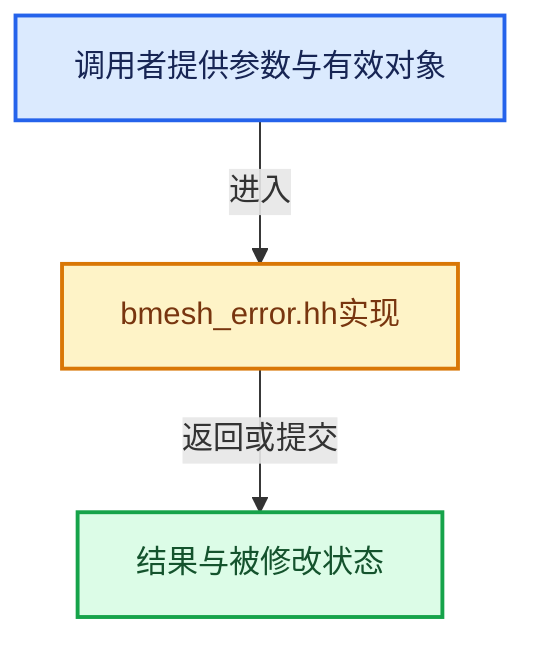

# 实现依赖专题：source/blender/bmesh/intern/bmesh_error.hh

[实现依赖导航](../../../README.md) · [符号索引](../../../../00-课程指南/02-源码与提交索引/符号依赖与实现索引.md)

本专题从正文实际调用进入，集中保存共享实现。函数有稳定锚点，可从调用处直接跳到对应完整函数；递归与互相调用通过回链组织。

## 本文件的实现关系





<a id="m-fee7b758515b"></a>

## 宏 `BM_ELEM_INDEX_VALIDATE`

<!-- annotated:3849f652f414c7 -->

```cpp
#define BM_ELEM_INDEX_VALIDATE(_bm, _msg_a, _msg_b) \
  BM_mesh_elem_index_validate(_bm, __FILE__ ":" STRINGIFY(__LINE__), __func__, _msg_a, _msg_b)

```

<details>
<summary>核对原始源码：source/blender/bmesh/intern/bmesh_error.hh · L72—L74</summary>

<!-- original:3849f652f414c7:source/blender/bmesh/intern/bmesh_error.hh:72:74 -->

```cpp
#define BM_ELEM_INDEX_VALIDATE(_bm, _msg_a, _msg_b) \
  BM_mesh_elem_index_validate(_bm, __FILE__ ":" STRINGIFY(__LINE__), __func__, _msg_a, _msg_b)

```

</details>

宏在预处理阶段展开，参数替换、重复求值和条件编译应直接从该定义检查。与普通函数不同，宏不会自动提供参数类型检查；构建配置选择哪个定义需结合外围条件。

<a id="m-00685b9e20fb"></a>

## 宏 `BMESH_ASSERT`

<!-- annotated:7c1cd8c7cf2b31 -->

```cpp
#define BMESH_ASSERT(a) \
  (void)((!(a)) ? ((fprintf(stderr, \
                            "BMESH_ASSERT failed: %s, %s(), %d at \'%s\'\n", \
                            __FILE__, \
                            __func__, \
                            __LINE__, \
                            STRINGIFY(a)), \
                    _BMESH_DUMMY_ABORT(), \
                    NULL)) : \
                  NULL)

```

<details>
<summary>核对原始源码：source/blender/bmesh/intern/bmesh_error.hh · L86—L96</summary>

<!-- original:7c1cd8c7cf2b31:source/blender/bmesh/intern/bmesh_error.hh:86:96 -->

```cpp
#define BMESH_ASSERT(a) \
  (void)((!(a)) ? ((fprintf(stderr, \
                            "BMESH_ASSERT failed: %s, %s(), %d at \'%s\'\n", \
                            __FILE__, \
                            __func__, \
                            __LINE__, \
                            STRINGIFY(a)), \
                    _BMESH_DUMMY_ABORT(), \
                    NULL)) : \
                  NULL)

```

</details>

宏在预处理阶段展开，参数替换、重复求值和条件编译应直接从该定义检查。与普通函数不同，宏不会自动提供参数类型检查；构建配置选择哪个定义需结合外围条件。

## 完整成员与函数实现
