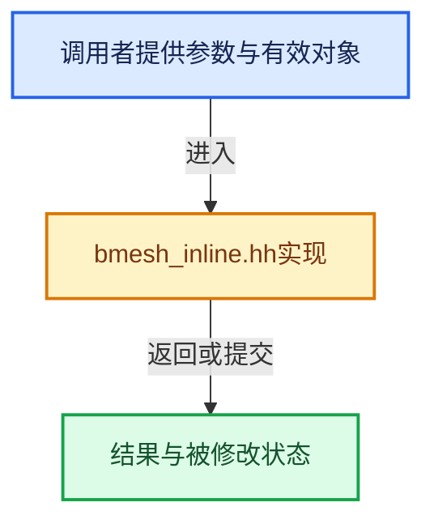

# 实现依赖专题：source/blender/bmesh/intern/bmesh_inline.hh

[实现依赖导航](../../../README.md) · [符号索引](../../../../00-课程指南/02-源码与提交索引/符号依赖与实现索引.md)

本专题从正文实际调用进入，集中保存共享实现。函数有稳定锚点，可从调用处直接跳到对应完整函数；递归与互相调用通过回链组织。

## 本文件的实现关系





<a id="m-2431d1179b41"></a>

## 宏 `BM_elem_flag_test`

<!-- annotated:a76944838a4037 -->

```cpp
#define BM_elem_flag_test(ele, hflag) _bm_elem_flag_test(&(ele)->head, hflag)
#define BM_elem_flag_test_bool(ele, hflag) _bm_elem_flag_test_bool(&(ele)->head, hflag)
```

<details>
<summary>核对原始源码：source/blender/bmesh/intern/bmesh_inline.hh · L21—L22</summary>

<!-- original:a76944838a4037:source/blender/bmesh/intern/bmesh_inline.hh:21:22 -->

```cpp
#define BM_elem_flag_test(ele, hflag) _bm_elem_flag_test(&(ele)->head, hflag)
#define BM_elem_flag_test_bool(ele, hflag) _bm_elem_flag_test_bool(&(ele)->head, hflag)
```

</details>

宏在预处理阶段展开，参数替换、重复求值和条件编译应直接从该定义检查。与普通函数不同，宏不会自动提供参数类型检查；构建配置选择哪个定义需结合外围条件。

<a id="m-a8ef8d976b74"></a>

## 宏 `BM_elem_flag_test_bool`

<!-- annotated:fcc495e61ee398 -->

```cpp
#define BM_elem_flag_test_bool(ele, hflag) _bm_elem_flag_test_bool(&(ele)->head, hflag)
#define BM_elem_flag_enable(ele, hflag) _bm_elem_flag_enable(&(ele)->head, hflag)
```

<details>
<summary>核对原始源码：source/blender/bmesh/intern/bmesh_inline.hh · L22—L23</summary>

<!-- original:fcc495e61ee398:source/blender/bmesh/intern/bmesh_inline.hh:22:23 -->

```cpp
#define BM_elem_flag_test_bool(ele, hflag) _bm_elem_flag_test_bool(&(ele)->head, hflag)
#define BM_elem_flag_enable(ele, hflag) _bm_elem_flag_enable(&(ele)->head, hflag)
```

</details>

宏在预处理阶段展开，参数替换、重复求值和条件编译应直接从该定义检查。与普通函数不同，宏不会自动提供参数类型检查；构建配置选择哪个定义需结合外围条件。

<a id="m-4400242f1540"></a>

## 宏 `BM_elem_flag_enable`

<!-- annotated:75463906545db4 -->

```cpp
#define BM_elem_flag_enable(ele, hflag) _bm_elem_flag_enable(&(ele)->head, hflag)
#define BM_elem_flag_disable(ele, hflag) _bm_elem_flag_disable(&(ele)->head, hflag)
```

<details>
<summary>核对原始源码：source/blender/bmesh/intern/bmesh_inline.hh · L23—L24</summary>

<!-- original:75463906545db4:source/blender/bmesh/intern/bmesh_inline.hh:23:24 -->

```cpp
#define BM_elem_flag_enable(ele, hflag) _bm_elem_flag_enable(&(ele)->head, hflag)
#define BM_elem_flag_disable(ele, hflag) _bm_elem_flag_disable(&(ele)->head, hflag)
```

</details>

宏在预处理阶段展开，参数替换、重复求值和条件编译应直接从该定义检查。与普通函数不同，宏不会自动提供参数类型检查；构建配置选择哪个定义需结合外围条件。

<a id="m-e129d62b6353"></a>

## 宏 `BM_elem_flag_disable`

<!-- annotated:49a1993f328fff -->

```cpp
#define BM_elem_flag_disable(ele, hflag) _bm_elem_flag_disable(&(ele)->head, hflag)
#define BM_elem_flag_set(ele, hflag, val) _bm_elem_flag_set(&(ele)->head, hflag, val)
```

<details>
<summary>核对原始源码：source/blender/bmesh/intern/bmesh_inline.hh · L24—L25</summary>

<!-- original:49a1993f328fff:source/blender/bmesh/intern/bmesh_inline.hh:24:25 -->

```cpp
#define BM_elem_flag_disable(ele, hflag) _bm_elem_flag_disable(&(ele)->head, hflag)
#define BM_elem_flag_set(ele, hflag, val) _bm_elem_flag_set(&(ele)->head, hflag, val)
```

</details>

宏在预处理阶段展开，参数替换、重复求值和条件编译应直接从该定义检查。与普通函数不同，宏不会自动提供参数类型检查；构建配置选择哪个定义需结合外围条件。

<a id="m-5023b35f9b0b"></a>

## 宏 `BM_elem_flag_set`

<!-- annotated:12400643f3fe03 -->

```cpp
#define BM_elem_flag_set(ele, hflag, val) _bm_elem_flag_set(&(ele)->head, hflag, val)
#define BM_elem_flag_toggle(ele, hflag) _bm_elem_flag_toggle(&(ele)->head, hflag)
```

<details>
<summary>核对原始源码：source/blender/bmesh/intern/bmesh_inline.hh · L25—L26</summary>

<!-- original:12400643f3fe03:source/blender/bmesh/intern/bmesh_inline.hh:25:26 -->

```cpp
#define BM_elem_flag_set(ele, hflag, val) _bm_elem_flag_set(&(ele)->head, hflag, val)
#define BM_elem_flag_toggle(ele, hflag) _bm_elem_flag_toggle(&(ele)->head, hflag)
```

</details>

宏在预处理阶段展开，参数替换、重复求值和条件编译应直接从该定义检查。与普通函数不同，宏不会自动提供参数类型检查；构建配置选择哪个定义需结合外围条件。

<a id="m-e3a18086cc5c"></a>

## 宏 `BM_elem_flag_merge_into`

<!-- annotated:def5eb5a7f7459 -->

```cpp
#define BM_elem_flag_merge_into(ele, ele_a, ele_b) \
  _bm_elem_flag_merge_into(&(ele)->head, &(ele_a)->head, &(ele_b)->head)

```

<details>
<summary>核对原始源码：source/blender/bmesh/intern/bmesh_inline.hh · L30—L32</summary>

<!-- original:def5eb5a7f7459:source/blender/bmesh/intern/bmesh_inline.hh:30:32 -->

```cpp
#define BM_elem_flag_merge_into(ele, ele_a, ele_b) \
  _bm_elem_flag_merge_into(&(ele)->head, &(ele_a)->head, &(ele_b)->head)

```

</details>

宏在预处理阶段展开，参数替换、重复求值和条件编译应直接从该定义检查。与普通函数不同，宏不会自动提供参数类型检查；构建配置选择哪个定义需结合外围条件。

<a id="m-201981cdc62d"></a>

## 宏 `BM_elem_index_get`

<!-- annotated:fc6844eeaae110 -->

```cpp
#define BM_elem_index_get(ele) _bm_elem_index_get(&(ele)->head)
#define BM_elem_index_set(ele, index) _bm_elem_index_set(&(ele)->head, index)
```

<details>
<summary>核对原始源码：source/blender/bmesh/intern/bmesh_inline.hh · L120—L121</summary>

<!-- original:fc6844eeaae110:source/blender/bmesh/intern/bmesh_inline.hh:120:121 -->

```cpp
#define BM_elem_index_get(ele) _bm_elem_index_get(&(ele)->head)
#define BM_elem_index_set(ele, index) _bm_elem_index_set(&(ele)->head, index)
```

</details>

宏在预处理阶段展开，参数替换、重复求值和条件编译应直接从该定义检查。与普通函数不同，宏不会自动提供参数类型检查；构建配置选择哪个定义需结合外围条件。

<a id="m-7bd559c53007"></a>

## 宏 `BM_elem_index_set`

<!-- annotated:909164565d3a83 -->

```cpp
#define BM_elem_index_set(ele, index) _bm_elem_index_set(&(ele)->head, index)

```

<details>
<summary>核对原始源码：source/blender/bmesh/intern/bmesh_inline.hh · L121—L122</summary>

<!-- original:909164565d3a83:source/blender/bmesh/intern/bmesh_inline.hh:121:122 -->

```cpp
#define BM_elem_index_set(ele, index) _bm_elem_index_set(&(ele)->head, index)

```

</details>

宏在预处理阶段展开，参数替换、重复求值和条件编译应直接从该定义检查。与普通函数不同，宏不会自动提供参数类型检查；构建配置选择哪个定义需结合外围条件。

## 完整成员与函数实现
