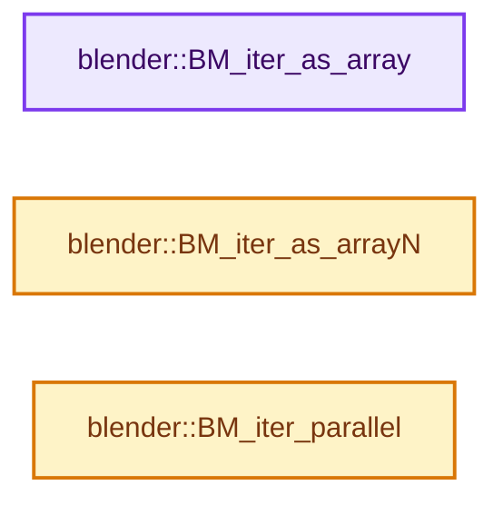

# 实现依赖专题：source/blender/bmesh/intern/bmesh_iterators.cc

[实现依赖导航](../../../README.md) · [符号索引](../../../../00-课程指南/02-源码与提交索引/符号依赖与实现索引.md)

本专题从正文实际调用进入，集中保存共享实现。函数有稳定锚点，可从调用处直接跳到对应完整函数；递归与互相调用通过回链组织。

## 本文件的实现关系




## 完整成员与函数实现

<a id="f-3380abfb8a533638"></a>

### `blender::BM_iter_as_array`

实现位置：[source/blender/bmesh/intern/bmesh_iterators.cc](../../../../../../../../source/blender/bmesh/intern/bmesh_iterators.cc) · L83—L102。

接口参数：

- `BMesh *bm`
- `const char itype`
- `void *data`
- `void **array`
- `const int len`

**教学注释版**

<!-- annotated:8c7fe5b5846ad7 -->

```cpp
int BM_iter_as_array(BMesh *bm, const char itype, void *data, void **array, const int len)
{
  int i = 0;

  /* sanity check */
  if (len > 0) {
    BMIter iter;
    void *ele;

    for (ele = BM_iter_new(&iter, bm, itype, data); ele; ele = BM_iter_step(&iter)) {
      array[i] = ele;
      i++;
      if (i == len) {
        return len;
      }
    }
  }

  return i;
}
```

<details>
<summary>核对原始源码：source/blender/bmesh/intern/bmesh_iterators.cc · L83—L102</summary>

<!-- original:8c7fe5b5846ad7:source/blender/bmesh/intern/bmesh_iterators.cc:83:102 -->

```cpp
int BM_iter_as_array(BMesh *bm, const char itype, void *data, void **array, const int len)
{
  int i = 0;

  /* sanity check */
  if (len > 0) {
    BMIter iter;
    void *ele;

    for (ele = BM_iter_new(&iter, bm, itype, data); ele; ele = BM_iter_step(&iter)) {
      array[i] = ele;
      i++;
      if (i == len) {
        return len;
      }
    }
  }

  return i;
}
```

</details>

**沿实际写入检查状态**

- `array[i] = ele;`

**结果出口**

- `return len;`
- `return i;`

**继续追踪实现**

- `BM_iter_new` → [blender::BM_iter_new · L157](bmesh_iterators_inline.hh.md#f-e280df82ed5024b1)。
- `BM_iter_step` → [blender::BM_iter_step · L26](bmesh_iterators_inline.hh.md#f-4f8eca41b20b0437)。

<a id="f-03d9ab4819723c90"></a>

### `blender::BM_iter_as_arrayN`

实现位置：[source/blender/bmesh/intern/bmesh_iterators.cc](../../../../../../../../source/blender/bmesh/intern/bmesh_iterators.cc) · L130—L174。

接口参数：

- `BMesh *bm`
- `const char itype`
- `void *data`
- `int *r_len`
- `void **stack_array`
- `int stack_array_size`

**教学注释版**

<!-- annotated:a958824e91aafc -->

```cpp
void *BM_iter_as_arrayN(BMesh *bm,
                        const char itype,
                        void *data,
                        int *r_len,
                        /* Optional args to avoid an allocation (normally stack array). */
                        void **stack_array,
                        int stack_array_size)
{
  BMIter iter;

  BLI_assert(stack_array_size == 0 || (stack_array_size && stack_array));

  /* We can't rely on #BMIter.count being set. */
  switch (itype) {
    case BM_VERTS_OF_MESH:
      iter.count = bm->totvert;
      break;
    case BM_EDGES_OF_MESH:
      iter.count = bm->totedge;
      break;
    case BM_FACES_OF_MESH:
      iter.count = bm->totface;
      break;
    default:
      break;
  }

  if (BM_iter_init(&iter, bm, itype, data) && iter.count > 0) {
    BMElem *ele;
    BMElem **array = iter.count > stack_array_size ?
                         MEM_new_array_uninitialized<BMElem *>(iter.count, __func__) :
                         reinterpret_cast<BMElem **>(stack_array);
    int i = 0;

    *r_len = iter.count; /* set before iterating */

    while ((ele = static_cast<BMElem *>(BM_iter_step(&iter)))) {
      array[i++] = ele;
    }
    return array;
  }

  *r_len = 0;
  return nullptr;
}
```

<details>
<summary>核对原始源码：source/blender/bmesh/intern/bmesh_iterators.cc · L130—L174</summary>

<!-- original:a958824e91aafc:source/blender/bmesh/intern/bmesh_iterators.cc:130:174 -->

```cpp
void *BM_iter_as_arrayN(BMesh *bm,
                        const char itype,
                        void *data,
                        int *r_len,
                        /* Optional args to avoid an allocation (normally stack array). */
                        void **stack_array,
                        int stack_array_size)
{
  BMIter iter;

  BLI_assert(stack_array_size == 0 || (stack_array_size && stack_array));

  /* We can't rely on #BMIter.count being set. */
  switch (itype) {
    case BM_VERTS_OF_MESH:
      iter.count = bm->totvert;
      break;
    case BM_EDGES_OF_MESH:
      iter.count = bm->totedge;
      break;
    case BM_FACES_OF_MESH:
      iter.count = bm->totface;
      break;
    default:
      break;
  }

  if (BM_iter_init(&iter, bm, itype, data) && iter.count > 0) {
    BMElem *ele;
    BMElem **array = iter.count > stack_array_size ?
                         MEM_new_array_uninitialized<BMElem *>(iter.count, __func__) :
                         reinterpret_cast<BMElem **>(stack_array);
    int i = 0;

    *r_len = iter.count; /* set before iterating */

    while ((ele = static_cast<BMElem *>(BM_iter_step(&iter)))) {
      array[i++] = ele;
    }
    return array;
  }

  *r_len = 0;
  return nullptr;
}
```

</details>

**沿实际写入检查状态**

- `iter.count = bm->totvert;`
- `iter.count = bm->totedge;`
- `iter.count = bm->totface;`

**结果出口**

- `return array;`
- `return nullptr;`

**继续追踪实现**

- `BLI_assert` → [BLI_assert · L48](../../../01-BLI基础库/BLI_assert.hh.md#m-57a88495704d)；[BLI_assert · L63](../../../01-BLI基础库/BLI_assert.hh.md#m-d07050020cb5)。宏定义由构建条件选择。
- `BM_iter_init` → [blender::BM_iter_init · L38](bmesh_iterators_inline.hh.md#f-6c010b12b164bf56)。
- `MEM_new_array_uninitialized<BMElem *>` → [MEM_new_array_uninitialized · L608](../../../07-Intern运行时与平台/guardedalloc/MEM_guardedalloc.h.md#f-b7103eae8eb57b05)；[MEM_new_array_uninitialized · L129](../../../07-Intern运行时与平台/guardedalloc/intern/mallocn.cc.md#f-bf6ef4ddcfb6e5df)。同名重载需按实参类型选择。
- `BM_iter_step` → [blender::BM_iter_step · L26](bmesh_iterators_inline.hh.md#f-4f8eca41b20b0437)。

<a id="f-41193fa0ee749051"></a>

### `blender::BM_iter_parallel`

实现位置：[source/blender/bmesh/intern/bmesh_iterators.cc](../../../../../../../../source/blender/bmesh/intern/bmesh_iterators.cc) · L662—L683。

接口参数：

- `BMesh *bm`
- `const char itype`
- `TaskParallelMempoolFunc func`
- `void *userdata`
- `const TaskParallelSettings *settings`

**教学注释版**

<!-- annotated:3c22cbe741723c -->

```cpp
void BM_iter_parallel(BMesh *bm,
                      const char itype,
                      TaskParallelMempoolFunc func,
                      void *userdata,
                      const TaskParallelSettings *settings)
{
  switch (BMIterType(itype)) {
    case BM_VERTS_OF_MESH:
      BLI_task_parallel_mempool(bm->vpool, userdata, func, settings);
      break;
    case BM_EDGES_OF_MESH:
      BLI_task_parallel_mempool(bm->epool, userdata, func, settings);
      break;
    case BM_FACES_OF_MESH:
      BLI_task_parallel_mempool(bm->fpool, userdata, func, settings);
      break;
    default:
      /* Should never happen. */
      BLI_assert_unreachable();
      break;
  }
}
```

<details>
<summary>核对原始源码：source/blender/bmesh/intern/bmesh_iterators.cc · L662—L683</summary>

<!-- original:3c22cbe741723c:source/blender/bmesh/intern/bmesh_iterators.cc:662:683 -->

```cpp
void BM_iter_parallel(BMesh *bm,
                      const char itype,
                      TaskParallelMempoolFunc func,
                      void *userdata,
                      const TaskParallelSettings *settings)
{
  switch (BMIterType(itype)) {
    case BM_VERTS_OF_MESH:
      BLI_task_parallel_mempool(bm->vpool, userdata, func, settings);
      break;
    case BM_EDGES_OF_MESH:
      BLI_task_parallel_mempool(bm->epool, userdata, func, settings);
      break;
    case BM_FACES_OF_MESH:
      BLI_task_parallel_mempool(bm->fpool, userdata, func, settings);
      break;
    default:
      /* Should never happen. */
      BLI_assert_unreachable();
      break;
  }
}
```

</details>

**继续追踪实现**

- `BMIterType` → [blender::BMIterType](bmesh_iterators.hh.md#t-5887f9d5a0b1)。
- `BLI_task_parallel_mempool` → [blender::BLI_task_parallel_mempool · L57](../../../01-BLI基础库/intern/task_iterator.cc.md#f-5cdf188dbaf24c71)。
- `BLI_assert_unreachable` → [BLI_assert_unreachable · L77](../../../01-BLI基础库/BLI_assert.hh.md#m-7a2d91a67d8e)。宏定义由构建条件选择。
