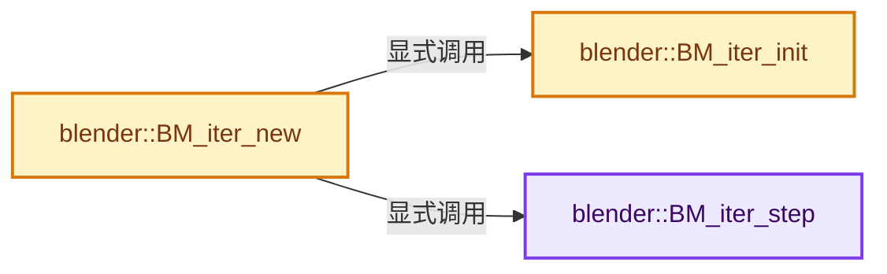
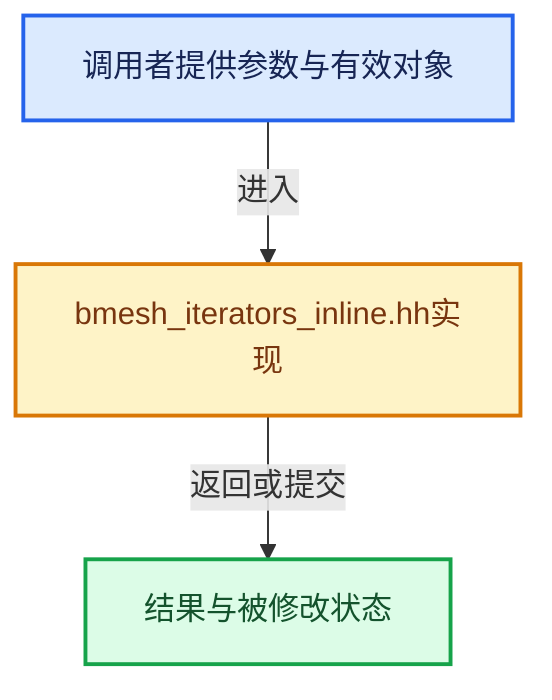

# 实现依赖专题：source/blender/bmesh/intern/bmesh_iterators_inline.hh

[实现依赖导航](../../../README.md) · [符号索引](../../../../00-课程指南/02-源码与提交索引/符号依赖与实现索引.md)

本专题从正文实际调用进入，集中保存共享实现。函数有稳定锚点，可从调用处直接跳到对应完整函数；递归与互相调用通过回链组织。

## 本文件的实现关系






## 完整成员与函数实现

<a id="f-4f8eca41b20b0437"></a>

### `blender::BM_iter_step`

实现位置：[source/blender/bmesh/intern/bmesh_iterators_inline.hh](../../../../../../../../source/blender/bmesh/intern/bmesh_iterators_inline.hh) · L26—L29。

接口参数：

- `BMIter *iter`

**教学注释版**

<!-- annotated:579ef6b219bd21 -->

```cpp
ATTR_WARN_UNUSED_RESULT ATTR_NONNULL(1) BLI_INLINE void *BM_iter_step(BMIter *iter)
{
  return iter->step(iter);
}
```

<details>
<summary>核对原始源码：source/blender/bmesh/intern/bmesh_iterators_inline.hh · L26—L29</summary>

<!-- original:579ef6b219bd21:source/blender/bmesh/intern/bmesh_iterators_inline.hh:26:29 -->

```cpp
ATTR_WARN_UNUSED_RESULT ATTR_NONNULL(1) BLI_INLINE void *BM_iter_step(BMIter *iter)
{
  return iter->step(iter);
}
```

</details>

**结果出口**

- `return iter->step(iter);`

**继续追踪实现**

- `iter->step` → [调用协议](../../../../00-课程指南/01-路线与规范/模板宏与动态分派协议.md)：由接收对象具体类型或运行时策略提供实现。调用位置L28。

<a id="f-6c010b12b164bf56"></a>

### `blender::BM_iter_init`

实现位置：[source/blender/bmesh/intern/bmesh_iterators_inline.hh](../../../../../../../../source/blender/bmesh/intern/bmesh_iterators_inline.hh) · L38—L146。

接口参数：

- `BMIter *iter`
- `BMesh *bm`
- `const char itype`
- `void *data`

**教学注释版**

<!-- annotated:0412c8d1302659 -->

```cpp
ATTR_NONNULL(1) BLI_INLINE bool BM_iter_init(BMIter *iter, BMesh *bm, const char itype, void *data)
{
  // int argtype;
  iter->itype = itype;

  /* inlining optimizes out this switch when called with the defined type */
  switch (BMIterType(itype)) {
    case BM_VERTS_OF_MESH:
      BLI_assert(bm != nullptr);
      BLI_assert(data == nullptr);
      iter->begin = reinterpret_cast<BMIter__begin_cb>(bmiter__elem_of_mesh_begin);
      iter->step = reinterpret_cast<BMIter__step_cb>(bmiter__elem_of_mesh_step);
      iter->data.elem_of_mesh.pooliter.pool = bm->vpool;
      break;
    case BM_EDGES_OF_MESH:
      BLI_assert(bm != nullptr);
      BLI_assert(data == nullptr);
      iter->begin = reinterpret_cast<BMIter__begin_cb>(bmiter__elem_of_mesh_begin);
      iter->step = reinterpret_cast<BMIter__step_cb>(bmiter__elem_of_mesh_step);
      iter->data.elem_of_mesh.pooliter.pool = bm->epool;
      break;
    case BM_FACES_OF_MESH:
      BLI_assert(bm != nullptr);
      BLI_assert(data == nullptr);
      iter->begin = reinterpret_cast<BMIter__begin_cb>(bmiter__elem_of_mesh_begin);
      iter->step = reinterpret_cast<BMIter__step_cb>(bmiter__elem_of_mesh_step);
      iter->data.elem_of_mesh.pooliter.pool = bm->fpool;
      break;
    case BM_EDGES_OF_VERT:
      BLI_assert(data != nullptr);
      BLI_assert(((BMElem *)data)->head.htype == BM_VERT);
      iter->begin = reinterpret_cast<BMIter__begin_cb>(bmiter__edge_of_vert_begin);
      iter->step = reinterpret_cast<BMIter__step_cb>(bmiter__edge_of_vert_step);
      iter->data.edge_of_vert.vdata = static_cast<BMVert *>(data);
      break;
    case BM_FACES_OF_VERT:
      BLI_assert(data != nullptr);
      BLI_assert(((BMElem *)data)->head.htype == BM_VERT);
      iter->begin = reinterpret_cast<BMIter__begin_cb>(bmiter__face_of_vert_begin);
      iter->step = reinterpret_cast<BMIter__step_cb>(bmiter__face_of_vert_step);
      iter->data.face_of_vert.vdata = static_cast<BMVert *>(data);
      break;
    case BM_LOOPS_OF_VERT:
      BLI_assert(data != nullptr);
      BLI_assert(((BMElem *)data)->head.htype == BM_VERT);
      iter->begin = reinterpret_cast<BMIter__begin_cb>(bmiter__loop_of_vert_begin);
      iter->step = reinterpret_cast<BMIter__step_cb>(bmiter__loop_of_vert_step);
      iter->data.loop_of_vert.vdata = static_cast<BMVert *>(data);
      break;
    case BM_VERTS_OF_EDGE:
      BLI_assert(data != nullptr);
      BLI_assert(((BMElem *)data)->head.htype == BM_EDGE);
      iter->begin = reinterpret_cast<BMIter__begin_cb>(bmiter__vert_of_edge_begin);
      iter->step = reinterpret_cast<BMIter__step_cb>(bmiter__vert_of_edge_step);
      iter->data.vert_of_edge.edata = static_cast<BMEdge *>(data);
      break;
    case BM_FACES_OF_EDGE:
      BLI_assert(data != nullptr);
      BLI_assert(((BMElem *)data)->head.htype == BM_EDGE);
      iter->begin = reinterpret_cast<BMIter__begin_cb>(bmiter__face_of_edge_begin);
      iter->step = reinterpret_cast<BMIter__step_cb>(bmiter__face_of_edge_step);
      iter->data.face_of_edge.edata = static_cast<BMEdge *>(data);
      break;
    case BM_VERTS_OF_FACE:
      BLI_assert(data != nullptr);
      BLI_assert(((BMElem *)data)->head.htype == BM_FACE);
      iter->begin = reinterpret_cast<BMIter__begin_cb>(bmiter__vert_of_face_begin);
      iter->step = reinterpret_cast<BMIter__step_cb>(bmiter__vert_of_face_step);
      iter->data.vert_of_face.pdata = static_cast<BMFace *>(data);
      break;
    case BM_EDGES_OF_FACE:
      BLI_assert(data != nullptr);
      BLI_assert(((BMElem *)data)->head.htype == BM_FACE);
      iter->begin = reinterpret_cast<BMIter__begin_cb>(bmiter__edge_of_face_begin);
      iter->step = reinterpret_cast<BMIter__step_cb>(bmiter__edge_of_face_step);
      iter->data.edge_of_face.pdata = static_cast<BMFace *>(data);
      break;
    case BM_LOOPS_OF_FACE:
      BLI_assert(data != nullptr);
      BLI_assert(((BMElem *)data)->head.htype == BM_FACE);
      iter->begin = reinterpret_cast<BMIter__begin_cb>(bmiter__loop_of_face_begin);
      iter->step = reinterpret_cast<BMIter__step_cb>(bmiter__loop_of_face_step);
      iter->data.loop_of_face.pdata = static_cast<BMFace *>(data);
      break;
    case BM_LOOPS_OF_LOOP:
      BLI_assert(data != nullptr);
      BLI_assert(((BMElem *)data)->head.htype == BM_LOOP);
      iter->begin = reinterpret_cast<BMIter__begin_cb>(bmiter__loop_of_loop_begin);
      iter->step = reinterpret_cast<BMIter__step_cb>(bmiter__loop_of_loop_step);
      iter->data.loop_of_loop.ldata = static_cast<BMLoop *>(data);
      break;
    case BM_LOOPS_OF_EDGE:
      BLI_assert(data != nullptr);
      BLI_assert(((BMElem *)data)->head.htype == BM_EDGE);
      iter->begin = reinterpret_cast<BMIter__begin_cb>(bmiter__loop_of_edge_begin);
      iter->step = reinterpret_cast<BMIter__step_cb>(bmiter__loop_of_edge_step);
      iter->data.loop_of_edge.edata = static_cast<BMEdge *>(data);
      break;
    default:
      /* should never happen */
      BLI_assert(0);
      return false;
      break;
  }

  iter->begin(iter);

  return true;
}
```

<details>
<summary>核对原始源码：source/blender/bmesh/intern/bmesh_iterators_inline.hh · L38—L146</summary>

<!-- original:0412c8d1302659:source/blender/bmesh/intern/bmesh_iterators_inline.hh:38:146 -->

```cpp
ATTR_NONNULL(1) BLI_INLINE bool BM_iter_init(BMIter *iter, BMesh *bm, const char itype, void *data)
{
  // int argtype;
  iter->itype = itype;

  /* inlining optimizes out this switch when called with the defined type */
  switch (BMIterType(itype)) {
    case BM_VERTS_OF_MESH:
      BLI_assert(bm != nullptr);
      BLI_assert(data == nullptr);
      iter->begin = reinterpret_cast<BMIter__begin_cb>(bmiter__elem_of_mesh_begin);
      iter->step = reinterpret_cast<BMIter__step_cb>(bmiter__elem_of_mesh_step);
      iter->data.elem_of_mesh.pooliter.pool = bm->vpool;
      break;
    case BM_EDGES_OF_MESH:
      BLI_assert(bm != nullptr);
      BLI_assert(data == nullptr);
      iter->begin = reinterpret_cast<BMIter__begin_cb>(bmiter__elem_of_mesh_begin);
      iter->step = reinterpret_cast<BMIter__step_cb>(bmiter__elem_of_mesh_step);
      iter->data.elem_of_mesh.pooliter.pool = bm->epool;
      break;
    case BM_FACES_OF_MESH:
      BLI_assert(bm != nullptr);
      BLI_assert(data == nullptr);
      iter->begin = reinterpret_cast<BMIter__begin_cb>(bmiter__elem_of_mesh_begin);
      iter->step = reinterpret_cast<BMIter__step_cb>(bmiter__elem_of_mesh_step);
      iter->data.elem_of_mesh.pooliter.pool = bm->fpool;
      break;
    case BM_EDGES_OF_VERT:
      BLI_assert(data != nullptr);
      BLI_assert(((BMElem *)data)->head.htype == BM_VERT);
      iter->begin = reinterpret_cast<BMIter__begin_cb>(bmiter__edge_of_vert_begin);
      iter->step = reinterpret_cast<BMIter__step_cb>(bmiter__edge_of_vert_step);
      iter->data.edge_of_vert.vdata = static_cast<BMVert *>(data);
      break;
    case BM_FACES_OF_VERT:
      BLI_assert(data != nullptr);
      BLI_assert(((BMElem *)data)->head.htype == BM_VERT);
      iter->begin = reinterpret_cast<BMIter__begin_cb>(bmiter__face_of_vert_begin);
      iter->step = reinterpret_cast<BMIter__step_cb>(bmiter__face_of_vert_step);
      iter->data.face_of_vert.vdata = static_cast<BMVert *>(data);
      break;
    case BM_LOOPS_OF_VERT:
      BLI_assert(data != nullptr);
      BLI_assert(((BMElem *)data)->head.htype == BM_VERT);
      iter->begin = reinterpret_cast<BMIter__begin_cb>(bmiter__loop_of_vert_begin);
      iter->step = reinterpret_cast<BMIter__step_cb>(bmiter__loop_of_vert_step);
      iter->data.loop_of_vert.vdata = static_cast<BMVert *>(data);
      break;
    case BM_VERTS_OF_EDGE:
      BLI_assert(data != nullptr);
      BLI_assert(((BMElem *)data)->head.htype == BM_EDGE);
      iter->begin = reinterpret_cast<BMIter__begin_cb>(bmiter__vert_of_edge_begin);
      iter->step = reinterpret_cast<BMIter__step_cb>(bmiter__vert_of_edge_step);
      iter->data.vert_of_edge.edata = static_cast<BMEdge *>(data);
      break;
    case BM_FACES_OF_EDGE:
      BLI_assert(data != nullptr);
      BLI_assert(((BMElem *)data)->head.htype == BM_EDGE);
      iter->begin = reinterpret_cast<BMIter__begin_cb>(bmiter__face_of_edge_begin);
      iter->step = reinterpret_cast<BMIter__step_cb>(bmiter__face_of_edge_step);
      iter->data.face_of_edge.edata = static_cast<BMEdge *>(data);
      break;
    case BM_VERTS_OF_FACE:
      BLI_assert(data != nullptr);
      BLI_assert(((BMElem *)data)->head.htype == BM_FACE);
      iter->begin = reinterpret_cast<BMIter__begin_cb>(bmiter__vert_of_face_begin);
      iter->step = reinterpret_cast<BMIter__step_cb>(bmiter__vert_of_face_step);
      iter->data.vert_of_face.pdata = static_cast<BMFace *>(data);
      break;
    case BM_EDGES_OF_FACE:
      BLI_assert(data != nullptr);
      BLI_assert(((BMElem *)data)->head.htype == BM_FACE);
      iter->begin = reinterpret_cast<BMIter__begin_cb>(bmiter__edge_of_face_begin);
      iter->step = reinterpret_cast<BMIter__step_cb>(bmiter__edge_of_face_step);
      iter->data.edge_of_face.pdata = static_cast<BMFace *>(data);
      break;
    case BM_LOOPS_OF_FACE:
      BLI_assert(data != nullptr);
      BLI_assert(((BMElem *)data)->head.htype == BM_FACE);
      iter->begin = reinterpret_cast<BMIter__begin_cb>(bmiter__loop_of_face_begin);
      iter->step = reinterpret_cast<BMIter__step_cb>(bmiter__loop_of_face_step);
      iter->data.loop_of_face.pdata = static_cast<BMFace *>(data);
      break;
    case BM_LOOPS_OF_LOOP:
      BLI_assert(data != nullptr);
      BLI_assert(((BMElem *)data)->head.htype == BM_LOOP);
      iter->begin = reinterpret_cast<BMIter__begin_cb>(bmiter__loop_of_loop_begin);
      iter->step = reinterpret_cast<BMIter__step_cb>(bmiter__loop_of_loop_step);
      iter->data.loop_of_loop.ldata = static_cast<BMLoop *>(data);
      break;
    case BM_LOOPS_OF_EDGE:
      BLI_assert(data != nullptr);
      BLI_assert(((BMElem *)data)->head.htype == BM_EDGE);
      iter->begin = reinterpret_cast<BMIter__begin_cb>(bmiter__loop_of_edge_begin);
      iter->step = reinterpret_cast<BMIter__step_cb>(bmiter__loop_of_edge_step);
      iter->data.loop_of_edge.edata = static_cast<BMEdge *>(data);
      break;
    default:
      /* should never happen */
      BLI_assert(0);
      return false;
      break;
  }

  iter->begin(iter);

  return true;
}
```

</details>

**沿实际写入检查状态**

- `iter->itype = itype;`
- `iter->begin = reinterpret_cast<BMIter__begin_cb>(bmiter__elem_of_mesh_begin);`
- `iter->step = reinterpret_cast<BMIter__step_cb>(bmiter__elem_of_mesh_step);`
- `iter->data.elem_of_mesh.pooliter.pool = bm->vpool;`
- `iter->data.elem_of_mesh.pooliter.pool = bm->epool;`
- `iter->data.elem_of_mesh.pooliter.pool = bm->fpool;`
- `iter->begin = reinterpret_cast<BMIter__begin_cb>(bmiter__edge_of_vert_begin);`
- `iter->step = reinterpret_cast<BMIter__step_cb>(bmiter__edge_of_vert_step);`
- `iter->data.edge_of_vert.vdata = static_cast<BMVert *>(data);`
- `iter->begin = reinterpret_cast<BMIter__begin_cb>(bmiter__face_of_vert_begin);`
- `iter->step = reinterpret_cast<BMIter__step_cb>(bmiter__face_of_vert_step);`
- `iter->data.face_of_vert.vdata = static_cast<BMVert *>(data);`
- `iter->begin = reinterpret_cast<BMIter__begin_cb>(bmiter__loop_of_vert_begin);`
- `iter->step = reinterpret_cast<BMIter__step_cb>(bmiter__loop_of_vert_step);`
- `iter->data.loop_of_vert.vdata = static_cast<BMVert *>(data);`
- `iter->begin = reinterpret_cast<BMIter__begin_cb>(bmiter__vert_of_edge_begin);`
- `iter->step = reinterpret_cast<BMIter__step_cb>(bmiter__vert_of_edge_step);`
- `iter->data.vert_of_edge.edata = static_cast<BMEdge *>(data);`
- `iter->begin = reinterpret_cast<BMIter__begin_cb>(bmiter__face_of_edge_begin);`
- `iter->step = reinterpret_cast<BMIter__step_cb>(bmiter__face_of_edge_step);`
- `iter->data.face_of_edge.edata = static_cast<BMEdge *>(data);`
- `iter->begin = reinterpret_cast<BMIter__begin_cb>(bmiter__vert_of_face_begin);`
- `iter->step = reinterpret_cast<BMIter__step_cb>(bmiter__vert_of_face_step);`
- `iter->data.vert_of_face.pdata = static_cast<BMFace *>(data);`
- `iter->begin = reinterpret_cast<BMIter__begin_cb>(bmiter__edge_of_face_begin);`
- `iter->step = reinterpret_cast<BMIter__step_cb>(bmiter__edge_of_face_step);`
- `iter->data.edge_of_face.pdata = static_cast<BMFace *>(data);`
- `iter->begin = reinterpret_cast<BMIter__begin_cb>(bmiter__loop_of_face_begin);`
- `iter->step = reinterpret_cast<BMIter__step_cb>(bmiter__loop_of_face_step);`
- `iter->data.loop_of_face.pdata = static_cast<BMFace *>(data);`
- `iter->begin = reinterpret_cast<BMIter__begin_cb>(bmiter__loop_of_loop_begin);`
- `iter->step = reinterpret_cast<BMIter__step_cb>(bmiter__loop_of_loop_step);`
- `iter->data.loop_of_loop.ldata = static_cast<BMLoop *>(data);`
- `iter->begin = reinterpret_cast<BMIter__begin_cb>(bmiter__loop_of_edge_begin);`
- `iter->step = reinterpret_cast<BMIter__step_cb>(bmiter__loop_of_edge_step);`
- `iter->data.loop_of_edge.edata = static_cast<BMEdge *>(data);`

**结果出口**

- `return false;`
- `return true;`

**继续追踪实现**

- `BMIterType` → [blender::BMIterType](bmesh_iterators.hh.md#t-5887f9d5a0b1)。
- `BLI_assert` → [BLI_assert · L48](../../../01-BLI基础库/BLI_assert.hh.md#m-57a88495704d)；[BLI_assert · L63](../../../01-BLI基础库/BLI_assert.hh.md#m-d07050020cb5)。宏定义由构建条件选择。
- `iter->begin` → [blender::StringRefBase::begin · L233](../../../../01-基础容器与现代CPP/15-StringRef字符串视图.md#f-0fa50fe40314532d)。

<a id="f-e280df82ed5024b1"></a>

### `blender::BM_iter_new`

实现位置：[source/blender/bmesh/intern/bmesh_iterators_inline.hh](../../../../../../../../source/blender/bmesh/intern/bmesh_iterators_inline.hh) · L157—L165。

接口参数：

- `BMIter *iter`
- `BMesh *bm`
- `const char itype`
- `void *data`

**教学注释版**

<!-- annotated:b269bd12ea4cc7 -->

```cpp
    void *BM_iter_new(BMIter *iter, BMesh *bm, const char itype, void *data)
{
  if (BM_iter_init(iter, bm, itype, data)) [[likely]] {
    return BM_iter_step(iter);
  }
  else {
    return nullptr;
  }
}
```

<details>
<summary>核对原始源码：source/blender/bmesh/intern/bmesh_iterators_inline.hh · L157—L165</summary>

<!-- original:b269bd12ea4cc7:source/blender/bmesh/intern/bmesh_iterators_inline.hh:157:165 -->

```cpp
    void *BM_iter_new(BMIter *iter, BMesh *bm, const char itype, void *data)
{
  if (BM_iter_init(iter, bm, itype, data)) [[likely]] {
    return BM_iter_step(iter);
  }
  else {
    return nullptr;
  }
}
```

</details>

**结果出口**

- `return BM_iter_step(iter);`
- `return nullptr;`

**继续追踪实现**

- `BM_iter_init` → [blender::BM_iter_init · L38](bmesh_iterators_inline.hh.md#f-6c010b12b164bf56)。
- `BM_iter_step` → [blender::BM_iter_step · L26](bmesh_iterators_inline.hh.md#f-4f8eca41b20b0437)。
