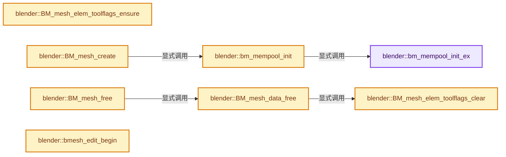
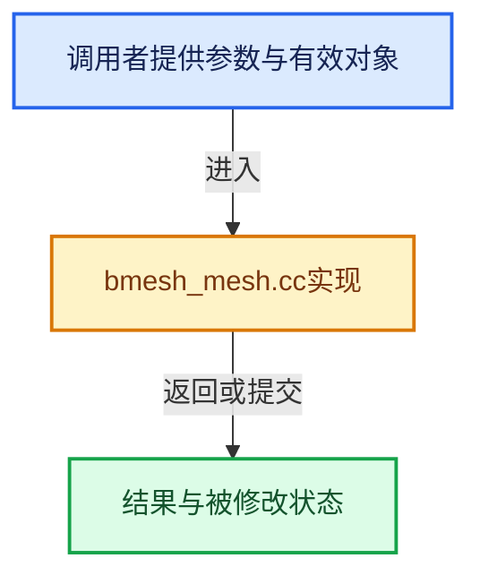

# 实现依赖专题：source/blender/bmesh/intern/bmesh_mesh.cc

[实现依赖导航](../../../README.md) · [符号索引](../../../../00-课程指南/02-源码与提交索引/符号依赖与实现索引.md)

本专题从正文实际调用进入，集中保存共享实现。函数有稳定锚点，可从调用处直接跳到对应完整函数；递归与互相调用通过回链组织。

## 本文件的实现关系






## 完整成员与函数实现

<a id="f-4987c4b1d160ee7d"></a>

### `blender::bm_mempool_init_ex`

实现位置：[source/blender/bmesh/intern/bmesh_mesh.cc](../../../../../../../../source/blender/bmesh/intern/bmesh_mesh.cc) · L29—L67。

接口参数：

- `const BMAllocTemplate *allocsize`
- `const bool use_toolflags`
- `BLI_mempool **r_vpool`
- `BLI_mempool **r_epool`
- `BLI_mempool **r_lpool`
- `BLI_mempool **r_fpool`

**教学注释版**

<!-- annotated:cc2f1d2fcfd22f -->

```cpp
static void bm_mempool_init_ex(const BMAllocTemplate *allocsize,
                               const bool use_toolflags,
                               BLI_mempool **r_vpool,
                               BLI_mempool **r_epool,
                               BLI_mempool **r_lpool,
                               BLI_mempool **r_fpool)
{
  size_t vert_size, edge_size, loop_size, face_size;

  if (use_toolflags == true) {
    vert_size = sizeof(BMVert_OFlag);
    edge_size = sizeof(BMEdge_OFlag);
    loop_size = sizeof(BMLoop);
    face_size = sizeof(BMFace_OFlag);
  }
  else {
    vert_size = sizeof(BMVert);
    edge_size = sizeof(BMEdge);
    loop_size = sizeof(BMLoop);
    face_size = sizeof(BMFace);
  }

  if (r_vpool) {
    *r_vpool = BLI_mempool_create(
        vert_size, allocsize->totvert, bm_mesh_chunksize_default.totvert, BLI_MEMPOOL_ALLOW_ITER);
  }
  if (r_epool) {
    *r_epool = BLI_mempool_create(
        edge_size, allocsize->totedge, bm_mesh_chunksize_default.totedge, BLI_MEMPOOL_ALLOW_ITER);
  }
  if (r_lpool) {
    *r_lpool = BLI_mempool_create(
        loop_size, allocsize->totloop, bm_mesh_chunksize_default.totloop, BLI_MEMPOOL_NOP);
  }
  if (r_fpool) {
    *r_fpool = BLI_mempool_create(
        face_size, allocsize->totface, bm_mesh_chunksize_default.totface, BLI_MEMPOOL_ALLOW_ITER);
  }
}
```

<details>
<summary>核对原始源码：source/blender/bmesh/intern/bmesh_mesh.cc · L29—L67</summary>

<!-- original:cc2f1d2fcfd22f:source/blender/bmesh/intern/bmesh_mesh.cc:29:67 -->

```cpp
static void bm_mempool_init_ex(const BMAllocTemplate *allocsize,
                               const bool use_toolflags,
                               BLI_mempool **r_vpool,
                               BLI_mempool **r_epool,
                               BLI_mempool **r_lpool,
                               BLI_mempool **r_fpool)
{
  size_t vert_size, edge_size, loop_size, face_size;

  if (use_toolflags == true) {
    vert_size = sizeof(BMVert_OFlag);
    edge_size = sizeof(BMEdge_OFlag);
    loop_size = sizeof(BMLoop);
    face_size = sizeof(BMFace_OFlag);
  }
  else {
    vert_size = sizeof(BMVert);
    edge_size = sizeof(BMEdge);
    loop_size = sizeof(BMLoop);
    face_size = sizeof(BMFace);
  }

  if (r_vpool) {
    *r_vpool = BLI_mempool_create(
        vert_size, allocsize->totvert, bm_mesh_chunksize_default.totvert, BLI_MEMPOOL_ALLOW_ITER);
  }
  if (r_epool) {
    *r_epool = BLI_mempool_create(
        edge_size, allocsize->totedge, bm_mesh_chunksize_default.totedge, BLI_MEMPOOL_ALLOW_ITER);
  }
  if (r_lpool) {
    *r_lpool = BLI_mempool_create(
        loop_size, allocsize->totloop, bm_mesh_chunksize_default.totloop, BLI_MEMPOOL_NOP);
  }
  if (r_fpool) {
    *r_fpool = BLI_mempool_create(
        face_size, allocsize->totface, bm_mesh_chunksize_default.totface, BLI_MEMPOOL_ALLOW_ITER);
  }
}
```

</details>

**沿实际写入检查状态**

- `vert_size = sizeof(BMVert_OFlag);`
- `edge_size = sizeof(BMEdge_OFlag);`
- `loop_size = sizeof(BMLoop);`
- `face_size = sizeof(BMFace_OFlag);`
- `vert_size = sizeof(BMVert);`
- `edge_size = sizeof(BMEdge);`
- `face_size = sizeof(BMFace);`

**继续追踪实现**

- `BLI_mempool_create` → [blender::BLI_mempool_create · L320](../../../01-BLI基础库/intern/BLI_mempool.cc.md#f-90a2c14d1b30f9cf)。

<a id="f-1c1103a21ec52c2f"></a>

### `blender::bm_mempool_init`

实现位置：[source/blender/bmesh/intern/bmesh_mesh.cc](../../../../../../../../source/blender/bmesh/intern/bmesh_mesh.cc) · L69—L76。

接口参数：

- `BMesh *bm`
- `const BMAllocTemplate *allocsize`
- `const bool use_toolflags`

**教学注释版**

<!-- annotated:66e009c4255328 -->

```cpp
static void bm_mempool_init(BMesh *bm, const BMAllocTemplate *allocsize, const bool use_toolflags)
{
  bm_mempool_init_ex(allocsize, use_toolflags, &bm->vpool, &bm->epool, &bm->lpool, &bm->fpool);

#ifdef USE_BMESH_HOLES
  bm->looplistpool = BLI_mempool_create(sizeof(BMLoopList), 512, 512, BLI_MEMPOOL_NOP);
#endif
}
```

<details>
<summary>核对原始源码：source/blender/bmesh/intern/bmesh_mesh.cc · L69—L76</summary>

<!-- original:66e009c4255328:source/blender/bmesh/intern/bmesh_mesh.cc:69:76 -->

```cpp
static void bm_mempool_init(BMesh *bm, const BMAllocTemplate *allocsize, const bool use_toolflags)
{
  bm_mempool_init_ex(allocsize, use_toolflags, &bm->vpool, &bm->epool, &bm->lpool, &bm->fpool);

#ifdef USE_BMESH_HOLES
  bm->looplistpool = BLI_mempool_create(sizeof(BMLoopList), 512, 512, BLI_MEMPOOL_NOP);
#endif
}
```

</details>

**沿实际写入检查状态**

- `bm->looplistpool = BLI_mempool_create(sizeof(BMLoopList), 512, 512, BLI_MEMPOOL_NOP);`

**继续追踪实现**

- `bm_mempool_init_ex` → [blender::bm_mempool_init_ex · L29](bmesh_mesh.cc.md#f-4987c4b1d160ee7d)。
- `BLI_mempool_create` → [blender::BLI_mempool_create · L320](../../../01-BLI基础库/intern/BLI_mempool.cc.md#f-90a2c14d1b30f9cf)。

<a id="f-fa1651f520d88161"></a>

### `blender::BM_mesh_elem_toolflags_ensure`

实现位置：[source/blender/bmesh/intern/bmesh_mesh.cc](../../../../../../../../source/blender/bmesh/intern/bmesh_mesh.cc) · L78—L110。

接口参数：

- `BMesh *bm`

**教学注释版**

<!-- annotated:6df5c163687248 -->

```cpp
void BM_mesh_elem_toolflags_ensure(BMesh *bm)
{
  BLI_assert(bm->use_toolflags);

  if (bm->vtoolflagpool && bm->etoolflagpool && bm->ftoolflagpool) {
    return;
  }

  bm->vtoolflagpool = BLI_mempool_create(sizeof(BMFlagLayer), bm->totvert, 512, BLI_MEMPOOL_NOP);
  bm->etoolflagpool = BLI_mempool_create(sizeof(BMFlagLayer), bm->totedge, 512, BLI_MEMPOOL_NOP);
  bm->ftoolflagpool = BLI_mempool_create(sizeof(BMFlagLayer), bm->totface, 512, BLI_MEMPOOL_NOP);

  BMIter iter;
  BMVert_OFlag *v_olfag;
  BLI_mempool *toolflagpool = bm->vtoolflagpool;
  BM_ITER_MESH (v_olfag, &iter, bm, BM_VERTS_OF_MESH) {
    v_olfag->oflags = static_cast<BMFlagLayer *>(BLI_mempool_calloc(toolflagpool));
  }

  BMEdge_OFlag *e_olfag;
  toolflagpool = bm->etoolflagpool;
  BM_ITER_MESH (e_olfag, &iter, bm, BM_EDGES_OF_MESH) {
    e_olfag->oflags = static_cast<BMFlagLayer *>(BLI_mempool_calloc(toolflagpool));
  }

  BMFace_OFlag *f_olfag;
  toolflagpool = bm->ftoolflagpool;
  BM_ITER_MESH (f_olfag, &iter, bm, BM_FACES_OF_MESH) {
    f_olfag->oflags = static_cast<BMFlagLayer *>(BLI_mempool_calloc(toolflagpool));
  }

  bm->totflags = 1;
}
```

<details>
<summary>核对原始源码：source/blender/bmesh/intern/bmesh_mesh.cc · L78—L110</summary>

<!-- original:6df5c163687248:source/blender/bmesh/intern/bmesh_mesh.cc:78:110 -->

```cpp
void BM_mesh_elem_toolflags_ensure(BMesh *bm)
{
  BLI_assert(bm->use_toolflags);

  if (bm->vtoolflagpool && bm->etoolflagpool && bm->ftoolflagpool) {
    return;
  }

  bm->vtoolflagpool = BLI_mempool_create(sizeof(BMFlagLayer), bm->totvert, 512, BLI_MEMPOOL_NOP);
  bm->etoolflagpool = BLI_mempool_create(sizeof(BMFlagLayer), bm->totedge, 512, BLI_MEMPOOL_NOP);
  bm->ftoolflagpool = BLI_mempool_create(sizeof(BMFlagLayer), bm->totface, 512, BLI_MEMPOOL_NOP);

  BMIter iter;
  BMVert_OFlag *v_olfag;
  BLI_mempool *toolflagpool = bm->vtoolflagpool;
  BM_ITER_MESH (v_olfag, &iter, bm, BM_VERTS_OF_MESH) {
    v_olfag->oflags = static_cast<BMFlagLayer *>(BLI_mempool_calloc(toolflagpool));
  }

  BMEdge_OFlag *e_olfag;
  toolflagpool = bm->etoolflagpool;
  BM_ITER_MESH (e_olfag, &iter, bm, BM_EDGES_OF_MESH) {
    e_olfag->oflags = static_cast<BMFlagLayer *>(BLI_mempool_calloc(toolflagpool));
  }

  BMFace_OFlag *f_olfag;
  toolflagpool = bm->ftoolflagpool;
  BM_ITER_MESH (f_olfag, &iter, bm, BM_FACES_OF_MESH) {
    f_olfag->oflags = static_cast<BMFlagLayer *>(BLI_mempool_calloc(toolflagpool));
  }

  bm->totflags = 1;
}
```

</details>

**沿实际写入检查状态**

- `bm->vtoolflagpool = BLI_mempool_create(sizeof(BMFlagLayer), bm->totvert, 512, BLI_MEMPOOL_NOP);`
- `bm->etoolflagpool = BLI_mempool_create(sizeof(BMFlagLayer), bm->totedge, 512, BLI_MEMPOOL_NOP);`
- `bm->ftoolflagpool = BLI_mempool_create(sizeof(BMFlagLayer), bm->totface, 512, BLI_MEMPOOL_NOP);`
- `v_olfag->oflags = static_cast<BMFlagLayer *>(BLI_mempool_calloc(toolflagpool));`
- `toolflagpool = bm->etoolflagpool;`
- `e_olfag->oflags = static_cast<BMFlagLayer *>(BLI_mempool_calloc(toolflagpool));`
- `toolflagpool = bm->ftoolflagpool;`
- `f_olfag->oflags = static_cast<BMFlagLayer *>(BLI_mempool_calloc(toolflagpool));`
- `bm->totflags = 1;`

**继续追踪实现**

- `BLI_assert` → [BLI_assert · L48](../../../01-BLI基础库/BLI_assert.hh.md#m-57a88495704d)；[BLI_assert · L63](../../../01-BLI基础库/BLI_assert.hh.md#m-d07050020cb5)。宏定义由构建条件选择。
- `BLI_mempool_create` → [blender::BLI_mempool_create · L320](../../../01-BLI基础库/intern/BLI_mempool.cc.md#f-90a2c14d1b30f9cf)。
- `BM_ITER_MESH` → [BM_ITER_MESH · L72](bmesh_iterators.hh.md#m-cfc837c73218)。宏定义由构建条件选择。
- `BLI_mempool_calloc` → [blender::BLI_mempool_calloc · L428](../../../01-BLI基础库/intern/BLI_mempool.cc.md#f-d69998b8a4465dc5)；[blender::BLI_mempool_calloc · L41](../../../01-BLI基础库/BLI_mempool.hh.md#f-202f5a34c11990d3)。同名重载需按实参类型选择。

<a id="f-3faa73a13c8fd54a"></a>

### `blender::BM_mesh_elem_toolflags_clear`

实现位置：[source/blender/bmesh/intern/bmesh_mesh.cc](../../../../../../../../source/blender/bmesh/intern/bmesh_mesh.cc) · L112—L126。

接口参数：

- `BMesh *bm`

**教学注释版**

<!-- annotated:9583793496bd9b -->

```cpp
void BM_mesh_elem_toolflags_clear(BMesh *bm)
{
  if (bm->vtoolflagpool) {
    BLI_mempool_destroy(bm->vtoolflagpool);
    bm->vtoolflagpool = nullptr;
  }
  if (bm->etoolflagpool) {
    BLI_mempool_destroy(bm->etoolflagpool);
    bm->etoolflagpool = nullptr;
  }
  if (bm->ftoolflagpool) {
    BLI_mempool_destroy(bm->ftoolflagpool);
    bm->ftoolflagpool = nullptr;
  }
}
```

<details>
<summary>核对原始源码：source/blender/bmesh/intern/bmesh_mesh.cc · L112—L126</summary>

<!-- original:9583793496bd9b:source/blender/bmesh/intern/bmesh_mesh.cc:112:126 -->

```cpp
void BM_mesh_elem_toolflags_clear(BMesh *bm)
{
  if (bm->vtoolflagpool) {
    BLI_mempool_destroy(bm->vtoolflagpool);
    bm->vtoolflagpool = nullptr;
  }
  if (bm->etoolflagpool) {
    BLI_mempool_destroy(bm->etoolflagpool);
    bm->etoolflagpool = nullptr;
  }
  if (bm->ftoolflagpool) {
    BLI_mempool_destroy(bm->ftoolflagpool);
    bm->ftoolflagpool = nullptr;
  }
}
```

</details>

**沿实际写入检查状态**

- `bm->vtoolflagpool = nullptr;`
- `bm->etoolflagpool = nullptr;`
- `bm->ftoolflagpool = nullptr;`

**继续追踪实现**

- `BLI_mempool_destroy` → [blender::BLI_mempool_destroy · L844](../../../01-BLI基础库/intern/BLI_mempool.cc.md#f-6f09741326791f2d)。

<a id="f-af852087bbdba512"></a>

### `blender::BM_mesh_create`

实现位置：[source/blender/bmesh/intern/bmesh_mesh.cc](../../../../../../../../source/blender/bmesh/intern/bmesh_mesh.cc) · L128—L147。

接口参数：

- `const BMAllocTemplate *allocsize`
- `const BMeshCreateParams *params`

**教学注释版**

<!-- annotated:585b0635c49871 -->

```cpp
BMesh *BM_mesh_create(const BMAllocTemplate *allocsize, const BMeshCreateParams *params)
{
  /* allocate the structure */
  BMesh *bm = MEM_new<BMesh>(__func__);

  /* allocate the memory pools for the mesh elements */
  bm_mempool_init(bm, allocsize, params->use_toolflags);

  /* allocate one flag pool that we don't get rid of. */
  bm->use_toolflags = params->use_toolflags;
  bm->toolflag_index = 0;
  bm->totflags = 0;

  CustomData_reset(&bm->vdata);
  CustomData_reset(&bm->edata);
  CustomData_reset(&bm->ldata);
  CustomData_reset(&bm->pdata);

  return bm;
}
```

<details>
<summary>核对原始源码：source/blender/bmesh/intern/bmesh_mesh.cc · L128—L147</summary>

<!-- original:585b0635c49871:source/blender/bmesh/intern/bmesh_mesh.cc:128:147 -->

```cpp
BMesh *BM_mesh_create(const BMAllocTemplate *allocsize, const BMeshCreateParams *params)
{
  /* allocate the structure */
  BMesh *bm = MEM_new<BMesh>(__func__);

  /* allocate the memory pools for the mesh elements */
  bm_mempool_init(bm, allocsize, params->use_toolflags);

  /* allocate one flag pool that we don't get rid of. */
  bm->use_toolflags = params->use_toolflags;
  bm->toolflag_index = 0;
  bm->totflags = 0;

  CustomData_reset(&bm->vdata);
  CustomData_reset(&bm->edata);
  CustomData_reset(&bm->ldata);
  CustomData_reset(&bm->pdata);

  return bm;
}
```

</details>

**沿实际写入检查状态**

- `bm->use_toolflags = params->use_toolflags;`
- `bm->toolflag_index = 0;`
- `bm->totflags = 0;`

**结果出口**

- `return bm;`

**继续追踪实现**

- `MEM_new<BMesh>` → [MEM_new · L351](../../../07-Intern运行时与平台/guardedalloc/MEM_guardedalloc.h.md#f-115f9b6784f89912)。
- `bm_mempool_init` → [blender::bm_mempool_init · L69](bmesh_mesh.cc.md#f-1c1103a21ec52c2f)。
- `CustomData_reset` → [blender::CustomData_reset · L2495](../../../02-BKE几何与数据/intern/customdata.cc.md#f-b5d2fd143bcd64b1)。

<a id="f-168a5274f81f5e59"></a>

### `blender::BM_mesh_data_free`

实现位置：[source/blender/bmesh/intern/bmesh_mesh.cc](../../../../../../../../source/blender/bmesh/intern/bmesh_mesh.cc) · L149—L238。

接口参数：

- `BMesh *bm`

**教学注释版**

<!-- annotated:0f1b962e5d2a6f -->

```cpp
void BM_mesh_data_free(BMesh *bm)
{
  BMVert *v;
  BMEdge *e;
  BMLoop *l;
  BMFace *f;

  BMIter iter;
  BMIter itersub;

  const bool is_ldata_free = CustomData_bmesh_has_free(&bm->ldata);
  const bool is_pdata_free = CustomData_bmesh_has_free(&bm->pdata);

  /* Check if we have to call free, if not we can avoid a lot of looping */
  if (CustomData_bmesh_has_free(&(bm->vdata))) {
    BM_ITER_MESH (v, &iter, bm, BM_VERTS_OF_MESH) {
      CustomData_bmesh_free_block(&(bm->vdata), &(v->head.data));
    }
  }
  if (CustomData_bmesh_has_free(&(bm->edata))) {
    BM_ITER_MESH (e, &iter, bm, BM_EDGES_OF_MESH) {
      CustomData_bmesh_free_block(&(bm->edata), &(e->head.data));
    }
  }

  if (is_ldata_free || is_pdata_free) {
    BM_ITER_MESH (f, &iter, bm, BM_FACES_OF_MESH) {
      if (is_pdata_free) {
        CustomData_bmesh_free_block(&(bm->pdata), &(f->head.data));
      }
      if (is_ldata_free) {
        BM_ITER_ELEM (l, &itersub, f, BM_LOOPS_OF_FACE) {
          CustomData_bmesh_free_block(&(bm->ldata), &(l->head.data));
        }
      }
    }
  }

  /* Free custom data pools, This should probably go in CustomData_free? */
  if (bm->vdata.totlayer) {
    BLI_mempool_destroy(bm->vdata.pool);
  }
  if (bm->edata.totlayer) {
    BLI_mempool_destroy(bm->edata.pool);
  }
  if (bm->ldata.totlayer) {
    BLI_mempool_destroy(bm->ldata.pool);
  }
  if (bm->pdata.totlayer) {
    BLI_mempool_destroy(bm->pdata.pool);
  }

  /* free custom data */
  CustomData_free(&bm->vdata);
  CustomData_free(&bm->edata);
  CustomData_free(&bm->ldata);
  CustomData_free(&bm->pdata);

  /* destroy element pools */
  BLI_mempool_destroy(bm->vpool);
  BLI_mempool_destroy(bm->epool);
  BLI_mempool_destroy(bm->lpool);
  BLI_mempool_destroy(bm->fpool);

  if (bm->vtable) {
    MEM_delete(bm->vtable);
  }
  if (bm->etable) {
    MEM_delete(bm->etable);
  }
  if (bm->ftable) {
    MEM_delete(bm->ftable);
  }

  /* destroy flag pool */
  BM_mesh_elem_toolflags_clear(bm);

#ifdef USE_BMESH_HOLES
  BLI_mempool_destroy(bm->looplistpool);
#endif

  bm->selected.free_no_destruct();

  if (bm->lnor_spacearr) {
    BKE_lnor_spacearr_free(bm->lnor_spacearr);
    MEM_delete(bm->lnor_spacearr);
  }

  BMO_error_clear(bm);
}
```

<details>
<summary>核对原始源码：source/blender/bmesh/intern/bmesh_mesh.cc · L149—L238</summary>

<!-- original:0f1b962e5d2a6f:source/blender/bmesh/intern/bmesh_mesh.cc:149:238 -->

```cpp
void BM_mesh_data_free(BMesh *bm)
{
  BMVert *v;
  BMEdge *e;
  BMLoop *l;
  BMFace *f;

  BMIter iter;
  BMIter itersub;

  const bool is_ldata_free = CustomData_bmesh_has_free(&bm->ldata);
  const bool is_pdata_free = CustomData_bmesh_has_free(&bm->pdata);

  /* Check if we have to call free, if not we can avoid a lot of looping */
  if (CustomData_bmesh_has_free(&(bm->vdata))) {
    BM_ITER_MESH (v, &iter, bm, BM_VERTS_OF_MESH) {
      CustomData_bmesh_free_block(&(bm->vdata), &(v->head.data));
    }
  }
  if (CustomData_bmesh_has_free(&(bm->edata))) {
    BM_ITER_MESH (e, &iter, bm, BM_EDGES_OF_MESH) {
      CustomData_bmesh_free_block(&(bm->edata), &(e->head.data));
    }
  }

  if (is_ldata_free || is_pdata_free) {
    BM_ITER_MESH (f, &iter, bm, BM_FACES_OF_MESH) {
      if (is_pdata_free) {
        CustomData_bmesh_free_block(&(bm->pdata), &(f->head.data));
      }
      if (is_ldata_free) {
        BM_ITER_ELEM (l, &itersub, f, BM_LOOPS_OF_FACE) {
          CustomData_bmesh_free_block(&(bm->ldata), &(l->head.data));
        }
      }
    }
  }

  /* Free custom data pools, This should probably go in CustomData_free? */
  if (bm->vdata.totlayer) {
    BLI_mempool_destroy(bm->vdata.pool);
  }
  if (bm->edata.totlayer) {
    BLI_mempool_destroy(bm->edata.pool);
  }
  if (bm->ldata.totlayer) {
    BLI_mempool_destroy(bm->ldata.pool);
  }
  if (bm->pdata.totlayer) {
    BLI_mempool_destroy(bm->pdata.pool);
  }

  /* free custom data */
  CustomData_free(&bm->vdata);
  CustomData_free(&bm->edata);
  CustomData_free(&bm->ldata);
  CustomData_free(&bm->pdata);

  /* destroy element pools */
  BLI_mempool_destroy(bm->vpool);
  BLI_mempool_destroy(bm->epool);
  BLI_mempool_destroy(bm->lpool);
  BLI_mempool_destroy(bm->fpool);

  if (bm->vtable) {
    MEM_delete(bm->vtable);
  }
  if (bm->etable) {
    MEM_delete(bm->etable);
  }
  if (bm->ftable) {
    MEM_delete(bm->ftable);
  }

  /* destroy flag pool */
  BM_mesh_elem_toolflags_clear(bm);

#ifdef USE_BMESH_HOLES
  BLI_mempool_destroy(bm->looplistpool);
#endif

  bm->selected.free_no_destruct();

  if (bm->lnor_spacearr) {
    BKE_lnor_spacearr_free(bm->lnor_spacearr);
    MEM_delete(bm->lnor_spacearr);
  }

  BMO_error_clear(bm);
}
```

</details>

**继续追踪实现**

- `CustomData_bmesh_has_free` → [blender::CustomData_bmesh_has_free · L3813](../../../02-BKE几何与数据/intern/customdata.cc.md#f-a57be682abc76788)。
- `BM_ITER_MESH` → [BM_ITER_MESH · L72](bmesh_iterators.hh.md#m-cfc837c73218)。宏定义由构建条件选择。
- `CustomData_bmesh_free_block` → [blender::CustomData_bmesh_free_block · L3562](../../../02-BKE几何与数据/intern/customdata.cc.md#f-58fcd46fa669559a)。
- `BM_ITER_ELEM` → [BM_ITER_ELEM · L97](bmesh_iterators.hh.md#m-751d15be7ee4)。宏定义由构建条件选择。
- `BLI_mempool_destroy` → [blender::BLI_mempool_destroy · L844](../../../01-BLI基础库/intern/BLI_mempool.cc.md#f-6f09741326791f2d)。
- `CustomData_free` → [blender::CustomData_free · L2501](../../../02-BKE几何与数据/intern/customdata.cc.md#f-af45329c2d7b60ae)。
- `MEM_delete` → [MEM_delete · L400](../../../07-Intern运行时与平台/guardedalloc/MEM_guardedalloc.h.md#f-9049ffdd1682887c)。
- `BM_mesh_elem_toolflags_clear` → [blender::BM_mesh_elem_toolflags_clear · L112](bmesh_mesh.cc.md#f-3faa73a13c8fd54a)。
- `bm->selected.free_no_destruct` → [调用协议](../../../../00-课程指南/01-路线与规范/模板宏与动态分派协议.md)：接收对象类型依赖auto、返回值或模板实例；不按同名猜测目标。调用位置L230。
- `BKE_lnor_spacearr_free` → [blender::BKE_lnor_spacearr_free · L574](../../../../06-隐式共享与缓存系统/08-法线缓存的真实依赖.md#f-db2bf57cbb492dde)。
- `BMO_error_clear` → [blender::BMO_error_clear · L1481](bmesh_operators.cc.md#f-3bdea73e945d8989)。

<a id="f-3871ddd58daba48c"></a>

### `blender::BM_mesh_free`

实现位置：[source/blender/bmesh/intern/bmesh_mesh.cc](../../../../../../../../source/blender/bmesh/intern/bmesh_mesh.cc) · L264—L276。

接口参数：

- `BMesh *bm`

**教学注释版**

<!-- annotated:70532df625288f -->

```cpp
void BM_mesh_free(BMesh *bm)
{
  BM_mesh_data_free(bm);

  if (bm->py_handle) {
    /* keep this out of 'BM_mesh_data_free' because we want python
     * to be able to clear the mesh and maintain access. */
    bpy_bm_generic_invalidate(static_cast<BPy_BMGeneric *>(bm->py_handle));
    bm->py_handle = nullptr;
  }

  MEM_delete(bm);
}
```

<details>
<summary>核对原始源码：source/blender/bmesh/intern/bmesh_mesh.cc · L264—L276</summary>

<!-- original:70532df625288f:source/blender/bmesh/intern/bmesh_mesh.cc:264:276 -->

```cpp
void BM_mesh_free(BMesh *bm)
{
  BM_mesh_data_free(bm);

  if (bm->py_handle) {
    /* keep this out of 'BM_mesh_data_free' because we want python
     * to be able to clear the mesh and maintain access. */
    bpy_bm_generic_invalidate(static_cast<BPy_BMGeneric *>(bm->py_handle));
    bm->py_handle = nullptr;
  }

  MEM_delete(bm);
}
```

</details>

**沿实际写入检查状态**

- `bm->py_handle = nullptr;`

**继续追踪实现**

- `BM_mesh_data_free` → [blender::BM_mesh_data_free · L149](bmesh_mesh.cc.md#f-168a5274f81f5e59)。
- `bpy_bm_generic_invalidate` → [blender::bpy_bm_generic_invalidate · L719](../../../02-BKE几何与数据/intern/customdata.cc.md#f-83ee4b5c3f2db74e)。
- `MEM_delete` → [MEM_delete · L400](../../../07-Intern运行时与平台/guardedalloc/MEM_guardedalloc.h.md#f-9049ffdd1682887c)。

<a id="f-9037d3aa8785b91c"></a>

### `blender::bmesh_edit_begin`

实现位置：[source/blender/bmesh/intern/bmesh_mesh.cc](../../../../../../../../source/blender/bmesh/intern/bmesh_mesh.cc) · L278—L296。

接口参数：

- `BMesh *`
- `BMOpTypeFlag`

**教学注释版**

<!-- annotated:238ce8bc558e4a -->

```cpp
void bmesh_edit_begin(BMesh * /*bm*/, BMOpTypeFlag /*type_flag*/)
{
  /* Most operators seem to be using BMO_OPTYPE_FLAG_UNTAN_MULTIRES to change the MDisps to
   * absolute space during mesh edits. With this enabled, changes to the topology
   * (loop cuts, edge subdivides, etc) are not reflected in the higher levels of
   * the mesh at all, which doesn't seem right. Turning off completely for now,
   * until this is shown to be better for certain types of mesh edits. */
#ifdef BMOP_UNTAN_MULTIRES_ENABLED
  /* switch multires data out of tangent space */
  if ((type_flag & BMO_OPTYPE_FLAG_UNTAN_MULTIRES) && CustomData_has_layer(&bm->ldata, CD_MDISPS))
  {
    bmesh_mdisps_space_set(bm, MULTIRES_SPACE_TANGENT, MULTIRES_SPACE_ABSOLUTE);

    /* ensure correct normals, if possible */
    bmesh_rationalize_normals(bm, 0);
    BM_mesh_normals_update(bm);
  }
#endif
}
```

<details>
<summary>核对原始源码：source/blender/bmesh/intern/bmesh_mesh.cc · L278—L296</summary>

<!-- original:238ce8bc558e4a:source/blender/bmesh/intern/bmesh_mesh.cc:278:296 -->

```cpp
void bmesh_edit_begin(BMesh * /*bm*/, BMOpTypeFlag /*type_flag*/)
{
  /* Most operators seem to be using BMO_OPTYPE_FLAG_UNTAN_MULTIRES to change the MDisps to
   * absolute space during mesh edits. With this enabled, changes to the topology
   * (loop cuts, edge subdivides, etc) are not reflected in the higher levels of
   * the mesh at all, which doesn't seem right. Turning off completely for now,
   * until this is shown to be better for certain types of mesh edits. */
#ifdef BMOP_UNTAN_MULTIRES_ENABLED
  /* switch multires data out of tangent space */
  if ((type_flag & BMO_OPTYPE_FLAG_UNTAN_MULTIRES) && CustomData_has_layer(&bm->ldata, CD_MDISPS))
  {
    bmesh_mdisps_space_set(bm, MULTIRES_SPACE_TANGENT, MULTIRES_SPACE_ABSOLUTE);

    /* ensure correct normals, if possible */
    bmesh_rationalize_normals(bm, 0);
    BM_mesh_normals_update(bm);
  }
#endif
}
```

</details>

**继续追踪实现**

- `CustomData_has_layer` → [blender::CustomData_has_layer · L3005](../../../02-BKE几何与数据/intern/customdata.cc.md#f-7333340531d48ea3)。
- `bmesh_mdisps_space_set` → [调用协议](../../../../00-课程指南/01-路线与规范/模板宏与动态分派协议.md)：函数指针、局部可调用对象或未展开的宏；必须结合调用者环境。调用位置L289。
- `bmesh_rationalize_normals` → [调用协议](../../../../00-课程指南/01-路线与规范/模板宏与动态分派协议.md)：函数指针、局部可调用对象或未展开的宏；必须结合调用者环境。调用位置L292。
- `BM_mesh_normals_update` → [blender::BM_mesh_normals_update · L258](bmesh_mesh_normals.cc.md#f-b61534bf72350223)。

<a id="f-cdb6571e24c7db6a"></a>

### `blender::bmesh_edit_end`

实现位置：[source/blender/bmesh/intern/bmesh_mesh.cc](../../../../../../../../source/blender/bmesh/intern/bmesh_mesh.cc) · L298—L336。

接口参数：

- `BMesh *bm`
- `BMOpTypeFlag type_flag`

**教学注释版**

<!-- annotated:43b9501ff73fae -->

```cpp
void bmesh_edit_end(BMesh *bm, BMOpTypeFlag type_flag)
{
  ListBaseT<BMEditSelection> select_history;

  /* BMO_OPTYPE_FLAG_UNTAN_MULTIRES disabled for now, see comment above in bmesh_edit_begin. */
#ifdef BMOP_UNTAN_MULTIRES_ENABLED
  /* switch multires data into tangent space */
  if ((flag & BMO_OPTYPE_FLAG_UNTAN_MULTIRES) && CustomData_has_layer(&bm->ldata, CD_MDISPS)) {
    /* set normals to their previous winding */
    bmesh_rationalize_normals(bm, 1);
    bmesh_mdisps_space_set(bm, MULTIRES_SPACE_ABSOLUTE, MULTIRES_SPACE_TANGENT);
  }
  else if (flag & BMO_OP_FLAG_RATIONALIZE_NORMALS) {
    bmesh_rationalize_normals(bm, 1);
  }
#endif

  /* compute normals, clear temp flags and flush selections */
  if (type_flag & BMO_OPTYPE_FLAG_NORMALS_CALC) {
    bm->spacearr_dirty |= BM_SPACEARR_DIRTY_ALL;
    BM_mesh_normals_update(bm);
  }

  if ((type_flag & BMO_OPTYPE_FLAG_SELECT_VALIDATE) == 0) {
    select_history = bm->selected;
    bm->selected.clear_no_delete();
  }

  if (type_flag & BMO_OPTYPE_FLAG_SELECT_FLUSH) {
    BM_mesh_select_mode_flush(bm);
  }

  if ((type_flag & BMO_OPTYPE_FLAG_SELECT_VALIDATE) == 0) {
    bm->selected = select_history;
  }
  if (type_flag & BMO_OPTYPE_FLAG_INVALIDATE_CLNOR_ALL) {
    bm->spacearr_dirty |= BM_SPACEARR_DIRTY_ALL;
  }
}
```

<details>
<summary>核对原始源码：source/blender/bmesh/intern/bmesh_mesh.cc · L298—L336</summary>

<!-- original:43b9501ff73fae:source/blender/bmesh/intern/bmesh_mesh.cc:298:336 -->

```cpp
void bmesh_edit_end(BMesh *bm, BMOpTypeFlag type_flag)
{
  ListBaseT<BMEditSelection> select_history;

  /* BMO_OPTYPE_FLAG_UNTAN_MULTIRES disabled for now, see comment above in bmesh_edit_begin. */
#ifdef BMOP_UNTAN_MULTIRES_ENABLED
  /* switch multires data into tangent space */
  if ((flag & BMO_OPTYPE_FLAG_UNTAN_MULTIRES) && CustomData_has_layer(&bm->ldata, CD_MDISPS)) {
    /* set normals to their previous winding */
    bmesh_rationalize_normals(bm, 1);
    bmesh_mdisps_space_set(bm, MULTIRES_SPACE_ABSOLUTE, MULTIRES_SPACE_TANGENT);
  }
  else if (flag & BMO_OP_FLAG_RATIONALIZE_NORMALS) {
    bmesh_rationalize_normals(bm, 1);
  }
#endif

  /* compute normals, clear temp flags and flush selections */
  if (type_flag & BMO_OPTYPE_FLAG_NORMALS_CALC) {
    bm->spacearr_dirty |= BM_SPACEARR_DIRTY_ALL;
    BM_mesh_normals_update(bm);
  }

  if ((type_flag & BMO_OPTYPE_FLAG_SELECT_VALIDATE) == 0) {
    select_history = bm->selected;
    bm->selected.clear_no_delete();
  }

  if (type_flag & BMO_OPTYPE_FLAG_SELECT_FLUSH) {
    BM_mesh_select_mode_flush(bm);
  }

  if ((type_flag & BMO_OPTYPE_FLAG_SELECT_VALIDATE) == 0) {
    bm->selected = select_history;
  }
  if (type_flag & BMO_OPTYPE_FLAG_INVALIDATE_CLNOR_ALL) {
    bm->spacearr_dirty |= BM_SPACEARR_DIRTY_ALL;
  }
}
```

</details>

**沿实际写入检查状态**

- `bm->spacearr_dirty |= BM_SPACEARR_DIRTY_ALL;`
- `select_history = bm->selected;`
- `bm->selected = select_history;`

**继续追踪实现**

- `CustomData_has_layer` → [blender::CustomData_has_layer · L3005](../../../02-BKE几何与数据/intern/customdata.cc.md#f-7333340531d48ea3)。
- `bmesh_rationalize_normals` → [调用协议](../../../../00-课程指南/01-路线与规范/模板宏与动态分派协议.md)：函数指针、局部可调用对象或未展开的宏；必须结合调用者环境。调用位置L307。
- `bmesh_mdisps_space_set` → [调用协议](../../../../00-课程指南/01-路线与规范/模板宏与动态分派协议.md)：函数指针、局部可调用对象或未展开的宏；必须结合调用者环境。调用位置L308。
- `BM_mesh_normals_update` → [blender::BM_mesh_normals_update · L258](bmesh_mesh_normals.cc.md#f-b61534bf72350223)。
- `bm->selected.clear_no_delete` → [调用协议](../../../../00-课程指南/01-路线与规范/模板宏与动态分派协议.md)：接收对象类型依赖auto、返回值或模板实例；不按同名猜测目标。调用位置L323。
- `BM_mesh_select_mode_flush` → [blender::BM_mesh_select_mode_flush · L544](bmesh_marking.cc.md#f-f380b9046d9454a0)。

<a id="f-4546ec9a5c5c3c95"></a>

### `blender::BM_mesh_elem_index_ensure_ex`

实现位置：[source/blender/bmesh/intern/bmesh_mesh.cc](../../../../../../../../source/blender/bmesh/intern/bmesh_mesh.cc) · L338—L451。

接口参数：

- `BMesh *bm`
- `const char htype`
- `int elem_offset[4]`

**教学注释版**

<!-- annotated:f6cbfe6db80078 -->

```cpp
void BM_mesh_elem_index_ensure_ex(BMesh *bm, const char htype, int elem_offset[4])
{

#ifndef NDEBUG
  BM_ELEM_INDEX_VALIDATE(bm, "Should Never Fail!", __func__);
#endif

  if (elem_offset == nullptr) {
    /* Simple case. */
    const char htype_needed = bm->elem_index_dirty & htype;
    if (htype_needed == 0) {
      goto finally;
    }
  }

  if (htype & BM_VERT) {
    if ((bm->elem_index_dirty & BM_VERT) || (elem_offset && elem_offset[0])) {
      BMIter iter;
      BMElem *ele;

      int index = elem_offset ? elem_offset[0] : 0;
      BM_ITER_MESH (ele, &iter, bm, BM_VERTS_OF_MESH) {
        BM_elem_index_set(ele, index++); /* set_ok */
      }
      BLI_assert(elem_offset || index == bm->totvert);
    }
    else {
      // printf("%s: skipping vert index calc!\n", __func__);
    }
  }

  if (htype & BM_EDGE) {
    if ((bm->elem_index_dirty & BM_EDGE) || (elem_offset && elem_offset[1])) {
      BMIter iter;
      BMElem *ele;

      int index = elem_offset ? elem_offset[1] : 0;
      BM_ITER_MESH (ele, &iter, bm, BM_EDGES_OF_MESH) {
        BM_elem_index_set(ele, index++); /* set_ok */
      }
      BLI_assert(elem_offset || index == bm->totedge);
    }
    else {
      // printf("%s: skipping edge index calc!\n", __func__);
    }
  }

  if (htype & (BM_FACE | BM_LOOP)) {
    if ((bm->elem_index_dirty & (BM_FACE | BM_LOOP)) ||
        (elem_offset && (elem_offset[2] || elem_offset[3])))
    {
      BMIter iter;
      BMElem *ele;

      const bool update_face = (htype & BM_FACE) && (bm->elem_index_dirty & BM_FACE);
      const bool update_loop = (htype & BM_LOOP) && (bm->elem_index_dirty & BM_LOOP);

      int index_loop = elem_offset ? elem_offset[2] : 0;
      int index = elem_offset ? elem_offset[3] : 0;

      BM_ITER_MESH (ele, &iter, bm, BM_FACES_OF_MESH) {
        if (update_face) {
          BM_elem_index_set(ele, index++); /* set_ok */
        }

        if (update_loop) {
          BMLoop *l_iter, *l_first;

          l_iter = l_first = BM_FACE_FIRST_LOOP((BMFace *)ele);
          do {
            BM_elem_index_set(l_iter, index_loop++); /* set_ok */
          } while ((l_iter = l_iter->next) != l_first);
        }
      }

      BLI_assert(elem_offset || !update_face || index == bm->totface);
      if (update_loop) {
        BLI_assert(elem_offset || !update_loop || index_loop == bm->totloop);
      }
    }
    else {
      // printf("%s: skipping face/loop index calc!\n", __func__);
    }
  }

finally:
  bm->elem_index_dirty &= ~htype;
  if (elem_offset) {
    if (htype & BM_VERT) {
      elem_offset[0] += bm->totvert;
      if (elem_offset[0] != bm->totvert) {
        bm->elem_index_dirty |= BM_VERT;
      }
    }
    if (htype & BM_EDGE) {
      elem_offset[1] += bm->totedge;
      if (elem_offset[1] != bm->totedge) {
        bm->elem_index_dirty |= BM_EDGE;
      }
    }
    if (htype & BM_LOOP) {
      elem_offset[2] += bm->totloop;
      if (elem_offset[2] != bm->totloop) {
        bm->elem_index_dirty |= BM_LOOP;
      }
    }
    if (htype & BM_FACE) {
      elem_offset[3] += bm->totface;
      if (elem_offset[3] != bm->totface) {
        bm->elem_index_dirty |= BM_FACE;
      }
    }
  }
}
```

<details>
<summary>核对原始源码：source/blender/bmesh/intern/bmesh_mesh.cc · L338—L451</summary>

<!-- original:f6cbfe6db80078:source/blender/bmesh/intern/bmesh_mesh.cc:338:451 -->

```cpp
void BM_mesh_elem_index_ensure_ex(BMesh *bm, const char htype, int elem_offset[4])
{

#ifndef NDEBUG
  BM_ELEM_INDEX_VALIDATE(bm, "Should Never Fail!", __func__);
#endif

  if (elem_offset == nullptr) {
    /* Simple case. */
    const char htype_needed = bm->elem_index_dirty & htype;
    if (htype_needed == 0) {
      goto finally;
    }
  }

  if (htype & BM_VERT) {
    if ((bm->elem_index_dirty & BM_VERT) || (elem_offset && elem_offset[0])) {
      BMIter iter;
      BMElem *ele;

      int index = elem_offset ? elem_offset[0] : 0;
      BM_ITER_MESH (ele, &iter, bm, BM_VERTS_OF_MESH) {
        BM_elem_index_set(ele, index++); /* set_ok */
      }
      BLI_assert(elem_offset || index == bm->totvert);
    }
    else {
      // printf("%s: skipping vert index calc!\n", __func__);
    }
  }

  if (htype & BM_EDGE) {
    if ((bm->elem_index_dirty & BM_EDGE) || (elem_offset && elem_offset[1])) {
      BMIter iter;
      BMElem *ele;

      int index = elem_offset ? elem_offset[1] : 0;
      BM_ITER_MESH (ele, &iter, bm, BM_EDGES_OF_MESH) {
        BM_elem_index_set(ele, index++); /* set_ok */
      }
      BLI_assert(elem_offset || index == bm->totedge);
    }
    else {
      // printf("%s: skipping edge index calc!\n", __func__);
    }
  }

  if (htype & (BM_FACE | BM_LOOP)) {
    if ((bm->elem_index_dirty & (BM_FACE | BM_LOOP)) ||
        (elem_offset && (elem_offset[2] || elem_offset[3])))
    {
      BMIter iter;
      BMElem *ele;

      const bool update_face = (htype & BM_FACE) && (bm->elem_index_dirty & BM_FACE);
      const bool update_loop = (htype & BM_LOOP) && (bm->elem_index_dirty & BM_LOOP);

      int index_loop = elem_offset ? elem_offset[2] : 0;
      int index = elem_offset ? elem_offset[3] : 0;

      BM_ITER_MESH (ele, &iter, bm, BM_FACES_OF_MESH) {
        if (update_face) {
          BM_elem_index_set(ele, index++); /* set_ok */
        }

        if (update_loop) {
          BMLoop *l_iter, *l_first;

          l_iter = l_first = BM_FACE_FIRST_LOOP((BMFace *)ele);
          do {
            BM_elem_index_set(l_iter, index_loop++); /* set_ok */
          } while ((l_iter = l_iter->next) != l_first);
        }
      }

      BLI_assert(elem_offset || !update_face || index == bm->totface);
      if (update_loop) {
        BLI_assert(elem_offset || !update_loop || index_loop == bm->totloop);
      }
    }
    else {
      // printf("%s: skipping face/loop index calc!\n", __func__);
    }
  }

finally:
  bm->elem_index_dirty &= ~htype;
  if (elem_offset) {
    if (htype & BM_VERT) {
      elem_offset[0] += bm->totvert;
      if (elem_offset[0] != bm->totvert) {
        bm->elem_index_dirty |= BM_VERT;
      }
    }
    if (htype & BM_EDGE) {
      elem_offset[1] += bm->totedge;
      if (elem_offset[1] != bm->totedge) {
        bm->elem_index_dirty |= BM_EDGE;
      }
    }
    if (htype & BM_LOOP) {
      elem_offset[2] += bm->totloop;
      if (elem_offset[2] != bm->totloop) {
        bm->elem_index_dirty |= BM_LOOP;
      }
    }
    if (htype & BM_FACE) {
      elem_offset[3] += bm->totface;
      if (elem_offset[3] != bm->totface) {
        bm->elem_index_dirty |= BM_FACE;
      }
    }
  }
}
```

</details>

**沿实际写入检查状态**

- `l_iter = l_first = BM_FACE_FIRST_LOOP((BMFace *)ele);`
- `bm->elem_index_dirty &= ~htype;`
- `elem_offset[0] += bm->totvert;`
- `bm->elem_index_dirty |= BM_VERT;`
- `elem_offset[1] += bm->totedge;`
- `bm->elem_index_dirty |= BM_EDGE;`
- `elem_offset[2] += bm->totloop;`
- `bm->elem_index_dirty |= BM_LOOP;`
- `elem_offset[3] += bm->totface;`
- `bm->elem_index_dirty |= BM_FACE;`

**继续追踪实现**

- `BM_ELEM_INDEX_VALIDATE` → [BM_ELEM_INDEX_VALIDATE · L72](bmesh_error.hh.md#m-fee7b758515b)。宏定义由构建条件选择。
- `BM_ITER_MESH` → [BM_ITER_MESH · L72](bmesh_iterators.hh.md#m-cfc837c73218)。宏定义由构建条件选择。
- `BM_elem_index_set` → [BM_elem_index_set · L121](bmesh_inline.hh.md#m-7bd559c53007)。宏定义由构建条件选择。
- `BLI_assert` → [BLI_assert · L48](../../../01-BLI基础库/BLI_assert.hh.md#m-57a88495704d)；[BLI_assert · L63](../../../01-BLI基础库/BLI_assert.hh.md#m-d07050020cb5)。宏定义由构建条件选择。
- `BM_FACE_FIRST_LOOP` → [BM_FACE_FIRST_LOOP · L697](../bmesh_class.hh.md#m-c7e10ffb38e6)；[BM_FACE_FIRST_LOOP · L699](../bmesh_class.hh.md#m-76a054cc4770)。宏定义由构建条件选择。

<a id="f-bd47fe96d72a16e4"></a>

### `blender::BM_mesh_elem_index_ensure`

实现位置：[source/blender/bmesh/intern/bmesh_mesh.cc](../../../../../../../../source/blender/bmesh/intern/bmesh_mesh.cc) · L453—L456。

接口参数：

- `BMesh *bm`
- `const char htype`

**教学注释版**

<!-- annotated:74877b664d633a -->

```cpp
void BM_mesh_elem_index_ensure(BMesh *bm, const char htype)
{
  BM_mesh_elem_index_ensure_ex(bm, htype, nullptr);
}
```

<details>
<summary>核对原始源码：source/blender/bmesh/intern/bmesh_mesh.cc · L453—L456</summary>

<!-- original:74877b664d633a:source/blender/bmesh/intern/bmesh_mesh.cc:453:456 -->

```cpp
void BM_mesh_elem_index_ensure(BMesh *bm, const char htype)
{
  BM_mesh_elem_index_ensure_ex(bm, htype, nullptr);
}
```

</details>

**继续追踪实现**

- `BM_mesh_elem_index_ensure_ex` → [blender::BM_mesh_elem_index_ensure_ex · L338](bmesh_mesh.cc.md#f-4546ec9a5c5c3c95)。

<a id="f-85f90ae1f06c79cd"></a>

### `blender::BM_mesh_elem_table_check`

实现位置：[source/blender/bmesh/intern/bmesh_mesh.cc](../../../../../../../../source/blender/bmesh/intern/bmesh_mesh.cc) · L531—L562。

接口参数：

- `BMesh *bm`

**教学注释版**

<!-- annotated:eeae853c2adfb8 -->

```cpp
bool BM_mesh_elem_table_check(BMesh *bm)
{
  BMIter iter;
  BMElem *ele;
  int i;

  if (bm->vtable && ((bm->elem_table_dirty & BM_VERT) == 0)) {
    BM_ITER_MESH_INDEX (ele, &iter, bm, BM_VERTS_OF_MESH, i) {
      if (ele != reinterpret_cast<BMElem *>(bm->vtable[i])) {
        return false;
      }
    }
  }

  if (bm->etable && ((bm->elem_table_dirty & BM_EDGE) == 0)) {
    BM_ITER_MESH_INDEX (ele, &iter, bm, BM_EDGES_OF_MESH, i) {
      if (ele != reinterpret_cast<BMElem *>(bm->etable[i])) {
        return false;
      }
    }
  }

  if (bm->ftable && ((bm->elem_table_dirty & BM_FACE) == 0)) {
    BM_ITER_MESH_INDEX (ele, &iter, bm, BM_FACES_OF_MESH, i) {
      if (ele != reinterpret_cast<BMElem *>(bm->ftable[i])) {
        return false;
      }
    }
  }

  return true;
}
```

<details>
<summary>核对原始源码：source/blender/bmesh/intern/bmesh_mesh.cc · L531—L562</summary>

<!-- original:eeae853c2adfb8:source/blender/bmesh/intern/bmesh_mesh.cc:531:562 -->

```cpp
bool BM_mesh_elem_table_check(BMesh *bm)
{
  BMIter iter;
  BMElem *ele;
  int i;

  if (bm->vtable && ((bm->elem_table_dirty & BM_VERT) == 0)) {
    BM_ITER_MESH_INDEX (ele, &iter, bm, BM_VERTS_OF_MESH, i) {
      if (ele != reinterpret_cast<BMElem *>(bm->vtable[i])) {
        return false;
      }
    }
  }

  if (bm->etable && ((bm->elem_table_dirty & BM_EDGE) == 0)) {
    BM_ITER_MESH_INDEX (ele, &iter, bm, BM_EDGES_OF_MESH, i) {
      if (ele != reinterpret_cast<BMElem *>(bm->etable[i])) {
        return false;
      }
    }
  }

  if (bm->ftable && ((bm->elem_table_dirty & BM_FACE) == 0)) {
    BM_ITER_MESH_INDEX (ele, &iter, bm, BM_FACES_OF_MESH, i) {
      if (ele != reinterpret_cast<BMElem *>(bm->ftable[i])) {
        return false;
      }
    }
  }

  return true;
}
```

</details>

**结果出口**

- `return false;`
- `return true;`

**继续追踪实现**

- `BM_ITER_MESH_INDEX` → [BM_ITER_MESH_INDEX · L76](bmesh_iterators.hh.md#m-6a0cac4538f9)。宏定义由构建条件选择。

<a id="f-09c6d14d1229a707"></a>

### `blender::BM_mesh_elem_table_ensure`

实现位置：[source/blender/bmesh/intern/bmesh_mesh.cc](../../../../../../../../source/blender/bmesh/intern/bmesh_mesh.cc) · L565—L632。

接口参数：

- `BMesh *bm`
- `const char htype`

**教学注释版**

<!-- annotated:3a27a1c9fdd9fb -->

```cpp
void BM_mesh_elem_table_ensure(BMesh *bm, const char htype)
{
  /* assume if the array is non-null then its valid and no need to recalc */
  const char htype_needed =
      (((bm->vtable && ((bm->elem_table_dirty & BM_VERT) == 0)) ? 0 : BM_VERT) |
       ((bm->etable && ((bm->elem_table_dirty & BM_EDGE) == 0)) ? 0 : BM_EDGE) |
       ((bm->ftable && ((bm->elem_table_dirty & BM_FACE) == 0)) ? 0 : BM_FACE)) &
      htype;

  BLI_assert((htype & ~BM_ALL_NOLOOP) == 0);

  /* in debug mode double check we didn't need to recalculate */
  BLI_assert(BM_mesh_elem_table_check(bm) == true);

  if (htype_needed == 0) {
    goto finally;
  }

  if (htype_needed & BM_VERT) {
    if (bm->vtable && bm->totvert <= bm->vtable_tot && bm->totvert * 2 >= bm->vtable_tot) {
      /* pass (re-use the array) */
    }
    else {
      if (bm->vtable) {
        MEM_delete(bm->vtable);
      }
      bm->vtable = MEM_new_array_uninitialized<BMVert *>(bm->totvert, "bm->vtable");
      bm->vtable_tot = bm->totvert;
    }
    BM_iter_as_array(
        bm, BM_VERTS_OF_MESH, nullptr, reinterpret_cast<void **>(bm->vtable), bm->totvert);
  }
  if (htype_needed & BM_EDGE) {
    if (bm->etable && bm->totedge <= bm->etable_tot && bm->totedge * 2 >= bm->etable_tot) {
      /* pass (re-use the array) */
    }
    else {
      if (bm->etable) {
        MEM_delete(bm->etable);
      }
      bm->etable = MEM_new_array_uninitialized<BMEdge *>(bm->totedge, "bm->etable");
      bm->etable_tot = bm->totedge;
    }
    BM_iter_as_array(
        bm, BM_EDGES_OF_MESH, nullptr, reinterpret_cast<void **>(bm->etable), bm->totedge);
  }
  if (htype_needed & BM_FACE) {
    if (bm->ftable && bm->totface <= bm->ftable_tot && bm->totface * 2 >= bm->ftable_tot) {
      /* pass (re-use the array) */
    }
    else {
      if (bm->ftable) {
        MEM_delete(bm->ftable);
      }
      bm->ftable = MEM_new_array_uninitialized<BMFace *>(bm->totface, "bm->ftable");
      bm->ftable_tot = bm->totface;
    }
    BM_iter_as_array(
        bm, BM_FACES_OF_MESH, nullptr, reinterpret_cast<void **>(bm->ftable), bm->totface);
  }

finally:
  /* Only clear dirty flags when all the pointers and data are actually valid.
   * This prevents possible threading issues when dirty flag check failed but
   * data wasn't ready still.
   */
  bm->elem_table_dirty &= ~htype_needed;
}
```

<details>
<summary>核对原始源码：source/blender/bmesh/intern/bmesh_mesh.cc · L565—L632</summary>

<!-- original:3a27a1c9fdd9fb:source/blender/bmesh/intern/bmesh_mesh.cc:565:632 -->

```cpp
void BM_mesh_elem_table_ensure(BMesh *bm, const char htype)
{
  /* assume if the array is non-null then its valid and no need to recalc */
  const char htype_needed =
      (((bm->vtable && ((bm->elem_table_dirty & BM_VERT) == 0)) ? 0 : BM_VERT) |
       ((bm->etable && ((bm->elem_table_dirty & BM_EDGE) == 0)) ? 0 : BM_EDGE) |
       ((bm->ftable && ((bm->elem_table_dirty & BM_FACE) == 0)) ? 0 : BM_FACE)) &
      htype;

  BLI_assert((htype & ~BM_ALL_NOLOOP) == 0);

  /* in debug mode double check we didn't need to recalculate */
  BLI_assert(BM_mesh_elem_table_check(bm) == true);

  if (htype_needed == 0) {
    goto finally;
  }

  if (htype_needed & BM_VERT) {
    if (bm->vtable && bm->totvert <= bm->vtable_tot && bm->totvert * 2 >= bm->vtable_tot) {
      /* pass (re-use the array) */
    }
    else {
      if (bm->vtable) {
        MEM_delete(bm->vtable);
      }
      bm->vtable = MEM_new_array_uninitialized<BMVert *>(bm->totvert, "bm->vtable");
      bm->vtable_tot = bm->totvert;
    }
    BM_iter_as_array(
        bm, BM_VERTS_OF_MESH, nullptr, reinterpret_cast<void **>(bm->vtable), bm->totvert);
  }
  if (htype_needed & BM_EDGE) {
    if (bm->etable && bm->totedge <= bm->etable_tot && bm->totedge * 2 >= bm->etable_tot) {
      /* pass (re-use the array) */
    }
    else {
      if (bm->etable) {
        MEM_delete(bm->etable);
      }
      bm->etable = MEM_new_array_uninitialized<BMEdge *>(bm->totedge, "bm->etable");
      bm->etable_tot = bm->totedge;
    }
    BM_iter_as_array(
        bm, BM_EDGES_OF_MESH, nullptr, reinterpret_cast<void **>(bm->etable), bm->totedge);
  }
  if (htype_needed & BM_FACE) {
    if (bm->ftable && bm->totface <= bm->ftable_tot && bm->totface * 2 >= bm->ftable_tot) {
      /* pass (re-use the array) */
    }
    else {
      if (bm->ftable) {
        MEM_delete(bm->ftable);
      }
      bm->ftable = MEM_new_array_uninitialized<BMFace *>(bm->totface, "bm->ftable");
      bm->ftable_tot = bm->totface;
    }
    BM_iter_as_array(
        bm, BM_FACES_OF_MESH, nullptr, reinterpret_cast<void **>(bm->ftable), bm->totface);
  }

finally:
  /* Only clear dirty flags when all the pointers and data are actually valid.
   * This prevents possible threading issues when dirty flag check failed but
   * data wasn't ready still.
   */
  bm->elem_table_dirty &= ~htype_needed;
}
```

</details>

**沿实际写入检查状态**

- `bm->vtable = MEM_new_array_uninitialized<BMVert *>(bm->totvert, "bm->vtable");`
- `bm->vtable_tot = bm->totvert;`
- `bm->etable = MEM_new_array_uninitialized<BMEdge *>(bm->totedge, "bm->etable");`
- `bm->etable_tot = bm->totedge;`
- `bm->ftable = MEM_new_array_uninitialized<BMFace *>(bm->totface, "bm->ftable");`
- `bm->ftable_tot = bm->totface;`
- `bm->elem_table_dirty &= ~htype_needed;`

**继续追踪实现**

- `BLI_assert` → [BLI_assert · L48](../../../01-BLI基础库/BLI_assert.hh.md#m-57a88495704d)；[BLI_assert · L63](../../../01-BLI基础库/BLI_assert.hh.md#m-d07050020cb5)。宏定义由构建条件选择。
- `BM_mesh_elem_table_check` → [blender::BM_mesh_elem_table_check · L531](bmesh_mesh.cc.md#f-85f90ae1f06c79cd)。
- `MEM_delete` → [MEM_delete · L400](../../../07-Intern运行时与平台/guardedalloc/MEM_guardedalloc.h.md#f-9049ffdd1682887c)。
- `MEM_new_array_uninitialized<BMVert *>` → [MEM_new_array_uninitialized · L608](../../../07-Intern运行时与平台/guardedalloc/MEM_guardedalloc.h.md#f-b7103eae8eb57b05)；[MEM_new_array_uninitialized · L129](../../../07-Intern运行时与平台/guardedalloc/intern/mallocn.cc.md#f-bf6ef4ddcfb6e5df)。同名重载需按实参类型选择。
- `BM_iter_as_array` → [blender::BM_iter_as_array · L83](bmesh_iterators.cc.md#f-3380abfb8a533638)。
- `MEM_new_array_uninitialized<BMEdge *>` → [MEM_new_array_uninitialized · L608](../../../07-Intern运行时与平台/guardedalloc/MEM_guardedalloc.h.md#f-b7103eae8eb57b05)；[MEM_new_array_uninitialized · L129](../../../07-Intern运行时与平台/guardedalloc/intern/mallocn.cc.md#f-bf6ef4ddcfb6e5df)。同名重载需按实参类型选择。
- `MEM_new_array_uninitialized<BMFace *>` → [MEM_new_array_uninitialized · L608](../../../07-Intern运行时与平台/guardedalloc/MEM_guardedalloc.h.md#f-b7103eae8eb57b05)；[MEM_new_array_uninitialized · L129](../../../07-Intern运行时与平台/guardedalloc/intern/mallocn.cc.md#f-bf6ef4ddcfb6e5df)。同名重载需按实参类型选择。

<a id="f-a5cf8c7a60e1f91e"></a>

### `blender::BM_mesh_vert_coords_get`

实现位置：[source/blender/bmesh/intern/bmesh_mesh.cc](../../../../../../../../source/blender/bmesh/intern/bmesh_mesh.cc) · L1317—L1325。

接口参数：

- `const BMesh *bm`
- `MutableSpan<float3> positions`

**教学注释版**

<!-- annotated:f673263404aeb5 -->

```cpp
void BM_mesh_vert_coords_get(const BMesh *bm, MutableSpan<float3> positions)
{
  BMIter iter;
  BMVert *v;
  int i;
  BM_ITER_MESH_INDEX (v, &iter, const_cast<BMesh *>(bm), BM_VERTS_OF_MESH, i) {
    positions[i] = v->co;
  }
}
```

<details>
<summary>核对原始源码：source/blender/bmesh/intern/bmesh_mesh.cc · L1317—L1325</summary>

<!-- original:f673263404aeb5:source/blender/bmesh/intern/bmesh_mesh.cc:1317:1325 -->

```cpp
void BM_mesh_vert_coords_get(const BMesh *bm, MutableSpan<float3> positions)
{
  BMIter iter;
  BMVert *v;
  int i;
  BM_ITER_MESH_INDEX (v, &iter, const_cast<BMesh *>(bm), BM_VERTS_OF_MESH, i) {
    positions[i] = v->co;
  }
}
```

</details>

**沿实际写入检查状态**

- `positions[i] = v->co;`

**继续追踪实现**

- `BM_ITER_MESH_INDEX` → [BM_ITER_MESH_INDEX · L76](bmesh_iterators.hh.md#m-6a0cac4538f9)。宏定义由构建条件选择。

<a id="f-bc4760be1676a19c"></a>

### `blender::BM_mesh_vert_coords_alloc`

实现位置：[source/blender/bmesh/intern/bmesh_mesh.cc](../../../../../../../../source/blender/bmesh/intern/bmesh_mesh.cc) · L1337—L1342。

接口参数：

- `const BMesh *bm`

**教学注释版**

<!-- annotated:740bd9d3cac828 -->

```cpp
Array<float3> BM_mesh_vert_coords_alloc(const BMesh *bm)
{
  Array<float3> positions(bm->totvert);
  BM_mesh_vert_coords_get(bm, positions);
  return positions;
}
```

<details>
<summary>核对原始源码：source/blender/bmesh/intern/bmesh_mesh.cc · L1337—L1342</summary>

<!-- original:740bd9d3cac828:source/blender/bmesh/intern/bmesh_mesh.cc:1337:1342 -->

```cpp
Array<float3> BM_mesh_vert_coords_alloc(const BMesh *bm)
{
  Array<float3> positions(bm->totvert);
  BM_mesh_vert_coords_get(bm, positions);
  return positions;
}
```

</details>

**结果出口**

- `return positions;`

**继续追踪实现**

- `BM_mesh_vert_coords_get` → [blender::BM_mesh_vert_coords_get · L1317](bmesh_mesh.cc.md#f-a5cf8c7a60e1f91e)。
