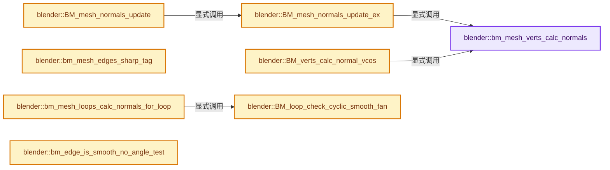
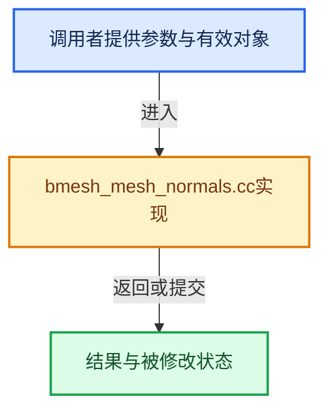

# 实现依赖专题：source/blender/bmesh/intern/bmesh_mesh_normals.cc

[实现依赖导航](../../../README.md) · [符号索引](../../../../00-课程指南/02-源码与提交索引/符号依赖与实现索引.md)

本专题从正文实际调用进入，集中保存共享实现。函数有稳定锚点，可从调用处直接跳到对应完整函数；递归与互相调用通过回链组织。

## 本文件的实现关系






## 完整成员与函数实现

<a id="f-f9efbebc7b6373ae"></a>

### `blender::bm_mesh_verts_calc_normals`

实现位置：[source/blender/bmesh/intern/bmesh_mesh_normals.cc](../../../../../../../../source/blender/bmesh/intern/bmesh_mesh_normals.cc) · L210—L232。

接口参数：

- `BMesh *bm`
- `const Span<float3> fnos`
- `const Span<float3> vcos`
- `MutableSpan<float3> vnos`

**教学注释版**

<!-- annotated:9cbce842960f14 -->

```cpp
static void bm_mesh_verts_calc_normals(BMesh *bm,
                                       const Span<float3> fnos,
                                       const Span<float3> vcos,
                                       MutableSpan<float3> vnos)
{
  // [讲解] vnos.is_empty：查询视图长度或生成对应有效索引区间。
  BM_mesh_elem_index_ensure(bm, BM_FACE | ((!vnos.is_empty() || !vcos.is_empty()) ? BM_VERT : 0));

  TaskParallelSettings settings;
  BLI_parallel_mempool_settings_defaults(&settings);
  settings.use_threading = bm->totvert >= BM_THREAD_LIMIT;

  if (vcos.is_empty()) {
    BM_iter_parallel(bm, BM_VERTS_OF_MESH, bm_vert_calc_normals_cb, nullptr, &settings);
  }
  else {
    BLI_assert(!fnos.is_empty() || !vnos.is_empty());
    BMVertsCalcNormalsWithCoordsData data{};
    data.fnos = fnos;
    data.vcos = vcos;
    data.vnos = vnos;
    BM_iter_parallel(bm, BM_VERTS_OF_MESH, bm_vert_calc_normals_with_coords_cb, &data, &settings);
  }
}
```

<details>
<summary>核对原始源码：source/blender/bmesh/intern/bmesh_mesh_normals.cc · L210—L232</summary>

<!-- original:9cbce842960f14:source/blender/bmesh/intern/bmesh_mesh_normals.cc:210:232 -->

```cpp
static void bm_mesh_verts_calc_normals(BMesh *bm,
                                       const Span<float3> fnos,
                                       const Span<float3> vcos,
                                       MutableSpan<float3> vnos)
{
  BM_mesh_elem_index_ensure(bm, BM_FACE | ((!vnos.is_empty() || !vcos.is_empty()) ? BM_VERT : 0));

  TaskParallelSettings settings;
  BLI_parallel_mempool_settings_defaults(&settings);
  settings.use_threading = bm->totvert >= BM_THREAD_LIMIT;

  if (vcos.is_empty()) {
    BM_iter_parallel(bm, BM_VERTS_OF_MESH, bm_vert_calc_normals_cb, nullptr, &settings);
  }
  else {
    BLI_assert(!fnos.is_empty() || !vnos.is_empty());
    BMVertsCalcNormalsWithCoordsData data{};
    data.fnos = fnos;
    data.vcos = vcos;
    data.vnos = vnos;
    BM_iter_parallel(bm, BM_VERTS_OF_MESH, bm_vert_calc_normals_with_coords_cb, &data, &settings);
  }
}
```

</details>

**沿实际写入检查状态**

- `settings.use_threading = bm->totvert >= BM_THREAD_LIMIT;`
- `data.fnos = fnos;`
- `data.vcos = vcos;`
- `data.vnos = vnos;`

**继续追踪实现**

- `BM_mesh_elem_index_ensure` → [blender::BM_mesh_elem_index_ensure · L453](bmesh_mesh.cc.md#f-bd47fe96d72a16e4)。
- `vnos.is_empty` → [blender::MutableSpan::is_empty · L515](../../../../01-基础容器与现代CPP/06-MutableSpan可写视图.md#f-be88df1422757437)。
- `vcos.is_empty` → [blender::Span::is_empty · L264](../../../../01-基础容器与现代CPP/05-Span只读连续视图.md#f-8cc1d7ba8feb50e6)。
- `BLI_parallel_mempool_settings_defaults` → [blender::BLI_parallel_mempool_settings_defaults · L226](../../../01-BLI基础库/BLI_task_c.hh.md#f-4663e9e152bb1f7d)。
- `BM_iter_parallel` → [blender::BM_iter_parallel · L662](bmesh_iterators.cc.md#f-41193fa0ee749051)。
- `BLI_assert` → [BLI_assert · L48](../../../01-BLI基础库/BLI_assert.hh.md#m-57a88495704d)；[BLI_assert · L63](../../../01-BLI基础库/BLI_assert.hh.md#m-d07050020cb5)。宏定义由构建条件选择。
- `fnos.is_empty` → [blender::Span::is_empty · L264](../../../../01-基础容器与现代CPP/05-Span只读连续视图.md#f-8cc1d7ba8feb50e6)。

<a id="f-0eec539fb10dd0e8"></a>

### `blender::BM_mesh_normals_update_ex`

实现位置：[source/blender/bmesh/intern/bmesh_mesh_normals.cc](../../../../../../../../source/blender/bmesh/intern/bmesh_mesh_normals.cc) · L243—L256。

接口参数：

- `BMesh *bm`
- `const BMeshNormalsUpdate_Params *params`

**教学注释版**

<!-- annotated:1aee547d01ce07 -->

```cpp
void BM_mesh_normals_update_ex(BMesh *bm, const BMeshNormalsUpdate_Params *params)
{
  if (params->face_normals) {
    /* Calculate all face normals. */
    TaskParallelSettings settings;
    BLI_parallel_mempool_settings_defaults(&settings);
    settings.use_threading = bm->totedge >= BM_THREAD_LIMIT;

    BM_iter_parallel(bm, BM_FACES_OF_MESH, bm_face_calc_normals_cb, nullptr, &settings);
  }

  /* Add weighted face normals to vertices, and normalize vert normals. */
  bm_mesh_verts_calc_normals(bm, {}, {}, {});
}
```

<details>
<summary>核对原始源码：source/blender/bmesh/intern/bmesh_mesh_normals.cc · L243—L256</summary>

<!-- original:1aee547d01ce07:source/blender/bmesh/intern/bmesh_mesh_normals.cc:243:256 -->

```cpp
void BM_mesh_normals_update_ex(BMesh *bm, const BMeshNormalsUpdate_Params *params)
{
  if (params->face_normals) {
    /* Calculate all face normals. */
    TaskParallelSettings settings;
    BLI_parallel_mempool_settings_defaults(&settings);
    settings.use_threading = bm->totedge >= BM_THREAD_LIMIT;

    BM_iter_parallel(bm, BM_FACES_OF_MESH, bm_face_calc_normals_cb, nullptr, &settings);
  }

  /* Add weighted face normals to vertices, and normalize vert normals. */
  bm_mesh_verts_calc_normals(bm, {}, {}, {});
}
```

</details>

**沿实际写入检查状态**

- `settings.use_threading = bm->totedge >= BM_THREAD_LIMIT;`

**继续追踪实现**

- `BLI_parallel_mempool_settings_defaults` → [blender::BLI_parallel_mempool_settings_defaults · L226](../../../01-BLI基础库/BLI_task_c.hh.md#f-4663e9e152bb1f7d)。
- `BM_iter_parallel` → [blender::BM_iter_parallel · L662](bmesh_iterators.cc.md#f-41193fa0ee749051)。
- `bm_mesh_verts_calc_normals` → [blender::bm_mesh_verts_calc_normals · L210](bmesh_mesh_normals.cc.md#f-f9efbebc7b6373ae)。

<a id="f-b61534bf72350223"></a>

### `blender::BM_mesh_normals_update`

实现位置：[source/blender/bmesh/intern/bmesh_mesh_normals.cc](../../../../../../../../source/blender/bmesh/intern/bmesh_mesh_normals.cc) · L258—L263。

接口参数：

- `BMesh *bm`

**教学注释版**

<!-- annotated:7ca0104dbc2284 -->

```cpp
void BM_mesh_normals_update(BMesh *bm)
{
  BMeshNormalsUpdate_Params params{};
  params.face_normals = true;
  BM_mesh_normals_update_ex(bm, &params);
}
```

<details>
<summary>核对原始源码：source/blender/bmesh/intern/bmesh_mesh_normals.cc · L258—L263</summary>

<!-- original:7ca0104dbc2284:source/blender/bmesh/intern/bmesh_mesh_normals.cc:258:263 -->

```cpp
void BM_mesh_normals_update(BMesh *bm)
{
  BMeshNormalsUpdate_Params params{};
  params.face_normals = true;
  BM_mesh_normals_update_ex(bm, &params);
}
```

</details>

**沿实际写入检查状态**

- `params.face_normals = true;`

**继续追踪实现**

- `BM_mesh_normals_update_ex` → [blender::BM_mesh_normals_update_ex · L243](bmesh_mesh_normals.cc.md#f-0eec539fb10dd0e8)。

<a id="f-fd11edf310770425"></a>

### `blender::BM_verts_calc_normal_vcos`

实现位置：[source/blender/bmesh/intern/bmesh_mesh_normals.cc](../../../../../../../../source/blender/bmesh/intern/bmesh_mesh_normals.cc) · L311—L318。

接口参数：

- `BMesh *bm`
- `const Span<float3> fnos`
- `const Span<float3> vcos`
- `MutableSpan<float3> vnos`

**教学注释版**

<!-- annotated:3dd07943142488 -->

```cpp
void BM_verts_calc_normal_vcos(BMesh *bm,
                               const Span<float3> fnos,
                               const Span<float3> vcos,
                               MutableSpan<float3> vnos)
{
  /* Add weighted face normals to vertices, and normalize vert normals. */
  bm_mesh_verts_calc_normals(bm, fnos, vcos, vnos);
}
```

<details>
<summary>核对原始源码：source/blender/bmesh/intern/bmesh_mesh_normals.cc · L311—L318</summary>

<!-- original:3dd07943142488:source/blender/bmesh/intern/bmesh_mesh_normals.cc:311:318 -->

```cpp
void BM_verts_calc_normal_vcos(BMesh *bm,
                               const Span<float3> fnos,
                               const Span<float3> vcos,
                               MutableSpan<float3> vnos)
{
  /* Add weighted face normals to vertices, and normalize vert normals. */
  bm_mesh_verts_calc_normals(bm, fnos, vcos, vnos);
}
```

</details>

**继续追踪实现**

- `bm_mesh_verts_calc_normals` → [blender::bm_mesh_verts_calc_normals · L210](bmesh_mesh_normals.cc.md#f-f9efbebc7b6373ae)。

<a id="f-4370713bb1a17473"></a>

### `blender::bm_mesh_edges_sharp_tag`

实现位置：[source/blender/bmesh/intern/bmesh_mesh_normals.cc](../../../../../../../../source/blender/bmesh/intern/bmesh_mesh_normals.cc) · L364—L395。

接口参数：

- `BMesh *bm`
- `const Span<float3> fnos`
- `float split_angle_cos`
- `const bool do_sharp_edges_tag`

**教学注释版**

<!-- annotated:585dcd75fc82ba -->

```cpp
static void bm_mesh_edges_sharp_tag(BMesh *bm,
                                    const Span<float3> fnos,
                                    float split_angle_cos,
                                    const bool do_sharp_edges_tag)
{
  BMIter eiter;
  BMEdge *e;
  int i;

  // [讲解] fnos.is_empty：查询视图长度或生成对应有效索引区间。
  if (!fnos.is_empty()) {
    BM_mesh_elem_index_ensure(bm, BM_FACE);
  }

  if (do_sharp_edges_tag) {
    BM_ITER_MESH_INDEX (e, &eiter, bm, BM_EDGES_OF_MESH, i) {
      BM_elem_index_set(e, i); /* set_inline */
      if (e->l != nullptr) {
        bm_edge_tag_from_smooth_and_set_sharp(fnos, e, split_angle_cos);
      }
    }
  }
  else {
    BM_ITER_MESH_INDEX (e, &eiter, bm, BM_EDGES_OF_MESH, i) {
      BM_elem_index_set(e, i); /* set_inline */
      if (e->l != nullptr) {
        bm_edge_tag_from_smooth(fnos, e, split_angle_cos);
      }
    }
  }

  bm->elem_index_dirty &= ~BM_EDGE;
}
```

<details>
<summary>核对原始源码：source/blender/bmesh/intern/bmesh_mesh_normals.cc · L364—L395</summary>

<!-- original:585dcd75fc82ba:source/blender/bmesh/intern/bmesh_mesh_normals.cc:364:395 -->

```cpp
static void bm_mesh_edges_sharp_tag(BMesh *bm,
                                    const Span<float3> fnos,
                                    float split_angle_cos,
                                    const bool do_sharp_edges_tag)
{
  BMIter eiter;
  BMEdge *e;
  int i;

  if (!fnos.is_empty()) {
    BM_mesh_elem_index_ensure(bm, BM_FACE);
  }

  if (do_sharp_edges_tag) {
    BM_ITER_MESH_INDEX (e, &eiter, bm, BM_EDGES_OF_MESH, i) {
      BM_elem_index_set(e, i); /* set_inline */
      if (e->l != nullptr) {
        bm_edge_tag_from_smooth_and_set_sharp(fnos, e, split_angle_cos);
      }
    }
  }
  else {
    BM_ITER_MESH_INDEX (e, &eiter, bm, BM_EDGES_OF_MESH, i) {
      BM_elem_index_set(e, i); /* set_inline */
      if (e->l != nullptr) {
        bm_edge_tag_from_smooth(fnos, e, split_angle_cos);
      }
    }
  }

  bm->elem_index_dirty &= ~BM_EDGE;
}
```

</details>

**沿实际写入检查状态**

- `bm->elem_index_dirty &= ~BM_EDGE;`

**继续追踪实现**

- `fnos.is_empty` → [blender::Span::is_empty · L264](../../../../01-基础容器与现代CPP/05-Span只读连续视图.md#f-8cc1d7ba8feb50e6)。
- `BM_mesh_elem_index_ensure` → [blender::BM_mesh_elem_index_ensure · L453](bmesh_mesh.cc.md#f-bd47fe96d72a16e4)。
- `BM_ITER_MESH_INDEX` → [BM_ITER_MESH_INDEX · L76](bmesh_iterators.hh.md#m-6a0cac4538f9)。宏定义由构建条件选择。
- `BM_elem_index_set` → [BM_elem_index_set · L121](bmesh_inline.hh.md#m-7bd559c53007)。宏定义由构建条件选择。
- `bm_edge_tag_from_smooth_and_set_sharp` → [blender::bm_edge_tag_from_smooth_and_set_sharp · L829](bmesh_mesh_normals.cc.md#f-0a5e7b95a5f89c67)。
- `bm_edge_tag_from_smooth` → [blender::bm_edge_tag_from_smooth · L788](bmesh_mesh_normals.cc.md#f-8ee859773492ef57)。

<a id="f-ceefab3edc267a46"></a>

### `blender::BM_loop_check_cyclic_smooth_fan`

实现位置：[source/blender/bmesh/intern/bmesh_mesh_normals.cc](../../../../../../../../source/blender/bmesh/intern/bmesh_mesh_normals.cc) · L413—L443。

接口参数：

- `BMLoop *l_curr`

**教学注释版**

<!-- annotated:8a7054513acbf9 -->

```cpp
bool BM_loop_check_cyclic_smooth_fan(BMLoop *l_curr)
{
  BMLoop *lfan_pivot_next = l_curr;
  BMEdge *e_next = l_curr->e;

  BLI_assert(!BM_elem_flag_test(lfan_pivot_next, BM_ELEM_TAG));
  BM_elem_flag_enable(lfan_pivot_next, BM_ELEM_TAG);

  while (true) {
    /* Much simpler than in sibling code with basic Mesh data! */
    lfan_pivot_next = BM_vert_step_fan_loop(lfan_pivot_next, &e_next);

    if (!lfan_pivot_next || !BM_elem_flag_test(e_next, BM_ELEM_TAG)) {
      /* Sharp loop/edge, so not a cyclic smooth fan... */
      return false;
    }
    /* Smooth loop/edge... */
    if (BM_elem_flag_test(lfan_pivot_next, BM_ELEM_TAG)) {
      if (lfan_pivot_next == l_curr) {
        /* We walked around a whole cyclic smooth fan
         * without finding any already-processed loop,
         * means we can use initial l_curr/l_prev edge as start for this smooth fan. */
        return true;
      }
      /* ... already checked in some previous looping, we can abort. */
      return false;
    }
    /* ... we can skip it in future, and keep checking the smooth fan. */
    BM_elem_flag_enable(lfan_pivot_next, BM_ELEM_TAG);
  }
}
```

<details>
<summary>核对原始源码：source/blender/bmesh/intern/bmesh_mesh_normals.cc · L413—L443</summary>

<!-- original:8a7054513acbf9:source/blender/bmesh/intern/bmesh_mesh_normals.cc:413:443 -->

```cpp
bool BM_loop_check_cyclic_smooth_fan(BMLoop *l_curr)
{
  BMLoop *lfan_pivot_next = l_curr;
  BMEdge *e_next = l_curr->e;

  BLI_assert(!BM_elem_flag_test(lfan_pivot_next, BM_ELEM_TAG));
  BM_elem_flag_enable(lfan_pivot_next, BM_ELEM_TAG);

  while (true) {
    /* Much simpler than in sibling code with basic Mesh data! */
    lfan_pivot_next = BM_vert_step_fan_loop(lfan_pivot_next, &e_next);

    if (!lfan_pivot_next || !BM_elem_flag_test(e_next, BM_ELEM_TAG)) {
      /* Sharp loop/edge, so not a cyclic smooth fan... */
      return false;
    }
    /* Smooth loop/edge... */
    if (BM_elem_flag_test(lfan_pivot_next, BM_ELEM_TAG)) {
      if (lfan_pivot_next == l_curr) {
        /* We walked around a whole cyclic smooth fan
         * without finding any already-processed loop,
         * means we can use initial l_curr/l_prev edge as start for this smooth fan. */
        return true;
      }
      /* ... already checked in some previous looping, we can abort. */
      return false;
    }
    /* ... we can skip it in future, and keep checking the smooth fan. */
    BM_elem_flag_enable(lfan_pivot_next, BM_ELEM_TAG);
  }
}
```

</details>

**沿实际写入检查状态**

- `lfan_pivot_next = BM_vert_step_fan_loop(lfan_pivot_next, &e_next);`

**结果出口**

- `return false;`
- `return true;`

**继续追踪实现**

- `BLI_assert` → [BLI_assert · L48](../../../01-BLI基础库/BLI_assert.hh.md#m-57a88495704d)；[BLI_assert · L63](../../../01-BLI基础库/BLI_assert.hh.md#m-d07050020cb5)。宏定义由构建条件选择。
- `BM_elem_flag_test` → [BM_elem_flag_test · L21](bmesh_inline.hh.md#m-2431d1179b41)。宏定义由构建条件选择。
- `BM_elem_flag_enable` → [BM_elem_flag_enable · L23](bmesh_inline.hh.md#m-4400242f1540)。宏定义由构建条件选择。
- `BM_vert_step_fan_loop` → [blender::BM_vert_step_fan_loop · L473](bmesh_query.cc.md#f-4429900071157825)。

<a id="f-620a734f67ebca8f"></a>

### `blender::bm_mesh_loops_calc_normals_for_loop`

实现位置：[source/blender/bmesh/intern/bmesh_mesh_normals.cc](../../../../../../../../source/blender/bmesh/intern/bmesh_mesh_normals.cc) · L457—L753。

接口参数：

- `BMesh *bm`
- `const Span<float3> vcos`
- `const Span<float3> fnos`
- `const short (*clnors_data)[2]`
- `const int cd_loop_clnors_offset`
- `const bool has_clnors`
- `Vector<float3, 16> *edge_vectors`
- `BMLoop *l_curr`
- `MutableSpan<float3> r_lnos`
- `MLoopNorSpaceArray *r_lnors_spacearr`

**教学注释版**

<!-- annotated:6dd554ef26fbb1 -->

```cpp
static int bm_mesh_loops_calc_normals_for_loop(BMesh *bm,
                                               const Span<float3> vcos,
                                               const Span<float3> fnos,
                                               const short (*clnors_data)[2],
                                               const int cd_loop_clnors_offset,
                                               const bool has_clnors,
                                               /* Cache. */
                                               Vector<float3, 16> *edge_vectors,
                                               /* Iterate. */
                                               BMLoop *l_curr,
                                               /* Result. */
                                               MutableSpan<float3> r_lnos,
                                               MLoopNorSpaceArray *r_lnors_spacearr)
{
  BLI_assert((bm->elem_index_dirty & BM_LOOP) == 0);
  // [讲解] fnos.is_empty：查询视图长度或生成对应有效索引区间。
  BLI_assert(fnos.is_empty() || ((bm->elem_index_dirty & BM_FACE) == 0));
  BLI_assert(vcos.is_empty() || ((bm->elem_index_dirty & BM_VERT) == 0));
  UNUSED_VARS_NDEBUG(bm);

  int handled = 0;

  /* Temp normal stack. */
  BLI_SMALLSTACK_DECLARE(normal, float *);
  /* Temp clnors stack. */
  BLI_SMALLSTACK_DECLARE(clnors, short *);
  /* Temp edge vectors stack, only used when computing lnor spacearr. */

  /* A smooth edge, we have to check for cyclic smooth fan case.
   * If we find a new, never-processed cyclic smooth fan, we can do it now using that loop/edge
   * as 'entry point', otherwise we can skip it. */

  /* NOTE: In theory, we could make bm_mesh_loop_check_cyclic_smooth_fan() store
   * mlfan_pivot's in a stack, to avoid having to fan again around
   * the vert during actual computation of clnor & clnorspace. However, this would complicate
   * the code, add more memory usage, and
   * BM_vert_step_fan_loop() is quite cheap in term of CPU cycles,
   * so really think it's not worth it. */
  if (BM_elem_flag_test(l_curr->e, BM_ELEM_TAG) &&
      (BM_elem_flag_test(l_curr, BM_ELEM_TAG) || !BM_loop_check_cyclic_smooth_fan(l_curr)))
  {
  }
  else if (!BM_elem_flag_test(l_curr->e, BM_ELEM_TAG) &&
           !BM_elem_flag_test(l_curr->prev->e, BM_ELEM_TAG))
  {
    /* Simple case (both edges around that vertex are sharp in related face),
     * this vertex just takes its face normal.
     */
    const int l_curr_index = BM_elem_index_get(l_curr);
    const float3 &no = !fnos.is_empty() ? fnos[BM_elem_index_get(l_curr->f)] :
                                          float3(l_curr->f->no);
    copy_v3_v3(r_lnos[l_curr_index], no);

    /* If needed, generate this (simple!) lnor space. */
    if (r_lnors_spacearr) {
      float vec_curr[3], vec_prev[3];
      MLoopNorSpace *lnor_space = BKE_lnor_space_create(r_lnors_spacearr);

      {
        const BMVert *v_pivot = l_curr->v;
        const float3 &co_pivot = !vcos.is_empty() ? vcos[BM_elem_index_get(v_pivot)] :
                                                    float3(v_pivot->co);
        const BMVert *v_1 = l_curr->next->v;
        const float3 co_1 = !vcos.is_empty() ? vcos[BM_elem_index_get(v_1)] : float3(v_1->co);
        const BMVert *v_2 = l_curr->prev->v;
        const float3 co_2 = !vcos.is_empty() ? vcos[BM_elem_index_get(v_2)] : float3(v_2->co);

        BLI_assert(v_1 == BM_edge_other_vert(l_curr->e, v_pivot));
        BLI_assert(v_2 == BM_edge_other_vert(l_curr->prev->e, v_pivot));

        sub_v3_v3v3(vec_curr, co_1, co_pivot);
        normalize_v3(vec_curr);
        sub_v3_v3v3(vec_prev, co_2, co_pivot);
        normalize_v3(vec_prev);
      }

      BKE_lnor_space_define(lnor_space, r_lnos[l_curr_index], vec_curr, vec_prev, {});
      /* We know there is only one loop in this space,
       * no need to create a linklist in this case... */
      BKE_lnor_space_add_loop(r_lnors_spacearr, lnor_space, l_curr_index, l_curr, true);

      if (has_clnors) {
        const short (*clnor)[2] = clnors_data ?
                                      &clnors_data[l_curr_index] :
                                      static_cast<const short (*)[2]>(
                                          BM_ELEM_CD_GET_VOID_P(l_curr, cd_loop_clnors_offset));
        BKE_lnor_space_custom_data_to_normal(lnor_space, *clnor, r_lnos[l_curr_index]);
      }
    }
    handled = 1;
  }
  /* We *do not need* to check/tag loops as already computed!
   * Due to the fact a loop only links to one of its two edges,
   * a same fan *will never be walked more than once!*
   * Since we consider edges having neighbor faces with inverted (flipped) normals as sharp,
   * we are sure that no fan will be skipped, even only considering the case
   * (sharp curr_edge, smooth prev_edge), and not the alternative
   * (smooth curr_edge, sharp prev_edge).
   * All this due/thanks to link between normals and loop ordering.
   */
  else {
    /* We have to fan around current vertex, until we find the other non-smooth edge,
     * and accumulate face normals into the vertex!
     * Note in case this vertex has only one sharp edge,
     * this is a waste because the normal is the same as the vertex normal,
     * but I do not see any easy way to detect that (would need to count number of sharp edges
     * per vertex, I doubt the additional memory usage would be worth it, especially as it
     * should not be a common case in real-life meshes anyway).
     */
    BMVert *v_pivot = l_curr->v;
    BMEdge *e_next;
    const BMEdge *e_org = l_curr->e;
    BMLoop *lfan_pivot, *lfan_pivot_next;
    int lfan_pivot_index;
    float lnor[3] = {0.0f, 0.0f, 0.0f};
    float vec_curr[3], vec_next[3], vec_org[3];

    /* We validate clnors data on the fly - cheapest way to do! */
    int clnors_avg[2] = {0, 0};
    const short (*clnor_ref)[2] = nullptr;
    int clnors_count = 0;
    bool clnors_invalid = false;

    const float3 &co_pivot = !vcos.is_empty() ? vcos[BM_elem_index_get(v_pivot)] :
                                                float3(v_pivot->co);

    MLoopNorSpace *lnor_space = r_lnors_spacearr ? BKE_lnor_space_create(r_lnors_spacearr) :
                                                   nullptr;

    BLI_assert((edge_vectors == nullptr) || edge_vectors->is_empty());

    lfan_pivot = l_curr;
    lfan_pivot_index = BM_elem_index_get(lfan_pivot);
    e_next = lfan_pivot->e; /* Current edge here, actually! */

    /* Only need to compute previous edge's vector once,
     * then we can just reuse old current one! */
    {
      const BMVert *v_2 = lfan_pivot->next->v;
      const float3 co_2 = !vcos.is_empty() ? vcos[BM_elem_index_get(v_2)] : float3(v_2->co);

      BLI_assert(v_2 == BM_edge_other_vert(e_next, v_pivot));

      sub_v3_v3v3(vec_org, co_2, co_pivot);
      normalize_v3(vec_org);
      copy_v3_v3(vec_curr, vec_org);

      if (r_lnors_spacearr) {
        // [讲解] edge_vectors->append：在尾部建立新元素，必要时先扩大存储。
        edge_vectors->append(vec_org);
      }
    }

    while (true) {
      lfan_pivot_next = BM_vert_step_fan_loop(lfan_pivot, &e_next);
      if (lfan_pivot_next) {
        BLI_assert(lfan_pivot_next->v == v_pivot);
      }
      else {
        /* next edge is non-manifold, we have to find it ourselves! */
        e_next = (lfan_pivot->e == e_next) ? lfan_pivot->prev->e : lfan_pivot->e;
      }

      /* Compute edge vector.
       * NOTE: We could pre-compute those into an array, in the first iteration,
       * instead of computing them twice (or more) here.
       * However, time gained is not worth memory and time lost,
       * given the fact that this code should not be called that much in real-life meshes.
       */
      {
        const BMVert *v_2 = BM_edge_other_vert(e_next, v_pivot);
        const float3 co_2 = !vcos.is_empty() ? vcos[BM_elem_index_get(v_2)] : float3(v_2->co);

        sub_v3_v3v3(vec_next, co_2, co_pivot);
        normalize_v3(vec_next);
      }

      {
        /* Code similar to accumulate_vertex_normals_poly_v3. */
        /* Calculate angle between the two face edges incident on this vertex. */
        const BMFace *f = lfan_pivot->f;
        const float fac = math::safe_acos_approx(dot_v3v3(vec_next, vec_curr));
        const float3 &no = !fnos.is_empty() ? fnos[BM_elem_index_get(f)] : float3(f->no);
        /* Accumulate */
        madd_v3_v3fl(lnor, no, fac);

        if (has_clnors) {
          /* Accumulate all clnors, if they are not all equal we have to fix that! */
          const short (*clnor)[2] = clnors_data ?
                                        &clnors_data[lfan_pivot_index] :
                                        static_cast<const short (*)[2]>(BM_ELEM_CD_GET_VOID_P(
                                            lfan_pivot, cd_loop_clnors_offset));
          if (clnors_count) {
            clnors_invalid |= ((*clnor_ref)[0] != (*clnor)[0] || (*clnor_ref)[1] != (*clnor)[1]);
          }
          else {
            clnor_ref = clnor;
          }
          clnors_avg[0] += (*clnor)[0];
          clnors_avg[1] += (*clnor)[1];
          clnors_count++;
          /* We store here a pointer to all custom lnors processed. */
          BLI_SMALLSTACK_PUSH(clnors, (short *)*clnor);
        }
      }

      /* We store here a pointer to all loop-normals processed. */
      BLI_SMALLSTACK_PUSH(normal, (float *)r_lnos[lfan_pivot_index]);

      if (r_lnors_spacearr) {
        /* Assign current lnor space to current 'vertex' loop. */
        BKE_lnor_space_add_loop(r_lnors_spacearr, lnor_space, lfan_pivot_index, lfan_pivot, false);
        if (e_next != e_org) {
          /* We store here all edges-normalized vectors processed. */
          edge_vectors->append(vec_next);
        }
      }

      handled += 1;

      if (!BM_elem_flag_test(e_next, BM_ELEM_TAG) || (e_next == e_org)) {
        /* Next edge is sharp, we have finished with this fan of faces around this vert! */
        break;
      }

      /* Copy next edge vector to current one. */
      copy_v3_v3(vec_curr, vec_next);
      /* Next pivot loop to current one. */
      lfan_pivot = lfan_pivot_next;
      lfan_pivot_index = BM_elem_index_get(lfan_pivot);
    }

    {
      float lnor_len = normalize_v3(lnor);

      /* If we are generating lnor spacearr, we can now define the one for this fan. */
      if (r_lnors_spacearr) {
        if (lnor_len == 0.0f) [[unlikely]] {
          /* Use vertex normal as fallback! */
          copy_v3_v3(lnor, r_lnos[lfan_pivot_index]);
          lnor_len = 1.0f;
        }

        BKE_lnor_space_define(lnor_space, lnor, vec_org, vec_next, *edge_vectors);
        // [讲解] edge_vectors->clear：销毁所有有效元素，把size变为0，但保留原分配或内嵌容量。
        edge_vectors->clear();

        if (has_clnors) {
          if (clnors_invalid) {
            short *clnor;

            clnors_avg[0] /= clnors_count;
            clnors_avg[1] /= clnors_count;
            /* Fix/update all clnors of this fan with computed average value. */

            /* Prints continuously when merge custom normals, so commenting. */
            // printf("Invalid clnors in this fan!\n");

            while ((clnor = static_cast<short *>(BLI_SMALLSTACK_POP(clnors)))) {
              // print_v2("org clnor", clnor);
              clnor[0] = short(clnors_avg[0]);
              clnor[1] = short(clnors_avg[1]);
            }
            // print_v2("new clnors", clnors_avg);
          }
          else {
            /* We still have to consume the stack! */
            while (BLI_SMALLSTACK_POP(clnors)) {
              /* pass */
            }
          }
          BKE_lnor_space_custom_data_to_normal(lnor_space, *clnor_ref, lnor);
        }
      }

      /* In case we get a zero normal here, just use vertex normal already set! */
      if (lnor_len != 0.0f) [[likely]] {
        /* Copy back the final computed normal into all related loop-normals. */
        float *nor;

        while ((nor = static_cast<float *>(BLI_SMALLSTACK_POP(normal)))) {
          copy_v3_v3(nor, lnor);
        }
      }
      else {
        /* We still have to consume the stack! */
        while (BLI_SMALLSTACK_POP(normal)) {
          /* pass */
        }
      }
    }

    /* Tag related vertex as sharp, to avoid fanning around it again
     * (in case it was a smooth one). */
    if (r_lnors_spacearr) {
      BM_elem_flag_enable(l_curr->v, BM_ELEM_TAG);
    }
  }
  return handled;
}
```

<details>
<summary>核对原始源码：source/blender/bmesh/intern/bmesh_mesh_normals.cc · L457—L753</summary>

<!-- original:6dd554ef26fbb1:source/blender/bmesh/intern/bmesh_mesh_normals.cc:457:753 -->

```cpp
static int bm_mesh_loops_calc_normals_for_loop(BMesh *bm,
                                               const Span<float3> vcos,
                                               const Span<float3> fnos,
                                               const short (*clnors_data)[2],
                                               const int cd_loop_clnors_offset,
                                               const bool has_clnors,
                                               /* Cache. */
                                               Vector<float3, 16> *edge_vectors,
                                               /* Iterate. */
                                               BMLoop *l_curr,
                                               /* Result. */
                                               MutableSpan<float3> r_lnos,
                                               MLoopNorSpaceArray *r_lnors_spacearr)
{
  BLI_assert((bm->elem_index_dirty & BM_LOOP) == 0);
  BLI_assert(fnos.is_empty() || ((bm->elem_index_dirty & BM_FACE) == 0));
  BLI_assert(vcos.is_empty() || ((bm->elem_index_dirty & BM_VERT) == 0));
  UNUSED_VARS_NDEBUG(bm);

  int handled = 0;

  /* Temp normal stack. */
  BLI_SMALLSTACK_DECLARE(normal, float *);
  /* Temp clnors stack. */
  BLI_SMALLSTACK_DECLARE(clnors, short *);
  /* Temp edge vectors stack, only used when computing lnor spacearr. */

  /* A smooth edge, we have to check for cyclic smooth fan case.
   * If we find a new, never-processed cyclic smooth fan, we can do it now using that loop/edge
   * as 'entry point', otherwise we can skip it. */

  /* NOTE: In theory, we could make bm_mesh_loop_check_cyclic_smooth_fan() store
   * mlfan_pivot's in a stack, to avoid having to fan again around
   * the vert during actual computation of clnor & clnorspace. However, this would complicate
   * the code, add more memory usage, and
   * BM_vert_step_fan_loop() is quite cheap in term of CPU cycles,
   * so really think it's not worth it. */
  if (BM_elem_flag_test(l_curr->e, BM_ELEM_TAG) &&
      (BM_elem_flag_test(l_curr, BM_ELEM_TAG) || !BM_loop_check_cyclic_smooth_fan(l_curr)))
  {
  }
  else if (!BM_elem_flag_test(l_curr->e, BM_ELEM_TAG) &&
           !BM_elem_flag_test(l_curr->prev->e, BM_ELEM_TAG))
  {
    /* Simple case (both edges around that vertex are sharp in related face),
     * this vertex just takes its face normal.
     */
    const int l_curr_index = BM_elem_index_get(l_curr);
    const float3 &no = !fnos.is_empty() ? fnos[BM_elem_index_get(l_curr->f)] :
                                          float3(l_curr->f->no);
    copy_v3_v3(r_lnos[l_curr_index], no);

    /* If needed, generate this (simple!) lnor space. */
    if (r_lnors_spacearr) {
      float vec_curr[3], vec_prev[3];
      MLoopNorSpace *lnor_space = BKE_lnor_space_create(r_lnors_spacearr);

      {
        const BMVert *v_pivot = l_curr->v;
        const float3 &co_pivot = !vcos.is_empty() ? vcos[BM_elem_index_get(v_pivot)] :
                                                    float3(v_pivot->co);
        const BMVert *v_1 = l_curr->next->v;
        const float3 co_1 = !vcos.is_empty() ? vcos[BM_elem_index_get(v_1)] : float3(v_1->co);
        const BMVert *v_2 = l_curr->prev->v;
        const float3 co_2 = !vcos.is_empty() ? vcos[BM_elem_index_get(v_2)] : float3(v_2->co);

        BLI_assert(v_1 == BM_edge_other_vert(l_curr->e, v_pivot));
        BLI_assert(v_2 == BM_edge_other_vert(l_curr->prev->e, v_pivot));

        sub_v3_v3v3(vec_curr, co_1, co_pivot);
        normalize_v3(vec_curr);
        sub_v3_v3v3(vec_prev, co_2, co_pivot);
        normalize_v3(vec_prev);
      }

      BKE_lnor_space_define(lnor_space, r_lnos[l_curr_index], vec_curr, vec_prev, {});
      /* We know there is only one loop in this space,
       * no need to create a linklist in this case... */
      BKE_lnor_space_add_loop(r_lnors_spacearr, lnor_space, l_curr_index, l_curr, true);

      if (has_clnors) {
        const short (*clnor)[2] = clnors_data ?
                                      &clnors_data[l_curr_index] :
                                      static_cast<const short (*)[2]>(
                                          BM_ELEM_CD_GET_VOID_P(l_curr, cd_loop_clnors_offset));
        BKE_lnor_space_custom_data_to_normal(lnor_space, *clnor, r_lnos[l_curr_index]);
      }
    }
    handled = 1;
  }
  /* We *do not need* to check/tag loops as already computed!
   * Due to the fact a loop only links to one of its two edges,
   * a same fan *will never be walked more than once!*
   * Since we consider edges having neighbor faces with inverted (flipped) normals as sharp,
   * we are sure that no fan will be skipped, even only considering the case
   * (sharp curr_edge, smooth prev_edge), and not the alternative
   * (smooth curr_edge, sharp prev_edge).
   * All this due/thanks to link between normals and loop ordering.
   */
  else {
    /* We have to fan around current vertex, until we find the other non-smooth edge,
     * and accumulate face normals into the vertex!
     * Note in case this vertex has only one sharp edge,
     * this is a waste because the normal is the same as the vertex normal,
     * but I do not see any easy way to detect that (would need to count number of sharp edges
     * per vertex, I doubt the additional memory usage would be worth it, especially as it
     * should not be a common case in real-life meshes anyway).
     */
    BMVert *v_pivot = l_curr->v;
    BMEdge *e_next;
    const BMEdge *e_org = l_curr->e;
    BMLoop *lfan_pivot, *lfan_pivot_next;
    int lfan_pivot_index;
    float lnor[3] = {0.0f, 0.0f, 0.0f};
    float vec_curr[3], vec_next[3], vec_org[3];

    /* We validate clnors data on the fly - cheapest way to do! */
    int clnors_avg[2] = {0, 0};
    const short (*clnor_ref)[2] = nullptr;
    int clnors_count = 0;
    bool clnors_invalid = false;

    const float3 &co_pivot = !vcos.is_empty() ? vcos[BM_elem_index_get(v_pivot)] :
                                                float3(v_pivot->co);

    MLoopNorSpace *lnor_space = r_lnors_spacearr ? BKE_lnor_space_create(r_lnors_spacearr) :
                                                   nullptr;

    BLI_assert((edge_vectors == nullptr) || edge_vectors->is_empty());

    lfan_pivot = l_curr;
    lfan_pivot_index = BM_elem_index_get(lfan_pivot);
    e_next = lfan_pivot->e; /* Current edge here, actually! */

    /* Only need to compute previous edge's vector once,
     * then we can just reuse old current one! */
    {
      const BMVert *v_2 = lfan_pivot->next->v;
      const float3 co_2 = !vcos.is_empty() ? vcos[BM_elem_index_get(v_2)] : float3(v_2->co);

      BLI_assert(v_2 == BM_edge_other_vert(e_next, v_pivot));

      sub_v3_v3v3(vec_org, co_2, co_pivot);
      normalize_v3(vec_org);
      copy_v3_v3(vec_curr, vec_org);

      if (r_lnors_spacearr) {
        edge_vectors->append(vec_org);
      }
    }

    while (true) {
      lfan_pivot_next = BM_vert_step_fan_loop(lfan_pivot, &e_next);
      if (lfan_pivot_next) {
        BLI_assert(lfan_pivot_next->v == v_pivot);
      }
      else {
        /* next edge is non-manifold, we have to find it ourselves! */
        e_next = (lfan_pivot->e == e_next) ? lfan_pivot->prev->e : lfan_pivot->e;
      }

      /* Compute edge vector.
       * NOTE: We could pre-compute those into an array, in the first iteration,
       * instead of computing them twice (or more) here.
       * However, time gained is not worth memory and time lost,
       * given the fact that this code should not be called that much in real-life meshes.
       */
      {
        const BMVert *v_2 = BM_edge_other_vert(e_next, v_pivot);
        const float3 co_2 = !vcos.is_empty() ? vcos[BM_elem_index_get(v_2)] : float3(v_2->co);

        sub_v3_v3v3(vec_next, co_2, co_pivot);
        normalize_v3(vec_next);
      }

      {
        /* Code similar to accumulate_vertex_normals_poly_v3. */
        /* Calculate angle between the two face edges incident on this vertex. */
        const BMFace *f = lfan_pivot->f;
        const float fac = math::safe_acos_approx(dot_v3v3(vec_next, vec_curr));
        const float3 &no = !fnos.is_empty() ? fnos[BM_elem_index_get(f)] : float3(f->no);
        /* Accumulate */
        madd_v3_v3fl(lnor, no, fac);

        if (has_clnors) {
          /* Accumulate all clnors, if they are not all equal we have to fix that! */
          const short (*clnor)[2] = clnors_data ?
                                        &clnors_data[lfan_pivot_index] :
                                        static_cast<const short (*)[2]>(BM_ELEM_CD_GET_VOID_P(
                                            lfan_pivot, cd_loop_clnors_offset));
          if (clnors_count) {
            clnors_invalid |= ((*clnor_ref)[0] != (*clnor)[0] || (*clnor_ref)[1] != (*clnor)[1]);
          }
          else {
            clnor_ref = clnor;
          }
          clnors_avg[0] += (*clnor)[0];
          clnors_avg[1] += (*clnor)[1];
          clnors_count++;
          /* We store here a pointer to all custom lnors processed. */
          BLI_SMALLSTACK_PUSH(clnors, (short *)*clnor);
        }
      }

      /* We store here a pointer to all loop-normals processed. */
      BLI_SMALLSTACK_PUSH(normal, (float *)r_lnos[lfan_pivot_index]);

      if (r_lnors_spacearr) {
        /* Assign current lnor space to current 'vertex' loop. */
        BKE_lnor_space_add_loop(r_lnors_spacearr, lnor_space, lfan_pivot_index, lfan_pivot, false);
        if (e_next != e_org) {
          /* We store here all edges-normalized vectors processed. */
          edge_vectors->append(vec_next);
        }
      }

      handled += 1;

      if (!BM_elem_flag_test(e_next, BM_ELEM_TAG) || (e_next == e_org)) {
        /* Next edge is sharp, we have finished with this fan of faces around this vert! */
        break;
      }

      /* Copy next edge vector to current one. */
      copy_v3_v3(vec_curr, vec_next);
      /* Next pivot loop to current one. */
      lfan_pivot = lfan_pivot_next;
      lfan_pivot_index = BM_elem_index_get(lfan_pivot);
    }

    {
      float lnor_len = normalize_v3(lnor);

      /* If we are generating lnor spacearr, we can now define the one for this fan. */
      if (r_lnors_spacearr) {
        if (lnor_len == 0.0f) [[unlikely]] {
          /* Use vertex normal as fallback! */
          copy_v3_v3(lnor, r_lnos[lfan_pivot_index]);
          lnor_len = 1.0f;
        }

        BKE_lnor_space_define(lnor_space, lnor, vec_org, vec_next, *edge_vectors);
        edge_vectors->clear();

        if (has_clnors) {
          if (clnors_invalid) {
            short *clnor;

            clnors_avg[0] /= clnors_count;
            clnors_avg[1] /= clnors_count;
            /* Fix/update all clnors of this fan with computed average value. */

            /* Prints continuously when merge custom normals, so commenting. */
            // printf("Invalid clnors in this fan!\n");

            while ((clnor = static_cast<short *>(BLI_SMALLSTACK_POP(clnors)))) {
              // print_v2("org clnor", clnor);
              clnor[0] = short(clnors_avg[0]);
              clnor[1] = short(clnors_avg[1]);
            }
            // print_v2("new clnors", clnors_avg);
          }
          else {
            /* We still have to consume the stack! */
            while (BLI_SMALLSTACK_POP(clnors)) {
              /* pass */
            }
          }
          BKE_lnor_space_custom_data_to_normal(lnor_space, *clnor_ref, lnor);
        }
      }

      /* In case we get a zero normal here, just use vertex normal already set! */
      if (lnor_len != 0.0f) [[likely]] {
        /* Copy back the final computed normal into all related loop-normals. */
        float *nor;

        while ((nor = static_cast<float *>(BLI_SMALLSTACK_POP(normal)))) {
          copy_v3_v3(nor, lnor);
        }
      }
      else {
        /* We still have to consume the stack! */
        while (BLI_SMALLSTACK_POP(normal)) {
          /* pass */
        }
      }
    }

    /* Tag related vertex as sharp, to avoid fanning around it again
     * (in case it was a smooth one). */
    if (r_lnors_spacearr) {
      BM_elem_flag_enable(l_curr->v, BM_ELEM_TAG);
    }
  }
  return handled;
}
```

</details>

**沿实际写入检查状态**

- `handled = 1;`
- `lfan_pivot = l_curr;`
- `lfan_pivot_index = BM_elem_index_get(lfan_pivot);`
- `e_next = lfan_pivot->e; /* Current edge here, actually! */`
- `lfan_pivot_next = BM_vert_step_fan_loop(lfan_pivot, &e_next);`
- `e_next = (lfan_pivot->e == e_next) ? lfan_pivot->prev->e : lfan_pivot->e;`
- `clnors_invalid |= ((*clnor_ref)[0] != (*clnor)[0] || (*clnor_ref)[1] != (*clnor)[1]);`
- `clnor_ref = clnor;`
- `clnors_avg[0] += (*clnor)[0];`
- `clnors_avg[1] += (*clnor)[1];`
- `handled += 1;`
- `lfan_pivot = lfan_pivot_next;`
- `lnor_len = 1.0f;`
- `clnor[0] = short(clnors_avg[0]);`
- `clnor[1] = short(clnors_avg[1]);`

**结果出口**

- `return handled;`

**继续追踪实现**

- `BLI_assert` → [BLI_assert · L48](../../../01-BLI基础库/BLI_assert.hh.md#m-57a88495704d)；[BLI_assert · L63](../../../01-BLI基础库/BLI_assert.hh.md#m-d07050020cb5)。宏定义由构建条件选择。
- `fnos.is_empty` → [blender::Span::is_empty · L264](../../../../01-基础容器与现代CPP/05-Span只读连续视图.md#f-8cc1d7ba8feb50e6)。
- `vcos.is_empty` → [blender::Span::is_empty · L264](../../../../01-基础容器与现代CPP/05-Span只读连续视图.md#f-8cc1d7ba8feb50e6)。
- `UNUSED_VARS_NDEBUG` → [UNUSED_VARS_NDEBUG · L526](../../../01-BLI基础库/BLI_utildefines.hh.md#m-fea439f7d366)；[UNUSED_VARS_NDEBUG · L528](../../../01-BLI基础库/BLI_utildefines.hh.md#m-a8f8cfac06c0)。宏定义由构建条件选择。
- `BM_elem_flag_test` → [BM_elem_flag_test · L21](bmesh_inline.hh.md#m-2431d1179b41)。宏定义由构建条件选择。
- `BM_loop_check_cyclic_smooth_fan` → [blender::BM_loop_check_cyclic_smooth_fan · L413](bmesh_mesh_normals.cc.md#f-ceefab3edc267a46)。
- `BM_elem_index_get` → [BM_elem_index_get · L120](bmesh_inline.hh.md#m-201981cdc62d)。宏定义由构建条件选择。
- `float3` → [float3 · L641](../../compositor/algorithms/intern/smaa.cc.md#m-0ea8254cfdb4)。宏定义由构建条件选择。
- `copy_v3_v3` → [blender::copy_v3_v3 · L47](../../../01-BLI基础库/intern/math_vector_inline.cc.md#f-037a0d5fa5060bd6)。
- `BKE_lnor_space_create` → [blender::BKE_lnor_space_create · L583](../../../../06-隐式共享与缓存系统/08-法线缓存的真实依赖.md#f-3443e484badc548d)。
- `BM_edge_other_vert` → [blender::BM_edge_other_vert · L52](bmesh_query_inline.hh.md#f-464fb9614b23d180)。
- `sub_v3_v3v3` → [blender::sub_v3_v3v3 · L360](../../../01-BLI基础库/intern/math_vector_inline.cc.md#f-23781c252db8b30c)。
- `normalize_v3` → [blender::normalize_v3 · L933](../../../01-BLI基础库/intern/math_vector_inline.cc.md#f-5f3257e657ef732c)。
- `BKE_lnor_space_define` → [blender::BKE_lnor_space_define · L659](../../../../06-隐式共享与缓存系统/08-法线缓存的真实依赖.md#f-3f35195e55e05cfe)。
- `BKE_lnor_space_add_loop` → [blender::BKE_lnor_space_add_loop · L674](../../../../06-隐式共享与缓存系统/08-法线缓存的真实依赖.md#f-3512e215d096c095)。
- `BM_ELEM_CD_GET_VOID_P` → [BM_ELEM_CD_GET_VOID_P · L610](../bmesh_class.hh.md#m-cdfe9f3023fa)；[BM_ELEM_CD_GET_VOID_P · L618](../bmesh_class.hh.md#m-126b1260772d)。宏定义由构建条件选择。
- `BKE_lnor_space_custom_data_to_normal` → [blender::BKE_lnor_space_custom_data_to_normal · L747](../../../../06-隐式共享与缓存系统/08-法线缓存的真实依赖.md#f-934d547cec483672)。
- `edge_vectors->is_empty` → [blender::Vector::is_empty · L792](../../../../01-基础容器与现代CPP/11-Vector插入删除与重排.md#f-937bbd9cb80bdcc8)。
- `edge_vectors->append` → [blender::Vector::append · L498](../../../../01-基础容器与现代CPP/11-Vector插入删除与重排.md#f-5bde268a69e443ec)；[blender::Vector::append · L502](../../../../01-基础容器与现代CPP/11-Vector插入删除与重排.md#f-591e0b15e6308532)。同名重载需按实参类型选择。
- `BM_vert_step_fan_loop` → [blender::BM_vert_step_fan_loop · L473](bmesh_query.cc.md#f-4429900071157825)。
- `math::safe_acos_approx` → [blender::math::safe_acos_approx · L241](../../../01-BLI基础库/BLI_math_base.hh.md#f-1f29eb306de0b3f7)。
- `dot_v3v3` → [blender::dot_v3v3 · L646](../../../01-BLI基础库/intern/math_vector_inline.cc.md#f-c88befa67d07591a)。
- `madd_v3_v3fl` → [blender::madd_v3_v3fl · L501](../../../01-BLI基础库/intern/math_vector_inline.cc.md#f-4f81667c5d595c80)。
- `BLI_SMALLSTACK_PUSH` → [BLI_SMALLSTACK_PUSH · L93](../../../01-BLI基础库/BLI_linklist_stack.hh.md#m-f6feea21b839)。宏定义由构建条件选择。
- `edge_vectors->clear` → [blender::Vector::clear · L468](../../../../01-基础容器与现代CPP/10-Vector扩容与增长.md#f-d051bebff5275a43)。
- `BLI_SMALLSTACK_POP` → [BLI_SMALLSTACK_POP · L122](../../../01-BLI基础库/BLI_linklist_stack.hh.md#m-de9dbbe51aef)。宏定义由构建条件选择。
- `BM_elem_flag_enable` → [BM_elem_flag_enable · L23](bmesh_inline.hh.md#m-4400242f1540)。宏定义由构建条件选择。

<a id="f-1d93a75882fe94ae"></a>

### `blender::bm_edge_is_smooth_no_angle_test`

实现位置：[source/blender/bmesh/intern/bmesh_mesh_normals.cc](../../../../../../../../source/blender/bmesh/intern/bmesh_mesh_normals.cc) · L772—L786。

接口参数：

- `const BMEdge *e`
- `const BMLoop *l_a`
- `const BMLoop *l_b`

**教学注释版**

<!-- annotated:e1b14c3fd3b7f6 -->

```cpp
BLI_INLINE bool bm_edge_is_smooth_no_angle_test(const BMEdge *e,
                                                const BMLoop *l_a,
                                                const BMLoop *l_b)
{
  BLI_assert(l_a->radial_next == l_b);
  return (
      /* The face is manifold. */
      (l_b->radial_next == l_a) &&
      /* Faces have winding that faces the same way. */
      (l_a->v != l_b->v) &&
      /* The edge is smooth. */
      BM_elem_flag_test(e, BM_ELEM_SMOOTH) &&
      /* Both faces are smooth. */
      BM_elem_flag_test(l_a->f, BM_ELEM_SMOOTH) && BM_elem_flag_test(l_b->f, BM_ELEM_SMOOTH));
}
```

<details>
<summary>核对原始源码：source/blender/bmesh/intern/bmesh_mesh_normals.cc · L772—L786</summary>

<!-- original:e1b14c3fd3b7f6:source/blender/bmesh/intern/bmesh_mesh_normals.cc:772:786 -->

```cpp
BLI_INLINE bool bm_edge_is_smooth_no_angle_test(const BMEdge *e,
                                                const BMLoop *l_a,
                                                const BMLoop *l_b)
{
  BLI_assert(l_a->radial_next == l_b);
  return (
      /* The face is manifold. */
      (l_b->radial_next == l_a) &&
      /* Faces have winding that faces the same way. */
      (l_a->v != l_b->v) &&
      /* The edge is smooth. */
      BM_elem_flag_test(e, BM_ELEM_SMOOTH) &&
      /* Both faces are smooth. */
      BM_elem_flag_test(l_a->f, BM_ELEM_SMOOTH) && BM_elem_flag_test(l_b->f, BM_ELEM_SMOOTH));
}
```

</details>

**结果出口**

- `return (`

**继续追踪实现**

- `BLI_assert` → [BLI_assert · L48](../../../01-BLI基础库/BLI_assert.hh.md#m-57a88495704d)；[BLI_assert · L63](../../../01-BLI基础库/BLI_assert.hh.md#m-d07050020cb5)。宏定义由构建条件选择。
- `BM_elem_flag_test` → [BM_elem_flag_test · L21](bmesh_inline.hh.md#m-2431d1179b41)。宏定义由构建条件选择。

<a id="f-8ee859773492ef57"></a>

### `blender::bm_edge_tag_from_smooth`

实现位置：[source/blender/bmesh/intern/bmesh_mesh_normals.cc](../../../../../../../../source/blender/bmesh/intern/bmesh_mesh_normals.cc) · L788—L820。

接口参数：

- `const Span<float3> fnos`
- `BMEdge *e`
- `const float split_angle_cos`

**教学注释版**

<!-- annotated:5a8a8ed1ef5468 -->

```cpp
static void bm_edge_tag_from_smooth(const Span<float3> fnos,
                                    BMEdge *e,
                                    const float split_angle_cos)
{
  BLI_assert(e->l != nullptr);
  BMLoop *l_a = e->l, *l_b = l_a->radial_next;
  bool is_smooth = false;
  if (bm_edge_is_smooth_no_angle_test(e, l_a, l_b)) {
    if (split_angle_cos != -1.0f) {
      // [讲解] fnos.is_empty：查询视图长度或生成对应有效索引区间。
      const float dot = fnos.is_empty() ? dot_v3v3(l_a->f->no, l_b->f->no) :
                                          dot_v3v3(fnos[BM_elem_index_get(l_a->f)],
                                                   fnos[BM_elem_index_get(l_b->f)]);
      if (dot >= split_angle_cos) {
        is_smooth = true;
      }
    }
    else {
      is_smooth = true;
    }
  }

  /* Perform `BM_elem_flag_set(e, BM_ELEM_TAG, is_smooth)`
   * NOTE: This will be set by multiple threads however it will be set to the same value. */

  /* No need for atomics here as this is a single byte. */
  char *hflag_p = &e->head.hflag;
  if (is_smooth) {
    *hflag_p = *hflag_p | BM_ELEM_TAG;
  }
  else {
    *hflag_p = *hflag_p & ~BM_ELEM_TAG;
  }
}
```

<details>
<summary>核对原始源码：source/blender/bmesh/intern/bmesh_mesh_normals.cc · L788—L820</summary>

<!-- original:5a8a8ed1ef5468:source/blender/bmesh/intern/bmesh_mesh_normals.cc:788:820 -->

```cpp
static void bm_edge_tag_from_smooth(const Span<float3> fnos,
                                    BMEdge *e,
                                    const float split_angle_cos)
{
  BLI_assert(e->l != nullptr);
  BMLoop *l_a = e->l, *l_b = l_a->radial_next;
  bool is_smooth = false;
  if (bm_edge_is_smooth_no_angle_test(e, l_a, l_b)) {
    if (split_angle_cos != -1.0f) {
      const float dot = fnos.is_empty() ? dot_v3v3(l_a->f->no, l_b->f->no) :
                                          dot_v3v3(fnos[BM_elem_index_get(l_a->f)],
                                                   fnos[BM_elem_index_get(l_b->f)]);
      if (dot >= split_angle_cos) {
        is_smooth = true;
      }
    }
    else {
      is_smooth = true;
    }
  }

  /* Perform `BM_elem_flag_set(e, BM_ELEM_TAG, is_smooth)`
   * NOTE: This will be set by multiple threads however it will be set to the same value. */

  /* No need for atomics here as this is a single byte. */
  char *hflag_p = &e->head.hflag;
  if (is_smooth) {
    *hflag_p = *hflag_p | BM_ELEM_TAG;
  }
  else {
    *hflag_p = *hflag_p & ~BM_ELEM_TAG;
  }
}
```

</details>

**沿实际写入检查状态**

- `is_smooth = true;`

**继续追踪实现**

- `BLI_assert` → [BLI_assert · L48](../../../01-BLI基础库/BLI_assert.hh.md#m-57a88495704d)；[BLI_assert · L63](../../../01-BLI基础库/BLI_assert.hh.md#m-d07050020cb5)。宏定义由构建条件选择。
- `bm_edge_is_smooth_no_angle_test` → [blender::bm_edge_is_smooth_no_angle_test · L772](bmesh_mesh_normals.cc.md#f-1d93a75882fe94ae)。
- `fnos.is_empty` → [blender::Span::is_empty · L264](../../../../01-基础容器与现代CPP/05-Span只读连续视图.md#f-8cc1d7ba8feb50e6)。
- `dot_v3v3` → [blender::dot_v3v3 · L646](../../../01-BLI基础库/intern/math_vector_inline.cc.md#f-c88befa67d07591a)。
- `BM_elem_index_get` → [BM_elem_index_get · L120](bmesh_inline.hh.md#m-201981cdc62d)。宏定义由构建条件选择。

<a id="f-0a5e7b95a5f89c67"></a>

### `blender::bm_edge_tag_from_smooth_and_set_sharp`

实现位置：[source/blender/bmesh/intern/bmesh_mesh_normals.cc](../../../../../../../../source/blender/bmesh/intern/bmesh_mesh_normals.cc) · L829—L857。

接口参数：

- `const Span<float3> fnos`
- `BMEdge *e`
- `const float split_angle_cos`

**教学注释版**

<!-- annotated:3955b474faf52e -->

```cpp
static void bm_edge_tag_from_smooth_and_set_sharp(const Span<float3> fnos,
                                                  BMEdge *e,
                                                  const float split_angle_cos)
{
  BLI_assert(e->l != nullptr);
  BMLoop *l_a = e->l, *l_b = l_a->radial_next;
  bool is_smooth = false;
  if (bm_edge_is_smooth_no_angle_test(e, l_a, l_b)) {
    if (split_angle_cos != -1.0f) {
      // [讲解] fnos.is_empty：查询视图长度或生成对应有效索引区间。
      const float dot = fnos.is_empty() ? dot_v3v3(l_a->f->no, l_b->f->no) :
                                          dot_v3v3(fnos[BM_elem_index_get(l_a->f)],
                                                   fnos[BM_elem_index_get(l_b->f)]);
      if (dot >= split_angle_cos) {
        is_smooth = true;
      }
      else {
        /* Note that we do not care about the other sharp-edge cases
         * (sharp face, non-manifold edge, etc.),
         * only tag edge as sharp when it is due to angle threshold. */
        BM_elem_flag_disable(e, BM_ELEM_SMOOTH);
      }
    }
    else {
      is_smooth = true;
    }
  }

  BM_elem_flag_set(e, BM_ELEM_TAG, is_smooth);
}
```

<details>
<summary>核对原始源码：source/blender/bmesh/intern/bmesh_mesh_normals.cc · L829—L857</summary>

<!-- original:3955b474faf52e:source/blender/bmesh/intern/bmesh_mesh_normals.cc:829:857 -->

```cpp
static void bm_edge_tag_from_smooth_and_set_sharp(const Span<float3> fnos,
                                                  BMEdge *e,
                                                  const float split_angle_cos)
{
  BLI_assert(e->l != nullptr);
  BMLoop *l_a = e->l, *l_b = l_a->radial_next;
  bool is_smooth = false;
  if (bm_edge_is_smooth_no_angle_test(e, l_a, l_b)) {
    if (split_angle_cos != -1.0f) {
      const float dot = fnos.is_empty() ? dot_v3v3(l_a->f->no, l_b->f->no) :
                                          dot_v3v3(fnos[BM_elem_index_get(l_a->f)],
                                                   fnos[BM_elem_index_get(l_b->f)]);
      if (dot >= split_angle_cos) {
        is_smooth = true;
      }
      else {
        /* Note that we do not care about the other sharp-edge cases
         * (sharp face, non-manifold edge, etc.),
         * only tag edge as sharp when it is due to angle threshold. */
        BM_elem_flag_disable(e, BM_ELEM_SMOOTH);
      }
    }
    else {
      is_smooth = true;
    }
  }

  BM_elem_flag_set(e, BM_ELEM_TAG, is_smooth);
}
```

</details>

**沿实际写入检查状态**

- `is_smooth = true;`

**继续追踪实现**

- `BLI_assert` → [BLI_assert · L48](../../../01-BLI基础库/BLI_assert.hh.md#m-57a88495704d)；[BLI_assert · L63](../../../01-BLI基础库/BLI_assert.hh.md#m-d07050020cb5)。宏定义由构建条件选择。
- `bm_edge_is_smooth_no_angle_test` → [blender::bm_edge_is_smooth_no_angle_test · L772](bmesh_mesh_normals.cc.md#f-1d93a75882fe94ae)。
- `fnos.is_empty` → [blender::Span::is_empty · L264](../../../../01-基础容器与现代CPP/05-Span只读连续视图.md#f-8cc1d7ba8feb50e6)。
- `dot_v3v3` → [blender::dot_v3v3 · L646](../../../01-BLI基础库/intern/math_vector_inline.cc.md#f-c88befa67d07591a)。
- `BM_elem_index_get` → [BM_elem_index_get · L120](bmesh_inline.hh.md#m-201981cdc62d)。宏定义由构建条件选择。
- `BM_elem_flag_disable` → [BM_elem_flag_disable · L24](bmesh_inline.hh.md#m-e129d62b6353)。宏定义由构建条件选择。
- `BM_elem_flag_set` → [BM_elem_flag_set · L25](bmesh_inline.hh.md#m-5023b35f9b0b)。宏定义由构建条件选择。

<a id="f-30ad90d5a3c601f0"></a>

### `blender::bm_mesh_loops_calc_normals__single_threaded`

实现位置：[source/blender/bmesh/intern/bmesh_mesh_normals.cc](../../../../../../../../source/blender/bmesh/intern/bmesh_mesh_normals.cc) · L1063—L1154。

接口参数：

- `BMesh *bm`
- `const Span<float3> vcos`
- `const Span<float3> fnos`
- `MutableSpan<float3> r_lnos`
- `MLoopNorSpaceArray *r_lnors_spacearr`
- `const short (*clnors_data)[2]`
- `const int cd_loop_clnors_offset`
- `const bool do_rebuild`
- `const float split_angle_cos`

**教学注释版**

<!-- annotated:77b23428685125 -->

```cpp
static void bm_mesh_loops_calc_normals__single_threaded(BMesh *bm,
                                                        const Span<float3> vcos,
                                                        const Span<float3> fnos,
                                                        MutableSpan<float3> r_lnos,
                                                        MLoopNorSpaceArray *r_lnors_spacearr,
                                                        const short (*clnors_data)[2],
                                                        const int cd_loop_clnors_offset,
                                                        const bool do_rebuild,
                                                        const float split_angle_cos)
{
  BMIter fiter;
  BMFace *f_curr;
  const bool has_clnors = clnors_data || (cd_loop_clnors_offset != -1);
  /* When false the caller must have already tagged the edges. */
  const bool do_edge_tag = (split_angle_cos != EDGE_TAG_FROM_SPLIT_ANGLE_BYPASS);

  MLoopNorSpaceArray _lnors_spacearr = {nullptr};

  std::unique_ptr<Vector<float3, 16>> edge_vectors = nullptr;

  {
    char htype = 0;
    // [讲解] vcos.is_empty：查询视图长度或生成对应有效索引区间。
    if (!vcos.is_empty()) {
      htype |= BM_VERT;
    }
    /* Face/Loop indices are set inline below. */
    BM_mesh_elem_index_ensure(bm, htype);
  }

  if (!r_lnors_spacearr && has_clnors) {
    /* We need to compute lnor spacearr if some custom lnor data are given to us! */
    r_lnors_spacearr = &_lnors_spacearr;
  }
  if (r_lnors_spacearr) {
    BKE_lnor_spacearr_init(r_lnors_spacearr, bm->totloop, MLNOR_SPACEARR_BMLOOP_PTR);
    // [讲解] std::make_unique<Vector<float3, 16>>：创建独占拥有的对象，拥有关系可移动，get返回的借用指针不自动延长寿命。
    edge_vectors = std::make_unique<Vector<float3, 16>>();
  }

  /* Clear all loops' tags (means none are to be skipped for now). */
  int index_face, index_loop = 0;
  BM_ITER_MESH_INDEX (f_curr, &fiter, bm, BM_FACES_OF_MESH, index_face) {
    BMLoop *l_curr, *l_first;

    BM_elem_index_set(f_curr, index_face); /* set_inline */

    l_curr = l_first = BM_FACE_FIRST_LOOP(f_curr);
    do {
      BM_elem_index_set(l_curr, index_loop++); /* set_inline */
      BM_elem_flag_disable(l_curr, BM_ELEM_TAG);
    } while ((l_curr = l_curr->next) != l_first);
  }
  bm->elem_index_dirty &= ~(BM_FACE | BM_LOOP);

  /* Always tag edges based on winding & sharp edge flag
   * (even when the auto-smooth angle doesn't need to be calculated). */
  if (do_edge_tag) {
    bm_mesh_edges_sharp_tag(bm, fnos, has_clnors ? -1.0f : split_angle_cos, false);
  }

  /* We now know edges that can be smoothed (they are tagged),
   * and edges that will be hard (they aren't).
   * Now, time to generate the normals.
   */
  BM_ITER_MESH (f_curr, &fiter, bm, BM_FACES_OF_MESH) {
    BMLoop *l_curr, *l_first;

    l_curr = l_first = BM_FACE_FIRST_LOOP(f_curr);
    do {
      if (do_rebuild && !BM_ELEM_API_FLAG_TEST(l_curr, BM_LNORSPACE_UPDATE) &&
          !(bm->spacearr_dirty & BM_SPACEARR_DIRTY_ALL))
      {
        continue;
      }
      bm_mesh_loops_calc_normals_for_loop(bm,
                                          vcos,
                                          fnos,
                                          clnors_data,
                                          cd_loop_clnors_offset,
                                          has_clnors,
                                          edge_vectors.get(),
                                          l_curr,
                                          r_lnos,
                                          r_lnors_spacearr);
    } while ((l_curr = l_curr->next) != l_first);
  }

  if (r_lnors_spacearr) {
    if (r_lnors_spacearr == &_lnors_spacearr) {
      BKE_lnor_spacearr_free(r_lnors_spacearr);
    }
  }
}
```

<details>
<summary>核对原始源码：source/blender/bmesh/intern/bmesh_mesh_normals.cc · L1063—L1154</summary>

<!-- original:77b23428685125:source/blender/bmesh/intern/bmesh_mesh_normals.cc:1063:1154 -->

```cpp
static void bm_mesh_loops_calc_normals__single_threaded(BMesh *bm,
                                                        const Span<float3> vcos,
                                                        const Span<float3> fnos,
                                                        MutableSpan<float3> r_lnos,
                                                        MLoopNorSpaceArray *r_lnors_spacearr,
                                                        const short (*clnors_data)[2],
                                                        const int cd_loop_clnors_offset,
                                                        const bool do_rebuild,
                                                        const float split_angle_cos)
{
  BMIter fiter;
  BMFace *f_curr;
  const bool has_clnors = clnors_data || (cd_loop_clnors_offset != -1);
  /* When false the caller must have already tagged the edges. */
  const bool do_edge_tag = (split_angle_cos != EDGE_TAG_FROM_SPLIT_ANGLE_BYPASS);

  MLoopNorSpaceArray _lnors_spacearr = {nullptr};

  std::unique_ptr<Vector<float3, 16>> edge_vectors = nullptr;

  {
    char htype = 0;
    if (!vcos.is_empty()) {
      htype |= BM_VERT;
    }
    /* Face/Loop indices are set inline below. */
    BM_mesh_elem_index_ensure(bm, htype);
  }

  if (!r_lnors_spacearr && has_clnors) {
    /* We need to compute lnor spacearr if some custom lnor data are given to us! */
    r_lnors_spacearr = &_lnors_spacearr;
  }
  if (r_lnors_spacearr) {
    BKE_lnor_spacearr_init(r_lnors_spacearr, bm->totloop, MLNOR_SPACEARR_BMLOOP_PTR);
    edge_vectors = std::make_unique<Vector<float3, 16>>();
  }

  /* Clear all loops' tags (means none are to be skipped for now). */
  int index_face, index_loop = 0;
  BM_ITER_MESH_INDEX (f_curr, &fiter, bm, BM_FACES_OF_MESH, index_face) {
    BMLoop *l_curr, *l_first;

    BM_elem_index_set(f_curr, index_face); /* set_inline */

    l_curr = l_first = BM_FACE_FIRST_LOOP(f_curr);
    do {
      BM_elem_index_set(l_curr, index_loop++); /* set_inline */
      BM_elem_flag_disable(l_curr, BM_ELEM_TAG);
    } while ((l_curr = l_curr->next) != l_first);
  }
  bm->elem_index_dirty &= ~(BM_FACE | BM_LOOP);

  /* Always tag edges based on winding & sharp edge flag
   * (even when the auto-smooth angle doesn't need to be calculated). */
  if (do_edge_tag) {
    bm_mesh_edges_sharp_tag(bm, fnos, has_clnors ? -1.0f : split_angle_cos, false);
  }

  /* We now know edges that can be smoothed (they are tagged),
   * and edges that will be hard (they aren't).
   * Now, time to generate the normals.
   */
  BM_ITER_MESH (f_curr, &fiter, bm, BM_FACES_OF_MESH) {
    BMLoop *l_curr, *l_first;

    l_curr = l_first = BM_FACE_FIRST_LOOP(f_curr);
    do {
      if (do_rebuild && !BM_ELEM_API_FLAG_TEST(l_curr, BM_LNORSPACE_UPDATE) &&
          !(bm->spacearr_dirty & BM_SPACEARR_DIRTY_ALL))
      {
        continue;
      }
      bm_mesh_loops_calc_normals_for_loop(bm,
                                          vcos,
                                          fnos,
                                          clnors_data,
                                          cd_loop_clnors_offset,
                                          has_clnors,
                                          edge_vectors.get(),
                                          l_curr,
                                          r_lnos,
                                          r_lnors_spacearr);
    } while ((l_curr = l_curr->next) != l_first);
  }

  if (r_lnors_spacearr) {
    if (r_lnors_spacearr == &_lnors_spacearr) {
      BKE_lnor_spacearr_free(r_lnors_spacearr);
    }
  }
}
```

</details>

**沿实际写入检查状态**

- `htype |= BM_VERT;`
- `r_lnors_spacearr = &_lnors_spacearr;`
- `edge_vectors = std::make_unique<Vector<float3, 16>>();`
- `l_curr = l_first = BM_FACE_FIRST_LOOP(f_curr);`
- `bm->elem_index_dirty &= ~(BM_FACE | BM_LOOP);`

**继续追踪实现**

- `vcos.is_empty` → [blender::Span::is_empty · L264](../../../../01-基础容器与现代CPP/05-Span只读连续视图.md#f-8cc1d7ba8feb50e6)。
- `BM_mesh_elem_index_ensure` → [blender::BM_mesh_elem_index_ensure · L453](bmesh_mesh.cc.md#f-bd47fe96d72a16e4)。
- `BKE_lnor_spacearr_init` → [blender::BKE_lnor_spacearr_init · L517](../../../../06-隐式共享与缓存系统/08-法线缓存的真实依赖.md#f-c9c03b6c56b5819c)。
- `std::make_unique<Vector<float3, 16>>` → [外部契约](https://eel.is/c++draft/unique.ptr.create)：创建独占拥有的对象，拥有关系可移动，get返回的借用指针不自动延长寿命。
- `BM_ITER_MESH_INDEX` → [BM_ITER_MESH_INDEX · L76](bmesh_iterators.hh.md#m-6a0cac4538f9)。宏定义由构建条件选择。
- `BM_elem_index_set` → [BM_elem_index_set · L121](bmesh_inline.hh.md#m-7bd559c53007)。宏定义由构建条件选择。
- `BM_FACE_FIRST_LOOP` → [BM_FACE_FIRST_LOOP · L697](../bmesh_class.hh.md#m-c7e10ffb38e6)；[BM_FACE_FIRST_LOOP · L699](../bmesh_class.hh.md#m-76a054cc4770)。宏定义由构建条件选择。
- `BM_elem_flag_disable` → [BM_elem_flag_disable · L24](bmesh_inline.hh.md#m-e129d62b6353)。宏定义由构建条件选择。
- `bm_mesh_edges_sharp_tag` → [blender::bm_mesh_edges_sharp_tag · L364](bmesh_mesh_normals.cc.md#f-4370713bb1a17473)。
- `BM_ITER_MESH` → [BM_ITER_MESH · L72](bmesh_iterators.hh.md#m-cfc837c73218)。宏定义由构建条件选择。
- `BM_ELEM_API_FLAG_TEST` → [BM_ELEM_API_FLAG_TEST · L77](bmesh_private.hh.md#m-633a16510ffa)。宏定义由构建条件选择。
- `bm_mesh_loops_calc_normals_for_loop` → [blender::bm_mesh_loops_calc_normals_for_loop · L457](bmesh_mesh_normals.cc.md#f-620a734f67ebca8f)。
- `edge_vectors.get` → [外部契约](https://eel.is/c++draft/)：这个边界按实际表达式及所属类型核对参数、返回值、寿命与失败行为。这里提供接口入口，不声称已解释该第三方版本的内部实现。
- `BKE_lnor_spacearr_free` → [blender::BKE_lnor_spacearr_free · L574](../../../../06-隐式共享与缓存系统/08-法线缓存的真实依赖.md#f-db2bf57cbb492dde)。

<a id="f-24c14c9e2a461419"></a>

### `blender::bm_mesh_loops_calc_normals__multi_threaded`

实现位置：[source/blender/bmesh/intern/bmesh_mesh_normals.cc](../../../../../../../../source/blender/bmesh/intern/bmesh_mesh_normals.cc) · L1265—L1338。

接口参数：

- `BMesh *bm`
- `const Span<float3> vcos`
- `const Span<float3> fnos`
- `MutableSpan<float3> r_lnos`
- `MLoopNorSpaceArray *r_lnors_spacearr`
- `const short (*clnors_data)[2]`
- `const int cd_loop_clnors_offset`
- `const bool do_rebuild`
- `const float split_angle_cos`

**教学注释版**

<!-- annotated:91e1bcc876db77 -->

```cpp
static void bm_mesh_loops_calc_normals__multi_threaded(BMesh *bm,
                                                       const Span<float3> vcos,
                                                       const Span<float3> fnos,
                                                       MutableSpan<float3> r_lnos,
                                                       MLoopNorSpaceArray *r_lnors_spacearr,
                                                       const short (*clnors_data)[2],
                                                       const int cd_loop_clnors_offset,
                                                       const bool do_rebuild,
                                                       const float split_angle_cos)
{
  const bool has_clnors = clnors_data || (cd_loop_clnors_offset != -1);
  MLoopNorSpaceArray _lnors_spacearr = {nullptr};

  {
    char htype = BM_LOOP;
    // [讲解] vcos.is_empty：查询视图长度或生成对应有效索引区间。
    if (!vcos.is_empty()) {
      htype |= BM_VERT;
    }
    if (!fnos.is_empty()) {
      htype |= BM_FACE;
    }
    /* Face/Loop indices are set inline below. */
    BM_mesh_elem_index_ensure(bm, htype);
  }

  if (!r_lnors_spacearr && has_clnors) {
    /* We need to compute lnor spacearr if some custom lnor data are given to us! */
    r_lnors_spacearr = &_lnors_spacearr;
  }
  if (r_lnors_spacearr) {
    BKE_lnor_spacearr_init(r_lnors_spacearr, bm->totloop, MLNOR_SPACEARR_BMLOOP_PTR);
  }

  /* We now know edges that can be smoothed (they are tagged),
   * and edges that will be hard (they aren't).
   * Now, time to generate the normals.
   */

  TaskParallelSettings settings;
  BLI_parallel_mempool_settings_defaults(&settings);

  BMLoopsCalcNormalsWithCoords_TLS tls = {nullptr};

  settings.userdata_chunk = &tls;
  settings.userdata_chunk_size = sizeof(tls);

  settings.func_init = bm_mesh_loops_calc_normals_for_vert_init_fn;
  settings.func_reduce = bm_mesh_loops_calc_normals_for_vert_reduce_fn;
  settings.func_free = bm_mesh_loops_calc_normals_for_vert_free_fn;

  BMLoopsCalcNormalsWithCoordsData data{};
  data.bm = bm;
  data.vcos = vcos;
  data.fnos = fnos;
  data.r_lnos = r_lnos;
  data.r_lnors_spacearr = r_lnors_spacearr;
  data.clnors_data = clnors_data;
  data.cd_loop_clnors_offset = cd_loop_clnors_offset;
  data.do_rebuild = do_rebuild;
  data.split_angle_cos = split_angle_cos;

  BM_iter_parallel(bm,
                   BM_VERTS_OF_MESH,
                   has_clnors ? bm_mesh_loops_calc_normals_for_vert_with_clnors_fn :
                                bm_mesh_loops_calc_normals_for_vert_without_clnors_fn,
                   &data,
                   &settings);

  if (r_lnors_spacearr) {
    if (r_lnors_spacearr == &_lnors_spacearr) {
      BKE_lnor_spacearr_free(r_lnors_spacearr);
    }
  }
}
```

<details>
<summary>核对原始源码：source/blender/bmesh/intern/bmesh_mesh_normals.cc · L1265—L1338</summary>

<!-- original:91e1bcc876db77:source/blender/bmesh/intern/bmesh_mesh_normals.cc:1265:1338 -->

```cpp
static void bm_mesh_loops_calc_normals__multi_threaded(BMesh *bm,
                                                       const Span<float3> vcos,
                                                       const Span<float3> fnos,
                                                       MutableSpan<float3> r_lnos,
                                                       MLoopNorSpaceArray *r_lnors_spacearr,
                                                       const short (*clnors_data)[2],
                                                       const int cd_loop_clnors_offset,
                                                       const bool do_rebuild,
                                                       const float split_angle_cos)
{
  const bool has_clnors = clnors_data || (cd_loop_clnors_offset != -1);
  MLoopNorSpaceArray _lnors_spacearr = {nullptr};

  {
    char htype = BM_LOOP;
    if (!vcos.is_empty()) {
      htype |= BM_VERT;
    }
    if (!fnos.is_empty()) {
      htype |= BM_FACE;
    }
    /* Face/Loop indices are set inline below. */
    BM_mesh_elem_index_ensure(bm, htype);
  }

  if (!r_lnors_spacearr && has_clnors) {
    /* We need to compute lnor spacearr if some custom lnor data are given to us! */
    r_lnors_spacearr = &_lnors_spacearr;
  }
  if (r_lnors_spacearr) {
    BKE_lnor_spacearr_init(r_lnors_spacearr, bm->totloop, MLNOR_SPACEARR_BMLOOP_PTR);
  }

  /* We now know edges that can be smoothed (they are tagged),
   * and edges that will be hard (they aren't).
   * Now, time to generate the normals.
   */

  TaskParallelSettings settings;
  BLI_parallel_mempool_settings_defaults(&settings);

  BMLoopsCalcNormalsWithCoords_TLS tls = {nullptr};

  settings.userdata_chunk = &tls;
  settings.userdata_chunk_size = sizeof(tls);

  settings.func_init = bm_mesh_loops_calc_normals_for_vert_init_fn;
  settings.func_reduce = bm_mesh_loops_calc_normals_for_vert_reduce_fn;
  settings.func_free = bm_mesh_loops_calc_normals_for_vert_free_fn;

  BMLoopsCalcNormalsWithCoordsData data{};
  data.bm = bm;
  data.vcos = vcos;
  data.fnos = fnos;
  data.r_lnos = r_lnos;
  data.r_lnors_spacearr = r_lnors_spacearr;
  data.clnors_data = clnors_data;
  data.cd_loop_clnors_offset = cd_loop_clnors_offset;
  data.do_rebuild = do_rebuild;
  data.split_angle_cos = split_angle_cos;

  BM_iter_parallel(bm,
                   BM_VERTS_OF_MESH,
                   has_clnors ? bm_mesh_loops_calc_normals_for_vert_with_clnors_fn :
                                bm_mesh_loops_calc_normals_for_vert_without_clnors_fn,
                   &data,
                   &settings);

  if (r_lnors_spacearr) {
    if (r_lnors_spacearr == &_lnors_spacearr) {
      BKE_lnor_spacearr_free(r_lnors_spacearr);
    }
  }
}
```

</details>

**沿实际写入检查状态**

- `htype |= BM_VERT;`
- `htype |= BM_FACE;`
- `r_lnors_spacearr = &_lnors_spacearr;`
- `settings.userdata_chunk = &tls;`
- `settings.userdata_chunk_size = sizeof(tls);`
- `settings.func_init = bm_mesh_loops_calc_normals_for_vert_init_fn;`
- `settings.func_reduce = bm_mesh_loops_calc_normals_for_vert_reduce_fn;`
- `settings.func_free = bm_mesh_loops_calc_normals_for_vert_free_fn;`
- `data.bm = bm;`
- `data.vcos = vcos;`
- `data.fnos = fnos;`
- `data.r_lnos = r_lnos;`
- `data.r_lnors_spacearr = r_lnors_spacearr;`
- `data.clnors_data = clnors_data;`
- `data.cd_loop_clnors_offset = cd_loop_clnors_offset;`
- `data.do_rebuild = do_rebuild;`
- `data.split_angle_cos = split_angle_cos;`

**继续追踪实现**

- `vcos.is_empty` → [blender::Span::is_empty · L264](../../../../01-基础容器与现代CPP/05-Span只读连续视图.md#f-8cc1d7ba8feb50e6)。
- `fnos.is_empty` → [blender::Span::is_empty · L264](../../../../01-基础容器与现代CPP/05-Span只读连续视图.md#f-8cc1d7ba8feb50e6)。
- `BM_mesh_elem_index_ensure` → [blender::BM_mesh_elem_index_ensure · L453](bmesh_mesh.cc.md#f-bd47fe96d72a16e4)。
- `BKE_lnor_spacearr_init` → [blender::BKE_lnor_spacearr_init · L517](../../../../06-隐式共享与缓存系统/08-法线缓存的真实依赖.md#f-c9c03b6c56b5819c)。
- `BLI_parallel_mempool_settings_defaults` → [blender::BLI_parallel_mempool_settings_defaults · L226](../../../01-BLI基础库/BLI_task_c.hh.md#f-4663e9e152bb1f7d)。
- `BM_iter_parallel` → [blender::BM_iter_parallel · L662](bmesh_iterators.cc.md#f-41193fa0ee749051)。
- `BKE_lnor_spacearr_free` → [blender::BKE_lnor_spacearr_free · L574](../../../../06-隐式共享与缓存系统/08-法线缓存的真实依赖.md#f-db2bf57cbb492dde)。

<a id="f-e1d29e572b5297ef"></a>

### `blender::bm_mesh_loops_calc_normals`

实现位置：[source/blender/bmesh/intern/bmesh_mesh_normals.cc](../../../../../../../../source/blender/bmesh/intern/bmesh_mesh_normals.cc) · L1340—L1372。

接口参数：

- `BMesh *bm`
- `const Span<float3> vcos`
- `const Span<float3> fnos`
- `MutableSpan<float3> r_lnos`
- `MLoopNorSpaceArray *r_lnors_spacearr`
- `const short (*clnors_data)[2]`
- `const int cd_loop_clnors_offset`
- `const bool do_rebuild`
- `const float split_angle_cos`

**教学注释版**

<!-- annotated:60170d416594a0 -->

```cpp
static void bm_mesh_loops_calc_normals(BMesh *bm,
                                       const Span<float3> vcos,
                                       const Span<float3> fnos,
                                       MutableSpan<float3> r_lnos,
                                       MLoopNorSpaceArray *r_lnors_spacearr,
                                       const short (*clnors_data)[2],
                                       const int cd_loop_clnors_offset,
                                       const bool do_rebuild,
                                       const float split_angle_cos)
{
  if (bm->totloop < BM_THREAD_LIMIT) {
    bm_mesh_loops_calc_normals__single_threaded(bm,
                                                vcos,
                                                fnos,
                                                r_lnos,
                                                r_lnors_spacearr,
                                                clnors_data,
                                                cd_loop_clnors_offset,
                                                do_rebuild,
                                                split_angle_cos);
  }
  else {
    bm_mesh_loops_calc_normals__multi_threaded(bm,
                                               vcos,
                                               fnos,
                                               r_lnos,
                                               r_lnors_spacearr,
                                               clnors_data,
                                               cd_loop_clnors_offset,
                                               do_rebuild,
                                               split_angle_cos);
  }
}
```

<details>
<summary>核对原始源码：source/blender/bmesh/intern/bmesh_mesh_normals.cc · L1340—L1372</summary>

<!-- original:60170d416594a0:source/blender/bmesh/intern/bmesh_mesh_normals.cc:1340:1372 -->

```cpp
static void bm_mesh_loops_calc_normals(BMesh *bm,
                                       const Span<float3> vcos,
                                       const Span<float3> fnos,
                                       MutableSpan<float3> r_lnos,
                                       MLoopNorSpaceArray *r_lnors_spacearr,
                                       const short (*clnors_data)[2],
                                       const int cd_loop_clnors_offset,
                                       const bool do_rebuild,
                                       const float split_angle_cos)
{
  if (bm->totloop < BM_THREAD_LIMIT) {
    bm_mesh_loops_calc_normals__single_threaded(bm,
                                                vcos,
                                                fnos,
                                                r_lnos,
                                                r_lnors_spacearr,
                                                clnors_data,
                                                cd_loop_clnors_offset,
                                                do_rebuild,
                                                split_angle_cos);
  }
  else {
    bm_mesh_loops_calc_normals__multi_threaded(bm,
                                               vcos,
                                               fnos,
                                               r_lnos,
                                               r_lnors_spacearr,
                                               clnors_data,
                                               cd_loop_clnors_offset,
                                               do_rebuild,
                                               split_angle_cos);
  }
}
```

</details>

**继续追踪实现**

- `bm_mesh_loops_calc_normals__single_threaded` → [blender::bm_mesh_loops_calc_normals__single_threaded · L1063](bmesh_mesh_normals.cc.md#f-30ad90d5a3c601f0)。
- `bm_mesh_loops_calc_normals__multi_threaded` → [blender::bm_mesh_loops_calc_normals__multi_threaded · L1265](bmesh_mesh_normals.cc.md#f-24c14c9e2a461419)。

<a id="f-5568750646b0b8db"></a>

### `blender::bm_mesh_loops_calc_normals_no_autosmooth`

实现位置：[source/blender/bmesh/intern/bmesh_mesh_normals.cc](../../../../../../../../source/blender/bmesh/intern/bmesh_mesh_normals.cc) · L1650—L1683。

接口参数：

- `BMesh *bm`
- `const Span<float3> vnos`
- `const Span<float3> fnos`
- `MutableSpan<float3> r_lnos`

**教学注释版**

<!-- annotated:76ecc5419147bb -->

```cpp
static void bm_mesh_loops_calc_normals_no_autosmooth(BMesh *bm,
                                                     const Span<float3> vnos,
                                                     const Span<float3> fnos,
                                                     MutableSpan<float3> r_lnos)
{
  BMIter fiter;
  BMFace *f_curr;

  {
    char htype = BM_LOOP;
    // [讲解] vnos.is_empty：查询视图长度或生成对应有效索引区间。
    if (!vnos.is_empty()) {
      htype |= BM_VERT;
    }
    if (!fnos.is_empty()) {
      htype |= BM_FACE;
    }
    BM_mesh_elem_index_ensure(bm, htype);
  }

  BM_ITER_MESH (f_curr, &fiter, bm, BM_FACES_OF_MESH) {
    BMLoop *l_curr, *l_first;
    const bool is_face_flat = !BM_elem_flag_test(f_curr, BM_ELEM_SMOOTH);

    l_curr = l_first = BM_FACE_FIRST_LOOP(f_curr);
    do {
      const float3 &no = is_face_flat ? (!fnos.is_empty() ? fnos[BM_elem_index_get(f_curr)] :
                                                            float3(f_curr->no)) :
                                        (!vnos.is_empty() ? vnos[BM_elem_index_get(l_curr->v)] :
                                                            float3(l_curr->v->no));
      copy_v3_v3(r_lnos[BM_elem_index_get(l_curr)], no);

    } while ((l_curr = l_curr->next) != l_first);
  }
}
```

<details>
<summary>核对原始源码：source/blender/bmesh/intern/bmesh_mesh_normals.cc · L1650—L1683</summary>

<!-- original:76ecc5419147bb:source/blender/bmesh/intern/bmesh_mesh_normals.cc:1650:1683 -->

```cpp
static void bm_mesh_loops_calc_normals_no_autosmooth(BMesh *bm,
                                                     const Span<float3> vnos,
                                                     const Span<float3> fnos,
                                                     MutableSpan<float3> r_lnos)
{
  BMIter fiter;
  BMFace *f_curr;

  {
    char htype = BM_LOOP;
    if (!vnos.is_empty()) {
      htype |= BM_VERT;
    }
    if (!fnos.is_empty()) {
      htype |= BM_FACE;
    }
    BM_mesh_elem_index_ensure(bm, htype);
  }

  BM_ITER_MESH (f_curr, &fiter, bm, BM_FACES_OF_MESH) {
    BMLoop *l_curr, *l_first;
    const bool is_face_flat = !BM_elem_flag_test(f_curr, BM_ELEM_SMOOTH);

    l_curr = l_first = BM_FACE_FIRST_LOOP(f_curr);
    do {
      const float3 &no = is_face_flat ? (!fnos.is_empty() ? fnos[BM_elem_index_get(f_curr)] :
                                                            float3(f_curr->no)) :
                                        (!vnos.is_empty() ? vnos[BM_elem_index_get(l_curr->v)] :
                                                            float3(l_curr->v->no));
      copy_v3_v3(r_lnos[BM_elem_index_get(l_curr)], no);

    } while ((l_curr = l_curr->next) != l_first);
  }
}
```

</details>

**沿实际写入检查状态**

- `htype |= BM_VERT;`
- `htype |= BM_FACE;`
- `l_curr = l_first = BM_FACE_FIRST_LOOP(f_curr);`

**继续追踪实现**

- `vnos.is_empty` → [blender::Span::is_empty · L264](../../../../01-基础容器与现代CPP/05-Span只读连续视图.md#f-8cc1d7ba8feb50e6)。
- `fnos.is_empty` → [blender::Span::is_empty · L264](../../../../01-基础容器与现代CPP/05-Span只读连续视图.md#f-8cc1d7ba8feb50e6)。
- `BM_mesh_elem_index_ensure` → [blender::BM_mesh_elem_index_ensure · L453](bmesh_mesh.cc.md#f-bd47fe96d72a16e4)。
- `BM_ITER_MESH` → [BM_ITER_MESH · L72](bmesh_iterators.hh.md#m-cfc837c73218)。宏定义由构建条件选择。
- `BM_elem_flag_test` → [BM_elem_flag_test · L21](bmesh_inline.hh.md#m-2431d1179b41)。宏定义由构建条件选择。
- `BM_FACE_FIRST_LOOP` → [BM_FACE_FIRST_LOOP · L697](../bmesh_class.hh.md#m-c7e10ffb38e6)；[BM_FACE_FIRST_LOOP · L699](../bmesh_class.hh.md#m-76a054cc4770)。宏定义由构建条件选择。
- `BM_elem_index_get` → [BM_elem_index_get · L120](bmesh_inline.hh.md#m-201981cdc62d)。宏定义由构建条件选择。
- `float3` → [float3 · L641](../../compositor/algorithms/intern/smaa.cc.md#m-0ea8254cfdb4)。宏定义由构建条件选择。
- `copy_v3_v3` → [blender::copy_v3_v3 · L47](../../../01-BLI基础库/intern/math_vector_inline.cc.md#f-037a0d5fa5060bd6)。

<a id="f-87ff30320fb49215"></a>

### `blender::BM_loops_calc_normal_vcos`

实现位置：[source/blender/bmesh/intern/bmesh_mesh_normals.cc](../../../../../../../../source/blender/bmesh/intern/bmesh_mesh_normals.cc) · L1685—L1712。

接口参数：

- `BMesh *bm`
- `const Span<float3> vcos`
- `const Span<float3> vnos`
- `const Span<float3> fnos`
- `const bool use_split_normals`
- `MutableSpan<float3> r_lnos`
- `MLoopNorSpaceArray *r_lnors_spacearr`
- `short (*clnors_data)[2]`
- `const int cd_loop_clnors_offset`
- `const bool do_rebuild`

**教学注释版**

<!-- annotated:72576d50024581 -->

```cpp
void BM_loops_calc_normal_vcos(BMesh *bm,
                               const Span<float3> vcos,
                               const Span<float3> vnos,
                               const Span<float3> fnos,
                               const bool use_split_normals,
                               MutableSpan<float3> r_lnos,
                               MLoopNorSpaceArray *r_lnors_spacearr,
                               short (*clnors_data)[2],
                               const int cd_loop_clnors_offset,
                               const bool do_rebuild)
{

  if (use_split_normals) {
    bm_mesh_loops_calc_normals(bm,
                               vcos,
                               fnos,
                               r_lnos,
                               r_lnors_spacearr,
                               clnors_data,
                               cd_loop_clnors_offset,
                               do_rebuild,
                               -1.0f);
  }
  else {
    BLI_assert(!r_lnors_spacearr);
    bm_mesh_loops_calc_normals_no_autosmooth(bm, vnos, fnos, r_lnos);
  }
}
```

<details>
<summary>核对原始源码：source/blender/bmesh/intern/bmesh_mesh_normals.cc · L1685—L1712</summary>

<!-- original:72576d50024581:source/blender/bmesh/intern/bmesh_mesh_normals.cc:1685:1712 -->

```cpp
void BM_loops_calc_normal_vcos(BMesh *bm,
                               const Span<float3> vcos,
                               const Span<float3> vnos,
                               const Span<float3> fnos,
                               const bool use_split_normals,
                               MutableSpan<float3> r_lnos,
                               MLoopNorSpaceArray *r_lnors_spacearr,
                               short (*clnors_data)[2],
                               const int cd_loop_clnors_offset,
                               const bool do_rebuild)
{

  if (use_split_normals) {
    bm_mesh_loops_calc_normals(bm,
                               vcos,
                               fnos,
                               r_lnos,
                               r_lnors_spacearr,
                               clnors_data,
                               cd_loop_clnors_offset,
                               do_rebuild,
                               -1.0f);
  }
  else {
    BLI_assert(!r_lnors_spacearr);
    bm_mesh_loops_calc_normals_no_autosmooth(bm, vnos, fnos, r_lnos);
  }
}
```

</details>

**继续追踪实现**

- `bm_mesh_loops_calc_normals` → [blender::bm_mesh_loops_calc_normals · L1340](bmesh_mesh_normals.cc.md#f-e1d29e572b5297ef)。
- `BLI_assert` → [BLI_assert · L48](../../../01-BLI基础库/BLI_assert.hh.md#m-57a88495704d)；[BLI_assert · L63](../../../01-BLI基础库/BLI_assert.hh.md#m-d07050020cb5)。宏定义由构建条件选择。
- `bm_mesh_loops_calc_normals_no_autosmooth` → [blender::bm_mesh_loops_calc_normals_no_autosmooth · L1650](bmesh_mesh_normals.cc.md#f-5568750646b0b8db)。

<a id="f-be291cc1473d1699"></a>

### `blender::BM_lnorspacearr_store`

实现位置：[source/blender/bmesh/intern/bmesh_mesh_normals.cc](../../../../../../../../source/blender/bmesh/intern/bmesh_mesh_normals.cc) · L1720—L1732。

接口参数：

- `BMesh *bm`
- `MutableSpan<float3> r_lnors`

**教学注释版**

<!-- annotated:84d41fbe6c033f -->

```cpp
void BM_lnorspacearr_store(BMesh *bm, MutableSpan<float3> r_lnors)
{
  BLI_assert(bm->lnor_spacearr != nullptr);

  BM_data_layer_ensure_named(bm, &bm->ldata, CD_PROP_INT16_2D, "custom_normal");

  int cd_loop_clnors_offset = CustomData_get_offset_named(
      &bm->ldata, CD_PROP_INT16_2D, "custom_normal");

  BM_loops_calc_normal_vcos(
      bm, {}, {}, {}, true, r_lnors, bm->lnor_spacearr, nullptr, cd_loop_clnors_offset, false);
  bm->spacearr_dirty &= ~(BM_SPACEARR_DIRTY | BM_SPACEARR_DIRTY_ALL);
}
```

<details>
<summary>核对原始源码：source/blender/bmesh/intern/bmesh_mesh_normals.cc · L1720—L1732</summary>

<!-- original:84d41fbe6c033f:source/blender/bmesh/intern/bmesh_mesh_normals.cc:1720:1732 -->

```cpp
void BM_lnorspacearr_store(BMesh *bm, MutableSpan<float3> r_lnors)
{
  BLI_assert(bm->lnor_spacearr != nullptr);

  BM_data_layer_ensure_named(bm, &bm->ldata, CD_PROP_INT16_2D, "custom_normal");

  int cd_loop_clnors_offset = CustomData_get_offset_named(
      &bm->ldata, CD_PROP_INT16_2D, "custom_normal");

  BM_loops_calc_normal_vcos(
      bm, {}, {}, {}, true, r_lnors, bm->lnor_spacearr, nullptr, cd_loop_clnors_offset, false);
  bm->spacearr_dirty &= ~(BM_SPACEARR_DIRTY | BM_SPACEARR_DIRTY_ALL);
}
```

</details>

**沿实际写入检查状态**

- `bm->spacearr_dirty &= ~(BM_SPACEARR_DIRTY | BM_SPACEARR_DIRTY_ALL);`

**继续追踪实现**

- `BLI_assert` → [BLI_assert · L48](../../../01-BLI基础库/BLI_assert.hh.md#m-57a88495704d)；[BLI_assert · L63](../../../01-BLI基础库/BLI_assert.hh.md#m-d07050020cb5)。宏定义由构建条件选择。
- `BM_data_layer_ensure_named` → [blender::BM_data_layer_ensure_named · L881](bmesh_interp.cc.md#f-360417ac0fc76876)。
- `CustomData_get_offset_named` → [blender::CustomData_get_offset_named · L3398](../../../02-BKE几何与数据/intern/customdata.cc.md#f-fe199f3da62e9c30)。
- `BM_loops_calc_normal_vcos` → [blender::BM_loops_calc_normal_vcos · L1685](bmesh_mesh_normals.cc.md#f-87ff30320fb49215)。

<a id="f-1289a69c78747b3f"></a>

### `blender::BM_lnorspace_rebuild`

实现位置：[source/blender/bmesh/intern/bmesh_mesh_normals.cc](../../../../../../../../source/blender/bmesh/intern/bmesh_mesh_normals.cc) · L1806—L1872。

接口参数：

- `BMesh *bm`
- `bool preserve_clnor`

**教学注释版**

<!-- annotated:6e558b632bfbab -->

```cpp
void BM_lnorspace_rebuild(BMesh *bm, bool preserve_clnor)
{
  BLI_assert(bm->lnor_spacearr != nullptr);

  if (!(bm->spacearr_dirty & (BM_SPACEARR_DIRTY | BM_SPACEARR_DIRTY_ALL))) {
    return;
  }
  BMFace *f;
  BMLoop *l;
  BMIter fiter, liter;

  Array<float3> r_lnors(bm->totloop, float3(0));
  Array<float3> oldnors(preserve_clnor ? bm->totloop : 0, float3(0));

  int cd_loop_clnors_offset = CustomData_get_offset_named(
      &bm->ldata, CD_PROP_INT16_2D, "custom_normal");

  BM_mesh_elem_index_ensure(bm, BM_LOOP);

  if (preserve_clnor) {
    BLI_assert(bm->lnor_spacearr->lspacearr != nullptr);

    BM_ITER_MESH (f, &fiter, bm, BM_FACES_OF_MESH) {
      BM_ITER_ELEM (l, &liter, f, BM_LOOPS_OF_FACE) {
        if (BM_ELEM_API_FLAG_TEST(l, BM_LNORSPACE_UPDATE) ||
            bm->spacearr_dirty & BM_SPACEARR_DIRTY_ALL)
        {
          short (*clnor)[2] = static_cast<short (*)[2]>(
              BM_ELEM_CD_GET_VOID_P(l, cd_loop_clnors_offset));
          int l_index = BM_elem_index_get(l);

          BKE_lnor_space_custom_data_to_normal(
              bm->lnor_spacearr->lspacearr[l_index], *clnor, oldnors[l_index]);
        }
      }
    }
  }

  if (bm->spacearr_dirty & BM_SPACEARR_DIRTY_ALL) {
    BKE_lnor_spacearr_clear(bm->lnor_spacearr);
  }
  BM_loops_calc_normal_vcos(
      bm, {}, {}, {}, true, r_lnors, bm->lnor_spacearr, nullptr, cd_loop_clnors_offset, true);

  BM_ITER_MESH (f, &fiter, bm, BM_FACES_OF_MESH) {
    BM_ITER_ELEM (l, &liter, f, BM_LOOPS_OF_FACE) {
      if (BM_ELEM_API_FLAG_TEST(l, BM_LNORSPACE_UPDATE) ||
          bm->spacearr_dirty & BM_SPACEARR_DIRTY_ALL)
      {
        if (preserve_clnor) {
          short (*clnor)[2] = static_cast<short (*)[2]>(
              BM_ELEM_CD_GET_VOID_P(l, cd_loop_clnors_offset));
          int l_index = BM_elem_index_get(l);
          BKE_lnor_space_custom_normal_to_data(
              bm->lnor_spacearr->lspacearr[l_index], oldnors[l_index], *clnor);
        }
        BM_ELEM_API_FLAG_DISABLE(l, BM_LNORSPACE_UPDATE);
      }
    }
  }

  bm->spacearr_dirty &= ~(BM_SPACEARR_DIRTY | BM_SPACEARR_DIRTY_ALL);

#ifndef NDEBUG
  BM_lnorspace_err(bm);
#endif
}
```

<details>
<summary>核对原始源码：source/blender/bmesh/intern/bmesh_mesh_normals.cc · L1806—L1872</summary>

<!-- original:6e558b632bfbab:source/blender/bmesh/intern/bmesh_mesh_normals.cc:1806:1872 -->

```cpp
void BM_lnorspace_rebuild(BMesh *bm, bool preserve_clnor)
{
  BLI_assert(bm->lnor_spacearr != nullptr);

  if (!(bm->spacearr_dirty & (BM_SPACEARR_DIRTY | BM_SPACEARR_DIRTY_ALL))) {
    return;
  }
  BMFace *f;
  BMLoop *l;
  BMIter fiter, liter;

  Array<float3> r_lnors(bm->totloop, float3(0));
  Array<float3> oldnors(preserve_clnor ? bm->totloop : 0, float3(0));

  int cd_loop_clnors_offset = CustomData_get_offset_named(
      &bm->ldata, CD_PROP_INT16_2D, "custom_normal");

  BM_mesh_elem_index_ensure(bm, BM_LOOP);

  if (preserve_clnor) {
    BLI_assert(bm->lnor_spacearr->lspacearr != nullptr);

    BM_ITER_MESH (f, &fiter, bm, BM_FACES_OF_MESH) {
      BM_ITER_ELEM (l, &liter, f, BM_LOOPS_OF_FACE) {
        if (BM_ELEM_API_FLAG_TEST(l, BM_LNORSPACE_UPDATE) ||
            bm->spacearr_dirty & BM_SPACEARR_DIRTY_ALL)
        {
          short (*clnor)[2] = static_cast<short (*)[2]>(
              BM_ELEM_CD_GET_VOID_P(l, cd_loop_clnors_offset));
          int l_index = BM_elem_index_get(l);

          BKE_lnor_space_custom_data_to_normal(
              bm->lnor_spacearr->lspacearr[l_index], *clnor, oldnors[l_index]);
        }
      }
    }
  }

  if (bm->spacearr_dirty & BM_SPACEARR_DIRTY_ALL) {
    BKE_lnor_spacearr_clear(bm->lnor_spacearr);
  }
  BM_loops_calc_normal_vcos(
      bm, {}, {}, {}, true, r_lnors, bm->lnor_spacearr, nullptr, cd_loop_clnors_offset, true);

  BM_ITER_MESH (f, &fiter, bm, BM_FACES_OF_MESH) {
    BM_ITER_ELEM (l, &liter, f, BM_LOOPS_OF_FACE) {
      if (BM_ELEM_API_FLAG_TEST(l, BM_LNORSPACE_UPDATE) ||
          bm->spacearr_dirty & BM_SPACEARR_DIRTY_ALL)
      {
        if (preserve_clnor) {
          short (*clnor)[2] = static_cast<short (*)[2]>(
              BM_ELEM_CD_GET_VOID_P(l, cd_loop_clnors_offset));
          int l_index = BM_elem_index_get(l);
          BKE_lnor_space_custom_normal_to_data(
              bm->lnor_spacearr->lspacearr[l_index], oldnors[l_index], *clnor);
        }
        BM_ELEM_API_FLAG_DISABLE(l, BM_LNORSPACE_UPDATE);
      }
    }
  }

  bm->spacearr_dirty &= ~(BM_SPACEARR_DIRTY | BM_SPACEARR_DIRTY_ALL);

#ifndef NDEBUG
  BM_lnorspace_err(bm);
#endif
}
```

</details>

**沿实际写入检查状态**

- `bm->spacearr_dirty &= ~(BM_SPACEARR_DIRTY | BM_SPACEARR_DIRTY_ALL);`

**继续追踪实现**

- `BLI_assert` → [BLI_assert · L48](../../../01-BLI基础库/BLI_assert.hh.md#m-57a88495704d)；[BLI_assert · L63](../../../01-BLI基础库/BLI_assert.hh.md#m-d07050020cb5)。宏定义由构建条件选择。
- `float3` → [float3 · L641](../../compositor/algorithms/intern/smaa.cc.md#m-0ea8254cfdb4)。宏定义由构建条件选择。
- `CustomData_get_offset_named` → [blender::CustomData_get_offset_named · L3398](../../../02-BKE几何与数据/intern/customdata.cc.md#f-fe199f3da62e9c30)。
- `BM_mesh_elem_index_ensure` → [blender::BM_mesh_elem_index_ensure · L453](bmesh_mesh.cc.md#f-bd47fe96d72a16e4)。
- `BM_ITER_MESH` → [BM_ITER_MESH · L72](bmesh_iterators.hh.md#m-cfc837c73218)。宏定义由构建条件选择。
- `BM_ITER_ELEM` → [BM_ITER_ELEM · L97](bmesh_iterators.hh.md#m-751d15be7ee4)。宏定义由构建条件选择。
- `BM_ELEM_API_FLAG_TEST` → [BM_ELEM_API_FLAG_TEST · L77](bmesh_private.hh.md#m-633a16510ffa)。宏定义由构建条件选择。
- `BM_ELEM_CD_GET_VOID_P` → [BM_ELEM_CD_GET_VOID_P · L610](../bmesh_class.hh.md#m-cdfe9f3023fa)；[BM_ELEM_CD_GET_VOID_P · L618](../bmesh_class.hh.md#m-126b1260772d)。宏定义由构建条件选择。
- `BM_elem_index_get` → [BM_elem_index_get · L120](bmesh_inline.hh.md#m-201981cdc62d)。宏定义由构建条件选择。
- `BKE_lnor_space_custom_data_to_normal` → [blender::BKE_lnor_space_custom_data_to_normal · L747](../../../../06-隐式共享与缓存系统/08-法线缓存的真实依赖.md#f-934d547cec483672)。
- `BKE_lnor_spacearr_clear` → [blender::BKE_lnor_spacearr_clear · L564](../../../../06-隐式共享与缓存系统/08-法线缓存的真实依赖.md#f-9ef868214a8332e6)。
- `BM_loops_calc_normal_vcos` → [blender::BM_loops_calc_normal_vcos · L1685](bmesh_mesh_normals.cc.md#f-87ff30320fb49215)。
- `BKE_lnor_space_custom_normal_to_data` → [blender::BKE_lnor_space_custom_normal_to_data · L813](../../../../06-隐式共享与缓存系统/08-法线缓存的真实依赖.md#f-1c563ba9a64f2747)。
- `BM_ELEM_API_FLAG_DISABLE` → [BM_ELEM_API_FLAG_DISABLE · L72](bmesh_private.hh.md#m-2d2cdca90e2f)。宏定义由构建条件选择。
- `BM_lnorspace_err` → [blender::BM_lnorspace_err · L1961](bmesh_mesh_normals.cc.md#f-c5b9950b693778dc)。

<a id="f-263f9a72c27387df"></a>

### `blender::bm_lnorspace_ensure_from_free_normals`

实现位置：[source/blender/bmesh/intern/bmesh_mesh_normals.cc](../../../../../../../../source/blender/bmesh/intern/bmesh_mesh_normals.cc) · L1879—L1932。

接口参数：

- `BMesh *bm`

**教学注释版**

<!-- annotated:538e39ff3f5cf0 -->

```cpp
static void bm_lnorspace_ensure_from_free_normals(BMesh *bm)
{
  /* Zero values tell the normals calculation code to use the automatic normals (rather than any
   * custom normal vector). */
  Array<float3> lnors(bm->totloop, float3(0));
  const int vert_free_offset = CustomData_get_offset_named(
      &bm->vdata, CD_PROP_FLOAT3, "custom_normal");
  const int edge_free_offset = CustomData_get_offset_named(
      &bm->edata, CD_PROP_FLOAT3, "custom_normal");
  const int face_free_offset = CustomData_get_offset_named(
      &bm->pdata, CD_PROP_FLOAT3, "custom_normal");
  const int loop_free_offset = CustomData_get_offset_named(
      &bm->ldata, CD_PROP_FLOAT3, "custom_normal");
  if (vert_free_offset != -1) {
    int loop_index = 0;
    BMFace *f;
    BMLoop *l;
    BMIter fiter, liter;
    BM_ITER_MESH (f, &fiter, bm, BM_FACES_OF_MESH) {
      BM_ITER_ELEM (l, &liter, f, BM_LOOPS_OF_FACE) {
        lnors[loop_index++] = float3(BM_ELEM_CD_GET_FLOAT_P(l->v, vert_free_offset));
      }
    }
    BM_data_layer_free_named(bm, &bm->vdata, "custom_normal");
  }
  else if (edge_free_offset != -1) {
    BM_data_layer_free_named(bm, &bm->edata, "custom_normal");
  }
  else if (face_free_offset != -1) {
    int loop_index = 0;
    BMFace *f;
    BMLoop *l;
    BMIter fiter, liter;
    BM_ITER_MESH (f, &fiter, bm, BM_FACES_OF_MESH) {
      BM_ITER_ELEM (l, &liter, f, BM_LOOPS_OF_FACE) {
        lnors[loop_index++] = float3(BM_ELEM_CD_GET_FLOAT_P(f, face_free_offset));
      }
    }
    BM_data_layer_free_named(bm, &bm->pdata, "custom_normal");
  }
  else if (loop_free_offset != -1) {
    int loop_index = 0;
    BMFace *f;
    BMLoop *l;
    BMIter fiter, liter;
    BM_ITER_MESH (f, &fiter, bm, BM_FACES_OF_MESH) {
      BM_ITER_ELEM (l, &liter, f, BM_LOOPS_OF_FACE) {
        lnors[loop_index++] = float3(BM_ELEM_CD_GET_FLOAT_P(l, loop_free_offset));
      }
    }
    BM_data_layer_free_named(bm, &bm->ldata, "custom_normal");
  }
  BM_lnorspacearr_store(bm, lnors);
}
```

<details>
<summary>核对原始源码：source/blender/bmesh/intern/bmesh_mesh_normals.cc · L1879—L1932</summary>

<!-- original:538e39ff3f5cf0:source/blender/bmesh/intern/bmesh_mesh_normals.cc:1879:1932 -->

```cpp
static void bm_lnorspace_ensure_from_free_normals(BMesh *bm)
{
  /* Zero values tell the normals calculation code to use the automatic normals (rather than any
   * custom normal vector). */
  Array<float3> lnors(bm->totloop, float3(0));
  const int vert_free_offset = CustomData_get_offset_named(
      &bm->vdata, CD_PROP_FLOAT3, "custom_normal");
  const int edge_free_offset = CustomData_get_offset_named(
      &bm->edata, CD_PROP_FLOAT3, "custom_normal");
  const int face_free_offset = CustomData_get_offset_named(
      &bm->pdata, CD_PROP_FLOAT3, "custom_normal");
  const int loop_free_offset = CustomData_get_offset_named(
      &bm->ldata, CD_PROP_FLOAT3, "custom_normal");
  if (vert_free_offset != -1) {
    int loop_index = 0;
    BMFace *f;
    BMLoop *l;
    BMIter fiter, liter;
    BM_ITER_MESH (f, &fiter, bm, BM_FACES_OF_MESH) {
      BM_ITER_ELEM (l, &liter, f, BM_LOOPS_OF_FACE) {
        lnors[loop_index++] = float3(BM_ELEM_CD_GET_FLOAT_P(l->v, vert_free_offset));
      }
    }
    BM_data_layer_free_named(bm, &bm->vdata, "custom_normal");
  }
  else if (edge_free_offset != -1) {
    BM_data_layer_free_named(bm, &bm->edata, "custom_normal");
  }
  else if (face_free_offset != -1) {
    int loop_index = 0;
    BMFace *f;
    BMLoop *l;
    BMIter fiter, liter;
    BM_ITER_MESH (f, &fiter, bm, BM_FACES_OF_MESH) {
      BM_ITER_ELEM (l, &liter, f, BM_LOOPS_OF_FACE) {
        lnors[loop_index++] = float3(BM_ELEM_CD_GET_FLOAT_P(f, face_free_offset));
      }
    }
    BM_data_layer_free_named(bm, &bm->pdata, "custom_normal");
  }
  else if (loop_free_offset != -1) {
    int loop_index = 0;
    BMFace *f;
    BMLoop *l;
    BMIter fiter, liter;
    BM_ITER_MESH (f, &fiter, bm, BM_FACES_OF_MESH) {
      BM_ITER_ELEM (l, &liter, f, BM_LOOPS_OF_FACE) {
        lnors[loop_index++] = float3(BM_ELEM_CD_GET_FLOAT_P(l, loop_free_offset));
      }
    }
    BM_data_layer_free_named(bm, &bm->ldata, "custom_normal");
  }
  BM_lnorspacearr_store(bm, lnors);
}
```

</details>

**继续追踪实现**

- `float3` → [float3 · L641](../../compositor/algorithms/intern/smaa.cc.md#m-0ea8254cfdb4)。宏定义由构建条件选择。
- `CustomData_get_offset_named` → [blender::CustomData_get_offset_named · L3398](../../../02-BKE几何与数据/intern/customdata.cc.md#f-fe199f3da62e9c30)。
- `BM_ITER_MESH` → [BM_ITER_MESH · L72](bmesh_iterators.hh.md#m-cfc837c73218)。宏定义由构建条件选择。
- `BM_ITER_ELEM` → [BM_ITER_ELEM · L97](bmesh_iterators.hh.md#m-751d15be7ee4)。宏定义由构建条件选择。
- `BM_ELEM_CD_GET_FLOAT_P` → [BM_ELEM_CD_GET_FLOAT_P · L635](../bmesh_class.hh.md#m-544f72c45c1b)；[BM_ELEM_CD_GET_FLOAT_P · L661](../bmesh_class.hh.md#m-c11efbe96e86)。宏定义由构建条件选择。
- `BM_data_layer_free_named` → [blender::BM_data_layer_free_named · L935](bmesh_interp.cc.md#f-d74468cb2444734f)。
- `BM_lnorspacearr_store` → [blender::BM_lnorspacearr_store · L1720](bmesh_mesh_normals.cc.md#f-be291cc1473d1699)。

<a id="f-d8c7d055af56763d"></a>

### `blender::BM_lnorspace_update`

实现位置：[source/blender/bmesh/intern/bmesh_mesh_normals.cc](../../../../../../../../source/blender/bmesh/intern/bmesh_mesh_normals.cc) · L1934—L1945。

接口参数：

- `BMesh *bm`

**教学注释版**

<!-- annotated:8e5d96ed4e2b81 -->

```cpp
void BM_lnorspace_update(BMesh *bm)
{
  if (bm->lnor_spacearr == nullptr) {
    bm->lnor_spacearr = MEM_new_zeroed<MLoopNorSpaceArray>(__func__);
  }
  if (bm->lnor_spacearr->lspacearr == nullptr) {
    bm_lnorspace_ensure_from_free_normals(bm);
  }
  else if (bm->spacearr_dirty & (BM_SPACEARR_DIRTY | BM_SPACEARR_DIRTY_ALL)) {
    BM_lnorspace_rebuild(bm, false);
  }
}
```

<details>
<summary>核对原始源码：source/blender/bmesh/intern/bmesh_mesh_normals.cc · L1934—L1945</summary>

<!-- original:8e5d96ed4e2b81:source/blender/bmesh/intern/bmesh_mesh_normals.cc:1934:1945 -->

```cpp
void BM_lnorspace_update(BMesh *bm)
{
  if (bm->lnor_spacearr == nullptr) {
    bm->lnor_spacearr = MEM_new_zeroed<MLoopNorSpaceArray>(__func__);
  }
  if (bm->lnor_spacearr->lspacearr == nullptr) {
    bm_lnorspace_ensure_from_free_normals(bm);
  }
  else if (bm->spacearr_dirty & (BM_SPACEARR_DIRTY | BM_SPACEARR_DIRTY_ALL)) {
    BM_lnorspace_rebuild(bm, false);
  }
}
```

</details>

**沿实际写入检查状态**

- `bm->lnor_spacearr = MEM_new_zeroed<MLoopNorSpaceArray>(__func__);`

**继续追踪实现**

- `MEM_new_zeroed<MLoopNorSpaceArray>` → [MEM_new_zeroed · L550](../../../07-Intern运行时与平台/guardedalloc/MEM_guardedalloc.h.md#f-eeb1e2a7f57dd231)；[MEM_new_zeroed · L114](../../../07-Intern运行时与平台/guardedalloc/intern/mallocn.cc.md#f-e04cf01c64c8b180)。同名重载需按实参类型选择。
- `bm_lnorspace_ensure_from_free_normals` → [blender::bm_lnorspace_ensure_from_free_normals · L1879](bmesh_mesh_normals.cc.md#f-263f9a72c27387df)。
- `BM_lnorspace_rebuild` → [blender::BM_lnorspace_rebuild · L1806](bmesh_mesh_normals.cc.md#f-1289a69c78747b3f)。

<a id="f-c5b9950b693778dc"></a>

### `blender::BM_lnorspace_err`

实现位置：[source/blender/bmesh/intern/bmesh_mesh_normals.cc](../../../../../../../../source/blender/bmesh/intern/bmesh_mesh_normals.cc) · L1961—L2006。

接口参数：

- `BMesh *bm`

**教学注释版**

<!-- annotated:7789923ea16b72 -->

```cpp
void BM_lnorspace_err(BMesh *bm)
{
  bm->spacearr_dirty |= BM_SPACEARR_DIRTY_ALL;
  bool clear = true;

  MLoopNorSpaceArray *temp = MEM_new_zeroed<MLoopNorSpaceArray>(__func__);
  temp->lspacearr = nullptr;

  BKE_lnor_spacearr_init(temp, bm->totloop, MLNOR_SPACEARR_BMLOOP_PTR);

  int cd_loop_clnors_offset = CustomData_get_offset_named(
      &bm->ldata, CD_PROP_INT16_2D, "custom_normal");
  Array<float3> lnors(bm->totloop, float3(0));
  BM_loops_calc_normal_vcos(
      bm, {}, {}, {}, true, lnors, temp, nullptr, cd_loop_clnors_offset, true);

  for (int i = 0; i < bm->totloop; i++) {
    /* Degenerate faces can produce non-finite normals which can't be usefully compared.
     * Skip them as the comparison is likely to fail and assert, see #160015. */
    if (!is_finite_v3(temp->lspacearr[i]->vec_lnor)) {
      continue;
    }

    int j = 0;
    j += compare_ff(
        temp->lspacearr[i]->ref_alpha, bm->lnor_spacearr->lspacearr[i]->ref_alpha, 1e-4f);
    j += compare_ff(
        temp->lspacearr[i]->ref_beta, bm->lnor_spacearr->lspacearr[i]->ref_beta, 1e-4f);
    j += compare_v3v3(
        temp->lspacearr[i]->vec_lnor, bm->lnor_spacearr->lspacearr[i]->vec_lnor, 1e-4f);
    j += compare_v3v3(
        temp->lspacearr[i]->vec_ortho, bm->lnor_spacearr->lspacearr[i]->vec_ortho, 1e-4f);
    j += compare_v3v3(
        temp->lspacearr[i]->vec_ref, bm->lnor_spacearr->lspacearr[i]->vec_ref, 1e-4f);

    if (j != 5) {
      clear = false;
      break;
    }
  }
  BKE_lnor_spacearr_free(temp);
  MEM_delete(temp);
  BLI_assert(clear);

  bm->spacearr_dirty &= ~BM_SPACEARR_DIRTY_ALL;
}
```

<details>
<summary>核对原始源码：source/blender/bmesh/intern/bmesh_mesh_normals.cc · L1961—L2006</summary>

<!-- original:7789923ea16b72:source/blender/bmesh/intern/bmesh_mesh_normals.cc:1961:2006 -->

```cpp
void BM_lnorspace_err(BMesh *bm)
{
  bm->spacearr_dirty |= BM_SPACEARR_DIRTY_ALL;
  bool clear = true;

  MLoopNorSpaceArray *temp = MEM_new_zeroed<MLoopNorSpaceArray>(__func__);
  temp->lspacearr = nullptr;

  BKE_lnor_spacearr_init(temp, bm->totloop, MLNOR_SPACEARR_BMLOOP_PTR);

  int cd_loop_clnors_offset = CustomData_get_offset_named(
      &bm->ldata, CD_PROP_INT16_2D, "custom_normal");
  Array<float3> lnors(bm->totloop, float3(0));
  BM_loops_calc_normal_vcos(
      bm, {}, {}, {}, true, lnors, temp, nullptr, cd_loop_clnors_offset, true);

  for (int i = 0; i < bm->totloop; i++) {
    /* Degenerate faces can produce non-finite normals which can't be usefully compared.
     * Skip them as the comparison is likely to fail and assert, see #160015. */
    if (!is_finite_v3(temp->lspacearr[i]->vec_lnor)) {
      continue;
    }

    int j = 0;
    j += compare_ff(
        temp->lspacearr[i]->ref_alpha, bm->lnor_spacearr->lspacearr[i]->ref_alpha, 1e-4f);
    j += compare_ff(
        temp->lspacearr[i]->ref_beta, bm->lnor_spacearr->lspacearr[i]->ref_beta, 1e-4f);
    j += compare_v3v3(
        temp->lspacearr[i]->vec_lnor, bm->lnor_spacearr->lspacearr[i]->vec_lnor, 1e-4f);
    j += compare_v3v3(
        temp->lspacearr[i]->vec_ortho, bm->lnor_spacearr->lspacearr[i]->vec_ortho, 1e-4f);
    j += compare_v3v3(
        temp->lspacearr[i]->vec_ref, bm->lnor_spacearr->lspacearr[i]->vec_ref, 1e-4f);

    if (j != 5) {
      clear = false;
      break;
    }
  }
  BKE_lnor_spacearr_free(temp);
  MEM_delete(temp);
  BLI_assert(clear);

  bm->spacearr_dirty &= ~BM_SPACEARR_DIRTY_ALL;
}
```

</details>

**沿实际写入检查状态**

- `bm->spacearr_dirty |= BM_SPACEARR_DIRTY_ALL;`
- `temp->lspacearr = nullptr;`
- `j += compare_ff(`
- `j += compare_v3v3(`
- `clear = false;`
- `bm->spacearr_dirty &= ~BM_SPACEARR_DIRTY_ALL;`

**继续追踪实现**

- `MEM_new_zeroed<MLoopNorSpaceArray>` → [MEM_new_zeroed · L550](../../../07-Intern运行时与平台/guardedalloc/MEM_guardedalloc.h.md#f-eeb1e2a7f57dd231)；[MEM_new_zeroed · L114](../../../07-Intern运行时与平台/guardedalloc/intern/mallocn.cc.md#f-e04cf01c64c8b180)。同名重载需按实参类型选择。
- `BKE_lnor_spacearr_init` → [blender::BKE_lnor_spacearr_init · L517](../../../../06-隐式共享与缓存系统/08-法线缓存的真实依赖.md#f-c9c03b6c56b5819c)。
- `CustomData_get_offset_named` → [blender::CustomData_get_offset_named · L3398](../../../02-BKE几何与数据/intern/customdata.cc.md#f-fe199f3da62e9c30)。
- `float3` → [float3 · L641](../../compositor/algorithms/intern/smaa.cc.md#m-0ea8254cfdb4)。宏定义由构建条件选择。
- `BM_loops_calc_normal_vcos` → [blender::BM_loops_calc_normal_vcos · L1685](bmesh_mesh_normals.cc.md#f-87ff30320fb49215)。
- `is_finite_v3` → [blender::is_finite_v3 · L978](../../../01-BLI基础库/intern/math_vector_inline.cc.md#f-7c2e99a63294858f)。
- `compare_ff` → [blender::compare_ff · L416](../../../01-BLI基础库/intern/math_base_inline.cc.md#f-05969a4cd4cc634f)。
- `compare_v3v3` → [blender::compare_v3v3 · L1026](../../../01-BLI基础库/intern/math_vector_inline.cc.md#f-201177e3ff1f8b64)。
- `BKE_lnor_spacearr_free` → [blender::BKE_lnor_spacearr_free · L574](../../../../06-隐式共享与缓存系统/08-法线缓存的真实依赖.md#f-db2bf57cbb492dde)。
- `MEM_delete` → [MEM_delete · L400](../../../07-Intern运行时与平台/guardedalloc/MEM_guardedalloc.h.md#f-9049ffdd1682887c)。
- `BLI_assert` → [BLI_assert · L48](../../../01-BLI基础库/BLI_assert.hh.md#m-57a88495704d)；[BLI_assert · L63](../../../01-BLI基础库/BLI_assert.hh.md#m-d07050020cb5)。宏定义由构建条件选择。
