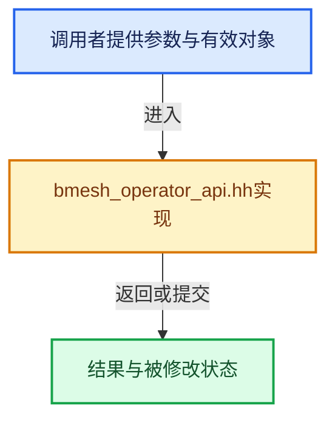

# 实现依赖专题：source/blender/bmesh/intern/bmesh_operator_api.hh

[实现依赖导航](../../../README.md) · [符号索引](../../../../00-课程指南/02-源码与提交索引/符号依赖与实现索引.md)

本专题从正文实际调用进入，集中保存共享实现。函数有稳定锚点，可从调用处直接跳到对应完整函数；递归与互相调用通过回链组织。

## 本文件的实现关系





## 相关类型布局与成员入口

<a id="t-b59fa50b2cc6"></a>

### `blender::BMOpTypeFlag`

原始声明：[source/blender/bmesh/intern/bmesh_operator_api.hh](../../../../../../../../source/blender/bmesh/intern/bmesh_operator_api.hh) · L292—L300。

以下保留类的数据声明与编译条件，成员函数实现通过后面的精确链接阅读。

<!-- annotated:d7a92d707c0407 -->

```cpp
enum BMOpTypeFlag {
  BMO_OPTYPE_FLAG_NOP = 0,
  /** Switch from multires tangent space to absolute coordinates. */
  BMO_OPTYPE_FLAG_UNTAN_MULTIRES = (1 << 0),
  BMO_OPTYPE_FLAG_NORMALS_CALC = (1 << 1),
  BMO_OPTYPE_FLAG_SELECT_FLUSH = (1 << 2),
  BMO_OPTYPE_FLAG_SELECT_VALIDATE = (1 << 3),
  BMO_OPTYPE_FLAG_INVALIDATE_CLNOR_ALL = (1 << 4),
};
```

<details>
<summary>核对原始源码：source/blender/bmesh/intern/bmesh_operator_api.hh · L292—L300</summary>

<!-- original:d7a92d707c0407:source/blender/bmesh/intern/bmesh_operator_api.hh:292:300 -->

```cpp
enum BMOpTypeFlag {
  BMO_OPTYPE_FLAG_NOP = 0,
  /** Switch from multires tangent space to absolute coordinates. */
  BMO_OPTYPE_FLAG_UNTAN_MULTIRES = (1 << 0),
  BMO_OPTYPE_FLAG_NORMALS_CALC = (1 << 1),
  BMO_OPTYPE_FLAG_SELECT_FLUSH = (1 << 2),
  BMO_OPTYPE_FLAG_SELECT_VALIDATE = (1 << 3),
  BMO_OPTYPE_FLAG_INVALIDATE_CLNOR_ALL = (1 << 4),
};
```

</details>


<a id="t-01c321503108"></a>

### `blender::BMO_Delimit`

原始声明：[source/blender/bmesh/intern/bmesh_operator_api.hh](../../../../../../../../source/blender/bmesh/intern/bmesh_operator_api.hh) · L544—L550。

以下保留类的数据声明与编译条件，成员函数实现通过后面的精确链接阅读。

<!-- annotated:d2144a07904c92 -->

```cpp
enum BMO_Delimit {
  BMO_DELIM_NORMAL = 1 << 0,
  BMO_DELIM_MATERIAL = 1 << 1,
  BMO_DELIM_SEAM = 1 << 2,
  BMO_DELIM_SHARP = 1 << 3,
  BMO_DELIM_UV = 1 << 4,
};
```

<details>
<summary>核对原始源码：source/blender/bmesh/intern/bmesh_operator_api.hh · L544—L550</summary>

<!-- original:d2144a07904c92:source/blender/bmesh/intern/bmesh_operator_api.hh:544:550 -->

```cpp
enum BMO_Delimit {
  BMO_DELIM_NORMAL = 1 << 0,
  BMO_DELIM_MATERIAL = 1 << 1,
  BMO_DELIM_SEAM = 1 << 2,
  BMO_DELIM_SHARP = 1 << 3,
  BMO_DELIM_UV = 1 << 4,
};
```

</details>


<a id="m-be1f100af7b0"></a>

## 宏 `BMO_vert_flag_test`

<!-- annotated:0ec0bd33a1a428 -->

```cpp
#define BMO_vert_flag_test(bm, e, oflag) \
  _bmo_elem_flag_test(bm, _BMO_CAST_V_CONST(e)->oflags, oflag)
#define BMO_vert_flag_test_bool(bm, e, oflag) \
```

<details>
<summary>核对原始源码：source/blender/bmesh/intern/bmesh_operator_api.hh · L144—L146</summary>

<!-- original:0ec0bd33a1a428:source/blender/bmesh/intern/bmesh_operator_api.hh:144:146 -->

```cpp
#define BMO_vert_flag_test(bm, e, oflag) \
  _bmo_elem_flag_test(bm, _BMO_CAST_V_CONST(e)->oflags, oflag)
#define BMO_vert_flag_test_bool(bm, e, oflag) \
```

</details>

宏在预处理阶段展开，参数替换、重复求值和条件编译应直接从该定义检查。与普通函数不同，宏不会自动提供参数类型检查；构建配置选择哪个定义需结合外围条件。

<a id="m-ac9fb06695b0"></a>

## 宏 `BMO_vert_flag_test_bool`

<!-- annotated:fa103c4ee4db2b -->

```cpp
#define BMO_vert_flag_test_bool(bm, e, oflag) \
  _bmo_elem_flag_test_bool(bm, _BMO_CAST_V_CONST(e)->oflags, oflag)
#define BMO_vert_flag_enable(bm, e, oflag) _bmo_elem_flag_enable(bm, _BMO_CAST_V(e)->oflags, oflag)
```

<details>
<summary>核对原始源码：source/blender/bmesh/intern/bmesh_operator_api.hh · L146—L148</summary>

<!-- original:fa103c4ee4db2b:source/blender/bmesh/intern/bmesh_operator_api.hh:146:148 -->

```cpp
#define BMO_vert_flag_test_bool(bm, e, oflag) \
  _bmo_elem_flag_test_bool(bm, _BMO_CAST_V_CONST(e)->oflags, oflag)
#define BMO_vert_flag_enable(bm, e, oflag) _bmo_elem_flag_enable(bm, _BMO_CAST_V(e)->oflags, oflag)
```

</details>

宏在预处理阶段展开，参数替换、重复求值和条件编译应直接从该定义检查。与普通函数不同，宏不会自动提供参数类型检查；构建配置选择哪个定义需结合外围条件。

<a id="m-90e32e8aabf0"></a>

## 宏 `BMO_vert_flag_enable`

<!-- annotated:b5a421f1751d7a -->

```cpp
#define BMO_vert_flag_enable(bm, e, oflag) _bmo_elem_flag_enable(bm, _BMO_CAST_V(e)->oflags, oflag)
#define BMO_vert_flag_disable(bm, e, oflag) \
```

<details>
<summary>核对原始源码：source/blender/bmesh/intern/bmesh_operator_api.hh · L148—L149</summary>

<!-- original:b5a421f1751d7a:source/blender/bmesh/intern/bmesh_operator_api.hh:148:149 -->

```cpp
#define BMO_vert_flag_enable(bm, e, oflag) _bmo_elem_flag_enable(bm, _BMO_CAST_V(e)->oflags, oflag)
#define BMO_vert_flag_disable(bm, e, oflag) \
```

</details>

宏在预处理阶段展开，参数替换、重复求值和条件编译应直接从该定义检查。与普通函数不同，宏不会自动提供参数类型检查；构建配置选择哪个定义需结合外围条件。

<a id="m-4f2d3e755257"></a>

## 宏 `BMO_edge_flag_test`

<!-- annotated:663ca94f024654 -->

```cpp
#define BMO_edge_flag_test(bm, e, oflag) \
  _bmo_elem_flag_test(bm, _BMO_CAST_E_CONST(e)->oflags, oflag)
#define BMO_edge_flag_test_bool(bm, e, oflag) \
```

<details>
<summary>核对原始源码：source/blender/bmesh/intern/bmesh_operator_api.hh · L155—L157</summary>

<!-- original:663ca94f024654:source/blender/bmesh/intern/bmesh_operator_api.hh:155:157 -->

```cpp
#define BMO_edge_flag_test(bm, e, oflag) \
  _bmo_elem_flag_test(bm, _BMO_CAST_E_CONST(e)->oflags, oflag)
#define BMO_edge_flag_test_bool(bm, e, oflag) \
```

</details>

宏在预处理阶段展开，参数替换、重复求值和条件编译应直接从该定义检查。与普通函数不同，宏不会自动提供参数类型检查；构建配置选择哪个定义需结合外围条件。

<a id="m-f151e66f6737"></a>

## 宏 `BMO_edge_flag_test_bool`

<!-- annotated:17066b34676f0a -->

```cpp
#define BMO_edge_flag_test_bool(bm, e, oflag) \
  _bmo_elem_flag_test_bool(bm, _BMO_CAST_E_CONST(e)->oflags, oflag)
#define BMO_edge_flag_enable(bm, e, oflag) _bmo_elem_flag_enable(bm, _BMO_CAST_E(e)->oflags, oflag)
```

<details>
<summary>核对原始源码：source/blender/bmesh/intern/bmesh_operator_api.hh · L157—L159</summary>

<!-- original:17066b34676f0a:source/blender/bmesh/intern/bmesh_operator_api.hh:157:159 -->

```cpp
#define BMO_edge_flag_test_bool(bm, e, oflag) \
  _bmo_elem_flag_test_bool(bm, _BMO_CAST_E_CONST(e)->oflags, oflag)
#define BMO_edge_flag_enable(bm, e, oflag) _bmo_elem_flag_enable(bm, _BMO_CAST_E(e)->oflags, oflag)
```

</details>

宏在预处理阶段展开，参数替换、重复求值和条件编译应直接从该定义检查。与普通函数不同，宏不会自动提供参数类型检查；构建配置选择哪个定义需结合外围条件。

<a id="m-c9656b4d0260"></a>

## 宏 `BMO_edge_flag_enable`

<!-- annotated:6e36f4cd66c17e -->

```cpp
#define BMO_edge_flag_enable(bm, e, oflag) _bmo_elem_flag_enable(bm, _BMO_CAST_E(e)->oflags, oflag)
#define BMO_edge_flag_disable(bm, e, oflag) \
```

<details>
<summary>核对原始源码：source/blender/bmesh/intern/bmesh_operator_api.hh · L159—L160</summary>

<!-- original:6e36f4cd66c17e:source/blender/bmesh/intern/bmesh_operator_api.hh:159:160 -->

```cpp
#define BMO_edge_flag_enable(bm, e, oflag) _bmo_elem_flag_enable(bm, _BMO_CAST_E(e)->oflags, oflag)
#define BMO_edge_flag_disable(bm, e, oflag) \
```

</details>

宏在预处理阶段展开，参数替换、重复求值和条件编译应直接从该定义检查。与普通函数不同，宏不会自动提供参数类型检查；构建配置选择哪个定义需结合外围条件。

<a id="m-747e7b3feece"></a>

## 宏 `BMO_edge_flag_disable`

<!-- annotated:552f7cb3a577ae -->

```cpp
#define BMO_edge_flag_disable(bm, e, oflag) \
  _bmo_elem_flag_disable(bm, _BMO_CAST_E(e)->oflags, oflag)
#define BMO_edge_flag_set(bm, e, oflag, val) \
```

<details>
<summary>核对原始源码：source/blender/bmesh/intern/bmesh_operator_api.hh · L160—L162</summary>

<!-- original:552f7cb3a577ae:source/blender/bmesh/intern/bmesh_operator_api.hh:160:162 -->

```cpp
#define BMO_edge_flag_disable(bm, e, oflag) \
  _bmo_elem_flag_disable(bm, _BMO_CAST_E(e)->oflags, oflag)
#define BMO_edge_flag_set(bm, e, oflag, val) \
```

</details>

宏在预处理阶段展开，参数替换、重复求值和条件编译应直接从该定义检查。与普通函数不同，宏不会自动提供参数类型检查；构建配置选择哪个定义需结合外围条件。

<a id="m-ab8737bca4d0"></a>

## 宏 `BMO_face_flag_test_bool`

<!-- annotated:ebe47eee05f810 -->

```cpp
#define BMO_face_flag_test_bool(bm, e, oflag) \
  _bmo_elem_flag_test_bool(bm, _BMO_CAST_F_CONST(e)->oflags, oflag)
#define BMO_face_flag_enable(bm, e, oflag) _bmo_elem_flag_enable(bm, _BMO_CAST_F(e)->oflags, oflag)
```

<details>
<summary>核对原始源码：source/blender/bmesh/intern/bmesh_operator_api.hh · L168—L170</summary>

<!-- original:ebe47eee05f810:source/blender/bmesh/intern/bmesh_operator_api.hh:168:170 -->

```cpp
#define BMO_face_flag_test_bool(bm, e, oflag) \
  _bmo_elem_flag_test_bool(bm, _BMO_CAST_F_CONST(e)->oflags, oflag)
#define BMO_face_flag_enable(bm, e, oflag) _bmo_elem_flag_enable(bm, _BMO_CAST_F(e)->oflags, oflag)
```

</details>

宏在预处理阶段展开，参数替换、重复求值和条件编译应直接从该定义检查。与普通函数不同，宏不会自动提供参数类型检查；构建配置选择哪个定义需结合外围条件。

<a id="m-9a51f5573d5e"></a>

## 宏 `BMO_face_flag_enable`

<!-- annotated:2dc53cf6e5a985 -->

```cpp
#define BMO_face_flag_enable(bm, e, oflag) _bmo_elem_flag_enable(bm, _BMO_CAST_F(e)->oflags, oflag)
#define BMO_face_flag_disable(bm, e, oflag) \
```

<details>
<summary>核对原始源码：source/blender/bmesh/intern/bmesh_operator_api.hh · L170—L171</summary>

<!-- original:2dc53cf6e5a985:source/blender/bmesh/intern/bmesh_operator_api.hh:170:171 -->

```cpp
#define BMO_face_flag_enable(bm, e, oflag) _bmo_elem_flag_enable(bm, _BMO_CAST_F(e)->oflags, oflag)
#define BMO_face_flag_disable(bm, e, oflag) \
```

</details>

宏在预处理阶段展开，参数替换、重复求值和条件编译应直接从该定义检查。与普通函数不同，宏不会自动提供参数类型检查；构建配置选择哪个定义需结合外围条件。

<a id="m-e31186f288c4"></a>

## 宏 `BMO_ASSERT_SLOT_IN_OP`

<!-- annotated:fe47b5ba1a8d80 -->

```cpp
#define BMO_ASSERT_SLOT_IN_OP(slot, op) \
  BLI_assert(((slot >= (op)->slots_in) && (slot < &(op)->slots_in[BMO_OP_MAX_SLOTS])) || \
             ((slot >= (op)->slots_out) && (slot < &(op)->slots_out[BMO_OP_MAX_SLOTS])))

```

<details>
<summary>核对原始源码：source/blender/bmesh/intern/bmesh_operator_api.hh · L284—L287</summary>

<!-- original:fe47b5ba1a8d80:source/blender/bmesh/intern/bmesh_operator_api.hh:284:287 -->

```cpp
#define BMO_ASSERT_SLOT_IN_OP(slot, op) \
  BLI_assert(((slot >= (op)->slots_in) && (slot < &(op)->slots_in[BMO_OP_MAX_SLOTS])) || \
             ((slot >= (op)->slots_out) && (slot < &(op)->slots_out[BMO_OP_MAX_SLOTS])))

```

</details>

宏在预处理阶段展开，参数替换、重复求值和条件编译应直接从该定义检查。与普通函数不同，宏不会自动提供参数类型检查；构建配置选择哪个定义需结合外围条件。

<a id="m-7bddd2957949"></a>

## 宏 `BMO_slot_copy`

<!-- annotated:5491f0be6c3639 -->

```cpp
#define BMO_slot_copy(op_src, slots_src, slot_name_src, op_dst, slots_dst, slot_name_dst) \
  _bmo_slot_copy( \
      (op_src)->slots_src, slot_name_src, (op_dst)->slots_dst, slot_name_dst, (op_dst)->arena)

```

<details>
<summary>核对原始源码：source/blender/bmesh/intern/bmesh_operator_api.hh · L503—L506</summary>

<!-- original:5491f0be6c3639:source/blender/bmesh/intern/bmesh_operator_api.hh:503:506 -->

```cpp
#define BMO_slot_copy(op_src, slots_src, slot_name_src, op_dst, slots_dst, slot_name_dst) \
  _bmo_slot_copy( \
      (op_src)->slots_src, slot_name_src, (op_dst)->slots_dst, slot_name_dst, (op_dst)->arena)

```

</details>

宏在预处理阶段展开，参数替换、重复求值和条件编译应直接从该定义检查。与普通函数不同，宏不会自动提供参数类型检查；构建配置选择哪个定义需结合外围条件。

<a id="m-234e0d75cc35"></a>

## 宏 `BMO_ITER`

<!-- annotated:282a4cf5a18c67 -->

```cpp
#define BMO_ITER(ele, iter, slot_args, slot_name, restrict_flag) \
  for (BM_CHECK_TYPE_ELEM_ASSIGN(ele) = BMO_iter_new(iter, slot_args, slot_name, restrict_flag); \
       ele; \
       BM_CHECK_TYPE_ELEM_ASSIGN(ele) = BMO_iter_step(iter))

```

<details>
<summary>核对原始源码：source/blender/bmesh/intern/bmesh_operator_api.hh · L832—L836</summary>

<!-- original:282a4cf5a18c67:source/blender/bmesh/intern/bmesh_operator_api.hh:832:836 -->

```cpp
#define BMO_ITER(ele, iter, slot_args, slot_name, restrict_flag) \
  for (BM_CHECK_TYPE_ELEM_ASSIGN(ele) = BMO_iter_new(iter, slot_args, slot_name, restrict_flag); \
       ele; \
       BM_CHECK_TYPE_ELEM_ASSIGN(ele) = BMO_iter_step(iter))

```

</details>

宏在预处理阶段展开，参数替换、重复求值和条件编译应直接从该定义检查。与普通函数不同，宏不会自动提供参数类型检查；构建配置选择哪个定义需结合外围条件。

## 完整成员与函数实现
