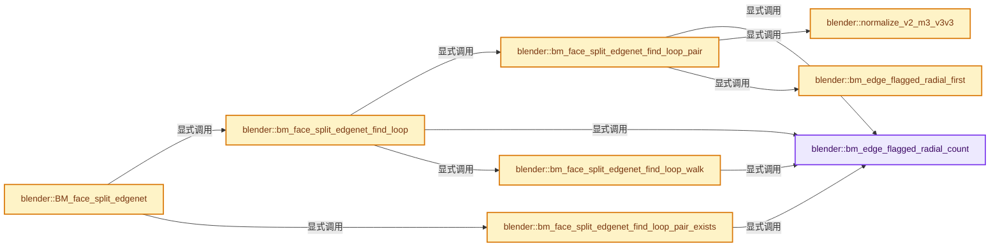
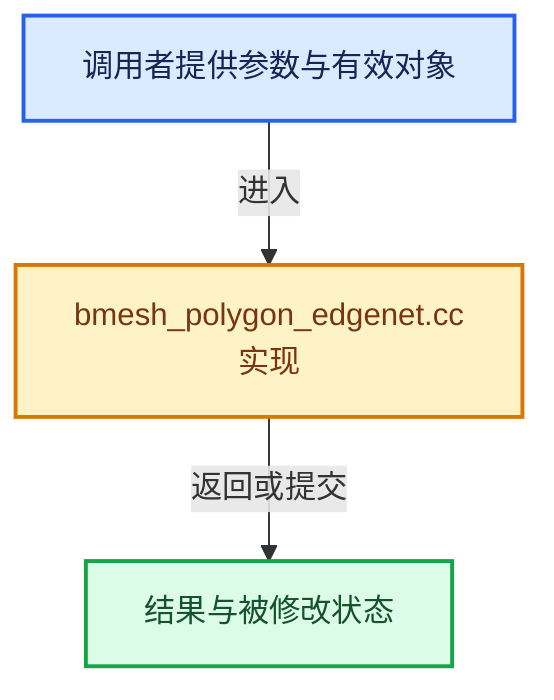

# 实现依赖专题：source/blender/bmesh/intern/bmesh_polygon_edgenet.cc

[实现依赖导航](../../../README.md) · [符号索引](../../../../00-课程指南/02-源码与提交索引/符号依赖与实现索引.md)

本专题从正文实际调用进入，集中保存共享实现。函数有稳定锚点，可从调用处直接跳到对应完整函数；递归与互相调用通过回链组织。

## 本文件的实现关系






## 完整成员与函数实现

<a id="f-1dba47e5171c7197"></a>

### `blender::bm_edge_flagged_radial_count`

实现位置：[source/blender/bmesh/intern/bmesh_polygon_edgenet.cc](../../../../../../../../source/blender/bmesh/intern/bmesh_polygon_edgenet.cc) · L61—L74。

接口参数：

- `BMEdge *e`

**教学注释版**

<!-- annotated:a8e26fa9d2b1f3 -->

```cpp
static uint bm_edge_flagged_radial_count(BMEdge *e)
{
  uint count = 0;
  BMLoop *l;

  if ((l = e->l)) {
    do {
      if (BM_ELEM_API_FLAG_TEST(l->f, FACE_NET)) {
        count++;
      }
    } while ((l = l->radial_next) != e->l);
  }
  return count;
}
```

<details>
<summary>核对原始源码：source/blender/bmesh/intern/bmesh_polygon_edgenet.cc · L61—L74</summary>

<!-- original:a8e26fa9d2b1f3:source/blender/bmesh/intern/bmesh_polygon_edgenet.cc:61:74 -->

```cpp
static uint bm_edge_flagged_radial_count(BMEdge *e)
{
  uint count = 0;
  BMLoop *l;

  if ((l = e->l)) {
    do {
      if (BM_ELEM_API_FLAG_TEST(l->f, FACE_NET)) {
        count++;
      }
    } while ((l = l->radial_next) != e->l);
  }
  return count;
}
```

</details>

**结果出口**

- `return count;`

**继续追踪实现**

- `BM_ELEM_API_FLAG_TEST` → [BM_ELEM_API_FLAG_TEST · L77](bmesh_private.hh.md#m-633a16510ffa)。宏定义由构建条件选择。

<a id="f-dae4f0274f94ee2b"></a>

### `blender::bm_edge_flagged_radial_first`

实现位置：[source/blender/bmesh/intern/bmesh_polygon_edgenet.cc](../../../../../../../../source/blender/bmesh/intern/bmesh_polygon_edgenet.cc) · L76—L88。

接口参数：

- `BMEdge *e`

**教学注释版**

<!-- annotated:3f42c6ad8a8dc8 -->

```cpp
static BMLoop *bm_edge_flagged_radial_first(BMEdge *e)
{
  BMLoop *l;

  if ((l = e->l)) {
    do {
      if (BM_ELEM_API_FLAG_TEST(l->f, FACE_NET)) {
        return l;
      }
    } while ((l = l->radial_next) != e->l);
  }
  return nullptr;
}
```

<details>
<summary>核对原始源码：source/blender/bmesh/intern/bmesh_polygon_edgenet.cc · L76—L88</summary>

<!-- original:3f42c6ad8a8dc8:source/blender/bmesh/intern/bmesh_polygon_edgenet.cc:76:88 -->

```cpp
static BMLoop *bm_edge_flagged_radial_first(BMEdge *e)
{
  BMLoop *l;

  if ((l = e->l)) {
    do {
      if (BM_ELEM_API_FLAG_TEST(l->f, FACE_NET)) {
        return l;
      }
    } while ((l = l->radial_next) != e->l);
  }
  return nullptr;
}
```

</details>

**结果出口**

- `return l;`
- `return nullptr;`

**继续追踪实现**

- `BM_ELEM_API_FLAG_TEST` → [BM_ELEM_API_FLAG_TEST · L77](bmesh_private.hh.md#m-633a16510ffa)。宏定义由构建条件选择。

<a id="f-4199b5eb43ddbd51"></a>

### `blender::normalize_v2_m3_v3v3`

实现位置：[source/blender/bmesh/intern/bmesh_polygon_edgenet.cc](../../../../../../../../source/blender/bmesh/intern/bmesh_polygon_edgenet.cc) · L90—L99。

接口参数：

- `float out[2]`
- `const float axis_mat[3][3]`
- `const float v1[3]`
- `const float v2[3]`

**教学注释版**

<!-- annotated:ca6f19ef36d58d -->

```cpp
static void normalize_v2_m3_v3v3(float out[2],
                                 const float axis_mat[3][3],
                                 const float v1[3],
                                 const float v2[3])
{
  float dir[3];
  sub_v3_v3v3(dir, v1, v2);
  mul_v2_m3v3(out, axis_mat, dir);
  normalize_v2(out);
}
```

<details>
<summary>核对原始源码：source/blender/bmesh/intern/bmesh_polygon_edgenet.cc · L90—L99</summary>

<!-- original:ca6f19ef36d58d:source/blender/bmesh/intern/bmesh_polygon_edgenet.cc:90:99 -->

```cpp
static void normalize_v2_m3_v3v3(float out[2],
                                 const float axis_mat[3][3],
                                 const float v1[3],
                                 const float v2[3])
{
  float dir[3];
  sub_v3_v3v3(dir, v1, v2);
  mul_v2_m3v3(out, axis_mat, dir);
  normalize_v2(out);
}
```

</details>

**继续追踪实现**

- `sub_v3_v3v3` → [blender::sub_v3_v3v3 · L360](../../../01-BLI基础库/intern/math_vector_inline.cc.md#f-23781c252db8b30c)。
- `mul_v2_m3v3` → [blender::mul_v2_m3v3 · L844](../../../01-BLI基础库/intern/math_matrix_c.cc.md#f-2550a487d003ca6b)。
- `normalize_v2` → [blender::normalize_v2 · L868](../../../01-BLI基础库/intern/math_vector_inline.cc.md#f-fe336b5a5c42cb6e)。

<a id="f-91e0e1c1f0fb0f08"></a>

### `blender::bm_face_split_edgenet_find_loop_pair`

实现位置：[source/blender/bmesh/intern/bmesh_polygon_edgenet.cc](../../../../../../../../source/blender/bmesh/intern/bmesh_polygon_edgenet.cc) · L105—L212。

接口参数：

- `BMVert *v_init`
- `const float face_normal[3]`
- `const float face_normal_matrix[3][3]`
- `BMEdge *e_pair[2]`

**教学注释版**

<!-- annotated:7d811b58e9b258 -->

```cpp
static bool bm_face_split_edgenet_find_loop_pair(BMVert *v_init,
                                                 const float face_normal[3],
                                                 const float face_normal_matrix[3][3],
                                                 BMEdge *e_pair[2])
{
  /* Always find one boundary edge (to determine winding)
   * and one wire (if available), otherwise another boundary.
   */

  /* detect winding */
  BMLoop *l_walk;
  bool swap;

  BLI_SMALLSTACK_DECLARE(edges_boundary, BMEdge *);
  BLI_SMALLSTACK_DECLARE(edges_wire, BMEdge *);
  int edges_boundary_len = 0;
  int edges_wire_len = 0;

  {
    BMEdge *e, *e_first;
    e = e_first = v_init->e;
    do {
      if (BM_ELEM_API_FLAG_TEST(e, EDGE_NET)) {
        const uint count = bm_edge_flagged_radial_count(e);
        if (count == 1) {
          BLI_SMALLSTACK_PUSH(edges_boundary, e);
          edges_boundary_len++;
        }
        else if (count == 0) {
          BLI_SMALLSTACK_PUSH(edges_wire, e);
          edges_wire_len++;
        }
      }
    } while ((e = BM_DISK_EDGE_NEXT(e, v_init)) != e_first);
  }

  /* first edge should always be boundary */
  if (edges_boundary_len == 0) {
    return false;
  }
  e_pair[0] = static_cast<BMEdge *>(BLI_SMALLSTACK_POP(edges_boundary));

  /* use to hold boundary OR wire edges */
  BLI_SMALLSTACK_DECLARE(edges_search, BMEdge *);

  /* attempt one boundary and one wire, or 2 boundary */
  if (edges_wire_len == 0) {
    if (edges_boundary_len > 1) {
      e_pair[1] = static_cast<BMEdge *>(BLI_SMALLSTACK_POP(edges_boundary));

      if (edges_boundary_len > 2) {
        BLI_SMALLSTACK_SWAP(edges_search, edges_boundary);
      }
    }
    else {
      /* one boundary and no wire */
      return false;
    }
  }
  else {
    e_pair[1] = static_cast<BMEdge *>(BLI_SMALLSTACK_POP(edges_wire));
    if (edges_wire_len > 1) {
      BLI_SMALLSTACK_SWAP(edges_search, edges_wire);
    }
  }

  /* if we swapped above, search this list for the best edge */
  if (!BLI_SMALLSTACK_IS_EMPTY(edges_search)) {
    /* find the best edge in 'edge_list' to use for 'e_pair[1]' */
    const BMVert *v_prev = BM_edge_other_vert(e_pair[0], v_init);
    const BMVert *v_next = BM_edge_other_vert(e_pair[1], v_init);

    float dir_prev[2], dir_next[2];

    normalize_v2_m3_v3v3(dir_prev, face_normal_matrix, v_prev->co, v_init->co);
    normalize_v2_m3_v3v3(dir_next, face_normal_matrix, v_next->co, v_init->co);
    float angle_best_cos = dot_v2v2(dir_next, dir_prev);

    BMEdge *e;
    while ((e = static_cast<BMEdge *>(BLI_SMALLSTACK_POP(edges_search)))) {
      v_next = BM_edge_other_vert(e, v_init);
      float dir_test[2];

      normalize_v2_m3_v3v3(dir_test, face_normal_matrix, v_next->co, v_init->co);
      const float angle_test_cos = dot_v2v2(dir_prev, dir_test);

      if (angle_test_cos > angle_best_cos) {
        angle_best_cos = angle_test_cos;
        e_pair[1] = e;
      }
    }
  }

  /* flip based on winding */
  l_walk = bm_edge_flagged_radial_first(e_pair[0]);
  swap = false;
  if (face_normal == l_walk->f->no) {
    swap = !swap;
  }
  if (l_walk->v != v_init) {
    swap = !swap;
  }
  if (swap) {
    std::swap(e_pair[0], e_pair[1]);
  }

  return true;
}
```

<details>
<summary>核对原始源码：source/blender/bmesh/intern/bmesh_polygon_edgenet.cc · L105—L212</summary>

<!-- original:7d811b58e9b258:source/blender/bmesh/intern/bmesh_polygon_edgenet.cc:105:212 -->

```cpp
static bool bm_face_split_edgenet_find_loop_pair(BMVert *v_init,
                                                 const float face_normal[3],
                                                 const float face_normal_matrix[3][3],
                                                 BMEdge *e_pair[2])
{
  /* Always find one boundary edge (to determine winding)
   * and one wire (if available), otherwise another boundary.
   */

  /* detect winding */
  BMLoop *l_walk;
  bool swap;

  BLI_SMALLSTACK_DECLARE(edges_boundary, BMEdge *);
  BLI_SMALLSTACK_DECLARE(edges_wire, BMEdge *);
  int edges_boundary_len = 0;
  int edges_wire_len = 0;

  {
    BMEdge *e, *e_first;
    e = e_first = v_init->e;
    do {
      if (BM_ELEM_API_FLAG_TEST(e, EDGE_NET)) {
        const uint count = bm_edge_flagged_radial_count(e);
        if (count == 1) {
          BLI_SMALLSTACK_PUSH(edges_boundary, e);
          edges_boundary_len++;
        }
        else if (count == 0) {
          BLI_SMALLSTACK_PUSH(edges_wire, e);
          edges_wire_len++;
        }
      }
    } while ((e = BM_DISK_EDGE_NEXT(e, v_init)) != e_first);
  }

  /* first edge should always be boundary */
  if (edges_boundary_len == 0) {
    return false;
  }
  e_pair[0] = static_cast<BMEdge *>(BLI_SMALLSTACK_POP(edges_boundary));

  /* use to hold boundary OR wire edges */
  BLI_SMALLSTACK_DECLARE(edges_search, BMEdge *);

  /* attempt one boundary and one wire, or 2 boundary */
  if (edges_wire_len == 0) {
    if (edges_boundary_len > 1) {
      e_pair[1] = static_cast<BMEdge *>(BLI_SMALLSTACK_POP(edges_boundary));

      if (edges_boundary_len > 2) {
        BLI_SMALLSTACK_SWAP(edges_search, edges_boundary);
      }
    }
    else {
      /* one boundary and no wire */
      return false;
    }
  }
  else {
    e_pair[1] = static_cast<BMEdge *>(BLI_SMALLSTACK_POP(edges_wire));
    if (edges_wire_len > 1) {
      BLI_SMALLSTACK_SWAP(edges_search, edges_wire);
    }
  }

  /* if we swapped above, search this list for the best edge */
  if (!BLI_SMALLSTACK_IS_EMPTY(edges_search)) {
    /* find the best edge in 'edge_list' to use for 'e_pair[1]' */
    const BMVert *v_prev = BM_edge_other_vert(e_pair[0], v_init);
    const BMVert *v_next = BM_edge_other_vert(e_pair[1], v_init);

    float dir_prev[2], dir_next[2];

    normalize_v2_m3_v3v3(dir_prev, face_normal_matrix, v_prev->co, v_init->co);
    normalize_v2_m3_v3v3(dir_next, face_normal_matrix, v_next->co, v_init->co);
    float angle_best_cos = dot_v2v2(dir_next, dir_prev);

    BMEdge *e;
    while ((e = static_cast<BMEdge *>(BLI_SMALLSTACK_POP(edges_search)))) {
      v_next = BM_edge_other_vert(e, v_init);
      float dir_test[2];

      normalize_v2_m3_v3v3(dir_test, face_normal_matrix, v_next->co, v_init->co);
      const float angle_test_cos = dot_v2v2(dir_prev, dir_test);

      if (angle_test_cos > angle_best_cos) {
        angle_best_cos = angle_test_cos;
        e_pair[1] = e;
      }
    }
  }

  /* flip based on winding */
  l_walk = bm_edge_flagged_radial_first(e_pair[0]);
  swap = false;
  if (face_normal == l_walk->f->no) {
    swap = !swap;
  }
  if (l_walk->v != v_init) {
    swap = !swap;
  }
  if (swap) {
    std::swap(e_pair[0], e_pair[1]);
  }

  return true;
}
```

</details>

**沿实际写入检查状态**

- `e = e_first = v_init->e;`
- `e_pair[0] = static_cast<BMEdge *>(BLI_SMALLSTACK_POP(edges_boundary));`
- `e_pair[1] = static_cast<BMEdge *>(BLI_SMALLSTACK_POP(edges_boundary));`
- `e_pair[1] = static_cast<BMEdge *>(BLI_SMALLSTACK_POP(edges_wire));`
- `v_next = BM_edge_other_vert(e, v_init);`
- `angle_best_cos = angle_test_cos;`
- `e_pair[1] = e;`
- `l_walk = bm_edge_flagged_radial_first(e_pair[0]);`
- `swap = false;`
- `swap = !swap;`

**结果出口**

- `return false;`
- `return true;`

**继续追踪实现**

- `BM_ELEM_API_FLAG_TEST` → [BM_ELEM_API_FLAG_TEST · L77](bmesh_private.hh.md#m-633a16510ffa)。宏定义由构建条件选择。
- `bm_edge_flagged_radial_count` → [blender::bm_edge_flagged_radial_count · L61](bmesh_polygon_edgenet.cc.md#f-1dba47e5171c7197)。
- `BLI_SMALLSTACK_PUSH` → [BLI_SMALLSTACK_PUSH · L93](../../../01-BLI基础库/BLI_linklist_stack.hh.md#m-f6feea21b839)。宏定义由构建条件选择。
- `BM_DISK_EDGE_NEXT` → [BM_DISK_EDGE_NEXT · L702](../bmesh_class.hh.md#m-5b55b3533de2)。宏定义由构建条件选择。
- `BLI_SMALLSTACK_POP` → [BLI_SMALLSTACK_POP · L122](../../../01-BLI基础库/BLI_linklist_stack.hh.md#m-de9dbbe51aef)。宏定义由构建条件选择。
- `BLI_SMALLSTACK_SWAP` → [BLI_SMALLSTACK_SWAP · L163](../../../01-BLI基础库/BLI_linklist_stack.hh.md#m-5062ab6dd6a0)。宏定义由构建条件选择。
- `BLI_SMALLSTACK_IS_EMPTY` → [BLI_SMALLSTACK_IS_EMPTY · L136](../../../01-BLI基础库/BLI_linklist_stack.hh.md#m-35bfee506840)。宏定义由构建条件选择。
- `BM_edge_other_vert` → [blender::BM_edge_other_vert · L52](bmesh_query_inline.hh.md#f-464fb9614b23d180)。
- `normalize_v2_m3_v3v3` → [blender::normalize_v2_m3_v3v3 · L90](bmesh_polygon_edgenet.cc.md#f-4199b5eb43ddbd51)。
- `dot_v2v2` → [blender::dot_v2v2 · L636](../../../01-BLI基础库/intern/math_vector_inline.cc.md#f-48540c18a12b0f43)。
- `bm_edge_flagged_radial_first` → [blender::bm_edge_flagged_radial_first · L76](bmesh_polygon_edgenet.cc.md#f-dae4f0274f94ee2b)。
- `std::swap` → [外部契约](https://eel.is/c++draft/)：这个边界按实际表达式及所属类型核对参数、返回值、寿命与失败行为。这里提供接口入口，不声称已解释该第三方版本的内部实现。

<a id="f-282cd774ead4ff2b"></a>

### `blender::bm_face_split_edgenet_find_loop_pair_exists`

实现位置：[source/blender/bmesh/intern/bmesh_polygon_edgenet.cc](../../../../../../../../source/blender/bmesh/intern/bmesh_polygon_edgenet.cc) · L222—L263。

接口参数：

- `BMVert *v_init`

**教学注释版**

<!-- annotated:dd7a125eaedb3e -->

```cpp
static bool bm_face_split_edgenet_find_loop_pair_exists(BMVert *v_init)
{
  int edges_boundary_len = 0;
  int edges_wire_len = 0;

  {
    BMEdge *e, *e_first;
    e = e_first = v_init->e;
    do {
      if (BM_ELEM_API_FLAG_TEST(e, EDGE_NET)) {
        const uint count = bm_edge_flagged_radial_count(e);
        if (count == 1) {
          edges_boundary_len++;
        }
        else if (count == 0) {
          edges_wire_len++;
        }
      }
    } while ((e = BM_DISK_EDGE_NEXT(e, v_init)) != e_first);
  }

  /* first edge should always be boundary */
  if (edges_boundary_len == 0) {
    return false;
  }

  /* attempt one boundary and one wire, or 2 boundary */
  if (edges_wire_len == 0) {
    if (edges_boundary_len >= 2) {
      /* pass */
    }
    else {
      /* one boundary and no wire */
      return false;
    }
  }
  else {
    /* pass */
  }

  return true;
}
```

<details>
<summary>核对原始源码：source/blender/bmesh/intern/bmesh_polygon_edgenet.cc · L222—L263</summary>

<!-- original:dd7a125eaedb3e:source/blender/bmesh/intern/bmesh_polygon_edgenet.cc:222:263 -->

```cpp
static bool bm_face_split_edgenet_find_loop_pair_exists(BMVert *v_init)
{
  int edges_boundary_len = 0;
  int edges_wire_len = 0;

  {
    BMEdge *e, *e_first;
    e = e_first = v_init->e;
    do {
      if (BM_ELEM_API_FLAG_TEST(e, EDGE_NET)) {
        const uint count = bm_edge_flagged_radial_count(e);
        if (count == 1) {
          edges_boundary_len++;
        }
        else if (count == 0) {
          edges_wire_len++;
        }
      }
    } while ((e = BM_DISK_EDGE_NEXT(e, v_init)) != e_first);
  }

  /* first edge should always be boundary */
  if (edges_boundary_len == 0) {
    return false;
  }

  /* attempt one boundary and one wire, or 2 boundary */
  if (edges_wire_len == 0) {
    if (edges_boundary_len >= 2) {
      /* pass */
    }
    else {
      /* one boundary and no wire */
      return false;
    }
  }
  else {
    /* pass */
  }

  return true;
}
```

</details>

**沿实际写入检查状态**

- `e = e_first = v_init->e;`

**结果出口**

- `return false;`
- `return true;`

**继续追踪实现**

- `BM_ELEM_API_FLAG_TEST` → [BM_ELEM_API_FLAG_TEST · L77](bmesh_private.hh.md#m-633a16510ffa)。宏定义由构建条件选择。
- `bm_edge_flagged_radial_count` → [blender::bm_edge_flagged_radial_count · L61](bmesh_polygon_edgenet.cc.md#f-1dba47e5171c7197)。
- `BM_DISK_EDGE_NEXT` → [BM_DISK_EDGE_NEXT · L702](../bmesh_class.hh.md#m-5b55b3533de2)。宏定义由构建条件选择。

<a id="f-66bdf85970e847b1"></a>

### `blender::bm_face_split_edgenet_find_loop_walk`

实现位置：[source/blender/bmesh/intern/bmesh_polygon_edgenet.cc](../../../../../../../../source/blender/bmesh/intern/bmesh_polygon_edgenet.cc) · L265—L412。

接口参数：

- `BMVert *v_init`
- `const float face_normal[3]`
- `VertOrder *edge_order`
- `const uint edge_order_len`
- `BMEdge *e_pair[2]`

**教学注释版**

<!-- annotated:ebe3b0abe9f98f -->

```cpp
static bool bm_face_split_edgenet_find_loop_walk(BMVert *v_init,
                                                 const float face_normal[3],
                                                 /* cache to avoid realloc every time */
                                                 VertOrder *edge_order,
                                                 const uint edge_order_len,
                                                 BMEdge *e_pair[2])
{
  UNUSED_VARS_NDEBUG(edge_order_len);

/* fast-path for the common case (avoid push-pop).
 * Also avoids tagging as visited since we know we
 * can't reach these verts some other way */
#define USE_FASTPATH_NOFORK

  BMVert *v;
  BMVert *v_dst;
  bool found = false;

  VertOrder *eo;
  STACK_DECLARE(edge_order);

  /* store visited verts so we can clear the visit flag after execution */
  BLI_SMALLSTACK_DECLARE(vert_visit, BMVert *);

  /* likely this will stay very small
   * all verts pushed into this stack _must_ have their previous edges set! */
  BLI_SMALLSTACK_DECLARE(vert_stack, BMVert *);
  BLI_SMALLSTACK_DECLARE(vert_stack_next, BMVert *);

  STACK_INIT(edge_order, edge_order_len);

  /* start stepping */
  v = BM_edge_other_vert(e_pair[0], v_init);
  v->e = e_pair[0];
  BLI_SMALLSTACK_PUSH(vert_stack, v);

  v_dst = BM_edge_other_vert(e_pair[1], v_init);

#ifdef DEBUG_PRINT
  printf("%s: vert (search) %d\n", __func__, BM_elem_index_get(v_init));
#endif

  /* This loop will keep stepping over the best possible edge,
   * in most cases it finds the direct route to close the face.
   *
   * In cases where paths can't be closed,
   * alternatives are stored in the 'vert_stack'.
   */
  while ((v = static_cast<BMVert *>(BLI_SMALLSTACK_POP_EX(vert_stack, vert_stack_next)))) {
#ifdef USE_FASTPATH_NOFORK
  walk_nofork:
#else
    BLI_SMALLSTACK_PUSH(vert_visit, v);
    BM_ELEM_API_FLAG_ENABLE(v, VERT_VISIT);
#endif

    BLI_assert(STACK_SIZE(edge_order) == 0);

    /* check if we're done! */
    if (v == v_dst) {
      found = true;
      goto finally;
    }

    BMEdge *e_next, *e_first;
    e_first = v->e;
    e_next = BM_DISK_EDGE_NEXT(e_first, v); /* always skip this verts edge */

    /* in rare cases there may be edges with a single connecting vertex */
    if (e_next != e_first) {
      do {
        if (BM_ELEM_API_FLAG_TEST(e_next, EDGE_NET) && (bm_edge_flagged_radial_count(e_next) < 2))
        {
          BMVert *v_next;

          v_next = BM_edge_other_vert(e_next, v);
          BLI_assert(v->e != e_next);

#ifdef DEBUG_PRINT
          /* indent and print */
          {
            BMVert *_v = v;
            do {
              printf("  ");
            } while ((_v = BM_edge_other_vert(_v->e, _v)) != v_init);
            printf("vert %d -> %d (add=%d)\n",
                   BM_elem_index_get(v),
                   BM_elem_index_get(v_next),
                   BM_ELEM_API_FLAG_TEST(v_next, VERT_VISIT) == 0);
          }
#endif

          if (!BM_ELEM_API_FLAG_TEST(v_next, VERT_VISIT)) {
            eo = STACK_PUSH_RET_PTR(edge_order);
            eo->v = v_next;

            v_next->e = e_next;
          }
        }
      } while ((e_next = BM_DISK_EDGE_NEXT(e_next, v)) != e_first);
    }

#ifdef USE_FASTPATH_NOFORK
    if (STACK_SIZE(edge_order) == 1) {
      eo = STACK_POP_PTR(edge_order);
      v = eo->v;

      goto walk_nofork;
    }
#endif

    /* sort by angle if needed */
    if (STACK_SIZE(edge_order) > 1) {
      uint j;
      BMVert *v_prev = BM_edge_other_vert(v->e, v);

      for (j = 0; j < STACK_SIZE(edge_order); j++) {
        edge_order[j].angle = angle_signed_on_axis_v3v3v3_v3(
            v_prev->co, v->co, edge_order[j].v->co, face_normal);
      }
      qsort(edge_order, STACK_SIZE(edge_order), sizeof(VertOrder), BLI_sortutil_cmp_float_reverse);

#ifdef USE_FASTPATH_NOFORK
      /* only tag forks */
      BLI_SMALLSTACK_PUSH(vert_visit, v);
      BM_ELEM_API_FLAG_ENABLE(v, VERT_VISIT);
#endif
    }

    while ((eo = STACK_POP_PTR(edge_order))) {
      BLI_SMALLSTACK_PUSH(vert_stack_next, eo->v);
    }

    if (!BLI_SMALLSTACK_IS_EMPTY(vert_stack_next)) {
      BLI_SMALLSTACK_SWAP(vert_stack, vert_stack_next);
    }
  }

finally:
  /* clear flag for next execution */
  while ((v = static_cast<BMVert *>(BLI_SMALLSTACK_POP(vert_visit)))) {
    BM_ELEM_API_FLAG_DISABLE(v, VERT_VISIT);
  }

  return found;

#undef USE_FASTPATH_NOFORK
}
```

<details>
<summary>核对原始源码：source/blender/bmesh/intern/bmesh_polygon_edgenet.cc · L265—L412</summary>

<!-- original:ebe3b0abe9f98f:source/blender/bmesh/intern/bmesh_polygon_edgenet.cc:265:412 -->

```cpp
static bool bm_face_split_edgenet_find_loop_walk(BMVert *v_init,
                                                 const float face_normal[3],
                                                 /* cache to avoid realloc every time */
                                                 VertOrder *edge_order,
                                                 const uint edge_order_len,
                                                 BMEdge *e_pair[2])
{
  UNUSED_VARS_NDEBUG(edge_order_len);

/* fast-path for the common case (avoid push-pop).
 * Also avoids tagging as visited since we know we
 * can't reach these verts some other way */
#define USE_FASTPATH_NOFORK

  BMVert *v;
  BMVert *v_dst;
  bool found = false;

  VertOrder *eo;
  STACK_DECLARE(edge_order);

  /* store visited verts so we can clear the visit flag after execution */
  BLI_SMALLSTACK_DECLARE(vert_visit, BMVert *);

  /* likely this will stay very small
   * all verts pushed into this stack _must_ have their previous edges set! */
  BLI_SMALLSTACK_DECLARE(vert_stack, BMVert *);
  BLI_SMALLSTACK_DECLARE(vert_stack_next, BMVert *);

  STACK_INIT(edge_order, edge_order_len);

  /* start stepping */
  v = BM_edge_other_vert(e_pair[0], v_init);
  v->e = e_pair[0];
  BLI_SMALLSTACK_PUSH(vert_stack, v);

  v_dst = BM_edge_other_vert(e_pair[1], v_init);

#ifdef DEBUG_PRINT
  printf("%s: vert (search) %d\n", __func__, BM_elem_index_get(v_init));
#endif

  /* This loop will keep stepping over the best possible edge,
   * in most cases it finds the direct route to close the face.
   *
   * In cases where paths can't be closed,
   * alternatives are stored in the 'vert_stack'.
   */
  while ((v = static_cast<BMVert *>(BLI_SMALLSTACK_POP_EX(vert_stack, vert_stack_next)))) {
#ifdef USE_FASTPATH_NOFORK
  walk_nofork:
#else
    BLI_SMALLSTACK_PUSH(vert_visit, v);
    BM_ELEM_API_FLAG_ENABLE(v, VERT_VISIT);
#endif

    BLI_assert(STACK_SIZE(edge_order) == 0);

    /* check if we're done! */
    if (v == v_dst) {
      found = true;
      goto finally;
    }

    BMEdge *e_next, *e_first;
    e_first = v->e;
    e_next = BM_DISK_EDGE_NEXT(e_first, v); /* always skip this verts edge */

    /* in rare cases there may be edges with a single connecting vertex */
    if (e_next != e_first) {
      do {
        if (BM_ELEM_API_FLAG_TEST(e_next, EDGE_NET) && (bm_edge_flagged_radial_count(e_next) < 2))
        {
          BMVert *v_next;

          v_next = BM_edge_other_vert(e_next, v);
          BLI_assert(v->e != e_next);

#ifdef DEBUG_PRINT
          /* indent and print */
          {
            BMVert *_v = v;
            do {
              printf("  ");
            } while ((_v = BM_edge_other_vert(_v->e, _v)) != v_init);
            printf("vert %d -> %d (add=%d)\n",
                   BM_elem_index_get(v),
                   BM_elem_index_get(v_next),
                   BM_ELEM_API_FLAG_TEST(v_next, VERT_VISIT) == 0);
          }
#endif

          if (!BM_ELEM_API_FLAG_TEST(v_next, VERT_VISIT)) {
            eo = STACK_PUSH_RET_PTR(edge_order);
            eo->v = v_next;

            v_next->e = e_next;
          }
        }
      } while ((e_next = BM_DISK_EDGE_NEXT(e_next, v)) != e_first);
    }

#ifdef USE_FASTPATH_NOFORK
    if (STACK_SIZE(edge_order) == 1) {
      eo = STACK_POP_PTR(edge_order);
      v = eo->v;

      goto walk_nofork;
    }
#endif

    /* sort by angle if needed */
    if (STACK_SIZE(edge_order) > 1) {
      uint j;
      BMVert *v_prev = BM_edge_other_vert(v->e, v);

      for (j = 0; j < STACK_SIZE(edge_order); j++) {
        edge_order[j].angle = angle_signed_on_axis_v3v3v3_v3(
            v_prev->co, v->co, edge_order[j].v->co, face_normal);
      }
      qsort(edge_order, STACK_SIZE(edge_order), sizeof(VertOrder), BLI_sortutil_cmp_float_reverse);

#ifdef USE_FASTPATH_NOFORK
      /* only tag forks */
      BLI_SMALLSTACK_PUSH(vert_visit, v);
      BM_ELEM_API_FLAG_ENABLE(v, VERT_VISIT);
#endif
    }

    while ((eo = STACK_POP_PTR(edge_order))) {
      BLI_SMALLSTACK_PUSH(vert_stack_next, eo->v);
    }

    if (!BLI_SMALLSTACK_IS_EMPTY(vert_stack_next)) {
      BLI_SMALLSTACK_SWAP(vert_stack, vert_stack_next);
    }
  }

finally:
  /* clear flag for next execution */
  while ((v = static_cast<BMVert *>(BLI_SMALLSTACK_POP(vert_visit)))) {
    BM_ELEM_API_FLAG_DISABLE(v, VERT_VISIT);
  }

  return found;

#undef USE_FASTPATH_NOFORK
}
```

</details>

**沿实际写入检查状态**

- `v = BM_edge_other_vert(e_pair[0], v_init);`
- `v->e = e_pair[0];`
- `v_dst = BM_edge_other_vert(e_pair[1], v_init);`
- `found = true;`
- `e_first = v->e;`
- `e_next = BM_DISK_EDGE_NEXT(e_first, v); /* always skip this verts edge */`
- `v_next = BM_edge_other_vert(e_next, v);`
- `eo = STACK_PUSH_RET_PTR(edge_order);`
- `eo->v = v_next;`
- `v_next->e = e_next;`
- `eo = STACK_POP_PTR(edge_order);`
- `v = eo->v;`
- `edge_order[j].angle = angle_signed_on_axis_v3v3v3_v3(`

**结果出口**

- `return found;`

**继续追踪实现**

- `UNUSED_VARS_NDEBUG` → [UNUSED_VARS_NDEBUG · L526](../../../01-BLI基础库/BLI_utildefines.hh.md#m-fea439f7d366)；[UNUSED_VARS_NDEBUG · L528](../../../01-BLI基础库/BLI_utildefines.hh.md#m-a8f8cfac06c0)。宏定义由构建条件选择。
- `STACK_DECLARE` → [STACK_DECLARE · L16](../../../01-BLI基础库/BLI_utildefines_stack.hh.md#m-f46a6637d868)；[STACK_DECLARE · L26](../../../01-BLI基础库/BLI_utildefines_stack.hh.md#m-8fc157423707)。宏定义由构建条件选择。
- `STACK_INIT` → [STACK_INIT · L17](../../../01-BLI基础库/BLI_utildefines_stack.hh.md#m-4faf42665148)；[STACK_INIT · L27](../../../01-BLI基础库/BLI_utildefines_stack.hh.md#m-dda4483df379)。宏定义由构建条件选择。
- `BM_edge_other_vert` → [blender::BM_edge_other_vert · L52](bmesh_query_inline.hh.md#f-464fb9614b23d180)。
- `BLI_SMALLSTACK_PUSH` → [BLI_SMALLSTACK_PUSH · L93](../../../01-BLI基础库/BLI_linklist_stack.hh.md#m-f6feea21b839)。宏定义由构建条件选择。
- `printf` → [外部契约](https://eel.is/c++draft/)：这个边界按实际表达式及所属类型核对参数、返回值、寿命与失败行为。这里提供接口入口，不声称已解释该第三方版本的内部实现。
- `BM_elem_index_get` → [BM_elem_index_get · L120](bmesh_inline.hh.md#m-201981cdc62d)。宏定义由构建条件选择。
- `BLI_SMALLSTACK_POP_EX` → [BLI_SMALLSTACK_POP_EX · L127](../../../01-BLI基础库/BLI_linklist_stack.hh.md#m-884d63d7718b)。宏定义由构建条件选择。
- `BM_ELEM_API_FLAG_ENABLE` → [BM_ELEM_API_FLAG_ENABLE · L67](bmesh_private.hh.md#m-f71d74e3af7b)。宏定义由构建条件选择。
- `BLI_assert` → [BLI_assert · L48](../../../01-BLI基础库/BLI_assert.hh.md#m-57a88495704d)；[BLI_assert · L63](../../../01-BLI基础库/BLI_assert.hh.md#m-d07050020cb5)。宏定义由构建条件选择。
- `STACK_SIZE` → [STACK_SIZE · L35](../../../01-BLI基础库/BLI_utildefines_stack.hh.md#m-fc750f4e0a0a)。宏定义由构建条件选择。
- `BM_DISK_EDGE_NEXT` → [BM_DISK_EDGE_NEXT · L702](../bmesh_class.hh.md#m-5b55b3533de2)。宏定义由构建条件选择。
- `BM_ELEM_API_FLAG_TEST` → [BM_ELEM_API_FLAG_TEST · L77](bmesh_private.hh.md#m-633a16510ffa)。宏定义由构建条件选择。
- `bm_edge_flagged_radial_count` → [blender::bm_edge_flagged_radial_count · L61](bmesh_polygon_edgenet.cc.md#f-1dba47e5171c7197)。
- `STACK_PUSH_RET_PTR` → [STACK_PUSH_RET_PTR · L47](../../../01-BLI基础库/BLI_utildefines_stack.hh.md#m-f81a6debaf84)。宏定义由构建条件选择。
- `STACK_POP_PTR` → [STACK_POP_PTR · L51](../../../01-BLI基础库/BLI_utildefines_stack.hh.md#m-29af4d0778e7)。宏定义由构建条件选择。
- `angle_signed_on_axis_v3v3v3_v3` → [blender::angle_signed_on_axis_v3v3v3_v3 · L412](../../../01-BLI基础库/intern/math_vector.cc.md#f-ed46f12bd1b8e462)。
- `qsort` → [调用协议](../../../../00-课程指南/01-路线与规范/模板宏与动态分派协议.md)：函数指针、局部可调用对象或未展开的宏；必须结合调用者环境。调用位置L385。
- `BLI_SMALLSTACK_IS_EMPTY` → [BLI_SMALLSTACK_IS_EMPTY · L136](../../../01-BLI基础库/BLI_linklist_stack.hh.md#m-35bfee506840)。宏定义由构建条件选择。
- `BLI_SMALLSTACK_SWAP` → [BLI_SMALLSTACK_SWAP · L163](../../../01-BLI基础库/BLI_linklist_stack.hh.md#m-5062ab6dd6a0)。宏定义由构建条件选择。
- `BLI_SMALLSTACK_POP` → [BLI_SMALLSTACK_POP · L122](../../../01-BLI基础库/BLI_linklist_stack.hh.md#m-de9dbbe51aef)。宏定义由构建条件选择。
- `BM_ELEM_API_FLAG_DISABLE` → [BM_ELEM_API_FLAG_DISABLE · L72](bmesh_private.hh.md#m-2d2cdca90e2f)。宏定义由构建条件选择。

<a id="f-649d1fe2fa5a376c"></a>

### `blender::bm_face_split_edgenet_find_loop`

实现位置：[source/blender/bmesh/intern/bmesh_polygon_edgenet.cc](../../../../../../../../source/blender/bmesh/intern/bmesh_polygon_edgenet.cc) · L414—L475。

接口参数：

- `BMVert *v_init`
- `const float face_normal[3]`
- `const float face_normal_matrix[3][3]`
- `VertOrder *edge_order`
- `const uint edge_order_len`
- `BMVert **face_verts`
- `BMEdge **face_edges`
- `int *r_face_verts_len`
- `bool *r_check_face_exists`

**教学注释版**

<!-- annotated:19f1d07eba5064 -->

```cpp
static bool bm_face_split_edgenet_find_loop(BMVert *v_init,
                                            const float face_normal[3],
                                            const float face_normal_matrix[3][3],
                                            /* cache to avoid realloc every time */
                                            VertOrder *edge_order,
                                            const uint edge_order_len,
                                            BMVert **face_verts,
                                            BMEdge **face_edges,
                                            int *r_face_verts_len,
                                            bool *r_check_face_exists)
{
  BMEdge *e_pair[2];

  if (!bm_face_split_edgenet_find_loop_pair(v_init, face_normal, face_normal_matrix, e_pair)) {
    return false;
  }

  BLI_assert((bm_edge_flagged_radial_count(e_pair[0]) == 1) ||
             (bm_edge_flagged_radial_count(e_pair[1]) == 1));

  if (!bm_face_split_edgenet_find_loop_walk(
          v_init, face_normal, edge_order, edge_order_len, e_pair))
  {
    return false;
  }

  /* Skip redundant checks for existing faces if *any* edges are wire. */
  bool check_face_exists = true;

  BMVert *v = BM_edge_other_vert(e_pair[1], v_init);
  int i = 0;
  face_verts[i] = v_init;
  face_edges[i] = e_pair[1];
  if (check_face_exists && BM_edge_is_wire(face_edges[i])) {
    check_face_exists = false;
  }
  i++;

  do {
    face_verts[i] = v;
    face_edges[i] = v->e;
    if (check_face_exists && BM_edge_is_wire(face_edges[i])) {
      check_face_exists = false;
    }
    i++;
  } while ((v = BM_edge_other_vert(v->e, v)) != v_init);

  if (i < 3) {
    return false;
  }

#ifndef NDEBUG
  for (int j = 0, j_prev = i - 1; j < i; j_prev = j++) {
    BLI_assert(face_edges[j_prev] == BM_edge_exists(face_verts[j], face_verts[j_prev]));
  }
#endif

  *r_face_verts_len = i;

  *r_check_face_exists = check_face_exists;
  return true;
}
```

<details>
<summary>核对原始源码：source/blender/bmesh/intern/bmesh_polygon_edgenet.cc · L414—L475</summary>

<!-- original:19f1d07eba5064:source/blender/bmesh/intern/bmesh_polygon_edgenet.cc:414:475 -->

```cpp
static bool bm_face_split_edgenet_find_loop(BMVert *v_init,
                                            const float face_normal[3],
                                            const float face_normal_matrix[3][3],
                                            /* cache to avoid realloc every time */
                                            VertOrder *edge_order,
                                            const uint edge_order_len,
                                            BMVert **face_verts,
                                            BMEdge **face_edges,
                                            int *r_face_verts_len,
                                            bool *r_check_face_exists)
{
  BMEdge *e_pair[2];

  if (!bm_face_split_edgenet_find_loop_pair(v_init, face_normal, face_normal_matrix, e_pair)) {
    return false;
  }

  BLI_assert((bm_edge_flagged_radial_count(e_pair[0]) == 1) ||
             (bm_edge_flagged_radial_count(e_pair[1]) == 1));

  if (!bm_face_split_edgenet_find_loop_walk(
          v_init, face_normal, edge_order, edge_order_len, e_pair))
  {
    return false;
  }

  /* Skip redundant checks for existing faces if *any* edges are wire. */
  bool check_face_exists = true;

  BMVert *v = BM_edge_other_vert(e_pair[1], v_init);
  int i = 0;
  face_verts[i] = v_init;
  face_edges[i] = e_pair[1];
  if (check_face_exists && BM_edge_is_wire(face_edges[i])) {
    check_face_exists = false;
  }
  i++;

  do {
    face_verts[i] = v;
    face_edges[i] = v->e;
    if (check_face_exists && BM_edge_is_wire(face_edges[i])) {
      check_face_exists = false;
    }
    i++;
  } while ((v = BM_edge_other_vert(v->e, v)) != v_init);

  if (i < 3) {
    return false;
  }

#ifndef NDEBUG
  for (int j = 0, j_prev = i - 1; j < i; j_prev = j++) {
    BLI_assert(face_edges[j_prev] == BM_edge_exists(face_verts[j], face_verts[j_prev]));
  }
#endif

  *r_face_verts_len = i;

  *r_check_face_exists = check_face_exists;
  return true;
}
```

</details>

**沿实际写入检查状态**

- `face_verts[i] = v_init;`
- `face_edges[i] = e_pair[1];`
- `check_face_exists = false;`
- `face_verts[i] = v;`
- `face_edges[i] = v->e;`

**结果出口**

- `return false;`
- `return true;`

**继续追踪实现**

- `bm_face_split_edgenet_find_loop_pair` → [blender::bm_face_split_edgenet_find_loop_pair · L105](bmesh_polygon_edgenet.cc.md#f-91e0e1c1f0fb0f08)。
- `BLI_assert` → [BLI_assert · L48](../../../01-BLI基础库/BLI_assert.hh.md#m-57a88495704d)；[BLI_assert · L63](../../../01-BLI基础库/BLI_assert.hh.md#m-d07050020cb5)。宏定义由构建条件选择。
- `bm_edge_flagged_radial_count` → [blender::bm_edge_flagged_radial_count · L61](bmesh_polygon_edgenet.cc.md#f-1dba47e5171c7197)。
- `bm_face_split_edgenet_find_loop_walk` → [blender::bm_face_split_edgenet_find_loop_walk · L265](bmesh_polygon_edgenet.cc.md#f-66bdf85970e847b1)。
- `BM_edge_other_vert` → [blender::BM_edge_other_vert · L52](bmesh_query_inline.hh.md#f-464fb9614b23d180)。
- `BM_edge_is_wire` → [blender::BM_edge_is_wire · L68](bmesh_query_inline.hh.md#f-8171635700fdb320)。
- `BM_edge_exists` → [blender::BM_edge_exists · L1551](bmesh_query.cc.md#f-f9a007e7659d480b)；[blender::BM_edge_exists · L1568](bmesh_query.cc.md#f-e774a553f01590ed)。同名重载需按实参类型选择。

<a id="f-4d9a3bc8f5d3d976"></a>

### `blender::BM_face_split_edgenet`

实现位置：[source/blender/bmesh/intern/bmesh_polygon_edgenet.cc](../../../../../../../../source/blender/bmesh/intern/bmesh_polygon_edgenet.cc) · L477—L711。

接口参数：

- `BMesh *bm`
- `BMFace *f`
- `BMEdge **edge_net`
- `const int edge_net_len`
- `Vector<BMFace *> *r_face_arr`

**教学注释版**

<!-- annotated:acc34a7ecdb065 -->

```cpp
bool BM_face_split_edgenet(
    BMesh *bm, BMFace *f, BMEdge **edge_net, const int edge_net_len, Vector<BMFace *> *r_face_arr)
{
  /* re-use for new face verts */
  BMVert **face_verts;
  BMEdge **face_edges;
  int face_verts_len;

  BMVert **vert_queue;
  STACK_DECLARE(vert_queue);
  int i;

  VertOrder *edge_order;
  const uint edge_order_len = edge_net_len + 2;

  BMVert *v;

  BMLoop *l_iter, *l_first;

  if (!edge_net_len) {
    if (r_face_arr) {
      // [讲解] r_face_arr->clear_and_shrink：销毁全部元素，释放外部缓冲，并恢复到空的内嵌存储状态。
      r_face_arr->clear_and_shrink();
    }
    return false;
  }

  /* These arrays used to be stack memory, however they can be
   * large for single faces with complex edge-nets, see: #65980. */

  /* over-alloc (probably 2-4 is only used in most cases), for the biggest-fan */
  edge_order = MEM_new_array_uninitialized<VertOrder>(edge_order_len, __func__);

  /* use later */
  face_verts = MEM_new_array_uninitialized<BMVert *>(edge_net_len + f->len, __func__);
  face_edges = MEM_new_array_uninitialized<BMEdge *>(edge_net_len + f->len, __func__);

  vert_queue = MEM_new_array_uninitialized<BMVert *>(edge_net_len + f->len, __func__);
  STACK_INIT(vert_queue, f->len + edge_net_len);

  BLI_assert(BM_ELEM_API_FLAG_TEST(f, FACE_NET) == 0);
  BM_ELEM_API_FLAG_ENABLE(f, FACE_NET);

#ifndef NDEBUG
  for (i = 0; i < edge_net_len; i++) {
    BLI_assert(BM_ELEM_API_FLAG_TEST(edge_net[i], EDGE_NET) == 0);
    BLI_assert(BM_edge_in_face(edge_net[i], f) == false);
  }
  l_iter = l_first = BM_FACE_FIRST_LOOP(f);
  do {
    BLI_assert(BM_ELEM_API_FLAG_TEST(l_iter->e, EDGE_NET) == 0);
  } while ((l_iter = l_iter->next) != l_first);
#endif

  /* NOTE: 'VERT_IN_QUEUE' is often not needed at all,
   * however in rare cases verts are added multiple times to the queue,
   * that on its own is harmless but in _very_ rare cases,
   * the queue will overflow its maximum size,
   * so we better be strict about this! see: #51539 */

  for (i = 0; i < edge_net_len; i++) {
    BM_ELEM_API_FLAG_ENABLE(edge_net[i], EDGE_NET);
    BM_ELEM_API_FLAG_DISABLE(edge_net[i]->v1, VERT_IN_QUEUE);
    BM_ELEM_API_FLAG_DISABLE(edge_net[i]->v2, VERT_IN_QUEUE);
  }
  l_iter = l_first = BM_FACE_FIRST_LOOP(f);
  do {
    BM_ELEM_API_FLAG_ENABLE(l_iter->e, EDGE_NET);
    BM_ELEM_API_FLAG_DISABLE(l_iter->v, VERT_IN_QUEUE);
  } while ((l_iter = l_iter->next) != l_first);

  float face_normal_matrix[3][3];
  axis_dominant_v3_to_m3(face_normal_matrix, f->no);

  /* any vert can be used to begin with */
  STACK_PUSH(vert_queue, l_first->v);
  BM_ELEM_API_FLAG_ENABLE(l_first->v, VERT_IN_QUEUE);

  Vector<BMFace *> face_arr;
  while ((v = STACK_POP(vert_queue))) {
    bool check_face_exists = false;
    BM_ELEM_API_FLAG_DISABLE(v, VERT_IN_QUEUE);
    if (bm_face_split_edgenet_find_loop(v,
                                        f->no,
                                        face_normal_matrix,
                                        edge_order,
                                        edge_order_len,
                                        face_verts,
                                        face_edges,
                                        &face_verts_len,
                                        &check_face_exists))
    {
      BMFace *f_new = nullptr;

      if (check_face_exists && BM_face_exists(face_verts, face_verts_len)) [[unlikely]] {
        /* Should only happen in unexpected/degenerate cases, see: #150360. */
      }
      else {
        BLI_assert(!BM_face_exists(face_verts, face_verts_len));
        f_new = BM_face_create(bm, face_verts, face_edges, face_verts_len, f, BM_CREATE_NOP);
      }
      for (i = 0; i < edge_net_len; i++) {
        BLI_assert(BM_ELEM_API_FLAG_TEST(edge_net[i], EDGE_NET));
      }

      if (f_new) {
        BLI_assert(f != f_new);
        // [讲解] face_arr.append：在尾部建立新元素，必要时先扩大存储。
        face_arr.append(f_new);
        copy_v3_v3(f_new->no, f->no);

        /* warning, normally don't do this,
         * its needed for mesh intersection - which tracks face-sides based on selection */
        f_new->head.hflag = f->head.hflag;
        if (f->head.hflag & BM_ELEM_SELECT) {
          bm->totfacesel++;
        }

        BM_ELEM_API_FLAG_ENABLE(f_new, FACE_NET);

        /* add new verts to keep finding loops for
         * (verts between boundary and manifold edges) */
        l_iter = l_first = BM_FACE_FIRST_LOOP(f_new);
        do {
          /* Avoid adding to queue multiple times (not common but happens). */
          if (!BM_ELEM_API_FLAG_TEST(l_iter->v, VERT_IN_QUEUE) &&
              bm_face_split_edgenet_find_loop_pair_exists(l_iter->v))
          {
            STACK_PUSH(vert_queue, l_iter->v);
            BM_ELEM_API_FLAG_ENABLE(l_iter->v, VERT_IN_QUEUE);
          }
        } while ((l_iter = l_iter->next) != l_first);
      }
    }
  }

  if (CustomData_has_math(&bm->ldata)) {
    /* reuse VERT_VISIT here to tag vert's already interpolated */
    BMIter iter;
    BMLoop *l_other;

    /* See: #BM_loop_interp_from_face for similar logic. */
    Array<void *, BM_DEFAULT_NGON_STACK_SIZE> blocks_buf(f->len);
    Array<float2, BM_DEFAULT_NGON_STACK_SIZE> cos_2d_buf(f->len);
    Array<float, BM_DEFAULT_NGON_STACK_SIZE> w(f->len);
    // [讲解] blocks_buf.data：提供数组的借用访问入口。
    void **blocks = blocks_buf.data();
    float (*cos_2d)[2] = reinterpret_cast<float (*)[2]>(cos_2d_buf.data());
    float axis_mat[3][3];
    float co[2];

    /* interior loops */
    axis_dominant_v3_to_m3(axis_mat, f->no);

    /* first simply copy from existing face */
    i = 0;
    l_iter = l_first = BM_FACE_FIRST_LOOP(f);
    do {
      BM_ITER_ELEM (l_other, &iter, l_iter->v, BM_LOOPS_OF_VERT) {
        if ((l_other->f != f) && BM_ELEM_API_FLAG_TEST(l_other->f, FACE_NET)) {
          CustomData_bmesh_copy_block(bm->ldata, l_iter->head.data, &l_other->head.data);
        }
      }
      /* tag not to interpolate */
      BM_ELEM_API_FLAG_ENABLE(l_iter->v, VERT_VISIT);

      mul_v2_m3v3(cos_2d[i], axis_mat, l_iter->v->co);
      blocks[i] = l_iter->head.data;

    } while ((void)i++, (l_iter = l_iter->next) != l_first);

    for (i = 0; i < edge_net_len; i++) {
      BM_ITER_ELEM (v, &iter, edge_net[i], BM_VERTS_OF_EDGE) {
        if (!BM_ELEM_API_FLAG_TEST(v, VERT_VISIT)) {
          BMIter liter;

          BM_ELEM_API_FLAG_ENABLE(v, VERT_VISIT);

          /* interpolate this loop, then copy to the rest */
          l_first = nullptr;

          BM_ITER_ELEM (l_iter, &liter, v, BM_LOOPS_OF_VERT) {
            if (BM_ELEM_API_FLAG_TEST(l_iter->f, FACE_NET)) {
              if (l_first == nullptr) {
                mul_v2_m3v3(co, axis_mat, v->co);
                interp_weights_poly_v2(w.data(), cos_2d, f->len, co);
                CustomData_bmesh_interp(
                    &bm->ldata, (const void **)blocks, w.data(), f->len, l_iter->head.data);
                l_first = l_iter;
              }
              else {
                CustomData_bmesh_copy_block(bm->ldata, l_first->head.data, &l_iter->head.data);
              }
            }
          }
        }
      }
    }
  }

  /* cleanup */
  for (i = 0; i < edge_net_len; i++) {
    BM_ELEM_API_FLAG_DISABLE(edge_net[i], EDGE_NET);
    /* from interp only */
    BM_ELEM_API_FLAG_DISABLE(edge_net[i]->v1, VERT_VISIT);
    BM_ELEM_API_FLAG_DISABLE(edge_net[i]->v2, VERT_VISIT);
  }
  l_iter = l_first = BM_FACE_FIRST_LOOP(f);
  do {
    BM_ELEM_API_FLAG_DISABLE(l_iter->e, EDGE_NET);
    /* from interp only */
    BM_ELEM_API_FLAG_DISABLE(l_iter->v, VERT_VISIT);
  } while ((l_iter = l_iter->next) != l_first);

  if (!face_arr.is_empty()) {
    bmesh_face_swap_data(f, face_arr[0]);
    BM_face_kill(bm, face_arr[0]);
    face_arr[0] = f;
  }
  else {
    BM_ELEM_API_FLAG_DISABLE(f, FACE_NET);
  }

  for (BMFace *face : face_arr) {
    BM_ELEM_API_FLAG_DISABLE(face, FACE_NET);
  }

  if (r_face_arr) {
    // [讲解] std::move：把表达式转换成可供移动重载选择的值类别；不保证真的移动，不结束源对象寿命，对const值可能选择复制。
    *r_face_arr = std::move(face_arr);
  }

  MEM_delete(edge_order);
  MEM_delete(face_verts);
  MEM_delete(face_edges);
  MEM_delete(vert_queue);

  return true;
}
```

<details>
<summary>核对原始源码：source/blender/bmesh/intern/bmesh_polygon_edgenet.cc · L477—L711</summary>

<!-- original:acc34a7ecdb065:source/blender/bmesh/intern/bmesh_polygon_edgenet.cc:477:711 -->

```cpp
bool BM_face_split_edgenet(
    BMesh *bm, BMFace *f, BMEdge **edge_net, const int edge_net_len, Vector<BMFace *> *r_face_arr)
{
  /* re-use for new face verts */
  BMVert **face_verts;
  BMEdge **face_edges;
  int face_verts_len;

  BMVert **vert_queue;
  STACK_DECLARE(vert_queue);
  int i;

  VertOrder *edge_order;
  const uint edge_order_len = edge_net_len + 2;

  BMVert *v;

  BMLoop *l_iter, *l_first;

  if (!edge_net_len) {
    if (r_face_arr) {
      r_face_arr->clear_and_shrink();
    }
    return false;
  }

  /* These arrays used to be stack memory, however they can be
   * large for single faces with complex edge-nets, see: #65980. */

  /* over-alloc (probably 2-4 is only used in most cases), for the biggest-fan */
  edge_order = MEM_new_array_uninitialized<VertOrder>(edge_order_len, __func__);

  /* use later */
  face_verts = MEM_new_array_uninitialized<BMVert *>(edge_net_len + f->len, __func__);
  face_edges = MEM_new_array_uninitialized<BMEdge *>(edge_net_len + f->len, __func__);

  vert_queue = MEM_new_array_uninitialized<BMVert *>(edge_net_len + f->len, __func__);
  STACK_INIT(vert_queue, f->len + edge_net_len);

  BLI_assert(BM_ELEM_API_FLAG_TEST(f, FACE_NET) == 0);
  BM_ELEM_API_FLAG_ENABLE(f, FACE_NET);

#ifndef NDEBUG
  for (i = 0; i < edge_net_len; i++) {
    BLI_assert(BM_ELEM_API_FLAG_TEST(edge_net[i], EDGE_NET) == 0);
    BLI_assert(BM_edge_in_face(edge_net[i], f) == false);
  }
  l_iter = l_first = BM_FACE_FIRST_LOOP(f);
  do {
    BLI_assert(BM_ELEM_API_FLAG_TEST(l_iter->e, EDGE_NET) == 0);
  } while ((l_iter = l_iter->next) != l_first);
#endif

  /* NOTE: 'VERT_IN_QUEUE' is often not needed at all,
   * however in rare cases verts are added multiple times to the queue,
   * that on its own is harmless but in _very_ rare cases,
   * the queue will overflow its maximum size,
   * so we better be strict about this! see: #51539 */

  for (i = 0; i < edge_net_len; i++) {
    BM_ELEM_API_FLAG_ENABLE(edge_net[i], EDGE_NET);
    BM_ELEM_API_FLAG_DISABLE(edge_net[i]->v1, VERT_IN_QUEUE);
    BM_ELEM_API_FLAG_DISABLE(edge_net[i]->v2, VERT_IN_QUEUE);
  }
  l_iter = l_first = BM_FACE_FIRST_LOOP(f);
  do {
    BM_ELEM_API_FLAG_ENABLE(l_iter->e, EDGE_NET);
    BM_ELEM_API_FLAG_DISABLE(l_iter->v, VERT_IN_QUEUE);
  } while ((l_iter = l_iter->next) != l_first);

  float face_normal_matrix[3][3];
  axis_dominant_v3_to_m3(face_normal_matrix, f->no);

  /* any vert can be used to begin with */
  STACK_PUSH(vert_queue, l_first->v);
  BM_ELEM_API_FLAG_ENABLE(l_first->v, VERT_IN_QUEUE);

  Vector<BMFace *> face_arr;
  while ((v = STACK_POP(vert_queue))) {
    bool check_face_exists = false;
    BM_ELEM_API_FLAG_DISABLE(v, VERT_IN_QUEUE);
    if (bm_face_split_edgenet_find_loop(v,
                                        f->no,
                                        face_normal_matrix,
                                        edge_order,
                                        edge_order_len,
                                        face_verts,
                                        face_edges,
                                        &face_verts_len,
                                        &check_face_exists))
    {
      BMFace *f_new = nullptr;

      if (check_face_exists && BM_face_exists(face_verts, face_verts_len)) [[unlikely]] {
        /* Should only happen in unexpected/degenerate cases, see: #150360. */
      }
      else {
        BLI_assert(!BM_face_exists(face_verts, face_verts_len));
        f_new = BM_face_create(bm, face_verts, face_edges, face_verts_len, f, BM_CREATE_NOP);
      }
      for (i = 0; i < edge_net_len; i++) {
        BLI_assert(BM_ELEM_API_FLAG_TEST(edge_net[i], EDGE_NET));
      }

      if (f_new) {
        BLI_assert(f != f_new);
        face_arr.append(f_new);
        copy_v3_v3(f_new->no, f->no);

        /* warning, normally don't do this,
         * its needed for mesh intersection - which tracks face-sides based on selection */
        f_new->head.hflag = f->head.hflag;
        if (f->head.hflag & BM_ELEM_SELECT) {
          bm->totfacesel++;
        }

        BM_ELEM_API_FLAG_ENABLE(f_new, FACE_NET);

        /* add new verts to keep finding loops for
         * (verts between boundary and manifold edges) */
        l_iter = l_first = BM_FACE_FIRST_LOOP(f_new);
        do {
          /* Avoid adding to queue multiple times (not common but happens). */
          if (!BM_ELEM_API_FLAG_TEST(l_iter->v, VERT_IN_QUEUE) &&
              bm_face_split_edgenet_find_loop_pair_exists(l_iter->v))
          {
            STACK_PUSH(vert_queue, l_iter->v);
            BM_ELEM_API_FLAG_ENABLE(l_iter->v, VERT_IN_QUEUE);
          }
        } while ((l_iter = l_iter->next) != l_first);
      }
    }
  }

  if (CustomData_has_math(&bm->ldata)) {
    /* reuse VERT_VISIT here to tag vert's already interpolated */
    BMIter iter;
    BMLoop *l_other;

    /* See: #BM_loop_interp_from_face for similar logic. */
    Array<void *, BM_DEFAULT_NGON_STACK_SIZE> blocks_buf(f->len);
    Array<float2, BM_DEFAULT_NGON_STACK_SIZE> cos_2d_buf(f->len);
    Array<float, BM_DEFAULT_NGON_STACK_SIZE> w(f->len);
    void **blocks = blocks_buf.data();
    float (*cos_2d)[2] = reinterpret_cast<float (*)[2]>(cos_2d_buf.data());
    float axis_mat[3][3];
    float co[2];

    /* interior loops */
    axis_dominant_v3_to_m3(axis_mat, f->no);

    /* first simply copy from existing face */
    i = 0;
    l_iter = l_first = BM_FACE_FIRST_LOOP(f);
    do {
      BM_ITER_ELEM (l_other, &iter, l_iter->v, BM_LOOPS_OF_VERT) {
        if ((l_other->f != f) && BM_ELEM_API_FLAG_TEST(l_other->f, FACE_NET)) {
          CustomData_bmesh_copy_block(bm->ldata, l_iter->head.data, &l_other->head.data);
        }
      }
      /* tag not to interpolate */
      BM_ELEM_API_FLAG_ENABLE(l_iter->v, VERT_VISIT);

      mul_v2_m3v3(cos_2d[i], axis_mat, l_iter->v->co);
      blocks[i] = l_iter->head.data;

    } while ((void)i++, (l_iter = l_iter->next) != l_first);

    for (i = 0; i < edge_net_len; i++) {
      BM_ITER_ELEM (v, &iter, edge_net[i], BM_VERTS_OF_EDGE) {
        if (!BM_ELEM_API_FLAG_TEST(v, VERT_VISIT)) {
          BMIter liter;

          BM_ELEM_API_FLAG_ENABLE(v, VERT_VISIT);

          /* interpolate this loop, then copy to the rest */
          l_first = nullptr;

          BM_ITER_ELEM (l_iter, &liter, v, BM_LOOPS_OF_VERT) {
            if (BM_ELEM_API_FLAG_TEST(l_iter->f, FACE_NET)) {
              if (l_first == nullptr) {
                mul_v2_m3v3(co, axis_mat, v->co);
                interp_weights_poly_v2(w.data(), cos_2d, f->len, co);
                CustomData_bmesh_interp(
                    &bm->ldata, (const void **)blocks, w.data(), f->len, l_iter->head.data);
                l_first = l_iter;
              }
              else {
                CustomData_bmesh_copy_block(bm->ldata, l_first->head.data, &l_iter->head.data);
              }
            }
          }
        }
      }
    }
  }

  /* cleanup */
  for (i = 0; i < edge_net_len; i++) {
    BM_ELEM_API_FLAG_DISABLE(edge_net[i], EDGE_NET);
    /* from interp only */
    BM_ELEM_API_FLAG_DISABLE(edge_net[i]->v1, VERT_VISIT);
    BM_ELEM_API_FLAG_DISABLE(edge_net[i]->v2, VERT_VISIT);
  }
  l_iter = l_first = BM_FACE_FIRST_LOOP(f);
  do {
    BM_ELEM_API_FLAG_DISABLE(l_iter->e, EDGE_NET);
    /* from interp only */
    BM_ELEM_API_FLAG_DISABLE(l_iter->v, VERT_VISIT);
  } while ((l_iter = l_iter->next) != l_first);

  if (!face_arr.is_empty()) {
    bmesh_face_swap_data(f, face_arr[0]);
    BM_face_kill(bm, face_arr[0]);
    face_arr[0] = f;
  }
  else {
    BM_ELEM_API_FLAG_DISABLE(f, FACE_NET);
  }

  for (BMFace *face : face_arr) {
    BM_ELEM_API_FLAG_DISABLE(face, FACE_NET);
  }

  if (r_face_arr) {
    *r_face_arr = std::move(face_arr);
  }

  MEM_delete(edge_order);
  MEM_delete(face_verts);
  MEM_delete(face_edges);
  MEM_delete(vert_queue);

  return true;
}
```

</details>

**沿实际写入检查状态**

- `edge_order = MEM_new_array_uninitialized<VertOrder>(edge_order_len, __func__);`
- `face_verts = MEM_new_array_uninitialized<BMVert *>(edge_net_len + f->len, __func__);`
- `face_edges = MEM_new_array_uninitialized<BMEdge *>(edge_net_len + f->len, __func__);`
- `vert_queue = MEM_new_array_uninitialized<BMVert *>(edge_net_len + f->len, __func__);`
- `l_iter = l_first = BM_FACE_FIRST_LOOP(f);`
- `f_new = BM_face_create(bm, face_verts, face_edges, face_verts_len, f, BM_CREATE_NOP);`
- `f_new->head.hflag = f->head.hflag;`
- `l_iter = l_first = BM_FACE_FIRST_LOOP(f_new);`
- `i = 0;`
- `blocks[i] = l_iter->head.data;`
- `l_first = nullptr;`
- `l_first = l_iter;`
- `face_arr[0] = f;`

**结果出口**

- `return false;`
- `return true;`

**继续追踪实现**

- `STACK_DECLARE` → [STACK_DECLARE · L16](../../../01-BLI基础库/BLI_utildefines_stack.hh.md#m-f46a6637d868)；[STACK_DECLARE · L26](../../../01-BLI基础库/BLI_utildefines_stack.hh.md#m-8fc157423707)。宏定义由构建条件选择。
- `r_face_arr->clear_and_shrink` → [blender::Vector::clear_and_shrink · L479](../../../../01-基础容器与现代CPP/10-Vector扩容与增长.md#f-bc6dd407df52ad34)。
- `MEM_new_array_uninitialized<VertOrder>` → [MEM_new_array_uninitialized · L608](../../../07-Intern运行时与平台/guardedalloc/MEM_guardedalloc.h.md#f-b7103eae8eb57b05)；[MEM_new_array_uninitialized · L129](../../../07-Intern运行时与平台/guardedalloc/intern/mallocn.cc.md#f-bf6ef4ddcfb6e5df)。同名重载需按实参类型选择。
- `MEM_new_array_uninitialized<BMVert *>` → [MEM_new_array_uninitialized · L608](../../../07-Intern运行时与平台/guardedalloc/MEM_guardedalloc.h.md#f-b7103eae8eb57b05)；[MEM_new_array_uninitialized · L129](../../../07-Intern运行时与平台/guardedalloc/intern/mallocn.cc.md#f-bf6ef4ddcfb6e5df)。同名重载需按实参类型选择。
- `MEM_new_array_uninitialized<BMEdge *>` → [MEM_new_array_uninitialized · L608](../../../07-Intern运行时与平台/guardedalloc/MEM_guardedalloc.h.md#f-b7103eae8eb57b05)；[MEM_new_array_uninitialized · L129](../../../07-Intern运行时与平台/guardedalloc/intern/mallocn.cc.md#f-bf6ef4ddcfb6e5df)。同名重载需按实参类型选择。
- `STACK_INIT` → [STACK_INIT · L17](../../../01-BLI基础库/BLI_utildefines_stack.hh.md#m-4faf42665148)；[STACK_INIT · L27](../../../01-BLI基础库/BLI_utildefines_stack.hh.md#m-dda4483df379)。宏定义由构建条件选择。
- `BLI_assert` → [BLI_assert · L48](../../../01-BLI基础库/BLI_assert.hh.md#m-57a88495704d)；[BLI_assert · L63](../../../01-BLI基础库/BLI_assert.hh.md#m-d07050020cb5)。宏定义由构建条件选择。
- `BM_ELEM_API_FLAG_TEST` → [BM_ELEM_API_FLAG_TEST · L77](bmesh_private.hh.md#m-633a16510ffa)。宏定义由构建条件选择。
- `BM_ELEM_API_FLAG_ENABLE` → [BM_ELEM_API_FLAG_ENABLE · L67](bmesh_private.hh.md#m-f71d74e3af7b)。宏定义由构建条件选择。
- `BM_edge_in_face` → [blender::BM_edge_in_face · L432](bmesh_query.cc.md#f-35ed5d132fbe244d)。
- `BM_FACE_FIRST_LOOP` → [BM_FACE_FIRST_LOOP · L697](../bmesh_class.hh.md#m-c7e10ffb38e6)；[BM_FACE_FIRST_LOOP · L699](../bmesh_class.hh.md#m-76a054cc4770)。宏定义由构建条件选择。
- `BM_ELEM_API_FLAG_DISABLE` → [BM_ELEM_API_FLAG_DISABLE · L72](bmesh_private.hh.md#m-2d2cdca90e2f)。宏定义由构建条件选择。
- `axis_dominant_v3_to_m3` → [blender::axis_dominant_v3_to_m3 · L3702](../../../01-BLI基础库/intern/math_geom.cc.md#f-3e28943552d479d7)。
- `STACK_PUSH` → [STACK_PUSH · L43](../../../01-BLI基础库/BLI_utildefines_stack.hh.md#m-9a5f4720c097)。宏定义由构建条件选择。
- `STACK_POP` → [STACK_POP · L50](../../../01-BLI基础库/BLI_utildefines_stack.hh.md#m-a0bfacbfa370)。宏定义由构建条件选择。
- `bm_face_split_edgenet_find_loop` → [blender::bm_face_split_edgenet_find_loop · L414](bmesh_polygon_edgenet.cc.md#f-649d1fe2fa5a376c)。
- `BM_face_exists` → [blender::BM_face_exists · L1627](bmesh_query.cc.md#f-ebe5a4117c0d751d)。
- `BM_face_create` → [blender::BM_face_create · L516](bmesh_core.cc.md#f-bff201f281bcc55d)。
- `face_arr.append` → [blender::Vector::append · L498](../../../../01-基础容器与现代CPP/11-Vector插入删除与重排.md#f-5bde268a69e443ec)；[blender::Vector::append · L502](../../../../01-基础容器与现代CPP/11-Vector插入删除与重排.md#f-591e0b15e6308532)。同名重载需按实参类型选择。
- `copy_v3_v3` → [blender::copy_v3_v3 · L47](../../../01-BLI基础库/intern/math_vector_inline.cc.md#f-037a0d5fa5060bd6)。
- `bm_face_split_edgenet_find_loop_pair_exists` → [blender::bm_face_split_edgenet_find_loop_pair_exists · L222](bmesh_polygon_edgenet.cc.md#f-282cd774ead4ff2b)。
- `CustomData_has_math` → [blender::CustomData_has_math · L3801](../../../02-BKE几何与数据/intern/customdata.cc.md#f-130cbbd65a50d1ac)。
- `blocks_buf.data` → [blender::Array::data · L323](../../../../01-基础容器与现代CPP/08-Array复制移动与销毁.md#f-95648c799002f4ba)；[blender::Array::data · L327](../../../../01-基础容器与现代CPP/08-Array复制移动与销毁.md#f-50c18301f8c40f9e)。同名重载需按实参类型选择。
- `cos_2d_buf.data` → [blender::Array::data · L323](../../../../01-基础容器与现代CPP/08-Array复制移动与销毁.md#f-95648c799002f4ba)；[blender::Array::data · L327](../../../../01-基础容器与现代CPP/08-Array复制移动与销毁.md#f-50c18301f8c40f9e)。同名重载需按实参类型选择。
- `BM_ITER_ELEM` → [BM_ITER_ELEM · L97](bmesh_iterators.hh.md#m-751d15be7ee4)。宏定义由构建条件选择。
- `CustomData_bmesh_copy_block` → [blender::CustomData_bmesh_copy_block · L3681](../../../02-BKE几何与数据/intern/customdata.cc.md#f-d681531939b43aec)；[blender::CustomData_bmesh_copy_block · L3716](../../../02-BKE几何与数据/intern/customdata.cc.md#f-37799c7d006e0906)。同名重载需按实参类型选择。
- `mul_v2_m3v3` → [blender::mul_v2_m3v3 · L844](../../../01-BLI基础库/intern/math_matrix_c.cc.md#f-2550a487d003ca6b)。
- `interp_weights_poly_v2` → [blender::interp_weights_poly_v2 · L4350](../../../01-BLI基础库/intern/math_geom.cc.md#f-73ffea639341cdd5)。
- `w.data` → [blender::Array::data · L323](../../../../01-基础容器与现代CPP/08-Array复制移动与销毁.md#f-95648c799002f4ba)；[blender::Array::data · L327](../../../../01-基础容器与现代CPP/08-Array复制移动与销毁.md#f-50c18301f8c40f9e)。同名重载需按实参类型选择。
- `CustomData_bmesh_interp` → [blender::CustomData_bmesh_interp · L3954](../../../02-BKE几何与数据/intern/customdata.cc.md#f-098f274d067755f3)。
- `face_arr.is_empty` → [blender::Vector::is_empty · L792](../../../../01-基础容器与现代CPP/11-Vector插入删除与重排.md#f-937bbd9cb80bdcc8)。
- `bmesh_face_swap_data` → [blender::bmesh_face_swap_data · L2999](bmesh_core.cc.md#f-08c28f5fc73847e9)。
- `BM_face_kill` → [blender::BM_face_kill · L957](bmesh_core.cc.md#f-fbdcd02b85e7db02)。
- `std::move` → [外部契约](https://eel.is/c++draft/utility.forward)：把表达式转换成可供移动重载选择的值类别；不保证真的移动，不结束源对象寿命，对const值可能选择复制。
- `MEM_delete` → [MEM_delete · L400](../../../07-Intern运行时与平台/guardedalloc/MEM_guardedalloc.h.md#f-9049ffdd1682887c)。

<a id="f-82e91f3cd02f480c"></a>

### `blender::edge_isect_verts_point_2d`

实现位置：[source/blender/bmesh/intern/bmesh_polygon_edgenet.cc](../../../../../../../../source/blender/bmesh/intern/bmesh_polygon_edgenet.cc) · L740—L751。

接口参数：

- `const BMEdge *e`
- `const BMVert *v_a`
- `const BMVert *v_b`
- `float r_isect[2]`

**教学注释版**

<!-- annotated:3d0ebe60cb44ea -->

```cpp
BLI_INLINE bool edge_isect_verts_point_2d(const BMEdge *e,
                                          const BMVert *v_a,
                                          const BMVert *v_b,
                                          float r_isect[2])
{
  /* This bias seems like it could be too large,
   * mostly its not needed, see #52329 for example where it is. */
  const float endpoint_bias = 1e-4f;
  return ((isect_seg_seg_v2_point_ex(
               v_a->co, v_b->co, e->v1->co, e->v2->co, endpoint_bias, r_isect) == 1) &&
          ((e->v1 != v_a) && (e->v2 != v_a) && (e->v1 != v_b) && (e->v2 != v_b)));
}
```

<details>
<summary>核对原始源码：source/blender/bmesh/intern/bmesh_polygon_edgenet.cc · L740—L751</summary>

<!-- original:3d0ebe60cb44ea:source/blender/bmesh/intern/bmesh_polygon_edgenet.cc:740:751 -->

```cpp
BLI_INLINE bool edge_isect_verts_point_2d(const BMEdge *e,
                                          const BMVert *v_a,
                                          const BMVert *v_b,
                                          float r_isect[2])
{
  /* This bias seems like it could be too large,
   * mostly its not needed, see #52329 for example where it is. */
  const float endpoint_bias = 1e-4f;
  return ((isect_seg_seg_v2_point_ex(
               v_a->co, v_b->co, e->v1->co, e->v2->co, endpoint_bias, r_isect) == 1) &&
          ((e->v1 != v_a) && (e->v2 != v_a) && (e->v1 != v_b) && (e->v2 != v_b)));
}
```

</details>

**结果出口**

- `return ((isect_seg_seg_v2_point_ex(`

**继续追踪实现**

- `isect_seg_seg_v2_point_ex` → [blender::isect_seg_seg_v2_point_ex · L1319](../../../01-BLI基础库/intern/math_geom.cc.md#f-eceeef78ebb37cb9)。

<a id="f-1c872a0afce3fd75"></a>

### `blender::axis_pt_cmp`

实现位置：[source/blender/bmesh/intern/bmesh_polygon_edgenet.cc](../../../../../../../../source/blender/bmesh/intern/bmesh_polygon_edgenet.cc) · L753—L768。

接口参数：

- `const float pt_a[2]`
- `const float pt_b[2]`

**教学注释版**

<!-- annotated:f48db39a50f627 -->

```cpp
BLI_INLINE int axis_pt_cmp(const float pt_a[2], const float pt_b[2])
{
  if (pt_a[0] < pt_b[0]) {
    return -1;
  }
  if (pt_a[0] > pt_b[0]) {
    return 1;
  }
  if (pt_a[1] < pt_b[1]) {
    return -1;
  }
  if (pt_a[1] > pt_b[1]) {
    return 1;
  }
  return 0;
}
```

<details>
<summary>核对原始源码：source/blender/bmesh/intern/bmesh_polygon_edgenet.cc · L753—L768</summary>

<!-- original:f48db39a50f627:source/blender/bmesh/intern/bmesh_polygon_edgenet.cc:753:768 -->

```cpp
BLI_INLINE int axis_pt_cmp(const float pt_a[2], const float pt_b[2])
{
  if (pt_a[0] < pt_b[0]) {
    return -1;
  }
  if (pt_a[0] > pt_b[0]) {
    return 1;
  }
  if (pt_a[1] < pt_b[1]) {
    return -1;
  }
  if (pt_a[1] > pt_b[1]) {
    return 1;
  }
  return 0;
}
```

</details>

**结果出口**

- `return -1;`
- `return 1;`
- `return 0;`

**继续追踪实现**

本实现没有需要继续展开的显式调用；检查返回表达式、对象转换和调用者前置条件。

<a id="f-bc5e4ad7b489cd67"></a>

### `blender::test_edges_isect_2d_vert`

实现位置：[source/blender/bmesh/intern/bmesh_polygon_edgenet.cc](../../../../../../../../source/blender/bmesh/intern/bmesh_polygon_edgenet.cc) · L897—L948。

接口参数：

- `const EdgeGroup_FindConnection_Args *args`
- `BMVert *v_origin`
- `BMVert *v_other`

**教学注释版**

<!-- annotated:f40fd60412aa7f -->

```cpp
static BMEdge *test_edges_isect_2d_vert(const EdgeGroup_FindConnection_Args *args,
                                        BMVert *v_origin,
                                        BMVert *v_other)
{
  int index;

  BVHTreeRayHit hit = {0};
  float dir[3];

  sub_v2_v2v2(dir, v_other->co, v_origin->co);
  dir[2] = 0.0f;
  hit.index = -1;
  hit.dist = normalize_v2(dir);

  Edges_VertVert_BVHTreeTest user_data = {0};
  user_data.dist_orig = hit.dist;
  user_data.edge_arr = args->edge_arr;
  user_data.v_origin = v_origin;
  user_data.v_other = v_other;
  user_data.vert_range = args->vert_range;

  index = BLI_bvhtree_ray_cast_ex(args->bvhtree,
                                  v_origin->co,
                                  dir,
                                  0.0f,
                                  &hit,
                                  bvhtree_test_edges_isect_2d_vert_cb,
                                  &user_data,
                                  0);

  BMEdge *e_hit = (index != -1) ? args->edge_arr[index] : nullptr;

  /* check existing connections (no spatial optimization here since we're continually adding). */
  if (index == -1) [[likely]] {
    float t_best = 1.0f;
    for (uint i = 0; i < args->edge_arr_new_len; i++) {
      float co_isect[2];
      if (edge_isect_verts_point_2d(args->edge_arr_new[i], v_origin, v_other, co_isect))
          [[unlikely]]
      {
        const float t_test = line_point_factor_v2(co_isect, v_origin->co, v_other->co);
        if (t_test < t_best) {
          t_best = t_test;

          e_hit = args->edge_arr_new[i];
        }
      }
    }
  }

  return e_hit;
}
```

<details>
<summary>核对原始源码：source/blender/bmesh/intern/bmesh_polygon_edgenet.cc · L897—L948</summary>

<!-- original:f40fd60412aa7f:source/blender/bmesh/intern/bmesh_polygon_edgenet.cc:897:948 -->

```cpp
static BMEdge *test_edges_isect_2d_vert(const EdgeGroup_FindConnection_Args *args,
                                        BMVert *v_origin,
                                        BMVert *v_other)
{
  int index;

  BVHTreeRayHit hit = {0};
  float dir[3];

  sub_v2_v2v2(dir, v_other->co, v_origin->co);
  dir[2] = 0.0f;
  hit.index = -1;
  hit.dist = normalize_v2(dir);

  Edges_VertVert_BVHTreeTest user_data = {0};
  user_data.dist_orig = hit.dist;
  user_data.edge_arr = args->edge_arr;
  user_data.v_origin = v_origin;
  user_data.v_other = v_other;
  user_data.vert_range = args->vert_range;

  index = BLI_bvhtree_ray_cast_ex(args->bvhtree,
                                  v_origin->co,
                                  dir,
                                  0.0f,
                                  &hit,
                                  bvhtree_test_edges_isect_2d_vert_cb,
                                  &user_data,
                                  0);

  BMEdge *e_hit = (index != -1) ? args->edge_arr[index] : nullptr;

  /* check existing connections (no spatial optimization here since we're continually adding). */
  if (index == -1) [[likely]] {
    float t_best = 1.0f;
    for (uint i = 0; i < args->edge_arr_new_len; i++) {
      float co_isect[2];
      if (edge_isect_verts_point_2d(args->edge_arr_new[i], v_origin, v_other, co_isect))
          [[unlikely]]
      {
        const float t_test = line_point_factor_v2(co_isect, v_origin->co, v_other->co);
        if (t_test < t_best) {
          t_best = t_test;

          e_hit = args->edge_arr_new[i];
        }
      }
    }
  }

  return e_hit;
}
```

</details>

**沿实际写入检查状态**

- `dir[2] = 0.0f;`
- `hit.index = -1;`
- `hit.dist = normalize_v2(dir);`
- `user_data.dist_orig = hit.dist;`
- `user_data.edge_arr = args->edge_arr;`
- `user_data.v_origin = v_origin;`
- `user_data.v_other = v_other;`
- `user_data.vert_range = args->vert_range;`
- `index = BLI_bvhtree_ray_cast_ex(args->bvhtree,`
- `t_best = t_test;`
- `e_hit = args->edge_arr_new[i];`

**结果出口**

- `return e_hit;`

**继续追踪实现**

- `sub_v2_v2v2` → [blender::sub_v2_v2v2 · L335](../../../01-BLI基础库/intern/math_vector_inline.cc.md#f-f37d18ab53de26ca)。
- `normalize_v2` → [blender::normalize_v2 · L868](../../../01-BLI基础库/intern/math_vector_inline.cc.md#f-fe336b5a5c42cb6e)。
- `BLI_bvhtree_ray_cast_ex` → [blender::BLI_bvhtree_ray_cast_ex · L1979](../../../01-BLI基础库/intern/BLI_kdopbvh.cc.md#f-08d53e516a08936a)。
- `edge_isect_verts_point_2d` → [blender::edge_isect_verts_point_2d · L740](bmesh_polygon_edgenet.cc.md#f-82e91f3cd02f480c)。
- `line_point_factor_v2` → [blender::line_point_factor_v2 · L3445](../../../01-BLI基础库/intern/math_geom.cc.md#f-2c83663237f16d09)。

<a id="f-33bfe79831e1ae2f"></a>

### `blender::test_edges_isect_2d_ray`

实现位置：[source/blender/bmesh/intern/bmesh_polygon_edgenet.cc](../../../../../../../../source/blender/bmesh/intern/bmesh_polygon_edgenet.cc) · L954—L1001。

接口参数：

- `const EdgeGroup_FindConnection_Args *args`
- `BMVert *v_origin`
- `const float dir[3]`

**教学注释版**

<!-- annotated:4aa1312a49f168 -->

```cpp
static BMEdge *test_edges_isect_2d_ray(const EdgeGroup_FindConnection_Args *args,
                                       BMVert *v_origin,
                                       const float dir[3])
{
  int index;
  BVHTreeRayHit hit = {0};

  BLI_ASSERT_UNIT_V2(dir);

  hit.index = -1;
  hit.dist = BVH_RAYCAST_DIST_MAX;

  Edges_VertRay_BVHTreeTest user_data = {nullptr};
  user_data.edge_arr = args->edge_arr;
  user_data.v_origin = v_origin;
  user_data.vert_range = args->vert_range;

  index = BLI_bvhtree_ray_cast_ex(args->bvhtree,
                                  v_origin->co,
                                  dir,
                                  0.0f,
                                  &hit,
                                  bvhtree_test_edges_isect_2d_ray_cb,
                                  &user_data,
                                  0);

  BMEdge *e_hit = (index != -1) ? args->edge_arr[index] : nullptr;

  /* check existing connections (no spatial optimization here since we're continually adding). */
  if (index != -1) [[likely]] {
    for (uint i = 0; i < args->edge_arr_new_len; i++) {
      BMEdge *e = args->edge_arr_new[i];
      float dist_new;
      if (isect_ray_seg_v2(v_origin->co, dir, e->v1->co, e->v2->co, &dist_new, nullptr)) {
        if (e->v1 != v_origin && e->v2 != v_origin) {
          /* avoid float precision issues, possible this is greater */
          if (dist_new < hit.dist) [[likely]] {
            hit.dist = dist_new;

            e_hit = args->edge_arr_new[i];
          }
        }
      }
    }
  }

  return e_hit;
}
```

<details>
<summary>核对原始源码：source/blender/bmesh/intern/bmesh_polygon_edgenet.cc · L954—L1001</summary>

<!-- original:4aa1312a49f168:source/blender/bmesh/intern/bmesh_polygon_edgenet.cc:954:1001 -->

```cpp
static BMEdge *test_edges_isect_2d_ray(const EdgeGroup_FindConnection_Args *args,
                                       BMVert *v_origin,
                                       const float dir[3])
{
  int index;
  BVHTreeRayHit hit = {0};

  BLI_ASSERT_UNIT_V2(dir);

  hit.index = -1;
  hit.dist = BVH_RAYCAST_DIST_MAX;

  Edges_VertRay_BVHTreeTest user_data = {nullptr};
  user_data.edge_arr = args->edge_arr;
  user_data.v_origin = v_origin;
  user_data.vert_range = args->vert_range;

  index = BLI_bvhtree_ray_cast_ex(args->bvhtree,
                                  v_origin->co,
                                  dir,
                                  0.0f,
                                  &hit,
                                  bvhtree_test_edges_isect_2d_ray_cb,
                                  &user_data,
                                  0);

  BMEdge *e_hit = (index != -1) ? args->edge_arr[index] : nullptr;

  /* check existing connections (no spatial optimization here since we're continually adding). */
  if (index != -1) [[likely]] {
    for (uint i = 0; i < args->edge_arr_new_len; i++) {
      BMEdge *e = args->edge_arr_new[i];
      float dist_new;
      if (isect_ray_seg_v2(v_origin->co, dir, e->v1->co, e->v2->co, &dist_new, nullptr)) {
        if (e->v1 != v_origin && e->v2 != v_origin) {
          /* avoid float precision issues, possible this is greater */
          if (dist_new < hit.dist) [[likely]] {
            hit.dist = dist_new;

            e_hit = args->edge_arr_new[i];
          }
        }
      }
    }
  }

  return e_hit;
}
```

</details>

**沿实际写入检查状态**

- `hit.index = -1;`
- `hit.dist = BVH_RAYCAST_DIST_MAX;`
- `user_data.edge_arr = args->edge_arr;`
- `user_data.v_origin = v_origin;`
- `user_data.vert_range = args->vert_range;`
- `index = BLI_bvhtree_ray_cast_ex(args->bvhtree,`
- `hit.dist = dist_new;`
- `e_hit = args->edge_arr_new[i];`

**结果出口**

- `return e_hit;`

**继续追踪实现**

- `BLI_ASSERT_UNIT_V2` → [BLI_ASSERT_UNIT_V2 · L323](../../../01-BLI基础库/BLI_math_base_c.hh.md#m-36229ddcf0e5)；[BLI_ASSERT_UNIT_V2 · L358](../../../01-BLI基础库/BLI_math_base_c.hh.md#m-288232d9d182)。宏定义由构建条件选择。
- `BLI_bvhtree_ray_cast_ex` → [blender::BLI_bvhtree_ray_cast_ex · L1979](../../../01-BLI基础库/intern/BLI_kdopbvh.cc.md#f-08d53e516a08936a)。
- `isect_ray_seg_v2` → [blender::isect_ray_seg_v2 · L2144](../../../01-BLI基础库/intern/math_geom.cc.md#f-3e22aa812ffb9794)。

<a id="f-1b887c59c33e9990"></a>

### `blender::bm_face_split_edgenet_find_connection`

实现位置：[source/blender/bmesh/intern/bmesh_polygon_edgenet.cc](../../../../../../../../source/blender/bmesh/intern/bmesh_polygon_edgenet.cc) · L1003—L1080。

接口参数：

- `const EdgeGroup_FindConnection_Args *args`
- `BMVert *v_origin`
- `bool direction_sign`

**教学注释版**

<!-- annotated:935b81ea271344 -->

```cpp
static int bm_face_split_edgenet_find_connection(const EdgeGroup_FindConnection_Args *args,
                                                 BMVert *v_origin,
                                                 /* false = negative, true = positive */
                                                 bool direction_sign)
{
  /**
   * Method for finding connection is as follows:
   *
   * - Cast a ray along either the positive or negative directions.
   * - Take the hit-edge, and cast rays to their vertices
   *   checking those rays don't intersect a closer edge.
   * - Keep taking the hit-edge and testing its verts
   *   until a vertex is found which isn't blocked by an edge.
   *
   * \note It's possible none of the verts can be accessed (with self-intersecting lines).
   * In that case there's no right answer (without subdividing edges),
   * so return a fall-back vertex in that case.
   */

  float dir[3] = {0, 0, 0};
  dir[SORT_AXIS] = direction_sign ? 1.0f : -1.0f;
  BMEdge *e_hit = test_edges_isect_2d_ray(args, v_origin, dir);
  BMVert *v_other = nullptr;

  if (e_hit) {
    BMVert *v_other_fallback = nullptr;

    BLI_SMALLSTACK_DECLARE(vert_search, BMVert *);

    /* ensure we never add verts multiple times (not all that likely - but possible) */
    BLI_SMALLSTACK_DECLARE(vert_blacklist, BMVert *);

    do {
      BMVert *v_pair[2];
      /* ensure the closest vertex is popped back off the stack first */
      if (len_squared_v2v2(v_origin->co, e_hit->v1->co) >
          len_squared_v2v2(v_origin->co, e_hit->v2->co))
      {
        ARRAY_SET_ITEMS(v_pair, e_hit->v1, e_hit->v2);
      }
      else {
        ARRAY_SET_ITEMS(v_pair, e_hit->v2, e_hit->v1);
      }

      for (int j = 0; j < 2; j++) {
        BMVert *v_iter = v_pair[j];
        if (BM_elem_flag_test(v_iter, VERT_IS_VALID)) {
          if (direction_sign ? (v_iter->co[SORT_AXIS] > v_origin->co[SORT_AXIS]) :
                               (v_iter->co[SORT_AXIS] < v_origin->co[SORT_AXIS]))
          {
            BLI_SMALLSTACK_PUSH(vert_search, v_iter);
            BLI_SMALLSTACK_PUSH(vert_blacklist, v_iter);
            BM_elem_flag_disable(v_iter, VERT_IS_VALID);
          }
        }
      }
      v_other_fallback = v_other;

    } while ((v_other = static_cast<BMVert *>(BLI_SMALLSTACK_POP(vert_search))) &&
             (e_hit = test_edges_isect_2d_vert(args, v_origin, v_other)));

    if (v_other == nullptr) {
#ifdef DEBUG_PRINT
      printf("Using fallback\n");
#endif
      v_other = v_other_fallback;
    }

    /* reset the blacklist flag, for future use */
    BMVert *v;
    while ((v = static_cast<BMVert *>(BLI_SMALLSTACK_POP(vert_blacklist)))) {
      BM_elem_flag_enable(v, VERT_IS_VALID);
    }
  }

  /* if we reach this line, v_other is either the best vertex or its nullptr */
  return v_other ? BM_elem_index_get(v_other) : -1;
}
```

<details>
<summary>核对原始源码：source/blender/bmesh/intern/bmesh_polygon_edgenet.cc · L1003—L1080</summary>

<!-- original:935b81ea271344:source/blender/bmesh/intern/bmesh_polygon_edgenet.cc:1003:1080 -->

```cpp
static int bm_face_split_edgenet_find_connection(const EdgeGroup_FindConnection_Args *args,
                                                 BMVert *v_origin,
                                                 /* false = negative, true = positive */
                                                 bool direction_sign)
{
  /**
   * Method for finding connection is as follows:
   *
   * - Cast a ray along either the positive or negative directions.
   * - Take the hit-edge, and cast rays to their vertices
   *   checking those rays don't intersect a closer edge.
   * - Keep taking the hit-edge and testing its verts
   *   until a vertex is found which isn't blocked by an edge.
   *
   * \note It's possible none of the verts can be accessed (with self-intersecting lines).
   * In that case there's no right answer (without subdividing edges),
   * so return a fall-back vertex in that case.
   */

  float dir[3] = {0, 0, 0};
  dir[SORT_AXIS] = direction_sign ? 1.0f : -1.0f;
  BMEdge *e_hit = test_edges_isect_2d_ray(args, v_origin, dir);
  BMVert *v_other = nullptr;

  if (e_hit) {
    BMVert *v_other_fallback = nullptr;

    BLI_SMALLSTACK_DECLARE(vert_search, BMVert *);

    /* ensure we never add verts multiple times (not all that likely - but possible) */
    BLI_SMALLSTACK_DECLARE(vert_blacklist, BMVert *);

    do {
      BMVert *v_pair[2];
      /* ensure the closest vertex is popped back off the stack first */
      if (len_squared_v2v2(v_origin->co, e_hit->v1->co) >
          len_squared_v2v2(v_origin->co, e_hit->v2->co))
      {
        ARRAY_SET_ITEMS(v_pair, e_hit->v1, e_hit->v2);
      }
      else {
        ARRAY_SET_ITEMS(v_pair, e_hit->v2, e_hit->v1);
      }

      for (int j = 0; j < 2; j++) {
        BMVert *v_iter = v_pair[j];
        if (BM_elem_flag_test(v_iter, VERT_IS_VALID)) {
          if (direction_sign ? (v_iter->co[SORT_AXIS] > v_origin->co[SORT_AXIS]) :
                               (v_iter->co[SORT_AXIS] < v_origin->co[SORT_AXIS]))
          {
            BLI_SMALLSTACK_PUSH(vert_search, v_iter);
            BLI_SMALLSTACK_PUSH(vert_blacklist, v_iter);
            BM_elem_flag_disable(v_iter, VERT_IS_VALID);
          }
        }
      }
      v_other_fallback = v_other;

    } while ((v_other = static_cast<BMVert *>(BLI_SMALLSTACK_POP(vert_search))) &&
             (e_hit = test_edges_isect_2d_vert(args, v_origin, v_other)));

    if (v_other == nullptr) {
#ifdef DEBUG_PRINT
      printf("Using fallback\n");
#endif
      v_other = v_other_fallback;
    }

    /* reset the blacklist flag, for future use */
    BMVert *v;
    while ((v = static_cast<BMVert *>(BLI_SMALLSTACK_POP(vert_blacklist)))) {
      BM_elem_flag_enable(v, VERT_IS_VALID);
    }
  }

  /* if we reach this line, v_other is either the best vertex or its nullptr */
  return v_other ? BM_elem_index_get(v_other) : -1;
}
```

</details>

**沿实际写入检查状态**

- `dir[SORT_AXIS] = direction_sign ? 1.0f : -1.0f;`
- `v_other_fallback = v_other;`
- `v_other = v_other_fallback;`

**结果出口**

- `return v_other ? BM_elem_index_get(v_other) : -1;`

**继续追踪实现**

- `test_edges_isect_2d_ray` → [blender::test_edges_isect_2d_ray · L954](bmesh_polygon_edgenet.cc.md#f-33bfe79831e1ae2f)。
- `len_squared_v2v2` → [blender::len_squared_v2v2 · L786](../../../01-BLI基础库/intern/math_vector_inline.cc.md#f-58f946d5a3fd1414)。
- `ARRAY_SET_ITEMS` → [ARRAY_SET_ITEMS · L304](../../../01-BLI基础库/BLI_utildefines.hh.md#m-80336b50a95e)。宏定义由构建条件选择。
- `BM_elem_flag_test` → [BM_elem_flag_test · L21](bmesh_inline.hh.md#m-2431d1179b41)。宏定义由构建条件选择。
- `BLI_SMALLSTACK_PUSH` → [BLI_SMALLSTACK_PUSH · L93](../../../01-BLI基础库/BLI_linklist_stack.hh.md#m-f6feea21b839)。宏定义由构建条件选择。
- `BM_elem_flag_disable` → [BM_elem_flag_disable · L24](bmesh_inline.hh.md#m-e129d62b6353)。宏定义由构建条件选择。
- `BLI_SMALLSTACK_POP` → [BLI_SMALLSTACK_POP · L122](../../../01-BLI基础库/BLI_linklist_stack.hh.md#m-de9dbbe51aef)。宏定义由构建条件选择。
- `test_edges_isect_2d_vert` → [blender::test_edges_isect_2d_vert · L897](bmesh_polygon_edgenet.cc.md#f-bc5e4ad7b489cd67)。
- `printf` → [外部契约](https://eel.is/c++draft/)：这个边界按实际表达式及所属类型核对参数、返回值、寿命与失败行为。这里提供接口入口，不声称已解释该第三方版本的内部实现。
- `BM_elem_flag_enable` → [BM_elem_flag_enable · L23](bmesh_inline.hh.md#m-4400242f1540)。宏定义由构建条件选择。
- `BM_elem_index_get` → [BM_elem_index_get · L120](bmesh_inline.hh.md#m-201981cdc62d)。宏定义由构建条件选择。

<a id="f-3a5ee221267f778f"></a>

### `blender::bm_face_split_edgenet_partial_connect`

实现位置：[source/blender/bmesh/intern/bmesh_polygon_edgenet.cc](../../../../../../../../source/blender/bmesh/intern/bmesh_polygon_edgenet.cc) · L1105—L1230。

接口参数：

- `BMesh *bm`
- `BMVert *v_delimit`
- `BMFace *f`

**教学注释版**

<!-- annotated:b9b6417bce22e6 -->

```cpp
static BMVert *bm_face_split_edgenet_partial_connect(BMesh *bm, BMVert *v_delimit, BMFace *f)
{
  /* -------------------------------------------------------------------- */
  /* Initial check that we may be a delimiting vert (keep this fast) */

  /* initial check - see if we have 3+ flagged edges attached to 'v_delimit'
   * if not, we can early exit */
  LinkNode *e_delimit_list = nullptr;
  uint e_delimit_list_len = 0;

#  define EDGE_NOT_IN_STACK BM_ELEM_INTERNAL_TAG
#  define VERT_NOT_IN_STACK BM_ELEM_INTERNAL_TAG

#  define FOREACH_VERT_EDGE(v_, e_, body_) \
    { \
      BMEdge *e_ = v_->e; \
      do { \
        body_ \
      } while ((e_ = BM_DISK_EDGE_NEXT(e_, v_)) != v_->e); \
    } \
    ((void)0)

  /* start with face edges, since we need to split away wire-only edges */
  BMEdge *e_face_init = nullptr;

  FOREACH_VERT_EDGE(v_delimit, e_iter, {
    if (BM_elem_flag_test(e_iter, EDGE_NOT_IN_STACK)) {
      BLI_assert(BM_elem_flag_test(BM_edge_other_vert(e_iter, v_delimit), VERT_NOT_IN_STACK));
      BLI_linklist_prepend_alloca(&e_delimit_list, e_iter);
      e_delimit_list_len++;
      if (e_iter->l != nullptr && BM_edge_in_face(e_iter, f)) {
        e_face_init = e_iter;
      }
    }
  });

  /* skip typical edge-chain verts */
  if (e_delimit_list_len <= 2) [[likely]] {
    return nullptr;
  }

  /* -------------------------------------------------------------------- */
  /* Complicated stuff starts now! */

  /* Store connected vertices for restoring the flag */
  LinkNode *vert_stack = nullptr;
  BLI_linklist_prepend_alloca(&vert_stack, v_delimit);
  BM_elem_flag_disable(v_delimit, VERT_NOT_IN_STACK);

  /* Walk the net... */
  {
    BLI_SMALLSTACK_DECLARE(search, BMVert *);
    BMVert *v_other = BM_edge_other_vert(e_face_init ? e_face_init : v_delimit->e, v_delimit);

    BLI_SMALLSTACK_PUSH(search, v_other);
    if (BM_elem_flag_test(v_other, VERT_NOT_IN_STACK)) {
      BM_elem_flag_disable(v_other, VERT_NOT_IN_STACK);
      BLI_linklist_prepend_alloca(&vert_stack, v_other);
    }

    while ((v_other = static_cast<BMVert *>(BLI_SMALLSTACK_POP(search)))) {
      BLI_assert(BM_elem_flag_test(v_other, VERT_NOT_IN_STACK) == false);
      BMEdge *e_iter = v_other->e;
      do {
        BMVert *v_step = BM_edge_other_vert(e_iter, v_other);
        if (BM_elem_flag_test(e_iter, EDGE_NOT_IN_STACK)) {
          if (BM_elem_flag_test(v_step, VERT_NOT_IN_STACK)) {
            BM_elem_flag_disable(v_step, VERT_NOT_IN_STACK);
            BLI_SMALLSTACK_PUSH(search, v_step);
            BLI_linklist_prepend_alloca(&vert_stack, v_step);
          }
        }
      } while ((e_iter = BM_DISK_EDGE_NEXT(e_iter, v_other)) != v_other->e);
    }
  }

  /* Detect if this is a delimiter
   * by checking if we didn't walk any of edges connected to 'v_delimit'. */
  bool is_delimit = false;
  FOREACH_VERT_EDGE(v_delimit, e_iter, {
    BMVert *v_step = BM_edge_other_vert(e_iter, v_delimit);
    if (BM_elem_flag_test(v_step, VERT_NOT_IN_STACK) && !BM_edge_in_face(e_iter, f)) {
      is_delimit = true; /* if one vertex is valid - we have a mix */
    }
    else {
      /* match the vertex flag (only for edges around 'v_delimit') */
      BM_elem_flag_disable(e_iter, EDGE_NOT_IN_STACK);
    }
  });

#  undef FOREACH_VERT_EDGE

  /* Execute the split */
  BMVert *v_split = nullptr;
  if (is_delimit) {
    v_split = BM_vert_create(bm, v_delimit->co, nullptr, eBMCreateFlag(0));
    BM_vert_separate_tested_edges(bm, v_split, v_delimit, test_tagged_and_notface, f);
    BM_elem_flag_enable(v_split, VERT_NOT_IN_STACK);

    BLI_assert(v_delimit->e != nullptr);

/* Degenerate, avoid eternal loop, see: #59074. */
#  if 0
    BLI_assert(v_split->e != nullptr);
#  else
    if (v_split->e == nullptr) [[unlikely]] {
      BM_vert_kill(bm, v_split);
      v_split = nullptr;
    }
#  endif
  }

  /* Restore flags */
  do {
    BM_elem_flag_enable((BMVert *)vert_stack->link, VERT_NOT_IN_STACK);
  } while ((vert_stack = vert_stack->next));

  do {
    BM_elem_flag_enable((BMEdge *)e_delimit_list->link, EDGE_NOT_IN_STACK);
  } while ((e_delimit_list = e_delimit_list->next));

#  undef EDGE_NOT_IN_STACK
#  undef VERT_NOT_IN_STACK

  return v_split;
}
```

<details>
<summary>核对原始源码：source/blender/bmesh/intern/bmesh_polygon_edgenet.cc · L1105—L1230</summary>

<!-- original:b9b6417bce22e6:source/blender/bmesh/intern/bmesh_polygon_edgenet.cc:1105:1230 -->

```cpp
static BMVert *bm_face_split_edgenet_partial_connect(BMesh *bm, BMVert *v_delimit, BMFace *f)
{
  /* -------------------------------------------------------------------- */
  /* Initial check that we may be a delimiting vert (keep this fast) */

  /* initial check - see if we have 3+ flagged edges attached to 'v_delimit'
   * if not, we can early exit */
  LinkNode *e_delimit_list = nullptr;
  uint e_delimit_list_len = 0;

#  define EDGE_NOT_IN_STACK BM_ELEM_INTERNAL_TAG
#  define VERT_NOT_IN_STACK BM_ELEM_INTERNAL_TAG

#  define FOREACH_VERT_EDGE(v_, e_, body_) \
    { \
      BMEdge *e_ = v_->e; \
      do { \
        body_ \
      } while ((e_ = BM_DISK_EDGE_NEXT(e_, v_)) != v_->e); \
    } \
    ((void)0)

  /* start with face edges, since we need to split away wire-only edges */
  BMEdge *e_face_init = nullptr;

  FOREACH_VERT_EDGE(v_delimit, e_iter, {
    if (BM_elem_flag_test(e_iter, EDGE_NOT_IN_STACK)) {
      BLI_assert(BM_elem_flag_test(BM_edge_other_vert(e_iter, v_delimit), VERT_NOT_IN_STACK));
      BLI_linklist_prepend_alloca(&e_delimit_list, e_iter);
      e_delimit_list_len++;
      if (e_iter->l != nullptr && BM_edge_in_face(e_iter, f)) {
        e_face_init = e_iter;
      }
    }
  });

  /* skip typical edge-chain verts */
  if (e_delimit_list_len <= 2) [[likely]] {
    return nullptr;
  }

  /* -------------------------------------------------------------------- */
  /* Complicated stuff starts now! */

  /* Store connected vertices for restoring the flag */
  LinkNode *vert_stack = nullptr;
  BLI_linklist_prepend_alloca(&vert_stack, v_delimit);
  BM_elem_flag_disable(v_delimit, VERT_NOT_IN_STACK);

  /* Walk the net... */
  {
    BLI_SMALLSTACK_DECLARE(search, BMVert *);
    BMVert *v_other = BM_edge_other_vert(e_face_init ? e_face_init : v_delimit->e, v_delimit);

    BLI_SMALLSTACK_PUSH(search, v_other);
    if (BM_elem_flag_test(v_other, VERT_NOT_IN_STACK)) {
      BM_elem_flag_disable(v_other, VERT_NOT_IN_STACK);
      BLI_linklist_prepend_alloca(&vert_stack, v_other);
    }

    while ((v_other = static_cast<BMVert *>(BLI_SMALLSTACK_POP(search)))) {
      BLI_assert(BM_elem_flag_test(v_other, VERT_NOT_IN_STACK) == false);
      BMEdge *e_iter = v_other->e;
      do {
        BMVert *v_step = BM_edge_other_vert(e_iter, v_other);
        if (BM_elem_flag_test(e_iter, EDGE_NOT_IN_STACK)) {
          if (BM_elem_flag_test(v_step, VERT_NOT_IN_STACK)) {
            BM_elem_flag_disable(v_step, VERT_NOT_IN_STACK);
            BLI_SMALLSTACK_PUSH(search, v_step);
            BLI_linklist_prepend_alloca(&vert_stack, v_step);
          }
        }
      } while ((e_iter = BM_DISK_EDGE_NEXT(e_iter, v_other)) != v_other->e);
    }
  }

  /* Detect if this is a delimiter
   * by checking if we didn't walk any of edges connected to 'v_delimit'. */
  bool is_delimit = false;
  FOREACH_VERT_EDGE(v_delimit, e_iter, {
    BMVert *v_step = BM_edge_other_vert(e_iter, v_delimit);
    if (BM_elem_flag_test(v_step, VERT_NOT_IN_STACK) && !BM_edge_in_face(e_iter, f)) {
      is_delimit = true; /* if one vertex is valid - we have a mix */
    }
    else {
      /* match the vertex flag (only for edges around 'v_delimit') */
      BM_elem_flag_disable(e_iter, EDGE_NOT_IN_STACK);
    }
  });

#  undef FOREACH_VERT_EDGE

  /* Execute the split */
  BMVert *v_split = nullptr;
  if (is_delimit) {
    v_split = BM_vert_create(bm, v_delimit->co, nullptr, eBMCreateFlag(0));
    BM_vert_separate_tested_edges(bm, v_split, v_delimit, test_tagged_and_notface, f);
    BM_elem_flag_enable(v_split, VERT_NOT_IN_STACK);

    BLI_assert(v_delimit->e != nullptr);

/* Degenerate, avoid eternal loop, see: #59074. */
#  if 0
    BLI_assert(v_split->e != nullptr);
#  else
    if (v_split->e == nullptr) [[unlikely]] {
      BM_vert_kill(bm, v_split);
      v_split = nullptr;
    }
#  endif
  }

  /* Restore flags */
  do {
    BM_elem_flag_enable((BMVert *)vert_stack->link, VERT_NOT_IN_STACK);
  } while ((vert_stack = vert_stack->next));

  do {
    BM_elem_flag_enable((BMEdge *)e_delimit_list->link, EDGE_NOT_IN_STACK);
  } while ((e_delimit_list = e_delimit_list->next));

#  undef EDGE_NOT_IN_STACK
#  undef VERT_NOT_IN_STACK

  return v_split;
}
```

</details>

**沿实际写入检查状态**

- `e_face_init = e_iter;`
- `is_delimit = true; /* if one vertex is valid - we have a mix */`
- `v_split = BM_vert_create(bm, v_delimit->co, nullptr, eBMCreateFlag(0));`
- `v_split = nullptr;`

**结果出口**

- `return nullptr;`
- `return v_split;`

**继续追踪实现**

- `FOREACH_VERT_EDGE` → [调用协议](../../../../00-课程指南/01-路线与规范/模板宏与动态分派协议.md)：函数指针、局部可调用对象或未展开的宏；必须结合调用者环境。调用位置L1130。
- `BM_elem_flag_test` → [BM_elem_flag_test · L21](bmesh_inline.hh.md#m-2431d1179b41)。宏定义由构建条件选择。
- `BLI_assert` → [BLI_assert · L48](../../../01-BLI基础库/BLI_assert.hh.md#m-57a88495704d)；[BLI_assert · L63](../../../01-BLI基础库/BLI_assert.hh.md#m-d07050020cb5)。宏定义由构建条件选择。
- `BM_edge_other_vert` → [blender::BM_edge_other_vert · L52](bmesh_query_inline.hh.md#f-464fb9614b23d180)。
- `BLI_linklist_prepend_alloca` → [BLI_linklist_prepend_alloca · L89](../../../01-BLI基础库/BLI_linklist.hh.md#m-0467394cde28)。宏定义由构建条件选择。
- `BM_edge_in_face` → [blender::BM_edge_in_face · L432](bmesh_query.cc.md#f-35ed5d132fbe244d)。
- `BM_elem_flag_disable` → [BM_elem_flag_disable · L24](bmesh_inline.hh.md#m-e129d62b6353)。宏定义由构建条件选择。
- `BLI_SMALLSTACK_PUSH` → [BLI_SMALLSTACK_PUSH · L93](../../../01-BLI基础库/BLI_linklist_stack.hh.md#m-f6feea21b839)。宏定义由构建条件选择。
- `BLI_SMALLSTACK_POP` → [BLI_SMALLSTACK_POP · L122](../../../01-BLI基础库/BLI_linklist_stack.hh.md#m-de9dbbe51aef)。宏定义由构建条件选择。
- `BM_DISK_EDGE_NEXT` → [BM_DISK_EDGE_NEXT · L702](../bmesh_class.hh.md#m-5b55b3533de2)。宏定义由构建条件选择。
- `BM_vert_create` → [blender::BM_vert_create · L130](bmesh_core.cc.md#f-dfad50d18825b328)。
- `eBMCreateFlag` → [blender::eBMCreateFlag](bmesh_core.hh.md#t-e556bb14cda2)。
- `BM_vert_separate_tested_edges` → [blender::BM_vert_separate_tested_edges · L2656](bmesh_core.cc.md#f-ed65d16e604890d1)。
- `BM_elem_flag_enable` → [BM_elem_flag_enable · L23](bmesh_inline.hh.md#m-4400242f1540)。宏定义由构建条件选择。
- `BM_vert_kill` → [blender::BM_vert_kill · L1068](bmesh_core.cc.md#f-0895632efe77ce45)。

<a id="f-500949e0daa5da91"></a>

### `blender::bm_vert_partial_connect_check_overlap`

实现位置：[source/blender/bmesh/intern/bmesh_polygon_edgenet.cc](../../../../../../../../source/blender/bmesh/intern/bmesh_polygon_edgenet.cc) · L1235—L1244。

接口参数：

- `const int *remap`
- `const int v_a_index`
- `const int v_b_index`

**教学注释版**

<!-- annotated:e82fceb4d03bc1 -->

```cpp
static bool bm_vert_partial_connect_check_overlap(const int *remap,
                                                  const int v_a_index,
                                                  const int v_b_index)
{
  /* Connected to each other. */
  if ((remap[v_a_index] == v_b_index) || (remap[v_b_index] == v_a_index)) [[unlikely]] {
    return true;
  }
  return false;
}
```

<details>
<summary>核对原始源码：source/blender/bmesh/intern/bmesh_polygon_edgenet.cc · L1235—L1244</summary>

<!-- original:e82fceb4d03bc1:source/blender/bmesh/intern/bmesh_polygon_edgenet.cc:1235:1244 -->

```cpp
static bool bm_vert_partial_connect_check_overlap(const int *remap,
                                                  const int v_a_index,
                                                  const int v_b_index)
{
  /* Connected to each other. */
  if ((remap[v_a_index] == v_b_index) || (remap[v_b_index] == v_a_index)) [[unlikely]] {
    return true;
  }
  return false;
}
```

</details>

**结果出口**

- `return true;`
- `return false;`

**继续追踪实现**

本实现没有需要继续展开的显式调用；检查返回表达式、对象转换和调用者前置条件。

<a id="f-9273ad113d22dc8d"></a>

### `blender::BM_face_split_edgenet_connect_islands`

实现位置：[source/blender/bmesh/intern/bmesh_polygon_edgenet.cc](../../../../../../../../source/blender/bmesh/intern/bmesh_polygon_edgenet.cc) · L1248—L1753。

接口参数：

- `BMesh *bm`
- `BMFace *f`
- `BMEdge **edge_net_init`
- `const uint edge_net_init_len`
- `bool use_partial_connect`
- `MemArena *mem_arena`
- `BMEdge ***r_edge_net_new`
- `uint *r_edge_net_new_len`

**教学注释版**

<!-- annotated:ccbf1e85a515a0 -->

```cpp
bool BM_face_split_edgenet_connect_islands(BMesh *bm,
                                           BMFace *f,
                                           BMEdge **edge_net_init,
                                           const uint edge_net_init_len,
                                           bool use_partial_connect,
                                           MemArena *mem_arena,
                                           BMEdge ***r_edge_net_new,
                                           uint *r_edge_net_new_len)
{
  /* -------------------------------------------------------------------- */
  /**
   * This function has 2 main parts.
   *
   * - Check if there are any holes.
   * - Connect the holes with edges (if any are found).
   *
   * Keep the first part fast since it will run very often for edge-nets that have no holes.
   *
   * \note Don't use the mem_arena unless we have holes to fill.
   * (avoid thrashing the area when the initial check isn't so intensive on the stack).
   */

  const uint edge_arr_len = uint(edge_net_init_len) + uint(f->len);
  BMEdge **edge_arr = static_cast<BMEdge **>(
      BLI_memarena_alloc(mem_arena, sizeof(*edge_arr) * edge_arr_len));
  bool ok = false;
  uint edge_net_new_len = uint(edge_net_init_len);

  // [讲解] memcpy：复制字节，源与目标不应重叠。类型生命周期、对齐和可复制表示须由调用者证明，不是任意对象的复制构造。
  memcpy(edge_arr, edge_net_init, sizeof(*edge_arr) * size_t(edge_net_init_len));

/* _must_ clear on exit */
#define EDGE_NOT_IN_STACK BM_ELEM_INTERNAL_TAG
#define VERT_NOT_IN_STACK BM_ELEM_INTERNAL_TAG

  {
    uint i = edge_net_init_len;
    BMLoop *l_iter, *l_first;
    l_iter = l_first = BM_FACE_FIRST_LOOP(f);
    do {
      BLI_assert(!BM_elem_flag_test(l_iter->v, VERT_NOT_IN_STACK));
      BLI_assert(!BM_elem_flag_test(l_iter->e, EDGE_NOT_IN_STACK));
      edge_arr[i++] = l_iter->e;
    } while ((l_iter = l_iter->next) != l_first);
    BLI_assert(i == edge_arr_len);
  }

  for (uint i = 0; i < edge_arr_len; i++) {
    BM_elem_flag_enable(edge_arr[i], EDGE_NOT_IN_STACK);
    BM_elem_flag_enable(edge_arr[i]->v1, VERT_NOT_IN_STACK);
    BM_elem_flag_enable(edge_arr[i]->v2, VERT_NOT_IN_STACK);
  }

#ifdef USE_PARTIAL_CONNECT
  /* Split-out delimiting vertices */
  struct TempVertPair {
    TempVertPair *next;
    BMVert *v_temp;
    BMVert *v_orig;
  };

  struct {
    TempVertPair *list;
    uint len;
    int *remap; /* temp -> orig mapping */
  } temp_vert_pairs = {nullptr};

  if (use_partial_connect) {
    for (uint i = 0; i < edge_net_init_len; i++) {
      for (uint j = 0; j < 2; j++) {
        BMVert *v_delimit = (&edge_arr[i]->v1)[j];
        BMVert *v_other;

        /* NOTE: remapping will _never_ map a vertex to an already mapped vertex. */
        while ((v_other = bm_face_split_edgenet_partial_connect(bm, v_delimit, f))) [[unlikely]] {
          TempVertPair *tvp = static_cast<TempVertPair *>(
              BLI_memarena_alloc(mem_arena, sizeof(*tvp)));
          tvp->next = temp_vert_pairs.list;
          tvp->v_orig = v_delimit;
          tvp->v_temp = v_other;
          temp_vert_pairs.list = tvp;
          temp_vert_pairs.len++;
        }
      }
    }

    if (temp_vert_pairs.len == 0) {
      use_partial_connect = false;
    }
  }
#endif /* USE_PARTIAL_CONNECT */

  uint group_arr_len = 0;
  LinkNode *group_head = nullptr;
  {
    /* scan 'edge_arr' backwards so the outer face boundary is handled first
     * (since its likely to be the largest) */
    uint edge_index = (edge_arr_len - 1);
    uint edge_in_group_tot = 0;

    BLI_SMALLSTACK_DECLARE(vstack, BMVert *);

    while (true) {
      LinkNode *edge_links = nullptr;
      uint unique_verts_in_group = 0, unique_edges_in_group = 0;

      /* list of groups */
      BLI_assert(BM_elem_flag_test(edge_arr[edge_index]->v1, VERT_NOT_IN_STACK));
      BLI_SMALLSTACK_PUSH(vstack, edge_arr[edge_index]->v1);
      BM_elem_flag_disable(edge_arr[edge_index]->v1, VERT_NOT_IN_STACK);

      BMVert *v_iter;
      while ((v_iter = static_cast<BMVert *>(BLI_SMALLSTACK_POP(vstack)))) {
        unique_verts_in_group++;

        BMEdge *e_iter = v_iter->e;
        do {
          if (BM_elem_flag_test(e_iter, EDGE_NOT_IN_STACK)) {
            BM_elem_flag_disable(e_iter, EDGE_NOT_IN_STACK);
            unique_edges_in_group++;

            BLI_linklist_prepend_arena(&edge_links, e_iter, mem_arena);

            BMVert *v_other = BM_edge_other_vert(e_iter, v_iter);
            if (BM_elem_flag_test(v_other, VERT_NOT_IN_STACK)) {
              BLI_SMALLSTACK_PUSH(vstack, v_other);
              BM_elem_flag_disable(v_other, VERT_NOT_IN_STACK);
            }
          }
        } while ((e_iter = BM_DISK_EDGE_NEXT(e_iter, v_iter)) != v_iter->e);
      }

      EdgeGroupIsland *g = static_cast<EdgeGroupIsland *>(
          BLI_memarena_alloc(mem_arena, sizeof(*g)));
      g->vert_len = unique_verts_in_group;
      g->edge_len = unique_edges_in_group;
      edge_in_group_tot += unique_edges_in_group;

      BLI_linklist_prepend_nlink(&group_head, edge_links, reinterpret_cast<LinkNode *>(g));

      group_arr_len++;

      if (edge_in_group_tot == edge_arr_len) {
        break;
      }

      /* skip edges in the stack */
      while (BM_elem_flag_test(edge_arr[edge_index], EDGE_NOT_IN_STACK) == false) {
        BLI_assert(edge_index != 0);
        edge_index--;
      }
    }
  }

  /* Declare here because of `goto` below. */
  BMEdge **edge_net_new = nullptr;
  BVHTree *bvhtree = nullptr;
  float (*vert_coords_backup)[3] = nullptr;
  uint *verts_group_table = nullptr;
  BMVert **vert_arr = nullptr;
  uint vert_arr_len = 0;
  EdgeGroupIsland **group_arr = nullptr;

  /* single group - no holes */
  if (group_arr_len == 1) {
    goto finally;
  }

  /* -------------------------------------------------------------------- */
  /* Previous checks need to be kept fast, since they will run very often,
   * now we know there are holes, so calculate a spatial lookup info and
   * other per-group data.
   */

  float axis_mat[3][3];
  axis_dominant_v3_to_m3(axis_mat, f->no);

#define VERT_IN_ARRAY BM_ELEM_INTERNAL_TAG
  /* Any destructive edits are going to render the UV selection dirty,
   * the flags use here is acceptable. */
#define EDGE_IS_NEW BM_ELEM_SELECT_UV

  group_arr = static_cast<EdgeGroupIsland **>(
      BLI_memarena_alloc(mem_arena, sizeof(*group_arr) * group_arr_len));
  /* sort groups by lowest value vertex */
  {
    /* fill 'groups_arr' in reverse order so the boundary face is first */
    EdgeGroupIsland **group_arr_p = &group_arr[group_arr_len];

    for (EdgeGroupIsland *g = static_cast<EdgeGroupIsland *>(static_cast<void *>(group_head)); g;
         g = reinterpret_cast<EdgeGroupIsland *>(g->edge_links.next))
    {
      LinkNode *edge_links = static_cast<LinkNode *>(g->edge_links.link);

      /* init with *any* different verts */
      g->vert_span.min = (static_cast<BMEdge *>(edge_links->link))->v1;
      g->vert_span.max = (static_cast<BMEdge *>(edge_links->link))->v2;
      float min_axis[2] = {FLT_MAX, FLT_MAX};
      float max_axis[2] = {-FLT_MAX, -FLT_MAX};

      do {
        BMEdge *e = static_cast<BMEdge *>(edge_links->link);
        BLI_assert(e->head.htype == BM_EDGE);

        for (int j = 0; j < 2; j++) {
          BMVert *v_iter = (&e->v1)[j];
          BLI_assert(v_iter->head.htype == BM_VERT);
          /* ideally we could use 'v_iter->co[SORT_AXIS]' here,
           * but we need to sort the groups before setting the vertex array order */
          const float axis_value[2] = {
#if SORT_AXIS == 0
              dot_m3_v3_row_x(axis_mat, v_iter->co),
              dot_m3_v3_row_y(axis_mat, v_iter->co),
#else
              dot_m3_v3_row_y(axis_mat, v_iter->co),
              dot_m3_v3_row_x(axis_mat, v_iter->co),
#endif
          };

          if (axis_pt_cmp(axis_value, min_axis) == -1) {
            g->vert_span.min = v_iter;
            copy_v2_v2(min_axis, axis_value);
          }
          if (axis_pt_cmp(axis_value, max_axis) == 1) {
            g->vert_span.max = v_iter;
            copy_v2_v2(max_axis, axis_value);
          }
        }
      } while ((edge_links = edge_links->next));

      copy_v2_v2(g->vert_span.min_axis, min_axis);
      copy_v2_v2(g->vert_span.max_axis, max_axis);

      g->has_prev_edge = false;

      vert_arr_len += g->vert_len;

      *(--group_arr_p) = g;
    }
  }

  qsort(group_arr, group_arr_len, sizeof(*group_arr), group_min_cmp_fn);

  /* we don't know how many unique verts there are connecting the edges, so over-alloc */
  vert_arr = static_cast<BMVert **>(
      BLI_memarena_alloc(mem_arena, sizeof(*vert_arr) * vert_arr_len));
  /* map vertex -> group index */
  verts_group_table = static_cast<uint *>(
      BLI_memarena_alloc(mem_arena, sizeof(*verts_group_table) * vert_arr_len));

  vert_coords_backup = static_cast<float (*)[3]>(
      BLI_memarena_alloc(mem_arena, sizeof(*vert_coords_backup) * vert_arr_len));

  {
    /* relative location, for higher precision calculations */
    const float f_co_ref[3] = {UNPACK3(BM_FACE_FIRST_LOOP(f)->v->co)};

    int v_index = 0; /* global vert index */
    for (uint g_index = 0; g_index < group_arr_len; g_index++) {
      LinkNode *edge_links = static_cast<LinkNode *>(group_arr[g_index]->edge_links.link);
      do {
        BMEdge *e = static_cast<BMEdge *>(edge_links->link);
        for (int j = 0; j < 2; j++) {
          BMVert *v_iter = (&e->v1)[j];
          if (!BM_elem_flag_test(v_iter, VERT_IN_ARRAY)) {
            BM_elem_flag_enable(v_iter, VERT_IN_ARRAY);

            /* not nice, but alternatives aren't much better :S */
            {
              copy_v3_v3(vert_coords_backup[v_index], v_iter->co);

              /* for higher precision */
              sub_v3_v3(v_iter->co, f_co_ref);

              float co_2d[2];
              mul_v2_m3v3(co_2d, axis_mat, v_iter->co);
              v_iter->co[0] = co_2d[0];
              v_iter->co[1] = co_2d[1];
              v_iter->co[2] = 0.0f;
            }

            BM_elem_index_set(v_iter, v_index); /* set_dirty */

            vert_arr[v_index] = v_iter;
            verts_group_table[v_index] = g_index;
            v_index++;
          }
        }
      } while ((edge_links = edge_links->next));
    }
  }

  bm->elem_index_dirty |= BM_VERT;

  /* Now create BVH tree.
   *
   * Note that a large epsilon is used because meshes with dimensions of around 100+ need it.
   * see #52329. */
  bvhtree = BLI_bvhtree_new(edge_arr_len, 1e-4f, 8, 8);
  for (uint i = 0; i < edge_arr_len; i++) {
    const float e_cos[2][3] = {
        {UNPACK2(edge_arr[i]->v1->co), 0.0f},
        {UNPACK2(edge_arr[i]->v2->co), 0.0f},
    };
    BLI_bvhtree_insert(bvhtree, i, reinterpret_cast<const float *>(e_cos), 2);
  }
  BLI_bvhtree_balance(bvhtree);

#ifdef USE_PARTIAL_CONNECT
  if (use_partial_connect) {
    /* needs to be done once the vertex indices have been written into */
    temp_vert_pairs.remap = static_cast<int *>(
        BLI_memarena_alloc(mem_arena, sizeof(*temp_vert_pairs.remap) * vert_arr_len));
    std::fill_n(temp_vert_pairs.remap, vert_arr_len, -1);

    TempVertPair *tvp = temp_vert_pairs.list;
    do {
      temp_vert_pairs.remap[BM_elem_index_get(tvp->v_temp)] = BM_elem_index_get(tvp->v_orig);
    } while ((tvp = tvp->next));
  }
#endif /* USE_PARTIAL_CONNECT */

  /* Create connections between groups */

  /* may be an over-alloc, but not by much */
  edge_net_new_len = uint(edge_net_init_len) + ((group_arr_len - 1) * 2);
  edge_net_new = static_cast<BMEdge **>(
      BLI_memarena_alloc(mem_arena, sizeof(*edge_net_new) * edge_net_new_len));
  memcpy(edge_net_new, edge_net_init, sizeof(*edge_net_new) * size_t(edge_net_init_len));

  {
    uint edge_net_new_index = edge_net_init_len;
    /* start-end of the verts in the current group */

    uint vert_range[2];

    vert_range[0] = 0;
    vert_range[1] = group_arr[0]->vert_len;

    EdgeGroup_FindConnection_Args args{};
    args.bvhtree = bvhtree;

    /* use the new edge array so we can scan edges which have been added */
    args.edge_arr = edge_arr;
    args.edge_arr_len = edge_arr_len;

    /* we only want to check newly created edges */
    args.edge_arr_new = edge_net_new + edge_net_init_len;
    args.edge_arr_new_len = 0;

    args.vert_range = vert_range;

    for (uint g_index = 1; g_index < group_arr_len; g_index++) {
      EdgeGroupIsland *g = group_arr[g_index];

      /* The range of verts this group uses in 'verts_arr' (not including the last index). */
      vert_range[0] = vert_range[1];
      vert_range[1] += g->vert_len;

      if (g->has_prev_edge == false) {
        BMVert *v_origin = g->vert_span.min;
        /* Index of BMVert for the edge group connection with `v_origin`. */
        const int index_other = bm_face_split_edgenet_find_connection(&args, v_origin, false);
        // BLI_assert(index_other >= 0 && index_other < int(vert_arr_len));

        /* only for degenerate geometry */
        if (index_other != -1) {
#ifdef USE_PARTIAL_CONNECT
          if ((use_partial_connect == false) ||
              (bm_vert_partial_connect_check_overlap(
                   temp_vert_pairs.remap, BM_elem_index_get(v_origin), index_other) == false))
#endif
          {
            BMVert *v_end = vert_arr[index_other];
            const int totedge_prev = bm->totedge;
            /* Doubles should not be present in the common case,
             * see the complex test file from: #150360. */
            BMEdge *e_new = edge_net_new[edge_net_new_index] = BM_edge_create(
                bm, v_origin, v_end, nullptr, BM_CREATE_NO_DOUBLE);
            if ((edge_net_new[edge_net_new_index] = e_new)) {
#ifdef USE_PARTIAL_CONNECT
              BM_elem_index_set(e_new, edge_net_new_index);
#endif
              BM_elem_flag_set(e_new, EDGE_IS_NEW, bm->totedge != totedge_prev);
              edge_net_new_index++;
              args.edge_arr_new_len++;
            }
          }
        }
      }

      {
        BMVert *v_origin = g->vert_span.max;
        /* Index of BMVert for the edge group connection with `v_origin`. */
        const int index_other = bm_face_split_edgenet_find_connection(&args, v_origin, true);
        // BLI_assert(index_other >= 0 && index_other < int(vert_arr_len));

        /* only for degenerate geometry */
        if (index_other != -1) {
#ifdef USE_PARTIAL_CONNECT
          if ((use_partial_connect == false) ||
              (bm_vert_partial_connect_check_overlap(
                   temp_vert_pairs.remap, BM_elem_index_get(v_origin), index_other) == false))
#endif
          {
            BMVert *v_end = vert_arr[index_other];
            const int totedge_prev = bm->totedge;
            /* Doubles should not be present in the common case,
             * see the complex test file from: #150360. */
            BMEdge *e_new = edge_net_new[edge_net_new_index] = BM_edge_create(
                bm, v_origin, v_end, nullptr, BM_CREATE_NO_DOUBLE);
            if ((edge_net_new[edge_net_new_index] = e_new)) {
#ifdef USE_PARTIAL_CONNECT
              BM_elem_index_set(e_new, edge_net_new_index);
#endif
              BM_elem_flag_set(e_new, EDGE_IS_NEW, bm->totedge != totedge_prev);
              edge_net_new_index++;
              args.edge_arr_new_len++;
            }
          }

          /* tell the 'next' group it doesn't need to create its own back-link */
          uint g_index_other = verts_group_table[index_other];
          group_arr[g_index_other]->has_prev_edge = true;
        }
      }
    }
    BLI_assert(edge_net_new_len >= edge_net_new_index);
    edge_net_new_len = edge_net_new_index;
  }

  BLI_bvhtree_free(bvhtree);

  *r_edge_net_new = edge_net_new;
  *r_edge_net_new_len = edge_net_new_len;
  ok = true;

  for (uint i = 0; i < vert_arr_len; i++) {
    copy_v3_v3(vert_arr[i]->co, vert_coords_backup[i]);
  }

finally:

#ifdef USE_PARTIAL_CONNECT
  /* don't free 'vert_temp_pair_list', its part of the arena */
  if (use_partial_connect) {

/* Sanity check: ensure we don't have connecting edges before splicing begins. */
#  ifndef NDEBUG
    {
      TempVertPair *tvp = temp_vert_pairs.list;
      do {
        /* We must _never_ create connections here
         * (in case the islands can't have a connection at all). */
        BLI_assert(BM_edge_exists(tvp->v_orig, tvp->v_temp) == nullptr);
      } while ((tvp = tvp->next));
    }
#  endif

    TempVertPair *tvp = temp_vert_pairs.list;
    do {
      /* its _very_ unlikely the edge exists,
       * however splicing may cause this. see: #48012 */
      if (!BM_edge_exists(tvp->v_orig, tvp->v_temp) &&
          !BM_vert_splice_check_double_face(tvp->v_orig, tvp->v_temp))
      {
        BM_vert_splice(bm, tvp->v_orig, tvp->v_temp);
      }
    } while ((tvp = tvp->next));

    /* Remove edges which have become doubles since splicing vertices together,
     * its less trouble than detecting future-doubles on edge-creation.
     *
     * Only kill it when it was created here because an pre-existing edge may be
     * part of a face which should not be removed as part of this isolated cleanup.
     * Any other doubles which may exist are left as-is,
     * the caller is responsible for them, see #160601. */
    for (uint i = edge_net_init_len; i < edge_net_new_len; i++) {
      while (BM_edge_find_double(edge_net_new[i])) {
        if (BM_elem_flag_test(edge_net_new[i], EDGE_IS_NEW)) {
          BM_edge_kill(bm, edge_net_new[i]);
        }
        edge_net_new_len--;
        if (i == edge_net_new_len) {
          break;
        }
        edge_net_new[i] = edge_net_new[edge_net_new_len];
      }
    }

    *r_edge_net_new_len = edge_net_new_len;
  }
#endif

  for (uint i = 0; i < edge_arr_len; i++) {
    BM_elem_flag_disable(edge_arr[i], EDGE_NOT_IN_STACK | EDGE_IS_NEW);
    BM_elem_flag_disable(edge_arr[i]->v1, VERT_NOT_IN_STACK);
    BM_elem_flag_disable(edge_arr[i]->v2, VERT_NOT_IN_STACK);
  }

#undef VERT_IN_ARRAY
#undef EDGE_IS_NEW
#undef VERT_NOT_IN_STACK
#undef EDGE_NOT_IN_STACK

  return ok;
}
```

<details>
<summary>核对原始源码：source/blender/bmesh/intern/bmesh_polygon_edgenet.cc · L1248—L1753</summary>

<!-- original:ccbf1e85a515a0:source/blender/bmesh/intern/bmesh_polygon_edgenet.cc:1248:1753 -->

```cpp
bool BM_face_split_edgenet_connect_islands(BMesh *bm,
                                           BMFace *f,
                                           BMEdge **edge_net_init,
                                           const uint edge_net_init_len,
                                           bool use_partial_connect,
                                           MemArena *mem_arena,
                                           BMEdge ***r_edge_net_new,
                                           uint *r_edge_net_new_len)
{
  /* -------------------------------------------------------------------- */
  /**
   * This function has 2 main parts.
   *
   * - Check if there are any holes.
   * - Connect the holes with edges (if any are found).
   *
   * Keep the first part fast since it will run very often for edge-nets that have no holes.
   *
   * \note Don't use the mem_arena unless we have holes to fill.
   * (avoid thrashing the area when the initial check isn't so intensive on the stack).
   */

  const uint edge_arr_len = uint(edge_net_init_len) + uint(f->len);
  BMEdge **edge_arr = static_cast<BMEdge **>(
      BLI_memarena_alloc(mem_arena, sizeof(*edge_arr) * edge_arr_len));
  bool ok = false;
  uint edge_net_new_len = uint(edge_net_init_len);

  memcpy(edge_arr, edge_net_init, sizeof(*edge_arr) * size_t(edge_net_init_len));

/* _must_ clear on exit */
#define EDGE_NOT_IN_STACK BM_ELEM_INTERNAL_TAG
#define VERT_NOT_IN_STACK BM_ELEM_INTERNAL_TAG

  {
    uint i = edge_net_init_len;
    BMLoop *l_iter, *l_first;
    l_iter = l_first = BM_FACE_FIRST_LOOP(f);
    do {
      BLI_assert(!BM_elem_flag_test(l_iter->v, VERT_NOT_IN_STACK));
      BLI_assert(!BM_elem_flag_test(l_iter->e, EDGE_NOT_IN_STACK));
      edge_arr[i++] = l_iter->e;
    } while ((l_iter = l_iter->next) != l_first);
    BLI_assert(i == edge_arr_len);
  }

  for (uint i = 0; i < edge_arr_len; i++) {
    BM_elem_flag_enable(edge_arr[i], EDGE_NOT_IN_STACK);
    BM_elem_flag_enable(edge_arr[i]->v1, VERT_NOT_IN_STACK);
    BM_elem_flag_enable(edge_arr[i]->v2, VERT_NOT_IN_STACK);
  }

#ifdef USE_PARTIAL_CONNECT
  /* Split-out delimiting vertices */
  struct TempVertPair {
    TempVertPair *next;
    BMVert *v_temp;
    BMVert *v_orig;
  };

  struct {
    TempVertPair *list;
    uint len;
    int *remap; /* temp -> orig mapping */
  } temp_vert_pairs = {nullptr};

  if (use_partial_connect) {
    for (uint i = 0; i < edge_net_init_len; i++) {
      for (uint j = 0; j < 2; j++) {
        BMVert *v_delimit = (&edge_arr[i]->v1)[j];
        BMVert *v_other;

        /* NOTE: remapping will _never_ map a vertex to an already mapped vertex. */
        while ((v_other = bm_face_split_edgenet_partial_connect(bm, v_delimit, f))) [[unlikely]] {
          TempVertPair *tvp = static_cast<TempVertPair *>(
              BLI_memarena_alloc(mem_arena, sizeof(*tvp)));
          tvp->next = temp_vert_pairs.list;
          tvp->v_orig = v_delimit;
          tvp->v_temp = v_other;
          temp_vert_pairs.list = tvp;
          temp_vert_pairs.len++;
        }
      }
    }

    if (temp_vert_pairs.len == 0) {
      use_partial_connect = false;
    }
  }
#endif /* USE_PARTIAL_CONNECT */

  uint group_arr_len = 0;
  LinkNode *group_head = nullptr;
  {
    /* scan 'edge_arr' backwards so the outer face boundary is handled first
     * (since its likely to be the largest) */
    uint edge_index = (edge_arr_len - 1);
    uint edge_in_group_tot = 0;

    BLI_SMALLSTACK_DECLARE(vstack, BMVert *);

    while (true) {
      LinkNode *edge_links = nullptr;
      uint unique_verts_in_group = 0, unique_edges_in_group = 0;

      /* list of groups */
      BLI_assert(BM_elem_flag_test(edge_arr[edge_index]->v1, VERT_NOT_IN_STACK));
      BLI_SMALLSTACK_PUSH(vstack, edge_arr[edge_index]->v1);
      BM_elem_flag_disable(edge_arr[edge_index]->v1, VERT_NOT_IN_STACK);

      BMVert *v_iter;
      while ((v_iter = static_cast<BMVert *>(BLI_SMALLSTACK_POP(vstack)))) {
        unique_verts_in_group++;

        BMEdge *e_iter = v_iter->e;
        do {
          if (BM_elem_flag_test(e_iter, EDGE_NOT_IN_STACK)) {
            BM_elem_flag_disable(e_iter, EDGE_NOT_IN_STACK);
            unique_edges_in_group++;

            BLI_linklist_prepend_arena(&edge_links, e_iter, mem_arena);

            BMVert *v_other = BM_edge_other_vert(e_iter, v_iter);
            if (BM_elem_flag_test(v_other, VERT_NOT_IN_STACK)) {
              BLI_SMALLSTACK_PUSH(vstack, v_other);
              BM_elem_flag_disable(v_other, VERT_NOT_IN_STACK);
            }
          }
        } while ((e_iter = BM_DISK_EDGE_NEXT(e_iter, v_iter)) != v_iter->e);
      }

      EdgeGroupIsland *g = static_cast<EdgeGroupIsland *>(
          BLI_memarena_alloc(mem_arena, sizeof(*g)));
      g->vert_len = unique_verts_in_group;
      g->edge_len = unique_edges_in_group;
      edge_in_group_tot += unique_edges_in_group;

      BLI_linklist_prepend_nlink(&group_head, edge_links, reinterpret_cast<LinkNode *>(g));

      group_arr_len++;

      if (edge_in_group_tot == edge_arr_len) {
        break;
      }

      /* skip edges in the stack */
      while (BM_elem_flag_test(edge_arr[edge_index], EDGE_NOT_IN_STACK) == false) {
        BLI_assert(edge_index != 0);
        edge_index--;
      }
    }
  }

  /* Declare here because of `goto` below. */
  BMEdge **edge_net_new = nullptr;
  BVHTree *bvhtree = nullptr;
  float (*vert_coords_backup)[3] = nullptr;
  uint *verts_group_table = nullptr;
  BMVert **vert_arr = nullptr;
  uint vert_arr_len = 0;
  EdgeGroupIsland **group_arr = nullptr;

  /* single group - no holes */
  if (group_arr_len == 1) {
    goto finally;
  }

  /* -------------------------------------------------------------------- */
  /* Previous checks need to be kept fast, since they will run very often,
   * now we know there are holes, so calculate a spatial lookup info and
   * other per-group data.
   */

  float axis_mat[3][3];
  axis_dominant_v3_to_m3(axis_mat, f->no);

#define VERT_IN_ARRAY BM_ELEM_INTERNAL_TAG
  /* Any destructive edits are going to render the UV selection dirty,
   * the flags use here is acceptable. */
#define EDGE_IS_NEW BM_ELEM_SELECT_UV

  group_arr = static_cast<EdgeGroupIsland **>(
      BLI_memarena_alloc(mem_arena, sizeof(*group_arr) * group_arr_len));
  /* sort groups by lowest value vertex */
  {
    /* fill 'groups_arr' in reverse order so the boundary face is first */
    EdgeGroupIsland **group_arr_p = &group_arr[group_arr_len];

    for (EdgeGroupIsland *g = static_cast<EdgeGroupIsland *>(static_cast<void *>(group_head)); g;
         g = reinterpret_cast<EdgeGroupIsland *>(g->edge_links.next))
    {
      LinkNode *edge_links = static_cast<LinkNode *>(g->edge_links.link);

      /* init with *any* different verts */
      g->vert_span.min = (static_cast<BMEdge *>(edge_links->link))->v1;
      g->vert_span.max = (static_cast<BMEdge *>(edge_links->link))->v2;
      float min_axis[2] = {FLT_MAX, FLT_MAX};
      float max_axis[2] = {-FLT_MAX, -FLT_MAX};

      do {
        BMEdge *e = static_cast<BMEdge *>(edge_links->link);
        BLI_assert(e->head.htype == BM_EDGE);

        for (int j = 0; j < 2; j++) {
          BMVert *v_iter = (&e->v1)[j];
          BLI_assert(v_iter->head.htype == BM_VERT);
          /* ideally we could use 'v_iter->co[SORT_AXIS]' here,
           * but we need to sort the groups before setting the vertex array order */
          const float axis_value[2] = {
#if SORT_AXIS == 0
              dot_m3_v3_row_x(axis_mat, v_iter->co),
              dot_m3_v3_row_y(axis_mat, v_iter->co),
#else
              dot_m3_v3_row_y(axis_mat, v_iter->co),
              dot_m3_v3_row_x(axis_mat, v_iter->co),
#endif
          };

          if (axis_pt_cmp(axis_value, min_axis) == -1) {
            g->vert_span.min = v_iter;
            copy_v2_v2(min_axis, axis_value);
          }
          if (axis_pt_cmp(axis_value, max_axis) == 1) {
            g->vert_span.max = v_iter;
            copy_v2_v2(max_axis, axis_value);
          }
        }
      } while ((edge_links = edge_links->next));

      copy_v2_v2(g->vert_span.min_axis, min_axis);
      copy_v2_v2(g->vert_span.max_axis, max_axis);

      g->has_prev_edge = false;

      vert_arr_len += g->vert_len;

      *(--group_arr_p) = g;
    }
  }

  qsort(group_arr, group_arr_len, sizeof(*group_arr), group_min_cmp_fn);

  /* we don't know how many unique verts there are connecting the edges, so over-alloc */
  vert_arr = static_cast<BMVert **>(
      BLI_memarena_alloc(mem_arena, sizeof(*vert_arr) * vert_arr_len));
  /* map vertex -> group index */
  verts_group_table = static_cast<uint *>(
      BLI_memarena_alloc(mem_arena, sizeof(*verts_group_table) * vert_arr_len));

  vert_coords_backup = static_cast<float (*)[3]>(
      BLI_memarena_alloc(mem_arena, sizeof(*vert_coords_backup) * vert_arr_len));

  {
    /* relative location, for higher precision calculations */
    const float f_co_ref[3] = {UNPACK3(BM_FACE_FIRST_LOOP(f)->v->co)};

    int v_index = 0; /* global vert index */
    for (uint g_index = 0; g_index < group_arr_len; g_index++) {
      LinkNode *edge_links = static_cast<LinkNode *>(group_arr[g_index]->edge_links.link);
      do {
        BMEdge *e = static_cast<BMEdge *>(edge_links->link);
        for (int j = 0; j < 2; j++) {
          BMVert *v_iter = (&e->v1)[j];
          if (!BM_elem_flag_test(v_iter, VERT_IN_ARRAY)) {
            BM_elem_flag_enable(v_iter, VERT_IN_ARRAY);

            /* not nice, but alternatives aren't much better :S */
            {
              copy_v3_v3(vert_coords_backup[v_index], v_iter->co);

              /* for higher precision */
              sub_v3_v3(v_iter->co, f_co_ref);

              float co_2d[2];
              mul_v2_m3v3(co_2d, axis_mat, v_iter->co);
              v_iter->co[0] = co_2d[0];
              v_iter->co[1] = co_2d[1];
              v_iter->co[2] = 0.0f;
            }

            BM_elem_index_set(v_iter, v_index); /* set_dirty */

            vert_arr[v_index] = v_iter;
            verts_group_table[v_index] = g_index;
            v_index++;
          }
        }
      } while ((edge_links = edge_links->next));
    }
  }

  bm->elem_index_dirty |= BM_VERT;

  /* Now create BVH tree.
   *
   * Note that a large epsilon is used because meshes with dimensions of around 100+ need it.
   * see #52329. */
  bvhtree = BLI_bvhtree_new(edge_arr_len, 1e-4f, 8, 8);
  for (uint i = 0; i < edge_arr_len; i++) {
    const float e_cos[2][3] = {
        {UNPACK2(edge_arr[i]->v1->co), 0.0f},
        {UNPACK2(edge_arr[i]->v2->co), 0.0f},
    };
    BLI_bvhtree_insert(bvhtree, i, reinterpret_cast<const float *>(e_cos), 2);
  }
  BLI_bvhtree_balance(bvhtree);

#ifdef USE_PARTIAL_CONNECT
  if (use_partial_connect) {
    /* needs to be done once the vertex indices have been written into */
    temp_vert_pairs.remap = static_cast<int *>(
        BLI_memarena_alloc(mem_arena, sizeof(*temp_vert_pairs.remap) * vert_arr_len));
    std::fill_n(temp_vert_pairs.remap, vert_arr_len, -1);

    TempVertPair *tvp = temp_vert_pairs.list;
    do {
      temp_vert_pairs.remap[BM_elem_index_get(tvp->v_temp)] = BM_elem_index_get(tvp->v_orig);
    } while ((tvp = tvp->next));
  }
#endif /* USE_PARTIAL_CONNECT */

  /* Create connections between groups */

  /* may be an over-alloc, but not by much */
  edge_net_new_len = uint(edge_net_init_len) + ((group_arr_len - 1) * 2);
  edge_net_new = static_cast<BMEdge **>(
      BLI_memarena_alloc(mem_arena, sizeof(*edge_net_new) * edge_net_new_len));
  memcpy(edge_net_new, edge_net_init, sizeof(*edge_net_new) * size_t(edge_net_init_len));

  {
    uint edge_net_new_index = edge_net_init_len;
    /* start-end of the verts in the current group */

    uint vert_range[2];

    vert_range[0] = 0;
    vert_range[1] = group_arr[0]->vert_len;

    EdgeGroup_FindConnection_Args args{};
    args.bvhtree = bvhtree;

    /* use the new edge array so we can scan edges which have been added */
    args.edge_arr = edge_arr;
    args.edge_arr_len = edge_arr_len;

    /* we only want to check newly created edges */
    args.edge_arr_new = edge_net_new + edge_net_init_len;
    args.edge_arr_new_len = 0;

    args.vert_range = vert_range;

    for (uint g_index = 1; g_index < group_arr_len; g_index++) {
      EdgeGroupIsland *g = group_arr[g_index];

      /* The range of verts this group uses in 'verts_arr' (not including the last index). */
      vert_range[0] = vert_range[1];
      vert_range[1] += g->vert_len;

      if (g->has_prev_edge == false) {
        BMVert *v_origin = g->vert_span.min;
        /* Index of BMVert for the edge group connection with `v_origin`. */
        const int index_other = bm_face_split_edgenet_find_connection(&args, v_origin, false);
        // BLI_assert(index_other >= 0 && index_other < int(vert_arr_len));

        /* only for degenerate geometry */
        if (index_other != -1) {
#ifdef USE_PARTIAL_CONNECT
          if ((use_partial_connect == false) ||
              (bm_vert_partial_connect_check_overlap(
                   temp_vert_pairs.remap, BM_elem_index_get(v_origin), index_other) == false))
#endif
          {
            BMVert *v_end = vert_arr[index_other];
            const int totedge_prev = bm->totedge;
            /* Doubles should not be present in the common case,
             * see the complex test file from: #150360. */
            BMEdge *e_new = edge_net_new[edge_net_new_index] = BM_edge_create(
                bm, v_origin, v_end, nullptr, BM_CREATE_NO_DOUBLE);
            if ((edge_net_new[edge_net_new_index] = e_new)) {
#ifdef USE_PARTIAL_CONNECT
              BM_elem_index_set(e_new, edge_net_new_index);
#endif
              BM_elem_flag_set(e_new, EDGE_IS_NEW, bm->totedge != totedge_prev);
              edge_net_new_index++;
              args.edge_arr_new_len++;
            }
          }
        }
      }

      {
        BMVert *v_origin = g->vert_span.max;
        /* Index of BMVert for the edge group connection with `v_origin`. */
        const int index_other = bm_face_split_edgenet_find_connection(&args, v_origin, true);
        // BLI_assert(index_other >= 0 && index_other < int(vert_arr_len));

        /* only for degenerate geometry */
        if (index_other != -1) {
#ifdef USE_PARTIAL_CONNECT
          if ((use_partial_connect == false) ||
              (bm_vert_partial_connect_check_overlap(
                   temp_vert_pairs.remap, BM_elem_index_get(v_origin), index_other) == false))
#endif
          {
            BMVert *v_end = vert_arr[index_other];
            const int totedge_prev = bm->totedge;
            /* Doubles should not be present in the common case,
             * see the complex test file from: #150360. */
            BMEdge *e_new = edge_net_new[edge_net_new_index] = BM_edge_create(
                bm, v_origin, v_end, nullptr, BM_CREATE_NO_DOUBLE);
            if ((edge_net_new[edge_net_new_index] = e_new)) {
#ifdef USE_PARTIAL_CONNECT
              BM_elem_index_set(e_new, edge_net_new_index);
#endif
              BM_elem_flag_set(e_new, EDGE_IS_NEW, bm->totedge != totedge_prev);
              edge_net_new_index++;
              args.edge_arr_new_len++;
            }
          }

          /* tell the 'next' group it doesn't need to create its own back-link */
          uint g_index_other = verts_group_table[index_other];
          group_arr[g_index_other]->has_prev_edge = true;
        }
      }
    }
    BLI_assert(edge_net_new_len >= edge_net_new_index);
    edge_net_new_len = edge_net_new_index;
  }

  BLI_bvhtree_free(bvhtree);

  *r_edge_net_new = edge_net_new;
  *r_edge_net_new_len = edge_net_new_len;
  ok = true;

  for (uint i = 0; i < vert_arr_len; i++) {
    copy_v3_v3(vert_arr[i]->co, vert_coords_backup[i]);
  }

finally:

#ifdef USE_PARTIAL_CONNECT
  /* don't free 'vert_temp_pair_list', its part of the arena */
  if (use_partial_connect) {

/* Sanity check: ensure we don't have connecting edges before splicing begins. */
#  ifndef NDEBUG
    {
      TempVertPair *tvp = temp_vert_pairs.list;
      do {
        /* We must _never_ create connections here
         * (in case the islands can't have a connection at all). */
        BLI_assert(BM_edge_exists(tvp->v_orig, tvp->v_temp) == nullptr);
      } while ((tvp = tvp->next));
    }
#  endif

    TempVertPair *tvp = temp_vert_pairs.list;
    do {
      /* its _very_ unlikely the edge exists,
       * however splicing may cause this. see: #48012 */
      if (!BM_edge_exists(tvp->v_orig, tvp->v_temp) &&
          !BM_vert_splice_check_double_face(tvp->v_orig, tvp->v_temp))
      {
        BM_vert_splice(bm, tvp->v_orig, tvp->v_temp);
      }
    } while ((tvp = tvp->next));

    /* Remove edges which have become doubles since splicing vertices together,
     * its less trouble than detecting future-doubles on edge-creation.
     *
     * Only kill it when it was created here because an pre-existing edge may be
     * part of a face which should not be removed as part of this isolated cleanup.
     * Any other doubles which may exist are left as-is,
     * the caller is responsible for them, see #160601. */
    for (uint i = edge_net_init_len; i < edge_net_new_len; i++) {
      while (BM_edge_find_double(edge_net_new[i])) {
        if (BM_elem_flag_test(edge_net_new[i], EDGE_IS_NEW)) {
          BM_edge_kill(bm, edge_net_new[i]);
        }
        edge_net_new_len--;
        if (i == edge_net_new_len) {
          break;
        }
        edge_net_new[i] = edge_net_new[edge_net_new_len];
      }
    }

    *r_edge_net_new_len = edge_net_new_len;
  }
#endif

  for (uint i = 0; i < edge_arr_len; i++) {
    BM_elem_flag_disable(edge_arr[i], EDGE_NOT_IN_STACK | EDGE_IS_NEW);
    BM_elem_flag_disable(edge_arr[i]->v1, VERT_NOT_IN_STACK);
    BM_elem_flag_disable(edge_arr[i]->v2, VERT_NOT_IN_STACK);
  }

#undef VERT_IN_ARRAY
#undef EDGE_IS_NEW
#undef VERT_NOT_IN_STACK
#undef EDGE_NOT_IN_STACK

  return ok;
}
```

</details>

**沿实际写入检查状态**

- `l_iter = l_first = BM_FACE_FIRST_LOOP(f);`
- `tvp->next = temp_vert_pairs.list;`
- `tvp->v_orig = v_delimit;`
- `tvp->v_temp = v_other;`
- `temp_vert_pairs.list = tvp;`
- `use_partial_connect = false;`
- `g->vert_len = unique_verts_in_group;`
- `g->edge_len = unique_edges_in_group;`
- `edge_in_group_tot += unique_edges_in_group;`
- `group_arr = static_cast<EdgeGroupIsland **>(`
- `g = reinterpret_cast<EdgeGroupIsland *>(g->edge_links.next))`
- `g->vert_span.min = (static_cast<BMEdge *>(edge_links->link))->v1;`
- `g->vert_span.max = (static_cast<BMEdge *>(edge_links->link))->v2;`
- `g->vert_span.min = v_iter;`
- `g->vert_span.max = v_iter;`
- `g->has_prev_edge = false;`
- `vert_arr_len += g->vert_len;`
- `vert_arr = static_cast<BMVert **>(`
- `verts_group_table = static_cast<uint *>(`
- `vert_coords_backup = static_cast<float (*)[3]>(`
- `v_iter->co[0] = co_2d[0];`
- `v_iter->co[1] = co_2d[1];`
- `v_iter->co[2] = 0.0f;`
- `vert_arr[v_index] = v_iter;`
- `verts_group_table[v_index] = g_index;`
- `bm->elem_index_dirty |= BM_VERT;`
- `bvhtree = BLI_bvhtree_new(edge_arr_len, 1e-4f, 8, 8);`
- `temp_vert_pairs.remap = static_cast<int *>(`
- `edge_net_new_len = uint(edge_net_init_len) + ((group_arr_len - 1) * 2);`
- `edge_net_new = static_cast<BMEdge **>(`
- `vert_range[0] = 0;`
- `vert_range[1] = group_arr[0]->vert_len;`
- `args.bvhtree = bvhtree;`
- `args.edge_arr = edge_arr;`
- `args.edge_arr_len = edge_arr_len;`
- `args.edge_arr_new = edge_net_new + edge_net_init_len;`
- `args.edge_arr_new_len = 0;`
- `args.vert_range = vert_range;`
- `vert_range[0] = vert_range[1];`
- `vert_range[1] += g->vert_len;`
- `group_arr[g_index_other]->has_prev_edge = true;`
- `edge_net_new_len = edge_net_new_index;`
- `ok = true;`
- `edge_net_new[i] = edge_net_new[edge_net_new_len];`

**结果出口**

- `return ok;`

**继续追踪实现**

- `BLI_memarena_alloc` → [blender::BLI_memarena_alloc · L125](../../../01-BLI基础库/intern/BLI_memarena.cc.md#f-ae79828c3629e134)；[blender::BLI_memarena_alloc · L43](../../../01-BLI基础库/BLI_memarena.hh.md#f-3c7ccf0d8384021b)。同名重载需按实参类型选择。
- `memcpy` → [外部契约](https://eel.is/c++draft/cstring.syn)：复制字节，源与目标不应重叠。类型生命周期、对齐和可复制表示须由调用者证明，不是任意对象的复制构造。
- `BM_FACE_FIRST_LOOP` → [BM_FACE_FIRST_LOOP · L697](../bmesh_class.hh.md#m-c7e10ffb38e6)；[BM_FACE_FIRST_LOOP · L699](../bmesh_class.hh.md#m-76a054cc4770)。宏定义由构建条件选择。
- `BLI_assert` → [BLI_assert · L48](../../../01-BLI基础库/BLI_assert.hh.md#m-57a88495704d)；[BLI_assert · L63](../../../01-BLI基础库/BLI_assert.hh.md#m-d07050020cb5)。宏定义由构建条件选择。
- `BM_elem_flag_test` → [BM_elem_flag_test · L21](bmesh_inline.hh.md#m-2431d1179b41)。宏定义由构建条件选择。
- `BM_elem_flag_enable` → [BM_elem_flag_enable · L23](bmesh_inline.hh.md#m-4400242f1540)。宏定义由构建条件选择。
- `bm_face_split_edgenet_partial_connect` → [blender::bm_face_split_edgenet_partial_connect · L1105](bmesh_polygon_edgenet.cc.md#f-3a5ee221267f778f)。
- `BLI_SMALLSTACK_PUSH` → [BLI_SMALLSTACK_PUSH · L93](../../../01-BLI基础库/BLI_linklist_stack.hh.md#m-f6feea21b839)。宏定义由构建条件选择。
- `BM_elem_flag_disable` → [BM_elem_flag_disable · L24](bmesh_inline.hh.md#m-e129d62b6353)。宏定义由构建条件选择。
- `BLI_SMALLSTACK_POP` → [BLI_SMALLSTACK_POP · L122](../../../01-BLI基础库/BLI_linklist_stack.hh.md#m-de9dbbe51aef)。宏定义由构建条件选择。
- `BLI_linklist_prepend_arena` → [blender::BLI_linklist_prepend_arena · L169](../../../01-BLI基础库/intern/BLI_linklist.cc.md#f-de98ab9b60371015)。
- `BM_edge_other_vert` → [blender::BM_edge_other_vert · L52](bmesh_query_inline.hh.md#f-464fb9614b23d180)。
- `BM_DISK_EDGE_NEXT` → [BM_DISK_EDGE_NEXT · L702](../bmesh_class.hh.md#m-5b55b3533de2)。宏定义由构建条件选择。
- `BLI_linklist_prepend_nlink` → [blender::BLI_linklist_prepend_nlink · L156](../../../01-BLI基础库/intern/BLI_linklist.cc.md#f-b9aa7837cf05537f)。
- `axis_dominant_v3_to_m3` → [blender::axis_dominant_v3_to_m3 · L3702](../../../01-BLI基础库/intern/math_geom.cc.md#f-3e28943552d479d7)。
- `dot_m3_v3_row_x` → [blender::dot_m3_v3_row_x · L469](../../../01-BLI基础库/intern/math_vector_inline.cc.md#f-451411eead555474)。
- `dot_m3_v3_row_y` → [blender::dot_m3_v3_row_y · L473](../../../01-BLI基础库/intern/math_vector_inline.cc.md#f-c61340a43d692df2)。
- `axis_pt_cmp` → [blender::axis_pt_cmp · L753](bmesh_polygon_edgenet.cc.md#f-1c872a0afce3fd75)。
- `copy_v2_v2` → [blender::copy_v2_v2 · L41](../../../01-BLI基础库/intern/math_vector_inline.cc.md#f-e736ee2dd71cd821)。
- `qsort` → [调用协议](../../../../00-课程指南/01-路线与规范/模板宏与动态分派协议.md)：函数指针、局部可调用对象或未展开的宏；必须结合调用者环境。调用位置L1488。
- `UNPACK3` → [UNPACK3 · L23](../../../07-Intern运行时与平台/ghost/intern/GHOST_utildefines.hh.md#m-f882324eb80a)；[UNPACK3 · L235](../../../01-BLI基础库/BLI_utildefines.hh.md#m-bbbbdcf09d3b)；[UNPACK3 · L14](../../gpu/shaders/common/gpu_shader_utildefines.bsl.hh.md#m-b4e3357a0310)。宏定义由构建条件选择。
- `copy_v3_v3` → [blender::copy_v3_v3 · L47](../../../01-BLI基础库/intern/math_vector_inline.cc.md#f-037a0d5fa5060bd6)。
- `sub_v3_v3` → [blender::sub_v3_v3 · L353](../../../01-BLI基础库/intern/math_vector_inline.cc.md#f-da39d7342c417f4b)。
- `mul_v2_m3v3` → [blender::mul_v2_m3v3 · L844](../../../01-BLI基础库/intern/math_matrix_c.cc.md#f-2550a487d003ca6b)。
- `BM_elem_index_set` → [BM_elem_index_set · L121](bmesh_inline.hh.md#m-7bd559c53007)。宏定义由构建条件选择。
- `BLI_bvhtree_new` → [blender::BLI_bvhtree_new · L864](../../../01-BLI基础库/intern/BLI_kdopbvh.cc.md#f-4ec9d64950b835b8)。
- `UNPACK2` → [UNPACK2 · L22](../../../07-Intern运行时与平台/ghost/intern/GHOST_utildefines.hh.md#m-00ad768fe1c1)；[UNPACK2 · L234](../../../01-BLI基础库/BLI_utildefines.hh.md#m-96ff8266d239)；[UNPACK2 · L13](../../gpu/shaders/common/gpu_shader_utildefines.bsl.hh.md#m-8316603fb9a6)。宏定义由构建条件选择。
- `BLI_bvhtree_insert` → [blender::BLI_bvhtree_insert · L988](../../../01-BLI基础库/intern/BLI_kdopbvh.cc.md#f-00e2c6f8e338e6a0)。
- `BLI_bvhtree_balance` → [blender::BLI_bvhtree_balance · L946](../../../01-BLI基础库/intern/BLI_kdopbvh.cc.md#f-623c82143d96130e)。
- `std::fill_n` → [外部契约](https://eel.is/c++draft/)：这个边界按实际表达式及所属类型核对参数、返回值、寿命与失败行为。这里提供接口入口，不声称已解释该第三方版本的内部实现。
- `BM_elem_index_get` → [BM_elem_index_get · L120](bmesh_inline.hh.md#m-201981cdc62d)。宏定义由构建条件选择。
- `bm_face_split_edgenet_find_connection` → [blender::bm_face_split_edgenet_find_connection · L1003](bmesh_polygon_edgenet.cc.md#f-1b887c59c33e9990)。
- `bm_vert_partial_connect_check_overlap` → [blender::bm_vert_partial_connect_check_overlap · L1235](bmesh_polygon_edgenet.cc.md#f-500949e0daa5da91)。
- `BM_edge_create` → [blender::BM_edge_create · L213](bmesh_core.cc.md#f-fc71228706cebaf6)。
- `BM_elem_flag_set` → [BM_elem_flag_set · L25](bmesh_inline.hh.md#m-5023b35f9b0b)。宏定义由构建条件选择。
- `BLI_bvhtree_free` → [blender::BLI_bvhtree_free · L935](../../../01-BLI基础库/intern/BLI_kdopbvh.cc.md#f-7dcbdb0a7d2476fe)。
- `BM_edge_exists` → [blender::BM_edge_exists · L1551](bmesh_query.cc.md#f-f9a007e7659d480b)；[blender::BM_edge_exists · L1568](bmesh_query.cc.md#f-e774a553f01590ed)。同名重载需按实参类型选择。
- `BM_vert_splice_check_double_face` → [blender::BM_vert_splice_check_double_face · L2204](bmesh_core.cc.md#f-8bb113a9a2abc29d)。
- `BM_vert_splice` → [blender::BM_vert_splice · L2396](bmesh_core.cc.md#f-344e9a87a73bd09a)。
- `BM_edge_find_double` → [blender::BM_edge_find_double · L1596](bmesh_query.cc.md#f-e8fe1abc12f9ca2c)。
- `BM_edge_kill` → [blender::BM_edge_kill · L1056](bmesh_core.cc.md#f-e0ef5c4dacb541b2)。
