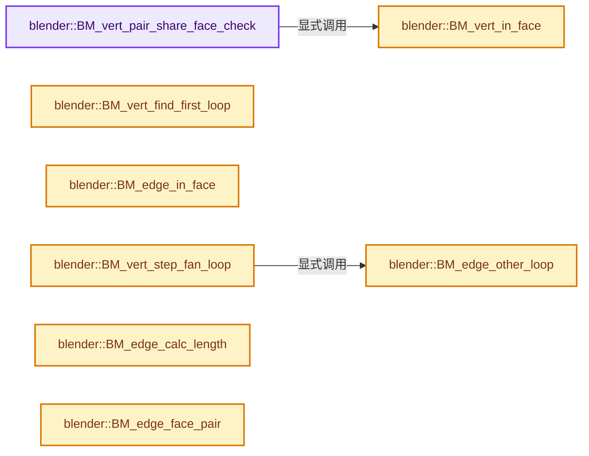
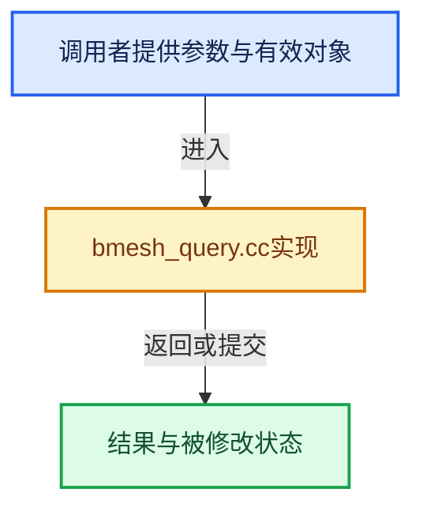

# 实现依赖专题：source/blender/bmesh/intern/bmesh_query.cc

[实现依赖导航](../../../README.md) · [符号索引](../../../../00-课程指南/02-源码与提交索引/符号依赖与实现索引.md)

本专题从正文实际调用进入，集中保存共享实现。函数有稳定锚点，可从调用处直接跳到对应完整函数；递归与互相调用通过回链组织。

## 本文件的实现关系






## 完整成员与函数实现

<a id="f-5245cd1f20da6979"></a>

### `blender::BM_vert_pair_share_face_check`

实现位置：[source/blender/bmesh/intern/bmesh_query.cc](../../../../../../../../source/blender/bmesh/intern/bmesh_query.cc) · L110—L124。

接口参数：

- `BMVert *v_a`
- `BMVert *v_b`

**教学注释版**

<!-- annotated:5bcca79adfea8d -->

```cpp
bool BM_vert_pair_share_face_check(BMVert *v_a, BMVert *v_b)
{
  if (v_a->e && v_b->e) {
    BMIter iter;
    BMFace *f;

    BM_ITER_ELEM (f, &iter, v_a, BM_FACES_OF_VERT) {
      if (BM_vert_in_face(v_b, f)) {
        return true;
      }
    }
  }

  return false;
}
```

<details>
<summary>核对原始源码：source/blender/bmesh/intern/bmesh_query.cc · L110—L124</summary>

<!-- original:5bcca79adfea8d:source/blender/bmesh/intern/bmesh_query.cc:110:124 -->

```cpp
bool BM_vert_pair_share_face_check(BMVert *v_a, BMVert *v_b)
{
  if (v_a->e && v_b->e) {
    BMIter iter;
    BMFace *f;

    BM_ITER_ELEM (f, &iter, v_a, BM_FACES_OF_VERT) {
      if (BM_vert_in_face(v_b, f)) {
        return true;
      }
    }
  }

  return false;
}
```

</details>

**结果出口**

- `return true;`
- `return false;`

**继续追踪实现**

- `BM_ITER_ELEM` → [BM_ITER_ELEM · L97](bmesh_iterators.hh.md#m-751d15be7ee4)。宏定义由构建条件选择。
- `BM_vert_in_face` → [blender::BM_vert_in_face · L318](bmesh_query.cc.md#f-9fc1e830b5454b0b)。

<a id="f-18741548918712b6"></a>

### `blender::BM_vert_find_first_loop`

实现位置：[source/blender/bmesh/intern/bmesh_query.cc](../../../../../../../../source/blender/bmesh/intern/bmesh_query.cc) · L309—L312。

接口参数：

- `BMVert *v`

**教学注释版**

<!-- annotated:c1428d65c9ce5e -->

```cpp
BMLoop *BM_vert_find_first_loop(BMVert *v)
{
  return v->e ? bmesh_disk_faceloop_find_first(v->e, v) : nullptr;
}
```

<details>
<summary>核对原始源码：source/blender/bmesh/intern/bmesh_query.cc · L309—L312</summary>

<!-- original:c1428d65c9ce5e:source/blender/bmesh/intern/bmesh_query.cc:309:312 -->

```cpp
BMLoop *BM_vert_find_first_loop(BMVert *v)
{
  return v->e ? bmesh_disk_faceloop_find_first(v->e, v) : nullptr;
}
```

</details>

**结果出口**

- `return v->e ? bmesh_disk_faceloop_find_first(v->e, v) : nullptr;`

**继续追踪实现**

- `bmesh_disk_faceloop_find_first` → [blender::bmesh_disk_faceloop_find_first · L302](bmesh_structure.cc.md#f-2a30bde02ae96ee2)。

<a id="f-9fc1e830b5454b0b"></a>

### `blender::BM_vert_in_face`

实现位置：[source/blender/bmesh/intern/bmesh_query.cc](../../../../../../../../source/blender/bmesh/intern/bmesh_query.cc) · L318—L340。

接口参数：

- `BMVert *v`
- `BMFace *f`

**教学注释版**

<!-- annotated:5b6b8c4747323b -->

```cpp
bool BM_vert_in_face(BMVert *v, BMFace *f)
{
  BMLoop *l_iter, *l_first;

#ifdef USE_BMESH_HOLES
  BMLoopList *lst;
  for (lst = f->loops.first; lst; lst = lst->next)
#endif
  {
#ifdef USE_BMESH_HOLES
    l_iter = l_first = lst->first;
#else
    l_iter = l_first = f->l_first;
#endif
    do {
      if (l_iter->v == v) {
        return true;
      }
    } while ((l_iter = l_iter->next) != l_first);
  }

  return false;
}
```

<details>
<summary>核对原始源码：source/blender/bmesh/intern/bmesh_query.cc · L318—L340</summary>

<!-- original:5b6b8c4747323b:source/blender/bmesh/intern/bmesh_query.cc:318:340 -->

```cpp
bool BM_vert_in_face(BMVert *v, BMFace *f)
{
  BMLoop *l_iter, *l_first;

#ifdef USE_BMESH_HOLES
  BMLoopList *lst;
  for (lst = f->loops.first; lst; lst = lst->next)
#endif
  {
#ifdef USE_BMESH_HOLES
    l_iter = l_first = lst->first;
#else
    l_iter = l_first = f->l_first;
#endif
    do {
      if (l_iter->v == v) {
        return true;
      }
    } while ((l_iter = l_iter->next) != l_first);
  }

  return false;
}
```

</details>

**沿实际写入检查状态**

- `l_iter = l_first = lst->first;`
- `l_iter = l_first = f->l_first;`

**结果出口**

- `return true;`
- `return false;`

**继续追踪实现**

本实现没有需要继续展开的显式调用；检查返回表达式、对象转换和调用者前置条件。

<a id="f-35ed5d132fbe244d"></a>

### `blender::BM_edge_in_face`

实现位置：[source/blender/bmesh/intern/bmesh_query.cc](../../../../../../../../source/blender/bmesh/intern/bmesh_query.cc) · L432—L446。

接口参数：

- `const BMEdge *e`
- `const BMFace *f`

**教学注释版**

<!-- annotated:ddcdf921e92519 -->

```cpp
bool BM_edge_in_face(const BMEdge *e, const BMFace *f)
{
  if (e->l) {
    const BMLoop *l_iter, *l_first;

    l_iter = l_first = e->l;
    do {
      if (l_iter->f == f) {
        return true;
      }
    } while ((l_iter = l_iter->radial_next) != l_first);
  }

  return false;
}
```

<details>
<summary>核对原始源码：source/blender/bmesh/intern/bmesh_query.cc · L432—L446</summary>

<!-- original:ddcdf921e92519:source/blender/bmesh/intern/bmesh_query.cc:432:446 -->

```cpp
bool BM_edge_in_face(const BMEdge *e, const BMFace *f)
{
  if (e->l) {
    const BMLoop *l_iter, *l_first;

    l_iter = l_first = e->l;
    do {
      if (l_iter->f == f) {
        return true;
      }
    } while ((l_iter = l_iter->radial_next) != l_first);
  }

  return false;
}
```

</details>

**沿实际写入检查状态**

- `l_iter = l_first = e->l;`

**结果出口**

- `return true;`
- `return false;`

**继续追踪实现**

本实现没有需要继续展开的显式调用；检查返回表达式、对象转换和调用者前置条件。

<a id="f-a0c8a803e360b067"></a>

### `blender::BM_edge_other_loop`

实现位置：[source/blender/bmesh/intern/bmesh_query.cc](../../../../../../../../source/blender/bmesh/intern/bmesh_query.cc) · L448—L471。

接口参数：

- `BMEdge *e`
- `BMLoop *l`

**教学注释版**

<!-- annotated:482d8f46148061 -->

```cpp
BMLoop *BM_edge_other_loop(BMEdge *e, BMLoop *l)
{
  BMLoop *l_other;

  // BLI_assert(BM_edge_is_manifold(e)); /* Too strict, just check there is another radial face. */
  BLI_assert(e->l && e->l->radial_next != e->l);
  BLI_assert(BM_vert_in_edge(e, l->v));

  l_other = (l->e == e) ? l : l->prev;
  l_other = l_other->radial_next;
  BLI_assert(l_other->e == e);

  if (l_other->v == l->v) {
    /* pass */
  }
  else if (l_other->next->v == l->v) {
    l_other = l_other->next;
  }
  else {
    BLI_assert(0);
  }

  return l_other;
}
```

<details>
<summary>核对原始源码：source/blender/bmesh/intern/bmesh_query.cc · L448—L471</summary>

<!-- original:482d8f46148061:source/blender/bmesh/intern/bmesh_query.cc:448:471 -->

```cpp
BMLoop *BM_edge_other_loop(BMEdge *e, BMLoop *l)
{
  BMLoop *l_other;

  // BLI_assert(BM_edge_is_manifold(e)); /* Too strict, just check there is another radial face. */
  BLI_assert(e->l && e->l->radial_next != e->l);
  BLI_assert(BM_vert_in_edge(e, l->v));

  l_other = (l->e == e) ? l : l->prev;
  l_other = l_other->radial_next;
  BLI_assert(l_other->e == e);

  if (l_other->v == l->v) {
    /* pass */
  }
  else if (l_other->next->v == l->v) {
    l_other = l_other->next;
  }
  else {
    BLI_assert(0);
  }

  return l_other;
}
```

</details>

**沿实际写入检查状态**

- `l_other = (l->e == e) ? l : l->prev;`
- `l_other = l_other->radial_next;`
- `l_other = l_other->next;`

**结果出口**

- `return l_other;`

**继续追踪实现**

- `BLI_assert` → [BLI_assert · L48](../../../01-BLI基础库/BLI_assert.hh.md#m-57a88495704d)；[BLI_assert · L63](../../../01-BLI基础库/BLI_assert.hh.md#m-d07050020cb5)。宏定义由构建条件选择。
- `BM_vert_in_edge` → [blender::BM_vert_in_edge · L24](bmesh_query_inline.hh.md#f-bca1d91adf4264fd)。

<a id="f-4429900071157825"></a>

### `blender::BM_vert_step_fan_loop`

实现位置：[source/blender/bmesh/intern/bmesh_query.cc](../../../../../../../../source/blender/bmesh/intern/bmesh_query.cc) · L473—L492。

接口参数：

- `BMLoop *l`
- `BMEdge **e_step`

**教学注释版**

<!-- annotated:d693e443348683 -->

```cpp
BMLoop *BM_vert_step_fan_loop(BMLoop *l, BMEdge **e_step)
{
  BMEdge *e_prev = *e_step;
  BMEdge *e_next;
  if (l->e == e_prev) {
    e_next = l->prev->e;
  }
  else if (l->prev->e == e_prev) {
    e_next = l->e;
  }
  else {
    BLI_assert(0);
    return nullptr;
  }

  if (BM_edge_is_manifold(e_next)) {
    return BM_edge_other_loop((*e_step = e_next), l);
  }
  return nullptr;
}
```

<details>
<summary>核对原始源码：source/blender/bmesh/intern/bmesh_query.cc · L473—L492</summary>

<!-- original:d693e443348683:source/blender/bmesh/intern/bmesh_query.cc:473:492 -->

```cpp
BMLoop *BM_vert_step_fan_loop(BMLoop *l, BMEdge **e_step)
{
  BMEdge *e_prev = *e_step;
  BMEdge *e_next;
  if (l->e == e_prev) {
    e_next = l->prev->e;
  }
  else if (l->prev->e == e_prev) {
    e_next = l->e;
  }
  else {
    BLI_assert(0);
    return nullptr;
  }

  if (BM_edge_is_manifold(e_next)) {
    return BM_edge_other_loop((*e_step = e_next), l);
  }
  return nullptr;
}
```

</details>

**沿实际写入检查状态**

- `e_next = l->prev->e;`
- `e_next = l->e;`

**结果出口**

- `return nullptr;`
- `return BM_edge_other_loop((*e_step = e_next), l);`

**继续追踪实现**

- `BLI_assert` → [BLI_assert · L48](../../../01-BLI基础库/BLI_assert.hh.md#m-57a88495704d)；[BLI_assert · L63](../../../01-BLI基础库/BLI_assert.hh.md#m-d07050020cb5)。宏定义由构建条件选择。
- `BM_edge_is_manifold` → [blender::BM_edge_is_manifold · L79](bmesh_query_inline.hh.md#f-4944cfa861683f59)；[blender::BM_edge_is_manifold · L86](bmesh_query_inline.hh.md#f-f07686548bcc2440)。同名重载需按实参类型选择。
- `BM_edge_other_loop` → [blender::BM_edge_other_loop · L448](bmesh_query.cc.md#f-a0c8a803e360b067)。

<a id="f-bc3c0cb2a1cc6c46"></a>

### `blender::BM_edge_calc_length`

实现位置：[source/blender/bmesh/intern/bmesh_query.cc](../../../../../../../../source/blender/bmesh/intern/bmesh_query.cc) · L540—L543。

接口参数：

- `const BMEdge *e`

**教学注释版**

<!-- annotated:597d66a81d7760 -->

```cpp
float BM_edge_calc_length(const BMEdge *e)
{
  return len_v3v3(e->v1->co, e->v2->co);
}
```

<details>
<summary>核对原始源码：source/blender/bmesh/intern/bmesh_query.cc · L540—L543</summary>

<!-- original:597d66a81d7760:source/blender/bmesh/intern/bmesh_query.cc:540:543 -->

```cpp
float BM_edge_calc_length(const BMEdge *e)
{
  return len_v3v3(e->v1->co, e->v2->co);
}
```

</details>

**结果出口**

- `return len_v3v3(e->v1->co, e->v2->co);`

**继续追踪实现**

- `len_v3v3` → [blender::len_v3v3 · L826](../../../01-BLI基础库/intern/math_vector_inline.cc.md#f-c873370566848169)。

<a id="f-ac1d8967087da3d0"></a>

### `blender::BM_edge_face_pair`

实现位置：[source/blender/bmesh/intern/bmesh_query.cc](../../../../../../../../source/blender/bmesh/intern/bmesh_query.cc) · L550—L563。

接口参数：

- `BMEdge *e`
- `BMFace **r_fa`
- `BMFace **r_fb`

**教学注释版**

<!-- annotated:3ebb9e85e89119 -->

```cpp
bool BM_edge_face_pair(BMEdge *e, BMFace **r_fa, BMFace **r_fb)
{
  BMLoop *la, *lb;

  if ((la = e->l) && (lb = la->radial_next) && (la != lb) && (lb->radial_next == la)) {
    *r_fa = la->f;
    *r_fb = lb->f;
    return true;
  }

  *r_fa = nullptr;
  *r_fb = nullptr;
  return false;
}
```

<details>
<summary>核对原始源码：source/blender/bmesh/intern/bmesh_query.cc · L550—L563</summary>

<!-- original:3ebb9e85e89119:source/blender/bmesh/intern/bmesh_query.cc:550:563 -->

```cpp
bool BM_edge_face_pair(BMEdge *e, BMFace **r_fa, BMFace **r_fb)
{
  BMLoop *la, *lb;

  if ((la = e->l) && (lb = la->radial_next) && (la != lb) && (lb->radial_next == la)) {
    *r_fa = la->f;
    *r_fb = lb->f;
    return true;
  }

  *r_fa = nullptr;
  *r_fb = nullptr;
  return false;
}
```

</details>

**结果出口**

- `return true;`
- `return false;`

**继续追踪实现**

本实现没有需要继续展开的显式调用；检查返回表达式、对象转换和调用者前置条件。

<a id="f-18337b6d26e6aa9d"></a>

### `blender::BM_edge_loop_pair`

实现位置：[source/blender/bmesh/intern/bmesh_query.cc](../../../../../../../../source/blender/bmesh/intern/bmesh_query.cc) · L565—L578。

接口参数：

- `BMEdge *e`
- `BMLoop **r_la`
- `BMLoop **r_lb`

**教学注释版**

<!-- annotated:334da6978b511d -->

```cpp
bool BM_edge_loop_pair(BMEdge *e, BMLoop **r_la, BMLoop **r_lb)
{
  BMLoop *la, *lb;

  if ((la = e->l) && (lb = la->radial_next) && (la != lb) && (lb->radial_next == la)) {
    *r_la = la;
    *r_lb = lb;
    return true;
  }

  *r_la = nullptr;
  *r_lb = nullptr;
  return false;
}
```

<details>
<summary>核对原始源码：source/blender/bmesh/intern/bmesh_query.cc · L565—L578</summary>

<!-- original:334da6978b511d:source/blender/bmesh/intern/bmesh_query.cc:565:578 -->

```cpp
bool BM_edge_loop_pair(BMEdge *e, BMLoop **r_la, BMLoop **r_lb)
{
  BMLoop *la, *lb;

  if ((la = e->l) && (lb = la->radial_next) && (la != lb) && (lb->radial_next == la)) {
    *r_la = la;
    *r_lb = lb;
    return true;
  }

  *r_la = nullptr;
  *r_lb = nullptr;
  return false;
}
```

</details>

**结果出口**

- `return true;`
- `return false;`

**继续追踪实现**

本实现没有需要继续展开的显式调用；检查返回表达式、对象转换和调用者前置条件。

<a id="f-8d6c36b5c1589dd2"></a>

### `blender::BM_vert_is_edge_pair`

实现位置：[source/blender/bmesh/intern/bmesh_query.cc](../../../../../../../../source/blender/bmesh/intern/bmesh_query.cc) · L580—L588。

接口参数：

- `const BMVert *v`

**教学注释版**

<!-- annotated:00c27ec199b91f -->

```cpp
bool BM_vert_is_edge_pair(const BMVert *v)
{
  const BMEdge *e = v->e;
  if (e) {
    BMEdge *e_other = BM_DISK_EDGE_NEXT(e, v);
    return ((e_other != e) && (BM_DISK_EDGE_NEXT(e_other, v) == e));
  }
  return false;
}
```

<details>
<summary>核对原始源码：source/blender/bmesh/intern/bmesh_query.cc · L580—L588</summary>

<!-- original:00c27ec199b91f:source/blender/bmesh/intern/bmesh_query.cc:580:588 -->

```cpp
bool BM_vert_is_edge_pair(const BMVert *v)
{
  const BMEdge *e = v->e;
  if (e) {
    BMEdge *e_other = BM_DISK_EDGE_NEXT(e, v);
    return ((e_other != e) && (BM_DISK_EDGE_NEXT(e_other, v) == e));
  }
  return false;
}
```

</details>

**结果出口**

- `return ((e_other != e) && (BM_DISK_EDGE_NEXT(e_other, v) == e));`
- `return false;`

**继续追踪实现**

- `BM_DISK_EDGE_NEXT` → [BM_DISK_EDGE_NEXT · L702](../bmesh_class.hh.md#m-5b55b3533de2)。宏定义由构建条件选择。

<a id="f-4663b13982695891"></a>

### `blender::BM_vert_edge_pair`

实现位置：[source/blender/bmesh/intern/bmesh_query.cc](../../../../../../../../source/blender/bmesh/intern/bmesh_query.cc) · L602—L617。

接口参数：

- `const BMVert *v`
- `BMEdge **r_e_a`
- `BMEdge **r_e_b`

**教学注释版**

<!-- annotated:c5ffecafeb083b -->

```cpp
bool BM_vert_edge_pair(const BMVert *v, BMEdge **r_e_a, BMEdge **r_e_b)
{
  BMEdge *e_a = v->e;
  if (e_a) {
    BMEdge *e_b = BM_DISK_EDGE_NEXT(e_a, v);
    if ((e_b != e_a) && (BM_DISK_EDGE_NEXT(e_b, v) == e_a)) {
      *r_e_a = e_a;
      *r_e_b = e_b;
      return true;
    }
  }

  *r_e_a = nullptr;
  *r_e_b = nullptr;
  return false;
}
```

<details>
<summary>核对原始源码：source/blender/bmesh/intern/bmesh_query.cc · L602—L617</summary>

<!-- original:c5ffecafeb083b:source/blender/bmesh/intern/bmesh_query.cc:602:617 -->

```cpp
bool BM_vert_edge_pair(const BMVert *v, BMEdge **r_e_a, BMEdge **r_e_b)
{
  BMEdge *e_a = v->e;
  if (e_a) {
    BMEdge *e_b = BM_DISK_EDGE_NEXT(e_a, v);
    if ((e_b != e_a) && (BM_DISK_EDGE_NEXT(e_b, v) == e_a)) {
      *r_e_a = e_a;
      *r_e_b = e_b;
      return true;
    }
  }

  *r_e_a = nullptr;
  *r_e_b = nullptr;
  return false;
}
```

</details>

**结果出口**

- `return true;`
- `return false;`

**继续追踪实现**

- `BM_DISK_EDGE_NEXT` → [BM_DISK_EDGE_NEXT · L702](../bmesh_class.hh.md#m-5b55b3533de2)。宏定义由构建条件选择。

<a id="f-470746625e1ef19a"></a>

### `blender::BM_vert_edge_count_at_most`

实现位置：[source/blender/bmesh/intern/bmesh_query.cc](../../../../../../../../source/blender/bmesh/intern/bmesh_query.cc) · L624—L627。

接口参数：

- `const BMVert *v`
- `const int count_max`

**教学注释版**

<!-- annotated:0d4c448b85946b -->

```cpp
int BM_vert_edge_count_at_most(const BMVert *v, const int count_max)
{
  return bmesh_disk_count_at_most(v, count_max);
}
```

<details>
<summary>核对原始源码：source/blender/bmesh/intern/bmesh_query.cc · L624—L627</summary>

<!-- original:0d4c448b85946b:source/blender/bmesh/intern/bmesh_query.cc:624:627 -->

```cpp
int BM_vert_edge_count_at_most(const BMVert *v, const int count_max)
{
  return bmesh_disk_count_at_most(v, count_max);
}
```

</details>

**结果出口**

- `return bmesh_disk_count_at_most(v, count_max);`

**继续追踪实现**

- `bmesh_disk_count_at_most` → [blender::bmesh_disk_count_at_most · L215](bmesh_structure.cc.md#f-6b353d00b07957a2)。

<a id="f-761ee7a093256f30"></a>

### `blender::BM_edge_face_count`

实现位置：[source/blender/bmesh/intern/bmesh_query.cc](../../../../../../../../source/blender/bmesh/intern/bmesh_query.cc) · L641—L655。

接口参数：

- `const BMEdge *e`

**教学注释版**

<!-- annotated:f7345399660ede -->

```cpp
int BM_edge_face_count(const BMEdge *e)
{
  int count = 0;

  if (e->l) {
    BMLoop *l_iter, *l_first;

    l_iter = l_first = e->l;
    do {
      count++;
    } while ((l_iter = l_iter->radial_next) != l_first);
  }

  return count;
}
```

<details>
<summary>核对原始源码：source/blender/bmesh/intern/bmesh_query.cc · L641—L655</summary>

<!-- original:f7345399660ede:source/blender/bmesh/intern/bmesh_query.cc:641:655 -->

```cpp
int BM_edge_face_count(const BMEdge *e)
{
  int count = 0;

  if (e->l) {
    BMLoop *l_iter, *l_first;

    l_iter = l_first = e->l;
    do {
      count++;
    } while ((l_iter = l_iter->radial_next) != l_first);
  }

  return count;
}
```

</details>

**沿实际写入检查状态**

- `l_iter = l_first = e->l;`

**结果出口**

- `return count;`

**继续追踪实现**

本实现没有需要继续展开的显式调用；检查返回表达式、对象转换和调用者前置条件。

<a id="f-e8e1f46695792113"></a>

### `blender::BM_vert_face_check`

实现位置：[source/blender/bmesh/intern/bmesh_query.cc](../../../../../../../../source/blender/bmesh/intern/bmesh_query.cc) · L686—L698。

接口参数：

- `const BMVert *v`

**教学注释版**

<!-- annotated:0637d490775540 -->

```cpp
bool BM_vert_face_check(const BMVert *v)
{
  if (v->e != nullptr) {
    const BMEdge *e_iter, *e_first;
    e_first = e_iter = v->e;
    do {
      if (e_iter->l != nullptr) {
        return true;
      }
    } while ((e_iter = bmesh_disk_edge_next(e_iter, v)) != e_first);
  }
  return false;
}
```

<details>
<summary>核对原始源码：source/blender/bmesh/intern/bmesh_query.cc · L686—L698</summary>

<!-- original:0637d490775540:source/blender/bmesh/intern/bmesh_query.cc:686:698 -->

```cpp
bool BM_vert_face_check(const BMVert *v)
{
  if (v->e != nullptr) {
    const BMEdge *e_iter, *e_first;
    e_first = e_iter = v->e;
    do {
      if (e_iter->l != nullptr) {
        return true;
      }
    } while ((e_iter = bmesh_disk_edge_next(e_iter, v)) != e_first);
  }
  return false;
}
```

</details>

**沿实际写入检查状态**

- `e_first = e_iter = v->e;`

**结果出口**

- `return true;`
- `return false;`

**继续追踪实现**

- `bmesh_disk_edge_next` → [blender::bmesh_disk_edge_next · L59](bmesh_structure_inline.hh.md#f-bde0a66632cf5785)。

<a id="f-be46e39965fb7762"></a>

### `blender::BM_vert_is_manifold`

实现位置：[source/blender/bmesh/intern/bmesh_query.cc](../../../../../../../../source/blender/bmesh/intern/bmesh_query.cc) · L717—L774。

接口参数：

- `const BMVert *v`

**教学注释版**

<!-- annotated:d2be5e24fc23b8 -->

```cpp
bool BM_vert_is_manifold(const BMVert *v)
{
  BMEdge *e_iter, *e_first, *e_prev;
  BMLoop *l_iter, *l_first;
  int loop_num = 0, loop_num_region = 0, boundary_num = 0;

  if (v->e == nullptr) {
    /* loose vert */
    return false;
  }

  /* count edges while looking for non-manifold edges */
  e_first = e_iter = v->e;
  /* may be null */
  l_first = e_iter->l;
  do {
    /* loose edge or edge shared by more than two faces,
     * edges with 1 face user are OK, otherwise we could
     * use BM_edge_is_manifold() here */
    if (e_iter->l == nullptr || (e_iter->l != e_iter->l->radial_next->radial_next)) {
      return false;
    }

    /* count radial loops */
    if (e_iter->l->v == v) {
      loop_num += 1;
    }

    if (!BM_edge_is_boundary(e_iter)) {
      /* non boundary check opposite loop */
      if (e_iter->l->radial_next->v == v) {
        loop_num += 1;
      }
    }
    else {
      /* start at the boundary */
      l_first = e_iter->l;
      boundary_num += 1;
      /* >2 boundaries can't be manifold */
      if (boundary_num == 3) {
        return false;
      }
    }
  } while ((e_iter = bmesh_disk_edge_next(e_iter, v)) != e_first);

  e_first = l_first->e;
  l_first = (l_first->v == v) ? l_first : l_first->next;
  BLI_assert(l_first->v == v);

  l_iter = l_first;
  e_prev = e_first;

  do {
    loop_num_region += 1;
  } while (((l_iter = BM_vert_step_fan_loop(l_iter, &e_prev)) != l_first) && (l_iter != nullptr));

  return (loop_num == loop_num_region);
}
```

<details>
<summary>核对原始源码：source/blender/bmesh/intern/bmesh_query.cc · L717—L774</summary>

<!-- original:d2be5e24fc23b8:source/blender/bmesh/intern/bmesh_query.cc:717:774 -->

```cpp
bool BM_vert_is_manifold(const BMVert *v)
{
  BMEdge *e_iter, *e_first, *e_prev;
  BMLoop *l_iter, *l_first;
  int loop_num = 0, loop_num_region = 0, boundary_num = 0;

  if (v->e == nullptr) {
    /* loose vert */
    return false;
  }

  /* count edges while looking for non-manifold edges */
  e_first = e_iter = v->e;
  /* may be null */
  l_first = e_iter->l;
  do {
    /* loose edge or edge shared by more than two faces,
     * edges with 1 face user are OK, otherwise we could
     * use BM_edge_is_manifold() here */
    if (e_iter->l == nullptr || (e_iter->l != e_iter->l->radial_next->radial_next)) {
      return false;
    }

    /* count radial loops */
    if (e_iter->l->v == v) {
      loop_num += 1;
    }

    if (!BM_edge_is_boundary(e_iter)) {
      /* non boundary check opposite loop */
      if (e_iter->l->radial_next->v == v) {
        loop_num += 1;
      }
    }
    else {
      /* start at the boundary */
      l_first = e_iter->l;
      boundary_num += 1;
      /* >2 boundaries can't be manifold */
      if (boundary_num == 3) {
        return false;
      }
    }
  } while ((e_iter = bmesh_disk_edge_next(e_iter, v)) != e_first);

  e_first = l_first->e;
  l_first = (l_first->v == v) ? l_first : l_first->next;
  BLI_assert(l_first->v == v);

  l_iter = l_first;
  e_prev = e_first;

  do {
    loop_num_region += 1;
  } while (((l_iter = BM_vert_step_fan_loop(l_iter, &e_prev)) != l_first) && (l_iter != nullptr));

  return (loop_num == loop_num_region);
}
```

</details>

**沿实际写入检查状态**

- `e_first = e_iter = v->e;`
- `l_first = e_iter->l;`
- `loop_num += 1;`
- `boundary_num += 1;`
- `e_first = l_first->e;`
- `l_first = (l_first->v == v) ? l_first : l_first->next;`
- `l_iter = l_first;`
- `e_prev = e_first;`
- `loop_num_region += 1;`

**结果出口**

- `return false;`
- `return (loop_num == loop_num_region);`

**继续追踪实现**

- `BM_edge_is_boundary` → [blender::BM_edge_is_boundary · L111](bmesh_query_inline.hh.md#f-9626087cfab8be44)；[blender::BM_edge_is_boundary · L117](bmesh_query_inline.hh.md#f-2fee18c217b38784)。同名重载需按实参类型选择。
- `bmesh_disk_edge_next` → [blender::bmesh_disk_edge_next · L59](bmesh_structure_inline.hh.md#f-bde0a66632cf5785)。
- `BLI_assert` → [BLI_assert · L48](../../../01-BLI基础库/BLI_assert.hh.md#m-57a88495704d)；[BLI_assert · L63](../../../01-BLI基础库/BLI_assert.hh.md#m-d07050020cb5)。宏定义由构建条件选择。
- `BM_vert_step_fan_loop` → [blender::BM_vert_step_fan_loop · L473](bmesh_query.cc.md#f-4429900071157825)。

<a id="f-eadb1f4b68b87d0e"></a>

### `blender::BM_edge_is_convex`

实现位置：[source/blender/bmesh/intern/bmesh_query.cc](../../../../../../../../source/blender/bmesh/intern/bmesh_query.cc) · L870—L885。

接口参数：

- `const BMEdge *e`

**教学注释版**

<!-- annotated:f7bbc55e6faf79 -->

```cpp
bool BM_edge_is_convex(const BMEdge *e)
{
  if (BM_edge_is_manifold(e)) {
    BMLoop *l1 = e->l;
    BMLoop *l2 = e->l->radial_next;
    if (!equals_v3v3(l1->f->no, l2->f->no)) {
      float cross[3];
      float l_dir[3];
      cross_v3_v3v3(cross, l1->f->no, l2->f->no);
      /* we assume contiguous normals, otherwise the result isn't meaningful */
      sub_v3_v3v3(l_dir, l1->next->v->co, l1->v->co);
      return (dot_v3v3(l_dir, cross) > 0.0f);
    }
  }
  return true;
}
```

<details>
<summary>核对原始源码：source/blender/bmesh/intern/bmesh_query.cc · L870—L885</summary>

<!-- original:f7bbc55e6faf79:source/blender/bmesh/intern/bmesh_query.cc:870:885 -->

```cpp
bool BM_edge_is_convex(const BMEdge *e)
{
  if (BM_edge_is_manifold(e)) {
    BMLoop *l1 = e->l;
    BMLoop *l2 = e->l->radial_next;
    if (!equals_v3v3(l1->f->no, l2->f->no)) {
      float cross[3];
      float l_dir[3];
      cross_v3_v3v3(cross, l1->f->no, l2->f->no);
      /* we assume contiguous normals, otherwise the result isn't meaningful */
      sub_v3_v3v3(l_dir, l1->next->v->co, l1->v->co);
      return (dot_v3v3(l_dir, cross) > 0.0f);
    }
  }
  return true;
}
```

</details>

**结果出口**

- `return (dot_v3v3(l_dir, cross) > 0.0f);`
- `return true;`

**继续追踪实现**

- `BM_edge_is_manifold` → [blender::BM_edge_is_manifold · L79](bmesh_query_inline.hh.md#f-4944cfa861683f59)；[blender::BM_edge_is_manifold · L86](bmesh_query_inline.hh.md#f-f07686548bcc2440)。同名重载需按实参类型选择。
- `equals_v3v3` → [blender::equals_v3v3 · L1006](../../../01-BLI基础库/intern/math_vector_inline.cc.md#f-f49aac9436333b4a)。
- `cross_v3_v3v3` → [blender::cross_v3_v3v3 · L690](../../../01-BLI基础库/intern/math_vector_inline.cc.md#f-ac8d04405fb5dad4)。
- `sub_v3_v3v3` → [blender::sub_v3_v3v3 · L360](../../../01-BLI基础库/intern/math_vector_inline.cc.md#f-23781c252db8b30c)。
- `dot_v3v3` → [blender::dot_v3v3 · L646](../../../01-BLI基础库/intern/math_vector_inline.cc.md#f-c88befa67d07591a)。

<a id="f-f3dbfb60b79bce81"></a>

### `blender::BM_edge_is_contiguous_loop_cd`

实现位置：[source/blender/bmesh/intern/bmesh_query.cc](../../../../../../../../source/blender/bmesh/intern/bmesh_query.cc) · L887—L928。

接口参数：

- `const BMEdge *e`
- `const int cd_loop_type`
- `const int cd_loop_offset`

**教学注释版**

<!-- annotated:f96d73ff6b5fa3 -->

```cpp
bool BM_edge_is_contiguous_loop_cd(const BMEdge *e,
                                   const int cd_loop_type,
                                   const int cd_loop_offset)
{
  BLI_assert(cd_loop_offset != -1);

  if (e->l && e->l->radial_next != e->l) {
    const BMLoop *l_base_v1 = e->l;
    const BMLoop *l_base_v2 = e->l->next;
    const void *l_base_cd_v1 = BM_ELEM_CD_GET_VOID_P(l_base_v1, cd_loop_offset);
    const void *l_base_cd_v2 = BM_ELEM_CD_GET_VOID_P(l_base_v2, cd_loop_offset);
    const BMLoop *l_iter = e->l->radial_next;
    do {
      const BMLoop *l_iter_v1;
      const BMLoop *l_iter_v2;
      const void *l_iter_cd_v1;
      const void *l_iter_cd_v2;

      if (l_iter->v == l_base_v1->v) {
        l_iter_v1 = l_iter;
        l_iter_v2 = l_iter->next;
      }
      else {
        l_iter_v1 = l_iter->next;
        l_iter_v2 = l_iter;
      }
      BLI_assert((l_iter_v1->v == l_base_v1->v) && (l_iter_v2->v == l_base_v2->v));

      l_iter_cd_v1 = BM_ELEM_CD_GET_VOID_P(l_iter_v1, cd_loop_offset);
      l_iter_cd_v2 = BM_ELEM_CD_GET_VOID_P(l_iter_v2, cd_loop_offset);

      if ((CustomData_data_equals(eCustomDataType(cd_loop_type), l_base_cd_v1, l_iter_cd_v1) ==
           0) ||
          (CustomData_data_equals(eCustomDataType(cd_loop_type), l_base_cd_v2, l_iter_cd_v2) == 0))
      {
        return false;
      }

    } while ((l_iter = l_iter->radial_next) != e->l);
  }
  return true;
}
```

<details>
<summary>核对原始源码：source/blender/bmesh/intern/bmesh_query.cc · L887—L928</summary>

<!-- original:f96d73ff6b5fa3:source/blender/bmesh/intern/bmesh_query.cc:887:928 -->

```cpp
bool BM_edge_is_contiguous_loop_cd(const BMEdge *e,
                                   const int cd_loop_type,
                                   const int cd_loop_offset)
{
  BLI_assert(cd_loop_offset != -1);

  if (e->l && e->l->radial_next != e->l) {
    const BMLoop *l_base_v1 = e->l;
    const BMLoop *l_base_v2 = e->l->next;
    const void *l_base_cd_v1 = BM_ELEM_CD_GET_VOID_P(l_base_v1, cd_loop_offset);
    const void *l_base_cd_v2 = BM_ELEM_CD_GET_VOID_P(l_base_v2, cd_loop_offset);
    const BMLoop *l_iter = e->l->radial_next;
    do {
      const BMLoop *l_iter_v1;
      const BMLoop *l_iter_v2;
      const void *l_iter_cd_v1;
      const void *l_iter_cd_v2;

      if (l_iter->v == l_base_v1->v) {
        l_iter_v1 = l_iter;
        l_iter_v2 = l_iter->next;
      }
      else {
        l_iter_v1 = l_iter->next;
        l_iter_v2 = l_iter;
      }
      BLI_assert((l_iter_v1->v == l_base_v1->v) && (l_iter_v2->v == l_base_v2->v));

      l_iter_cd_v1 = BM_ELEM_CD_GET_VOID_P(l_iter_v1, cd_loop_offset);
      l_iter_cd_v2 = BM_ELEM_CD_GET_VOID_P(l_iter_v2, cd_loop_offset);

      if ((CustomData_data_equals(eCustomDataType(cd_loop_type), l_base_cd_v1, l_iter_cd_v1) ==
           0) ||
          (CustomData_data_equals(eCustomDataType(cd_loop_type), l_base_cd_v2, l_iter_cd_v2) == 0))
      {
        return false;
      }

    } while ((l_iter = l_iter->radial_next) != e->l);
  }
  return true;
}
```

</details>

**沿实际写入检查状态**

- `l_iter_v1 = l_iter;`
- `l_iter_v2 = l_iter->next;`
- `l_iter_v1 = l_iter->next;`
- `l_iter_v2 = l_iter;`
- `l_iter_cd_v1 = BM_ELEM_CD_GET_VOID_P(l_iter_v1, cd_loop_offset);`
- `l_iter_cd_v2 = BM_ELEM_CD_GET_VOID_P(l_iter_v2, cd_loop_offset);`

**结果出口**

- `return false;`
- `return true;`

**继续追踪实现**

- `BLI_assert` → [BLI_assert · L48](../../../01-BLI基础库/BLI_assert.hh.md#m-57a88495704d)；[BLI_assert · L63](../../../01-BLI基础库/BLI_assert.hh.md#m-d07050020cb5)。宏定义由构建条件选择。
- `BM_ELEM_CD_GET_VOID_P` → [BM_ELEM_CD_GET_VOID_P · L610](../bmesh_class.hh.md#m-cdfe9f3023fa)；[BM_ELEM_CD_GET_VOID_P · L618](../bmesh_class.hh.md#m-126b1260772d)。宏定义由构建条件选择。
- `CustomData_data_equals` → [blender::CustomData_data_equals · L3873](../../../02-BKE几何与数据/intern/customdata.cc.md#f-9c44e5087570523f)。
- `eCustomDataType` → [blender::eCustomDataType](../../makesdna/DNA_customdata_types.h.md#t-dfbf4a4ce0e1)。

<a id="f-741097b58c4b10af"></a>

### `blender::BM_face_share_face_check`

实现位置：[source/blender/bmesh/intern/bmesh_query.cc](../../../../../../../../source/blender/bmesh/intern/bmesh_query.cc) · L965—L980。

接口参数：

- `BMFace *f_a`
- `BMFace *f_b`

**教学注释版**

<!-- annotated:cbb7eaf72b52cf -->

```cpp
bool BM_face_share_face_check(BMFace *f_a, BMFace *f_b)
{
  BMIter iter1, iter2;
  BMEdge *e;
  BMFace *f;

  BM_ITER_ELEM (e, &iter1, f_a, BM_EDGES_OF_FACE) {
    BM_ITER_ELEM (f, &iter2, e, BM_FACES_OF_EDGE) {
      if (f != f_a && f != f_b && BM_face_share_edge_check(f, f_b)) {
        return true;
      }
    }
  }

  return false;
}
```

<details>
<summary>核对原始源码：source/blender/bmesh/intern/bmesh_query.cc · L965—L980</summary>

<!-- original:cbb7eaf72b52cf:source/blender/bmesh/intern/bmesh_query.cc:965:980 -->

```cpp
bool BM_face_share_face_check(BMFace *f_a, BMFace *f_b)
{
  BMIter iter1, iter2;
  BMEdge *e;
  BMFace *f;

  BM_ITER_ELEM (e, &iter1, f_a, BM_EDGES_OF_FACE) {
    BM_ITER_ELEM (f, &iter2, e, BM_FACES_OF_EDGE) {
      if (f != f_a && f != f_b && BM_face_share_edge_check(f, f_b)) {
        return true;
      }
    }
  }

  return false;
}
```

</details>

**结果出口**

- `return true;`
- `return false;`

**继续追踪实现**

- `BM_ITER_ELEM` → [BM_ITER_ELEM · L97](bmesh_iterators.hh.md#m-751d15be7ee4)。宏定义由构建条件选择。
- `BM_face_share_edge_check` → [blender::BM_face_share_edge_check · L998](bmesh_query.cc.md#f-e4b1add4f98ef7d1)。

<a id="f-e4b1add4f98ef7d1"></a>

### `blender::BM_face_share_edge_check`

实现位置：[source/blender/bmesh/intern/bmesh_query.cc](../../../../../../../../source/blender/bmesh/intern/bmesh_query.cc) · L998—L1011。

接口参数：

- `BMFace *f_a`
- `BMFace *f_b`

**教学注释版**

<!-- annotated:ebd080c5fc6db3 -->

```cpp
bool BM_face_share_edge_check(BMFace *f_a, BMFace *f_b)
{
  BMLoop *l_iter;
  BMLoop *l_first;

  l_iter = l_first = BM_FACE_FIRST_LOOP(f_a);
  do {
    if (BM_edge_in_face(l_iter->e, f_b)) {
      return true;
    }
  } while ((l_iter = l_iter->next) != l_first);

  return false;
}
```

<details>
<summary>核对原始源码：source/blender/bmesh/intern/bmesh_query.cc · L998—L1011</summary>

<!-- original:ebd080c5fc6db3:source/blender/bmesh/intern/bmesh_query.cc:998:1011 -->

```cpp
bool BM_face_share_edge_check(BMFace *f_a, BMFace *f_b)
{
  BMLoop *l_iter;
  BMLoop *l_first;

  l_iter = l_first = BM_FACE_FIRST_LOOP(f_a);
  do {
    if (BM_edge_in_face(l_iter->e, f_b)) {
      return true;
    }
  } while ((l_iter = l_iter->next) != l_first);

  return false;
}
```

</details>

**沿实际写入检查状态**

- `l_iter = l_first = BM_FACE_FIRST_LOOP(f_a);`

**结果出口**

- `return true;`
- `return false;`

**继续追踪实现**

- `BM_FACE_FIRST_LOOP` → [BM_FACE_FIRST_LOOP · L697](../bmesh_class.hh.md#m-c7e10ffb38e6)；[BM_FACE_FIRST_LOOP · L699](../bmesh_class.hh.md#m-76a054cc4770)。宏定义由构建条件选择。
- `BM_edge_in_face` → [blender::BM_edge_in_face · L432](bmesh_query.cc.md#f-35ed5d132fbe244d)。

<a id="f-bacd2c070617e557"></a>

### `blender::BM_edge_share_face_check`

实现位置：[source/blender/bmesh/intern/bmesh_query.cc](../../../../../../../../source/blender/bmesh/intern/bmesh_query.cc) · L1050—L1066。

接口参数：

- `BMEdge *e1`
- `BMEdge *e2`

**教学注释版**

<!-- annotated:beeec304b46fd3 -->

```cpp
bool BM_edge_share_face_check(BMEdge *e1, BMEdge *e2)
{
  BMLoop *l;
  BMFace *f;

  if (e1->l && e2->l) {
    l = e1->l;
    do {
      f = l->f;
      if (BM_edge_in_face(e2, f)) {
        return true;
      }
      l = l->radial_next;
    } while (l != e1->l);
  }
  return false;
}
```

<details>
<summary>核对原始源码：source/blender/bmesh/intern/bmesh_query.cc · L1050—L1066</summary>

<!-- original:beeec304b46fd3:source/blender/bmesh/intern/bmesh_query.cc:1050:1066 -->

```cpp
bool BM_edge_share_face_check(BMEdge *e1, BMEdge *e2)
{
  BMLoop *l;
  BMFace *f;

  if (e1->l && e2->l) {
    l = e1->l;
    do {
      f = l->f;
      if (BM_edge_in_face(e2, f)) {
        return true;
      }
      l = l->radial_next;
    } while (l != e1->l);
  }
  return false;
}
```

</details>

**沿实际写入检查状态**

- `l = e1->l;`
- `f = l->f;`
- `l = l->radial_next;`

**结果出口**

- `return true;`
- `return false;`

**继续追踪实现**

- `BM_edge_in_face` → [blender::BM_edge_in_face · L432](bmesh_query.cc.md#f-35ed5d132fbe244d)。

<a id="f-f08b18ff7ca721b2"></a>

### `blender::BM_edge_share_vert_check`

实现位置：[source/blender/bmesh/intern/bmesh_query.cc](../../../../../../../../source/blender/bmesh/intern/bmesh_query.cc) · L1088—L1091。

接口参数：

- `BMEdge *e1`
- `BMEdge *e2`

**教学注释版**

<!-- annotated:3928caa8e75e65 -->

```cpp
bool BM_edge_share_vert_check(BMEdge *e1, BMEdge *e2)
{
  return (e1->v1 == e2->v1 || e1->v1 == e2->v2 || e1->v2 == e2->v1 || e1->v2 == e2->v2);
}
```

<details>
<summary>核对原始源码：source/blender/bmesh/intern/bmesh_query.cc · L1088—L1091</summary>

<!-- original:3928caa8e75e65:source/blender/bmesh/intern/bmesh_query.cc:1088:1091 -->

```cpp
bool BM_edge_share_vert_check(BMEdge *e1, BMEdge *e2)
{
  return (e1->v1 == e2->v1 || e1->v1 == e2->v2 || e1->v2 == e2->v1 || e1->v2 == e2->v2);
}
```

</details>

**结果出口**

- `return (e1->v1 == e2->v1 || e1->v1 == e2->v2 || e1->v2 == e2->v1 || e1->v2 == e2->v2);`

**继续追踪实现**

本实现没有需要继续展开的显式调用；检查返回表达式、对象转换和调用者前置条件。

<a id="f-3757af78ffa7b19a"></a>

### `blender::BM_edge_share_vert`

实现位置：[source/blender/bmesh/intern/bmesh_query.cc](../../../../../../../../source/blender/bmesh/intern/bmesh_query.cc) · L1093—L1103。

接口参数：

- `BMEdge *e1`
- `BMEdge *e2`

**教学注释版**

<!-- annotated:18188e71239de7 -->

```cpp
BMVert *BM_edge_share_vert(BMEdge *e1, BMEdge *e2)
{
  BLI_assert(e1 != e2);
  if (BM_vert_in_edge(e2, e1->v1)) {
    return e1->v1;
  }
  if (BM_vert_in_edge(e2, e1->v2)) {
    return e1->v2;
  }
  return nullptr;
}
```

<details>
<summary>核对原始源码：source/blender/bmesh/intern/bmesh_query.cc · L1093—L1103</summary>

<!-- original:18188e71239de7:source/blender/bmesh/intern/bmesh_query.cc:1093:1103 -->

```cpp
BMVert *BM_edge_share_vert(BMEdge *e1, BMEdge *e2)
{
  BLI_assert(e1 != e2);
  if (BM_vert_in_edge(e2, e1->v1)) {
    return e1->v1;
  }
  if (BM_vert_in_edge(e2, e1->v2)) {
    return e1->v2;
  }
  return nullptr;
}
```

</details>

**结果出口**

- `return e1->v1;`
- `return e1->v2;`
- `return nullptr;`

**继续追踪实现**

- `BLI_assert` → [BLI_assert · L48](../../../01-BLI基础库/BLI_assert.hh.md#m-57a88495704d)；[BLI_assert · L63](../../../01-BLI基础库/BLI_assert.hh.md#m-d07050020cb5)。宏定义由构建条件选择。
- `BM_vert_in_edge` → [blender::BM_vert_in_edge · L24](bmesh_query_inline.hh.md#f-bca1d91adf4264fd)。

<a id="f-1cd9a48462ab71ad"></a>

### `blender::BM_face_vert_share_loop`

实现位置：[source/blender/bmesh/intern/bmesh_query.cc](../../../../../../../../source/blender/bmesh/intern/bmesh_query.cc) · L1114—L1127。

接口参数：

- `BMFace *f`
- `BMVert *v`

**教学注释版**

<!-- annotated:4c961884cdd26c -->

```cpp
BMLoop *BM_face_vert_share_loop(BMFace *f, BMVert *v)
{
  BMLoop *l_first;
  BMLoop *l_iter;

  l_iter = l_first = BM_FACE_FIRST_LOOP(f);
  do {
    if (l_iter->v == v) {
      return l_iter;
    }
  } while ((l_iter = l_iter->next) != l_first);

  return nullptr;
}
```

<details>
<summary>核对原始源码：source/blender/bmesh/intern/bmesh_query.cc · L1114—L1127</summary>

<!-- original:4c961884cdd26c:source/blender/bmesh/intern/bmesh_query.cc:1114:1127 -->

```cpp
BMLoop *BM_face_vert_share_loop(BMFace *f, BMVert *v)
{
  BMLoop *l_first;
  BMLoop *l_iter;

  l_iter = l_first = BM_FACE_FIRST_LOOP(f);
  do {
    if (l_iter->v == v) {
      return l_iter;
    }
  } while ((l_iter = l_iter->next) != l_first);

  return nullptr;
}
```

</details>

**沿实际写入检查状态**

- `l_iter = l_first = BM_FACE_FIRST_LOOP(f);`

**结果出口**

- `return l_iter;`
- `return nullptr;`

**继续追踪实现**

- `BM_FACE_FIRST_LOOP` → [BM_FACE_FIRST_LOOP · L697](../bmesh_class.hh.md#m-c7e10ffb38e6)；[BM_FACE_FIRST_LOOP · L699](../bmesh_class.hh.md#m-76a054cc4770)。宏定义由构建条件选择。

<a id="f-8f44ad7055b40482"></a>

### `blender::BM_face_edge_share_loop`

实现位置：[source/blender/bmesh/intern/bmesh_query.cc](../../../../../../../../source/blender/bmesh/intern/bmesh_query.cc) · L1129—L1142。

接口参数：

- `BMFace *f`
- `BMEdge *e`

**教学注释版**

<!-- annotated:dd7ecadf8a1d0c -->

```cpp
BMLoop *BM_face_edge_share_loop(BMFace *f, BMEdge *e)
{
  BMLoop *l_first;
  BMLoop *l_iter;

  l_iter = l_first = e->l;
  do {
    if (l_iter->f == f) {
      return l_iter;
    }
  } while ((l_iter = l_iter->radial_next) != l_first);

  return nullptr;
}
```

<details>
<summary>核对原始源码：source/blender/bmesh/intern/bmesh_query.cc · L1129—L1142</summary>

<!-- original:dd7ecadf8a1d0c:source/blender/bmesh/intern/bmesh_query.cc:1129:1142 -->

```cpp
BMLoop *BM_face_edge_share_loop(BMFace *f, BMEdge *e)
{
  BMLoop *l_first;
  BMLoop *l_iter;

  l_iter = l_first = e->l;
  do {
    if (l_iter->f == f) {
      return l_iter;
    }
  } while ((l_iter = l_iter->radial_next) != l_first);

  return nullptr;
}
```

</details>

**沿实际写入检查状态**

- `l_iter = l_first = e->l;`

**结果出口**

- `return l_iter;`
- `return nullptr;`

**继续追踪实现**

本实现没有需要继续展开的显式调用；检查返回表达式、对象转换和调用者前置条件。

<a id="f-3c9c0df0d07c723f"></a>

### `blender::BM_edge_ordered_verts_ex`

实现位置：[source/blender/bmesh/intern/bmesh_query.cc](../../../../../../../../source/blender/bmesh/intern/bmesh_query.cc) · L1144—L1153。

接口参数：

- `const BMEdge *edge`
- `BMVert **r_v1`
- `BMVert **r_v2`
- `const BMLoop *edge_loop`

**教学注释版**

<!-- annotated:ec14abc7aa9822 -->

```cpp
void BM_edge_ordered_verts_ex(const BMEdge *edge,
                              BMVert **r_v1,
                              BMVert **r_v2,
                              const BMLoop *edge_loop)
{
  BLI_assert(edge_loop->e == edge);
  (void)edge; /* quiet warning in release build */
  *r_v1 = edge_loop->v;
  *r_v2 = edge_loop->next->v;
}
```

<details>
<summary>核对原始源码：source/blender/bmesh/intern/bmesh_query.cc · L1144—L1153</summary>

<!-- original:ec14abc7aa9822:source/blender/bmesh/intern/bmesh_query.cc:1144:1153 -->

```cpp
void BM_edge_ordered_verts_ex(const BMEdge *edge,
                              BMVert **r_v1,
                              BMVert **r_v2,
                              const BMLoop *edge_loop)
{
  BLI_assert(edge_loop->e == edge);
  (void)edge; /* quiet warning in release build */
  *r_v1 = edge_loop->v;
  *r_v2 = edge_loop->next->v;
}
```

</details>

**继续追踪实现**

- `BLI_assert` → [BLI_assert · L48](../../../01-BLI基础库/BLI_assert.hh.md#m-57a88495704d)；[BLI_assert · L63](../../../01-BLI基础库/BLI_assert.hh.md#m-d07050020cb5)。宏定义由构建条件选择。

<a id="f-2a2942e2b92c346e"></a>

### `blender::BM_loop_calc_face_angle`

实现位置：[source/blender/bmesh/intern/bmesh_query.cc](../../../../../../../../source/blender/bmesh/intern/bmesh_query.cc) · L1206—L1209。

接口参数：

- `const BMLoop *l`

**教学注释版**

<!-- annotated:9026fea836821b -->

```cpp
float BM_loop_calc_face_angle(const BMLoop *l)
{
  return angle_v3v3v3(l->prev->v->co, l->v->co, l->next->v->co);
}
```

<details>
<summary>核对原始源码：source/blender/bmesh/intern/bmesh_query.cc · L1206—L1209</summary>

<!-- original:9026fea836821b:source/blender/bmesh/intern/bmesh_query.cc:1206:1209 -->

```cpp
float BM_loop_calc_face_angle(const BMLoop *l)
{
  return angle_v3v3v3(l->prev->v->co, l->v->co, l->next->v->co);
}
```

</details>

**结果出口**

- `return angle_v3v3v3(l->prev->v->co, l->v->co, l->next->v->co);`

**继续追踪实现**

- `angle_v3v3v3` → [blender::angle_v3v3v3 · L252](../../../01-BLI基础库/intern/math_vector.cc.md#f-db413d8eb44e7a53)。

<a id="f-6b94873d78c574e7"></a>

### `blender::BM_loop_calc_face_normal_safe_ex`

实现位置：[source/blender/bmesh/intern/bmesh_query.cc](../../../../../../../../source/blender/bmesh/intern/bmesh_query.cc) · L1211—L1238。

接口参数：

- `const BMLoop *l`
- `const float epsilon_sq`
- `float r_normal[3]`

**教学注释版**

<!-- annotated:c16658e86b5036 -->

```cpp
float BM_loop_calc_face_normal_safe_ex(const BMLoop *l, const float epsilon_sq, float r_normal[3])
{
  /* NOTE: we cannot use result of normal_tri_v3 here to detect colinear vectors
   * (vertex on a straight line) from zero value,
   * because it does not normalize both vectors before making cross-product.
   * Instead of adding two costly normalize computations,
   * just check ourselves for colinear case. */
  /* NOTE: FEPSILON might need some finer tweaking at some point?
   * Seems to be working OK for now though. */
  float v1[3], v2[3], v_tmp[3];
  sub_v3_v3v3(v1, l->prev->v->co, l->v->co);
  sub_v3_v3v3(v2, l->next->v->co, l->v->co);

  const float fac = ((v2[0] == 0.0f) ?
                         ((v2[1] == 0.0f) ? ((v2[2] == 0.0f) ? 0.0f : v1[2] / v2[2]) :
                                            v1[1] / v2[1]) :
                         v1[0] / v2[0]);

  mul_v3_v3fl(v_tmp, v2, fac);
  sub_v3_v3(v_tmp, v1);
  if (fac != 0.0f && !is_zero_v3(v1) && len_squared_v3(v_tmp) > epsilon_sq) {
    /* Not co-linear, we can compute cross-product and normalize it into normal. */
    cross_v3_v3v3(r_normal, v1, v2);
    return normalize_v3(r_normal);
  }
  copy_v3_v3(r_normal, l->f->no);
  return 0.0f;
}
```

<details>
<summary>核对原始源码：source/blender/bmesh/intern/bmesh_query.cc · L1211—L1238</summary>

<!-- original:c16658e86b5036:source/blender/bmesh/intern/bmesh_query.cc:1211:1238 -->

```cpp
float BM_loop_calc_face_normal_safe_ex(const BMLoop *l, const float epsilon_sq, float r_normal[3])
{
  /* NOTE: we cannot use result of normal_tri_v3 here to detect colinear vectors
   * (vertex on a straight line) from zero value,
   * because it does not normalize both vectors before making cross-product.
   * Instead of adding two costly normalize computations,
   * just check ourselves for colinear case. */
  /* NOTE: FEPSILON might need some finer tweaking at some point?
   * Seems to be working OK for now though. */
  float v1[3], v2[3], v_tmp[3];
  sub_v3_v3v3(v1, l->prev->v->co, l->v->co);
  sub_v3_v3v3(v2, l->next->v->co, l->v->co);

  const float fac = ((v2[0] == 0.0f) ?
                         ((v2[1] == 0.0f) ? ((v2[2] == 0.0f) ? 0.0f : v1[2] / v2[2]) :
                                            v1[1] / v2[1]) :
                         v1[0] / v2[0]);

  mul_v3_v3fl(v_tmp, v2, fac);
  sub_v3_v3(v_tmp, v1);
  if (fac != 0.0f && !is_zero_v3(v1) && len_squared_v3(v_tmp) > epsilon_sq) {
    /* Not co-linear, we can compute cross-product and normalize it into normal. */
    cross_v3_v3v3(r_normal, v1, v2);
    return normalize_v3(r_normal);
  }
  copy_v3_v3(r_normal, l->f->no);
  return 0.0f;
}
```

</details>

**结果出口**

- `return normalize_v3(r_normal);`
- `return 0.0f;`

**继续追踪实现**

- `sub_v3_v3v3` → [blender::sub_v3_v3v3 · L360](../../../01-BLI基础库/intern/math_vector_inline.cc.md#f-23781c252db8b30c)。
- `mul_v3_v3fl` → [blender::mul_v3_v3fl · L428](../../../01-BLI基础库/intern/math_vector_inline.cc.md#f-c3cb822497b967a8)。
- `sub_v3_v3` → [blender::sub_v3_v3 · L353](../../../01-BLI基础库/intern/math_vector_inline.cc.md#f-da39d7342c417f4b)。
- `is_zero_v3` → [blender::is_zero_v3 · L963](../../../01-BLI基础库/intern/math_vector_inline.cc.md#f-80d0c8ecffdfad5b)。
- `len_squared_v3` → [blender::len_squared_v3 · L724](../../../01-BLI基础库/intern/math_vector_inline.cc.md#f-089409f6f09f82ef)。
- `cross_v3_v3v3` → [blender::cross_v3_v3v3 · L690](../../../01-BLI基础库/intern/math_vector_inline.cc.md#f-ac8d04405fb5dad4)。
- `normalize_v3` → [blender::normalize_v3 · L933](../../../01-BLI基础库/intern/math_vector_inline.cc.md#f-5f3257e657ef732c)。
- `copy_v3_v3` → [blender::copy_v3_v3 · L47](../../../01-BLI基础库/intern/math_vector_inline.cc.md#f-037a0d5fa5060bd6)。

<a id="f-9fe2ff715b2ce7f5"></a>

### `blender::BM_loop_calc_face_normal_safe_vcos_ex`

实现位置：[source/blender/bmesh/intern/bmesh_query.cc](../../../../../../../../source/blender/bmesh/intern/bmesh_query.cc) · L1240—L1268。

接口参数：

- `const BMLoop *l`
- `const float normal_fallback[3]`
- `float const (*vertexCos)[3]`
- `const float epsilon_sq`
- `float r_normal[3]`

**教学注释版**

<!-- annotated:322fa147d40523 -->

```cpp
float BM_loop_calc_face_normal_safe_vcos_ex(const BMLoop *l,
                                            const float normal_fallback[3],
                                            float const (*vertexCos)[3],
                                            const float epsilon_sq,
                                            float r_normal[3])
{
  const int i_prev = BM_elem_index_get(l->prev->v);
  const int i_next = BM_elem_index_get(l->next->v);
  const int i = BM_elem_index_get(l->v);

  float v1[3], v2[3], v_tmp[3];
  sub_v3_v3v3(v1, vertexCos[i_prev], vertexCos[i]);
  sub_v3_v3v3(v2, vertexCos[i_next], vertexCos[i]);

  const float fac = ((v2[0] == 0.0f) ?
                         ((v2[1] == 0.0f) ? ((v2[2] == 0.0f) ? 0.0f : v1[2] / v2[2]) :
                                            v1[1] / v2[1]) :
                         v1[0] / v2[0]);

  mul_v3_v3fl(v_tmp, v2, fac);
  sub_v3_v3(v_tmp, v1);
  if (fac != 0.0f && !is_zero_v3(v1) && len_squared_v3(v_tmp) > epsilon_sq) {
    /* Not co-linear, we can compute cross-product and normalize it into normal. */
    cross_v3_v3v3(r_normal, v1, v2);
    return normalize_v3(r_normal);
  }
  copy_v3_v3(r_normal, normal_fallback);
  return 0.0f;
}
```

<details>
<summary>核对原始源码：source/blender/bmesh/intern/bmesh_query.cc · L1240—L1268</summary>

<!-- original:322fa147d40523:source/blender/bmesh/intern/bmesh_query.cc:1240:1268 -->

```cpp
float BM_loop_calc_face_normal_safe_vcos_ex(const BMLoop *l,
                                            const float normal_fallback[3],
                                            float const (*vertexCos)[3],
                                            const float epsilon_sq,
                                            float r_normal[3])
{
  const int i_prev = BM_elem_index_get(l->prev->v);
  const int i_next = BM_elem_index_get(l->next->v);
  const int i = BM_elem_index_get(l->v);

  float v1[3], v2[3], v_tmp[3];
  sub_v3_v3v3(v1, vertexCos[i_prev], vertexCos[i]);
  sub_v3_v3v3(v2, vertexCos[i_next], vertexCos[i]);

  const float fac = ((v2[0] == 0.0f) ?
                         ((v2[1] == 0.0f) ? ((v2[2] == 0.0f) ? 0.0f : v1[2] / v2[2]) :
                                            v1[1] / v2[1]) :
                         v1[0] / v2[0]);

  mul_v3_v3fl(v_tmp, v2, fac);
  sub_v3_v3(v_tmp, v1);
  if (fac != 0.0f && !is_zero_v3(v1) && len_squared_v3(v_tmp) > epsilon_sq) {
    /* Not co-linear, we can compute cross-product and normalize it into normal. */
    cross_v3_v3v3(r_normal, v1, v2);
    return normalize_v3(r_normal);
  }
  copy_v3_v3(r_normal, normal_fallback);
  return 0.0f;
}
```

</details>

**结果出口**

- `return normalize_v3(r_normal);`
- `return 0.0f;`

**继续追踪实现**

- `BM_elem_index_get` → [BM_elem_index_get · L120](bmesh_inline.hh.md#m-201981cdc62d)。宏定义由构建条件选择。
- `sub_v3_v3v3` → [blender::sub_v3_v3v3 · L360](../../../01-BLI基础库/intern/math_vector_inline.cc.md#f-23781c252db8b30c)。
- `mul_v3_v3fl` → [blender::mul_v3_v3fl · L428](../../../01-BLI基础库/intern/math_vector_inline.cc.md#f-c3cb822497b967a8)。
- `sub_v3_v3` → [blender::sub_v3_v3 · L353](../../../01-BLI基础库/intern/math_vector_inline.cc.md#f-da39d7342c417f4b)。
- `is_zero_v3` → [blender::is_zero_v3 · L963](../../../01-BLI基础库/intern/math_vector_inline.cc.md#f-80d0c8ecffdfad5b)。
- `len_squared_v3` → [blender::len_squared_v3 · L724](../../../01-BLI基础库/intern/math_vector_inline.cc.md#f-089409f6f09f82ef)。
- `cross_v3_v3v3` → [blender::cross_v3_v3v3 · L690](../../../01-BLI基础库/intern/math_vector_inline.cc.md#f-ac8d04405fb5dad4)。
- `normalize_v3` → [blender::normalize_v3 · L933](../../../01-BLI基础库/intern/math_vector_inline.cc.md#f-5f3257e657ef732c)。
- `copy_v3_v3` → [blender::copy_v3_v3 · L47](../../../01-BLI基础库/intern/math_vector_inline.cc.md#f-037a0d5fa5060bd6)。

<a id="f-f70aba3117594996"></a>

### `blender::BM_loop_calc_face_normal_safe`

实现位置：[source/blender/bmesh/intern/bmesh_query.cc](../../../../../../../../source/blender/bmesh/intern/bmesh_query.cc) · L1270—L1273。

接口参数：

- `const BMLoop *l`
- `float r_normal[3]`

**教学注释版**

<!-- annotated:7f0e854a701a14 -->

```cpp
float BM_loop_calc_face_normal_safe(const BMLoop *l, float r_normal[3])
{
  return BM_loop_calc_face_normal_safe_ex(l, 1e-5f, r_normal);
}
```

<details>
<summary>核对原始源码：source/blender/bmesh/intern/bmesh_query.cc · L1270—L1273</summary>

<!-- original:7f0e854a701a14:source/blender/bmesh/intern/bmesh_query.cc:1270:1273 -->

```cpp
float BM_loop_calc_face_normal_safe(const BMLoop *l, float r_normal[3])
{
  return BM_loop_calc_face_normal_safe_ex(l, 1e-5f, r_normal);
}
```

</details>

**结果出口**

- `return BM_loop_calc_face_normal_safe_ex(l, 1e-5f, r_normal);`

**继续追踪实现**

- `BM_loop_calc_face_normal_safe_ex` → [blender::BM_loop_calc_face_normal_safe_ex · L1211](bmesh_query.cc.md#f-6b94873d78c574e7)。

<a id="f-631f6c1b8a8c5d49"></a>

### `blender::BM_loop_calc_face_normal_safe_vcos`

实现位置：[source/blender/bmesh/intern/bmesh_query.cc](../../../../../../../../source/blender/bmesh/intern/bmesh_query.cc) · L1275—L1282。

接口参数：

- `const BMLoop *l`
- `const float normal_fallback[3]`
- `float const (*vertexCos)[3]`
- `float r_normal[3]`

**教学注释版**

<!-- annotated:543a1f277e5c3b -->

```cpp
float BM_loop_calc_face_normal_safe_vcos(const BMLoop *l,
                                         const float normal_fallback[3],
                                         float const (*vertexCos)[3],
                                         float r_normal[3])

{
  return BM_loop_calc_face_normal_safe_vcos_ex(l, normal_fallback, vertexCos, 1e-5f, r_normal);
}
```

<details>
<summary>核对原始源码：source/blender/bmesh/intern/bmesh_query.cc · L1275—L1282</summary>

<!-- original:543a1f277e5c3b:source/blender/bmesh/intern/bmesh_query.cc:1275:1282 -->

```cpp
float BM_loop_calc_face_normal_safe_vcos(const BMLoop *l,
                                         const float normal_fallback[3],
                                         float const (*vertexCos)[3],
                                         float r_normal[3])

{
  return BM_loop_calc_face_normal_safe_vcos_ex(l, normal_fallback, vertexCos, 1e-5f, r_normal);
}
```

</details>

**结果出口**

- `return BM_loop_calc_face_normal_safe_vcos_ex(l, normal_fallback, vertexCos, 1e-5f, r_normal);`

**继续追踪实现**

- `BM_loop_calc_face_normal_safe_vcos_ex` → [blender::BM_loop_calc_face_normal_safe_vcos_ex · L1240](bmesh_query.cc.md#f-9fe2ff715b2ce7f5)。

<a id="f-70ac0da5065c00ba"></a>

### `blender::BM_loop_calc_face_tangent`

实现位置：[source/blender/bmesh/intern/bmesh_query.cc](../../../../../../../../source/blender/bmesh/intern/bmesh_query.cc) · L1313—L1341。

接口参数：

- `const BMLoop *l`
- `float r_tangent[3]`

**教学注释版**

<!-- annotated:e822ed09298eef -->

```cpp
void BM_loop_calc_face_tangent(const BMLoop *l, float r_tangent[3])
{
  float v_prev[3];
  float v_next[3];
  float dir[3];

  sub_v3_v3v3(v_prev, l->prev->v->co, l->v->co);
  sub_v3_v3v3(v_next, l->v->co, l->next->v->co);

  normalize_v3(v_prev);
  normalize_v3(v_next);
  add_v3_v3v3(dir, v_prev, v_next);

  if (compare_v3v3(v_prev, v_next, FLT_EPSILON * 10.0f) == false) {
    float nor[3]; /* for this purpose doesn't need to be normalized */
    cross_v3_v3v3(nor, v_prev, v_next);
    /* concave face check */
    if (dot_v3v3(nor, l->f->no) < 0.0f) [[unlikely]] {
      negate_v3(nor);
    }
    cross_v3_v3v3(r_tangent, dir, nor);
  }
  else {
    /* prev/next are the same - compare with face normal since we don't have one */
    cross_v3_v3v3(r_tangent, dir, l->f->no);
  }

  normalize_v3(r_tangent);
}
```

<details>
<summary>核对原始源码：source/blender/bmesh/intern/bmesh_query.cc · L1313—L1341</summary>

<!-- original:e822ed09298eef:source/blender/bmesh/intern/bmesh_query.cc:1313:1341 -->

```cpp
void BM_loop_calc_face_tangent(const BMLoop *l, float r_tangent[3])
{
  float v_prev[3];
  float v_next[3];
  float dir[3];

  sub_v3_v3v3(v_prev, l->prev->v->co, l->v->co);
  sub_v3_v3v3(v_next, l->v->co, l->next->v->co);

  normalize_v3(v_prev);
  normalize_v3(v_next);
  add_v3_v3v3(dir, v_prev, v_next);

  if (compare_v3v3(v_prev, v_next, FLT_EPSILON * 10.0f) == false) {
    float nor[3]; /* for this purpose doesn't need to be normalized */
    cross_v3_v3v3(nor, v_prev, v_next);
    /* concave face check */
    if (dot_v3v3(nor, l->f->no) < 0.0f) [[unlikely]] {
      negate_v3(nor);
    }
    cross_v3_v3v3(r_tangent, dir, nor);
  }
  else {
    /* prev/next are the same - compare with face normal since we don't have one */
    cross_v3_v3v3(r_tangent, dir, l->f->no);
  }

  normalize_v3(r_tangent);
}
```

</details>

**继续追踪实现**

- `sub_v3_v3v3` → [blender::sub_v3_v3v3 · L360](../../../01-BLI基础库/intern/math_vector_inline.cc.md#f-23781c252db8b30c)。
- `normalize_v3` → [blender::normalize_v3 · L933](../../../01-BLI基础库/intern/math_vector_inline.cc.md#f-5f3257e657ef732c)。
- `add_v3_v3v3` → [blender::add_v3_v3v3 · L300](../../../01-BLI基础库/intern/math_vector_inline.cc.md#f-7343b459d0d3db69)。
- `compare_v3v3` → [blender::compare_v3v3 · L1026](../../../01-BLI基础库/intern/math_vector_inline.cc.md#f-201177e3ff1f8b64)。
- `cross_v3_v3v3` → [blender::cross_v3_v3v3 · L690](../../../01-BLI基础库/intern/math_vector_inline.cc.md#f-ac8d04405fb5dad4)。
- `dot_v3v3` → [blender::dot_v3v3 · L646](../../../01-BLI基础库/intern/math_vector_inline.cc.md#f-c88befa67d07591a)。
- `negate_v3` → [blender::negate_v3 · L571](../../../01-BLI基础库/intern/math_vector_inline.cc.md#f-10baf09f690bcba8)。

<a id="f-a7b8f1c324325598"></a>

### `blender::BM_edge_calc_face_angle_ex`

实现位置：[source/blender/bmesh/intern/bmesh_query.cc](../../../../../../../../source/blender/bmesh/intern/bmesh_query.cc) · L1343—L1351。

接口参数：

- `const BMEdge *e`
- `const float fallback`

**教学注释版**

<!-- annotated:4725249ef9b915 -->

```cpp
float BM_edge_calc_face_angle_ex(const BMEdge *e, const float fallback)
{
  if (BM_edge_is_manifold(e)) {
    const BMLoop *l1 = e->l;
    const BMLoop *l2 = e->l->radial_next;
    return angle_normalized_v3v3(l1->f->no, l2->f->no);
  }
  return fallback;
}
```

<details>
<summary>核对原始源码：source/blender/bmesh/intern/bmesh_query.cc · L1343—L1351</summary>

<!-- original:4725249ef9b915:source/blender/bmesh/intern/bmesh_query.cc:1343:1351 -->

```cpp
float BM_edge_calc_face_angle_ex(const BMEdge *e, const float fallback)
{
  if (BM_edge_is_manifold(e)) {
    const BMLoop *l1 = e->l;
    const BMLoop *l2 = e->l->radial_next;
    return angle_normalized_v3v3(l1->f->no, l2->f->no);
  }
  return fallback;
}
```

</details>

**结果出口**

- `return angle_normalized_v3v3(l1->f->no, l2->f->no);`
- `return fallback;`

**继续追踪实现**

- `BM_edge_is_manifold` → [blender::BM_edge_is_manifold · L79](bmesh_query_inline.hh.md#f-4944cfa861683f59)；[blender::BM_edge_is_manifold · L86](bmesh_query_inline.hh.md#f-f07686548bcc2440)。同名重载需按实参类型选择。
- `angle_normalized_v3v3` → [blender::angle_normalized_v3v3 · L336](../../../01-BLI基础库/intern/math_vector.cc.md#f-46a4c8a9d1ed895e)。

<a id="f-1b99d89301d10486"></a>

### `blender::BM_edge_calc_face_angle`

实现位置：[source/blender/bmesh/intern/bmesh_query.cc](../../../../../../../../source/blender/bmesh/intern/bmesh_query.cc) · L1352—L1355。

接口参数：

- `const BMEdge *e`

**教学注释版**

<!-- annotated:b2b603e870a1d5 -->

```cpp
float BM_edge_calc_face_angle(const BMEdge *e)
{
  return BM_edge_calc_face_angle_ex(e, DEG2RADF(90.0f));
}
```

<details>
<summary>核对原始源码：source/blender/bmesh/intern/bmesh_query.cc · L1352—L1355</summary>

<!-- original:b2b603e870a1d5:source/blender/bmesh/intern/bmesh_query.cc:1352:1355 -->

```cpp
float BM_edge_calc_face_angle(const BMEdge *e)
{
  return BM_edge_calc_face_angle_ex(e, DEG2RADF(90.0f));
}
```

</details>

**结果出口**

- `return BM_edge_calc_face_angle_ex(e, DEG2RADF(90.0f));`

**继续追踪实现**

- `BM_edge_calc_face_angle_ex` → [blender::BM_edge_calc_face_angle_ex · L1343](bmesh_query.cc.md#f-a7b8f1c324325598)。
- `DEG2RADF` → [DEG2RADF · L75](../../../01-BLI基础库/BLI_math_constants.hh.md#m-b7feaa4acbdb)；[DEG2RADF · L17](../../../07-Intern运行时与平台/cycles/app/cycles_xml.h.md#m-de839cbb85d5)。宏定义由构建条件选择。

<a id="f-dc11a0f0bf27bb0a"></a>

### `blender::BM_edge_calc_face_angle_signed_ex`

实现位置：[source/blender/bmesh/intern/bmesh_query.cc](../../../../../../../../source/blender/bmesh/intern/bmesh_query.cc) · L1383—L1392。

接口参数：

- `const BMEdge *e`
- `const float fallback`

**教学注释版**

<!-- annotated:ed5f97ca9b34aa -->

```cpp
float BM_edge_calc_face_angle_signed_ex(const BMEdge *e, const float fallback)
{
  if (BM_edge_is_manifold(e)) {
    BMLoop *l1 = e->l;
    BMLoop *l2 = e->l->radial_next;
    const float angle = angle_normalized_v3v3(l1->f->no, l2->f->no);
    return BM_edge_is_convex(e) ? angle : -angle;
  }
  return fallback;
}
```

<details>
<summary>核对原始源码：source/blender/bmesh/intern/bmesh_query.cc · L1383—L1392</summary>

<!-- original:ed5f97ca9b34aa:source/blender/bmesh/intern/bmesh_query.cc:1383:1392 -->

```cpp
float BM_edge_calc_face_angle_signed_ex(const BMEdge *e, const float fallback)
{
  if (BM_edge_is_manifold(e)) {
    BMLoop *l1 = e->l;
    BMLoop *l2 = e->l->radial_next;
    const float angle = angle_normalized_v3v3(l1->f->no, l2->f->no);
    return BM_edge_is_convex(e) ? angle : -angle;
  }
  return fallback;
}
```

</details>

**结果出口**

- `return BM_edge_is_convex(e) ? angle : -angle;`
- `return fallback;`

**继续追踪实现**

- `BM_edge_is_manifold` → [blender::BM_edge_is_manifold · L79](bmesh_query_inline.hh.md#f-4944cfa861683f59)；[blender::BM_edge_is_manifold · L86](bmesh_query_inline.hh.md#f-f07686548bcc2440)。同名重载需按实参类型选择。
- `angle_normalized_v3v3` → [blender::angle_normalized_v3v3 · L336](../../../01-BLI基础库/intern/math_vector.cc.md#f-46a4c8a9d1ed895e)。
- `BM_edge_is_convex` → [blender::BM_edge_is_convex · L870](bmesh_query.cc.md#f-eadb1f4b68b87d0e)。

<a id="f-d67e1ab49d47e04f"></a>

### `blender::BM_edge_calc_face_angle_signed`

实现位置：[source/blender/bmesh/intern/bmesh_query.cc](../../../../../../../../source/blender/bmesh/intern/bmesh_query.cc) · L1393—L1396。

接口参数：

- `const BMEdge *e`

**教学注释版**

<!-- annotated:5a8f58e72cc576 -->

```cpp
float BM_edge_calc_face_angle_signed(const BMEdge *e)
{
  return BM_edge_calc_face_angle_signed_ex(e, DEG2RADF(90.0f));
}
```

<details>
<summary>核对原始源码：source/blender/bmesh/intern/bmesh_query.cc · L1393—L1396</summary>

<!-- original:5a8f58e72cc576:source/blender/bmesh/intern/bmesh_query.cc:1393:1396 -->

```cpp
float BM_edge_calc_face_angle_signed(const BMEdge *e)
{
  return BM_edge_calc_face_angle_signed_ex(e, DEG2RADF(90.0f));
}
```

</details>

**结果出口**

- `return BM_edge_calc_face_angle_signed_ex(e, DEG2RADF(90.0f));`

**继续追踪实现**

- `BM_edge_calc_face_angle_signed_ex` → [blender::BM_edge_calc_face_angle_signed_ex · L1383](bmesh_query.cc.md#f-dc11a0f0bf27bb0a)。
- `DEG2RADF` → [DEG2RADF · L75](../../../01-BLI基础库/BLI_math_constants.hh.md#m-b7feaa4acbdb)；[DEG2RADF · L17](../../../07-Intern运行时与平台/cycles/app/cycles_xml.h.md#m-de839cbb85d5)。宏定义由构建条件选择。

<a id="f-7ee616d6561bc66b"></a>

### `blender::BM_edge_calc_face_tangent`

实现位置：[source/blender/bmesh/intern/bmesh_query.cc](../../../../../../../../source/blender/bmesh/intern/bmesh_query.cc) · L1398—L1409。

接口参数：

- `const BMEdge *e`
- `const BMLoop *e_loop`
- `float r_tangent[3]`

**教学注释版**

<!-- annotated:c94b879645d0f4 -->

```cpp
void BM_edge_calc_face_tangent(const BMEdge *e, const BMLoop *e_loop, float r_tangent[3])
{
  float tvec[3];
  BMVert *v1, *v2;
  BM_edge_ordered_verts_ex(e, &v1, &v2, e_loop);

  sub_v3_v3v3(tvec, v1->co, v2->co); /* use for temp storage */
  /* NOTE: we could average the tangents of both loops,
   * for non flat ngons it will give a better direction */
  cross_v3_v3v3(r_tangent, tvec, e_loop->f->no);
  normalize_v3(r_tangent);
}
```

<details>
<summary>核对原始源码：source/blender/bmesh/intern/bmesh_query.cc · L1398—L1409</summary>

<!-- original:c94b879645d0f4:source/blender/bmesh/intern/bmesh_query.cc:1398:1409 -->

```cpp
void BM_edge_calc_face_tangent(const BMEdge *e, const BMLoop *e_loop, float r_tangent[3])
{
  float tvec[3];
  BMVert *v1, *v2;
  BM_edge_ordered_verts_ex(e, &v1, &v2, e_loop);

  sub_v3_v3v3(tvec, v1->co, v2->co); /* use for temp storage */
  /* NOTE: we could average the tangents of both loops,
   * for non flat ngons it will give a better direction */
  cross_v3_v3v3(r_tangent, tvec, e_loop->f->no);
  normalize_v3(r_tangent);
}
```

</details>

**继续追踪实现**

- `BM_edge_ordered_verts_ex` → [blender::BM_edge_ordered_verts_ex · L1144](bmesh_query.cc.md#f-3c9c0df0d07c723f)。
- `sub_v3_v3v3` → [blender::sub_v3_v3v3 · L360](../../../01-BLI基础库/intern/math_vector_inline.cc.md#f-23781c252db8b30c)。
- `cross_v3_v3v3` → [blender::cross_v3_v3v3 · L690](../../../01-BLI基础库/intern/math_vector_inline.cc.md#f-ac8d04405fb5dad4)。
- `normalize_v3` → [blender::normalize_v3 · L933](../../../01-BLI基础库/intern/math_vector_inline.cc.md#f-5f3257e657ef732c)。

<a id="f-55627528a5331437"></a>

### `blender::BM_vert_calc_edge_angle_ex`

实现位置：[source/blender/bmesh/intern/bmesh_query.cc](../../../../../../../../source/blender/bmesh/intern/bmesh_query.cc) · L1411—L1428。

接口参数：

- `const BMVert *v`
- `const float fallback`

**教学注释版**

<!-- annotated:44811b4da4ac82 -->

```cpp
float BM_vert_calc_edge_angle_ex(const BMVert *v, const float fallback)
{
  BMEdge *e1, *e2;

  /* Saves `BM_vert_edge_count(v)` and edge iterator,
   * get the edges and count them both at once. */

  if ((e1 = v->e) && (e2 = bmesh_disk_edge_next(e1, v)) && (e1 != e2) &&
      /* make sure we come full circle and only have 2 connected edges */
      (e1 == bmesh_disk_edge_next(e2, v)))
  {
    BMVert *v1 = BM_edge_other_vert(e1, v);
    BMVert *v2 = BM_edge_other_vert(e2, v);

    return float(M_PI) - angle_v3v3v3(v1->co, v->co, v2->co);
  }
  return fallback;
}
```

<details>
<summary>核对原始源码：source/blender/bmesh/intern/bmesh_query.cc · L1411—L1428</summary>

<!-- original:44811b4da4ac82:source/blender/bmesh/intern/bmesh_query.cc:1411:1428 -->

```cpp
float BM_vert_calc_edge_angle_ex(const BMVert *v, const float fallback)
{
  BMEdge *e1, *e2;

  /* Saves `BM_vert_edge_count(v)` and edge iterator,
   * get the edges and count them both at once. */

  if ((e1 = v->e) && (e2 = bmesh_disk_edge_next(e1, v)) && (e1 != e2) &&
      /* make sure we come full circle and only have 2 connected edges */
      (e1 == bmesh_disk_edge_next(e2, v)))
  {
    BMVert *v1 = BM_edge_other_vert(e1, v);
    BMVert *v2 = BM_edge_other_vert(e2, v);

    return float(M_PI) - angle_v3v3v3(v1->co, v->co, v2->co);
  }
  return fallback;
}
```

</details>

**结果出口**

- `return float(M_PI) - angle_v3v3v3(v1->co, v->co, v2->co);`
- `return fallback;`

**继续追踪实现**

- `bmesh_disk_edge_next` → [blender::bmesh_disk_edge_next · L59](bmesh_structure_inline.hh.md#f-bde0a66632cf5785)。
- `BM_edge_other_vert` → [blender::BM_edge_other_vert · L52](bmesh_query_inline.hh.md#f-464fb9614b23d180)。
- `angle_v3v3v3` → [blender::angle_v3v3v3 · L252](../../../01-BLI基础库/intern/math_vector.cc.md#f-db413d8eb44e7a53)。

<a id="f-d59959f62064e4c0"></a>

### `blender::BM_vert_calc_edge_angle`

实现位置：[source/blender/bmesh/intern/bmesh_query.cc](../../../../../../../../source/blender/bmesh/intern/bmesh_query.cc) · L1430—L1433。

接口参数：

- `const BMVert *v`

**教学注释版**

<!-- annotated:5d0170188df740 -->

```cpp
float BM_vert_calc_edge_angle(const BMVert *v)
{
  return BM_vert_calc_edge_angle_ex(v, DEG2RADF(90.0f));
}
```

<details>
<summary>核对原始源码：source/blender/bmesh/intern/bmesh_query.cc · L1430—L1433</summary>

<!-- original:5d0170188df740:source/blender/bmesh/intern/bmesh_query.cc:1430:1433 -->

```cpp
float BM_vert_calc_edge_angle(const BMVert *v)
{
  return BM_vert_calc_edge_angle_ex(v, DEG2RADF(90.0f));
}
```

</details>

**结果出口**

- `return BM_vert_calc_edge_angle_ex(v, DEG2RADF(90.0f));`

**继续追踪实现**

- `BM_vert_calc_edge_angle_ex` → [blender::BM_vert_calc_edge_angle_ex · L1411](bmesh_query.cc.md#f-55627528a5331437)。
- `DEG2RADF` → [DEG2RADF · L75](../../../01-BLI基础库/BLI_math_constants.hh.md#m-b7feaa4acbdb)；[DEG2RADF · L17](../../../07-Intern运行时与平台/cycles/app/cycles_xml.h.md#m-de839cbb85d5)。宏定义由构建条件选择。

<a id="f-d0b74c3acfe71712"></a>

### `blender::BM_vert_calc_median_tagged_edge_length`

实现位置：[source/blender/bmesh/intern/bmesh_query.cc](../../../../../../../../source/blender/bmesh/intern/bmesh_query.cc) · L1482—L1500。

接口参数：

- `const BMVert *v`

**教学注释版**

<!-- annotated:ef8143e43156a4 -->

```cpp
float BM_vert_calc_median_tagged_edge_length(const BMVert *v)
{
  BMIter iter;
  BMEdge *e;
  int tot;
  float length = 0.0f;

  BM_ITER_ELEM_INDEX (e, &iter, (BMVert *)v, BM_EDGES_OF_VERT, tot) {
    const BMVert *v_other = BM_edge_other_vert(e, v);
    if (BM_elem_flag_test(v_other, BM_ELEM_TAG)) {
      length += BM_edge_calc_length(e);
    }
  }

  if (tot) {
    return length / float(tot);
  }
  return 0.0f;
}
```

<details>
<summary>核对原始源码：source/blender/bmesh/intern/bmesh_query.cc · L1482—L1500</summary>

<!-- original:ef8143e43156a4:source/blender/bmesh/intern/bmesh_query.cc:1482:1500 -->

```cpp
float BM_vert_calc_median_tagged_edge_length(const BMVert *v)
{
  BMIter iter;
  BMEdge *e;
  int tot;
  float length = 0.0f;

  BM_ITER_ELEM_INDEX (e, &iter, (BMVert *)v, BM_EDGES_OF_VERT, tot) {
    const BMVert *v_other = BM_edge_other_vert(e, v);
    if (BM_elem_flag_test(v_other, BM_ELEM_TAG)) {
      length += BM_edge_calc_length(e);
    }
  }

  if (tot) {
    return length / float(tot);
  }
  return 0.0f;
}
```

</details>

**沿实际写入检查状态**

- `length += BM_edge_calc_length(e);`

**结果出口**

- `return length / float(tot);`
- `return 0.0f;`

**继续追踪实现**

- `BM_ITER_ELEM_INDEX` → [BM_ITER_ELEM_INDEX · L101](bmesh_iterators.hh.md#m-b74163463a01)。宏定义由构建条件选择。
- `BM_edge_other_vert` → [blender::BM_edge_other_vert · L52](bmesh_query_inline.hh.md#f-464fb9614b23d180)。
- `BM_elem_flag_test` → [BM_elem_flag_test · L21](bmesh_inline.hh.md#m-2431d1179b41)。宏定义由构建条件选择。
- `BM_edge_calc_length` → [blender::BM_edge_calc_length · L540](bmesh_query.cc.md#f-bc3c0cb2a1cc6c46)。

<a id="f-2fb7935a03307fa6"></a>

### `blender::BM_face_find_shortest_loop`

实现位置：[source/blender/bmesh/intern/bmesh_query.cc](../../../../../../../../source/blender/bmesh/intern/bmesh_query.cc) · L1502—L1521。

接口参数：

- `BMFace *f`

**教学注释版**

<!-- annotated:8730183449147b -->

```cpp
BMLoop *BM_face_find_shortest_loop(BMFace *f)
{
  float shortest_len = FLT_MAX;

  BMLoop *l_iter;
  BMLoop *l_first;

  l_iter = l_first = BM_FACE_FIRST_LOOP(f);
  BMLoop *shortest_loop = l_first; /* Fallback for non-finite coordinates, see #108658. */

  do {
    const float len_sq = len_squared_v3v3(l_iter->v->co, l_iter->next->v->co);
    if (len_sq <= shortest_len) {
      shortest_loop = l_iter;
      shortest_len = len_sq;
    }
  } while ((l_iter = l_iter->next) != l_first);

  return shortest_loop;
}
```

<details>
<summary>核对原始源码：source/blender/bmesh/intern/bmesh_query.cc · L1502—L1521</summary>

<!-- original:8730183449147b:source/blender/bmesh/intern/bmesh_query.cc:1502:1521 -->

```cpp
BMLoop *BM_face_find_shortest_loop(BMFace *f)
{
  float shortest_len = FLT_MAX;

  BMLoop *l_iter;
  BMLoop *l_first;

  l_iter = l_first = BM_FACE_FIRST_LOOP(f);
  BMLoop *shortest_loop = l_first; /* Fallback for non-finite coordinates, see #108658. */

  do {
    const float len_sq = len_squared_v3v3(l_iter->v->co, l_iter->next->v->co);
    if (len_sq <= shortest_len) {
      shortest_loop = l_iter;
      shortest_len = len_sq;
    }
  } while ((l_iter = l_iter->next) != l_first);

  return shortest_loop;
}
```

</details>

**沿实际写入检查状态**

- `l_iter = l_first = BM_FACE_FIRST_LOOP(f);`
- `shortest_loop = l_iter;`
- `shortest_len = len_sq;`

**结果出口**

- `return shortest_loop;`

**继续追踪实现**

- `BM_FACE_FIRST_LOOP` → [BM_FACE_FIRST_LOOP · L697](../bmesh_class.hh.md#m-c7e10ffb38e6)；[BM_FACE_FIRST_LOOP · L699](../bmesh_class.hh.md#m-76a054cc4770)。宏定义由构建条件选择。
- `len_squared_v3v3` → [blender::len_squared_v3v3 · L794](../../../01-BLI基础库/intern/math_vector_inline.cc.md#f-ae487ac3ef64aa87)。

<a id="f-ad7e86c333f0f9d8"></a>

### `blender::BM_face_find_longest_loop`

实现位置：[source/blender/bmesh/intern/bmesh_query.cc](../../../../../../../../source/blender/bmesh/intern/bmesh_query.cc) · L1523—L1542。

接口参数：

- `BMFace *f`

**教学注释版**

<!-- annotated:519037a9b73b5e -->

```cpp
BMLoop *BM_face_find_longest_loop(BMFace *f)
{
  float len_max_sq = 0.0f;

  BMLoop *l_iter;
  BMLoop *l_first;

  l_iter = l_first = BM_FACE_FIRST_LOOP(f);
  BMLoop *longest_loop = l_first; /* Fallback for non-finite coordinates, see #108658. */

  do {
    const float len_sq = len_squared_v3v3(l_iter->v->co, l_iter->next->v->co);
    if (len_sq >= len_max_sq) {
      longest_loop = l_iter;
      len_max_sq = len_sq;
    }
  } while ((l_iter = l_iter->next) != l_first);

  return longest_loop;
}
```

<details>
<summary>核对原始源码：source/blender/bmesh/intern/bmesh_query.cc · L1523—L1542</summary>

<!-- original:519037a9b73b5e:source/blender/bmesh/intern/bmesh_query.cc:1523:1542 -->

```cpp
BMLoop *BM_face_find_longest_loop(BMFace *f)
{
  float len_max_sq = 0.0f;

  BMLoop *l_iter;
  BMLoop *l_first;

  l_iter = l_first = BM_FACE_FIRST_LOOP(f);
  BMLoop *longest_loop = l_first; /* Fallback for non-finite coordinates, see #108658. */

  do {
    const float len_sq = len_squared_v3v3(l_iter->v->co, l_iter->next->v->co);
    if (len_sq >= len_max_sq) {
      longest_loop = l_iter;
      len_max_sq = len_sq;
    }
  } while ((l_iter = l_iter->next) != l_first);

  return longest_loop;
}
```

</details>

**沿实际写入检查状态**

- `l_iter = l_first = BM_FACE_FIRST_LOOP(f);`
- `longest_loop = l_iter;`
- `len_max_sq = len_sq;`

**结果出口**

- `return longest_loop;`

**继续追踪实现**

- `BM_FACE_FIRST_LOOP` → [BM_FACE_FIRST_LOOP · L697](../bmesh_class.hh.md#m-c7e10ffb38e6)；[BM_FACE_FIRST_LOOP · L699](../bmesh_class.hh.md#m-76a054cc4770)。宏定义由构建条件选择。
- `len_squared_v3v3` → [blender::len_squared_v3v3 · L794](../../../01-BLI基础库/intern/math_vector_inline.cc.md#f-ae487ac3ef64aa87)。

<a id="f-f9a007e7659d480b"></a>

### `blender::BM_edge_exists`

实现位置：[source/blender/bmesh/intern/bmesh_query.cc](../../../../../../../../source/blender/bmesh/intern/bmesh_query.cc) · L1551—L1566。

接口参数：

- `BMVert *v_a`
- `BMVert *v_b`

**教学注释版**

<!-- annotated:bfb2b0bc018a78 -->

```cpp
BMEdge *BM_edge_exists(BMVert *v_a, BMVert *v_b)
{
  BMIter iter;
  BMEdge *e;

  BLI_assert(v_a != v_b);
  BLI_assert(v_a->head.htype == BM_VERT && v_b->head.htype == BM_VERT);

  BM_ITER_ELEM (e, &iter, v_a, BM_EDGES_OF_VERT) {
    if (e->v1 == v_b || e->v2 == v_b) {
      return e;
    }
  }

  return nullptr;
}
```

<details>
<summary>核对原始源码：source/blender/bmesh/intern/bmesh_query.cc · L1551—L1566</summary>

<!-- original:bfb2b0bc018a78:source/blender/bmesh/intern/bmesh_query.cc:1551:1566 -->

```cpp
BMEdge *BM_edge_exists(BMVert *v_a, BMVert *v_b)
{
  BMIter iter;
  BMEdge *e;

  BLI_assert(v_a != v_b);
  BLI_assert(v_a->head.htype == BM_VERT && v_b->head.htype == BM_VERT);

  BM_ITER_ELEM (e, &iter, v_a, BM_EDGES_OF_VERT) {
    if (e->v1 == v_b || e->v2 == v_b) {
      return e;
    }
  }

  return nullptr;
}
```

</details>

**结果出口**

- `return e;`
- `return nullptr;`

**继续追踪实现**

- `BLI_assert` → [BLI_assert · L48](../../../01-BLI基础库/BLI_assert.hh.md#m-57a88495704d)；[BLI_assert · L63](../../../01-BLI基础库/BLI_assert.hh.md#m-d07050020cb5)。宏定义由构建条件选择。
- `BM_ITER_ELEM` → [BM_ITER_ELEM · L97](bmesh_iterators.hh.md#m-751d15be7ee4)。宏定义由构建条件选择。

<a id="f-e774a553f01590ed"></a>

### `blender::BM_edge_exists`

实现位置：[source/blender/bmesh/intern/bmesh_query.cc](../../../../../../../../source/blender/bmesh/intern/bmesh_query.cc) · L1568—L1593。

接口参数：

- `BMVert *v_a`
- `BMVert *v_b`

**教学注释版**

<!-- annotated:e10cc7074e73dd -->

```cpp
BMEdge *BM_edge_exists(BMVert *v_a, BMVert *v_b)
{
  /* speedup by looping over both edges verts
   * where one vert may connect to many edges but not the other. */

  BMEdge *e_a, *e_b;

  BLI_assert(v_a != v_b);
  BLI_assert(v_a->head.htype == BM_VERT && v_b->head.htype == BM_VERT);

  if ((e_a = v_a->e) && (e_b = v_b->e)) {
    BMEdge *e_a_iter = e_a, *e_b_iter = e_b;

    do {
      if (BM_vert_in_edge(e_a_iter, v_b)) {
        return e_a_iter;
      }
      if (BM_vert_in_edge(e_b_iter, v_a)) {
        return e_b_iter;
      }
    } while (((e_a_iter = bmesh_disk_edge_next(e_a_iter, v_a)) != e_a) &&
             ((e_b_iter = bmesh_disk_edge_next(e_b_iter, v_b)) != e_b));
  }

  return nullptr;
}
```

<details>
<summary>核对原始源码：source/blender/bmesh/intern/bmesh_query.cc · L1568—L1593</summary>

<!-- original:e10cc7074e73dd:source/blender/bmesh/intern/bmesh_query.cc:1568:1593 -->

```cpp
BMEdge *BM_edge_exists(BMVert *v_a, BMVert *v_b)
{
  /* speedup by looping over both edges verts
   * where one vert may connect to many edges but not the other. */

  BMEdge *e_a, *e_b;

  BLI_assert(v_a != v_b);
  BLI_assert(v_a->head.htype == BM_VERT && v_b->head.htype == BM_VERT);

  if ((e_a = v_a->e) && (e_b = v_b->e)) {
    BMEdge *e_a_iter = e_a, *e_b_iter = e_b;

    do {
      if (BM_vert_in_edge(e_a_iter, v_b)) {
        return e_a_iter;
      }
      if (BM_vert_in_edge(e_b_iter, v_a)) {
        return e_b_iter;
      }
    } while (((e_a_iter = bmesh_disk_edge_next(e_a_iter, v_a)) != e_a) &&
             ((e_b_iter = bmesh_disk_edge_next(e_b_iter, v_b)) != e_b));
  }

  return nullptr;
}
```

</details>

**结果出口**

- `return e_a_iter;`
- `return e_b_iter;`
- `return nullptr;`

**继续追踪实现**

- `BLI_assert` → [BLI_assert · L48](../../../01-BLI基础库/BLI_assert.hh.md#m-57a88495704d)；[BLI_assert · L63](../../../01-BLI基础库/BLI_assert.hh.md#m-d07050020cb5)。宏定义由构建条件选择。
- `BM_vert_in_edge` → [blender::BM_vert_in_edge · L24](bmesh_query_inline.hh.md#f-bca1d91adf4264fd)。
- `bmesh_disk_edge_next` → [blender::bmesh_disk_edge_next · L59](bmesh_structure_inline.hh.md#f-bde0a66632cf5785)。

<a id="f-e8fe1abc12f9ca2c"></a>

### `blender::BM_edge_find_double`

实现位置：[source/blender/bmesh/intern/bmesh_query.cc](../../../../../../../../source/blender/bmesh/intern/bmesh_query.cc) · L1596—L1611。

接口参数：

- `BMEdge *e`

**教学注释版**

<!-- annotated:56035c43340e10 -->

```cpp
BMEdge *BM_edge_find_double(BMEdge *e)
{
  BMVert *v = e->v1;
  BMVert *v_other = e->v2;

  BMEdge *e_iter;

  e_iter = e;
  while ((e_iter = bmesh_disk_edge_next(e_iter, v)) != e) {
    if (BM_vert_in_edge(e_iter, v_other)) [[unlikely]] {
      return e_iter;
    }
  }

  return nullptr;
}
```

<details>
<summary>核对原始源码：source/blender/bmesh/intern/bmesh_query.cc · L1596—L1611</summary>

<!-- original:56035c43340e10:source/blender/bmesh/intern/bmesh_query.cc:1596:1611 -->

```cpp
BMEdge *BM_edge_find_double(BMEdge *e)
{
  BMVert *v = e->v1;
  BMVert *v_other = e->v2;

  BMEdge *e_iter;

  e_iter = e;
  while ((e_iter = bmesh_disk_edge_next(e_iter, v)) != e) {
    if (BM_vert_in_edge(e_iter, v_other)) [[unlikely]] {
      return e_iter;
    }
  }

  return nullptr;
}
```

</details>

**沿实际写入检查状态**

- `e_iter = e;`

**结果出口**

- `return e_iter;`
- `return nullptr;`

**继续追踪实现**

- `bmesh_disk_edge_next` → [blender::bmesh_disk_edge_next · L59](bmesh_structure_inline.hh.md#f-bde0a66632cf5785)。
- `BM_vert_in_edge` → [blender::BM_vert_in_edge · L24](bmesh_query_inline.hh.md#f-bca1d91adf4264fd)。

<a id="f-ebe5a4117c0d751d"></a>

### `blender::BM_face_exists`

实现位置：[source/blender/bmesh/intern/bmesh_query.cc](../../../../../../../../source/blender/bmesh/intern/bmesh_query.cc) · L1627—L1673。

接口参数：

- `BMVert *const *varr`
- `int len`

**教学注释版**

<!-- annotated:7f8bf3d5f2ca9c -->

```cpp
BMFace *BM_face_exists(BMVert *const *varr, int len)
{
  if (varr[0]->e) {
    BMEdge *e_iter, *e_first;
    e_iter = e_first = varr[0]->e;

    /* would normally use BM_LOOPS_OF_VERT, but this runs so often,
     * its faster to iterate on the data directly */
    do {
      if (e_iter->l) {
        BMLoop *l_iter_radial, *l_first_radial;
        l_iter_radial = l_first_radial = e_iter->l;

        do {
          if ((l_iter_radial->v == varr[0]) && (l_iter_radial->f->len == len)) {
            /* the fist 2 verts match, now check the remaining (len - 2) faces do too
             * winding isn't known, so check in both directions */
            int i_walk = 2;

            if (l_iter_radial->next->v == varr[1]) {
              BMLoop *l_walk = l_iter_radial->next->next;
              do {
                if (l_walk->v != varr[i_walk]) {
                  break;
                }
              } while ((void)(l_walk = l_walk->next), ++i_walk != len);
            }
            else if (l_iter_radial->prev->v == varr[1]) {
              BMLoop *l_walk = l_iter_radial->prev->prev;
              do {
                if (l_walk->v != varr[i_walk]) {
                  break;
                }
              } while ((void)(l_walk = l_walk->prev), ++i_walk != len);
            }

            if (i_walk == len) {
              return l_iter_radial->f;
            }
          }
        } while ((l_iter_radial = l_iter_radial->radial_next) != l_first_radial);
      }
    } while ((e_iter = BM_DISK_EDGE_NEXT(e_iter, varr[0])) != e_first);
  }

  return nullptr;
}
```

<details>
<summary>核对原始源码：source/blender/bmesh/intern/bmesh_query.cc · L1627—L1673</summary>

<!-- original:7f8bf3d5f2ca9c:source/blender/bmesh/intern/bmesh_query.cc:1627:1673 -->

```cpp
BMFace *BM_face_exists(BMVert *const *varr, int len)
{
  if (varr[0]->e) {
    BMEdge *e_iter, *e_first;
    e_iter = e_first = varr[0]->e;

    /* would normally use BM_LOOPS_OF_VERT, but this runs so often,
     * its faster to iterate on the data directly */
    do {
      if (e_iter->l) {
        BMLoop *l_iter_radial, *l_first_radial;
        l_iter_radial = l_first_radial = e_iter->l;

        do {
          if ((l_iter_radial->v == varr[0]) && (l_iter_radial->f->len == len)) {
            /* the fist 2 verts match, now check the remaining (len - 2) faces do too
             * winding isn't known, so check in both directions */
            int i_walk = 2;

            if (l_iter_radial->next->v == varr[1]) {
              BMLoop *l_walk = l_iter_radial->next->next;
              do {
                if (l_walk->v != varr[i_walk]) {
                  break;
                }
              } while ((void)(l_walk = l_walk->next), ++i_walk != len);
            }
            else if (l_iter_radial->prev->v == varr[1]) {
              BMLoop *l_walk = l_iter_radial->prev->prev;
              do {
                if (l_walk->v != varr[i_walk]) {
                  break;
                }
              } while ((void)(l_walk = l_walk->prev), ++i_walk != len);
            }

            if (i_walk == len) {
              return l_iter_radial->f;
            }
          }
        } while ((l_iter_radial = l_iter_radial->radial_next) != l_first_radial);
      }
    } while ((e_iter = BM_DISK_EDGE_NEXT(e_iter, varr[0])) != e_first);
  }

  return nullptr;
}
```

</details>

**沿实际写入检查状态**

- `e_iter = e_first = varr[0]->e;`
- `l_iter_radial = l_first_radial = e_iter->l;`

**结果出口**

- `return l_iter_radial->f;`
- `return nullptr;`

**继续追踪实现**

- `BM_DISK_EDGE_NEXT` → [BM_DISK_EDGE_NEXT · L702](../bmesh_class.hh.md#m-5b55b3533de2)。宏定义由构建条件选择。

<a id="f-326ed71d2355f2d6"></a>

### `blender::BM_face_exists_subset_from_face`

实现位置：[source/blender/bmesh/intern/bmesh_query.cc](../../../../../../../../source/blender/bmesh/intern/bmesh_query.cc) · L1675—L1730。

接口参数：

- `BMLoop *l_a`
- `BMLoop *l_b`
- `const int f_len`

**教学注释版**

<!-- annotated:4334de662465ec -->

```cpp
BMFace *BM_face_exists_subset_from_face(BMLoop *l_a, BMLoop *l_b, const int f_len)
{
  BLI_assert(l_a->f == l_b->f);
  BLI_assert(l_a != l_b);
#ifndef NDEBUG
  {
    BMLoop *l_test = l_a;
    for (int i = 1; i < f_len; i++) {
      l_test = l_test->next;
    }
    BLI_assert(l_test == l_b);
  }
#endif

  BMEdge *e_exists = BM_edge_exists(l_a->v, l_b->v);
  if (e_exists == nullptr || e_exists->l == nullptr) {
    return nullptr;
  }

  BMLoop *l_radial_iter = e_exists->l;
  do {
    if (l_radial_iter->f->len != f_len) {
      continue;
    }

    const bool swap_winding = (l_radial_iter->v == l_a->v);
    BMLoop *l_other_beg, *l_other_end;
    if (swap_winding) {
      l_other_beg = l_radial_iter;
      l_other_end = l_radial_iter->next;
    }
    else {
      l_other_beg = l_radial_iter->next;
      l_other_end = l_radial_iter;
    }
    BLI_assert(l_a->v == l_other_beg->v);
    BLI_assert(l_b->v == l_other_end->v);

    if (swap_winding) {
      if (BM_face_pair_overlap_check_subset_swap_winding(
              l_a->next, l_b->prev, l_other_beg->prev, l_other_end->next))
      {
        return l_radial_iter->f;
      }
    }
    else {
      if (BM_face_pair_overlap_check_subset_same_winding(
              l_a->next, l_b->prev, l_other_beg->next, l_other_end->prev))
      {
        return l_radial_iter->f;
      }
    }
  } while ((l_radial_iter = l_radial_iter->radial_next) != e_exists->l);

  return nullptr;
}
```

<details>
<summary>核对原始源码：source/blender/bmesh/intern/bmesh_query.cc · L1675—L1730</summary>

<!-- original:4334de662465ec:source/blender/bmesh/intern/bmesh_query.cc:1675:1730 -->

```cpp
BMFace *BM_face_exists_subset_from_face(BMLoop *l_a, BMLoop *l_b, const int f_len)
{
  BLI_assert(l_a->f == l_b->f);
  BLI_assert(l_a != l_b);
#ifndef NDEBUG
  {
    BMLoop *l_test = l_a;
    for (int i = 1; i < f_len; i++) {
      l_test = l_test->next;
    }
    BLI_assert(l_test == l_b);
  }
#endif

  BMEdge *e_exists = BM_edge_exists(l_a->v, l_b->v);
  if (e_exists == nullptr || e_exists->l == nullptr) {
    return nullptr;
  }

  BMLoop *l_radial_iter = e_exists->l;
  do {
    if (l_radial_iter->f->len != f_len) {
      continue;
    }

    const bool swap_winding = (l_radial_iter->v == l_a->v);
    BMLoop *l_other_beg, *l_other_end;
    if (swap_winding) {
      l_other_beg = l_radial_iter;
      l_other_end = l_radial_iter->next;
    }
    else {
      l_other_beg = l_radial_iter->next;
      l_other_end = l_radial_iter;
    }
    BLI_assert(l_a->v == l_other_beg->v);
    BLI_assert(l_b->v == l_other_end->v);

    if (swap_winding) {
      if (BM_face_pair_overlap_check_subset_swap_winding(
              l_a->next, l_b->prev, l_other_beg->prev, l_other_end->next))
      {
        return l_radial_iter->f;
      }
    }
    else {
      if (BM_face_pair_overlap_check_subset_same_winding(
              l_a->next, l_b->prev, l_other_beg->next, l_other_end->prev))
      {
        return l_radial_iter->f;
      }
    }
  } while ((l_radial_iter = l_radial_iter->radial_next) != e_exists->l);

  return nullptr;
}
```

</details>

**沿实际写入检查状态**

- `l_test = l_test->next;`
- `l_other_beg = l_radial_iter;`
- `l_other_end = l_radial_iter->next;`
- `l_other_beg = l_radial_iter->next;`
- `l_other_end = l_radial_iter;`

**结果出口**

- `return nullptr;`
- `return l_radial_iter->f;`

**继续追踪实现**

- `BLI_assert` → [BLI_assert · L48](../../../01-BLI基础库/BLI_assert.hh.md#m-57a88495704d)；[BLI_assert · L63](../../../01-BLI基础库/BLI_assert.hh.md#m-d07050020cb5)。宏定义由构建条件选择。
- `BM_edge_exists` → [blender::BM_edge_exists · L1551](bmesh_query.cc.md#f-f9a007e7659d480b)；[blender::BM_edge_exists · L1568](bmesh_query.cc.md#f-e774a553f01590ed)。同名重载需按实参类型选择。
- `BM_face_pair_overlap_check_subset_swap_winding` → [blender::BM_face_pair_overlap_check_subset_swap_winding · L87](bmesh_core.cc.md#f-27b412ad19719530)。
- `BM_face_pair_overlap_check_subset_same_winding` → [blender::BM_face_pair_overlap_check_subset_same_winding · L45](bmesh_core.cc.md#f-757275778740c120)。

<a id="f-ac71e9620bb946ef"></a>

### `blender::BM_face_find_double`

实现位置：[source/blender/bmesh/intern/bmesh_query.cc](../../../../../../../../source/blender/bmesh/intern/bmesh_query.cc) · L1732—L1762。

接口参数：

- `BMFace *f`

**教学注释版**

<!-- annotated:a9c22a0dd6429a -->

```cpp
BMFace *BM_face_find_double(BMFace *f)
{
  BMLoop *l_first = BM_FACE_FIRST_LOOP(f);
  for (BMLoop *l_iter = l_first->radial_next; l_first != l_iter; l_iter = l_iter->radial_next) {
    if (l_iter->f->len == l_first->f->len) {
      if (l_iter->v == l_first->v) {
        BMLoop *l_a = l_first, *l_b = l_iter, *l_b_init = l_iter;
        do {
          if (l_a->e != l_b->e) {
            break;
          }
        } while (((void)(l_a = l_a->next), (l_b = l_b->next)) != l_b_init);
        if (l_b == l_b_init) {
          return l_iter->f;
        }
      }
      else {
        BMLoop *l_a = l_first, *l_b = l_iter, *l_b_init = l_iter;
        do {
          if (l_a->e != l_b->e) {
            break;
          }
        } while (((void)(l_a = l_a->prev), (l_b = l_b->next)) != l_b_init);
        if (l_b == l_b_init) {
          return l_iter->f;
        }
      }
    }
  }
  return nullptr;
}
```

<details>
<summary>核对原始源码：source/blender/bmesh/intern/bmesh_query.cc · L1732—L1762</summary>

<!-- original:a9c22a0dd6429a:source/blender/bmesh/intern/bmesh_query.cc:1732:1762 -->

```cpp
BMFace *BM_face_find_double(BMFace *f)
{
  BMLoop *l_first = BM_FACE_FIRST_LOOP(f);
  for (BMLoop *l_iter = l_first->radial_next; l_first != l_iter; l_iter = l_iter->radial_next) {
    if (l_iter->f->len == l_first->f->len) {
      if (l_iter->v == l_first->v) {
        BMLoop *l_a = l_first, *l_b = l_iter, *l_b_init = l_iter;
        do {
          if (l_a->e != l_b->e) {
            break;
          }
        } while (((void)(l_a = l_a->next), (l_b = l_b->next)) != l_b_init);
        if (l_b == l_b_init) {
          return l_iter->f;
        }
      }
      else {
        BMLoop *l_a = l_first, *l_b = l_iter, *l_b_init = l_iter;
        do {
          if (l_a->e != l_b->e) {
            break;
          }
        } while (((void)(l_a = l_a->prev), (l_b = l_b->next)) != l_b_init);
        if (l_b == l_b_init) {
          return l_iter->f;
        }
      }
    }
  }
  return nullptr;
}
```

</details>

**结果出口**

- `return l_iter->f;`
- `return nullptr;`

**继续追踪实现**

- `BM_FACE_FIRST_LOOP` → [BM_FACE_FIRST_LOOP · L697](../bmesh_class.hh.md#m-c7e10ffb38e6)；[BM_FACE_FIRST_LOOP · L699](../bmesh_class.hh.md#m-76a054cc4770)。宏定义由构建条件选择。

<a id="f-d78a064449e8d613"></a>

### `blender::BM_face_exists_multi`

实现位置：[source/blender/bmesh/intern/bmesh_query.cc](../../../../../../../../source/blender/bmesh/intern/bmesh_query.cc) · L1764—L1871。

接口参数：

- `BMVert **varr`
- `BMEdge **earr`
- `int len`

**教学注释版**

<!-- annotated:167478fb106c56 -->

```cpp
bool BM_face_exists_multi(BMVert **varr, BMEdge **earr, int len)
{
  BMFace *f;
  BMEdge *e;
  BMVert *v;
  bool ok;
  int tot_tag;

  BMIter fiter;
  BMIter viter;

  int i;

  for (i = 0; i < len; i++) {
    /* save some time by looping over edge faces rather than vert faces
     * will still loop over some faces twice but not as many */
    BM_ITER_ELEM (f, &fiter, earr[i], BM_FACES_OF_EDGE) {
      BM_elem_flag_disable(f, BM_ELEM_INTERNAL_TAG);
      BM_ITER_ELEM (v, &viter, f, BM_VERTS_OF_FACE) {
        BM_elem_flag_disable(v, BM_ELEM_INTERNAL_TAG);
      }
    }

    /* clear all edge tags */
    BM_ITER_ELEM (e, &fiter, varr[i], BM_EDGES_OF_VERT) {
      BM_elem_flag_disable(e, BM_ELEM_INTERNAL_TAG);
    }
  }

  /* now tag all verts and edges in the boundary array as true so
   * we can know if a face-vert is from our array */
  for (i = 0; i < len; i++) {
    BM_elem_flag_enable(varr[i], BM_ELEM_INTERNAL_TAG);
    BM_elem_flag_enable(earr[i], BM_ELEM_INTERNAL_TAG);
  }

  /* so! boundary is tagged, everything else cleared */

  /* 1) tag all faces connected to edges - if all their verts are boundary */
  tot_tag = 0;
  for (i = 0; i < len; i++) {
    BM_ITER_ELEM (f, &fiter, earr[i], BM_FACES_OF_EDGE) {
      if (!BM_elem_flag_test(f, BM_ELEM_INTERNAL_TAG)) {
        ok = true;
        BM_ITER_ELEM (v, &viter, f, BM_VERTS_OF_FACE) {
          if (!BM_elem_flag_test(v, BM_ELEM_INTERNAL_TAG)) {
            ok = false;
            break;
          }
        }

        if (ok) {
          /* we only use boundary verts */
          BM_elem_flag_enable(f, BM_ELEM_INTERNAL_TAG);
          tot_tag++;
        }
      }
      else {
        /* we already found! */
      }
    }
  }

  if (tot_tag == 0) {
    /* no faces use only boundary verts, quit early */
    ok = false;
    goto finally;
  }

  /* 2) loop over non-boundary edges that use boundary verts,
   *    check each have 2 tagged faces connected (faces that only use 'varr' verts) */
  ok = true;
  for (i = 0; i < len; i++) {
    BM_ITER_ELEM (e, &fiter, varr[i], BM_EDGES_OF_VERT) {

      if (/* non-boundary edge */
          BM_elem_flag_test(e, BM_ELEM_INTERNAL_TAG) == false &&
          /* ...using boundary verts */
          BM_elem_flag_test(e->v1, BM_ELEM_INTERNAL_TAG) &&
          BM_elem_flag_test(e->v2, BM_ELEM_INTERNAL_TAG))
      {
        int tot_face_tag = 0;
        BM_ITER_ELEM (f, &fiter, e, BM_FACES_OF_EDGE) {
          if (BM_elem_flag_test(f, BM_ELEM_INTERNAL_TAG)) {
            tot_face_tag++;
          }
        }

        if (tot_face_tag != 2) {
          ok = false;
          break;
        }
      }
    }

    if (ok == false) {
      break;
    }
  }

finally:
  /* Cleanup */
  for (i = 0; i < len; i++) {
    BM_elem_flag_disable(varr[i], BM_ELEM_INTERNAL_TAG);
    BM_elem_flag_disable(earr[i], BM_ELEM_INTERNAL_TAG);
  }
  return ok;
}
```

<details>
<summary>核对原始源码：source/blender/bmesh/intern/bmesh_query.cc · L1764—L1871</summary>

<!-- original:167478fb106c56:source/blender/bmesh/intern/bmesh_query.cc:1764:1871 -->

```cpp
bool BM_face_exists_multi(BMVert **varr, BMEdge **earr, int len)
{
  BMFace *f;
  BMEdge *e;
  BMVert *v;
  bool ok;
  int tot_tag;

  BMIter fiter;
  BMIter viter;

  int i;

  for (i = 0; i < len; i++) {
    /* save some time by looping over edge faces rather than vert faces
     * will still loop over some faces twice but not as many */
    BM_ITER_ELEM (f, &fiter, earr[i], BM_FACES_OF_EDGE) {
      BM_elem_flag_disable(f, BM_ELEM_INTERNAL_TAG);
      BM_ITER_ELEM (v, &viter, f, BM_VERTS_OF_FACE) {
        BM_elem_flag_disable(v, BM_ELEM_INTERNAL_TAG);
      }
    }

    /* clear all edge tags */
    BM_ITER_ELEM (e, &fiter, varr[i], BM_EDGES_OF_VERT) {
      BM_elem_flag_disable(e, BM_ELEM_INTERNAL_TAG);
    }
  }

  /* now tag all verts and edges in the boundary array as true so
   * we can know if a face-vert is from our array */
  for (i = 0; i < len; i++) {
    BM_elem_flag_enable(varr[i], BM_ELEM_INTERNAL_TAG);
    BM_elem_flag_enable(earr[i], BM_ELEM_INTERNAL_TAG);
  }

  /* so! boundary is tagged, everything else cleared */

  /* 1) tag all faces connected to edges - if all their verts are boundary */
  tot_tag = 0;
  for (i = 0; i < len; i++) {
    BM_ITER_ELEM (f, &fiter, earr[i], BM_FACES_OF_EDGE) {
      if (!BM_elem_flag_test(f, BM_ELEM_INTERNAL_TAG)) {
        ok = true;
        BM_ITER_ELEM (v, &viter, f, BM_VERTS_OF_FACE) {
          if (!BM_elem_flag_test(v, BM_ELEM_INTERNAL_TAG)) {
            ok = false;
            break;
          }
        }

        if (ok) {
          /* we only use boundary verts */
          BM_elem_flag_enable(f, BM_ELEM_INTERNAL_TAG);
          tot_tag++;
        }
      }
      else {
        /* we already found! */
      }
    }
  }

  if (tot_tag == 0) {
    /* no faces use only boundary verts, quit early */
    ok = false;
    goto finally;
  }

  /* 2) loop over non-boundary edges that use boundary verts,
   *    check each have 2 tagged faces connected (faces that only use 'varr' verts) */
  ok = true;
  for (i = 0; i < len; i++) {
    BM_ITER_ELEM (e, &fiter, varr[i], BM_EDGES_OF_VERT) {

      if (/* non-boundary edge */
          BM_elem_flag_test(e, BM_ELEM_INTERNAL_TAG) == false &&
          /* ...using boundary verts */
          BM_elem_flag_test(e->v1, BM_ELEM_INTERNAL_TAG) &&
          BM_elem_flag_test(e->v2, BM_ELEM_INTERNAL_TAG))
      {
        int tot_face_tag = 0;
        BM_ITER_ELEM (f, &fiter, e, BM_FACES_OF_EDGE) {
          if (BM_elem_flag_test(f, BM_ELEM_INTERNAL_TAG)) {
            tot_face_tag++;
          }
        }

        if (tot_face_tag != 2) {
          ok = false;
          break;
        }
      }
    }

    if (ok == false) {
      break;
    }
  }

finally:
  /* Cleanup */
  for (i = 0; i < len; i++) {
    BM_elem_flag_disable(varr[i], BM_ELEM_INTERNAL_TAG);
    BM_elem_flag_disable(earr[i], BM_ELEM_INTERNAL_TAG);
  }
  return ok;
}
```

</details>

**沿实际写入检查状态**

- `tot_tag = 0;`
- `ok = true;`
- `ok = false;`

**结果出口**

- `return ok;`

**继续追踪实现**

- `BM_ITER_ELEM` → [BM_ITER_ELEM · L97](bmesh_iterators.hh.md#m-751d15be7ee4)。宏定义由构建条件选择。
- `BM_elem_flag_disable` → [BM_elem_flag_disable · L24](bmesh_inline.hh.md#m-e129d62b6353)。宏定义由构建条件选择。
- `BM_elem_flag_enable` → [BM_elem_flag_enable · L23](bmesh_inline.hh.md#m-4400242f1540)。宏定义由构建条件选择。
- `BM_elem_flag_test` → [BM_elem_flag_test · L21](bmesh_inline.hh.md#m-2431d1179b41)。宏定义由构建条件选择。

<a id="f-d768d5c81d7793e8"></a>

### `blender::BM_face_exists_multi_edge`

实现位置：[source/blender/bmesh/intern/bmesh_query.cc](../../../../../../../../source/blender/bmesh/intern/bmesh_query.cc) · L1873—L1907。

接口参数：

- `BMEdge **earr`
- `int len`

**教学注释版**

<!-- annotated:de644757e3bf5c -->

```cpp
bool BM_face_exists_multi_edge(BMEdge **earr, int len)
{
  /* Build a unique vertex array from `earr`, to pass to #BM_face_exists_multi. */
  Array<BMVert *, BM_DEFAULT_TOPOLOGY_STACK_SIZE> varr(len);

  for (int i = 0; i < len; i++) {
    BM_elem_flag_enable(earr[i]->v1, BM_ELEM_INTERNAL_TAG);
    BM_elem_flag_enable(earr[i]->v2, BM_ELEM_INTERNAL_TAG);
  }

  int varr_len = 0;
  for (int i = 0; i < len; i++) {
    BMEdge *e = earr[i];
    for (int j = 0; j < 2; j++) {
      BMVert *v = *((&e->v1) + j);
      if (BM_elem_flag_test(v, BM_ELEM_INTERNAL_TAG)) {
        BM_elem_flag_disable(v, BM_ELEM_INTERNAL_TAG);
        /* Invalid input, likely a bug in the caller (assert below).
         * Keep going so all flags are cleared. */
        if (varr_len < len) {
          varr[varr_len] = v;
        }
        varr_len++;
      }
    }
  }

  /* A closed loop has exactly one vert per edge, anything else is invalid input. */
  if (varr_len != len) {
    BMESH_ASSERT(0);
    return false;
  }

  // [讲解] varr.data：提供数组的借用访问入口。
  return BM_face_exists_multi(varr.data(), earr, len);
}
```

<details>
<summary>核对原始源码：source/blender/bmesh/intern/bmesh_query.cc · L1873—L1907</summary>

<!-- original:de644757e3bf5c:source/blender/bmesh/intern/bmesh_query.cc:1873:1907 -->

```cpp
bool BM_face_exists_multi_edge(BMEdge **earr, int len)
{
  /* Build a unique vertex array from `earr`, to pass to #BM_face_exists_multi. */
  Array<BMVert *, BM_DEFAULT_TOPOLOGY_STACK_SIZE> varr(len);

  for (int i = 0; i < len; i++) {
    BM_elem_flag_enable(earr[i]->v1, BM_ELEM_INTERNAL_TAG);
    BM_elem_flag_enable(earr[i]->v2, BM_ELEM_INTERNAL_TAG);
  }

  int varr_len = 0;
  for (int i = 0; i < len; i++) {
    BMEdge *e = earr[i];
    for (int j = 0; j < 2; j++) {
      BMVert *v = *((&e->v1) + j);
      if (BM_elem_flag_test(v, BM_ELEM_INTERNAL_TAG)) {
        BM_elem_flag_disable(v, BM_ELEM_INTERNAL_TAG);
        /* Invalid input, likely a bug in the caller (assert below).
         * Keep going so all flags are cleared. */
        if (varr_len < len) {
          varr[varr_len] = v;
        }
        varr_len++;
      }
    }
  }

  /* A closed loop has exactly one vert per edge, anything else is invalid input. */
  if (varr_len != len) {
    BMESH_ASSERT(0);
    return false;
  }

  return BM_face_exists_multi(varr.data(), earr, len);
}
```

</details>

**沿实际写入检查状态**

- `varr[varr_len] = v;`

**结果出口**

- `return false;`
- `return BM_face_exists_multi(varr.data(), earr, len);`

**继续追踪实现**

- `BM_elem_flag_enable` → [BM_elem_flag_enable · L23](bmesh_inline.hh.md#m-4400242f1540)。宏定义由构建条件选择。
- `BM_elem_flag_test` → [BM_elem_flag_test · L21](bmesh_inline.hh.md#m-2431d1179b41)。宏定义由构建条件选择。
- `BM_elem_flag_disable` → [BM_elem_flag_disable · L24](bmesh_inline.hh.md#m-e129d62b6353)。宏定义由构建条件选择。
- `BMESH_ASSERT` → [BMESH_ASSERT · L86](bmesh_error.hh.md#m-00685b9e20fb)。宏定义由构建条件选择。
- `BM_face_exists_multi` → [blender::BM_face_exists_multi · L1764](bmesh_query.cc.md#f-d78a064449e8d613)。
- `varr.data` → [blender::Array::data · L323](../../../../01-基础容器与现代CPP/08-Array复制移动与销毁.md#f-95648c799002f4ba)；[blender::Array::data · L327](../../../../01-基础容器与现代CPP/08-Array复制移动与销毁.md#f-50c18301f8c40f9e)。同名重载需按实参类型选择。

<a id="f-6eb906a3b14c0fa3"></a>

### `blender::BM_face_is_normal_valid`

实现位置：[source/blender/bmesh/intern/bmesh_query.cc](../../../../../../../../source/blender/bmesh/intern/bmesh_query.cc) · L2129—L2137。

接口参数：

- `const BMFace *f`

**教学注释版**

<!-- annotated:03a17f18a4c684 -->

```cpp
bool BM_face_is_normal_valid(const BMFace *f)
{
  const float eps = 0.0001f;
  float no[3];

  BM_face_calc_normal(f, no);
  /* Invert comparison so NAN normals don't assert. */
  return !(len_squared_v3v3(no, f->no) >= (eps * eps));
}
```

<details>
<summary>核对原始源码：source/blender/bmesh/intern/bmesh_query.cc · L2129—L2137</summary>

<!-- original:03a17f18a4c684:source/blender/bmesh/intern/bmesh_query.cc:2129:2137 -->

```cpp
bool BM_face_is_normal_valid(const BMFace *f)
{
  const float eps = 0.0001f;
  float no[3];

  BM_face_calc_normal(f, no);
  /* Invert comparison so NAN normals don't assert. */
  return !(len_squared_v3v3(no, f->no) >= (eps * eps));
}
```

</details>

**结果出口**

- `return !(len_squared_v3v3(no, f->no) >= (eps * eps));`

**继续追踪实现**

- `BM_face_calc_normal` → [blender::BM_face_calc_normal · L825](bmesh_polygon.cc.md#f-f55fbdbb12ca2577)。
- `len_squared_v3v3` → [blender::len_squared_v3v3 · L794](../../../01-BLI基础库/intern/math_vector_inline.cc.md#f-ae487ac3ef64aa87)。

<a id="f-41662bd11d7afbbe"></a>

### `blender::BM_mesh_calc_face_groups`

实现位置：[source/blender/bmesh/intern/bmesh_query.cc](../../../../../../../../source/blender/bmesh/intern/bmesh_query.cc) · L2191—L2345。

接口参数：

- `BMesh *bm`
- `int *r_groups_array`
- `int (**r_group_index)[2]`
- `BMLoopFilterFunc filter_fn`
- `BMLoopPairFilterFunc filter_pair_fn`
- `void *user_data`
- `const char hflag_test`
- `const char htype_step`

**教学注释版**

<!-- annotated:ac89deeff1ebcd -->

```cpp
int BM_mesh_calc_face_groups(BMesh *bm,
                             int *r_groups_array,
                             int (**r_group_index)[2],
                             BMLoopFilterFunc filter_fn,
                             BMLoopPairFilterFunc filter_pair_fn,
                             void *user_data,
                             const char hflag_test,
                             const char htype_step)
{
  /* NOTE: almost duplicate of #BM_mesh_calc_edge_groups, keep in sync. */

#ifndef NDEBUG
  int group_index_len = 1;
#else
  int group_index_len = 32;
#endif

  int (*group_index)[2] = MEM_new_array_uninitialized<int[2]>(group_index_len, __func__);

  int *group_array = r_groups_array;
  STACK_DECLARE(group_array);

  int group_curr = 0;

  uint tot_faces = 0;
  uint tot_touch = 0;

  BMFace **stack;
  STACK_DECLARE(stack);

  BMIter iter;
  BMFace *f, *f_next;
  int i;

  STACK_INIT(group_array, bm->totface);

  BLI_assert(((htype_step & ~(BM_VERT | BM_EDGE)) == 0) && (htype_step != 0));

  /* init the array */
  BM_ITER_MESH_INDEX (f, &iter, bm, BM_FACES_OF_MESH, i) {
    if ((hflag_test == 0) || BM_elem_flag_test(f, hflag_test)) {
      tot_faces++;
      BM_elem_flag_disable(f, BM_ELEM_TAG);
    }
    else {
      /* never walk over tagged */
      BM_elem_flag_enable(f, BM_ELEM_TAG);
    }

    BM_elem_index_set(f, i); /* set_inline */
  }
  bm->elem_index_dirty &= ~BM_FACE;

  /* detect groups */
  stack = MEM_new_array_uninitialized<BMFace *>(tot_faces, __func__);

  f_next = static_cast<BMFace *>(BM_iter_new(&iter, bm, BM_FACES_OF_MESH, nullptr));

  while (tot_touch != tot_faces) {
    int *group_item;
    bool ok = false;

    BLI_assert(tot_touch < tot_faces);

    STACK_INIT(stack, tot_faces);

    for (; f_next; f_next = static_cast<BMFace *>(BM_iter_step(&iter))) {
      if (BM_elem_flag_test(f_next, BM_ELEM_TAG) == false) {
        BM_elem_flag_enable(f_next, BM_ELEM_TAG);
        STACK_PUSH(stack, f_next);
        ok = true;
        break;
      }
    }

    BLI_assert(ok == true);
    UNUSED_VARS_NDEBUG(ok);

    /* manage arrays */
    if (group_index_len == group_curr) {
      group_index_len *= 2;
      group_index = static_cast<int (*)[2]>(
          MEM_realloc_uninitialized(group_index, sizeof(*group_index) * group_index_len));
    }

    group_item = group_index[group_curr];
    group_item[0] = STACK_SIZE(group_array);
    group_item[1] = 0;

    while ((f = STACK_POP(stack))) {
      BMLoop *l_iter, *l_first;

      /* add face */
      STACK_PUSH(group_array, BM_elem_index_get(f));
      tot_touch++;
      group_item[1]++;
      /* done */

      if (htype_step & BM_EDGE) {
        /* search for other faces */
        l_iter = l_first = BM_FACE_FIRST_LOOP(f);
        do {
          BMLoop *l_radial_iter = l_iter->radial_next;
          if ((l_radial_iter != l_iter) &&
              ((filter_fn == nullptr) || filter_fn(l_iter, user_data)))
          {
            do {
              if ((filter_pair_fn == nullptr) || filter_pair_fn(l_iter, l_radial_iter, user_data))
              {
                BMFace *f_other = l_radial_iter->f;
                if (BM_elem_flag_test(f_other, BM_ELEM_TAG) == false) {
                  BM_elem_flag_enable(f_other, BM_ELEM_TAG);
                  STACK_PUSH(stack, f_other);
                }
              }
            } while ((l_radial_iter = l_radial_iter->radial_next) != l_iter);
          }
        } while ((l_iter = l_iter->next) != l_first);
      }

      if (htype_step & BM_VERT) {
        BMIter liter;
        /* search for other faces */
        l_iter = l_first = BM_FACE_FIRST_LOOP(f);
        do {
          if ((filter_fn == nullptr) || filter_fn(l_iter, user_data)) {
            BMLoop *l_other;
            BM_ITER_ELEM (l_other, &liter, l_iter, BM_LOOPS_OF_LOOP) {
              if ((filter_pair_fn == nullptr) || filter_pair_fn(l_iter, l_other, user_data)) {
                BMFace *f_other = l_other->f;
                if (BM_elem_flag_test(f_other, BM_ELEM_TAG) == false) {
                  BM_elem_flag_enable(f_other, BM_ELEM_TAG);
                  STACK_PUSH(stack, f_other);
                }
              }
            }
          }
        } while ((l_iter = l_iter->next) != l_first);
      }
    }

    group_curr++;
  }

  MEM_delete(stack);

  /* Reduce allocation to the required size. */
  if (group_index_len != group_curr) {
    group_index = static_cast<int (*)[2]>(
        MEM_realloc_uninitialized(group_index, sizeof(*group_index) * group_curr));
  }
  *r_group_index = group_index;

  return group_curr;
}
```

<details>
<summary>核对原始源码：source/blender/bmesh/intern/bmesh_query.cc · L2191—L2345</summary>

<!-- original:ac89deeff1ebcd:source/blender/bmesh/intern/bmesh_query.cc:2191:2345 -->

```cpp
int BM_mesh_calc_face_groups(BMesh *bm,
                             int *r_groups_array,
                             int (**r_group_index)[2],
                             BMLoopFilterFunc filter_fn,
                             BMLoopPairFilterFunc filter_pair_fn,
                             void *user_data,
                             const char hflag_test,
                             const char htype_step)
{
  /* NOTE: almost duplicate of #BM_mesh_calc_edge_groups, keep in sync. */

#ifndef NDEBUG
  int group_index_len = 1;
#else
  int group_index_len = 32;
#endif

  int (*group_index)[2] = MEM_new_array_uninitialized<int[2]>(group_index_len, __func__);

  int *group_array = r_groups_array;
  STACK_DECLARE(group_array);

  int group_curr = 0;

  uint tot_faces = 0;
  uint tot_touch = 0;

  BMFace **stack;
  STACK_DECLARE(stack);

  BMIter iter;
  BMFace *f, *f_next;
  int i;

  STACK_INIT(group_array, bm->totface);

  BLI_assert(((htype_step & ~(BM_VERT | BM_EDGE)) == 0) && (htype_step != 0));

  /* init the array */
  BM_ITER_MESH_INDEX (f, &iter, bm, BM_FACES_OF_MESH, i) {
    if ((hflag_test == 0) || BM_elem_flag_test(f, hflag_test)) {
      tot_faces++;
      BM_elem_flag_disable(f, BM_ELEM_TAG);
    }
    else {
      /* never walk over tagged */
      BM_elem_flag_enable(f, BM_ELEM_TAG);
    }

    BM_elem_index_set(f, i); /* set_inline */
  }
  bm->elem_index_dirty &= ~BM_FACE;

  /* detect groups */
  stack = MEM_new_array_uninitialized<BMFace *>(tot_faces, __func__);

  f_next = static_cast<BMFace *>(BM_iter_new(&iter, bm, BM_FACES_OF_MESH, nullptr));

  while (tot_touch != tot_faces) {
    int *group_item;
    bool ok = false;

    BLI_assert(tot_touch < tot_faces);

    STACK_INIT(stack, tot_faces);

    for (; f_next; f_next = static_cast<BMFace *>(BM_iter_step(&iter))) {
      if (BM_elem_flag_test(f_next, BM_ELEM_TAG) == false) {
        BM_elem_flag_enable(f_next, BM_ELEM_TAG);
        STACK_PUSH(stack, f_next);
        ok = true;
        break;
      }
    }

    BLI_assert(ok == true);
    UNUSED_VARS_NDEBUG(ok);

    /* manage arrays */
    if (group_index_len == group_curr) {
      group_index_len *= 2;
      group_index = static_cast<int (*)[2]>(
          MEM_realloc_uninitialized(group_index, sizeof(*group_index) * group_index_len));
    }

    group_item = group_index[group_curr];
    group_item[0] = STACK_SIZE(group_array);
    group_item[1] = 0;

    while ((f = STACK_POP(stack))) {
      BMLoop *l_iter, *l_first;

      /* add face */
      STACK_PUSH(group_array, BM_elem_index_get(f));
      tot_touch++;
      group_item[1]++;
      /* done */

      if (htype_step & BM_EDGE) {
        /* search for other faces */
        l_iter = l_first = BM_FACE_FIRST_LOOP(f);
        do {
          BMLoop *l_radial_iter = l_iter->radial_next;
          if ((l_radial_iter != l_iter) &&
              ((filter_fn == nullptr) || filter_fn(l_iter, user_data)))
          {
            do {
              if ((filter_pair_fn == nullptr) || filter_pair_fn(l_iter, l_radial_iter, user_data))
              {
                BMFace *f_other = l_radial_iter->f;
                if (BM_elem_flag_test(f_other, BM_ELEM_TAG) == false) {
                  BM_elem_flag_enable(f_other, BM_ELEM_TAG);
                  STACK_PUSH(stack, f_other);
                }
              }
            } while ((l_radial_iter = l_radial_iter->radial_next) != l_iter);
          }
        } while ((l_iter = l_iter->next) != l_first);
      }

      if (htype_step & BM_VERT) {
        BMIter liter;
        /* search for other faces */
        l_iter = l_first = BM_FACE_FIRST_LOOP(f);
        do {
          if ((filter_fn == nullptr) || filter_fn(l_iter, user_data)) {
            BMLoop *l_other;
            BM_ITER_ELEM (l_other, &liter, l_iter, BM_LOOPS_OF_LOOP) {
              if ((filter_pair_fn == nullptr) || filter_pair_fn(l_iter, l_other, user_data)) {
                BMFace *f_other = l_other->f;
                if (BM_elem_flag_test(f_other, BM_ELEM_TAG) == false) {
                  BM_elem_flag_enable(f_other, BM_ELEM_TAG);
                  STACK_PUSH(stack, f_other);
                }
              }
            }
          }
        } while ((l_iter = l_iter->next) != l_first);
      }
    }

    group_curr++;
  }

  MEM_delete(stack);

  /* Reduce allocation to the required size. */
  if (group_index_len != group_curr) {
    group_index = static_cast<int (*)[2]>(
        MEM_realloc_uninitialized(group_index, sizeof(*group_index) * group_curr));
  }
  *r_group_index = group_index;

  return group_curr;
}
```

</details>

**沿实际写入检查状态**

- `bm->elem_index_dirty &= ~BM_FACE;`
- `stack = MEM_new_array_uninitialized<BMFace *>(tot_faces, __func__);`
- `f_next = static_cast<BMFace *>(BM_iter_new(&iter, bm, BM_FACES_OF_MESH, nullptr));`
- `ok = true;`
- `group_index_len *= 2;`
- `group_index = static_cast<int (*)[2]>(`
- `group_item = group_index[group_curr];`
- `group_item[0] = STACK_SIZE(group_array);`
- `group_item[1] = 0;`
- `l_iter = l_first = BM_FACE_FIRST_LOOP(f);`

**结果出口**

- `return group_curr;`

**继续追踪实现**

- `MEM_new_array_uninitialized<int[2]>` → [MEM_new_array_uninitialized · L608](../../../07-Intern运行时与平台/guardedalloc/MEM_guardedalloc.h.md#f-b7103eae8eb57b05)；[MEM_new_array_uninitialized · L129](../../../07-Intern运行时与平台/guardedalloc/intern/mallocn.cc.md#f-bf6ef4ddcfb6e5df)。同名重载需按实参类型选择。
- `STACK_DECLARE` → [STACK_DECLARE · L16](../../../01-BLI基础库/BLI_utildefines_stack.hh.md#m-f46a6637d868)；[STACK_DECLARE · L26](../../../01-BLI基础库/BLI_utildefines_stack.hh.md#m-8fc157423707)。宏定义由构建条件选择。
- `STACK_INIT` → [STACK_INIT · L17](../../../01-BLI基础库/BLI_utildefines_stack.hh.md#m-4faf42665148)；[STACK_INIT · L27](../../../01-BLI基础库/BLI_utildefines_stack.hh.md#m-dda4483df379)。宏定义由构建条件选择。
- `BLI_assert` → [BLI_assert · L48](../../../01-BLI基础库/BLI_assert.hh.md#m-57a88495704d)；[BLI_assert · L63](../../../01-BLI基础库/BLI_assert.hh.md#m-d07050020cb5)。宏定义由构建条件选择。
- `BM_ITER_MESH_INDEX` → [BM_ITER_MESH_INDEX · L76](bmesh_iterators.hh.md#m-6a0cac4538f9)。宏定义由构建条件选择。
- `BM_elem_flag_test` → [BM_elem_flag_test · L21](bmesh_inline.hh.md#m-2431d1179b41)。宏定义由构建条件选择。
- `BM_elem_flag_disable` → [BM_elem_flag_disable · L24](bmesh_inline.hh.md#m-e129d62b6353)。宏定义由构建条件选择。
- `BM_elem_flag_enable` → [BM_elem_flag_enable · L23](bmesh_inline.hh.md#m-4400242f1540)。宏定义由构建条件选择。
- `BM_elem_index_set` → [BM_elem_index_set · L121](bmesh_inline.hh.md#m-7bd559c53007)。宏定义由构建条件选择。
- `MEM_new_array_uninitialized<BMFace *>` → [MEM_new_array_uninitialized · L608](../../../07-Intern运行时与平台/guardedalloc/MEM_guardedalloc.h.md#f-b7103eae8eb57b05)；[MEM_new_array_uninitialized · L129](../../../07-Intern运行时与平台/guardedalloc/intern/mallocn.cc.md#f-bf6ef4ddcfb6e5df)。同名重载需按实参类型选择。
- `BM_iter_new` → [blender::BM_iter_new · L157](bmesh_iterators_inline.hh.md#f-e280df82ed5024b1)。
- `BM_iter_step` → [blender::BM_iter_step · L26](bmesh_iterators_inline.hh.md#f-4f8eca41b20b0437)。
- `STACK_PUSH` → [STACK_PUSH · L43](../../../01-BLI基础库/BLI_utildefines_stack.hh.md#m-9a5f4720c097)。宏定义由构建条件选择。
- `UNUSED_VARS_NDEBUG` → [UNUSED_VARS_NDEBUG · L526](../../../01-BLI基础库/BLI_utildefines.hh.md#m-fea439f7d366)；[UNUSED_VARS_NDEBUG · L528](../../../01-BLI基础库/BLI_utildefines.hh.md#m-a8f8cfac06c0)。宏定义由构建条件选择。
- `MEM_realloc_uninitialized` → [MEM_realloc_uninitialized · L118](../../../07-Intern运行时与平台/guardedalloc/MEM_guardedalloc.h.md#m-813b7cd3fcff)。宏定义由构建条件选择。
- `STACK_SIZE` → [STACK_SIZE · L35](../../../01-BLI基础库/BLI_utildefines_stack.hh.md#m-fc750f4e0a0a)。宏定义由构建条件选择。
- `STACK_POP` → [STACK_POP · L50](../../../01-BLI基础库/BLI_utildefines_stack.hh.md#m-a0bfacbfa370)。宏定义由构建条件选择。
- `BM_elem_index_get` → [BM_elem_index_get · L120](bmesh_inline.hh.md#m-201981cdc62d)。宏定义由构建条件选择。
- `BM_FACE_FIRST_LOOP` → [BM_FACE_FIRST_LOOP · L697](../bmesh_class.hh.md#m-c7e10ffb38e6)；[BM_FACE_FIRST_LOOP · L699](../bmesh_class.hh.md#m-76a054cc4770)。宏定义由构建条件选择。
- `filter_fn` → [调用协议](../../../../00-课程指南/01-路线与规范/模板宏与动态分派协议.md)：局部可调用对象，须结合其初始化与捕获环境。调用位置L2295。
- `filter_pair_fn` → [调用协议](../../../../00-课程指南/01-路线与规范/模板宏与动态分派协议.md)：局部可调用对象，须结合其初始化与捕获环境。调用位置L2298。
- `BM_ITER_ELEM` → [BM_ITER_ELEM · L97](bmesh_iterators.hh.md#m-751d15be7ee4)。宏定义由构建条件选择。
- `MEM_delete` → [MEM_delete · L400](../../../07-Intern运行时与平台/guardedalloc/MEM_guardedalloc.h.md#f-9049ffdd1682887c)。
