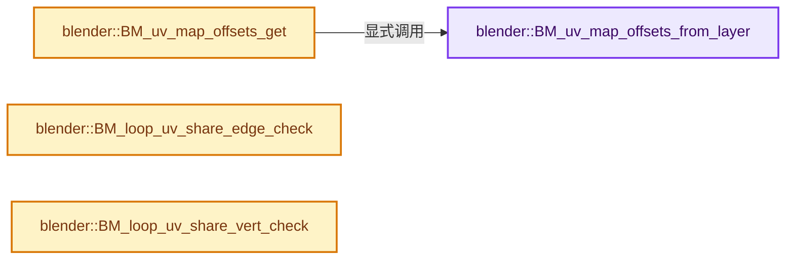
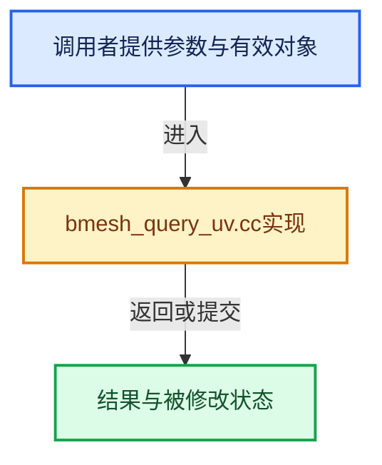

# 实现依赖专题：source/blender/bmesh/intern/bmesh_query_uv.cc

[实现依赖导航](../../../README.md) · [符号索引](../../../../00-课程指南/02-源码与提交索引/符号依赖与实现索引.md)

本专题从正文实际调用进入，集中保存共享实现。函数有稳定锚点，可从调用处直接跳到对应完整函数；递归与互相调用通过回链组织。

## 本文件的实现关系






## 完整成员与函数实现

<a id="f-dddce5d2cd74daff"></a>

### `blender::BM_uv_map_offsets_from_layer`

实现位置：[source/blender/bmesh/intern/bmesh_query_uv.cc](../../../../../../../../source/blender/bmesh/intern/bmesh_query_uv.cc) · L22—L39。

接口参数：

- `const BMesh *bm`
- `const int layer`

**教学注释版**

<!-- annotated:1bc9be5536843e -->

```cpp
BMUVOffsets BM_uv_map_offsets_from_layer(const BMesh *bm, const int layer)
{
  using namespace bke;
  const int layer_index = CustomData_get_layer_index_n(&bm->ldata, CD_PROP_FLOAT2, layer);
  if (layer_index == -1) {
    return BMUVOFFSETS_NONE;
  }

  const StringRef name = bm->ldata.layers[layer_index].name;
  char buffer[MAX_CUSTOMDATA_LAYER_NAME];

  BMUVOffsets offsets;
  offsets.uv = bm->ldata.layers[layer_index].offset;
  offsets.pin = CustomData_get_offset_named(
      &bm->ldata, CD_PROP_BOOL, BKE_uv_map_pin_name_get(name, buffer));

  return offsets;
}
```

<details>
<summary>核对原始源码：source/blender/bmesh/intern/bmesh_query_uv.cc · L22—L39</summary>

<!-- original:1bc9be5536843e:source/blender/bmesh/intern/bmesh_query_uv.cc:22:39 -->

```cpp
BMUVOffsets BM_uv_map_offsets_from_layer(const BMesh *bm, const int layer)
{
  using namespace bke;
  const int layer_index = CustomData_get_layer_index_n(&bm->ldata, CD_PROP_FLOAT2, layer);
  if (layer_index == -1) {
    return BMUVOFFSETS_NONE;
  }

  const StringRef name = bm->ldata.layers[layer_index].name;
  char buffer[MAX_CUSTOMDATA_LAYER_NAME];

  BMUVOffsets offsets;
  offsets.uv = bm->ldata.layers[layer_index].offset;
  offsets.pin = CustomData_get_offset_named(
      &bm->ldata, CD_PROP_BOOL, BKE_uv_map_pin_name_get(name, buffer));

  return offsets;
}
```

</details>

**沿实际写入检查状态**

- `offsets.uv = bm->ldata.layers[layer_index].offset;`
- `offsets.pin = CustomData_get_offset_named(`

**结果出口**

- `return BMUVOFFSETS_NONE;`
- `return offsets;`

**继续追踪实现**

- `CustomData_get_layer_index_n` → [blender::CustomData_get_layer_index_n · L2562](../../../02-BKE几何与数据/intern/customdata.cc.md#f-a5c18b99111c4b5f)。
- `CustomData_get_offset_named` → [blender::CustomData_get_offset_named · L3398](../../../02-BKE几何与数据/intern/customdata.cc.md#f-fe199f3da62e9c30)。
- `BKE_uv_map_pin_name_get` → [blender::BKE_uv_map_pin_name_get · L1001](../../../02-BKE几何与数据/intern/attribute.cc.md#f-d992dfa0848838f1)。

<a id="f-3ed93ab53a3df44e"></a>

### `blender::BM_uv_map_offsets_get`

实现位置：[source/blender/bmesh/intern/bmesh_query_uv.cc](../../../../../../../../source/blender/bmesh/intern/bmesh_query_uv.cc) · L41—L48。

接口参数：

- `const BMesh *bm`

**教学注释版**

<!-- annotated:6f0e1efd265e0e -->

```cpp
BMUVOffsets BM_uv_map_offsets_get(const BMesh *bm)
{
  const int layer = CustomData_get_active_layer(&bm->ldata, CD_PROP_FLOAT2);
  if (layer == -1) {
    return BMUVOFFSETS_NONE;
  }
  return BM_uv_map_offsets_from_layer(bm, layer);
}
```

<details>
<summary>核对原始源码：source/blender/bmesh/intern/bmesh_query_uv.cc · L41—L48</summary>

<!-- original:6f0e1efd265e0e:source/blender/bmesh/intern/bmesh_query_uv.cc:41:48 -->

```cpp
BMUVOffsets BM_uv_map_offsets_get(const BMesh *bm)
{
  const int layer = CustomData_get_active_layer(&bm->ldata, CD_PROP_FLOAT2);
  if (layer == -1) {
    return BMUVOFFSETS_NONE;
  }
  return BM_uv_map_offsets_from_layer(bm, layer);
}
```

</details>

**结果出口**

- `return BMUVOFFSETS_NONE;`
- `return BM_uv_map_offsets_from_layer(bm, layer);`

**继续追踪实现**

- `CustomData_get_active_layer` → [blender::CustomData_get_active_layer · L2628](../../../02-BKE几何与数据/intern/customdata.cc.md#f-65322aa9bb4f07e1)。
- `BM_uv_map_offsets_from_layer` → [blender::BM_uv_map_offsets_from_layer · L22](bmesh_query_uv.cc.md#f-dddce5d2cd74daff)。

<a id="f-ac1414bcb4207e6b"></a>

### `blender::BM_loop_uv_share_edge_check`

实现位置：[source/blender/bmesh/intern/bmesh_query_uv.cc](../../../../../../../../source/blender/bmesh/intern/bmesh_query_uv.cc) · L143—L154。

接口参数：

- `const BMLoop *l_a`
- `const BMLoop *l_b`
- `const int cd_loop_uv_offset`

**教学注释版**

<!-- annotated:2de2c5f43072a6 -->

```cpp
bool BM_loop_uv_share_edge_check(const BMLoop *l_a, const BMLoop *l_b, const int cd_loop_uv_offset)
{
  BLI_assert(l_a->e == l_b->e);
  const float *luv_a_curr = BM_ELEM_CD_GET_FLOAT_P(l_a, cd_loop_uv_offset);
  const float *luv_a_next = BM_ELEM_CD_GET_FLOAT_P(l_a->next, cd_loop_uv_offset);
  const float *luv_b_curr = BM_ELEM_CD_GET_FLOAT_P(l_b, cd_loop_uv_offset);
  const float *luv_b_next = BM_ELEM_CD_GET_FLOAT_P(l_b->next, cd_loop_uv_offset);
  if (l_a->v != l_b->v) {
    std::swap(luv_b_curr, luv_b_next);
  }
  return (equals_v2v2(luv_a_curr, luv_b_curr) && equals_v2v2(luv_a_next, luv_b_next));
}
```

<details>
<summary>核对原始源码：source/blender/bmesh/intern/bmesh_query_uv.cc · L143—L154</summary>

<!-- original:2de2c5f43072a6:source/blender/bmesh/intern/bmesh_query_uv.cc:143:154 -->

```cpp
bool BM_loop_uv_share_edge_check(const BMLoop *l_a, const BMLoop *l_b, const int cd_loop_uv_offset)
{
  BLI_assert(l_a->e == l_b->e);
  const float *luv_a_curr = BM_ELEM_CD_GET_FLOAT_P(l_a, cd_loop_uv_offset);
  const float *luv_a_next = BM_ELEM_CD_GET_FLOAT_P(l_a->next, cd_loop_uv_offset);
  const float *luv_b_curr = BM_ELEM_CD_GET_FLOAT_P(l_b, cd_loop_uv_offset);
  const float *luv_b_next = BM_ELEM_CD_GET_FLOAT_P(l_b->next, cd_loop_uv_offset);
  if (l_a->v != l_b->v) {
    std::swap(luv_b_curr, luv_b_next);
  }
  return (equals_v2v2(luv_a_curr, luv_b_curr) && equals_v2v2(luv_a_next, luv_b_next));
}
```

</details>

**结果出口**

- `return (equals_v2v2(luv_a_curr, luv_b_curr) && equals_v2v2(luv_a_next, luv_b_next));`

**继续追踪实现**

- `BLI_assert` → [BLI_assert · L48](../../../01-BLI基础库/BLI_assert.hh.md#m-57a88495704d)；[BLI_assert · L63](../../../01-BLI基础库/BLI_assert.hh.md#m-d07050020cb5)。宏定义由构建条件选择。
- `BM_ELEM_CD_GET_FLOAT_P` → [BM_ELEM_CD_GET_FLOAT_P · L635](../bmesh_class.hh.md#m-544f72c45c1b)；[BM_ELEM_CD_GET_FLOAT_P · L661](../bmesh_class.hh.md#m-c11efbe96e86)。宏定义由构建条件选择。
- `std::swap` → [外部契约](https://eel.is/c++draft/)：这个边界按实际表达式及所属类型核对参数、返回值、寿命与失败行为。这里提供接口入口，不声称已解释该第三方版本的内部实现。
- `equals_v2v2` → [blender::equals_v2v2 · L1001](../../../01-BLI基础库/intern/math_vector_inline.cc.md#f-5cb3944ff2c53ef9)。

<a id="f-a7d1cd6d1336772b"></a>

### `blender::BM_loop_uv_share_vert_check`

实现位置：[source/blender/bmesh/intern/bmesh_query_uv.cc](../../../../../../../../source/blender/bmesh/intern/bmesh_query_uv.cc) · L156—L165。

接口参数：

- `const BMLoop *l_a`
- `const BMLoop *l_b`
- `const int cd_loop_uv_offset`

**教学注释版**

<!-- annotated:71bdddaeb0a286 -->

```cpp
bool BM_loop_uv_share_vert_check(const BMLoop *l_a, const BMLoop *l_b, const int cd_loop_uv_offset)
{
  BLI_assert(l_a->v == l_b->v);
  const float *luv_a = BM_ELEM_CD_GET_FLOAT_P(l_a, cd_loop_uv_offset);
  const float *luv_b = BM_ELEM_CD_GET_FLOAT_P(l_b, cd_loop_uv_offset);
  if (!equals_v2v2(luv_a, luv_b)) {
    return false;
  }
  return true;
}
```

<details>
<summary>核对原始源码：source/blender/bmesh/intern/bmesh_query_uv.cc · L156—L165</summary>

<!-- original:71bdddaeb0a286:source/blender/bmesh/intern/bmesh_query_uv.cc:156:165 -->

```cpp
bool BM_loop_uv_share_vert_check(const BMLoop *l_a, const BMLoop *l_b, const int cd_loop_uv_offset)
{
  BLI_assert(l_a->v == l_b->v);
  const float *luv_a = BM_ELEM_CD_GET_FLOAT_P(l_a, cd_loop_uv_offset);
  const float *luv_b = BM_ELEM_CD_GET_FLOAT_P(l_b, cd_loop_uv_offset);
  if (!equals_v2v2(luv_a, luv_b)) {
    return false;
  }
  return true;
}
```

</details>

**结果出口**

- `return false;`
- `return true;`

**继续追踪实现**

- `BLI_assert` → [BLI_assert · L48](../../../01-BLI基础库/BLI_assert.hh.md#m-57a88495704d)；[BLI_assert · L63](../../../01-BLI基础库/BLI_assert.hh.md#m-d07050020cb5)。宏定义由构建条件选择。
- `BM_ELEM_CD_GET_FLOAT_P` → [BM_ELEM_CD_GET_FLOAT_P · L635](../bmesh_class.hh.md#m-544f72c45c1b)；[BM_ELEM_CD_GET_FLOAT_P · L661](../bmesh_class.hh.md#m-c11efbe96e86)。宏定义由构建条件选择。
- `equals_v2v2` → [blender::equals_v2v2 · L1001](../../../01-BLI基础库/intern/math_vector_inline.cc.md#f-5cb3944ff2c53ef9)。
