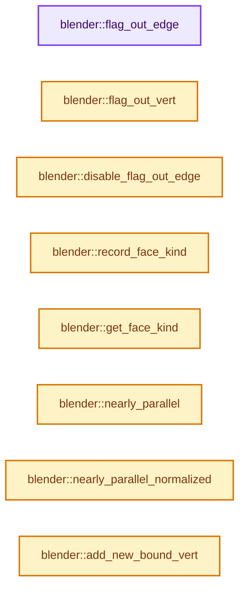
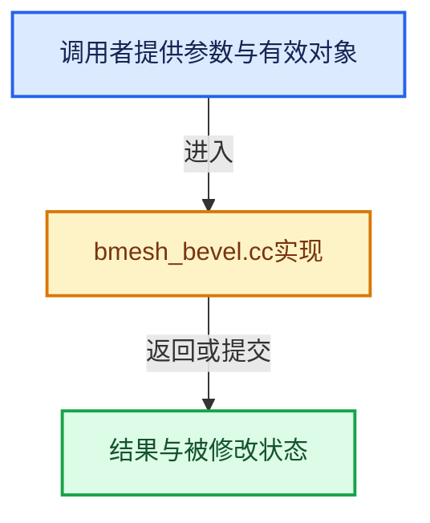

# 实现依赖专题：source/blender/bmesh/tools/bmesh_bevel.cc

[实现依赖导航](../../../README.md) · [符号索引](../../../../00-课程指南/02-源码与提交索引/符号依赖与实现索引.md)

本专题从正文实际调用进入，集中保存共享实现。函数有稳定锚点，可从调用处直接跳到对应完整函数；递归与互相调用通过回链组织。

## 本文件的实现关系






<a id="m-bc6281dd00dc"></a>

## 宏 `HASNOT_SEAMSHARP`

<!-- annotated:f151462af8ddb2 -->

```cpp
#define HASNOT_SEAMSHARP(eh, flag) \
  ((flag == BM_ELEM_SEAM && !BM_elem_flag_test(eh->e, BM_ELEM_SEAM)) || \
   (flag == BM_ELEM_SMOOTH && BM_elem_flag_test(eh->e, BM_ELEM_SMOOTH)))
static void check_edge_data_seam_sharp_edges(BevVert *bv, int flag)
```

<details>
<summary>核对原始源码：source/blender/bmesh/tools/bmesh_bevel.cc · L2848—L2851</summary>

<!-- original:f151462af8ddb2:source/blender/bmesh/tools/bmesh_bevel.cc:2848:2851 -->

```cpp
#define HASNOT_SEAMSHARP(eh, flag) \
  ((flag == BM_ELEM_SEAM && !BM_elem_flag_test(eh->e, BM_ELEM_SEAM)) || \
   (flag == BM_ELEM_SMOOTH && BM_elem_flag_test(eh->e, BM_ELEM_SMOOTH)))
static void check_edge_data_seam_sharp_edges(BevVert *bv, int flag)
```

</details>

宏在预处理阶段展开，参数替换、重复求值和条件编译应直接从该定义检查。与普通函数不同，宏不会自动提供参数类型检查；构建配置选择哪个定义需结合外围条件。

<a id="m-7ba581b94828"></a>

## 宏 `BM_BEVEL_EDGE_TAG_ENABLE`

<!-- annotated:a4384f000e1bf9 -->

```cpp
#define BM_BEVEL_EDGE_TAG_ENABLE(bme) BM_ELEM_API_FLAG_ENABLE((bme), _FLAG_OVERLAP)
#define BM_BEVEL_EDGE_TAG_DISABLE(bme) BM_ELEM_API_FLAG_DISABLE((bme), _FLAG_OVERLAP)
```

<details>
<summary>核对原始源码：source/blender/bmesh/tools/bmesh_bevel.cc · L6595—L6596</summary>

<!-- original:a4384f000e1bf9:source/blender/bmesh/tools/bmesh_bevel.cc:6595:6596 -->

```cpp
#define BM_BEVEL_EDGE_TAG_ENABLE(bme) BM_ELEM_API_FLAG_ENABLE((bme), _FLAG_OVERLAP)
#define BM_BEVEL_EDGE_TAG_DISABLE(bme) BM_ELEM_API_FLAG_DISABLE((bme), _FLAG_OVERLAP)
```

</details>

宏在预处理阶段展开，参数替换、重复求值和条件编译应直接从该定义检查。与普通函数不同，宏不会自动提供参数类型检查；构建配置选择哪个定义需结合外围条件。

<a id="m-1164e42ca711"></a>

## 宏 `BM_BEVEL_EDGE_TAG_DISABLE`

<!-- annotated:940c0d7f0f063b -->

```cpp
#define BM_BEVEL_EDGE_TAG_DISABLE(bme) BM_ELEM_API_FLAG_DISABLE((bme), _FLAG_OVERLAP)
#define BM_BEVEL_EDGE_TAG_TEST(bme) BM_ELEM_API_FLAG_TEST((bme), _FLAG_OVERLAP)
```

<details>
<summary>核对原始源码：source/blender/bmesh/tools/bmesh_bevel.cc · L6596—L6597</summary>

<!-- original:940c0d7f0f063b:source/blender/bmesh/tools/bmesh_bevel.cc:6596:6597 -->

```cpp
#define BM_BEVEL_EDGE_TAG_DISABLE(bme) BM_ELEM_API_FLAG_DISABLE((bme), _FLAG_OVERLAP)
#define BM_BEVEL_EDGE_TAG_TEST(bme) BM_ELEM_API_FLAG_TEST((bme), _FLAG_OVERLAP)
```

</details>

宏在预处理阶段展开，参数替换、重复求值和条件编译应直接从该定义检查。与普通函数不同，宏不会自动提供参数类型检查；构建配置选择哪个定义需结合外围条件。

<a id="m-d40b820c4a5f"></a>

## 宏 `BM_BEVEL_EDGE_TAG_TEST`

<!-- annotated:2914d8ae6b3ff0 -->

```cpp
#define BM_BEVEL_EDGE_TAG_TEST(bme) BM_ELEM_API_FLAG_TEST((bme), _FLAG_OVERLAP)

```

<details>
<summary>核对原始源码：source/blender/bmesh/tools/bmesh_bevel.cc · L6597—L6598</summary>

<!-- original:2914d8ae6b3ff0:source/blender/bmesh/tools/bmesh_bevel.cc:6597:6598 -->

```cpp
#define BM_BEVEL_EDGE_TAG_TEST(bme) BM_ELEM_API_FLAG_TEST((bme), _FLAG_OVERLAP)

```

</details>

宏在预处理阶段展开，参数替换、重复求值和条件编译应直接从该定义检查。与普通函数不同，宏不会自动提供参数类型检查；构建配置选择哪个定义需结合外围条件。

## 完整成员与函数实现

<a id="f-ebfd25b138e8a5ba"></a>

### `blender::flag_out_edge`

实现位置：[source/blender/bmesh/tools/bmesh_bevel.cc](../../../../../../../../source/blender/bmesh/tools/bmesh_bevel.cc) · L759—L764。

接口参数：

- `BMesh *bm`
- `BMEdge *bme`

**教学注释版**

<!-- annotated:a79393b028f937 -->

```cpp
static void flag_out_edge(BMesh *bm, BMEdge *bme)
{
  if (bm->use_toolflags) {
    BMO_edge_flag_enable(bm, bme, EDGE_OUT);
  }
}
```

<details>
<summary>核对原始源码：source/blender/bmesh/tools/bmesh_bevel.cc · L759—L764</summary>

<!-- original:a79393b028f937:source/blender/bmesh/tools/bmesh_bevel.cc:759:764 -->

```cpp
static void flag_out_edge(BMesh *bm, BMEdge *bme)
{
  if (bm->use_toolflags) {
    BMO_edge_flag_enable(bm, bme, EDGE_OUT);
  }
}
```

</details>

**继续追踪实现**

- `BMO_edge_flag_enable` → [BMO_edge_flag_enable · L159](../intern/bmesh_operator_api.hh.md#m-c9656b4d0260)。宏定义由构建条件选择。

<a id="f-49dadd7816119e33"></a>

### `blender::flag_out_vert`

实现位置：[source/blender/bmesh/tools/bmesh_bevel.cc](../../../../../../../../source/blender/bmesh/tools/bmesh_bevel.cc) · L766—L771。

接口参数：

- `BMesh *bm`
- `BMVert *bmv`

**教学注释版**

<!-- annotated:128c42d3baa4f8 -->

```cpp
static void flag_out_vert(BMesh *bm, BMVert *bmv)
{
  if (bm->use_toolflags) {
    BMO_vert_flag_enable(bm, bmv, VERT_OUT);
  }
}
```

<details>
<summary>核对原始源码：source/blender/bmesh/tools/bmesh_bevel.cc · L766—L771</summary>

<!-- original:128c42d3baa4f8:source/blender/bmesh/tools/bmesh_bevel.cc:766:771 -->

```cpp
static void flag_out_vert(BMesh *bm, BMVert *bmv)
{
  if (bm->use_toolflags) {
    BMO_vert_flag_enable(bm, bmv, VERT_OUT);
  }
}
```

</details>

**继续追踪实现**

- `BMO_vert_flag_enable` → [BMO_vert_flag_enable · L148](../intern/bmesh_operator_api.hh.md#m-90e32e8aabf0)。宏定义由构建条件选择。

<a id="f-fc5e58b6f689a7a5"></a>

### `blender::disable_flag_out_edge`

实现位置：[source/blender/bmesh/tools/bmesh_bevel.cc](../../../../../../../../source/blender/bmesh/tools/bmesh_bevel.cc) · L773—L778。

接口参数：

- `BMesh *bm`
- `BMEdge *bme`

**教学注释版**

<!-- annotated:b41e09a0abba7a -->

```cpp
static void disable_flag_out_edge(BMesh *bm, BMEdge *bme)
{
  if (bm->use_toolflags) {
    BMO_edge_flag_disable(bm, bme, EDGE_OUT);
  }
}
```

<details>
<summary>核对原始源码：source/blender/bmesh/tools/bmesh_bevel.cc · L773—L778</summary>

<!-- original:b41e09a0abba7a:source/blender/bmesh/tools/bmesh_bevel.cc:773:778 -->

```cpp
static void disable_flag_out_edge(BMesh *bm, BMEdge *bme)
{
  if (bm->use_toolflags) {
    BMO_edge_flag_disable(bm, bme, EDGE_OUT);
  }
}
```

</details>

**继续追踪实现**

- `BMO_edge_flag_disable` → [BMO_edge_flag_disable · L160](../intern/bmesh_operator_api.hh.md#m-747e7b3feece)。宏定义由构建条件选择。

<a id="f-ed3adbb4b9b65f47"></a>

### `blender::record_face_kind`

实现位置：[source/blender/bmesh/tools/bmesh_bevel.cc](../../../../../../../../source/blender/bmesh/tools/bmesh_bevel.cc) · L780—L785。

接口参数：

- `BevelParams *bp`
- `BMFace *f`
- `FKind fkind`

**教学注释版**

<!-- annotated:bc188cbffdfb28 -->

```cpp
static void record_face_kind(BevelParams *bp, BMFace *f, FKind fkind)
{
  if (bp->face_hash) {
    bp->face_hash->add(f, fkind);
  }
}
```

<details>
<summary>核对原始源码：source/blender/bmesh/tools/bmesh_bevel.cc · L780—L785</summary>

<!-- original:bc188cbffdfb28:source/blender/bmesh/tools/bmesh_bevel.cc:780:785 -->

```cpp
static void record_face_kind(BevelParams *bp, BMFace *f, FKind fkind)
{
  if (bp->face_hash) {
    bp->face_hash->add(f, fkind);
  }
}
```

</details>

**继续追踪实现**

- `bp->face_hash->add` → [调用协议](../../../../00-课程指南/01-路线与规范/模板宏与动态分派协议.md)：接收对象类型依赖auto、返回值或模板实例；不按同名猜测目标。调用位置L783。

<a id="f-f808d07b7f63f081"></a>

### `blender::get_face_kind`

实现位置：[source/blender/bmesh/tools/bmesh_bevel.cc](../../../../../../../../source/blender/bmesh/tools/bmesh_bevel.cc) · L787—L790。

接口参数：

- `BevelParams *bp`
- `BMFace *f`

**教学注释版**

<!-- annotated:1e260cb86e2b8c -->

```cpp
static FKind get_face_kind(BevelParams *bp, BMFace *f)
{
  return bp->face_hash->lookup_default(f, F_ORIG);
}
```

<details>
<summary>核对原始源码：source/blender/bmesh/tools/bmesh_bevel.cc · L787—L790</summary>

<!-- original:1e260cb86e2b8c:source/blender/bmesh/tools/bmesh_bevel.cc:787:790 -->

```cpp
static FKind get_face_kind(BevelParams *bp, BMFace *f)
{
  return bp->face_hash->lookup_default(f, F_ORIG);
}
```

</details>

**结果出口**

- `return bp->face_hash->lookup_default(f, F_ORIG);`

**继续追踪实现**

- `bp->face_hash->lookup_default` → [调用协议](../../../../00-课程指南/01-路线与规范/模板宏与动态分派协议.md)：接收对象类型依赖auto、返回值或模板实例；不按同名猜测目标。调用位置L789。

<a id="f-4eca174f8e507f35"></a>

### `blender::nearly_parallel`

实现位置：[source/blender/bmesh/tools/bmesh_bevel.cc](../../../../../../../../source/blender/bmesh/tools/bmesh_bevel.cc) · L793—L798。

接口参数：

- `const float d1[3]`
- `const float d2[3]`

**教学注释版**

<!-- annotated:ed791031f2dc9f -->

```cpp
static bool nearly_parallel(const float d1[3], const float d2[3])
{
  float ang = angle_v3v3(d1, d2);

  return (fabsf(ang) < BEVEL_EPSILON_ANG) || (fabsf(ang - float(M_PI)) < BEVEL_EPSILON_ANG);
}
```

<details>
<summary>核对原始源码：source/blender/bmesh/tools/bmesh_bevel.cc · L793—L798</summary>

<!-- original:ed791031f2dc9f:source/blender/bmesh/tools/bmesh_bevel.cc:793:798 -->

```cpp
static bool nearly_parallel(const float d1[3], const float d2[3])
{
  float ang = angle_v3v3(d1, d2);

  return (fabsf(ang) < BEVEL_EPSILON_ANG) || (fabsf(ang - float(M_PI)) < BEVEL_EPSILON_ANG);
}
```

</details>

**结果出口**

- `return (fabsf(ang) < BEVEL_EPSILON_ANG) || (fabsf(ang - float(M_PI)) < BEVEL_EPSILON_ANG);`

**继续追踪实现**

- `angle_v3v3` → [blender::angle_v3v3 · L276](../../../01-BLI基础库/intern/math_vector.cc.md#f-19f04f581481dab6)。
- `fabsf` → [fabsf · L21](../../../07-Intern运行时与平台/cycles/kernel/svm/radial_tiling_shared.h.md#m-02cc4c69cfb3)；[fabsf · L43](../../../07-Intern运行时与平台/cycles/kernel/svm/radial_tiling_shared.h.md#m-04effe61803b)；[fabsf · L74](../../../07-Intern运行时与平台/cycles/kernel/svm/radial_tiling_shared.h.md#m-927dd4eba7dc)；[fabsf · L25](../../../01-BLI基础库/intern/radial_tiling_shared.hh.md#m-8348d6b3d08f)；[fabsf · L47](../../../01-BLI基础库/intern/radial_tiling_shared.hh.md#m-13b7e0b6d84f)；[fabsf · L78](../../../01-BLI基础库/intern/radial_tiling_shared.hh.md#m-326c83464a0d)；[fabsf · L21](../../../07-Intern运行时与平台/cycles/kernel/osl/shaders/node_radial_tiling_shared.h.md#m-7c3ee12fc119)；[fabsf · L43](../../../07-Intern运行时与平台/cycles/kernel/osl/shaders/node_radial_tiling_shared.h.md#m-9112db0e2dd1)；[fabsf · L74](../../../07-Intern运行时与平台/cycles/kernel/osl/shaders/node_radial_tiling_shared.h.md#m-ee4e61908a6f)；[fabsf · L167](../../../07-Intern运行时与平台/cycles/kernel/device/oneapi/compat.h.md#m-b039ee6c1601)；[fabsf · L265](../../../07-Intern运行时与平台/cycles/kernel/device/metal/compat.h.md#m-6b21869e9f3f)。宏定义由构建条件选择。

<a id="f-8587f9efb5b26446"></a>

### `blender::nearly_parallel_normalized`

实现位置：[source/blender/bmesh/tools/bmesh_bevel.cc](../../../../../../../../source/blender/bmesh/tools/bmesh_bevel.cc) · L803—L810。

接口参数：

- `const float d1[3]`
- `const float d2[3]`

**教学注释版**

<!-- annotated:f26dbf4e7a02f6 -->

```cpp
static bool nearly_parallel_normalized(const float d1[3], const float d2[3])
{
  BLI_ASSERT_UNIT_V3(d1);
  BLI_ASSERT_UNIT_V3(d2);

  const float direction_dot = dot_v3v3(d1, d2);
  return compare_ff(fabsf(direction_dot), 1.0f, BEVEL_EPSILON_ANG_DOT);
}
```

<details>
<summary>核对原始源码：source/blender/bmesh/tools/bmesh_bevel.cc · L803—L810</summary>

<!-- original:f26dbf4e7a02f6:source/blender/bmesh/tools/bmesh_bevel.cc:803:810 -->

```cpp
static bool nearly_parallel_normalized(const float d1[3], const float d2[3])
{
  BLI_ASSERT_UNIT_V3(d1);
  BLI_ASSERT_UNIT_V3(d2);

  const float direction_dot = dot_v3v3(d1, d2);
  return compare_ff(fabsf(direction_dot), 1.0f, BEVEL_EPSILON_ANG_DOT);
}
```

</details>

**结果出口**

- `return compare_ff(fabsf(direction_dot), 1.0f, BEVEL_EPSILON_ANG_DOT);`

**继续追踪实现**

- `BLI_ASSERT_UNIT_V3` → [BLI_ASSERT_UNIT_V3 · L315](../../../01-BLI基础库/BLI_math_base_c.hh.md#m-7f347402189a)；[BLI_ASSERT_UNIT_V3 · L359](../../../01-BLI基础库/BLI_math_base_c.hh.md#m-fe91af053d50)。宏定义由构建条件选择。
- `dot_v3v3` → [blender::dot_v3v3 · L646](../../../01-BLI基础库/intern/math_vector_inline.cc.md#f-c88befa67d07591a)。
- `compare_ff` → [blender::compare_ff · L416](../../../01-BLI基础库/intern/math_base_inline.cc.md#f-05969a4cd4cc634f)。
- `fabsf` → [fabsf · L21](../../../07-Intern运行时与平台/cycles/kernel/svm/radial_tiling_shared.h.md#m-02cc4c69cfb3)；[fabsf · L43](../../../07-Intern运行时与平台/cycles/kernel/svm/radial_tiling_shared.h.md#m-04effe61803b)；[fabsf · L74](../../../07-Intern运行时与平台/cycles/kernel/svm/radial_tiling_shared.h.md#m-927dd4eba7dc)；[fabsf · L25](../../../01-BLI基础库/intern/radial_tiling_shared.hh.md#m-8348d6b3d08f)；[fabsf · L47](../../../01-BLI基础库/intern/radial_tiling_shared.hh.md#m-13b7e0b6d84f)；[fabsf · L78](../../../01-BLI基础库/intern/radial_tiling_shared.hh.md#m-326c83464a0d)；[fabsf · L21](../../../07-Intern运行时与平台/cycles/kernel/osl/shaders/node_radial_tiling_shared.h.md#m-7c3ee12fc119)；[fabsf · L43](../../../07-Intern运行时与平台/cycles/kernel/osl/shaders/node_radial_tiling_shared.h.md#m-9112db0e2dd1)；[fabsf · L74](../../../07-Intern运行时与平台/cycles/kernel/osl/shaders/node_radial_tiling_shared.h.md#m-ee4e61908a6f)；[fabsf · L167](../../../07-Intern运行时与平台/cycles/kernel/device/oneapi/compat.h.md#m-b039ee6c1601)；[fabsf · L265](../../../07-Intern运行时与平台/cycles/kernel/device/metal/compat.h.md#m-6b21869e9f3f)。宏定义由构建条件选择。

<a id="f-f245d6854b2c7a0a"></a>

### `blender::add_new_bound_vert`

实现位置：[source/blender/bmesh/tools/bmesh_bevel.cc](../../../../../../../../source/blender/bmesh/tools/bmesh_bevel.cc) · L814—L842。

接口参数：

- `MemArena *mem_arena`
- `VMesh *vm`
- `const float co[3]`

**教学注释版**

<!-- annotated:c2f04b4d9f77c2 -->

```cpp
static BoundVert *add_new_bound_vert(MemArena *mem_arena, VMesh *vm, const float co[3])
{
  BoundVert *ans = static_cast<BoundVert *>(BLI_memarena_alloc(mem_arena, sizeof(BoundVert)));

  copy_v3_v3(ans->nv.co, co);
  if (!vm->boundstart) {
    ans->index = 0;
    vm->boundstart = ans;
    ans->next = ans->prev = ans;
  }
  else {
    BoundVert *tail = vm->boundstart->prev;
    ans->index = tail->index + 1;
    ans->prev = tail;
    ans->next = vm->boundstart;
    tail->next = ans;
    vm->boundstart->prev = ans;
  }
  ans->profile.super_r = PRO_LINE_R;
  ans->adjchain = nullptr;
  ans->sinratio = 1.0f;
  ans->visited = false;
  ans->any_seam = false;
  ans->is_arc_start = false;
  ans->is_patch_start = false;
  ans->is_profile_start = false;
  vm->count++;
  return ans;
}
```

<details>
<summary>核对原始源码：source/blender/bmesh/tools/bmesh_bevel.cc · L814—L842</summary>

<!-- original:c2f04b4d9f77c2:source/blender/bmesh/tools/bmesh_bevel.cc:814:842 -->

```cpp
static BoundVert *add_new_bound_vert(MemArena *mem_arena, VMesh *vm, const float co[3])
{
  BoundVert *ans = static_cast<BoundVert *>(BLI_memarena_alloc(mem_arena, sizeof(BoundVert)));

  copy_v3_v3(ans->nv.co, co);
  if (!vm->boundstart) {
    ans->index = 0;
    vm->boundstart = ans;
    ans->next = ans->prev = ans;
  }
  else {
    BoundVert *tail = vm->boundstart->prev;
    ans->index = tail->index + 1;
    ans->prev = tail;
    ans->next = vm->boundstart;
    tail->next = ans;
    vm->boundstart->prev = ans;
  }
  ans->profile.super_r = PRO_LINE_R;
  ans->adjchain = nullptr;
  ans->sinratio = 1.0f;
  ans->visited = false;
  ans->any_seam = false;
  ans->is_arc_start = false;
  ans->is_patch_start = false;
  ans->is_profile_start = false;
  vm->count++;
  return ans;
}
```

</details>

**沿实际写入检查状态**

- `ans->index = 0;`
- `vm->boundstart = ans;`
- `ans->next = ans->prev = ans;`
- `ans->index = tail->index + 1;`
- `ans->prev = tail;`
- `ans->next = vm->boundstart;`
- `tail->next = ans;`
- `vm->boundstart->prev = ans;`
- `ans->profile.super_r = PRO_LINE_R;`
- `ans->adjchain = nullptr;`
- `ans->sinratio = 1.0f;`
- `ans->visited = false;`
- `ans->any_seam = false;`
- `ans->is_arc_start = false;`
- `ans->is_patch_start = false;`
- `ans->is_profile_start = false;`

**结果出口**

- `return ans;`

**继续追踪实现**

- `BLI_memarena_alloc` → [blender::BLI_memarena_alloc · L125](../../../01-BLI基础库/intern/BLI_memarena.cc.md#f-ae79828c3629e134)；[blender::BLI_memarena_alloc · L43](../../../01-BLI基础库/BLI_memarena.hh.md#f-3c7ccf0d8384021b)。同名重载需按实参类型选择。
- `copy_v3_v3` → [blender::copy_v3_v3 · L47](../../../01-BLI基础库/intern/math_vector_inline.cc.md#f-037a0d5fa5060bd6)。

<a id="f-8bde780676e3a97a"></a>

### `blender::adjust_bound_vert`

实现位置：[source/blender/bmesh/tools/bmesh_bevel.cc](../../../../../../../../source/blender/bmesh/tools/bmesh_bevel.cc) · L844—L847。

接口参数：

- `BoundVert *bv`
- `const float co[3]`

**教学注释版**

<!-- annotated:bfb4dfd8648366 -->

```cpp
BLI_INLINE void adjust_bound_vert(BoundVert *bv, const float co[3])
{
  copy_v3_v3(bv->nv.co, co);
}
```

<details>
<summary>核对原始源码：source/blender/bmesh/tools/bmesh_bevel.cc · L844—L847</summary>

<!-- original:bfb4dfd8648366:source/blender/bmesh/tools/bmesh_bevel.cc:844:847 -->

```cpp
BLI_INLINE void adjust_bound_vert(BoundVert *bv, const float co[3])
{
  copy_v3_v3(bv->nv.co, co);
}
```

</details>

**继续追踪实现**

- `copy_v3_v3` → [blender::copy_v3_v3 · L47](../../../01-BLI基础库/intern/math_vector_inline.cc.md#f-037a0d5fa5060bd6)。

<a id="f-24056259ae947091"></a>

### `blender::mesh_vert`

实现位置：[source/blender/bmesh/tools/bmesh_bevel.cc](../../../../../../../../source/blender/bmesh/tools/bmesh_bevel.cc) · L854—L860。

接口参数：

- `VMesh *vm`
- `int i`
- `int j`
- `int k`

**教学注释版**

<!-- annotated:556adb0c9864b8 -->

```cpp
static NewVert *mesh_vert(VMesh *vm, int i, int j, int k)
{
  int nj = (vm->seg / 2) + 1;
  int nk = vm->seg + 1;

  return &vm->mesh[i * nk * nj + j * nk + k];
}
```

<details>
<summary>核对原始源码：source/blender/bmesh/tools/bmesh_bevel.cc · L854—L860</summary>

<!-- original:556adb0c9864b8:source/blender/bmesh/tools/bmesh_bevel.cc:854:860 -->

```cpp
static NewVert *mesh_vert(VMesh *vm, int i, int j, int k)
{
  int nj = (vm->seg / 2) + 1;
  int nk = vm->seg + 1;

  return &vm->mesh[i * nk * nj + j * nk + k];
}
```

</details>

**结果出口**

- `return &vm->mesh[i * nk * nj + j * nk + k];`

**继续追踪实现**

本实现没有需要继续展开的显式调用；检查返回表达式、对象转换和调用者前置条件。

<a id="f-864a30cd1c704230"></a>

### `blender::create_mesh_bmvert`

实现位置：[source/blender/bmesh/tools/bmesh_bevel.cc](../../../../../../../../source/blender/bmesh/tools/bmesh_bevel.cc) · L862—L868。

接口参数：

- `BMesh *bm`
- `VMesh *vm`
- `int i`
- `int j`
- `int k`
- `BMVert *eg`

**教学注释版**

<!-- annotated:9ac23cdf7a0060 -->

```cpp
static void create_mesh_bmvert(BMesh *bm, VMesh *vm, int i, int j, int k, BMVert *eg)
{
  NewVert *nv = mesh_vert(vm, i, j, k);
  nv->v = BM_vert_create(bm, nv->co, eg, BM_CREATE_NOP);
  BM_elem_flag_disable(nv->v, BM_ELEM_TAG);
  flag_out_vert(bm, nv->v);
}
```

<details>
<summary>核对原始源码：source/blender/bmesh/tools/bmesh_bevel.cc · L862—L868</summary>

<!-- original:9ac23cdf7a0060:source/blender/bmesh/tools/bmesh_bevel.cc:862:868 -->

```cpp
static void create_mesh_bmvert(BMesh *bm, VMesh *vm, int i, int j, int k, BMVert *eg)
{
  NewVert *nv = mesh_vert(vm, i, j, k);
  nv->v = BM_vert_create(bm, nv->co, eg, BM_CREATE_NOP);
  BM_elem_flag_disable(nv->v, BM_ELEM_TAG);
  flag_out_vert(bm, nv->v);
}
```

</details>

**沿实际写入检查状态**

- `nv->v = BM_vert_create(bm, nv->co, eg, BM_CREATE_NOP);`

**继续追踪实现**

- `mesh_vert` → [blender::mesh_vert · L854](bmesh_bevel.cc.md#f-24056259ae947091)。
- `BM_vert_create` → [blender::BM_vert_create · L130](../intern/bmesh_core.cc.md#f-dfad50d18825b328)。
- `BM_elem_flag_disable` → [BM_elem_flag_disable · L24](../intern/bmesh_inline.hh.md#m-e129d62b6353)。宏定义由构建条件选择。
- `flag_out_vert` → [blender::flag_out_vert · L766](bmesh_bevel.cc.md#f-49dadd7816119e33)。

<a id="f-a4d28bc42561643e"></a>

### `blender::copy_mesh_vert`

实现位置：[source/blender/bmesh/tools/bmesh_bevel.cc](../../../../../../../../source/blender/bmesh/tools/bmesh_bevel.cc) · L870—L876。

接口参数：

- `VMesh *vm`
- `int ito`
- `int jto`
- `int kto`
- `int ifrom`
- `int jfrom`
- `int kfrom`

**教学注释版**

<!-- annotated:a860b112417f38 -->

```cpp
static void copy_mesh_vert(VMesh *vm, int ito, int jto, int kto, int ifrom, int jfrom, int kfrom)
{
  NewVert *nvto = mesh_vert(vm, ito, jto, kto);
  NewVert *nvfrom = mesh_vert(vm, ifrom, jfrom, kfrom);
  nvto->v = nvfrom->v;
  copy_v3_v3(nvto->co, nvfrom->co);
}
```

<details>
<summary>核对原始源码：source/blender/bmesh/tools/bmesh_bevel.cc · L870—L876</summary>

<!-- original:a860b112417f38:source/blender/bmesh/tools/bmesh_bevel.cc:870:876 -->

```cpp
static void copy_mesh_vert(VMesh *vm, int ito, int jto, int kto, int ifrom, int jfrom, int kfrom)
{
  NewVert *nvto = mesh_vert(vm, ito, jto, kto);
  NewVert *nvfrom = mesh_vert(vm, ifrom, jfrom, kfrom);
  nvto->v = nvfrom->v;
  copy_v3_v3(nvto->co, nvfrom->co);
}
```

</details>

**沿实际写入检查状态**

- `nvto->v = nvfrom->v;`

**继续追踪实现**

- `mesh_vert` → [blender::mesh_vert · L854](bmesh_bevel.cc.md#f-24056259ae947091)。
- `copy_v3_v3` → [blender::copy_v3_v3 · L47](../../../01-BLI基础库/intern/math_vector_inline.cc.md#f-037a0d5fa5060bd6)。

<a id="f-cd650966ededf17c"></a>

### `blender::find_edge_half`

实现位置：[source/blender/bmesh/tools/bmesh_bevel.cc](../../../../../../../../source/blender/bmesh/tools/bmesh_bevel.cc) · L879—L887。

接口参数：

- `BevVert *bv`
- `BMEdge *bme`

**教学注释版**

<!-- annotated:2b9a8b88599684 -->

```cpp
static EdgeHalf *find_edge_half(BevVert *bv, BMEdge *bme)
{
  for (int i = 0; i < bv->edgecount; i++) {
    if (bv->edges[i].e == bme) {
      return &bv->edges[i];
    }
  }
  return nullptr;
}
```

<details>
<summary>核对原始源码：source/blender/bmesh/tools/bmesh_bevel.cc · L879—L887</summary>

<!-- original:2b9a8b88599684:source/blender/bmesh/tools/bmesh_bevel.cc:879:887 -->

```cpp
static EdgeHalf *find_edge_half(BevVert *bv, BMEdge *bme)
{
  for (int i = 0; i < bv->edgecount; i++) {
    if (bv->edges[i].e == bme) {
      return &bv->edges[i];
    }
  }
  return nullptr;
}
```

</details>

**结果出口**

- `return &bv->edges[i];`
- `return nullptr;`

**继续追踪实现**

本实现没有需要继续展开的显式调用；检查返回表达式、对象转换和调用者前置条件。

<a id="f-353d67a2d1be271b"></a>

### `blender::find_bevvert`

实现位置：[source/blender/bmesh/tools/bmesh_bevel.cc](../../../../../../../../source/blender/bmesh/tools/bmesh_bevel.cc) · L890—L893。

接口参数：

- `BevelParams *bp`
- `BMVert *bmv`

**教学注释版**

<!-- annotated:3f1e1a958f077d -->

```cpp
static BevVert *find_bevvert(BevelParams *bp, BMVert *bmv)
{
  return bp->vert_hash.lookup_default(bmv, nullptr);
}
```

<details>
<summary>核对原始源码：source/blender/bmesh/tools/bmesh_bevel.cc · L890—L893</summary>

<!-- original:3f1e1a958f077d:source/blender/bmesh/tools/bmesh_bevel.cc:890:893 -->

```cpp
static BevVert *find_bevvert(BevelParams *bp, BMVert *bmv)
{
  return bp->vert_hash.lookup_default(bmv, nullptr);
}
```

</details>

**结果出口**

- `return bp->vert_hash.lookup_default(bmv, nullptr);`

**继续追踪实现**

- `bp->vert_hash.lookup_default` → [调用协议](../../../../00-课程指南/01-路线与规范/模板宏与动态分派协议.md)：接收对象类型依赖auto、返回值或模板实例；不按同名猜测目标。调用位置L892。

<a id="f-06344f32b8055774"></a>

### `blender::find_uv_face`

实现位置：[source/blender/bmesh/tools/bmesh_bevel.cc](../../../../../../../../source/blender/bmesh/tools/bmesh_bevel.cc) · L896—L899。

接口参数：

- `BevelParams *bp`
- `BMFace *bmf`

**教学注释版**

<!-- annotated:03bcaa32f06913 -->

```cpp
static UVFace *find_uv_face(BevelParams *bp, BMFace *bmf)
{
  return bp->uv_face_hash.lookup_default(bmf, nullptr);
}
```

<details>
<summary>核对原始源码：source/blender/bmesh/tools/bmesh_bevel.cc · L896—L899</summary>

<!-- original:03bcaa32f06913:source/blender/bmesh/tools/bmesh_bevel.cc:896:899 -->

```cpp
static UVFace *find_uv_face(BevelParams *bp, BMFace *bmf)
{
  return bp->uv_face_hash.lookup_default(bmf, nullptr);
}
```

</details>

**结果出口**

- `return bp->uv_face_hash.lookup_default(bmf, nullptr);`

**继续追踪实现**

- `bp->uv_face_hash.lookup_default` → [调用协议](../../../../00-课程指南/01-路线与规范/模板宏与动态分派协议.md)：接收对象类型依赖auto、返回值或模板实例；不按同名猜测目标。调用位置L898。

<a id="f-de23e83a21d3f932"></a>

### `blender::find_other_end_edge_half`

实现位置：[source/blender/bmesh/tools/bmesh_bevel.cc](../../../../../../../../source/blender/bmesh/tools/bmesh_bevel.cc) · L906—L921。

接口参数：

- `BevelParams *bp`
- `EdgeHalf *e`
- `BevVert **r_bvother`

**教学注释版**

<!-- annotated:f3ffe133c2de39 -->

```cpp
static EdgeHalf *find_other_end_edge_half(BevelParams *bp, EdgeHalf *e, BevVert **r_bvother)
{
  BevVert *bvo = find_bevvert(bp, e->is_rev ? e->e->v1 : e->e->v2);
  if (bvo) {
    if (r_bvother) {
      *r_bvother = bvo;
    }
    EdgeHalf *eother = find_edge_half(bvo, e->e);
    BLI_assert(eother != nullptr);
    return eother;
  }
  if (r_bvother) {
    *r_bvother = nullptr;
  }
  return nullptr;
}
```

<details>
<summary>核对原始源码：source/blender/bmesh/tools/bmesh_bevel.cc · L906—L921</summary>

<!-- original:f3ffe133c2de39:source/blender/bmesh/tools/bmesh_bevel.cc:906:921 -->

```cpp
static EdgeHalf *find_other_end_edge_half(BevelParams *bp, EdgeHalf *e, BevVert **r_bvother)
{
  BevVert *bvo = find_bevvert(bp, e->is_rev ? e->e->v1 : e->e->v2);
  if (bvo) {
    if (r_bvother) {
      *r_bvother = bvo;
    }
    EdgeHalf *eother = find_edge_half(bvo, e->e);
    BLI_assert(eother != nullptr);
    return eother;
  }
  if (r_bvother) {
    *r_bvother = nullptr;
  }
  return nullptr;
}
```

</details>

**结果出口**

- `return eother;`
- `return nullptr;`

**继续追踪实现**

- `find_bevvert` → [blender::find_bevvert · L890](bmesh_bevel.cc.md#f-353d67a2d1be271b)。
- `find_edge_half` → [blender::find_edge_half · L879](bmesh_bevel.cc.md#f-cd650966ededf17c)。
- `BLI_assert` → [BLI_assert · L48](../../../01-BLI基础库/BLI_assert.hh.md#m-57a88495704d)；[BLI_assert · L63](../../../01-BLI基础库/BLI_assert.hh.md#m-d07050020cb5)。宏定义由构建条件选择。

<a id="f-a13b8d03fa205cb2"></a>

### `blender::next_bev`

实现位置：[source/blender/bmesh/tools/bmesh_bevel.cc](../../../../../../../../source/blender/bmesh/tools/bmesh_bevel.cc) · L925—L937。

接口参数：

- `BevVert *bv`
- `EdgeHalf *from_e`

**教学注释版**

<!-- annotated:24d5144f9f86bc -->

```cpp
static EdgeHalf *next_bev(BevVert *bv, EdgeHalf *from_e)
{
  if (from_e == nullptr) {
    from_e = &bv->edges[bv->edgecount - 1];
  }
  EdgeHalf *e = from_e;
  do {
    if (e->is_bev) {
      return e;
    }
  } while ((e = e->next) != from_e);
  return nullptr;
}
```

<details>
<summary>核对原始源码：source/blender/bmesh/tools/bmesh_bevel.cc · L925—L937</summary>

<!-- original:24d5144f9f86bc:source/blender/bmesh/tools/bmesh_bevel.cc:925:937 -->

```cpp
static EdgeHalf *next_bev(BevVert *bv, EdgeHalf *from_e)
{
  if (from_e == nullptr) {
    from_e = &bv->edges[bv->edgecount - 1];
  }
  EdgeHalf *e = from_e;
  do {
    if (e->is_bev) {
      return e;
    }
  } while ((e = e->next) != from_e);
  return nullptr;
}
```

</details>

**沿实际写入检查状态**

- `from_e = &bv->edges[bv->edgecount - 1];`

**结果出口**

- `return e;`
- `return nullptr;`

**继续追踪实现**

本实现没有需要继续展开的显式调用；检查返回表达式、对象转换和调用者前置条件。

<a id="f-59edfe3ca07c9e4e"></a>

### `blender::count_ccw_edges_between`

实现位置：[source/blender/bmesh/tools/bmesh_bevel.cc](../../../../../../../../source/blender/bmesh/tools/bmesh_bevel.cc) · L940—L953。

接口参数：

- `EdgeHalf *e1`
- `EdgeHalf *e2`

**教学注释版**

<!-- annotated:1caa1d849ae603 -->

```cpp
static int count_ccw_edges_between(EdgeHalf *e1, EdgeHalf *e2)
{
  int count = 0;
  EdgeHalf *e = e1;

  do {
    if (e == e2) {
      break;
    }
    e = e->next;
    count++;
  } while (e != e1);
  return count;
}
```

<details>
<summary>核对原始源码：source/blender/bmesh/tools/bmesh_bevel.cc · L940—L953</summary>

<!-- original:1caa1d849ae603:source/blender/bmesh/tools/bmesh_bevel.cc:940:953 -->

```cpp
static int count_ccw_edges_between(EdgeHalf *e1, EdgeHalf *e2)
{
  int count = 0;
  EdgeHalf *e = e1;

  do {
    if (e == e2) {
      break;
    }
    e = e->next;
    count++;
  } while (e != e1);
  return count;
}
```

</details>

**沿实际写入检查状态**

- `e = e->next;`

**结果出口**

- `return count;`

**继续追踪实现**

本实现没有需要继续展开的显式调用；检查返回表达式、对象转换和调用者前置条件。

<a id="f-4c73b32c1726b0d4"></a>

### `blender::edges_face_connected_at_vert`

实现位置：[source/blender/bmesh/tools/bmesh_bevel.cc](../../../../../../../../source/blender/bmesh/tools/bmesh_bevel.cc) · L958—L968。

接口参数：

- `BMEdge *bme1`
- `BMEdge *bme2`

**教学注释版**

<!-- annotated:f48ff4daf99e27 -->

```cpp
static bool edges_face_connected_at_vert(BMEdge *bme1, BMEdge *bme2)
{
  BMIter iter;
  BMLoop *l;
  BM_ITER_ELEM (l, &iter, bme1, BM_LOOPS_OF_EDGE) {
    if (l->prev->e == bme2 || l->next->e == bme2) {
      return true;
    }
  }
  return false;
}
```

<details>
<summary>核对原始源码：source/blender/bmesh/tools/bmesh_bevel.cc · L958—L968</summary>

<!-- original:f48ff4daf99e27:source/blender/bmesh/tools/bmesh_bevel.cc:958:968 -->

```cpp
static bool edges_face_connected_at_vert(BMEdge *bme1, BMEdge *bme2)
{
  BMIter iter;
  BMLoop *l;
  BM_ITER_ELEM (l, &iter, bme1, BM_LOOPS_OF_EDGE) {
    if (l->prev->e == bme2 || l->next->e == bme2) {
      return true;
    }
  }
  return false;
}
```

</details>

**结果出口**

- `return true;`
- `return false;`

**继续追踪实现**

- `BM_ITER_ELEM` → [BM_ITER_ELEM · L97](../intern/bmesh_iterators.hh.md#m-751d15be7ee4)。宏定义由构建条件选择。

<a id="f-bf6fcf0f90d253cc"></a>

### `blender::register_uv_face`

实现位置：[source/blender/bmesh/tools/bmesh_bevel.cc](../../../../../../../../source/blender/bmesh/tools/bmesh_bevel.cc) · L974—L998。

接口参数：

- `BevelParams *bp`
- `BMFace *fnew`
- `BMFace *frep`
- `BMFace **frep_arr`

**教学注释版**

<!-- annotated:428422e8b1902e -->

```cpp
static UVFace *register_uv_face(BevelParams *bp, BMFace *fnew, BMFace *frep, BMFace **frep_arr)
{
  if (!fnew) {
    return nullptr;
  }

  UVFace *uv_face = static_cast<UVFace *>(BLI_memarena_alloc(bp->mem_arena, sizeof(UVFace)));
  uv_face->f = fnew;
  uv_face->attached_frep = nullptr;
  if (frep_arr && frep_arr[0]) {
    /* Choosing first face from `frep_arr` is an arbitrary choice but for our algorithm it doesn't
     * matter. Usually the difference in `frep` and `frep_arr` is that the latter is used when
     * loops' custom data for a new bevel face is interpolated between multiple original mesh faces
     * on top of which this new bevel face is being constructed; in such case original faces
     * _should_ be already connected in UV space (i.e. no seam) and we handle such scenarios when
     * setting proper value for `is_orig_uv_verts_connected` variable. */
    uv_face->attached_frep = frep_arr[0];
  }
  else if (frep) {
    uv_face->attached_frep = frep;
  }

  bp->uv_face_hash.add(fnew, uv_face);
  return uv_face;
}
```

<details>
<summary>核对原始源码：source/blender/bmesh/tools/bmesh_bevel.cc · L974—L998</summary>

<!-- original:428422e8b1902e:source/blender/bmesh/tools/bmesh_bevel.cc:974:998 -->

```cpp
static UVFace *register_uv_face(BevelParams *bp, BMFace *fnew, BMFace *frep, BMFace **frep_arr)
{
  if (!fnew) {
    return nullptr;
  }

  UVFace *uv_face = static_cast<UVFace *>(BLI_memarena_alloc(bp->mem_arena, sizeof(UVFace)));
  uv_face->f = fnew;
  uv_face->attached_frep = nullptr;
  if (frep_arr && frep_arr[0]) {
    /* Choosing first face from `frep_arr` is an arbitrary choice but for our algorithm it doesn't
     * matter. Usually the difference in `frep` and `frep_arr` is that the latter is used when
     * loops' custom data for a new bevel face is interpolated between multiple original mesh faces
     * on top of which this new bevel face is being constructed; in such case original faces
     * _should_ be already connected in UV space (i.e. no seam) and we handle such scenarios when
     * setting proper value for `is_orig_uv_verts_connected` variable. */
    uv_face->attached_frep = frep_arr[0];
  }
  else if (frep) {
    uv_face->attached_frep = frep;
  }

  bp->uv_face_hash.add(fnew, uv_face);
  return uv_face;
}
```

</details>

**沿实际写入检查状态**

- `uv_face->f = fnew;`
- `uv_face->attached_frep = nullptr;`
- `uv_face->attached_frep = frep_arr[0];`
- `uv_face->attached_frep = frep;`

**结果出口**

- `return nullptr;`
- `return uv_face;`

**继续追踪实现**

- `BLI_memarena_alloc` → [blender::BLI_memarena_alloc · L125](../../../01-BLI基础库/intern/BLI_memarena.cc.md#f-ae79828c3629e134)；[blender::BLI_memarena_alloc · L43](../../../01-BLI基础库/BLI_memarena.hh.md#f-3c7ccf0d8384021b)。同名重载需按实参类型选择。
- `bp->uv_face_hash.add` → [调用协议](../../../../00-课程指南/01-路线与规范/模板宏与动态分派协议.md)：接收对象类型依赖auto、返回值或模板实例；不按同名猜测目标。调用位置L996。

<a id="f-694add3f3d428573"></a>

### `blender::update_uv_vert_map`

实现位置：[source/blender/bmesh/tools/bmesh_bevel.cc](../../../../../../../../source/blender/bmesh/tools/bmesh_bevel.cc) · L1005—L1083。

接口参数：

- `BevelParams *bp`
- `UVFace *uv_face`
- `BMVert *bv`
- `Map<BMVert *, BMVert *> *nv_bv_map`

**教学注释版**

<!-- annotated:da880463de09e5 -->

```cpp
static void update_uv_vert_map(BevelParams *bp,
                               UVFace *uv_face,
                               BMVert *bv,
                               Map<BMVert *, BMVert *> *nv_bv_map)
{
  if (!uv_face || !uv_face->attached_frep) {
    return;
  }

  for (UVVertMap &uv_vert_map : bp->uv_vert_maps) {
    BMIter iter;
    BMLoop *l;
    BM_ITER_ELEM (l, &iter, uv_face->f, BM_LOOPS_OF_FACE) {
      Vector<UVVertBucket> *uv_vert_buckets = uv_vert_map.lookup_ptr(l->v);
      if (!uv_vert_buckets) {
        /* New vertex (and a corresponding loop) needs to be registered. No need for further UV
         * connectivity search, we just create a new bucket and move on. */
        uv_vert_map.add(l->v, Vector<UVVertBucket>{{l}});
        continue;
      }

      /* `orig_v` should always point to a vertex which takes part in a bevel operation and comes
       * from the original mesh. This vertex is equivalent to what is stored in the `BevVert::v`
       * field. */
      // [讲解] nv_bv_map->lookup：按键查找对应项。
      BMVert *orig_v = nv_bv_map ? nv_bv_map->lookup(l->v) : bv;
      BMLoop *orig_l = BM_face_vert_share_loop(uv_face->attached_frep, orig_v);
      BLI_assert(orig_l != nullptr);

      bool is_bucket_found = false;
      BMIter iter2;
      BMLoop *l2;
      BM_ITER_ELEM (l2, &iter2, l->v, BM_LOOPS_OF_VERT) {
        if (l == l2) {
          continue;
        }

        UVFace *uv_face2 = find_uv_face(bp, l2->f);
        if (!uv_face2 || !uv_face2->attached_frep) {
          continue;
        }

        BMLoop *orig_l2 = BM_face_vert_share_loop(uv_face2->attached_frep, orig_v);
        BLI_assert(orig_l2 != nullptr);

        bool is_orig_uv_verts_connected = false;
        Vector<UVVertBucket> &orig_uv_vert_buckets = uv_vert_map.lookup(orig_v);
        for (UVVertBucket &orig_uv_vert_bucket : orig_uv_vert_buckets) {
          if (orig_uv_vert_bucket.contains(orig_l) && orig_uv_vert_bucket.contains(orig_l2)) {
            is_orig_uv_verts_connected = true;
            break;
          }
        }

        /* Add loop `l` to the existing bucket containing neighboring loop `l2` if either of those
         * conditions are met:
         * 1. Neighboring faces (represented by `UVFace` objects) have the same representative face
         *    attached to them.
         * 2. If representative faces attached to faces containing both loops (`l` and `l2`) are
         *    different but otherwise connected in UV space (`orig_l` and `orig_l2` are
         *    overlapping) for original input mesh. */
        if (uv_face->attached_frep == uv_face2->attached_frep || is_orig_uv_verts_connected) {
          for (UVVertBucket &uv_vert_bucket : *uv_vert_buckets) {
            if (uv_vert_bucket.contains(l2)) {
              uv_vert_bucket.add(l);
              is_bucket_found = true;
              break;
            }
          }
        }
        if (is_bucket_found) {
          break;
        }
      }
      if (!is_bucket_found) {
        // [讲解] uv_vert_buckets->append：在尾部建立新元素，必要时先扩大存储。
        uv_vert_buckets->append(UVVertBucket{l});
      }
    }
  }
}
```

<details>
<summary>核对原始源码：source/blender/bmesh/tools/bmesh_bevel.cc · L1005—L1083</summary>

<!-- original:da880463de09e5:source/blender/bmesh/tools/bmesh_bevel.cc:1005:1083 -->

```cpp
static void update_uv_vert_map(BevelParams *bp,
                               UVFace *uv_face,
                               BMVert *bv,
                               Map<BMVert *, BMVert *> *nv_bv_map)
{
  if (!uv_face || !uv_face->attached_frep) {
    return;
  }

  for (UVVertMap &uv_vert_map : bp->uv_vert_maps) {
    BMIter iter;
    BMLoop *l;
    BM_ITER_ELEM (l, &iter, uv_face->f, BM_LOOPS_OF_FACE) {
      Vector<UVVertBucket> *uv_vert_buckets = uv_vert_map.lookup_ptr(l->v);
      if (!uv_vert_buckets) {
        /* New vertex (and a corresponding loop) needs to be registered. No need for further UV
         * connectivity search, we just create a new bucket and move on. */
        uv_vert_map.add(l->v, Vector<UVVertBucket>{{l}});
        continue;
      }

      /* `orig_v` should always point to a vertex which takes part in a bevel operation and comes
       * from the original mesh. This vertex is equivalent to what is stored in the `BevVert::v`
       * field. */
      BMVert *orig_v = nv_bv_map ? nv_bv_map->lookup(l->v) : bv;
      BMLoop *orig_l = BM_face_vert_share_loop(uv_face->attached_frep, orig_v);
      BLI_assert(orig_l != nullptr);

      bool is_bucket_found = false;
      BMIter iter2;
      BMLoop *l2;
      BM_ITER_ELEM (l2, &iter2, l->v, BM_LOOPS_OF_VERT) {
        if (l == l2) {
          continue;
        }

        UVFace *uv_face2 = find_uv_face(bp, l2->f);
        if (!uv_face2 || !uv_face2->attached_frep) {
          continue;
        }

        BMLoop *orig_l2 = BM_face_vert_share_loop(uv_face2->attached_frep, orig_v);
        BLI_assert(orig_l2 != nullptr);

        bool is_orig_uv_verts_connected = false;
        Vector<UVVertBucket> &orig_uv_vert_buckets = uv_vert_map.lookup(orig_v);
        for (UVVertBucket &orig_uv_vert_bucket : orig_uv_vert_buckets) {
          if (orig_uv_vert_bucket.contains(orig_l) && orig_uv_vert_bucket.contains(orig_l2)) {
            is_orig_uv_verts_connected = true;
            break;
          }
        }

        /* Add loop `l` to the existing bucket containing neighboring loop `l2` if either of those
         * conditions are met:
         * 1. Neighboring faces (represented by `UVFace` objects) have the same representative face
         *    attached to them.
         * 2. If representative faces attached to faces containing both loops (`l` and `l2`) are
         *    different but otherwise connected in UV space (`orig_l` and `orig_l2` are
         *    overlapping) for original input mesh. */
        if (uv_face->attached_frep == uv_face2->attached_frep || is_orig_uv_verts_connected) {
          for (UVVertBucket &uv_vert_bucket : *uv_vert_buckets) {
            if (uv_vert_bucket.contains(l2)) {
              uv_vert_bucket.add(l);
              is_bucket_found = true;
              break;
            }
          }
        }
        if (is_bucket_found) {
          break;
        }
      }
      if (!is_bucket_found) {
        uv_vert_buckets->append(UVVertBucket{l});
      }
    }
  }
}
```

</details>

**沿实际写入检查状态**

- `is_orig_uv_verts_connected = true;`
- `is_bucket_found = true;`

**继续追踪实现**

- `BM_ITER_ELEM` → [BM_ITER_ELEM · L97](../intern/bmesh_iterators.hh.md#m-751d15be7ee4)。宏定义由构建条件选择。
- `uv_vert_map.lookup_ptr` → [调用协议](../../../../00-课程指南/01-路线与规范/模板宏与动态分派协议.md)：接收对象类型依赖auto、返回值或模板实例；不按同名猜测目标。调用位置L1018。
- `uv_vert_map.add` → [调用协议](../../../../00-课程指南/01-路线与规范/模板宏与动态分派协议.md)：接收对象类型依赖auto、返回值或模板实例；不按同名猜测目标。调用位置L1022。
- `nv_bv_map->lookup` → [blender::Map::lookup · L545](../../../../02-哈希表与关联数据结构/04-Map查找与键访问.md#f-f25ef95f1454656d)；[blender::Map::lookup · L549](../../../../02-哈希表与关联数据结构/04-Map查找与键访问.md#f-742f9454fa7ea4b9)。同名重载需按实参类型选择。
- `BM_face_vert_share_loop` → [blender::BM_face_vert_share_loop · L1114](../intern/bmesh_query.cc.md#f-1cd9a48462ab71ad)。
- `BLI_assert` → [BLI_assert · L48](../../../01-BLI基础库/BLI_assert.hh.md#m-57a88495704d)；[BLI_assert · L63](../../../01-BLI基础库/BLI_assert.hh.md#m-d07050020cb5)。宏定义由构建条件选择。
- `find_uv_face` → [blender::find_uv_face · L896](bmesh_bevel.cc.md#f-06344f32b8055774)。
- `uv_vert_map.lookup` → [调用协议](../../../../00-课程指南/01-路线与规范/模板宏与动态分派协议.md)：接收对象类型依赖auto、返回值或模板实例；不按同名猜测目标。调用位置L1050。
- `orig_uv_vert_bucket.contains` → [调用协议](../../../../00-课程指南/01-路线与规范/模板宏与动态分派协议.md)：接收对象类型依赖auto、返回值或模板实例；不按同名猜测目标。调用位置L1052。
- `uv_vert_bucket.contains` → [调用协议](../../../../00-课程指南/01-路线与规范/模板宏与动态分派协议.md)：接收对象类型依赖auto、返回值或模板实例；不按同名猜测目标。调用位置L1067。
- `uv_vert_bucket.add` → [调用协议](../../../../00-课程指南/01-路线与规范/模板宏与动态分派协议.md)：接收对象类型依赖auto、返回值或模板实例；不按同名猜测目标。调用位置L1068。
- `uv_vert_buckets->append` → [blender::Vector::append · L498](../../../../01-基础容器与现代CPP/11-Vector插入删除与重排.md#f-5bde268a69e443ec)；[blender::Vector::append · L502](../../../../01-基础容器与现代CPP/11-Vector插入删除与重排.md#f-591e0b15e6308532)。同名重载需按实参类型选择。

<a id="f-6a335f1ea3b85dfd"></a>

### `blender::determine_uv_vert_connectivity`

实现位置：[source/blender/bmesh/tools/bmesh_bevel.cc](../../../../../../../../source/blender/bmesh/tools/bmesh_bevel.cc) · L1093—L1130。

接口参数：

- `BevelParams *bp`
- `BMesh *bm`
- `BMVert *v`

**教学注释版**

<!-- annotated:349e917da99b7d -->

```cpp
static void determine_uv_vert_connectivity(BevelParams *bp, BMesh *bm, BMVert *v)
{
  int num_uv_layers = CustomData_number_of_layers(&bm->ldata, CD_PROP_FLOAT2);
  BLI_assert(bp->uv_vert_maps.size() == num_uv_layers);

  for (int i = 0; i < num_uv_layers; ++i) {
    int uv_data_offset = CustomData_get_n_offset(&bm->ldata, CD_PROP_FLOAT2, i);
    Vector<UVVertBucket> uv_vert_buckets;
    BMIter iter;
    BMLoop *l;
    BM_ITER_ELEM (l, &iter, v, BM_LOOPS_OF_VERT) {
      float *luv = BM_ELEM_CD_GET_FLOAT_P(l, uv_data_offset);
      bool is_overlap_found = false;
      for (UVVertBucket &uv_vert_bucket : uv_vert_buckets) {
        for (BMLoop *l2 : uv_vert_bucket) {
          float *luv2 = BM_ELEM_CD_GET_FLOAT_P(l2, uv_data_offset);
          if (compare_v2v2(luv, luv2, STD_UV_CONNECT_LIMIT)) {
            uv_vert_bucket.add(l);
            is_overlap_found = true;
            break;
          }
        }
        if (is_overlap_found) {
          break;
        }
      }
      if (!is_overlap_found) {
        // [讲解] uv_vert_buckets.append：在尾部建立新元素，必要时先扩大存储。
        uv_vert_buckets.append(UVVertBucket{l});
      }
    }

    /* For now `determine_uv_vert_connectivity` is expected to be run at the beginning of the bevel
     * operation, determining connectivity for each vertex `v` (from the original mesh). We expect
     * `bp->uv_vert_maps[i]` to not contain vertex `v` at this point in time. */
    BLI_assert(bp->uv_vert_maps[i].contains(v) == false);
    bp->uv_vert_maps[i].add_new(v, uv_vert_buckets);
  }
}
```

<details>
<summary>核对原始源码：source/blender/bmesh/tools/bmesh_bevel.cc · L1093—L1130</summary>

<!-- original:349e917da99b7d:source/blender/bmesh/tools/bmesh_bevel.cc:1093:1130 -->

```cpp
static void determine_uv_vert_connectivity(BevelParams *bp, BMesh *bm, BMVert *v)
{
  int num_uv_layers = CustomData_number_of_layers(&bm->ldata, CD_PROP_FLOAT2);
  BLI_assert(bp->uv_vert_maps.size() == num_uv_layers);

  for (int i = 0; i < num_uv_layers; ++i) {
    int uv_data_offset = CustomData_get_n_offset(&bm->ldata, CD_PROP_FLOAT2, i);
    Vector<UVVertBucket> uv_vert_buckets;
    BMIter iter;
    BMLoop *l;
    BM_ITER_ELEM (l, &iter, v, BM_LOOPS_OF_VERT) {
      float *luv = BM_ELEM_CD_GET_FLOAT_P(l, uv_data_offset);
      bool is_overlap_found = false;
      for (UVVertBucket &uv_vert_bucket : uv_vert_buckets) {
        for (BMLoop *l2 : uv_vert_bucket) {
          float *luv2 = BM_ELEM_CD_GET_FLOAT_P(l2, uv_data_offset);
          if (compare_v2v2(luv, luv2, STD_UV_CONNECT_LIMIT)) {
            uv_vert_bucket.add(l);
            is_overlap_found = true;
            break;
          }
        }
        if (is_overlap_found) {
          break;
        }
      }
      if (!is_overlap_found) {
        uv_vert_buckets.append(UVVertBucket{l});
      }
    }

    /* For now `determine_uv_vert_connectivity` is expected to be run at the beginning of the bevel
     * operation, determining connectivity for each vertex `v` (from the original mesh). We expect
     * `bp->uv_vert_maps[i]` to not contain vertex `v` at this point in time. */
    BLI_assert(bp->uv_vert_maps[i].contains(v) == false);
    bp->uv_vert_maps[i].add_new(v, uv_vert_buckets);
  }
}
```

</details>

**沿实际写入检查状态**

- `is_overlap_found = true;`

**继续追踪实现**

- `CustomData_number_of_layers` → [blender::CustomData_number_of_layers · L3010](../../../02-BKE几何与数据/intern/customdata.cc.md#f-32d0d8916c76103d)。
- `BLI_assert` → [BLI_assert · L48](../../../01-BLI基础库/BLI_assert.hh.md#m-57a88495704d)；[BLI_assert · L63](../../../01-BLI基础库/BLI_assert.hh.md#m-d07050020cb5)。宏定义由构建条件选择。
- `bp->uv_vert_maps.size` → [调用协议](../../../../00-课程指南/01-路线与规范/模板宏与动态分派协议.md)：接收对象类型依赖auto、返回值或模板实例；不按同名猜测目标。调用位置L1096。
- `CustomData_get_n_offset` → [blender::CustomData_get_n_offset · L3388](../../../02-BKE几何与数据/intern/customdata.cc.md#f-46b812b051a02779)。
- `BM_ITER_ELEM` → [BM_ITER_ELEM · L97](../intern/bmesh_iterators.hh.md#m-751d15be7ee4)。宏定义由构建条件选择。
- `BM_ELEM_CD_GET_FLOAT_P` → [BM_ELEM_CD_GET_FLOAT_P · L635](../bmesh_class.hh.md#m-544f72c45c1b)；[BM_ELEM_CD_GET_FLOAT_P · L661](../bmesh_class.hh.md#m-c11efbe96e86)。宏定义由构建条件选择。
- `compare_v2v2` → [blender::compare_v2v2 · L1021](../../../01-BLI基础库/intern/math_vector_inline.cc.md#f-e883f2cfaa54e771)。
- `uv_vert_bucket.add` → [调用协议](../../../../00-课程指南/01-路线与规范/模板宏与动态分派协议.md)：接收对象类型依赖auto、返回值或模板实例；不按同名猜测目标。调用位置L1110。
- `uv_vert_buckets.append` → [blender::Vector::append · L498](../../../../01-基础容器与现代CPP/11-Vector插入删除与重排.md#f-5bde268a69e443ec)；[blender::Vector::append · L502](../../../../01-基础容器与现代CPP/11-Vector插入删除与重排.md#f-591e0b15e6308532)。同名重载需按实参类型选择。
- `bp->uv_vert_maps[i].contains` → [调用协议](../../../../00-课程指南/01-路线与规范/模板宏与动态分派协议.md)：接收对象类型依赖auto、返回值或模板实例；不按同名猜测目标。调用位置L1127。
- `bp->uv_vert_maps[i].add_new` → [调用协议](../../../../00-课程指南/01-路线与规范/模板宏与动态分派协议.md)：接收对象类型依赖auto、返回值或模板实例；不按同名猜测目标。调用位置L1128。

<a id="f-8bc146a409e618d4"></a>

### `blender::bevel_merge_uvs`

实现位置：[source/blender/bmesh/tools/bmesh_bevel.cc](../../../../../../../../source/blender/bmesh/tools/bmesh_bevel.cc) · L1137—L1163。

接口参数：

- `BevelParams *bp`
- `BMesh *bm`

**教学注释版**

<!-- annotated:627cfb39349396 -->

```cpp
static void bevel_merge_uvs(BevelParams *bp, BMesh *bm)
{
  int num_uv_layers = CustomData_number_of_layers(&bm->ldata, CD_PROP_FLOAT2);
  BLI_assert(bp->uv_vert_maps.size() == num_uv_layers);

  for (int i = 0; i < num_uv_layers; ++i) {
    int uv_data_offset = CustomData_get_n_offset(&bm->ldata, CD_PROP_FLOAT2, i);
    for (Vector<UVVertBucket> &uv_vert_buckets : bp->uv_vert_maps[i].values()) {
      for (UVVertBucket &uv_vert_bucket : uv_vert_buckets) {
        int num_uv_verts = uv_vert_bucket.size();
        if (num_uv_verts <= 1) {
          continue;
        }
        float uv[2] = {0.0f, 0.0f};
        for (BMLoop *l : uv_vert_bucket) {
          float *luv = BM_ELEM_CD_GET_FLOAT_P(l, uv_data_offset);
          add_v2_v2(uv, luv);
        }
        mul_v2_fl(uv, 1.0f / float(num_uv_verts));
        for (BMLoop *l : uv_vert_bucket) {
          float *luv = BM_ELEM_CD_GET_FLOAT_P(l, uv_data_offset);
          copy_v2_v2(luv, uv);
        }
      }
    }
  }
}
```

<details>
<summary>核对原始源码：source/blender/bmesh/tools/bmesh_bevel.cc · L1137—L1163</summary>

<!-- original:627cfb39349396:source/blender/bmesh/tools/bmesh_bevel.cc:1137:1163 -->

```cpp
static void bevel_merge_uvs(BevelParams *bp, BMesh *bm)
{
  int num_uv_layers = CustomData_number_of_layers(&bm->ldata, CD_PROP_FLOAT2);
  BLI_assert(bp->uv_vert_maps.size() == num_uv_layers);

  for (int i = 0; i < num_uv_layers; ++i) {
    int uv_data_offset = CustomData_get_n_offset(&bm->ldata, CD_PROP_FLOAT2, i);
    for (Vector<UVVertBucket> &uv_vert_buckets : bp->uv_vert_maps[i].values()) {
      for (UVVertBucket &uv_vert_bucket : uv_vert_buckets) {
        int num_uv_verts = uv_vert_bucket.size();
        if (num_uv_verts <= 1) {
          continue;
        }
        float uv[2] = {0.0f, 0.0f};
        for (BMLoop *l : uv_vert_bucket) {
          float *luv = BM_ELEM_CD_GET_FLOAT_P(l, uv_data_offset);
          add_v2_v2(uv, luv);
        }
        mul_v2_fl(uv, 1.0f / float(num_uv_verts));
        for (BMLoop *l : uv_vert_bucket) {
          float *luv = BM_ELEM_CD_GET_FLOAT_P(l, uv_data_offset);
          copy_v2_v2(luv, uv);
        }
      }
    }
  }
}
```

</details>

**继续追踪实现**

- `CustomData_number_of_layers` → [blender::CustomData_number_of_layers · L3010](../../../02-BKE几何与数据/intern/customdata.cc.md#f-32d0d8916c76103d)。
- `BLI_assert` → [BLI_assert · L48](../../../01-BLI基础库/BLI_assert.hh.md#m-57a88495704d)；[BLI_assert · L63](../../../01-BLI基础库/BLI_assert.hh.md#m-d07050020cb5)。宏定义由构建条件选择。
- `bp->uv_vert_maps.size` → [调用协议](../../../../00-课程指南/01-路线与规范/模板宏与动态分派协议.md)：接收对象类型依赖auto、返回值或模板实例；不按同名猜测目标。调用位置L1140。
- `CustomData_get_n_offset` → [blender::CustomData_get_n_offset · L3388](../../../02-BKE几何与数据/intern/customdata.cc.md#f-46b812b051a02779)。
- `bp->uv_vert_maps[i].values` → [调用协议](../../../../00-课程指南/01-路线与规范/模板宏与动态分派协议.md)：接收对象类型依赖auto、返回值或模板实例；不按同名猜测目标。调用位置L1144。
- `uv_vert_bucket.size` → [调用协议](../../../../00-课程指南/01-路线与规范/模板宏与动态分派协议.md)：接收对象类型依赖auto、返回值或模板实例；不按同名猜测目标。调用位置L1146。
- `BM_ELEM_CD_GET_FLOAT_P` → [BM_ELEM_CD_GET_FLOAT_P · L635](../bmesh_class.hh.md#m-544f72c45c1b)；[BM_ELEM_CD_GET_FLOAT_P · L661](../bmesh_class.hh.md#m-c11efbe96e86)。宏定义由构建条件选择。
- `add_v2_v2` → [blender::add_v2_v2 · L274](../../../01-BLI基础库/intern/math_vector_inline.cc.md#f-1d5add4ac1b3a385)。
- `mul_v2_fl` → [blender::mul_v2_fl · L402](../../../01-BLI基础库/intern/math_vector_inline.cc.md#f-01449ccd8e2e1640)。
- `copy_v2_v2` → [blender::copy_v2_v2 · L41](../../../01-BLI基础库/intern/math_vector_inline.cc.md#f-e736ee2dd71cd821)。

<a id="f-79cd4eac51565c05"></a>

### `blender::boundvert_rep_face`

实现位置：[source/blender/bmesh/tools/bmesh_bevel.cc](../../../../../../../../source/blender/bmesh/tools/bmesh_bevel.cc) · L1172—L1224。

接口参数：

- `BoundVert *v`
- `BMFace **r_fother`

**教学注释版**

<!-- annotated:a824630ddac9ac -->

```cpp
static BMFace *boundvert_rep_face(BoundVert *v, BMFace **r_fother)
{
  BMFace *frep;

  BMFace *frep2 = nullptr;
  if (v->ebev) {
    frep = v->ebev->fprev;
    if (v->efirst->fprev != frep) {
      frep2 = v->efirst->fprev;
    }
  }
  else if (v->efirst) {
    frep = v->efirst->fprev;
    if (frep) {
      if (v->elast->fnext != frep) {
        frep2 = v->elast->fnext;
      }
      else if (v->efirst->fnext != frep) {
        frep2 = v->efirst->fnext;
      }
      else if (v->elast->fprev != frep) {
        frep2 = v->efirst->fprev;
      }
    }
    else if (v->efirst->fnext) {
      frep = v->efirst->fnext;
      if (v->elast->fnext != frep) {
        frep2 = v->elast->fnext;
      }
    }
    else if (v->elast->fprev) {
      frep = v->elast->fprev;
    }
  }
  else if (v->prev->elast) {
    frep = v->prev->elast->fnext;
    if (v->next->efirst) {
      if (frep) {
        frep2 = v->next->efirst->fprev;
      }
      else {
        frep = v->next->efirst->fprev;
      }
    }
  }
  else {
    frep = nullptr;
  }
  if (r_fother) {
    *r_fother = frep2;
  }
  return frep;
}
```

<details>
<summary>核对原始源码：source/blender/bmesh/tools/bmesh_bevel.cc · L1172—L1224</summary>

<!-- original:a824630ddac9ac:source/blender/bmesh/tools/bmesh_bevel.cc:1172:1224 -->

```cpp
static BMFace *boundvert_rep_face(BoundVert *v, BMFace **r_fother)
{
  BMFace *frep;

  BMFace *frep2 = nullptr;
  if (v->ebev) {
    frep = v->ebev->fprev;
    if (v->efirst->fprev != frep) {
      frep2 = v->efirst->fprev;
    }
  }
  else if (v->efirst) {
    frep = v->efirst->fprev;
    if (frep) {
      if (v->elast->fnext != frep) {
        frep2 = v->elast->fnext;
      }
      else if (v->efirst->fnext != frep) {
        frep2 = v->efirst->fnext;
      }
      else if (v->elast->fprev != frep) {
        frep2 = v->efirst->fprev;
      }
    }
    else if (v->efirst->fnext) {
      frep = v->efirst->fnext;
      if (v->elast->fnext != frep) {
        frep2 = v->elast->fnext;
      }
    }
    else if (v->elast->fprev) {
      frep = v->elast->fprev;
    }
  }
  else if (v->prev->elast) {
    frep = v->prev->elast->fnext;
    if (v->next->efirst) {
      if (frep) {
        frep2 = v->next->efirst->fprev;
      }
      else {
        frep = v->next->efirst->fprev;
      }
    }
  }
  else {
    frep = nullptr;
  }
  if (r_fother) {
    *r_fother = frep2;
  }
  return frep;
}
```

</details>

**沿实际写入检查状态**

- `frep = v->ebev->fprev;`
- `frep2 = v->efirst->fprev;`
- `frep = v->efirst->fprev;`
- `frep2 = v->elast->fnext;`
- `frep2 = v->efirst->fnext;`
- `frep = v->efirst->fnext;`
- `frep = v->elast->fprev;`
- `frep = v->prev->elast->fnext;`
- `frep2 = v->next->efirst->fprev;`
- `frep = v->next->efirst->fprev;`
- `frep = nullptr;`

**结果出口**

- `return frep;`

**继续追踪实现**

本实现没有需要继续展开的显式调用；检查返回表达式、对象转换和调用者前置条件。

<a id="f-bdee9ba026c1c2ca"></a>

### `blender::bev_create_ngon`

实现位置：[source/blender/bmesh/tools/bmesh_bevel.cc](../../../../../../../../source/blender/bmesh/tools/bmesh_bevel.cc) · L1236—L1306。

接口参数：

- `BevelParams *bp`
- `BMesh *bm`
- `BMVert **vert_arr`
- `const int totv`
- `BMFace **face_arr`
- `BMFace *facerep`
- `BMEdge **snap_edge_arr`
- `BMVert *bv`
- `Map<BMVert *, BMVert *> *nv_bv_map`
- `int mat_nr`
- `bool do_interp`

**教学注释版**

<!-- annotated:b52d621b6d3711 -->

```cpp
static BMFace *bev_create_ngon(BevelParams *bp,
                               BMesh *bm,
                               BMVert **vert_arr,
                               const int totv,
                               BMFace **face_arr,
                               BMFace *facerep,
                               BMEdge **snap_edge_arr,
                               BMVert *bv,
                               Map<BMVert *, BMVert *> *nv_bv_map,
                               int mat_nr,
                               bool do_interp)
{
  BMFace *f = BM_face_create_verts(bm, vert_arr, totv, facerep, BM_CREATE_NOP, true);
  if (!f) {
    return nullptr;
  }

  if (facerep || (face_arr && face_arr[0])) {
    BM_elem_attrs_copy(bm, facerep ? facerep : face_arr[0], f);
    if (do_interp) {
      int i = 0;
      BMIter iter;
      BMLoop *l;
      BM_ITER_ELEM (l, &iter, f, BM_LOOPS_OF_FACE) {
        BMFace *interp_f;
        if (face_arr) {
          /* Assume loops of created face are in same order as verts. */
          BLI_assert(l->v == vert_arr[i]);
          interp_f = face_arr[i];
        }
        else {
          interp_f = facerep;
        }
        if (interp_f) {
          BMEdge *bme = nullptr;
          if (snap_edge_arr) {
            bme = snap_edge_arr[i];
          }
          float save_co[3];
          if (bme) {
            copy_v3_v3(save_co, l->v->co);
            closest_to_line_segment_v3(l->v->co, save_co, bme->v1->co, bme->v2->co);
          }
          BM_loop_interp_from_face(bm, l, interp_f, true, true);
          if (bme) {
            copy_v3_v3(l->v->co, save_co);
          }
        }
        i++;
      }
    }
  }

  BM_elem_flag_enable(f, BM_ELEM_TAG);
  BMIter iter;
  BMEdge *bme;
  BM_ITER_ELEM (bme, &iter, f, BM_EDGES_OF_FACE) {
    /* Not essential for bevels own internal logic, this is done so the operator can select newly
     * created geometry. */
    flag_out_edge(bm, bme);
  }

  if (mat_nr >= 0) {
    f->mat_nr = short(mat_nr);
  }

  UVFace *uv_face = register_uv_face(bp, f, facerep, face_arr);
  update_uv_vert_map(bp, uv_face, bv, nv_bv_map);

  return f;
}
```

<details>
<summary>核对原始源码：source/blender/bmesh/tools/bmesh_bevel.cc · L1236—L1306</summary>

<!-- original:b52d621b6d3711:source/blender/bmesh/tools/bmesh_bevel.cc:1236:1306 -->

```cpp
static BMFace *bev_create_ngon(BevelParams *bp,
                               BMesh *bm,
                               BMVert **vert_arr,
                               const int totv,
                               BMFace **face_arr,
                               BMFace *facerep,
                               BMEdge **snap_edge_arr,
                               BMVert *bv,
                               Map<BMVert *, BMVert *> *nv_bv_map,
                               int mat_nr,
                               bool do_interp)
{
  BMFace *f = BM_face_create_verts(bm, vert_arr, totv, facerep, BM_CREATE_NOP, true);
  if (!f) {
    return nullptr;
  }

  if (facerep || (face_arr && face_arr[0])) {
    BM_elem_attrs_copy(bm, facerep ? facerep : face_arr[0], f);
    if (do_interp) {
      int i = 0;
      BMIter iter;
      BMLoop *l;
      BM_ITER_ELEM (l, &iter, f, BM_LOOPS_OF_FACE) {
        BMFace *interp_f;
        if (face_arr) {
          /* Assume loops of created face are in same order as verts. */
          BLI_assert(l->v == vert_arr[i]);
          interp_f = face_arr[i];
        }
        else {
          interp_f = facerep;
        }
        if (interp_f) {
          BMEdge *bme = nullptr;
          if (snap_edge_arr) {
            bme = snap_edge_arr[i];
          }
          float save_co[3];
          if (bme) {
            copy_v3_v3(save_co, l->v->co);
            closest_to_line_segment_v3(l->v->co, save_co, bme->v1->co, bme->v2->co);
          }
          BM_loop_interp_from_face(bm, l, interp_f, true, true);
          if (bme) {
            copy_v3_v3(l->v->co, save_co);
          }
        }
        i++;
      }
    }
  }

  BM_elem_flag_enable(f, BM_ELEM_TAG);
  BMIter iter;
  BMEdge *bme;
  BM_ITER_ELEM (bme, &iter, f, BM_EDGES_OF_FACE) {
    /* Not essential for bevels own internal logic, this is done so the operator can select newly
     * created geometry. */
    flag_out_edge(bm, bme);
  }

  if (mat_nr >= 0) {
    f->mat_nr = short(mat_nr);
  }

  UVFace *uv_face = register_uv_face(bp, f, facerep, face_arr);
  update_uv_vert_map(bp, uv_face, bv, nv_bv_map);

  return f;
}
```

</details>

**沿实际写入检查状态**

- `interp_f = face_arr[i];`
- `interp_f = facerep;`
- `bme = snap_edge_arr[i];`
- `f->mat_nr = short(mat_nr);`

**结果出口**

- `return nullptr;`
- `return f;`

**继续追踪实现**

- `BM_face_create_verts` → [blender::BM_face_create_verts · L585](../intern/bmesh_core.cc.md#f-fd835ce429740b50)。
- `BM_elem_attrs_copy` → [blender::BM_elem_attrs_copy · L333](../intern/bmesh_construct.cc.md#f-ec0c0d58a048ea96)；[blender::BM_elem_attrs_copy · L341](../intern/bmesh_construct.cc.md#f-80ae04d80fdc35ae)；[blender::BM_elem_attrs_copy · L348](../intern/bmesh_construct.cc.md#f-dbcbb231c158b98b)；[blender::BM_elem_attrs_copy · L357](../intern/bmesh_construct.cc.md#f-eafdea205e3abf45)；[blender::BM_elem_attrs_copy · L365](../intern/bmesh_construct.cc.md#f-a1b7dd83514bd4e2)；[blender::BM_elem_attrs_copy · L373](../intern/bmesh_construct.cc.md#f-e5833bc564364b26)；[blender::BM_elem_attrs_copy · L380](../intern/bmesh_construct.cc.md#f-297cf479a7b72bc0)；[blender::BM_elem_attrs_copy · L389](../intern/bmesh_construct.cc.md#f-9014de1117364c14)。同名重载需按实参类型选择。
- `BM_ITER_ELEM` → [BM_ITER_ELEM · L97](../intern/bmesh_iterators.hh.md#m-751d15be7ee4)。宏定义由构建条件选择。
- `BLI_assert` → [BLI_assert · L48](../../../01-BLI基础库/BLI_assert.hh.md#m-57a88495704d)；[BLI_assert · L63](../../../01-BLI基础库/BLI_assert.hh.md#m-d07050020cb5)。宏定义由构建条件选择。
- `copy_v3_v3` → [blender::copy_v3_v3 · L47](../../../01-BLI基础库/intern/math_vector_inline.cc.md#f-037a0d5fa5060bd6)。
- `closest_to_line_segment_v3` → [blender::closest_to_line_segment_v3 · L403](../../../01-BLI基础库/intern/math_geom.cc.md#f-7753906a2490987b)。
- `BM_loop_interp_from_face` → [blender::BM_loop_interp_from_face · L693](../intern/bmesh_interp.cc.md#f-0e80079bd756e6ad)。
- `BM_elem_flag_enable` → [BM_elem_flag_enable · L23](../intern/bmesh_inline.hh.md#m-4400242f1540)。宏定义由构建条件选择。
- `flag_out_edge` → [blender::flag_out_edge · L759](bmesh_bevel.cc.md#f-ebfd25b138e8a5ba)。
- `register_uv_face` → [blender::register_uv_face · L974](bmesh_bevel.cc.md#f-bf6fcf0f90d253cc)。
- `update_uv_vert_map` → [blender::update_uv_vert_map · L1005](bmesh_bevel.cc.md#f-694add3f3d428573)。

<a id="f-e42a7000f78383f7"></a>

### `blender::contig_ldata_across_loops`

实现位置：[source/blender/bmesh/tools/bmesh_bevel.cc](../../../../../../../../source/blender/bmesh/tools/bmesh_bevel.cc) · L1309—L1317。

接口参数：

- `BMesh *bm`
- `BMLoop *l1`
- `BMLoop *l2`
- `int layer_index`

**教学注释版**

<!-- annotated:e57dcd055e2704 -->

```cpp
static bool contig_ldata_across_loops(BMesh *bm, BMLoop *l1, BMLoop *l2, int layer_index)
{
  const int offset = bm->ldata.layers[layer_index].offset;
  const int type = bm->ldata.layers[layer_index].type;

  return CustomData_data_equals(eCustomDataType(type),
                                static_cast<char *>(l1->head.data) + offset,
                                static_cast<char *>(l2->head.data) + offset);
}
```

<details>
<summary>核对原始源码：source/blender/bmesh/tools/bmesh_bevel.cc · L1309—L1317</summary>

<!-- original:e57dcd055e2704:source/blender/bmesh/tools/bmesh_bevel.cc:1309:1317 -->

```cpp
static bool contig_ldata_across_loops(BMesh *bm, BMLoop *l1, BMLoop *l2, int layer_index)
{
  const int offset = bm->ldata.layers[layer_index].offset;
  const int type = bm->ldata.layers[layer_index].type;

  return CustomData_data_equals(eCustomDataType(type),
                                static_cast<char *>(l1->head.data) + offset,
                                static_cast<char *>(l2->head.data) + offset);
}
```

</details>

**结果出口**

- `return CustomData_data_equals(eCustomDataType(type),`

**继续追踪实现**

- `CustomData_data_equals` → [blender::CustomData_data_equals · L3873](../../../02-BKE几何与数据/intern/customdata.cc.md#f-9c44e5087570523f)。
- `eCustomDataType` → [blender::eCustomDataType](../../makesdna/DNA_customdata_types.h.md#t-dfbf4a4ce0e1)。

<a id="f-c2077f64cd52af69"></a>

### `blender::contig_ldata_across_edge`

实现位置：[source/blender/bmesh/tools/bmesh_bevel.cc](../../../../../../../../source/blender/bmesh/tools/bmesh_bevel.cc) · L1322—L1364。

接口参数：

- `BMesh *bm`
- `BMEdge *e`
- `BMFace *f1`
- `BMFace *f2`

**教学注释版**

<!-- annotated:a98928678cd4cf -->

```cpp
static bool contig_ldata_across_edge(BMesh *bm, BMEdge *e, BMFace *f1, BMFace *f2)
{
  if (bm->ldata.totlayer == 0) {
    return true;
  }

  BMLoop *lef1, *lef2;
  if (!BM_edge_loop_pair(e, &lef1, &lef2)) {
    return false;
  }
  /* If faces are oriented consistently around e,
   * should now have lef1 and lef2 being f1 and f2 in either order.
   */
  if (lef1->f == f2) {
    std::swap(lef1, lef2);
  }
  if (lef1->f != f1 || lef2->f != f2) {
    return false;
  }
  BMVert *v1 = lef1->v;
  BMVert *v2 = lef2->v;
  if (v1 == v2) {
    return false;
  }
  BLI_assert((v1 == e->v1 && v2 == e->v2) || (v1 == e->v2 && v2 == e->v1));
  UNUSED_VARS_NDEBUG(v1, v2);
  BMLoop *lv1f1 = lef1;
  BMLoop *lv2f1 = lef1->next;
  BMLoop *lv1f2 = lef2->next;
  BMLoop *lv2f2 = lef2;
  BLI_assert(lv1f1->v == v1 && lv1f1->f == f1 && lv2f1->v == v2 && lv2f1->f == f1 &&
             lv1f2->v == v1 && lv1f2->f == f2 && lv2f2->v == v2 && lv2f2->f == f2);
  for (int i = 0; i < bm->ldata.totlayer; i++) {
    if (CustomData_layer_has_math(&bm->ldata, i)) {
      if (!contig_ldata_across_loops(bm, lv1f1, lv1f2, i) ||
          !contig_ldata_across_loops(bm, lv2f1, lv2f2, i))
      {
        return false;
      }
    }
  }
  return true;
}
```

<details>
<summary>核对原始源码：source/blender/bmesh/tools/bmesh_bevel.cc · L1322—L1364</summary>

<!-- original:a98928678cd4cf:source/blender/bmesh/tools/bmesh_bevel.cc:1322:1364 -->

```cpp
static bool contig_ldata_across_edge(BMesh *bm, BMEdge *e, BMFace *f1, BMFace *f2)
{
  if (bm->ldata.totlayer == 0) {
    return true;
  }

  BMLoop *lef1, *lef2;
  if (!BM_edge_loop_pair(e, &lef1, &lef2)) {
    return false;
  }
  /* If faces are oriented consistently around e,
   * should now have lef1 and lef2 being f1 and f2 in either order.
   */
  if (lef1->f == f2) {
    std::swap(lef1, lef2);
  }
  if (lef1->f != f1 || lef2->f != f2) {
    return false;
  }
  BMVert *v1 = lef1->v;
  BMVert *v2 = lef2->v;
  if (v1 == v2) {
    return false;
  }
  BLI_assert((v1 == e->v1 && v2 == e->v2) || (v1 == e->v2 && v2 == e->v1));
  UNUSED_VARS_NDEBUG(v1, v2);
  BMLoop *lv1f1 = lef1;
  BMLoop *lv2f1 = lef1->next;
  BMLoop *lv1f2 = lef2->next;
  BMLoop *lv2f2 = lef2;
  BLI_assert(lv1f1->v == v1 && lv1f1->f == f1 && lv2f1->v == v2 && lv2f1->f == f1 &&
             lv1f2->v == v1 && lv1f2->f == f2 && lv2f2->v == v2 && lv2f2->f == f2);
  for (int i = 0; i < bm->ldata.totlayer; i++) {
    if (CustomData_layer_has_math(&bm->ldata, i)) {
      if (!contig_ldata_across_loops(bm, lv1f1, lv1f2, i) ||
          !contig_ldata_across_loops(bm, lv2f1, lv2f2, i))
      {
        return false;
      }
    }
  }
  return true;
}
```

</details>

**结果出口**

- `return true;`
- `return false;`

**继续追踪实现**

- `BM_edge_loop_pair` → [blender::BM_edge_loop_pair · L565](../intern/bmesh_query.cc.md#f-18337b6d26e6aa9d)。
- `std::swap` → [外部契约](https://eel.is/c++draft/)：这个边界按实际表达式及所属类型核对参数、返回值、寿命与失败行为。这里提供接口入口，不声称已解释该第三方版本的内部实现。
- `BLI_assert` → [BLI_assert · L48](../../../01-BLI基础库/BLI_assert.hh.md#m-57a88495704d)；[BLI_assert · L63](../../../01-BLI基础库/BLI_assert.hh.md#m-d07050020cb5)。宏定义由构建条件选择。
- `UNUSED_VARS_NDEBUG` → [UNUSED_VARS_NDEBUG · L526](../../../01-BLI基础库/BLI_utildefines.hh.md#m-fea439f7d366)；[UNUSED_VARS_NDEBUG · L528](../../../01-BLI基础库/BLI_utildefines.hh.md#m-a8f8cfac06c0)。宏定义由构建条件选择。
- `CustomData_layer_has_math` → [blender::CustomData_layer_has_math · L3777](../../../02-BKE几何与数据/intern/customdata.cc.md#f-77d142519574142b)。
- `contig_ldata_across_loops` → [blender::contig_ldata_across_loops · L1309](bmesh_bevel.cc.md#f-e42a7000f78383f7)。

<a id="f-35413065bd80e7f7"></a>

### `blender::contig_ldata_around_vert`

实现位置：[source/blender/bmesh/tools/bmesh_bevel.cc](../../../../../../../../source/blender/bmesh/tools/bmesh_bevel.cc) · L1369—L1395。

接口参数：

- `BMesh *bm`
- `BMVert *v`

**教学注释版**

<!-- annotated:ba7c89a34a3c99 -->

```cpp
static bool contig_ldata_around_vert(BMesh *bm, BMVert *v)
{
  if (bm->ldata.totlayer == 0) {
    return true;
  }

  BMIter iter;
  BMLoop *l_first = nullptr;
  BMLoop *l;

  BM_ITER_ELEM (l, &iter, v, BM_LOOPS_OF_VERT) {
    if (l_first == nullptr) {
      l_first = l;
      continue;
    }
    /* Check all math layers (UVs, etc). */
    for (int i = 0; i < bm->ldata.totlayer; i++) {
      if (CustomData_layer_has_math(&bm->ldata, i)) {
        if (!contig_ldata_across_loops(bm, l_first, l, i)) {
          return false;
        }
      }
    }
  }

  return true;
}
```

<details>
<summary>核对原始源码：source/blender/bmesh/tools/bmesh_bevel.cc · L1369—L1395</summary>

<!-- original:ba7c89a34a3c99:source/blender/bmesh/tools/bmesh_bevel.cc:1369:1395 -->

```cpp
static bool contig_ldata_around_vert(BMesh *bm, BMVert *v)
{
  if (bm->ldata.totlayer == 0) {
    return true;
  }

  BMIter iter;
  BMLoop *l_first = nullptr;
  BMLoop *l;

  BM_ITER_ELEM (l, &iter, v, BM_LOOPS_OF_VERT) {
    if (l_first == nullptr) {
      l_first = l;
      continue;
    }
    /* Check all math layers (UVs, etc). */
    for (int i = 0; i < bm->ldata.totlayer; i++) {
      if (CustomData_layer_has_math(&bm->ldata, i)) {
        if (!contig_ldata_across_loops(bm, l_first, l, i)) {
          return false;
        }
      }
    }
  }

  return true;
}
```

</details>

**沿实际写入检查状态**

- `l_first = l;`

**结果出口**

- `return true;`
- `return false;`

**继续追踪实现**

- `BM_ITER_ELEM` → [BM_ITER_ELEM · L97](../intern/bmesh_iterators.hh.md#m-751d15be7ee4)。宏定义由构建条件选择。
- `CustomData_layer_has_math` → [blender::CustomData_layer_has_math · L3777](../../../02-BKE几何与数据/intern/customdata.cc.md#f-77d142519574142b)。
- `contig_ldata_across_loops` → [blender::contig_ldata_across_loops · L1309](bmesh_bevel.cc.md#f-e42a7000f78383f7)。

<a id="f-d041413329cf664d"></a>

### `blender::swap_face_components`

实现位置：[source/blender/bmesh/tools/bmesh_bevel.cc](../../../../../../../../source/blender/bmesh/tools/bmesh_bevel.cc) · L1401—L1414。

接口参数：

- `int *face_component`
- `int totface`
- `int c1`
- `int c2`

**教学注释版**

<!-- annotated:a78541493f835a -->

```cpp
static void swap_face_components(int *face_component, int totface, int c1, int c2)
{
  if (c1 == c2) {
    return; /* Nothing to do. */
  }
  for (int f = 0; f < totface; f++) {
    if (face_component[f] == c1) {
      face_component[f] = c2;
    }
    else if (face_component[f] == c2) {
      face_component[f] = c1;
    }
  }
}
```

<details>
<summary>核对原始源码：source/blender/bmesh/tools/bmesh_bevel.cc · L1401—L1414</summary>

<!-- original:a78541493f835a:source/blender/bmesh/tools/bmesh_bevel.cc:1401:1414 -->

```cpp
static void swap_face_components(int *face_component, int totface, int c1, int c2)
{
  if (c1 == c2) {
    return; /* Nothing to do. */
  }
  for (int f = 0; f < totface; f++) {
    if (face_component[f] == c1) {
      face_component[f] = c2;
    }
    else if (face_component[f] == c2) {
      face_component[f] = c1;
    }
  }
}
```

</details>

**沿实际写入检查状态**

- `face_component[f] = c2;`
- `face_component[f] = c1;`

**继续追踪实现**

本实现没有需要继续展开的显式调用；检查返回表达式、对象转换和调用者前置条件。

<a id="f-5752fe728ac641ac"></a>

### `blender::uv_vert_map_init`

实现位置：[source/blender/bmesh/tools/bmesh_bevel.cc](../../../../../../../../source/blender/bmesh/tools/bmesh_bevel.cc) · L1419—L1424。

接口参数：

- `BevelParams *bp`
- `BMesh *bm`

**教学注释版**

<!-- annotated:759452b0a2d269 -->

```cpp
static void uv_vert_map_init(BevelParams *bp, BMesh *bm)
{
  int num_uv_layers = CustomData_number_of_layers(&bm->ldata, CD_PROP_FLOAT2);
  bp->uv_vert_maps.clear();
  bp->uv_vert_maps.resize(num_uv_layers);
}
```

<details>
<summary>核对原始源码：source/blender/bmesh/tools/bmesh_bevel.cc · L1419—L1424</summary>

<!-- original:759452b0a2d269:source/blender/bmesh/tools/bmesh_bevel.cc:1419:1424 -->

```cpp
static void uv_vert_map_init(BevelParams *bp, BMesh *bm)
{
  int num_uv_layers = CustomData_number_of_layers(&bm->ldata, CD_PROP_FLOAT2);
  bp->uv_vert_maps.clear();
  bp->uv_vert_maps.resize(num_uv_layers);
}
```

</details>

**继续追踪实现**

- `CustomData_number_of_layers` → [blender::CustomData_number_of_layers · L3010](../../../02-BKE几何与数据/intern/customdata.cc.md#f-32d0d8916c76103d)。
- `bp->uv_vert_maps.clear` → [调用协议](../../../../00-课程指南/01-路线与规范/模板宏与动态分派协议.md)：接收对象类型依赖auto、返回值或模板实例；不按同名猜测目标。调用位置L1422。
- `bp->uv_vert_maps.resize` → [调用协议](../../../../00-课程指南/01-路线与规范/模板宏与动态分派协议.md)：接收对象类型依赖auto、返回值或模板实例；不按同名猜测目标。调用位置L1423。

<a id="f-33dc0d30219f76ff"></a>

### `blender::uv_vert_map_pop`

实现位置：[source/blender/bmesh/tools/bmesh_bevel.cc](../../../../../../../../source/blender/bmesh/tools/bmesh_bevel.cc) · L1429—L1434。

接口参数：

- `BevelParams *bp`
- `BMVert *v`

**教学注释版**

<!-- annotated:5eda823a4f1073 -->

```cpp
static void uv_vert_map_pop(BevelParams *bp, BMVert *v)
{
  for (UVVertMap &uv_vert_map : bp->uv_vert_maps) {
    uv_vert_map.pop_try(v);
  }
}
```

<details>
<summary>核对原始源码：source/blender/bmesh/tools/bmesh_bevel.cc · L1429—L1434</summary>

<!-- original:5eda823a4f1073:source/blender/bmesh/tools/bmesh_bevel.cc:1429:1434 -->

```cpp
static void uv_vert_map_pop(BevelParams *bp, BMVert *v)
{
  for (UVVertMap &uv_vert_map : bp->uv_vert_maps) {
    uv_vert_map.pop_try(v);
  }
}
```

</details>

**继续追踪实现**

- `uv_vert_map.pop_try` → [调用协议](../../../../00-课程指南/01-路线与规范/模板宏与动态分派协议.md)：接收对象类型依赖auto、返回值或模板实例；不按同名猜测目标。调用位置L1432。

<a id="f-ffebfae327711375"></a>

### `blender::math_layer_info_init`

实现位置：[source/blender/bmesh/tools/bmesh_bevel.cc](../../../../../../../../source/blender/bmesh/tools/bmesh_bevel.cc) · L1442—L1558。

接口参数：

- `BevelParams *bp`
- `BMesh *bm`

**教学注释版**

<!-- annotated:42f5a365a716b9 -->

```cpp
static void math_layer_info_init(BevelParams *bp, BMesh *bm)
{
  int f;
  bp->math_layer_info.has_math_layers = false;
  bp->math_layer_info.face_component = nullptr;
  for (int i = 0; i < bm->ldata.totlayer; i++) {
    if (CustomData_has_layer(&bm->ldata, CD_PROP_FLOAT2)) {
      bp->math_layer_info.has_math_layers = true;
      break;
    }
  }
  if (!bp->math_layer_info.has_math_layers || (bp->seg % 2) == 0) {
    return;
  }

  BM_mesh_elem_index_ensure(bm, BM_FACE);
  BM_mesh_elem_table_ensure(bm, BM_FACE);
  int totface = bm->totface;
  int *face_component = static_cast<int *>(
      BLI_memarena_alloc(bp->mem_arena, sizeof(int) * totface));
  bp->math_layer_info.face_component = face_component;

  /* Use an array as a stack. Stack size can't exceed total faces if keep track of what is in
   * stack. */
  BMFace **stack = MEM_new_array_uninitialized<BMFace *>(totface, __func__);
  bool *in_stack = MEM_new_array_uninitialized<bool>(totface, __func__);

  /* Set all component ids by DFS from faces with unassigned components. */
  for (f = 0; f < totface; f++) {
    face_component[f] = -1;
    in_stack[f] = false;
  }
  int current_component = -1;
  for (f = 0; f < totface; f++) {
    if (face_component[f] == -1 && !in_stack[f]) {
      int stack_top = 0;
      current_component++;
      BLI_assert(stack_top < totface);
      stack[stack_top] = BM_face_at_index(bm, f);
      in_stack[f] = true;
      while (stack_top >= 0) {
        BMFace *bmf = stack[stack_top];
        stack_top--;
        int bmf_index = BM_elem_index_get(bmf);
        in_stack[bmf_index] = false;
        if (face_component[bmf_index] != -1) {
          continue;
        }
        face_component[bmf_index] = current_component;
        /* Neighbors are faces that share an edge with bmf and
         * are where contig_ldata_across_edge(...) is true for the
         * shared edge and two faces.
         */
        BMIter eiter;
        BMEdge *bme;
        BM_ITER_ELEM (bme, &eiter, bmf, BM_EDGES_OF_FACE) {
          BMIter fiter;
          BMFace *bmf_other;
          BM_ITER_ELEM (bmf_other, &fiter, bme, BM_FACES_OF_EDGE) {
            if (bmf_other != bmf) {
              int bmf_other_index = BM_elem_index_get(bmf_other);
              if (face_component[bmf_other_index] != -1 || in_stack[bmf_other_index]) {
                continue;
              }
              if (contig_ldata_across_edge(bm, bme, bmf, bmf_other)) {
                stack_top++;
                BLI_assert(stack_top < totface);
                stack[stack_top] = bmf_other;
                in_stack[bmf_other_index] = true;
              }
            }
          }
        }
      }
    }
  }
  MEM_delete(stack);
  MEM_delete(in_stack);
  /* We can usually get more pleasing result if components 0 and 1
   * are the topmost and bottom-most (in z-coordinate) components,
   * so adjust component indices to make that so. */
  if (current_component <= 0) {
    return; /* Only one component, so no need to do this. */
  }
  BMFace *top_face = nullptr;
  float top_face_z = -1e30f;
  int top_face_component = -1;
  BMFace *bot_face = nullptr;
  float bot_face_z = 1e30f;
  int bot_face_component = -1;
  for (f = 0; f < totface; f++) {
    float cent[3];
    BMFace *bmf = BM_face_at_index(bm, f);
    BM_face_calc_center_bounds(bmf, cent);
    float fz = cent[2];
    if (fz > top_face_z) {
      top_face_z = fz;
      top_face = bmf;
      top_face_component = face_component[f];
    }
    if (fz < bot_face_z) {
      bot_face_z = fz;
      bot_face = bmf;
      bot_face_component = face_component[f];
    }
  }
  BLI_assert(top_face != nullptr && bot_face != nullptr);
  UNUSED_VARS_NDEBUG(top_face, bot_face);
  swap_face_components(face_component, totface, face_component[0], top_face_component);
  if (bot_face_component != top_face_component) {
    if (bot_face_component == 0) {
      /* It was swapped with old top_face_component. */
      bot_face_component = top_face_component;
    }
    swap_face_components(face_component, totface, face_component[1], bot_face_component);
  }
}
```

<details>
<summary>核对原始源码：source/blender/bmesh/tools/bmesh_bevel.cc · L1442—L1558</summary>

<!-- original:42f5a365a716b9:source/blender/bmesh/tools/bmesh_bevel.cc:1442:1558 -->

```cpp
static void math_layer_info_init(BevelParams *bp, BMesh *bm)
{
  int f;
  bp->math_layer_info.has_math_layers = false;
  bp->math_layer_info.face_component = nullptr;
  for (int i = 0; i < bm->ldata.totlayer; i++) {
    if (CustomData_has_layer(&bm->ldata, CD_PROP_FLOAT2)) {
      bp->math_layer_info.has_math_layers = true;
      break;
    }
  }
  if (!bp->math_layer_info.has_math_layers || (bp->seg % 2) == 0) {
    return;
  }

  BM_mesh_elem_index_ensure(bm, BM_FACE);
  BM_mesh_elem_table_ensure(bm, BM_FACE);
  int totface = bm->totface;
  int *face_component = static_cast<int *>(
      BLI_memarena_alloc(bp->mem_arena, sizeof(int) * totface));
  bp->math_layer_info.face_component = face_component;

  /* Use an array as a stack. Stack size can't exceed total faces if keep track of what is in
   * stack. */
  BMFace **stack = MEM_new_array_uninitialized<BMFace *>(totface, __func__);
  bool *in_stack = MEM_new_array_uninitialized<bool>(totface, __func__);

  /* Set all component ids by DFS from faces with unassigned components. */
  for (f = 0; f < totface; f++) {
    face_component[f] = -1;
    in_stack[f] = false;
  }
  int current_component = -1;
  for (f = 0; f < totface; f++) {
    if (face_component[f] == -1 && !in_stack[f]) {
      int stack_top = 0;
      current_component++;
      BLI_assert(stack_top < totface);
      stack[stack_top] = BM_face_at_index(bm, f);
      in_stack[f] = true;
      while (stack_top >= 0) {
        BMFace *bmf = stack[stack_top];
        stack_top--;
        int bmf_index = BM_elem_index_get(bmf);
        in_stack[bmf_index] = false;
        if (face_component[bmf_index] != -1) {
          continue;
        }
        face_component[bmf_index] = current_component;
        /* Neighbors are faces that share an edge with bmf and
         * are where contig_ldata_across_edge(...) is true for the
         * shared edge and two faces.
         */
        BMIter eiter;
        BMEdge *bme;
        BM_ITER_ELEM (bme, &eiter, bmf, BM_EDGES_OF_FACE) {
          BMIter fiter;
          BMFace *bmf_other;
          BM_ITER_ELEM (bmf_other, &fiter, bme, BM_FACES_OF_EDGE) {
            if (bmf_other != bmf) {
              int bmf_other_index = BM_elem_index_get(bmf_other);
              if (face_component[bmf_other_index] != -1 || in_stack[bmf_other_index]) {
                continue;
              }
              if (contig_ldata_across_edge(bm, bme, bmf, bmf_other)) {
                stack_top++;
                BLI_assert(stack_top < totface);
                stack[stack_top] = bmf_other;
                in_stack[bmf_other_index] = true;
              }
            }
          }
        }
      }
    }
  }
  MEM_delete(stack);
  MEM_delete(in_stack);
  /* We can usually get more pleasing result if components 0 and 1
   * are the topmost and bottom-most (in z-coordinate) components,
   * so adjust component indices to make that so. */
  if (current_component <= 0) {
    return; /* Only one component, so no need to do this. */
  }
  BMFace *top_face = nullptr;
  float top_face_z = -1e30f;
  int top_face_component = -1;
  BMFace *bot_face = nullptr;
  float bot_face_z = 1e30f;
  int bot_face_component = -1;
  for (f = 0; f < totface; f++) {
    float cent[3];
    BMFace *bmf = BM_face_at_index(bm, f);
    BM_face_calc_center_bounds(bmf, cent);
    float fz = cent[2];
    if (fz > top_face_z) {
      top_face_z = fz;
      top_face = bmf;
      top_face_component = face_component[f];
    }
    if (fz < bot_face_z) {
      bot_face_z = fz;
      bot_face = bmf;
      bot_face_component = face_component[f];
    }
  }
  BLI_assert(top_face != nullptr && bot_face != nullptr);
  UNUSED_VARS_NDEBUG(top_face, bot_face);
  swap_face_components(face_component, totface, face_component[0], top_face_component);
  if (bot_face_component != top_face_component) {
    if (bot_face_component == 0) {
      /* It was swapped with old top_face_component. */
      bot_face_component = top_face_component;
    }
    swap_face_components(face_component, totface, face_component[1], bot_face_component);
  }
}
```

</details>

**沿实际写入检查状态**

- `bp->math_layer_info.has_math_layers = false;`
- `bp->math_layer_info.face_component = nullptr;`
- `bp->math_layer_info.has_math_layers = true;`
- `bp->math_layer_info.face_component = face_component;`
- `face_component[f] = -1;`
- `in_stack[f] = false;`
- `stack[stack_top] = BM_face_at_index(bm, f);`
- `in_stack[f] = true;`
- `in_stack[bmf_index] = false;`
- `face_component[bmf_index] = current_component;`
- `stack[stack_top] = bmf_other;`
- `in_stack[bmf_other_index] = true;`
- `top_face_z = fz;`
- `top_face = bmf;`
- `top_face_component = face_component[f];`
- `bot_face_z = fz;`
- `bot_face = bmf;`
- `bot_face_component = face_component[f];`
- `bot_face_component = top_face_component;`

**继续追踪实现**

- `CustomData_has_layer` → [blender::CustomData_has_layer · L3005](../../../02-BKE几何与数据/intern/customdata.cc.md#f-7333340531d48ea3)。
- `BM_mesh_elem_index_ensure` → [blender::BM_mesh_elem_index_ensure · L453](../intern/bmesh_mesh.cc.md#f-bd47fe96d72a16e4)。
- `BM_mesh_elem_table_ensure` → [blender::BM_mesh_elem_table_ensure · L565](../intern/bmesh_mesh.cc.md#f-09c6d14d1229a707)。
- `BLI_memarena_alloc` → [blender::BLI_memarena_alloc · L125](../../../01-BLI基础库/intern/BLI_memarena.cc.md#f-ae79828c3629e134)；[blender::BLI_memarena_alloc · L43](../../../01-BLI基础库/BLI_memarena.hh.md#f-3c7ccf0d8384021b)。同名重载需按实参类型选择。
- `MEM_new_array_uninitialized<BMFace *>` → [MEM_new_array_uninitialized · L608](../../../07-Intern运行时与平台/guardedalloc/MEM_guardedalloc.h.md#f-b7103eae8eb57b05)；[MEM_new_array_uninitialized · L129](../../../07-Intern运行时与平台/guardedalloc/intern/mallocn.cc.md#f-bf6ef4ddcfb6e5df)。同名重载需按实参类型选择。
- `MEM_new_array_uninitialized<bool>` → [MEM_new_array_uninitialized · L608](../../../07-Intern运行时与平台/guardedalloc/MEM_guardedalloc.h.md#f-b7103eae8eb57b05)；[MEM_new_array_uninitialized · L129](../../../07-Intern运行时与平台/guardedalloc/intern/mallocn.cc.md#f-bf6ef4ddcfb6e5df)。同名重载需按实参类型选择。
- `BLI_assert` → [BLI_assert · L48](../../../01-BLI基础库/BLI_assert.hh.md#m-57a88495704d)；[BLI_assert · L63](../../../01-BLI基础库/BLI_assert.hh.md#m-d07050020cb5)。宏定义由构建条件选择。
- `BM_face_at_index` → [blender::BM_face_at_index · L122](../intern/bmesh_mesh.hh.md#f-366df62c166d5094)。
- `BM_elem_index_get` → [BM_elem_index_get · L120](../intern/bmesh_inline.hh.md#m-201981cdc62d)。宏定义由构建条件选择。
- `BM_ITER_ELEM` → [BM_ITER_ELEM · L97](../intern/bmesh_iterators.hh.md#m-751d15be7ee4)。宏定义由构建条件选择。
- `contig_ldata_across_edge` → [blender::contig_ldata_across_edge · L1322](bmesh_bevel.cc.md#f-c2077f64cd52af69)。
- `MEM_delete` → [MEM_delete · L400](../../../07-Intern运行时与平台/guardedalloc/MEM_guardedalloc.h.md#f-9049ffdd1682887c)。
- `BM_face_calc_center_bounds` → [blender::BM_face_calc_center_bounds · L618](../intern/bmesh_polygon.cc.md#f-e9c986b76f7913f3)。
- `UNUSED_VARS_NDEBUG` → [UNUSED_VARS_NDEBUG · L526](../../../01-BLI基础库/BLI_utildefines.hh.md#m-fea439f7d366)；[UNUSED_VARS_NDEBUG · L528](../../../01-BLI基础库/BLI_utildefines.hh.md#m-a8f8cfac06c0)。宏定义由构建条件选择。
- `swap_face_components` → [blender::swap_face_components · L1401](bmesh_bevel.cc.md#f-d041413329cf664d)。

<a id="f-b4311db2dacce764"></a>

### `blender::choose_rep_face`

实现位置：[source/blender/bmesh/tools/bmesh_bevel.cc](../../../../../../../../source/blender/bmesh/tools/bmesh_bevel.cc) · L1572—L1641。

接口参数：

- `BevelParams *bp`
- `BMFace **face`
- `int nfaces`

**教学注释版**

<!-- annotated:5cd8d6c153deba -->

```cpp
static BMFace *choose_rep_face(BevelParams *bp, BMFace **face, int nfaces)
{
#define VEC_VALUE_LEN 6
  float (*value_vecs)[VEC_VALUE_LEN] = nullptr;
  int num_viable = 0;

  value_vecs = BLI_array_alloca(value_vecs, nfaces);
  bool *still_viable = BLI_array_alloca(still_viable, nfaces);
  for (int f = 0; f < nfaces; f++) {
    BMFace *bmf = face[f];
    if (bmf == nullptr) {
      still_viable[f] = false;
      continue;
    }
    still_viable[f] = true;
    num_viable++;
    int bmf_index = BM_elem_index_get(bmf);
    int value_index = 0;
    /* First tie-breaker: lower math-layer connected component id. */
    value_vecs[f][value_index++] = bp->math_layer_info.face_component ?
                                       float(bp->math_layer_info.face_component[bmf_index]) :
                                       0.0f;
    /* Next tie-breaker: selected face beats unselected one. */
    value_vecs[f][value_index++] = BM_elem_flag_test(bmf, BM_ELEM_SELECT) ? 0.0f : 1.0f;
    /* Next tie-breaker: lower material index. */
    value_vecs[f][value_index++] = bmf->mat_nr >= 0 ? float(bmf->mat_nr) : 0.0f;
    /* Next three tie-breakers: z, x, y components of face center. */
    float cent[3];
    BM_face_calc_center_bounds(bmf, cent);
    value_vecs[f][value_index++] = cent[2];
    value_vecs[f][value_index++] = cent[0];
    value_vecs[f][value_index++] = cent[1];
    BLI_assert(value_index == VEC_VALUE_LEN);
  }

  /* Look for a face that has a unique minimum value for in a value_index,
   * trying each value_index in turn until find a unique minimum.
   */
  int best_f = -1;
  for (int value_index = 0; num_viable > 1 && value_index < VEC_VALUE_LEN; value_index++) {
    for (int f = 0; f < nfaces; f++) {
      if (!still_viable[f] || f == best_f) {
        continue;
      }
      if (best_f == -1) {
        best_f = f;
        continue;
      }
      if (value_vecs[f][value_index] < value_vecs[best_f][value_index]) {
        best_f = f;
        /* Previous f's are now not viable any more. */
        for (int i = f - 1; i >= 0; i--) {
          if (still_viable[i]) {
            still_viable[i] = false;
            num_viable--;
          }
        }
      }
      else if (value_vecs[f][value_index] > value_vecs[best_f][value_index]) {
        still_viable[f] = false;
        num_viable--;
      }
    }
  }
  if (best_f == -1) {
    best_f = 0;
  }
  return face[best_f];
#undef VEC_VALUE_LEN
}
```

<details>
<summary>核对原始源码：source/blender/bmesh/tools/bmesh_bevel.cc · L1572—L1641</summary>

<!-- original:5cd8d6c153deba:source/blender/bmesh/tools/bmesh_bevel.cc:1572:1641 -->

```cpp
static BMFace *choose_rep_face(BevelParams *bp, BMFace **face, int nfaces)
{
#define VEC_VALUE_LEN 6
  float (*value_vecs)[VEC_VALUE_LEN] = nullptr;
  int num_viable = 0;

  value_vecs = BLI_array_alloca(value_vecs, nfaces);
  bool *still_viable = BLI_array_alloca(still_viable, nfaces);
  for (int f = 0; f < nfaces; f++) {
    BMFace *bmf = face[f];
    if (bmf == nullptr) {
      still_viable[f] = false;
      continue;
    }
    still_viable[f] = true;
    num_viable++;
    int bmf_index = BM_elem_index_get(bmf);
    int value_index = 0;
    /* First tie-breaker: lower math-layer connected component id. */
    value_vecs[f][value_index++] = bp->math_layer_info.face_component ?
                                       float(bp->math_layer_info.face_component[bmf_index]) :
                                       0.0f;
    /* Next tie-breaker: selected face beats unselected one. */
    value_vecs[f][value_index++] = BM_elem_flag_test(bmf, BM_ELEM_SELECT) ? 0.0f : 1.0f;
    /* Next tie-breaker: lower material index. */
    value_vecs[f][value_index++] = bmf->mat_nr >= 0 ? float(bmf->mat_nr) : 0.0f;
    /* Next three tie-breakers: z, x, y components of face center. */
    float cent[3];
    BM_face_calc_center_bounds(bmf, cent);
    value_vecs[f][value_index++] = cent[2];
    value_vecs[f][value_index++] = cent[0];
    value_vecs[f][value_index++] = cent[1];
    BLI_assert(value_index == VEC_VALUE_LEN);
  }

  /* Look for a face that has a unique minimum value for in a value_index,
   * trying each value_index in turn until find a unique minimum.
   */
  int best_f = -1;
  for (int value_index = 0; num_viable > 1 && value_index < VEC_VALUE_LEN; value_index++) {
    for (int f = 0; f < nfaces; f++) {
      if (!still_viable[f] || f == best_f) {
        continue;
      }
      if (best_f == -1) {
        best_f = f;
        continue;
      }
      if (value_vecs[f][value_index] < value_vecs[best_f][value_index]) {
        best_f = f;
        /* Previous f's are now not viable any more. */
        for (int i = f - 1; i >= 0; i--) {
          if (still_viable[i]) {
            still_viable[i] = false;
            num_viable--;
          }
        }
      }
      else if (value_vecs[f][value_index] > value_vecs[best_f][value_index]) {
        still_viable[f] = false;
        num_viable--;
      }
    }
  }
  if (best_f == -1) {
    best_f = 0;
  }
  return face[best_f];
#undef VEC_VALUE_LEN
}
```

</details>

**沿实际写入检查状态**

- `value_vecs = BLI_array_alloca(value_vecs, nfaces);`
- `still_viable[f] = false;`
- `still_viable[f] = true;`
- `best_f = f;`
- `still_viable[i] = false;`
- `best_f = 0;`

**结果出口**

- `return face[best_f];`

**继续追踪实现**

- `BLI_array_alloca` → [BLI_array_alloca · L18](../../../01-BLI基础库/BLI_alloca.hh.md#m-6f2643116b59)。宏定义由构建条件选择。
- `BM_elem_index_get` → [BM_elem_index_get · L120](../intern/bmesh_inline.hh.md#m-201981cdc62d)。宏定义由构建条件选择。
- `BM_elem_flag_test` → [BM_elem_flag_test · L21](../intern/bmesh_inline.hh.md#m-2431d1179b41)。宏定义由构建条件选择。
- `BM_face_calc_center_bounds` → [blender::BM_face_calc_center_bounds · L618](../intern/bmesh_polygon.cc.md#f-e9c986b76f7913f3)。
- `BLI_assert` → [BLI_assert · L48](../../../01-BLI基础库/BLI_assert.hh.md#m-57a88495704d)；[BLI_assert · L63](../../../01-BLI基础库/BLI_assert.hh.md#m-d07050020cb5)。宏定义由构建条件选择。

<a id="f-50c227d2ef417e83"></a>

### `blender::slide_dist`

实现位置：[source/blender/bmesh/tools/bmesh_bevel.cc](../../../../../../../../source/blender/bmesh/tools/bmesh_bevel.cc) · L1644—L1655。

接口参数：

- `EdgeHalf *e`
- `BMVert *v`
- `float d`
- `float r_slideco[3]`

**教学注释版**

<!-- annotated:bc3fa01b9a71d6 -->

```cpp
static void slide_dist(EdgeHalf *e, BMVert *v, float d, float r_slideco[3])
{
  float dir[3];
  sub_v3_v3v3(dir, v->co, BM_edge_other_vert(e->e, v)->co);
  float len = normalize_v3(dir);

  if (d > len) {
    d = len - float(50.0 * BEVEL_EPSILON_D);
  }
  copy_v3_v3(r_slideco, v->co);
  madd_v3_v3fl(r_slideco, dir, -d);
}
```

<details>
<summary>核对原始源码：source/blender/bmesh/tools/bmesh_bevel.cc · L1644—L1655</summary>

<!-- original:bc3fa01b9a71d6:source/blender/bmesh/tools/bmesh_bevel.cc:1644:1655 -->

```cpp
static void slide_dist(EdgeHalf *e, BMVert *v, float d, float r_slideco[3])
{
  float dir[3];
  sub_v3_v3v3(dir, v->co, BM_edge_other_vert(e->e, v)->co);
  float len = normalize_v3(dir);

  if (d > len) {
    d = len - float(50.0 * BEVEL_EPSILON_D);
  }
  copy_v3_v3(r_slideco, v->co);
  madd_v3_v3fl(r_slideco, dir, -d);
}
```

</details>

**沿实际写入检查状态**

- `d = len - float(50.0 * BEVEL_EPSILON_D);`

**继续追踪实现**

- `sub_v3_v3v3` → [blender::sub_v3_v3v3 · L360](../../../01-BLI基础库/intern/math_vector_inline.cc.md#f-23781c252db8b30c)。
- `BM_edge_other_vert` → [blender::BM_edge_other_vert · L52](../intern/bmesh_query_inline.hh.md#f-464fb9614b23d180)。
- `normalize_v3` → [blender::normalize_v3 · L933](../../../01-BLI基础库/intern/math_vector_inline.cc.md#f-5f3257e657ef732c)。
- `copy_v3_v3` → [blender::copy_v3_v3 · L47](../../../01-BLI基础库/intern/math_vector_inline.cc.md#f-037a0d5fa5060bd6)。
- `madd_v3_v3fl` → [blender::madd_v3_v3fl · L501](../../../01-BLI基础库/intern/math_vector_inline.cc.md#f-4f81667c5d595c80)。

<a id="f-d2122f0b07952103"></a>

### `blender::is_outside_edge`

实现位置：[source/blender/bmesh/tools/bmesh_bevel.cc](../../../../../../../../source/blender/bmesh/tools/bmesh_bevel.cc) · L1658—L1676。

接口参数：

- `EdgeHalf *e`
- `const float co[3]`
- `BMVert **ret_closer_v`

**教学注释版**

<!-- annotated:56dc7e54f88dcf -->

```cpp
static bool is_outside_edge(EdgeHalf *e, const float co[3], BMVert **ret_closer_v)
{
  float h[3], u[3];
  float *l1 = e->e->v1->co;

  sub_v3_v3v3(u, e->e->v2->co, l1);
  sub_v3_v3v3(h, co, l1);
  float lenu = normalize_v3(u);
  float lambda = dot_v3v3(u, h);
  if (lambda <= -BEVEL_EPSILON_BIG * lenu) {
    *ret_closer_v = e->e->v1;
    return true;
  }
  if (lambda >= (1.0f + BEVEL_EPSILON_BIG) * lenu) {
    *ret_closer_v = e->e->v2;
    return true;
  }
  return false;
}
```

<details>
<summary>核对原始源码：source/blender/bmesh/tools/bmesh_bevel.cc · L1658—L1676</summary>

<!-- original:56dc7e54f88dcf:source/blender/bmesh/tools/bmesh_bevel.cc:1658:1676 -->

```cpp
static bool is_outside_edge(EdgeHalf *e, const float co[3], BMVert **ret_closer_v)
{
  float h[3], u[3];
  float *l1 = e->e->v1->co;

  sub_v3_v3v3(u, e->e->v2->co, l1);
  sub_v3_v3v3(h, co, l1);
  float lenu = normalize_v3(u);
  float lambda = dot_v3v3(u, h);
  if (lambda <= -BEVEL_EPSILON_BIG * lenu) {
    *ret_closer_v = e->e->v1;
    return true;
  }
  if (lambda >= (1.0f + BEVEL_EPSILON_BIG) * lenu) {
    *ret_closer_v = e->e->v2;
    return true;
  }
  return false;
}
```

</details>

**结果出口**

- `return true;`
- `return false;`

**继续追踪实现**

- `sub_v3_v3v3` → [blender::sub_v3_v3v3 · L360](../../../01-BLI基础库/intern/math_vector_inline.cc.md#f-23781c252db8b30c)。
- `normalize_v3` → [blender::normalize_v3 · L933](../../../01-BLI基础库/intern/math_vector_inline.cc.md#f-5f3257e657ef732c)。
- `dot_v3v3` → [blender::dot_v3v3 · L646](../../../01-BLI基础库/intern/math_vector_inline.cc.md#f-c88befa67d07591a)。

<a id="f-4ee0389433464877"></a>

### `blender::edges_angle_kind`

实现位置：[source/blender/bmesh/tools/bmesh_bevel.cc](../../../../../../../../source/blender/bmesh/tools/bmesh_bevel.cc) · L1679—L1713。

接口参数：

- `EdgeHalf *e1`
- `EdgeHalf *e2`
- `BMVert *v`

**教学注释版**

<!-- annotated:9aec2259ac72a8 -->

```cpp
static AngleKind edges_angle_kind(EdgeHalf *e1, EdgeHalf *e2, BMVert *v)
{
  BMVert *v1 = BM_edge_other_vert(e1->e, v);
  BMVert *v2 = BM_edge_other_vert(e2->e, v);
  float dir1[3], dir2[3];
  sub_v3_v3v3(dir1, v->co, v1->co);
  sub_v3_v3v3(dir2, v->co, v2->co);
  normalize_v3(dir1);
  normalize_v3(dir2);

  /* First check for in-line edges using a simpler test. */
  if (nearly_parallel_normalized(dir1, dir2)) {
    return ANGLE_STRAIGHT;
  }

  /* Angles are in [0,pi]. Need to compare cross product with normal to see if they are reflex. */
  float cross[3];
  cross_v3_v3v3(cross, dir1, dir2);
  normalize_v3(cross);
  float *no;
  if (e1->fnext) {
    no = e1->fnext->no;
  }
  else if (e2->fprev) {
    no = e2->fprev->no;
  }
  else {
    no = v->no;
  }

  if (dot_v3v3(cross, no) < 0.0f) {
    return ANGLE_LARGER;
  }
  return ANGLE_SMALLER;
}
```

<details>
<summary>核对原始源码：source/blender/bmesh/tools/bmesh_bevel.cc · L1679—L1713</summary>

<!-- original:9aec2259ac72a8:source/blender/bmesh/tools/bmesh_bevel.cc:1679:1713 -->

```cpp
static AngleKind edges_angle_kind(EdgeHalf *e1, EdgeHalf *e2, BMVert *v)
{
  BMVert *v1 = BM_edge_other_vert(e1->e, v);
  BMVert *v2 = BM_edge_other_vert(e2->e, v);
  float dir1[3], dir2[3];
  sub_v3_v3v3(dir1, v->co, v1->co);
  sub_v3_v3v3(dir2, v->co, v2->co);
  normalize_v3(dir1);
  normalize_v3(dir2);

  /* First check for in-line edges using a simpler test. */
  if (nearly_parallel_normalized(dir1, dir2)) {
    return ANGLE_STRAIGHT;
  }

  /* Angles are in [0,pi]. Need to compare cross product with normal to see if they are reflex. */
  float cross[3];
  cross_v3_v3v3(cross, dir1, dir2);
  normalize_v3(cross);
  float *no;
  if (e1->fnext) {
    no = e1->fnext->no;
  }
  else if (e2->fprev) {
    no = e2->fprev->no;
  }
  else {
    no = v->no;
  }

  if (dot_v3v3(cross, no) < 0.0f) {
    return ANGLE_LARGER;
  }
  return ANGLE_SMALLER;
}
```

</details>

**沿实际写入检查状态**

- `no = e1->fnext->no;`
- `no = e2->fprev->no;`
- `no = v->no;`

**结果出口**

- `return ANGLE_STRAIGHT;`
- `return ANGLE_LARGER;`
- `return ANGLE_SMALLER;`

**继续追踪实现**

- `BM_edge_other_vert` → [blender::BM_edge_other_vert · L52](../intern/bmesh_query_inline.hh.md#f-464fb9614b23d180)。
- `sub_v3_v3v3` → [blender::sub_v3_v3v3 · L360](../../../01-BLI基础库/intern/math_vector_inline.cc.md#f-23781c252db8b30c)。
- `normalize_v3` → [blender::normalize_v3 · L933](../../../01-BLI基础库/intern/math_vector_inline.cc.md#f-5f3257e657ef732c)。
- `nearly_parallel_normalized` → [blender::nearly_parallel_normalized · L803](bmesh_bevel.cc.md#f-8587f9efb5b26446)。
- `cross_v3_v3v3` → [blender::cross_v3_v3v3 · L690](../../../01-BLI基础库/intern/math_vector_inline.cc.md#f-ac8d04405fb5dad4)。
- `dot_v3v3` → [blender::dot_v3v3 · L646](../../../01-BLI基础库/intern/math_vector_inline.cc.md#f-c88befa67d07591a)。

<a id="f-993400e408d15a3f"></a>

### `blender::point_between_edges`

实现位置：[source/blender/bmesh/tools/bmesh_bevel.cc](../../../../../../../../source/blender/bmesh/tools/bmesh_bevel.cc) · L1717—L1742。

接口参数：

- `const float co[3]`
- `BMVert *v`
- `BMFace *f`
- `EdgeHalf *e1`
- `EdgeHalf *e2`

**教学注释版**

<!-- annotated:e6816f477c214c -->

```cpp
static bool point_between_edges(
    const float co[3], BMVert *v, BMFace *f, EdgeHalf *e1, EdgeHalf *e2)
{
  float dir1[3], dir2[3], dirco[3], no[3];

  BMVert *v1 = BM_edge_other_vert(e1->e, v);
  BMVert *v2 = BM_edge_other_vert(e2->e, v);
  sub_v3_v3v3(dir1, v->co, v1->co);
  sub_v3_v3v3(dir2, v->co, v2->co);
  sub_v3_v3v3(dirco, v->co, co);
  normalize_v3(dir1);
  normalize_v3(dir2);
  normalize_v3(dirco);
  float ang11 = angle_normalized_v3v3(dir1, dir2);
  float ang1co = angle_normalized_v3v3(dir1, dirco);
  /* Angles are in [0,pi]. Need to compare cross product with normal to see if they are reflex. */
  cross_v3_v3v3(no, dir1, dir2);
  if (dot_v3v3(no, f->no) < 0.0f) {
    ang11 = float(M_PI * 2.0) - ang11;
  }
  cross_v3_v3v3(no, dir1, dirco);
  if (dot_v3v3(no, f->no) < 0.0f) {
    ang1co = float(M_PI * 2.0) - ang1co;
  }
  return (ang11 - ang1co > -BEVEL_EPSILON_ANG);
}
```

<details>
<summary>核对原始源码：source/blender/bmesh/tools/bmesh_bevel.cc · L1717—L1742</summary>

<!-- original:e6816f477c214c:source/blender/bmesh/tools/bmesh_bevel.cc:1717:1742 -->

```cpp
static bool point_between_edges(
    const float co[3], BMVert *v, BMFace *f, EdgeHalf *e1, EdgeHalf *e2)
{
  float dir1[3], dir2[3], dirco[3], no[3];

  BMVert *v1 = BM_edge_other_vert(e1->e, v);
  BMVert *v2 = BM_edge_other_vert(e2->e, v);
  sub_v3_v3v3(dir1, v->co, v1->co);
  sub_v3_v3v3(dir2, v->co, v2->co);
  sub_v3_v3v3(dirco, v->co, co);
  normalize_v3(dir1);
  normalize_v3(dir2);
  normalize_v3(dirco);
  float ang11 = angle_normalized_v3v3(dir1, dir2);
  float ang1co = angle_normalized_v3v3(dir1, dirco);
  /* Angles are in [0,pi]. Need to compare cross product with normal to see if they are reflex. */
  cross_v3_v3v3(no, dir1, dir2);
  if (dot_v3v3(no, f->no) < 0.0f) {
    ang11 = float(M_PI * 2.0) - ang11;
  }
  cross_v3_v3v3(no, dir1, dirco);
  if (dot_v3v3(no, f->no) < 0.0f) {
    ang1co = float(M_PI * 2.0) - ang1co;
  }
  return (ang11 - ang1co > -BEVEL_EPSILON_ANG);
}
```

</details>

**沿实际写入检查状态**

- `ang11 = float(M_PI * 2.0) - ang11;`
- `ang1co = float(M_PI * 2.0) - ang1co;`

**结果出口**

- `return (ang11 - ang1co > -BEVEL_EPSILON_ANG);`

**继续追踪实现**

- `BM_edge_other_vert` → [blender::BM_edge_other_vert · L52](../intern/bmesh_query_inline.hh.md#f-464fb9614b23d180)。
- `sub_v3_v3v3` → [blender::sub_v3_v3v3 · L360](../../../01-BLI基础库/intern/math_vector_inline.cc.md#f-23781c252db8b30c)。
- `normalize_v3` → [blender::normalize_v3 · L933](../../../01-BLI基础库/intern/math_vector_inline.cc.md#f-5f3257e657ef732c)。
- `angle_normalized_v3v3` → [blender::angle_normalized_v3v3 · L336](../../../01-BLI基础库/intern/math_vector.cc.md#f-46a4c8a9d1ed895e)。
- `cross_v3_v3v3` → [blender::cross_v3_v3v3 · L690](../../../01-BLI基础库/intern/math_vector_inline.cc.md#f-ac8d04405fb5dad4)。
- `dot_v3v3` → [blender::dot_v3v3 · L646](../../../01-BLI基础库/intern/math_vector_inline.cc.md#f-c88befa67d07591a)。

<a id="f-0e971138d4e3ba1f"></a>

### `blender::edge_edge_angle_less_than_180`

实现位置：[source/blender/bmesh/tools/bmesh_bevel.cc](../../../../../../../../source/blender/bmesh/tools/bmesh_bevel.cc) · L1746—L1779。

接口参数：

- `const BMEdge *e1`
- `const BMEdge *e2`
- `const BMFace *f`

**教学注释版**

<!-- annotated:3d57a3f9ff2634 -->

```cpp
static bool edge_edge_angle_less_than_180(const BMEdge *e1, const BMEdge *e2, const BMFace *f)
{
  float dir1[3], dir2[3], cross[3];
  BLI_assert(f != nullptr);
  BMVert *v, *v1, *v2;
  if (e1->v1 == e2->v1) {
    v = e1->v1;
    v1 = e1->v2;
    v2 = e2->v2;
  }
  else if (e1->v1 == e2->v2) {
    v = e1->v1;
    v1 = e1->v2;
    v2 = e2->v1;
  }
  else if (e1->v2 == e2->v1) {
    v = e1->v2;
    v1 = e1->v1;
    v2 = e2->v2;
  }
  else if (e1->v2 == e2->v2) {
    v = e1->v2;
    v1 = e1->v1;
    v2 = e2->v1;
  }
  else {
    BLI_assert(false);
    return false;
  }
  sub_v3_v3v3(dir1, v1->co, v->co);
  sub_v3_v3v3(dir2, v2->co, v->co);
  cross_v3_v3v3(cross, dir1, dir2);
  return dot_v3v3(cross, f->no) > 0.0f;
}
```

<details>
<summary>核对原始源码：source/blender/bmesh/tools/bmesh_bevel.cc · L1746—L1779</summary>

<!-- original:3d57a3f9ff2634:source/blender/bmesh/tools/bmesh_bevel.cc:1746:1779 -->

```cpp
static bool edge_edge_angle_less_than_180(const BMEdge *e1, const BMEdge *e2, const BMFace *f)
{
  float dir1[3], dir2[3], cross[3];
  BLI_assert(f != nullptr);
  BMVert *v, *v1, *v2;
  if (e1->v1 == e2->v1) {
    v = e1->v1;
    v1 = e1->v2;
    v2 = e2->v2;
  }
  else if (e1->v1 == e2->v2) {
    v = e1->v1;
    v1 = e1->v2;
    v2 = e2->v1;
  }
  else if (e1->v2 == e2->v1) {
    v = e1->v2;
    v1 = e1->v1;
    v2 = e2->v2;
  }
  else if (e1->v2 == e2->v2) {
    v = e1->v2;
    v1 = e1->v1;
    v2 = e2->v1;
  }
  else {
    BLI_assert(false);
    return false;
  }
  sub_v3_v3v3(dir1, v1->co, v->co);
  sub_v3_v3v3(dir2, v2->co, v->co);
  cross_v3_v3v3(cross, dir1, dir2);
  return dot_v3v3(cross, f->no) > 0.0f;
}
```

</details>

**沿实际写入检查状态**

- `v = e1->v1;`
- `v1 = e1->v2;`
- `v2 = e2->v2;`
- `v2 = e2->v1;`
- `v = e1->v2;`
- `v1 = e1->v1;`

**结果出口**

- `return false;`
- `return dot_v3v3(cross, f->no) > 0.0f;`

**继续追踪实现**

- `BLI_assert` → [BLI_assert · L48](../../../01-BLI基础库/BLI_assert.hh.md#m-57a88495704d)；[BLI_assert · L63](../../../01-BLI基础库/BLI_assert.hh.md#m-d07050020cb5)。宏定义由构建条件选择。
- `sub_v3_v3v3` → [blender::sub_v3_v3v3 · L360](../../../01-BLI基础库/intern/math_vector_inline.cc.md#f-23781c252db8b30c)。
- `cross_v3_v3v3` → [blender::cross_v3_v3v3 · L690](../../../01-BLI基础库/intern/math_vector_inline.cc.md#f-ac8d04405fb5dad4)。
- `dot_v3v3` → [blender::dot_v3v3 · L646](../../../01-BLI基础库/intern/math_vector_inline.cc.md#f-c88befa67d07591a)。

<a id="f-bc56a4f9a4245c74"></a>

### `blender::offset_meet_lines_percent_or_absolute`

实现位置：[source/blender/bmesh/tools/bmesh_bevel.cc](../../../../../../../../source/blender/bmesh/tools/bmesh_bevel.cc) · L1785—L1862。

接口参数：

- `BevelParams *bp`
- `EdgeHalf *e1`
- `EdgeHalf *e2`
- `BMVert *v`
- `float r_l1a[3]`
- `float r_l1b[3]`
- `float r_l2a[3]`
- `float r_l2b[3]`

**教学注释版**

<!-- annotated:684d420d8ebf1d -->

```cpp
static void offset_meet_lines_percent_or_absolute(BevelParams *bp,
                                                  EdgeHalf *e1,
                                                  EdgeHalf *e2,
                                                  BMVert *v,
                                                  float r_l1a[3],
                                                  float r_l1b[3],
                                                  float r_l2a[3],
                                                  float r_l2b[3])
{
  /* Get points the specified distance along each leg.
   * NOTE: not all BevVerts and EdgeHalfs have been made yet, so we have
   * to find required edges by moving around faces and use fake EdgeHalfs for
   * some of the edges. If there aren't faces to move around, we have to give up.
   * The legs we need are:
   *   e0 : the next edge around e1->fnext (==f1) after e1.
   *   e3 : the prev edge around e2->fprev (==f2) before e2.
   *   e4 : the previous edge around f1 before e1 (may be e2).
   *   e5 : the next edge around f2 after e2 (may be e1).
   */
  BMVert *v1, *v2;
  EdgeHalf e0, e3, e4, e5;
  BMFace *f1, *f2;
  float d0, d3, d4, d5;
  float e1_wt, e2_wt;
  v1 = BM_edge_other_vert(e1->e, v);
  v2 = BM_edge_other_vert(e2->e, v);
  f1 = e1->fnext;
  f2 = e2->fprev;
  bool no_offsets = f1 == nullptr || f2 == nullptr;
  if (!no_offsets) {
    BMLoop *l = BM_face_vert_share_loop(f1, v1);
    e0.e = l->e;
    l = BM_face_vert_share_loop(f2, v2);
    e3.e = l->prev->e;
    l = BM_face_vert_share_loop(f1, v);
    e4.e = l->prev->e;
    l = BM_face_vert_share_loop(f2, v);
    e5.e = l->e;
    /* All the legs must be visible from their opposite legs. */
    no_offsets = !edge_edge_angle_less_than_180(e0.e, e1->e, f1) ||
                 !edge_edge_angle_less_than_180(e1->e, e4.e, f1) ||
                 !edge_edge_angle_less_than_180(e2->e, e3.e, f2) ||
                 !edge_edge_angle_less_than_180(e5.e, e2->e, f1);
    if (!no_offsets) {
      if (bp->offset_type == BEVEL_AMT_ABSOLUTE) {
        d0 = d3 = d4 = d5 = bp->offset;
      }
      else {
        d0 = bp->offset * BM_edge_calc_length(e0.e) / 100.0f;
        d3 = bp->offset * BM_edge_calc_length(e3.e) / 100.0f;
        d4 = bp->offset * BM_edge_calc_length(e4.e) / 100.0f;
        d5 = bp->offset * BM_edge_calc_length(e5.e) / 100.0f;
      }
      if (bp->use_weights) {
        e1_wt = bp->bweight_offset_edge == -1 ?
                    0.0f :
                    BM_ELEM_CD_GET_FLOAT(e1->e, bp->bweight_offset_edge);
        e2_wt = bp->bweight_offset_edge == -1 ?
                    0.0f :
                    BM_ELEM_CD_GET_FLOAT(e2->e, bp->bweight_offset_edge);
      }
      else {
        e1_wt = 1.0f;
        e2_wt = 1.0f;
      }
      slide_dist(&e4, v, d4 * e1_wt, r_l1a);
      slide_dist(&e0, v1, d0 * e1_wt, r_l1b);
      slide_dist(&e5, v, d5 * e2_wt, r_l2a);
      slide_dist(&e3, v2, d3 * e2_wt, r_l2b);
    }
  }
  if (no_offsets) {
    copy_v3_v3(r_l1a, v->co);
    copy_v3_v3(r_l1b, v1->co);
    copy_v3_v3(r_l2a, v->co);
    copy_v3_v3(r_l2b, v2->co);
  }
}
```

<details>
<summary>核对原始源码：source/blender/bmesh/tools/bmesh_bevel.cc · L1785—L1862</summary>

<!-- original:684d420d8ebf1d:source/blender/bmesh/tools/bmesh_bevel.cc:1785:1862 -->

```cpp
static void offset_meet_lines_percent_or_absolute(BevelParams *bp,
                                                  EdgeHalf *e1,
                                                  EdgeHalf *e2,
                                                  BMVert *v,
                                                  float r_l1a[3],
                                                  float r_l1b[3],
                                                  float r_l2a[3],
                                                  float r_l2b[3])
{
  /* Get points the specified distance along each leg.
   * NOTE: not all BevVerts and EdgeHalfs have been made yet, so we have
   * to find required edges by moving around faces and use fake EdgeHalfs for
   * some of the edges. If there aren't faces to move around, we have to give up.
   * The legs we need are:
   *   e0 : the next edge around e1->fnext (==f1) after e1.
   *   e3 : the prev edge around e2->fprev (==f2) before e2.
   *   e4 : the previous edge around f1 before e1 (may be e2).
   *   e5 : the next edge around f2 after e2 (may be e1).
   */
  BMVert *v1, *v2;
  EdgeHalf e0, e3, e4, e5;
  BMFace *f1, *f2;
  float d0, d3, d4, d5;
  float e1_wt, e2_wt;
  v1 = BM_edge_other_vert(e1->e, v);
  v2 = BM_edge_other_vert(e2->e, v);
  f1 = e1->fnext;
  f2 = e2->fprev;
  bool no_offsets = f1 == nullptr || f2 == nullptr;
  if (!no_offsets) {
    BMLoop *l = BM_face_vert_share_loop(f1, v1);
    e0.e = l->e;
    l = BM_face_vert_share_loop(f2, v2);
    e3.e = l->prev->e;
    l = BM_face_vert_share_loop(f1, v);
    e4.e = l->prev->e;
    l = BM_face_vert_share_loop(f2, v);
    e5.e = l->e;
    /* All the legs must be visible from their opposite legs. */
    no_offsets = !edge_edge_angle_less_than_180(e0.e, e1->e, f1) ||
                 !edge_edge_angle_less_than_180(e1->e, e4.e, f1) ||
                 !edge_edge_angle_less_than_180(e2->e, e3.e, f2) ||
                 !edge_edge_angle_less_than_180(e5.e, e2->e, f1);
    if (!no_offsets) {
      if (bp->offset_type == BEVEL_AMT_ABSOLUTE) {
        d0 = d3 = d4 = d5 = bp->offset;
      }
      else {
        d0 = bp->offset * BM_edge_calc_length(e0.e) / 100.0f;
        d3 = bp->offset * BM_edge_calc_length(e3.e) / 100.0f;
        d4 = bp->offset * BM_edge_calc_length(e4.e) / 100.0f;
        d5 = bp->offset * BM_edge_calc_length(e5.e) / 100.0f;
      }
      if (bp->use_weights) {
        e1_wt = bp->bweight_offset_edge == -1 ?
                    0.0f :
                    BM_ELEM_CD_GET_FLOAT(e1->e, bp->bweight_offset_edge);
        e2_wt = bp->bweight_offset_edge == -1 ?
                    0.0f :
                    BM_ELEM_CD_GET_FLOAT(e2->e, bp->bweight_offset_edge);
      }
      else {
        e1_wt = 1.0f;
        e2_wt = 1.0f;
      }
      slide_dist(&e4, v, d4 * e1_wt, r_l1a);
      slide_dist(&e0, v1, d0 * e1_wt, r_l1b);
      slide_dist(&e5, v, d5 * e2_wt, r_l2a);
      slide_dist(&e3, v2, d3 * e2_wt, r_l2b);
    }
  }
  if (no_offsets) {
    copy_v3_v3(r_l1a, v->co);
    copy_v3_v3(r_l1b, v1->co);
    copy_v3_v3(r_l2a, v->co);
    copy_v3_v3(r_l2b, v2->co);
  }
}
```

</details>

**沿实际写入检查状态**

- `v1 = BM_edge_other_vert(e1->e, v);`
- `v2 = BM_edge_other_vert(e2->e, v);`
- `f1 = e1->fnext;`
- `f2 = e2->fprev;`
- `e0.e = l->e;`
- `l = BM_face_vert_share_loop(f2, v2);`
- `e3.e = l->prev->e;`
- `l = BM_face_vert_share_loop(f1, v);`
- `e4.e = l->prev->e;`
- `l = BM_face_vert_share_loop(f2, v);`
- `e5.e = l->e;`
- `no_offsets = !edge_edge_angle_less_than_180(e0.e, e1->e, f1) ||`
- `d0 = d3 = d4 = d5 = bp->offset;`
- `d0 = bp->offset * BM_edge_calc_length(e0.e) / 100.0f;`
- `d3 = bp->offset * BM_edge_calc_length(e3.e) / 100.0f;`
- `d4 = bp->offset * BM_edge_calc_length(e4.e) / 100.0f;`
- `d5 = bp->offset * BM_edge_calc_length(e5.e) / 100.0f;`
- `e1_wt = bp->bweight_offset_edge == -1 ?`
- `e2_wt = bp->bweight_offset_edge == -1 ?`
- `e1_wt = 1.0f;`
- `e2_wt = 1.0f;`

**继续追踪实现**

- `BM_edge_other_vert` → [blender::BM_edge_other_vert · L52](../intern/bmesh_query_inline.hh.md#f-464fb9614b23d180)。
- `BM_face_vert_share_loop` → [blender::BM_face_vert_share_loop · L1114](../intern/bmesh_query.cc.md#f-1cd9a48462ab71ad)。
- `edge_edge_angle_less_than_180` → [blender::edge_edge_angle_less_than_180 · L1746](bmesh_bevel.cc.md#f-0e971138d4e3ba1f)。
- `BM_edge_calc_length` → [blender::BM_edge_calc_length · L540](../intern/bmesh_query.cc.md#f-bc3c0cb2a1cc6c46)。
- `BM_ELEM_CD_GET_FLOAT` → [BM_ELEM_CD_GET_FLOAT · L630](../bmesh_class.hh.md#m-f02a9920f7a0)。宏定义由构建条件选择。
- `slide_dist` → [blender::slide_dist · L1644](bmesh_bevel.cc.md#f-50c227d2ef417e83)。
- `copy_v3_v3` → [blender::copy_v3_v3 · L47](../../../01-BLI基础库/intern/math_vector_inline.cc.md#f-037a0d5fa5060bd6)。

<a id="f-13c4f41130c72e15"></a>

### `blender::offset_meet`

实现位置：[source/blender/bmesh/tools/bmesh_bevel.cc](../../../../../../../../source/blender/bmesh/tools/bmesh_bevel.cc) · L1882—L2066。

接口参数：

- `BevelParams *bp`
- `EdgeHalf *e1`
- `EdgeHalf *e2`
- `BMVert *v`
- `BMFace *f`
- `bool edges_between`
- `float meetco[3]`
- `const EdgeHalf *e_in_plane`

**教学注释版**

<!-- annotated:eea0b536576e1d -->

```cpp
static void offset_meet(BevelParams *bp,
                        EdgeHalf *e1,
                        EdgeHalf *e2,
                        BMVert *v,
                        BMFace *f,
                        bool edges_between,
                        float meetco[3],
                        const EdgeHalf *e_in_plane)
{
  /* Get direction vectors for two offset lines. */
  float dir1[3], dir2[3];
  sub_v3_v3v3(dir1, v->co, BM_edge_other_vert(e1->e, v)->co);
  sub_v3_v3v3(dir2, BM_edge_other_vert(e2->e, v)->co, v->co);

  float dir1n[3], dir2p[3];
  if (edges_between) {
    EdgeHalf *e1next = e1->next;
    EdgeHalf *e2prev = e2->prev;
    sub_v3_v3v3(dir1n, BM_edge_other_vert(e1next->e, v)->co, v->co);
    sub_v3_v3v3(dir2p, v->co, BM_edge_other_vert(e2prev->e, v)->co);
  }
  else {
    /* Shut up 'maybe unused' warnings. */
    zero_v3(dir1n);
    zero_v3(dir2p);
  }

  float ang = angle_v3v3(dir1, dir2);
  float norm_perp1[3];
  if (ang < BEVEL_EPSILON_ANG) {
    /* Special case: e1 and e2 are parallel; put offset point perp to both, from v.
     * need to find a suitable plane.
     * This code used to just use offset and dir1, but that makes for visible errors
     * on a circle with > 200 sides, which trips this "nearly perp" code (see #61214).
     * so use the average of the two, and the offset formula for angle bisector.
     * If offsets are different, we're out of luck:
     * Use the max of the two (so get consistent looking results if the same situation
     * arises elsewhere in the object but with opposite roles for e1 and e2). */
    float norm_v[3];
    if (f) {
      copy_v3_v3(norm_v, f->no);
    }
    else {
      /* Get average of face norms of faces between e and e2. */
      int fcount = 0;
      zero_v3(norm_v);
      for (EdgeHalf *eloop = e1; eloop != e2; eloop = eloop->next) {
        if (eloop->fnext != nullptr) {
          add_v3_v3(norm_v, eloop->fnext->no);
          fcount++;
        }
      }
      if (fcount == 0) {
        copy_v3_v3(norm_v, v->no);
      }
      else {
        mul_v3_fl(norm_v, 1.0f / fcount);
      }
    }
    add_v3_v3(dir1, dir2);
    cross_v3_v3v3(norm_perp1, dir1, norm_v);
    normalize_v3(norm_perp1);
    float off1a[3];
    copy_v3_v3(off1a, v->co);
    float d = max_ff(e1->offset_r, e2->offset_l);
    d = d / cosf(ang / 2.0f);
    madd_v3_v3fl(off1a, norm_perp1, d);
    copy_v3_v3(meetco, off1a);
  }
  else if (fabsf(ang - float(M_PI)) < BEVEL_EPSILON_ANG) {
    /* Special case: e1 and e2 are anti-parallel, so bevel is into a zero-area face.
     * Just make the offset point on the common line, at offset distance from v. */
    float d = max_ff(e1->offset_r, e2->offset_l);
    slide_dist(e2, v, d, meetco);
  }
  else {
    /* Get normal to plane where meet point should be, using cross product instead of f->no
     * in case f is non-planar.
     * Except: sometimes locally there can be a small angle between dir1 and dir2 that leads
     * to a normal that is actually almost perpendicular to the face normal;
     * in this case it looks wrong to use the local (cross-product) normal, so use the face normal
     * if the angle between dir1 and dir2 is smallish.
     * If e1-v-e2 is a reflex angle (viewed from vertex normal side), need to flip.
     * Use f->no to figure out which side to look at angle from, as even if f is non-planar,
     * will be more accurate than vertex normal. */
    float norm_v1[3], norm_v2[3];
    if (f && ang < BEVEL_SMALL_ANG) {
      copy_v3_v3(norm_v1, f->no);
      copy_v3_v3(norm_v2, f->no);
    }
    else if (!edges_between) {
      cross_v3_v3v3(norm_v1, dir2, dir1);
      normalize_v3(norm_v1);
      if (dot_v3v3(norm_v1, f ? f->no : v->no) < 0.0f) {
        negate_v3(norm_v1);
      }
      copy_v3_v3(norm_v2, norm_v1);
    }
    else {
      /* Separate faces; get face norms at corners for each separately. */
      cross_v3_v3v3(norm_v1, dir1n, dir1);
      normalize_v3(norm_v1);
      f = e1->fnext;
      if (dot_v3v3(norm_v1, f ? f->no : v->no) < 0.0f) {
        negate_v3(norm_v1);
      }
      cross_v3_v3v3(norm_v2, dir2, dir2p);
      normalize_v3(norm_v2);
      f = e2->fprev;
      if (dot_v3v3(norm_v2, f ? f->no : v->no) < 0.0f) {
        negate_v3(norm_v2);
      }
    }

    /* Get vectors perp to each edge, perp to norm_v, and pointing into face. */
    float norm_perp2[3];
    cross_v3_v3v3(norm_perp1, dir1, norm_v1);
    cross_v3_v3v3(norm_perp2, dir2, norm_v2);
    normalize_v3(norm_perp1);
    normalize_v3(norm_perp2);

    float off1a[3], off1b[3], off2a[3], off2b[3];
    if (ELEM(bp->offset_type, BEVEL_AMT_PERCENT, BEVEL_AMT_ABSOLUTE)) {
      offset_meet_lines_percent_or_absolute(bp, e1, e2, v, off1a, off1b, off2a, off2b);
    }
    else {
      /* Get points that are offset distances from each line, then another point on each line. */
      copy_v3_v3(off1a, v->co);
      madd_v3_v3fl(off1a, norm_perp1, e1->offset_r);
      add_v3_v3v3(off1b, off1a, dir1);
      copy_v3_v3(off2a, v->co);
      madd_v3_v3fl(off2a, norm_perp2, e2->offset_l);
      add_v3_v3v3(off2b, off2a, dir2);
    }

    /* Intersect the offset lines. */
    float isect2[3];
    int isect_kind = isect_line_line_v3(off1a, off1b, off2a, off2b, meetco, isect2);
    if (isect_kind == 0) {
      /* Lines are collinear: we already tested for this, but this used a different epsilon. */
      copy_v3_v3(meetco, off1a); /* Just to do something. */
    }
    else {
      /* The lines intersect, but is it at a reasonable place?
       * One problem to check: if one of the offsets is 0, then we don't want an intersection
       * that is outside that edge itself. This can happen if angle between them is > 180 degrees,
       * or if the offset amount is > the edge length. */
      BMVert *closer_v;
      if (e1->offset_r == 0.0f && is_outside_edge(e1, meetco, &closer_v)) {
        copy_v3_v3(meetco, closer_v->co);
      }
      if (e2->offset_l == 0.0f && is_outside_edge(e2, meetco, &closer_v)) {
        copy_v3_v3(meetco, closer_v->co);
      }
      if (edges_between && e1->offset_r > 0.0f && e2->offset_l > 0.0f) {
        /* Try to drop meetco to a face between e1 and e2. */
        if (isect_kind == 2) {
          /* Lines didn't meet in 3d: get average of meetco and isect2. */
          mid_v3_v3v3(meetco, meetco, isect2);
        }
        for (EdgeHalf *e = e1; e != e2; e = e->next) {
          BMFace *fnext = e->fnext;
          if (!fnext) {
            continue;
          }
          float plane[4];
          plane_from_point_normal_v3(plane, v->co, fnext->no);
          float dropco[3];
          closest_to_plane_normalized_v3(dropco, plane, meetco);
          /* Don't drop to the faces next to the in plane edge. */
          if (e_in_plane) {
            ang = angle_v3v3(fnext->no, e_in_plane->fnext->no);
            if ((fabsf(ang) < BEVEL_SMALL_ANG) || (fabsf(ang - float(M_PI)) < BEVEL_SMALL_ANG)) {
              continue;
            }
          }
          if (point_between_edges(dropco, v, fnext, e, e->next)) {
            copy_v3_v3(meetco, dropco);
            break;
          }
        }
      }
    }
  }
}
```

<details>
<summary>核对原始源码：source/blender/bmesh/tools/bmesh_bevel.cc · L1882—L2066</summary>

<!-- original:eea0b536576e1d:source/blender/bmesh/tools/bmesh_bevel.cc:1882:2066 -->

```cpp
static void offset_meet(BevelParams *bp,
                        EdgeHalf *e1,
                        EdgeHalf *e2,
                        BMVert *v,
                        BMFace *f,
                        bool edges_between,
                        float meetco[3],
                        const EdgeHalf *e_in_plane)
{
  /* Get direction vectors for two offset lines. */
  float dir1[3], dir2[3];
  sub_v3_v3v3(dir1, v->co, BM_edge_other_vert(e1->e, v)->co);
  sub_v3_v3v3(dir2, BM_edge_other_vert(e2->e, v)->co, v->co);

  float dir1n[3], dir2p[3];
  if (edges_between) {
    EdgeHalf *e1next = e1->next;
    EdgeHalf *e2prev = e2->prev;
    sub_v3_v3v3(dir1n, BM_edge_other_vert(e1next->e, v)->co, v->co);
    sub_v3_v3v3(dir2p, v->co, BM_edge_other_vert(e2prev->e, v)->co);
  }
  else {
    /* Shut up 'maybe unused' warnings. */
    zero_v3(dir1n);
    zero_v3(dir2p);
  }

  float ang = angle_v3v3(dir1, dir2);
  float norm_perp1[3];
  if (ang < BEVEL_EPSILON_ANG) {
    /* Special case: e1 and e2 are parallel; put offset point perp to both, from v.
     * need to find a suitable plane.
     * This code used to just use offset and dir1, but that makes for visible errors
     * on a circle with > 200 sides, which trips this "nearly perp" code (see #61214).
     * so use the average of the two, and the offset formula for angle bisector.
     * If offsets are different, we're out of luck:
     * Use the max of the two (so get consistent looking results if the same situation
     * arises elsewhere in the object but with opposite roles for e1 and e2). */
    float norm_v[3];
    if (f) {
      copy_v3_v3(norm_v, f->no);
    }
    else {
      /* Get average of face norms of faces between e and e2. */
      int fcount = 0;
      zero_v3(norm_v);
      for (EdgeHalf *eloop = e1; eloop != e2; eloop = eloop->next) {
        if (eloop->fnext != nullptr) {
          add_v3_v3(norm_v, eloop->fnext->no);
          fcount++;
        }
      }
      if (fcount == 0) {
        copy_v3_v3(norm_v, v->no);
      }
      else {
        mul_v3_fl(norm_v, 1.0f / fcount);
      }
    }
    add_v3_v3(dir1, dir2);
    cross_v3_v3v3(norm_perp1, dir1, norm_v);
    normalize_v3(norm_perp1);
    float off1a[3];
    copy_v3_v3(off1a, v->co);
    float d = max_ff(e1->offset_r, e2->offset_l);
    d = d / cosf(ang / 2.0f);
    madd_v3_v3fl(off1a, norm_perp1, d);
    copy_v3_v3(meetco, off1a);
  }
  else if (fabsf(ang - float(M_PI)) < BEVEL_EPSILON_ANG) {
    /* Special case: e1 and e2 are anti-parallel, so bevel is into a zero-area face.
     * Just make the offset point on the common line, at offset distance from v. */
    float d = max_ff(e1->offset_r, e2->offset_l);
    slide_dist(e2, v, d, meetco);
  }
  else {
    /* Get normal to plane where meet point should be, using cross product instead of f->no
     * in case f is non-planar.
     * Except: sometimes locally there can be a small angle between dir1 and dir2 that leads
     * to a normal that is actually almost perpendicular to the face normal;
     * in this case it looks wrong to use the local (cross-product) normal, so use the face normal
     * if the angle between dir1 and dir2 is smallish.
     * If e1-v-e2 is a reflex angle (viewed from vertex normal side), need to flip.
     * Use f->no to figure out which side to look at angle from, as even if f is non-planar,
     * will be more accurate than vertex normal. */
    float norm_v1[3], norm_v2[3];
    if (f && ang < BEVEL_SMALL_ANG) {
      copy_v3_v3(norm_v1, f->no);
      copy_v3_v3(norm_v2, f->no);
    }
    else if (!edges_between) {
      cross_v3_v3v3(norm_v1, dir2, dir1);
      normalize_v3(norm_v1);
      if (dot_v3v3(norm_v1, f ? f->no : v->no) < 0.0f) {
        negate_v3(norm_v1);
      }
      copy_v3_v3(norm_v2, norm_v1);
    }
    else {
      /* Separate faces; get face norms at corners for each separately. */
      cross_v3_v3v3(norm_v1, dir1n, dir1);
      normalize_v3(norm_v1);
      f = e1->fnext;
      if (dot_v3v3(norm_v1, f ? f->no : v->no) < 0.0f) {
        negate_v3(norm_v1);
      }
      cross_v3_v3v3(norm_v2, dir2, dir2p);
      normalize_v3(norm_v2);
      f = e2->fprev;
      if (dot_v3v3(norm_v2, f ? f->no : v->no) < 0.0f) {
        negate_v3(norm_v2);
      }
    }

    /* Get vectors perp to each edge, perp to norm_v, and pointing into face. */
    float norm_perp2[3];
    cross_v3_v3v3(norm_perp1, dir1, norm_v1);
    cross_v3_v3v3(norm_perp2, dir2, norm_v2);
    normalize_v3(norm_perp1);
    normalize_v3(norm_perp2);

    float off1a[3], off1b[3], off2a[3], off2b[3];
    if (ELEM(bp->offset_type, BEVEL_AMT_PERCENT, BEVEL_AMT_ABSOLUTE)) {
      offset_meet_lines_percent_or_absolute(bp, e1, e2, v, off1a, off1b, off2a, off2b);
    }
    else {
      /* Get points that are offset distances from each line, then another point on each line. */
      copy_v3_v3(off1a, v->co);
      madd_v3_v3fl(off1a, norm_perp1, e1->offset_r);
      add_v3_v3v3(off1b, off1a, dir1);
      copy_v3_v3(off2a, v->co);
      madd_v3_v3fl(off2a, norm_perp2, e2->offset_l);
      add_v3_v3v3(off2b, off2a, dir2);
    }

    /* Intersect the offset lines. */
    float isect2[3];
    int isect_kind = isect_line_line_v3(off1a, off1b, off2a, off2b, meetco, isect2);
    if (isect_kind == 0) {
      /* Lines are collinear: we already tested for this, but this used a different epsilon. */
      copy_v3_v3(meetco, off1a); /* Just to do something. */
    }
    else {
      /* The lines intersect, but is it at a reasonable place?
       * One problem to check: if one of the offsets is 0, then we don't want an intersection
       * that is outside that edge itself. This can happen if angle between them is > 180 degrees,
       * or if the offset amount is > the edge length. */
      BMVert *closer_v;
      if (e1->offset_r == 0.0f && is_outside_edge(e1, meetco, &closer_v)) {
        copy_v3_v3(meetco, closer_v->co);
      }
      if (e2->offset_l == 0.0f && is_outside_edge(e2, meetco, &closer_v)) {
        copy_v3_v3(meetco, closer_v->co);
      }
      if (edges_between && e1->offset_r > 0.0f && e2->offset_l > 0.0f) {
        /* Try to drop meetco to a face between e1 and e2. */
        if (isect_kind == 2) {
          /* Lines didn't meet in 3d: get average of meetco and isect2. */
          mid_v3_v3v3(meetco, meetco, isect2);
        }
        for (EdgeHalf *e = e1; e != e2; e = e->next) {
          BMFace *fnext = e->fnext;
          if (!fnext) {
            continue;
          }
          float plane[4];
          plane_from_point_normal_v3(plane, v->co, fnext->no);
          float dropco[3];
          closest_to_plane_normalized_v3(dropco, plane, meetco);
          /* Don't drop to the faces next to the in plane edge. */
          if (e_in_plane) {
            ang = angle_v3v3(fnext->no, e_in_plane->fnext->no);
            if ((fabsf(ang) < BEVEL_SMALL_ANG) || (fabsf(ang - float(M_PI)) < BEVEL_SMALL_ANG)) {
              continue;
            }
          }
          if (point_between_edges(dropco, v, fnext, e, e->next)) {
            copy_v3_v3(meetco, dropco);
            break;
          }
        }
      }
    }
  }
}
```

</details>

**沿实际写入检查状态**

- `d = d / cosf(ang / 2.0f);`
- `f = e1->fnext;`
- `f = e2->fprev;`
- `ang = angle_v3v3(fnext->no, e_in_plane->fnext->no);`

**继续追踪实现**

- `sub_v3_v3v3` → [blender::sub_v3_v3v3 · L360](../../../01-BLI基础库/intern/math_vector_inline.cc.md#f-23781c252db8b30c)。
- `BM_edge_other_vert` → [blender::BM_edge_other_vert · L52](../intern/bmesh_query_inline.hh.md#f-464fb9614b23d180)。
- `zero_v3` → [blender::zero_v3 · L26](../../../01-BLI基础库/intern/math_vector_inline.cc.md#f-13235b08fdecb098)。
- `angle_v3v3` → [blender::angle_v3v3 · L276](../../../01-BLI基础库/intern/math_vector.cc.md#f-19f04f581481dab6)。
- `copy_v3_v3` → [blender::copy_v3_v3 · L47](../../../01-BLI基础库/intern/math_vector_inline.cc.md#f-037a0d5fa5060bd6)。
- `add_v3_v3` → [blender::add_v3_v3 · L286](../../../01-BLI基础库/intern/math_vector_inline.cc.md#f-e7930c6fdefe462c)。
- `mul_v3_fl` → [blender::mul_v3_fl · L414](../../../01-BLI基础库/intern/math_vector_inline.cc.md#f-00165156a06d1224)。
- `cross_v3_v3v3` → [blender::cross_v3_v3v3 · L690](../../../01-BLI基础库/intern/math_vector_inline.cc.md#f-ac8d04405fb5dad4)。
- `normalize_v3` → [blender::normalize_v3 · L933](../../../01-BLI基础库/intern/math_vector_inline.cc.md#f-5f3257e657ef732c)。
- `max_ff` → [blender::max_ff · L325](../../../01-BLI基础库/intern/math_base_inline.cc.md#f-05a351a3afd7dc2a)。
- `cosf` → [cosf · L20](../../../07-Intern运行时与平台/cycles/kernel/svm/radial_tiling_shared.h.md#m-cee9ebf67d86)；[cosf · L42](../../../07-Intern运行时与平台/cycles/kernel/svm/radial_tiling_shared.h.md#m-346533627567)；[cosf · L73](../../../07-Intern运行时与平台/cycles/kernel/svm/radial_tiling_shared.h.md#m-e01b94a43b72)；[cosf · L24](../../../01-BLI基础库/intern/radial_tiling_shared.hh.md#m-c317cb08dec6)；[cosf · L46](../../../01-BLI基础库/intern/radial_tiling_shared.hh.md#m-93325b515297)；[cosf · L77](../../../01-BLI基础库/intern/radial_tiling_shared.hh.md#m-d3058af0b490)；[cosf · L20](../../../07-Intern运行时与平台/cycles/kernel/osl/shaders/node_radial_tiling_shared.h.md#m-4c6aea22a560)；[cosf · L42](../../../07-Intern运行时与平台/cycles/kernel/osl/shaders/node_radial_tiling_shared.h.md#m-1fd6a5414477)；[cosf · L73](../../../07-Intern运行时与平台/cycles/kernel/osl/shaders/node_radial_tiling_shared.h.md#m-de2402f85270)；[cosf · L186](../../../07-Intern运行时与平台/cycles/kernel/device/oneapi/compat.h.md#m-7fdbd99009e0)；[cosf · L288](../../../07-Intern运行时与平台/cycles/kernel/device/metal/compat.h.md#m-68fe984e8b68)；[cosf · L93](../../../07-Intern运行时与平台/cycles/kernel/device/hip/compat.h.md#m-21bb557a23f1)；[cosf · L91](../../../07-Intern运行时与平台/cycles/kernel/device/cuda/compat.h.md#m-7721be419a49)；[cosf · L43](../../gpu/GPU_shader_shared_utils.hh.md#m-25d02fd11b3b)；[cosf · L64](../../gpu/GPU_shader_shared_utils.hh.md#m-698fc51ccda3)。宏定义由构建条件选择。
- `madd_v3_v3fl` → [blender::madd_v3_v3fl · L501](../../../01-BLI基础库/intern/math_vector_inline.cc.md#f-4f81667c5d595c80)。
- `fabsf` → [fabsf · L21](../../../07-Intern运行时与平台/cycles/kernel/svm/radial_tiling_shared.h.md#m-02cc4c69cfb3)；[fabsf · L43](../../../07-Intern运行时与平台/cycles/kernel/svm/radial_tiling_shared.h.md#m-04effe61803b)；[fabsf · L74](../../../07-Intern运行时与平台/cycles/kernel/svm/radial_tiling_shared.h.md#m-927dd4eba7dc)；[fabsf · L25](../../../01-BLI基础库/intern/radial_tiling_shared.hh.md#m-8348d6b3d08f)；[fabsf · L47](../../../01-BLI基础库/intern/radial_tiling_shared.hh.md#m-13b7e0b6d84f)；[fabsf · L78](../../../01-BLI基础库/intern/radial_tiling_shared.hh.md#m-326c83464a0d)；[fabsf · L21](../../../07-Intern运行时与平台/cycles/kernel/osl/shaders/node_radial_tiling_shared.h.md#m-7c3ee12fc119)；[fabsf · L43](../../../07-Intern运行时与平台/cycles/kernel/osl/shaders/node_radial_tiling_shared.h.md#m-9112db0e2dd1)；[fabsf · L74](../../../07-Intern运行时与平台/cycles/kernel/osl/shaders/node_radial_tiling_shared.h.md#m-ee4e61908a6f)；[fabsf · L167](../../../07-Intern运行时与平台/cycles/kernel/device/oneapi/compat.h.md#m-b039ee6c1601)；[fabsf · L265](../../../07-Intern运行时与平台/cycles/kernel/device/metal/compat.h.md#m-6b21869e9f3f)。宏定义由构建条件选择。
- `slide_dist` → [blender::slide_dist · L1644](bmesh_bevel.cc.md#f-50c227d2ef417e83)。
- `dot_v3v3` → [blender::dot_v3v3 · L646](../../../01-BLI基础库/intern/math_vector_inline.cc.md#f-c88befa67d07591a)。
- `negate_v3` → [blender::negate_v3 · L571](../../../01-BLI基础库/intern/math_vector_inline.cc.md#f-10baf09f690bcba8)。
- `ELEM` → [ELEM · L88](../../../07-Intern运行时与平台/ghost/intern/GHOST_utildefines.hh.md#m-d28724a15928)；[ELEM · L135](../../../01-BLI基础库/BLI_utildefines.hh.md#m-d6572de7cae0)。宏定义由构建条件选择。
- `offset_meet_lines_percent_or_absolute` → [blender::offset_meet_lines_percent_or_absolute · L1785](bmesh_bevel.cc.md#f-bc56a4f9a4245c74)。
- `add_v3_v3v3` → [blender::add_v3_v3v3 · L300](../../../01-BLI基础库/intern/math_vector_inline.cc.md#f-7343b459d0d3db69)。
- `isect_line_line_v3` → [blender::isect_line_line_v3 · L3113](../../../01-BLI基础库/intern/math_geom.cc.md#f-527fc62f3440b4a6)。
- `is_outside_edge` → [blender::is_outside_edge · L1658](bmesh_bevel.cc.md#f-d2122f0b07952103)。
- `mid_v3_v3v3` → [blender::mid_v3_v3v3 · L183](../../../01-BLI基础库/intern/math_vector.cc.md#f-b748c1b0b472ad9b)。
- `plane_from_point_normal_v3` → [blender::plane_from_point_normal_v3 · L225](../../../01-BLI基础库/intern/math_geom.cc.md#f-bf2050728f0916e7)。
- `closest_to_plane_normalized_v3` → [blender::closest_to_plane_normalized_v3 · L458](../../../01-BLI基础库/intern/math_geom.cc.md#f-efa6588188967bc6)。
- `point_between_edges` → [blender::point_between_edges · L1717](bmesh_bevel.cc.md#f-993400e408d15a3f)。

<a id="f-f574ba68c8e20a60"></a>

### `blender::offset_meet_edge`

实现位置：[source/blender/bmesh/tools/bmesh_bevel.cc](../../../../../../../../source/blender/bmesh/tools/bmesh_bevel.cc) · L2083—L2127。

接口参数：

- `EdgeHalf *e1`
- `EdgeHalf *e2`
- `BMVert *v`
- `float meetco[3]`
- `float *r_angle`

**教学注释版**

<!-- annotated:622f6f7b3b308f -->

```cpp
static bool offset_meet_edge(
    EdgeHalf *e1, EdgeHalf *e2, BMVert *v, float meetco[3], float *r_angle)
{
  float dir1[3], dir2[3];
  sub_v3_v3v3(dir1, BM_edge_other_vert(e1->e, v)->co, v->co);
  sub_v3_v3v3(dir2, BM_edge_other_vert(e2->e, v)->co, v->co);
  normalize_v3(dir1);
  normalize_v3(dir2);

  /* Find angle from dir1 to dir2 as viewed from vertex normal side. */
  float ang = angle_normalized_v3v3(dir1, dir2);
  if (fabsf(ang) < BEVEL_GOOD_ANGLE) {
    if (r_angle) {
      *r_angle = 0.0f;
    }
    return false;
  }
  float fno[3];
  cross_v3_v3v3(fno, dir1, dir2);
  if (dot_v3v3(fno, v->no) < 0.0f) {
    ang = 2.0f * float(M_PI) - ang; /* Angle is reflex. */
    if (r_angle) {
      *r_angle = ang;
    }
    return false;
  }
  if (r_angle) {
    *r_angle = ang;
  }

  if (fabsf(ang - float(M_PI)) < BEVEL_GOOD_ANGLE) {
    return false;
  }

  float sinang = sinf(ang);

  copy_v3_v3(meetco, v->co);
  if (e1->offset_r == 0.0f) {
    madd_v3_v3fl(meetco, dir1, e2->offset_l / sinang);
  }
  else {
    madd_v3_v3fl(meetco, dir2, e1->offset_r / sinang);
  }
  return true;
}
```

<details>
<summary>核对原始源码：source/blender/bmesh/tools/bmesh_bevel.cc · L2083—L2127</summary>

<!-- original:622f6f7b3b308f:source/blender/bmesh/tools/bmesh_bevel.cc:2083:2127 -->

```cpp
static bool offset_meet_edge(
    EdgeHalf *e1, EdgeHalf *e2, BMVert *v, float meetco[3], float *r_angle)
{
  float dir1[3], dir2[3];
  sub_v3_v3v3(dir1, BM_edge_other_vert(e1->e, v)->co, v->co);
  sub_v3_v3v3(dir2, BM_edge_other_vert(e2->e, v)->co, v->co);
  normalize_v3(dir1);
  normalize_v3(dir2);

  /* Find angle from dir1 to dir2 as viewed from vertex normal side. */
  float ang = angle_normalized_v3v3(dir1, dir2);
  if (fabsf(ang) < BEVEL_GOOD_ANGLE) {
    if (r_angle) {
      *r_angle = 0.0f;
    }
    return false;
  }
  float fno[3];
  cross_v3_v3v3(fno, dir1, dir2);
  if (dot_v3v3(fno, v->no) < 0.0f) {
    ang = 2.0f * float(M_PI) - ang; /* Angle is reflex. */
    if (r_angle) {
      *r_angle = ang;
    }
    return false;
  }
  if (r_angle) {
    *r_angle = ang;
  }

  if (fabsf(ang - float(M_PI)) < BEVEL_GOOD_ANGLE) {
    return false;
  }

  float sinang = sinf(ang);

  copy_v3_v3(meetco, v->co);
  if (e1->offset_r == 0.0f) {
    madd_v3_v3fl(meetco, dir1, e2->offset_l / sinang);
  }
  else {
    madd_v3_v3fl(meetco, dir2, e1->offset_r / sinang);
  }
  return true;
}
```

</details>

**沿实际写入检查状态**

- `ang = 2.0f * float(M_PI) - ang; /* Angle is reflex. */`

**结果出口**

- `return false;`
- `return true;`

**继续追踪实现**

- `sub_v3_v3v3` → [blender::sub_v3_v3v3 · L360](../../../01-BLI基础库/intern/math_vector_inline.cc.md#f-23781c252db8b30c)。
- `BM_edge_other_vert` → [blender::BM_edge_other_vert · L52](../intern/bmesh_query_inline.hh.md#f-464fb9614b23d180)。
- `normalize_v3` → [blender::normalize_v3 · L933](../../../01-BLI基础库/intern/math_vector_inline.cc.md#f-5f3257e657ef732c)。
- `angle_normalized_v3v3` → [blender::angle_normalized_v3v3 · L336](../../../01-BLI基础库/intern/math_vector.cc.md#f-46a4c8a9d1ed895e)。
- `fabsf` → [fabsf · L21](../../../07-Intern运行时与平台/cycles/kernel/svm/radial_tiling_shared.h.md#m-02cc4c69cfb3)；[fabsf · L43](../../../07-Intern运行时与平台/cycles/kernel/svm/radial_tiling_shared.h.md#m-04effe61803b)；[fabsf · L74](../../../07-Intern运行时与平台/cycles/kernel/svm/radial_tiling_shared.h.md#m-927dd4eba7dc)；[fabsf · L25](../../../01-BLI基础库/intern/radial_tiling_shared.hh.md#m-8348d6b3d08f)；[fabsf · L47](../../../01-BLI基础库/intern/radial_tiling_shared.hh.md#m-13b7e0b6d84f)；[fabsf · L78](../../../01-BLI基础库/intern/radial_tiling_shared.hh.md#m-326c83464a0d)；[fabsf · L21](../../../07-Intern运行时与平台/cycles/kernel/osl/shaders/node_radial_tiling_shared.h.md#m-7c3ee12fc119)；[fabsf · L43](../../../07-Intern运行时与平台/cycles/kernel/osl/shaders/node_radial_tiling_shared.h.md#m-9112db0e2dd1)；[fabsf · L74](../../../07-Intern运行时与平台/cycles/kernel/osl/shaders/node_radial_tiling_shared.h.md#m-ee4e61908a6f)；[fabsf · L167](../../../07-Intern运行时与平台/cycles/kernel/device/oneapi/compat.h.md#m-b039ee6c1601)；[fabsf · L265](../../../07-Intern运行时与平台/cycles/kernel/device/metal/compat.h.md#m-6b21869e9f3f)。宏定义由构建条件选择。
- `cross_v3_v3v3` → [blender::cross_v3_v3v3 · L690](../../../01-BLI基础库/intern/math_vector_inline.cc.md#f-ac8d04405fb5dad4)。
- `dot_v3v3` → [blender::dot_v3v3 · L646](../../../01-BLI基础库/intern/math_vector_inline.cc.md#f-c88befa67d07591a)。
- `sinf` → [sinf · L27](../../../07-Intern运行时与平台/cycles/kernel/svm/radial_tiling_shared.h.md#m-40547e913688)；[sinf · L49](../../../07-Intern运行时与平台/cycles/kernel/svm/radial_tiling_shared.h.md#m-8908e5f49833)；[sinf · L80](../../../07-Intern运行时与平台/cycles/kernel/svm/radial_tiling_shared.h.md#m-71130f6adcc4)；[sinf · L31](../../../01-BLI基础库/intern/radial_tiling_shared.hh.md#m-a51a6c88deca)；[sinf · L53](../../../01-BLI基础库/intern/radial_tiling_shared.hh.md#m-9a4db95358ff)；[sinf · L84](../../../01-BLI基础库/intern/radial_tiling_shared.hh.md#m-d26cdafe5b93)；[sinf · L27](../../../07-Intern运行时与平台/cycles/kernel/osl/shaders/node_radial_tiling_shared.h.md#m-9f80b4d363af)；[sinf · L49](../../../07-Intern运行时与平台/cycles/kernel/osl/shaders/node_radial_tiling_shared.h.md#m-f52c29b37ed1)；[sinf · L80](../../../07-Intern运行时与平台/cycles/kernel/osl/shaders/node_radial_tiling_shared.h.md#m-7f1f234ef9ec)；[sinf · L187](../../../07-Intern运行时与平台/cycles/kernel/device/oneapi/compat.h.md#m-aab07e522dda)；[sinf · L287](../../../07-Intern运行时与平台/cycles/kernel/device/metal/compat.h.md#m-7009b99c07ca)；[sinf · L94](../../../07-Intern运行时与平台/cycles/kernel/device/hip/compat.h.md#m-4a1f5d760325)；[sinf · L92](../../../07-Intern运行时与平台/cycles/kernel/device/cuda/compat.h.md#m-e63872738f13)；[sinf · L44](../../gpu/GPU_shader_shared_utils.hh.md#m-a916f31e38c4)；[sinf · L65](../../gpu/GPU_shader_shared_utils.hh.md#m-268edbf6d41e)。宏定义由构建条件选择。
- `copy_v3_v3` → [blender::copy_v3_v3 · L47](../../../01-BLI基础库/intern/math_vector_inline.cc.md#f-037a0d5fa5060bd6)。
- `madd_v3_v3fl` → [blender::madd_v3_v3fl · L501](../../../01-BLI基础库/intern/math_vector_inline.cc.md#f-4f81667c5d595c80)。

<a id="f-3fb3f1699ce03c07"></a>

### `blender::good_offset_on_edge_between`

实现位置：[source/blender/bmesh/tools/bmesh_bevel.cc](../../../../../../../../source/blender/bmesh/tools/bmesh_bevel.cc) · L2133—L2139。

接口参数：

- `EdgeHalf *e1`
- `EdgeHalf *e2`
- `EdgeHalf *emid`
- `BMVert *v`

**教学注释版**

<!-- annotated:7b063af57fc0af -->

```cpp
static bool good_offset_on_edge_between(EdgeHalf *e1, EdgeHalf *e2, EdgeHalf *emid, BMVert *v)
{
  float ang;
  float meet[3];

  return offset_meet_edge(e1, emid, v, meet, &ang) && offset_meet_edge(emid, e2, v, meet, &ang);
}
```

<details>
<summary>核对原始源码：source/blender/bmesh/tools/bmesh_bevel.cc · L2133—L2139</summary>

<!-- original:7b063af57fc0af:source/blender/bmesh/tools/bmesh_bevel.cc:2133:2139 -->

```cpp
static bool good_offset_on_edge_between(EdgeHalf *e1, EdgeHalf *e2, EdgeHalf *emid, BMVert *v)
{
  float ang;
  float meet[3];

  return offset_meet_edge(e1, emid, v, meet, &ang) && offset_meet_edge(emid, e2, v, meet, &ang);
}
```

</details>

**结果出口**

- `return offset_meet_edge(e1, emid, v, meet, &ang) && offset_meet_edge(emid, e2, v, meet, &ang);`

**继续追踪实现**

- `offset_meet_edge` → [blender::offset_meet_edge · L2083](bmesh_bevel.cc.md#f-f574ba68c8e20a60)。

<a id="f-24e60f7fbf086eb6"></a>

### `blender::offset_on_edge_between`

实现位置：[source/blender/bmesh/tools/bmesh_bevel.cc](../../../../../../../../source/blender/bmesh/tools/bmesh_bevel.cc) · L2149—L2209。

接口参数：

- `BevelParams *bp`
- `EdgeHalf *e1`
- `EdgeHalf *e2`
- `EdgeHalf *emid`
- `BMVert *v`
- `float meetco[3]`
- `float *r_sinratio`

**教学注释版**

<!-- annotated:10efaa56d08d2e -->

```cpp
static bool offset_on_edge_between(BevelParams *bp,
                                   EdgeHalf *e1,
                                   EdgeHalf *e2,
                                   EdgeHalf *emid,
                                   BMVert *v,
                                   float meetco[3],
                                   float *r_sinratio)
{
  bool retval = false;

  BLI_assert(e1->is_bev && e2->is_bev && !emid->is_bev);

  float ang1, ang2;
  float meet1[3], meet2[3];
  bool ok1 = offset_meet_edge(e1, emid, v, meet1, &ang1);
  bool ok2 = offset_meet_edge(emid, e2, v, meet2, &ang2);
  if (ELEM(bp->offset_type, BEVEL_AMT_PERCENT, BEVEL_AMT_ABSOLUTE)) {
    BMVert *v2 = BM_edge_other_vert(emid->e, v);
    if (bp->offset_type == BEVEL_AMT_PERCENT) {
      float wt = 1.0;
      if (bp->use_weights) {
        wt = bp->bweight_offset_edge == -1 ?
                 0.0f :
                 0.5f * (BM_ELEM_CD_GET_FLOAT(e1->e, bp->bweight_offset_edge) +
                         BM_ELEM_CD_GET_FLOAT(e2->e, bp->bweight_offset_edge));
      }
      interp_v3_v3v3(meetco, v->co, v2->co, wt * bp->offset / 100.0f);
    }
    else {
      float dir[3];
      sub_v3_v3v3(dir, v2->co, v->co);
      normalize_v3(dir);
      madd_v3_v3v3fl(meetco, v->co, dir, bp->offset);
    }
    if (r_sinratio) {
      *r_sinratio = (ang1 == 0.0f) ? 1.0f : sinf(ang2) / sinf(ang1);
    }
    return true;
  }
  if (ok1 && ok2) {
    mid_v3_v3v3(meetco, meet1, meet2);
    if (r_sinratio) {
      /* ang1 should not be 0, but be paranoid. */
      *r_sinratio = (ang1 == 0.0f) ? 1.0f : sinf(ang2) / sinf(ang1);
    }
    retval = true;
  }
  else if (ok1 && !ok2) {
    copy_v3_v3(meetco, meet1);
  }
  else if (!ok1 && ok2) {
    copy_v3_v3(meetco, meet2);
  }
  else {
    /* Neither offset line met emid.
     * This should only happen if all three lines are on top of each other. */
    slide_dist(emid, v, e1->offset_r, meetco);
  }

  return retval;
}
```

<details>
<summary>核对原始源码：source/blender/bmesh/tools/bmesh_bevel.cc · L2149—L2209</summary>

<!-- original:10efaa56d08d2e:source/blender/bmesh/tools/bmesh_bevel.cc:2149:2209 -->

```cpp
static bool offset_on_edge_between(BevelParams *bp,
                                   EdgeHalf *e1,
                                   EdgeHalf *e2,
                                   EdgeHalf *emid,
                                   BMVert *v,
                                   float meetco[3],
                                   float *r_sinratio)
{
  bool retval = false;

  BLI_assert(e1->is_bev && e2->is_bev && !emid->is_bev);

  float ang1, ang2;
  float meet1[3], meet2[3];
  bool ok1 = offset_meet_edge(e1, emid, v, meet1, &ang1);
  bool ok2 = offset_meet_edge(emid, e2, v, meet2, &ang2);
  if (ELEM(bp->offset_type, BEVEL_AMT_PERCENT, BEVEL_AMT_ABSOLUTE)) {
    BMVert *v2 = BM_edge_other_vert(emid->e, v);
    if (bp->offset_type == BEVEL_AMT_PERCENT) {
      float wt = 1.0;
      if (bp->use_weights) {
        wt = bp->bweight_offset_edge == -1 ?
                 0.0f :
                 0.5f * (BM_ELEM_CD_GET_FLOAT(e1->e, bp->bweight_offset_edge) +
                         BM_ELEM_CD_GET_FLOAT(e2->e, bp->bweight_offset_edge));
      }
      interp_v3_v3v3(meetco, v->co, v2->co, wt * bp->offset / 100.0f);
    }
    else {
      float dir[3];
      sub_v3_v3v3(dir, v2->co, v->co);
      normalize_v3(dir);
      madd_v3_v3v3fl(meetco, v->co, dir, bp->offset);
    }
    if (r_sinratio) {
      *r_sinratio = (ang1 == 0.0f) ? 1.0f : sinf(ang2) / sinf(ang1);
    }
    return true;
  }
  if (ok1 && ok2) {
    mid_v3_v3v3(meetco, meet1, meet2);
    if (r_sinratio) {
      /* ang1 should not be 0, but be paranoid. */
      *r_sinratio = (ang1 == 0.0f) ? 1.0f : sinf(ang2) / sinf(ang1);
    }
    retval = true;
  }
  else if (ok1 && !ok2) {
    copy_v3_v3(meetco, meet1);
  }
  else if (!ok1 && ok2) {
    copy_v3_v3(meetco, meet2);
  }
  else {
    /* Neither offset line met emid.
     * This should only happen if all three lines are on top of each other. */
    slide_dist(emid, v, e1->offset_r, meetco);
  }

  return retval;
}
```

</details>

**沿实际写入检查状态**

- `wt = bp->bweight_offset_edge == -1 ?`
- `retval = true;`

**结果出口**

- `return true;`
- `return retval;`

**继续追踪实现**

- `BLI_assert` → [BLI_assert · L48](../../../01-BLI基础库/BLI_assert.hh.md#m-57a88495704d)；[BLI_assert · L63](../../../01-BLI基础库/BLI_assert.hh.md#m-d07050020cb5)。宏定义由构建条件选择。
- `offset_meet_edge` → [blender::offset_meet_edge · L2083](bmesh_bevel.cc.md#f-f574ba68c8e20a60)。
- `ELEM` → [ELEM · L88](../../../07-Intern运行时与平台/ghost/intern/GHOST_utildefines.hh.md#m-d28724a15928)；[ELEM · L135](../../../01-BLI基础库/BLI_utildefines.hh.md#m-d6572de7cae0)。宏定义由构建条件选择。
- `BM_edge_other_vert` → [blender::BM_edge_other_vert · L52](../intern/bmesh_query_inline.hh.md#f-464fb9614b23d180)。
- `BM_ELEM_CD_GET_FLOAT` → [BM_ELEM_CD_GET_FLOAT · L630](../bmesh_class.hh.md#m-f02a9920f7a0)。宏定义由构建条件选择。
- `interp_v3_v3v3` → [blender::interp_v3_v3v3 · L41](../../../01-BLI基础库/intern/math_vector.cc.md#f-18251c70c00824d7)。
- `sub_v3_v3v3` → [blender::sub_v3_v3v3 · L360](../../../01-BLI基础库/intern/math_vector_inline.cc.md#f-23781c252db8b30c)。
- `normalize_v3` → [blender::normalize_v3 · L933](../../../01-BLI基础库/intern/math_vector_inline.cc.md#f-5f3257e657ef732c)。
- `madd_v3_v3v3fl` → [blender::madd_v3_v3v3fl · L514](../../../01-BLI基础库/intern/math_vector_inline.cc.md#f-862faf7c108f3bb8)。
- `sinf` → [sinf · L27](../../../07-Intern运行时与平台/cycles/kernel/svm/radial_tiling_shared.h.md#m-40547e913688)；[sinf · L49](../../../07-Intern运行时与平台/cycles/kernel/svm/radial_tiling_shared.h.md#m-8908e5f49833)；[sinf · L80](../../../07-Intern运行时与平台/cycles/kernel/svm/radial_tiling_shared.h.md#m-71130f6adcc4)；[sinf · L31](../../../01-BLI基础库/intern/radial_tiling_shared.hh.md#m-a51a6c88deca)；[sinf · L53](../../../01-BLI基础库/intern/radial_tiling_shared.hh.md#m-9a4db95358ff)；[sinf · L84](../../../01-BLI基础库/intern/radial_tiling_shared.hh.md#m-d26cdafe5b93)；[sinf · L27](../../../07-Intern运行时与平台/cycles/kernel/osl/shaders/node_radial_tiling_shared.h.md#m-9f80b4d363af)；[sinf · L49](../../../07-Intern运行时与平台/cycles/kernel/osl/shaders/node_radial_tiling_shared.h.md#m-f52c29b37ed1)；[sinf · L80](../../../07-Intern运行时与平台/cycles/kernel/osl/shaders/node_radial_tiling_shared.h.md#m-7f1f234ef9ec)；[sinf · L187](../../../07-Intern运行时与平台/cycles/kernel/device/oneapi/compat.h.md#m-aab07e522dda)；[sinf · L287](../../../07-Intern运行时与平台/cycles/kernel/device/metal/compat.h.md#m-7009b99c07ca)；[sinf · L94](../../../07-Intern运行时与平台/cycles/kernel/device/hip/compat.h.md#m-4a1f5d760325)；[sinf · L92](../../../07-Intern运行时与平台/cycles/kernel/device/cuda/compat.h.md#m-e63872738f13)；[sinf · L44](../../gpu/GPU_shader_shared_utils.hh.md#m-a916f31e38c4)；[sinf · L65](../../gpu/GPU_shader_shared_utils.hh.md#m-268edbf6d41e)。宏定义由构建条件选择。
- `mid_v3_v3v3` → [blender::mid_v3_v3v3 · L183](../../../01-BLI基础库/intern/math_vector.cc.md#f-b748c1b0b472ad9b)。
- `copy_v3_v3` → [blender::copy_v3_v3 · L47](../../../01-BLI基础库/intern/math_vector_inline.cc.md#f-037a0d5fa5060bd6)。
- `slide_dist` → [blender::slide_dist · L1644](bmesh_bevel.cc.md#f-50c227d2ef417e83)。

<a id="f-feea6f0d14bb3bab"></a>

### `blender::offset_in_plane`

实现位置：[source/blender/bmesh/tools/bmesh_bevel.cc](../../../../../../../../source/blender/bmesh/tools/bmesh_bevel.cc) · L2213—L2243。

接口参数：

- `EdgeHalf *e`
- `const float plane_no[3]`
- `bool left`
- `float r_co[3]`

**教学注释版**

<!-- annotated:30a883c9ea10bb -->

```cpp
static void offset_in_plane(EdgeHalf *e, const float plane_no[3], bool left, float r_co[3])
{
  BMVert *v = e->is_rev ? e->e->v2 : e->e->v1;

  float dir[3], no[3];
  sub_v3_v3v3(dir, BM_edge_other_vert(e->e, v)->co, v->co);
  normalize_v3(dir);
  if (plane_no) {
    copy_v3_v3(no, plane_no);
  }
  else {
    zero_v3(no);
    if (fabsf(dir[0]) < fabsf(dir[1])) {
      no[0] = 1.0f;
    }
    else {
      no[1] = 1.0f;
    }
  }

  float fdir[3];
  if (left) {
    cross_v3_v3v3(fdir, dir, no);
  }
  else {
    cross_v3_v3v3(fdir, no, dir);
  }
  normalize_v3(fdir);
  copy_v3_v3(r_co, v->co);
  madd_v3_v3fl(r_co, fdir, left ? e->offset_l : e->offset_r);
}
```

<details>
<summary>核对原始源码：source/blender/bmesh/tools/bmesh_bevel.cc · L2213—L2243</summary>

<!-- original:30a883c9ea10bb:source/blender/bmesh/tools/bmesh_bevel.cc:2213:2243 -->

```cpp
static void offset_in_plane(EdgeHalf *e, const float plane_no[3], bool left, float r_co[3])
{
  BMVert *v = e->is_rev ? e->e->v2 : e->e->v1;

  float dir[3], no[3];
  sub_v3_v3v3(dir, BM_edge_other_vert(e->e, v)->co, v->co);
  normalize_v3(dir);
  if (plane_no) {
    copy_v3_v3(no, plane_no);
  }
  else {
    zero_v3(no);
    if (fabsf(dir[0]) < fabsf(dir[1])) {
      no[0] = 1.0f;
    }
    else {
      no[1] = 1.0f;
    }
  }

  float fdir[3];
  if (left) {
    cross_v3_v3v3(fdir, dir, no);
  }
  else {
    cross_v3_v3v3(fdir, no, dir);
  }
  normalize_v3(fdir);
  copy_v3_v3(r_co, v->co);
  madd_v3_v3fl(r_co, fdir, left ? e->offset_l : e->offset_r);
}
```

</details>

**沿实际写入检查状态**

- `no[0] = 1.0f;`
- `no[1] = 1.0f;`

**继续追踪实现**

- `sub_v3_v3v3` → [blender::sub_v3_v3v3 · L360](../../../01-BLI基础库/intern/math_vector_inline.cc.md#f-23781c252db8b30c)。
- `BM_edge_other_vert` → [blender::BM_edge_other_vert · L52](../intern/bmesh_query_inline.hh.md#f-464fb9614b23d180)。
- `normalize_v3` → [blender::normalize_v3 · L933](../../../01-BLI基础库/intern/math_vector_inline.cc.md#f-5f3257e657ef732c)。
- `copy_v3_v3` → [blender::copy_v3_v3 · L47](../../../01-BLI基础库/intern/math_vector_inline.cc.md#f-037a0d5fa5060bd6)。
- `zero_v3` → [blender::zero_v3 · L26](../../../01-BLI基础库/intern/math_vector_inline.cc.md#f-13235b08fdecb098)。
- `fabsf` → [fabsf · L21](../../../07-Intern运行时与平台/cycles/kernel/svm/radial_tiling_shared.h.md#m-02cc4c69cfb3)；[fabsf · L43](../../../07-Intern运行时与平台/cycles/kernel/svm/radial_tiling_shared.h.md#m-04effe61803b)；[fabsf · L74](../../../07-Intern运行时与平台/cycles/kernel/svm/radial_tiling_shared.h.md#m-927dd4eba7dc)；[fabsf · L25](../../../01-BLI基础库/intern/radial_tiling_shared.hh.md#m-8348d6b3d08f)；[fabsf · L47](../../../01-BLI基础库/intern/radial_tiling_shared.hh.md#m-13b7e0b6d84f)；[fabsf · L78](../../../01-BLI基础库/intern/radial_tiling_shared.hh.md#m-326c83464a0d)；[fabsf · L21](../../../07-Intern运行时与平台/cycles/kernel/osl/shaders/node_radial_tiling_shared.h.md#m-7c3ee12fc119)；[fabsf · L43](../../../07-Intern运行时与平台/cycles/kernel/osl/shaders/node_radial_tiling_shared.h.md#m-9112db0e2dd1)；[fabsf · L74](../../../07-Intern运行时与平台/cycles/kernel/osl/shaders/node_radial_tiling_shared.h.md#m-ee4e61908a6f)；[fabsf · L167](../../../07-Intern运行时与平台/cycles/kernel/device/oneapi/compat.h.md#m-b039ee6c1601)；[fabsf · L265](../../../07-Intern运行时与平台/cycles/kernel/device/metal/compat.h.md#m-6b21869e9f3f)。宏定义由构建条件选择。
- `cross_v3_v3v3` → [blender::cross_v3_v3v3 · L690](../../../01-BLI基础库/intern/math_vector_inline.cc.md#f-ac8d04405fb5dad4)。
- `madd_v3_v3fl` → [blender::madd_v3_v3fl · L501](../../../01-BLI基础库/intern/math_vector_inline.cc.md#f-4f81667c5d595c80)。

<a id="f-b9a084842840ba94"></a>

### `blender::project_to_edge`

实现位置：[source/blender/bmesh/tools/bmesh_bevel.cc](../../../../../../../../source/blender/bmesh/tools/bmesh_bevel.cc) · L2246—L2258。

接口参数：

- `const BMEdge *e`
- `const float co_a[3]`
- `const float co_b[3]`
- `float projco[3]`

**教学注释版**

<!-- annotated:125b557b16f098 -->

```cpp
static void project_to_edge(const BMEdge *e,
                            const float co_a[3],
                            const float co_b[3],
                            float projco[3])
{
  float otherco[3];
  if (!isect_line_line_v3(e->v1->co, e->v2->co, co_a, co_b, projco, otherco)) {
#ifdef BEVEL_ASSERT_PROJECT
    BLI_assert_msg(0, "project meet failure");
#endif
    copy_v3_v3(projco, e->v1->co);
  }
}
```

<details>
<summary>核对原始源码：source/blender/bmesh/tools/bmesh_bevel.cc · L2246—L2258</summary>

<!-- original:125b557b16f098:source/blender/bmesh/tools/bmesh_bevel.cc:2246:2258 -->

```cpp
static void project_to_edge(const BMEdge *e,
                            const float co_a[3],
                            const float co_b[3],
                            float projco[3])
{
  float otherco[3];
  if (!isect_line_line_v3(e->v1->co, e->v2->co, co_a, co_b, projco, otherco)) {
#ifdef BEVEL_ASSERT_PROJECT
    BLI_assert_msg(0, "project meet failure");
#endif
    copy_v3_v3(projco, e->v1->co);
  }
}
```

</details>

**继续追踪实现**

- `isect_line_line_v3` → [blender::isect_line_line_v3 · L3113](../../../01-BLI基础库/intern/math_geom.cc.md#f-527fc62f3440b4a6)。
- `BLI_assert_msg` → [BLI_assert_msg · L55](../../../01-BLI基础库/BLI_assert.hh.md#m-695eed20dceb)；[BLI_assert_msg · L64](../../../01-BLI基础库/BLI_assert.hh.md#m-7de5563de4db)。宏定义由构建条件选择。
- `copy_v3_v3` → [blender::copy_v3_v3 · L47](../../../01-BLI基础库/intern/math_vector_inline.cc.md#f-037a0d5fa5060bd6)。

<a id="f-70599ee875d268b5"></a>

### `blender::set_profile_params`

实现位置：[source/blender/bmesh/tools/bmesh_bevel.cc](../../../../../../../../source/blender/bmesh/tools/bmesh_bevel.cc) · L2262—L2379。

接口参数：

- `BevelParams *bp`
- `BevVert *bv`
- `BoundVert *bndv`

**教学注释版**

<!-- annotated:d14ec13b0feb19 -->

```cpp
static void set_profile_params(BevelParams *bp, BevVert *bv, BoundVert *bndv)
{
  bool do_linear_interp = true;
  EdgeHalf *e = bndv->ebev;
  Profile *pro = &bndv->profile;

  float start[3], end[3];
  copy_v3_v3(start, bndv->nv.co);
  copy_v3_v3(end, bndv->next->nv.co);
  if (e) {
    do_linear_interp = false;
    pro->super_r = bp->pro_super_r;
    /* Projection direction is direction of the edge. */
    sub_v3_v3v3(pro->proj_dir, e->e->v1->co, e->e->v2->co);
    if (e->is_rev) {
      negate_v3(pro->proj_dir);
    }
    normalize_v3(pro->proj_dir);
    project_to_edge(e->e, start, end, pro->middle);
    copy_v3_v3(pro->start, start);
    copy_v3_v3(pro->end, end);
    /* Default plane to project onto is the one with triangle start - middle - end in it. */
    float d1[3], d2[3];
    sub_v3_v3v3(d1, pro->middle, start);
    sub_v3_v3v3(d2, pro->middle, end);
    normalize_v3(d1);
    normalize_v3(d2);
    cross_v3_v3v3(pro->plane_no, d1, d2);
    normalize_v3(pro->plane_no);
    if (nearly_parallel(d1, d2)) {
      /* Start - middle - end are collinear.
       * It should be the case that beveled edge is coplanar with two boundary verts.
       * We want to move the profile to that common plane, if possible.
       * That makes the multi-segment bevels curve nicely in that plane, as users expect.
       * The new middle should be either v (when neighbor edges are unbeveled)
       * or the intersection of the offset lines (if they are).
       * If the profile is going to lead into unbeveled edges on each side
       * (that is, both BoundVerts are "on-edge" points on non-beveled edges). */
      copy_v3_v3(pro->middle, bv->v->co);
      if (e->prev->is_bev && e->next->is_bev && bv->selcount >= 3) {
        /* Want mid at the meet point of next and prev offset edges. */
        float d3[3], d4[3], co4[3], meetco[3], isect2[3];
        int isect_kind;

        sub_v3_v3v3(d3, e->prev->e->v1->co, e->prev->e->v2->co);
        sub_v3_v3v3(d4, e->next->e->v1->co, e->next->e->v2->co);
        normalize_v3(d3);
        normalize_v3(d4);
        if (nearly_parallel(d3, d4)) {
          /* Offset lines are collinear - want linear interpolation. */
          mid_v3_v3v3(pro->middle, start, end);
          do_linear_interp = true;
        }
        else {
          float co3[3];
          add_v3_v3v3(co3, start, d3);
          add_v3_v3v3(co4, end, d4);
          isect_kind = isect_line_line_v3(start, co3, end, co4, meetco, isect2);
          if (isect_kind != 0) {
            copy_v3_v3(pro->middle, meetco);
          }
          else {
            /* Offset lines don't intersect - want linear interpolation. */
            mid_v3_v3v3(pro->middle, start, end);
            do_linear_interp = true;
          }
        }
      }
      copy_v3_v3(pro->end, end);
      sub_v3_v3v3(d1, pro->middle, start);
      normalize_v3(d1);
      sub_v3_v3v3(d2, pro->middle, end);
      normalize_v3(d2);
      cross_v3_v3v3(pro->plane_no, d1, d2);
      normalize_v3(pro->plane_no);
      if (nearly_parallel(d1, d2)) {
        /* Whole profile is collinear with edge: just interpolate. */
        do_linear_interp = true;
      }
      else {
        copy_v3_v3(pro->plane_co, bv->v->co);
        copy_v3_v3(pro->proj_dir, pro->plane_no);
      }
    }
    copy_v3_v3(pro->plane_co, start);
  }
  else if (bndv->is_arc_start) {
    /* Assume pro->middle was already set. */
    copy_v3_v3(pro->start, start);
    copy_v3_v3(pro->end, end);
    pro->super_r = PRO_CIRCLE_R;
    zero_v3(pro->plane_co);
    zero_v3(pro->plane_no);
    zero_v3(pro->proj_dir);
    do_linear_interp = false;
  }
  else if (bp->affect_type == BEVEL_AFFECT_VERTICES) {
    copy_v3_v3(pro->start, start);
    copy_v3_v3(pro->middle, bv->v->co);
    copy_v3_v3(pro->end, end);
    pro->super_r = bp->pro_super_r;
    zero_v3(pro->plane_co);
    zero_v3(pro->plane_no);
    zero_v3(pro->proj_dir);
    do_linear_interp = false;
  }

  if (do_linear_interp) {
    pro->super_r = PRO_LINE_R;
    copy_v3_v3(pro->start, start);
    copy_v3_v3(pro->end, end);
    mid_v3_v3v3(pro->middle, start, end);
    /* Won't use projection for this line profile. */
    zero_v3(pro->plane_co);
    zero_v3(pro->plane_no);
    zero_v3(pro->proj_dir);
  }
}
```

<details>
<summary>核对原始源码：source/blender/bmesh/tools/bmesh_bevel.cc · L2262—L2379</summary>

<!-- original:d14ec13b0feb19:source/blender/bmesh/tools/bmesh_bevel.cc:2262:2379 -->

```cpp
static void set_profile_params(BevelParams *bp, BevVert *bv, BoundVert *bndv)
{
  bool do_linear_interp = true;
  EdgeHalf *e = bndv->ebev;
  Profile *pro = &bndv->profile;

  float start[3], end[3];
  copy_v3_v3(start, bndv->nv.co);
  copy_v3_v3(end, bndv->next->nv.co);
  if (e) {
    do_linear_interp = false;
    pro->super_r = bp->pro_super_r;
    /* Projection direction is direction of the edge. */
    sub_v3_v3v3(pro->proj_dir, e->e->v1->co, e->e->v2->co);
    if (e->is_rev) {
      negate_v3(pro->proj_dir);
    }
    normalize_v3(pro->proj_dir);
    project_to_edge(e->e, start, end, pro->middle);
    copy_v3_v3(pro->start, start);
    copy_v3_v3(pro->end, end);
    /* Default plane to project onto is the one with triangle start - middle - end in it. */
    float d1[3], d2[3];
    sub_v3_v3v3(d1, pro->middle, start);
    sub_v3_v3v3(d2, pro->middle, end);
    normalize_v3(d1);
    normalize_v3(d2);
    cross_v3_v3v3(pro->plane_no, d1, d2);
    normalize_v3(pro->plane_no);
    if (nearly_parallel(d1, d2)) {
      /* Start - middle - end are collinear.
       * It should be the case that beveled edge is coplanar with two boundary verts.
       * We want to move the profile to that common plane, if possible.
       * That makes the multi-segment bevels curve nicely in that plane, as users expect.
       * The new middle should be either v (when neighbor edges are unbeveled)
       * or the intersection of the offset lines (if they are).
       * If the profile is going to lead into unbeveled edges on each side
       * (that is, both BoundVerts are "on-edge" points on non-beveled edges). */
      copy_v3_v3(pro->middle, bv->v->co);
      if (e->prev->is_bev && e->next->is_bev && bv->selcount >= 3) {
        /* Want mid at the meet point of next and prev offset edges. */
        float d3[3], d4[3], co4[3], meetco[3], isect2[3];
        int isect_kind;

        sub_v3_v3v3(d3, e->prev->e->v1->co, e->prev->e->v2->co);
        sub_v3_v3v3(d4, e->next->e->v1->co, e->next->e->v2->co);
        normalize_v3(d3);
        normalize_v3(d4);
        if (nearly_parallel(d3, d4)) {
          /* Offset lines are collinear - want linear interpolation. */
          mid_v3_v3v3(pro->middle, start, end);
          do_linear_interp = true;
        }
        else {
          float co3[3];
          add_v3_v3v3(co3, start, d3);
          add_v3_v3v3(co4, end, d4);
          isect_kind = isect_line_line_v3(start, co3, end, co4, meetco, isect2);
          if (isect_kind != 0) {
            copy_v3_v3(pro->middle, meetco);
          }
          else {
            /* Offset lines don't intersect - want linear interpolation. */
            mid_v3_v3v3(pro->middle, start, end);
            do_linear_interp = true;
          }
        }
      }
      copy_v3_v3(pro->end, end);
      sub_v3_v3v3(d1, pro->middle, start);
      normalize_v3(d1);
      sub_v3_v3v3(d2, pro->middle, end);
      normalize_v3(d2);
      cross_v3_v3v3(pro->plane_no, d1, d2);
      normalize_v3(pro->plane_no);
      if (nearly_parallel(d1, d2)) {
        /* Whole profile is collinear with edge: just interpolate. */
        do_linear_interp = true;
      }
      else {
        copy_v3_v3(pro->plane_co, bv->v->co);
        copy_v3_v3(pro->proj_dir, pro->plane_no);
      }
    }
    copy_v3_v3(pro->plane_co, start);
  }
  else if (bndv->is_arc_start) {
    /* Assume pro->middle was already set. */
    copy_v3_v3(pro->start, start);
    copy_v3_v3(pro->end, end);
    pro->super_r = PRO_CIRCLE_R;
    zero_v3(pro->plane_co);
    zero_v3(pro->plane_no);
    zero_v3(pro->proj_dir);
    do_linear_interp = false;
  }
  else if (bp->affect_type == BEVEL_AFFECT_VERTICES) {
    copy_v3_v3(pro->start, start);
    copy_v3_v3(pro->middle, bv->v->co);
    copy_v3_v3(pro->end, end);
    pro->super_r = bp->pro_super_r;
    zero_v3(pro->plane_co);
    zero_v3(pro->plane_no);
    zero_v3(pro->proj_dir);
    do_linear_interp = false;
  }

  if (do_linear_interp) {
    pro->super_r = PRO_LINE_R;
    copy_v3_v3(pro->start, start);
    copy_v3_v3(pro->end, end);
    mid_v3_v3v3(pro->middle, start, end);
    /* Won't use projection for this line profile. */
    zero_v3(pro->plane_co);
    zero_v3(pro->plane_no);
    zero_v3(pro->proj_dir);
  }
}
```

</details>

**沿实际写入检查状态**

- `do_linear_interp = false;`
- `pro->super_r = bp->pro_super_r;`
- `do_linear_interp = true;`
- `isect_kind = isect_line_line_v3(start, co3, end, co4, meetco, isect2);`
- `pro->super_r = PRO_CIRCLE_R;`
- `pro->super_r = PRO_LINE_R;`

**继续追踪实现**

- `copy_v3_v3` → [blender::copy_v3_v3 · L47](../../../01-BLI基础库/intern/math_vector_inline.cc.md#f-037a0d5fa5060bd6)。
- `sub_v3_v3v3` → [blender::sub_v3_v3v3 · L360](../../../01-BLI基础库/intern/math_vector_inline.cc.md#f-23781c252db8b30c)。
- `negate_v3` → [blender::negate_v3 · L571](../../../01-BLI基础库/intern/math_vector_inline.cc.md#f-10baf09f690bcba8)。
- `normalize_v3` → [blender::normalize_v3 · L933](../../../01-BLI基础库/intern/math_vector_inline.cc.md#f-5f3257e657ef732c)。
- `project_to_edge` → [blender::project_to_edge · L2246](bmesh_bevel.cc.md#f-b9a084842840ba94)。
- `cross_v3_v3v3` → [blender::cross_v3_v3v3 · L690](../../../01-BLI基础库/intern/math_vector_inline.cc.md#f-ac8d04405fb5dad4)。
- `nearly_parallel` → [blender::nearly_parallel · L793](bmesh_bevel.cc.md#f-4eca174f8e507f35)。
- `mid_v3_v3v3` → [blender::mid_v3_v3v3 · L183](../../../01-BLI基础库/intern/math_vector.cc.md#f-b748c1b0b472ad9b)。
- `add_v3_v3v3` → [blender::add_v3_v3v3 · L300](../../../01-BLI基础库/intern/math_vector_inline.cc.md#f-7343b459d0d3db69)。
- `isect_line_line_v3` → [blender::isect_line_line_v3 · L3113](../../../01-BLI基础库/intern/math_geom.cc.md#f-527fc62f3440b4a6)。
- `zero_v3` → [blender::zero_v3 · L26](../../../01-BLI基础库/intern/math_vector_inline.cc.md#f-13235b08fdecb098)。

<a id="f-2573cdf0f27c9281"></a>

### `blender::move_profile_plane`

实现位置：[source/blender/bmesh/tools/bmesh_bevel.cc](../../../../../../../../source/blender/bmesh/tools/bmesh_bevel.cc) · L2388—L2419。

接口参数：

- `BoundVert *bndv`
- `BMVert *bmvert`

**教学注释版**

<!-- annotated:2a1585942c922c -->

```cpp
static void move_profile_plane(BoundVert *bndv, BMVert *bmvert)
{
  Profile *pro = &bndv->profile;

  /* Only do this if projecting, and start, end, and proj_dir are not coplanar. */
  if (is_zero_v3(pro->proj_dir)) {
    return;
  }

  float d1[3], d2[3];
  sub_v3_v3v3(d1, bmvert->co, pro->start);
  normalize_v3(d1);
  sub_v3_v3v3(d2, bmvert->co, pro->end);
  normalize_v3(d2);
  float no[3], no2[3], no3[3];
  cross_v3_v3v3(no, d1, d2);
  cross_v3_v3v3(no2, d1, pro->proj_dir);
  cross_v3_v3v3(no3, d2, pro->proj_dir);

  if (normalize_v3(no) > BEVEL_EPSILON_BIG && normalize_v3(no2) > BEVEL_EPSILON_BIG &&
      normalize_v3(no3) > BEVEL_EPSILON_BIG)
  {
    float dot2 = dot_v3v3(no, no2);
    float dot3 = dot_v3v3(no, no3);
    if (fabsf(dot2) < (1 - BEVEL_EPSILON_BIG) && fabsf(dot3) < (1 - BEVEL_EPSILON_BIG)) {
      copy_v3_v3(bndv->profile.plane_no, no);
    }
  }

  /* We've changed the parameters from their defaults, so don't recalculate them later. */
  pro->special_params = true;
}
```

<details>
<summary>核对原始源码：source/blender/bmesh/tools/bmesh_bevel.cc · L2388—L2419</summary>

<!-- original:2a1585942c922c:source/blender/bmesh/tools/bmesh_bevel.cc:2388:2419 -->

```cpp
static void move_profile_plane(BoundVert *bndv, BMVert *bmvert)
{
  Profile *pro = &bndv->profile;

  /* Only do this if projecting, and start, end, and proj_dir are not coplanar. */
  if (is_zero_v3(pro->proj_dir)) {
    return;
  }

  float d1[3], d2[3];
  sub_v3_v3v3(d1, bmvert->co, pro->start);
  normalize_v3(d1);
  sub_v3_v3v3(d2, bmvert->co, pro->end);
  normalize_v3(d2);
  float no[3], no2[3], no3[3];
  cross_v3_v3v3(no, d1, d2);
  cross_v3_v3v3(no2, d1, pro->proj_dir);
  cross_v3_v3v3(no3, d2, pro->proj_dir);

  if (normalize_v3(no) > BEVEL_EPSILON_BIG && normalize_v3(no2) > BEVEL_EPSILON_BIG &&
      normalize_v3(no3) > BEVEL_EPSILON_BIG)
  {
    float dot2 = dot_v3v3(no, no2);
    float dot3 = dot_v3v3(no, no3);
    if (fabsf(dot2) < (1 - BEVEL_EPSILON_BIG) && fabsf(dot3) < (1 - BEVEL_EPSILON_BIG)) {
      copy_v3_v3(bndv->profile.plane_no, no);
    }
  }

  /* We've changed the parameters from their defaults, so don't recalculate them later. */
  pro->special_params = true;
}
```

</details>

**沿实际写入检查状态**

- `pro->special_params = true;`

**继续追踪实现**

- `is_zero_v3` → [blender::is_zero_v3 · L963](../../../01-BLI基础库/intern/math_vector_inline.cc.md#f-80d0c8ecffdfad5b)。
- `sub_v3_v3v3` → [blender::sub_v3_v3v3 · L360](../../../01-BLI基础库/intern/math_vector_inline.cc.md#f-23781c252db8b30c)。
- `normalize_v3` → [blender::normalize_v3 · L933](../../../01-BLI基础库/intern/math_vector_inline.cc.md#f-5f3257e657ef732c)。
- `cross_v3_v3v3` → [blender::cross_v3_v3v3 · L690](../../../01-BLI基础库/intern/math_vector_inline.cc.md#f-ac8d04405fb5dad4)。
- `dot_v3v3` → [blender::dot_v3v3 · L646](../../../01-BLI基础库/intern/math_vector_inline.cc.md#f-c88befa67d07591a)。
- `fabsf` → [fabsf · L21](../../../07-Intern运行时与平台/cycles/kernel/svm/radial_tiling_shared.h.md#m-02cc4c69cfb3)；[fabsf · L43](../../../07-Intern运行时与平台/cycles/kernel/svm/radial_tiling_shared.h.md#m-04effe61803b)；[fabsf · L74](../../../07-Intern运行时与平台/cycles/kernel/svm/radial_tiling_shared.h.md#m-927dd4eba7dc)；[fabsf · L25](../../../01-BLI基础库/intern/radial_tiling_shared.hh.md#m-8348d6b3d08f)；[fabsf · L47](../../../01-BLI基础库/intern/radial_tiling_shared.hh.md#m-13b7e0b6d84f)；[fabsf · L78](../../../01-BLI基础库/intern/radial_tiling_shared.hh.md#m-326c83464a0d)；[fabsf · L21](../../../07-Intern运行时与平台/cycles/kernel/osl/shaders/node_radial_tiling_shared.h.md#m-7c3ee12fc119)；[fabsf · L43](../../../07-Intern运行时与平台/cycles/kernel/osl/shaders/node_radial_tiling_shared.h.md#m-9112db0e2dd1)；[fabsf · L74](../../../07-Intern运行时与平台/cycles/kernel/osl/shaders/node_radial_tiling_shared.h.md#m-ee4e61908a6f)；[fabsf · L167](../../../07-Intern运行时与平台/cycles/kernel/device/oneapi/compat.h.md#m-b039ee6c1601)；[fabsf · L265](../../../07-Intern运行时与平台/cycles/kernel/device/metal/compat.h.md#m-6b21869e9f3f)。宏定义由构建条件选择。
- `copy_v3_v3` → [blender::copy_v3_v3 · L47](../../../01-BLI基础库/intern/math_vector_inline.cc.md#f-037a0d5fa5060bd6)。

<a id="f-9ad16f37b49e13b3"></a>

### `blender::move_weld_profile_planes`

实现位置：[source/blender/bmesh/tools/bmesh_bevel.cc](../../../../../../../../source/blender/bmesh/tools/bmesh_bevel.cc) · L2428—L2461。

接口参数：

- `BevVert *bv`
- `BoundVert *bndv1`
- `BoundVert *bndv2`

**教学注释版**

<!-- annotated:131fd13a9f7c71 -->

```cpp
static void move_weld_profile_planes(BevVert *bv, BoundVert *bndv1, BoundVert *bndv2)
{
  /* Only do this if projecting, and d1, d2, and proj_dir are not coplanar. */
  if (is_zero_v3(bndv1->profile.proj_dir) || is_zero_v3(bndv2->profile.proj_dir)) {
    return;
  }
  float d1[3], d2[3], no[3];
  sub_v3_v3v3(d1, bv->v->co, bndv1->nv.co);
  sub_v3_v3v3(d2, bv->v->co, bndv2->nv.co);
  cross_v3_v3v3(no, d1, d2);
  float l1 = normalize_v3(no);

  /* "no" is new normal projection plane, but don't move if it is coplanar with both of the
   * projection directions. */
  float no2[3], no3[3];
  cross_v3_v3v3(no2, d1, bndv1->profile.proj_dir);
  float l2 = normalize_v3(no2);
  cross_v3_v3v3(no3, d2, bndv2->profile.proj_dir);
  float l3 = normalize_v3(no3);
  if (l1 != 0.0f && (l2 != 0.0f || l3 != 0.0f)) {
    float dot1 = fabsf(dot_v3v3(no, no2));
    float dot2 = fabsf(dot_v3v3(no, no3));
    if (fabsf(dot1 - 1.0f) > BEVEL_EPSILON) {
      copy_v3_v3(bndv1->profile.plane_no, no);
    }
    if (fabsf(dot2 - 1.0f) > BEVEL_EPSILON) {
      copy_v3_v3(bndv2->profile.plane_no, no);
    }
  }

  /* We've changed the parameters from their defaults, so don't recalculate them later. */
  bndv1->profile.special_params = true;
  bndv2->profile.special_params = true;
}
```

<details>
<summary>核对原始源码：source/blender/bmesh/tools/bmesh_bevel.cc · L2428—L2461</summary>

<!-- original:131fd13a9f7c71:source/blender/bmesh/tools/bmesh_bevel.cc:2428:2461 -->

```cpp
static void move_weld_profile_planes(BevVert *bv, BoundVert *bndv1, BoundVert *bndv2)
{
  /* Only do this if projecting, and d1, d2, and proj_dir are not coplanar. */
  if (is_zero_v3(bndv1->profile.proj_dir) || is_zero_v3(bndv2->profile.proj_dir)) {
    return;
  }
  float d1[3], d2[3], no[3];
  sub_v3_v3v3(d1, bv->v->co, bndv1->nv.co);
  sub_v3_v3v3(d2, bv->v->co, bndv2->nv.co);
  cross_v3_v3v3(no, d1, d2);
  float l1 = normalize_v3(no);

  /* "no" is new normal projection plane, but don't move if it is coplanar with both of the
   * projection directions. */
  float no2[3], no3[3];
  cross_v3_v3v3(no2, d1, bndv1->profile.proj_dir);
  float l2 = normalize_v3(no2);
  cross_v3_v3v3(no3, d2, bndv2->profile.proj_dir);
  float l3 = normalize_v3(no3);
  if (l1 != 0.0f && (l2 != 0.0f || l3 != 0.0f)) {
    float dot1 = fabsf(dot_v3v3(no, no2));
    float dot2 = fabsf(dot_v3v3(no, no3));
    if (fabsf(dot1 - 1.0f) > BEVEL_EPSILON) {
      copy_v3_v3(bndv1->profile.plane_no, no);
    }
    if (fabsf(dot2 - 1.0f) > BEVEL_EPSILON) {
      copy_v3_v3(bndv2->profile.plane_no, no);
    }
  }

  /* We've changed the parameters from their defaults, so don't recalculate them later. */
  bndv1->profile.special_params = true;
  bndv2->profile.special_params = true;
}
```

</details>

**沿实际写入检查状态**

- `bndv1->profile.special_params = true;`
- `bndv2->profile.special_params = true;`

**继续追踪实现**

- `is_zero_v3` → [blender::is_zero_v3 · L963](../../../01-BLI基础库/intern/math_vector_inline.cc.md#f-80d0c8ecffdfad5b)。
- `sub_v3_v3v3` → [blender::sub_v3_v3v3 · L360](../../../01-BLI基础库/intern/math_vector_inline.cc.md#f-23781c252db8b30c)。
- `cross_v3_v3v3` → [blender::cross_v3_v3v3 · L690](../../../01-BLI基础库/intern/math_vector_inline.cc.md#f-ac8d04405fb5dad4)。
- `normalize_v3` → [blender::normalize_v3 · L933](../../../01-BLI基础库/intern/math_vector_inline.cc.md#f-5f3257e657ef732c)。
- `fabsf` → [fabsf · L21](../../../07-Intern运行时与平台/cycles/kernel/svm/radial_tiling_shared.h.md#m-02cc4c69cfb3)；[fabsf · L43](../../../07-Intern运行时与平台/cycles/kernel/svm/radial_tiling_shared.h.md#m-04effe61803b)；[fabsf · L74](../../../07-Intern运行时与平台/cycles/kernel/svm/radial_tiling_shared.h.md#m-927dd4eba7dc)；[fabsf · L25](../../../01-BLI基础库/intern/radial_tiling_shared.hh.md#m-8348d6b3d08f)；[fabsf · L47](../../../01-BLI基础库/intern/radial_tiling_shared.hh.md#m-13b7e0b6d84f)；[fabsf · L78](../../../01-BLI基础库/intern/radial_tiling_shared.hh.md#m-326c83464a0d)；[fabsf · L21](../../../07-Intern运行时与平台/cycles/kernel/osl/shaders/node_radial_tiling_shared.h.md#m-7c3ee12fc119)；[fabsf · L43](../../../07-Intern运行时与平台/cycles/kernel/osl/shaders/node_radial_tiling_shared.h.md#m-9112db0e2dd1)；[fabsf · L74](../../../07-Intern运行时与平台/cycles/kernel/osl/shaders/node_radial_tiling_shared.h.md#m-ee4e61908a6f)；[fabsf · L167](../../../07-Intern运行时与平台/cycles/kernel/device/oneapi/compat.h.md#m-b039ee6c1601)；[fabsf · L265](../../../07-Intern运行时与平台/cycles/kernel/device/metal/compat.h.md#m-6b21869e9f3f)。宏定义由构建条件选择。
- `dot_v3v3` → [blender::dot_v3v3 · L646](../../../01-BLI基础库/intern/math_vector_inline.cc.md#f-c88befa67d07591a)。
- `copy_v3_v3` → [blender::copy_v3_v3 · L47](../../../01-BLI基础库/intern/math_vector_inline.cc.md#f-037a0d5fa5060bd6)。

<a id="f-255288919d630b46"></a>

### `blender::bev_ccw_test`

实现位置：[source/blender/bmesh/tools/bmesh_bevel.cc](../../../../../../../../source/blender/bmesh/tools/bmesh_bevel.cc) · L2465—L2476。

接口参数：

- `BMEdge *a`
- `BMEdge *b`
- `BMFace *f`

**教学注释版**

<!-- annotated:c56710815af2d3 -->

```cpp
static int bev_ccw_test(BMEdge *a, BMEdge *b, BMFace *f)
{
  if (!f) {
    return 0;
  }
  BMLoop *la = BM_face_edge_share_loop(f, a);
  BMLoop *lb = BM_face_edge_share_loop(f, b);
  if (!la || !lb) {
    return 0;
  }
  return lb->next == la ? 1 : -1;
}
```

<details>
<summary>核对原始源码：source/blender/bmesh/tools/bmesh_bevel.cc · L2465—L2476</summary>

<!-- original:c56710815af2d3:source/blender/bmesh/tools/bmesh_bevel.cc:2465:2476 -->

```cpp
static int bev_ccw_test(BMEdge *a, BMEdge *b, BMFace *f)
{
  if (!f) {
    return 0;
  }
  BMLoop *la = BM_face_edge_share_loop(f, a);
  BMLoop *lb = BM_face_edge_share_loop(f, b);
  if (!la || !lb) {
    return 0;
  }
  return lb->next == la ? 1 : -1;
}
```

</details>

**结果出口**

- `return 0;`
- `return lb->next == la ? 1 : -1;`

**继续追踪实现**

- `BM_face_edge_share_loop` → [blender::BM_face_edge_share_loop · L1129](../intern/bmesh_query.cc.md#f-8f44ad7055b40482)。

<a id="f-85853e0f7b7bb36d"></a>

### `blender::make_unit_square_map`

实现位置：[source/blender/bmesh/tools/bmesh_bevel.cc](../../../../../../../../source/blender/bmesh/tools/bmesh_bevel.cc) · L2499—L2538。

接口参数：

- `const float va[3]`
- `const float vmid[3]`
- `const float vb[3]`
- `float r_mat[4][4]`

**教学注释版**

<!-- annotated:bd858c21517b04 -->

```cpp
static bool make_unit_square_map(const float va[3],
                                 const float vmid[3],
                                 const float vb[3],
                                 float r_mat[4][4])
{
  float vb_vmid[3], va_vmid[3];
  sub_v3_v3v3(va_vmid, vmid, va);
  sub_v3_v3v3(vb_vmid, vmid, vb);

  if (is_zero_v3(va_vmid) || is_zero_v3(vb_vmid)) {
    return false;
  }

  if (fabsf(angle_v3v3(va_vmid, vb_vmid) - float(M_PI)) <= BEVEL_EPSILON_ANG) {
    return false;
  }

  float vo[3], vd[3], vddir[3];
  sub_v3_v3v3(vo, va, vb_vmid);
  cross_v3_v3v3(vddir, vb_vmid, va_vmid);
  normalize_v3(vddir);
  add_v3_v3v3(vd, vo, vddir);

  /* The cols of m are: `vmid - va, vmid - vb, vmid + vd - va -vb, va + vb - vmid`;
   * Blender transform matrices are stored such that `m[i][*]` is `i-th` column;
   * the last elements of each col remain as they are in unity matrix. */
  sub_v3_v3v3(&r_mat[0][0], vmid, va);
  r_mat[0][3] = 0.0f;
  sub_v3_v3v3(&r_mat[1][0], vmid, vb);
  r_mat[1][3] = 0.0f;
  add_v3_v3v3(&r_mat[2][0], vmid, vd);
  sub_v3_v3(&r_mat[2][0], va);
  sub_v3_v3(&r_mat[2][0], vb);
  r_mat[2][3] = 0.0f;
  add_v3_v3v3(&r_mat[3][0], va, vb);
  sub_v3_v3(&r_mat[3][0], vmid);
  r_mat[3][3] = 1.0f;

  return true;
}
```

<details>
<summary>核对原始源码：source/blender/bmesh/tools/bmesh_bevel.cc · L2499—L2538</summary>

<!-- original:bd858c21517b04:source/blender/bmesh/tools/bmesh_bevel.cc:2499:2538 -->

```cpp
static bool make_unit_square_map(const float va[3],
                                 const float vmid[3],
                                 const float vb[3],
                                 float r_mat[4][4])
{
  float vb_vmid[3], va_vmid[3];
  sub_v3_v3v3(va_vmid, vmid, va);
  sub_v3_v3v3(vb_vmid, vmid, vb);

  if (is_zero_v3(va_vmid) || is_zero_v3(vb_vmid)) {
    return false;
  }

  if (fabsf(angle_v3v3(va_vmid, vb_vmid) - float(M_PI)) <= BEVEL_EPSILON_ANG) {
    return false;
  }

  float vo[3], vd[3], vddir[3];
  sub_v3_v3v3(vo, va, vb_vmid);
  cross_v3_v3v3(vddir, vb_vmid, va_vmid);
  normalize_v3(vddir);
  add_v3_v3v3(vd, vo, vddir);

  /* The cols of m are: `vmid - va, vmid - vb, vmid + vd - va -vb, va + vb - vmid`;
   * Blender transform matrices are stored such that `m[i][*]` is `i-th` column;
   * the last elements of each col remain as they are in unity matrix. */
  sub_v3_v3v3(&r_mat[0][0], vmid, va);
  r_mat[0][3] = 0.0f;
  sub_v3_v3v3(&r_mat[1][0], vmid, vb);
  r_mat[1][3] = 0.0f;
  add_v3_v3v3(&r_mat[2][0], vmid, vd);
  sub_v3_v3(&r_mat[2][0], va);
  sub_v3_v3(&r_mat[2][0], vb);
  r_mat[2][3] = 0.0f;
  add_v3_v3v3(&r_mat[3][0], va, vb);
  sub_v3_v3(&r_mat[3][0], vmid);
  r_mat[3][3] = 1.0f;

  return true;
}
```

</details>

**沿实际写入检查状态**

- `r_mat[0][3] = 0.0f;`
- `r_mat[1][3] = 0.0f;`
- `r_mat[2][3] = 0.0f;`
- `r_mat[3][3] = 1.0f;`

**结果出口**

- `return false;`
- `return true;`

**继续追踪实现**

- `sub_v3_v3v3` → [blender::sub_v3_v3v3 · L360](../../../01-BLI基础库/intern/math_vector_inline.cc.md#f-23781c252db8b30c)。
- `is_zero_v3` → [blender::is_zero_v3 · L963](../../../01-BLI基础库/intern/math_vector_inline.cc.md#f-80d0c8ecffdfad5b)。
- `fabsf` → [fabsf · L21](../../../07-Intern运行时与平台/cycles/kernel/svm/radial_tiling_shared.h.md#m-02cc4c69cfb3)；[fabsf · L43](../../../07-Intern运行时与平台/cycles/kernel/svm/radial_tiling_shared.h.md#m-04effe61803b)；[fabsf · L74](../../../07-Intern运行时与平台/cycles/kernel/svm/radial_tiling_shared.h.md#m-927dd4eba7dc)；[fabsf · L25](../../../01-BLI基础库/intern/radial_tiling_shared.hh.md#m-8348d6b3d08f)；[fabsf · L47](../../../01-BLI基础库/intern/radial_tiling_shared.hh.md#m-13b7e0b6d84f)；[fabsf · L78](../../../01-BLI基础库/intern/radial_tiling_shared.hh.md#m-326c83464a0d)；[fabsf · L21](../../../07-Intern运行时与平台/cycles/kernel/osl/shaders/node_radial_tiling_shared.h.md#m-7c3ee12fc119)；[fabsf · L43](../../../07-Intern运行时与平台/cycles/kernel/osl/shaders/node_radial_tiling_shared.h.md#m-9112db0e2dd1)；[fabsf · L74](../../../07-Intern运行时与平台/cycles/kernel/osl/shaders/node_radial_tiling_shared.h.md#m-ee4e61908a6f)；[fabsf · L167](../../../07-Intern运行时与平台/cycles/kernel/device/oneapi/compat.h.md#m-b039ee6c1601)；[fabsf · L265](../../../07-Intern运行时与平台/cycles/kernel/device/metal/compat.h.md#m-6b21869e9f3f)。宏定义由构建条件选择。
- `angle_v3v3` → [blender::angle_v3v3 · L276](../../../01-BLI基础库/intern/math_vector.cc.md#f-19f04f581481dab6)。
- `cross_v3_v3v3` → [blender::cross_v3_v3v3 · L690](../../../01-BLI基础库/intern/math_vector_inline.cc.md#f-ac8d04405fb5dad4)。
- `normalize_v3` → [blender::normalize_v3 · L933](../../../01-BLI基础库/intern/math_vector_inline.cc.md#f-5f3257e657ef732c)。
- `add_v3_v3v3` → [blender::add_v3_v3v3 · L300](../../../01-BLI基础库/intern/math_vector_inline.cc.md#f-7343b459d0d3db69)。
- `sub_v3_v3` → [blender::sub_v3_v3 · L353](../../../01-BLI基础库/intern/math_vector_inline.cc.md#f-da39d7342c417f4b)。

<a id="f-e79b968bdad3561e"></a>

### `blender::make_unit_cube_map`

实现位置：[source/blender/bmesh/tools/bmesh_bevel.cc](../../../../../../../../source/blender/bmesh/tools/bmesh_bevel.cc) · L2556—L2583。

接口参数：

- `const float va[3]`
- `const float vb[3]`
- `const float vc[3]`
- `const float vd[3]`
- `float r_mat[4][4]`

**教学注释版**

<!-- annotated:821e2321d7d6f9 -->

```cpp
static void make_unit_cube_map(
    const float va[3], const float vb[3], const float vc[3], const float vd[3], float r_mat[4][4])
{
  copy_v3_v3(r_mat[0], va);
  sub_v3_v3(r_mat[0], vb);
  sub_v3_v3(r_mat[0], vc);
  add_v3_v3(r_mat[0], vd);
  mul_v3_fl(r_mat[0], 0.5f);
  r_mat[0][3] = 0.0f;
  copy_v3_v3(r_mat[1], vb);
  sub_v3_v3(r_mat[1], va);
  sub_v3_v3(r_mat[1], vc);
  add_v3_v3(r_mat[1], vd);
  mul_v3_fl(r_mat[1], 0.5f);
  r_mat[1][3] = 0.0f;
  copy_v3_v3(r_mat[2], vc);
  sub_v3_v3(r_mat[2], va);
  sub_v3_v3(r_mat[2], vb);
  add_v3_v3(r_mat[2], vd);
  mul_v3_fl(r_mat[2], 0.5f);
  r_mat[2][3] = 0.0f;
  copy_v3_v3(r_mat[3], va);
  add_v3_v3(r_mat[3], vb);
  add_v3_v3(r_mat[3], vc);
  sub_v3_v3(r_mat[3], vd);
  mul_v3_fl(r_mat[3], 0.5f);
  r_mat[3][3] = 1.0f;
}
```

<details>
<summary>核对原始源码：source/blender/bmesh/tools/bmesh_bevel.cc · L2556—L2583</summary>

<!-- original:821e2321d7d6f9:source/blender/bmesh/tools/bmesh_bevel.cc:2556:2583 -->

```cpp
static void make_unit_cube_map(
    const float va[3], const float vb[3], const float vc[3], const float vd[3], float r_mat[4][4])
{
  copy_v3_v3(r_mat[0], va);
  sub_v3_v3(r_mat[0], vb);
  sub_v3_v3(r_mat[0], vc);
  add_v3_v3(r_mat[0], vd);
  mul_v3_fl(r_mat[0], 0.5f);
  r_mat[0][3] = 0.0f;
  copy_v3_v3(r_mat[1], vb);
  sub_v3_v3(r_mat[1], va);
  sub_v3_v3(r_mat[1], vc);
  add_v3_v3(r_mat[1], vd);
  mul_v3_fl(r_mat[1], 0.5f);
  r_mat[1][3] = 0.0f;
  copy_v3_v3(r_mat[2], vc);
  sub_v3_v3(r_mat[2], va);
  sub_v3_v3(r_mat[2], vb);
  add_v3_v3(r_mat[2], vd);
  mul_v3_fl(r_mat[2], 0.5f);
  r_mat[2][3] = 0.0f;
  copy_v3_v3(r_mat[3], va);
  add_v3_v3(r_mat[3], vb);
  add_v3_v3(r_mat[3], vc);
  sub_v3_v3(r_mat[3], vd);
  mul_v3_fl(r_mat[3], 0.5f);
  r_mat[3][3] = 1.0f;
}
```

</details>

**沿实际写入检查状态**

- `r_mat[0][3] = 0.0f;`
- `r_mat[1][3] = 0.0f;`
- `r_mat[2][3] = 0.0f;`
- `r_mat[3][3] = 1.0f;`

**继续追踪实现**

- `copy_v3_v3` → [blender::copy_v3_v3 · L47](../../../01-BLI基础库/intern/math_vector_inline.cc.md#f-037a0d5fa5060bd6)。
- `sub_v3_v3` → [blender::sub_v3_v3 · L353](../../../01-BLI基础库/intern/math_vector_inline.cc.md#f-da39d7342c417f4b)。
- `add_v3_v3` → [blender::add_v3_v3 · L286](../../../01-BLI基础库/intern/math_vector_inline.cc.md#f-e7930c6fdefe462c)。
- `mul_v3_fl` → [blender::mul_v3_fl · L414](../../../01-BLI基础库/intern/math_vector_inline.cc.md#f-00165156a06d1224)。

<a id="f-a79fbf2139f751c5"></a>

### `blender::superellipse_co`

实现位置：[source/blender/bmesh/tools/bmesh_bevel.cc](../../../../../../../../source/blender/bmesh/tools/bmesh_bevel.cc) · L2591—L2601。

接口参数：

- `double x`
- `float r`
- `bool rbig`

**教学注释版**

<!-- annotated:0efc2bab603ab6 -->

```cpp
static double superellipse_co(double x, float r, bool rbig)
{
  BLI_assert(r > 0.0f);

  /* If r<1, mirror the superellipse function by (y=x)-line to get a numerically stable range
   * Possible because of symmetry, later mirror back. */
  if (rbig) {
    return pow((1.0 - pow(x, r)), (1.0 / r));
  }
  return 1.0 - pow((1.0 - pow(1.0 - x, r)), (1.0 / r));
}
```

<details>
<summary>核对原始源码：source/blender/bmesh/tools/bmesh_bevel.cc · L2591—L2601</summary>

<!-- original:0efc2bab603ab6:source/blender/bmesh/tools/bmesh_bevel.cc:2591:2601 -->

```cpp
static double superellipse_co(double x, float r, bool rbig)
{
  BLI_assert(r > 0.0f);

  /* If r<1, mirror the superellipse function by (y=x)-line to get a numerically stable range
   * Possible because of symmetry, later mirror back. */
  if (rbig) {
    return pow((1.0 - pow(x, r)), (1.0 / r));
  }
  return 1.0 - pow((1.0 - pow(1.0 - x, r)), (1.0 / r));
}
```

</details>

**结果出口**

- `return pow((1.0 - pow(x, r)), (1.0 / r));`
- `return 1.0 - pow((1.0 - pow(1.0 - x, r)), (1.0 / r));`

**继续追踪实现**

- `BLI_assert` → [BLI_assert · L48](../../../01-BLI基础库/BLI_assert.hh.md#m-57a88495704d)；[BLI_assert · L63](../../../01-BLI基础库/BLI_assert.hh.md#m-d07050020cb5)。宏定义由构建条件选择。
- `pow` → [外部契约](https://eel.is/c++draft/)：这个边界按实际表达式及所属类型核对参数、返回值、寿命与失败行为。这里提供接口入口，不声称已解释该第三方版本的内部实现。

<a id="f-e2a18036af869e28"></a>

### `blender::get_profile_point`

实现位置：[source/blender/bmesh/tools/bmesh_bevel.cc](../../../../../../../../source/blender/bmesh/tools/bmesh_bevel.cc) · L2612—L2635。

接口参数：

- `BevelParams *bp`
- `const Profile *pro`
- `int i`
- `int nseg`
- `float r_co[3]`

**教学注释版**

<!-- annotated:bdbc3be6b391ea -->

```cpp
static void get_profile_point(BevelParams *bp, const Profile *pro, int i, int nseg, float r_co[3])
{
  if (bp->seg == 1) {
    if (i == 0) {
      copy_v3_v3(r_co, pro->start);
    }
    else {
      copy_v3_v3(r_co, pro->end);
    }
  }

  else {
    if (nseg == bp->seg) {
      BLI_assert(pro->prof_co != nullptr);
      copy_v3_v3(r_co, pro->prof_co + 3 * i);
    }
    else {
      BLI_assert(is_power_of_2_i(nseg) && nseg <= bp->pro_spacing.seg_2);
      /* Find spacing between sub-samples in `prof_co_2`. */
      int subsample_spacing = bp->pro_spacing.seg_2 / nseg;
      copy_v3_v3(r_co, pro->prof_co_2 + 3 * i * subsample_spacing);
    }
  }
}
```

<details>
<summary>核对原始源码：source/blender/bmesh/tools/bmesh_bevel.cc · L2612—L2635</summary>

<!-- original:bdbc3be6b391ea:source/blender/bmesh/tools/bmesh_bevel.cc:2612:2635 -->

```cpp
static void get_profile_point(BevelParams *bp, const Profile *pro, int i, int nseg, float r_co[3])
{
  if (bp->seg == 1) {
    if (i == 0) {
      copy_v3_v3(r_co, pro->start);
    }
    else {
      copy_v3_v3(r_co, pro->end);
    }
  }

  else {
    if (nseg == bp->seg) {
      BLI_assert(pro->prof_co != nullptr);
      copy_v3_v3(r_co, pro->prof_co + 3 * i);
    }
    else {
      BLI_assert(is_power_of_2_i(nseg) && nseg <= bp->pro_spacing.seg_2);
      /* Find spacing between sub-samples in `prof_co_2`. */
      int subsample_spacing = bp->pro_spacing.seg_2 / nseg;
      copy_v3_v3(r_co, pro->prof_co_2 + 3 * i * subsample_spacing);
    }
  }
}
```

</details>

**继续追踪实现**

- `copy_v3_v3` → [blender::copy_v3_v3 · L47](../../../01-BLI基础库/intern/math_vector_inline.cc.md#f-037a0d5fa5060bd6)。
- `BLI_assert` → [BLI_assert · L48](../../../01-BLI基础库/BLI_assert.hh.md#m-57a88495704d)；[BLI_assert · L63](../../../01-BLI基础库/BLI_assert.hh.md#m-d07050020cb5)。宏定义由构建条件选择。
- `is_power_of_2_i` → [blender::is_power_of_2_i · L105](../../../01-BLI基础库/intern/math_base_inline.cc.md#f-122f291f1e7250f2)。

<a id="f-b48f5a7dac7be38b"></a>

### `blender::calculate_profile_segments`

实现位置：[source/blender/bmesh/tools/bmesh_bevel.cc](../../../../../../../../source/blender/bmesh/tools/bmesh_bevel.cc) · L2641—L2688。

接口参数：

- `const Profile *profile`
- `const float map[4][4]`
- `const bool use_map`
- `const bool reversed`
- `const int ns`
- `const double *xvals`
- `const double *yvals`
- `float *r_prof_co`

**教学注释版**

<!-- annotated:1538d53aa0f72c -->

```cpp
static void calculate_profile_segments(const Profile *profile,
                                       const float map[4][4],
                                       const bool use_map,
                                       const bool reversed,
                                       const int ns,
                                       const double *xvals,
                                       const double *yvals,
                                       float *r_prof_co)
{
  /* Iterate over the vertices along the boundary arc. */
  for (int k = 0; k <= ns; k++) {
    float co[3];
    if (k == 0) {
      copy_v3_v3(co, profile->start);
    }
    else if (k == ns) {
      copy_v3_v3(co, profile->end);
    }
    else {
      if (use_map) {
        const float p[3] = {
            reversed ? float(yvals[ns - k]) : float(xvals[k]),
            reversed ? float(xvals[ns - k]) : float(yvals[k]),
            0.0f,
        };
        /* Do the 2D->3D transformation of the profile coordinates. */
        mul_v3_m4v3(co, map, p);
      }
      else {
        interp_v3_v3v3(co, profile->start, profile->end, float(k) / float(ns));
      }
    }
    /* Finish the 2D->3D transformation by projecting onto the final profile plane. */
    float *prof_co_k = r_prof_co + 3 * k;
    if (!is_zero_v3(profile->proj_dir)) {
      float co2[3];
      add_v3_v3v3(co2, co, profile->proj_dir);
      /* pro->plane_co and pro->plane_no are filled in #set_profile_params. */
      if (!isect_line_plane_v3(prof_co_k, co, co2, profile->plane_co, profile->plane_no)) {
        /* Shouldn't happen. */
        copy_v3_v3(prof_co_k, co);
      }
    }
    else {
      copy_v3_v3(prof_co_k, co);
    }
  }
}
```

<details>
<summary>核对原始源码：source/blender/bmesh/tools/bmesh_bevel.cc · L2641—L2688</summary>

<!-- original:1538d53aa0f72c:source/blender/bmesh/tools/bmesh_bevel.cc:2641:2688 -->

```cpp
static void calculate_profile_segments(const Profile *profile,
                                       const float map[4][4],
                                       const bool use_map,
                                       const bool reversed,
                                       const int ns,
                                       const double *xvals,
                                       const double *yvals,
                                       float *r_prof_co)
{
  /* Iterate over the vertices along the boundary arc. */
  for (int k = 0; k <= ns; k++) {
    float co[3];
    if (k == 0) {
      copy_v3_v3(co, profile->start);
    }
    else if (k == ns) {
      copy_v3_v3(co, profile->end);
    }
    else {
      if (use_map) {
        const float p[3] = {
            reversed ? float(yvals[ns - k]) : float(xvals[k]),
            reversed ? float(xvals[ns - k]) : float(yvals[k]),
            0.0f,
        };
        /* Do the 2D->3D transformation of the profile coordinates. */
        mul_v3_m4v3(co, map, p);
      }
      else {
        interp_v3_v3v3(co, profile->start, profile->end, float(k) / float(ns));
      }
    }
    /* Finish the 2D->3D transformation by projecting onto the final profile plane. */
    float *prof_co_k = r_prof_co + 3 * k;
    if (!is_zero_v3(profile->proj_dir)) {
      float co2[3];
      add_v3_v3v3(co2, co, profile->proj_dir);
      /* pro->plane_co and pro->plane_no are filled in #set_profile_params. */
      if (!isect_line_plane_v3(prof_co_k, co, co2, profile->plane_co, profile->plane_no)) {
        /* Shouldn't happen. */
        copy_v3_v3(prof_co_k, co);
      }
    }
    else {
      copy_v3_v3(prof_co_k, co);
    }
  }
}
```

</details>

**继续追踪实现**

- `copy_v3_v3` → [blender::copy_v3_v3 · L47](../../../01-BLI基础库/intern/math_vector_inline.cc.md#f-037a0d5fa5060bd6)。
- `mul_v3_m4v3` → [blender::mul_v3_m4v3 · L687](../../../01-BLI基础库/intern/math_matrix_c.cc.md#f-31076c71c40783a8)。
- `interp_v3_v3v3` → [blender::interp_v3_v3v3 · L41](../../../01-BLI基础库/intern/math_vector.cc.md#f-18251c70c00824d7)。
- `is_zero_v3` → [blender::is_zero_v3 · L963](../../../01-BLI基础库/intern/math_vector_inline.cc.md#f-80d0c8ecffdfad5b)。
- `add_v3_v3v3` → [blender::add_v3_v3v3 · L300](../../../01-BLI基础库/intern/math_vector_inline.cc.md#f-7343b459d0d3db69)。
- `isect_line_plane_v3` → [blender::isect_line_plane_v3 · L2248](../../../01-BLI基础库/intern/math_geom.cc.md#f-5dd8d2ddfd92822e)。

<a id="f-aed16f2a7d12e60a"></a>

### `blender::calculate_profile`

实现位置：[source/blender/bmesh/tools/bmesh_bevel.cc](../../../../../../../../source/blender/bmesh/tools/bmesh_bevel.cc) · L2698—L2754。

接口参数：

- `BevelParams *bp`
- `BoundVert *bndv`
- `bool reversed`
- `bool miter`

**教学注释版**

<!-- annotated:3c785f83f9b10f -->

```cpp
static void calculate_profile(BevelParams *bp, BoundVert *bndv, bool reversed, bool miter)
{
  Profile *pro = &bndv->profile;
  ProfileSpacing *pro_spacing = (miter) ? &bp->pro_spacing_miter : &bp->pro_spacing;

  if (bp->seg == 1) {
    return;
  }

  bool need_2 = bp->seg != bp->pro_spacing.seg_2;
  if (pro->prof_co == nullptr) {
    pro->prof_co = static_cast<float *>(
        BLI_memarena_alloc(bp->mem_arena, sizeof(float[3]) * (bp->seg + 1)));
    if (need_2) {
      pro->prof_co_2 = static_cast<float *>(
          BLI_memarena_alloc(bp->mem_arena, sizeof(float[3]) * (bp->pro_spacing.seg_2 + 1)));
    }
    else {
      pro->prof_co_2 = pro->prof_co;
    }
  }

  bool use_map;
  float map[4][4];
  if (bp->profile_type == BEVEL_PROFILE_SUPERELLIPSE && pro->super_r == PRO_LINE_R) {
    use_map = false;
  }
  else {
    use_map = make_unit_square_map(pro->start, pro->middle, pro->end, map);
  }

  if (bp->vmesh_method == BEVEL_VMESH_CUTOFF && use_map) {
    /* Calculate the "height" of the profile by putting the (0,0) and (1,1) corners of the
     * un-transformed profile through the 2D->3D map and calculating the distance between them. */
    float bottom_corner[3] = {0.0f, 0.0f, 0.0f};
    mul_v3_m4v3(bottom_corner, map, bottom_corner);
    float top_corner[3] = {1.0f, 1.0f, 0.0f};
    mul_v3_m4v3(top_corner, map, top_corner);

    pro->height = len_v3v3(bottom_corner, top_corner);
  }

  /* Calculate the 3D locations for the profile points */
  calculate_profile_segments(
      pro, map, use_map, reversed, bp->seg, pro_spacing->xvals, pro_spacing->yvals, pro->prof_co);
  /* Also calculate for the seg_2 case if it's needed. */
  if (need_2) {
    calculate_profile_segments(pro,
                               map,
                               use_map,
                               reversed,
                               bp->pro_spacing.seg_2,
                               pro_spacing->xvals_2,
                               pro_spacing->yvals_2,
                               pro->prof_co_2);
  }
}
```

<details>
<summary>核对原始源码：source/blender/bmesh/tools/bmesh_bevel.cc · L2698—L2754</summary>

<!-- original:3c785f83f9b10f:source/blender/bmesh/tools/bmesh_bevel.cc:2698:2754 -->

```cpp
static void calculate_profile(BevelParams *bp, BoundVert *bndv, bool reversed, bool miter)
{
  Profile *pro = &bndv->profile;
  ProfileSpacing *pro_spacing = (miter) ? &bp->pro_spacing_miter : &bp->pro_spacing;

  if (bp->seg == 1) {
    return;
  }

  bool need_2 = bp->seg != bp->pro_spacing.seg_2;
  if (pro->prof_co == nullptr) {
    pro->prof_co = static_cast<float *>(
        BLI_memarena_alloc(bp->mem_arena, sizeof(float[3]) * (bp->seg + 1)));
    if (need_2) {
      pro->prof_co_2 = static_cast<float *>(
          BLI_memarena_alloc(bp->mem_arena, sizeof(float[3]) * (bp->pro_spacing.seg_2 + 1)));
    }
    else {
      pro->prof_co_2 = pro->prof_co;
    }
  }

  bool use_map;
  float map[4][4];
  if (bp->profile_type == BEVEL_PROFILE_SUPERELLIPSE && pro->super_r == PRO_LINE_R) {
    use_map = false;
  }
  else {
    use_map = make_unit_square_map(pro->start, pro->middle, pro->end, map);
  }

  if (bp->vmesh_method == BEVEL_VMESH_CUTOFF && use_map) {
    /* Calculate the "height" of the profile by putting the (0,0) and (1,1) corners of the
     * un-transformed profile through the 2D->3D map and calculating the distance between them. */
    float bottom_corner[3] = {0.0f, 0.0f, 0.0f};
    mul_v3_m4v3(bottom_corner, map, bottom_corner);
    float top_corner[3] = {1.0f, 1.0f, 0.0f};
    mul_v3_m4v3(top_corner, map, top_corner);

    pro->height = len_v3v3(bottom_corner, top_corner);
  }

  /* Calculate the 3D locations for the profile points */
  calculate_profile_segments(
      pro, map, use_map, reversed, bp->seg, pro_spacing->xvals, pro_spacing->yvals, pro->prof_co);
  /* Also calculate for the seg_2 case if it's needed. */
  if (need_2) {
    calculate_profile_segments(pro,
                               map,
                               use_map,
                               reversed,
                               bp->pro_spacing.seg_2,
                               pro_spacing->xvals_2,
                               pro_spacing->yvals_2,
                               pro->prof_co_2);
  }
}
```

</details>

**沿实际写入检查状态**

- `pro->prof_co = static_cast<float *>(`
- `pro->prof_co_2 = static_cast<float *>(`
- `pro->prof_co_2 = pro->prof_co;`
- `use_map = false;`
- `use_map = make_unit_square_map(pro->start, pro->middle, pro->end, map);`
- `pro->height = len_v3v3(bottom_corner, top_corner);`

**继续追踪实现**

- `BLI_memarena_alloc` → [blender::BLI_memarena_alloc · L125](../../../01-BLI基础库/intern/BLI_memarena.cc.md#f-ae79828c3629e134)；[blender::BLI_memarena_alloc · L43](../../../01-BLI基础库/BLI_memarena.hh.md#f-3c7ccf0d8384021b)。同名重载需按实参类型选择。
- `make_unit_square_map` → [blender::make_unit_square_map · L2499](bmesh_bevel.cc.md#f-85853e0f7b7bb36d)。
- `mul_v3_m4v3` → [blender::mul_v3_m4v3 · L687](../../../01-BLI基础库/intern/math_matrix_c.cc.md#f-31076c71c40783a8)。
- `len_v3v3` → [blender::len_v3v3 · L826](../../../01-BLI基础库/intern/math_vector_inline.cc.md#f-c873370566848169)。
- `calculate_profile_segments` → [blender::calculate_profile_segments · L2641](bmesh_bevel.cc.md#f-b48f5a7dac7be38b)。

<a id="f-2949ad1746cd10d9"></a>

### `blender::snap_to_superellipsoid`

实现位置：[source/blender/bmesh/tools/bmesh_bevel.cc](../../../../../../../../source/blender/bmesh/tools/bmesh_bevel.cc) · L2762—L2830。

接口参数：

- `float co[3]`
- `const float super_r`
- `bool midline`

**教学注释版**

<!-- annotated:7b9b423e4d47c8 -->

```cpp
static void snap_to_superellipsoid(float co[3], const float super_r, bool midline)
{
  float r = super_r;
  if (r == PRO_CIRCLE_R) {
    normalize_v3(co);
    return;
  }

  float a = max_ff(0.0f, co[0]);
  float b = max_ff(0.0f, co[1]);
  float c = max_ff(0.0f, co[2]);
  float x = a;
  float y = b;
  float z = c;
  if (ELEM(r, PRO_SQUARE_R, PRO_SQUARE_IN_R)) {
    /* Will only be called for 2d profile. */
    BLI_assert(fabsf(z) < BEVEL_EPSILON);
    z = 0.0f;
    x = min_ff(1.0f, x);
    y = min_ff(1.0f, y);
    if (r == PRO_SQUARE_R) {
      /* Snap to closer of x==1 and y==1 lines, or maybe both. */
      float dx = 1.0f - x;
      float dy = 1.0f - y;
      if (dx < dy) {
        x = 1.0f;
        y = midline ? 1.0f : y;
      }
      else {
        y = 1.0f;
        x = midline ? 1.0f : x;
      }
    }
    else {
      /* Snap to closer of x==0 and y==0 lines, or maybe both. */
      if (x < y) {
        x = 0.0f;
        y = midline ? 0.0f : y;
      }
      else {
        y = 0.0f;
        x = midline ? 0.0f : x;
      }
    }
  }
  else {
    float rinv = 1.0f / r;
    if (a == 0.0f) {
      if (b == 0.0f) {
        x = 0.0f;
        y = 0.0f;
        z = powf(c, rinv);
      }
      else {
        x = 0.0f;
        y = powf(1.0f / (1.0f + powf(c / b, r)), rinv);
        z = c * y / b;
      }
    }
    else {
      x = powf(1.0f / (1.0f + powf(b / a, r) + powf(c / a, r)), rinv);
      y = b * x / a;
      z = c * x / a;
    }
  }
  co[0] = x;
  co[1] = y;
  co[2] = z;
}
```

<details>
<summary>核对原始源码：source/blender/bmesh/tools/bmesh_bevel.cc · L2762—L2830</summary>

<!-- original:7b9b423e4d47c8:source/blender/bmesh/tools/bmesh_bevel.cc:2762:2830 -->

```cpp
static void snap_to_superellipsoid(float co[3], const float super_r, bool midline)
{
  float r = super_r;
  if (r == PRO_CIRCLE_R) {
    normalize_v3(co);
    return;
  }

  float a = max_ff(0.0f, co[0]);
  float b = max_ff(0.0f, co[1]);
  float c = max_ff(0.0f, co[2]);
  float x = a;
  float y = b;
  float z = c;
  if (ELEM(r, PRO_SQUARE_R, PRO_SQUARE_IN_R)) {
    /* Will only be called for 2d profile. */
    BLI_assert(fabsf(z) < BEVEL_EPSILON);
    z = 0.0f;
    x = min_ff(1.0f, x);
    y = min_ff(1.0f, y);
    if (r == PRO_SQUARE_R) {
      /* Snap to closer of x==1 and y==1 lines, or maybe both. */
      float dx = 1.0f - x;
      float dy = 1.0f - y;
      if (dx < dy) {
        x = 1.0f;
        y = midline ? 1.0f : y;
      }
      else {
        y = 1.0f;
        x = midline ? 1.0f : x;
      }
    }
    else {
      /* Snap to closer of x==0 and y==0 lines, or maybe both. */
      if (x < y) {
        x = 0.0f;
        y = midline ? 0.0f : y;
      }
      else {
        y = 0.0f;
        x = midline ? 0.0f : x;
      }
    }
  }
  else {
    float rinv = 1.0f / r;
    if (a == 0.0f) {
      if (b == 0.0f) {
        x = 0.0f;
        y = 0.0f;
        z = powf(c, rinv);
      }
      else {
        x = 0.0f;
        y = powf(1.0f / (1.0f + powf(c / b, r)), rinv);
        z = c * y / b;
      }
    }
    else {
      x = powf(1.0f / (1.0f + powf(b / a, r) + powf(c / a, r)), rinv);
      y = b * x / a;
      z = c * x / a;
    }
  }
  co[0] = x;
  co[1] = y;
  co[2] = z;
}
```

</details>

**沿实际写入检查状态**

- `z = 0.0f;`
- `x = min_ff(1.0f, x);`
- `y = min_ff(1.0f, y);`
- `x = 1.0f;`
- `y = midline ? 1.0f : y;`
- `y = 1.0f;`
- `x = midline ? 1.0f : x;`
- `x = 0.0f;`
- `y = midline ? 0.0f : y;`
- `y = 0.0f;`
- `x = midline ? 0.0f : x;`
- `z = powf(c, rinv);`
- `y = powf(1.0f / (1.0f + powf(c / b, r)), rinv);`
- `z = c * y / b;`
- `x = powf(1.0f / (1.0f + powf(b / a, r) + powf(c / a, r)), rinv);`
- `y = b * x / a;`
- `z = c * x / a;`
- `co[0] = x;`
- `co[1] = y;`
- `co[2] = z;`

**继续追踪实现**

- `normalize_v3` → [blender::normalize_v3 · L933](../../../01-BLI基础库/intern/math_vector_inline.cc.md#f-5f3257e657ef732c)。
- `max_ff` → [blender::max_ff · L325](../../../01-BLI基础库/intern/math_base_inline.cc.md#f-05a351a3afd7dc2a)。
- `ELEM` → [ELEM · L88](../../../07-Intern运行时与平台/ghost/intern/GHOST_utildefines.hh.md#m-d28724a15928)；[ELEM · L135](../../../01-BLI基础库/BLI_utildefines.hh.md#m-d6572de7cae0)。宏定义由构建条件选择。
- `BLI_assert` → [BLI_assert · L48](../../../01-BLI基础库/BLI_assert.hh.md#m-57a88495704d)；[BLI_assert · L63](../../../01-BLI基础库/BLI_assert.hh.md#m-d07050020cb5)。宏定义由构建条件选择。
- `fabsf` → [fabsf · L21](../../../07-Intern运行时与平台/cycles/kernel/svm/radial_tiling_shared.h.md#m-02cc4c69cfb3)；[fabsf · L43](../../../07-Intern运行时与平台/cycles/kernel/svm/radial_tiling_shared.h.md#m-04effe61803b)；[fabsf · L74](../../../07-Intern运行时与平台/cycles/kernel/svm/radial_tiling_shared.h.md#m-927dd4eba7dc)；[fabsf · L25](../../../01-BLI基础库/intern/radial_tiling_shared.hh.md#m-8348d6b3d08f)；[fabsf · L47](../../../01-BLI基础库/intern/radial_tiling_shared.hh.md#m-13b7e0b6d84f)；[fabsf · L78](../../../01-BLI基础库/intern/radial_tiling_shared.hh.md#m-326c83464a0d)；[fabsf · L21](../../../07-Intern运行时与平台/cycles/kernel/osl/shaders/node_radial_tiling_shared.h.md#m-7c3ee12fc119)；[fabsf · L43](../../../07-Intern运行时与平台/cycles/kernel/osl/shaders/node_radial_tiling_shared.h.md#m-9112db0e2dd1)；[fabsf · L74](../../../07-Intern运行时与平台/cycles/kernel/osl/shaders/node_radial_tiling_shared.h.md#m-ee4e61908a6f)；[fabsf · L167](../../../07-Intern运行时与平台/cycles/kernel/device/oneapi/compat.h.md#m-b039ee6c1601)；[fabsf · L265](../../../07-Intern运行时与平台/cycles/kernel/device/metal/compat.h.md#m-6b21869e9f3f)。宏定义由构建条件选择。
- `min_ff` → [blender::min_ff · L321](../../../01-BLI基础库/intern/math_base_inline.cc.md#f-5b8d83d6f191be1a)。
- `powf` → [powf · L188](../../../07-Intern运行时与平台/cycles/kernel/device/oneapi/compat.h.md#m-d8a2a165b5d3)；[powf · L264](../../../07-Intern运行时与平台/cycles/kernel/device/metal/compat.h.md#m-3de6a9230b53)；[powf · L95](../../../07-Intern运行时与平台/cycles/kernel/device/hip/compat.h.md#m-22a964b66221)；[powf · L93](../../../07-Intern运行时与平台/cycles/kernel/device/cuda/compat.h.md#m-64340c9f6eb3)。宏定义由构建条件选择。

<a id="f-350826e25641a214"></a>

### `blender::check_edge_data_seam_sharp_edges`

实现位置：[source/blender/bmesh/tools/bmesh_bevel.cc](../../../../../../../../source/blender/bmesh/tools/bmesh_bevel.cc) · L2851—L2893。

接口参数：

- `BevVert *bv`
- `int flag`

**教学注释版**

<!-- annotated:ac3f0273e2dcd1 -->

```cpp
static void check_edge_data_seam_sharp_edges(BevVert *bv, int flag)
{
  EdgeHalf *e = &bv->edges[0], *efirst = &bv->edges[0];

  /* Get to first edge with seam or sharp edge data. */
  while (HASNOT_SEAMSHARP(e, flag)) {
    e = e->next;
    if (e == efirst) {
      break;
    }
  }

  /* If no such edge found, return. */
  if (HASNOT_SEAMSHARP(e, flag)) {
    return;
  }

  /* Set efirst to this first encountered edge. */
  efirst = e;

  do {
    int flag_count = 0;
    EdgeHalf *ne = e->next;

    while (HASNOT_SEAMSHARP(ne, flag) && ne != efirst) {
      if (ne->is_bev) {
        flag_count++;
      }
      ne = ne->next;
    }
    if (ne == e || (ne == efirst && HASNOT_SEAMSHARP(efirst, flag))) {
      break;
    }
    /* Set seam_len / sharp_len of starting edge. */
    if (flag == BM_ELEM_SEAM) {
      e->rightv->seam_len = flag_count;
    }
    else if (flag == BM_ELEM_SMOOTH) {
      e->rightv->sharp_len = flag_count;
    }
    e = ne;
  } while (e != efirst);
}
```

<details>
<summary>核对原始源码：source/blender/bmesh/tools/bmesh_bevel.cc · L2851—L2893</summary>

<!-- original:ac3f0273e2dcd1:source/blender/bmesh/tools/bmesh_bevel.cc:2851:2893 -->

```cpp
static void check_edge_data_seam_sharp_edges(BevVert *bv, int flag)
{
  EdgeHalf *e = &bv->edges[0], *efirst = &bv->edges[0];

  /* Get to first edge with seam or sharp edge data. */
  while (HASNOT_SEAMSHARP(e, flag)) {
    e = e->next;
    if (e == efirst) {
      break;
    }
  }

  /* If no such edge found, return. */
  if (HASNOT_SEAMSHARP(e, flag)) {
    return;
  }

  /* Set efirst to this first encountered edge. */
  efirst = e;

  do {
    int flag_count = 0;
    EdgeHalf *ne = e->next;

    while (HASNOT_SEAMSHARP(ne, flag) && ne != efirst) {
      if (ne->is_bev) {
        flag_count++;
      }
      ne = ne->next;
    }
    if (ne == e || (ne == efirst && HASNOT_SEAMSHARP(efirst, flag))) {
      break;
    }
    /* Set seam_len / sharp_len of starting edge. */
    if (flag == BM_ELEM_SEAM) {
      e->rightv->seam_len = flag_count;
    }
    else if (flag == BM_ELEM_SMOOTH) {
      e->rightv->sharp_len = flag_count;
    }
    e = ne;
  } while (e != efirst);
}
```

</details>

**沿实际写入检查状态**

- `e = e->next;`
- `efirst = e;`
- `ne = ne->next;`
- `e->rightv->seam_len = flag_count;`
- `e->rightv->sharp_len = flag_count;`
- `e = ne;`

**继续追踪实现**

- `HASNOT_SEAMSHARP` → [HASNOT_SEAMSHARP · L2848](bmesh_bevel.cc.md#m-bc6281dd00dc)。宏定义由构建条件选择。

<a id="f-711c1f40851c2c58"></a>

### `blender::bevel_extend_edge_data_ex`

实现位置：[source/blender/bmesh/tools/bmesh_bevel.cc](../../../../../../../../source/blender/bmesh/tools/bmesh_bevel.cc) · L2899—L2956。

接口参数：

- `BevVert *bv`
- `int flag`

**教学注释版**

<!-- annotated:aa2d093d26d73c -->

```cpp
static void bevel_extend_edge_data_ex(BevVert *bv, int flag)
{
  BLI_assert(ELEM(flag, BM_ELEM_SEAM, BM_ELEM_SMOOTH));
  VMesh *vm = bv->vmesh;

  BoundVert *bcur = bv->vmesh->boundstart, *start = bcur;

  do {
    /* If current boundvert has a seam/sharp length > 0 then we need to extend here. */
    int extend_len = flag == BM_ELEM_SEAM ? bcur->seam_len : bcur->sharp_len;
    if (extend_len) {
      if (!bv->vmesh->boundstart->seam_len && start == bv->vmesh->boundstart) {
        start = bcur; /* Set start to first boundvert with seam_len > 0. */
      }

      /* Now for all the mesh_verts starting at current index and ending at `idx_end`
       * we go through outermost ring and through all its segments and add seams
       * for those edges. */
      int idx_end = bcur->index + extend_len;
      for (int i = bcur->index; i < idx_end; i++) {
        BMVert *v1 = mesh_vert(vm, i % vm->count, 0, 0)->v, *v2;
        BMEdge *e;
        for (int k = 1; k < vm->seg; k++) {
          v2 = mesh_vert(vm, i % vm->count, 0, k)->v;

          /* Here v1 & v2 are current and next BMverts,
           * we find common edge and set its edge data. */
          e = v1->e;
          while (e->v1 != v2 && e->v2 != v2) {
            e = BM_DISK_EDGE_NEXT(e, v1);
          }
          if (flag == BM_ELEM_SEAM) {
            BM_elem_flag_set(e, BM_ELEM_SEAM, true);
          }
          else {
            BM_elem_flag_set(e, BM_ELEM_SMOOTH, false);
          }
          v1 = v2;
        }
        BMVert *v3 = mesh_vert(vm, (i + 1) % vm->count, 0, 0)->v;
        e = v1->e; /* Do same as above for first and last vert. */
        while (e->v1 != v3 && e->v2 != v3) {
          e = BM_DISK_EDGE_NEXT(e, v1);
        }
        if (flag == BM_ELEM_SEAM) {
          BM_elem_flag_set(e, BM_ELEM_SEAM, true);
        }
        else {
          BM_elem_flag_set(e, BM_ELEM_SMOOTH, false);
        }
        bcur = bcur->next;
      }
    }
    else {
      bcur = bcur->next;
    }
  } while (bcur != start);
}
```

<details>
<summary>核对原始源码：source/blender/bmesh/tools/bmesh_bevel.cc · L2899—L2956</summary>

<!-- original:aa2d093d26d73c:source/blender/bmesh/tools/bmesh_bevel.cc:2899:2956 -->

```cpp
static void bevel_extend_edge_data_ex(BevVert *bv, int flag)
{
  BLI_assert(ELEM(flag, BM_ELEM_SEAM, BM_ELEM_SMOOTH));
  VMesh *vm = bv->vmesh;

  BoundVert *bcur = bv->vmesh->boundstart, *start = bcur;

  do {
    /* If current boundvert has a seam/sharp length > 0 then we need to extend here. */
    int extend_len = flag == BM_ELEM_SEAM ? bcur->seam_len : bcur->sharp_len;
    if (extend_len) {
      if (!bv->vmesh->boundstart->seam_len && start == bv->vmesh->boundstart) {
        start = bcur; /* Set start to first boundvert with seam_len > 0. */
      }

      /* Now for all the mesh_verts starting at current index and ending at `idx_end`
       * we go through outermost ring and through all its segments and add seams
       * for those edges. */
      int idx_end = bcur->index + extend_len;
      for (int i = bcur->index; i < idx_end; i++) {
        BMVert *v1 = mesh_vert(vm, i % vm->count, 0, 0)->v, *v2;
        BMEdge *e;
        for (int k = 1; k < vm->seg; k++) {
          v2 = mesh_vert(vm, i % vm->count, 0, k)->v;

          /* Here v1 & v2 are current and next BMverts,
           * we find common edge and set its edge data. */
          e = v1->e;
          while (e->v1 != v2 && e->v2 != v2) {
            e = BM_DISK_EDGE_NEXT(e, v1);
          }
          if (flag == BM_ELEM_SEAM) {
            BM_elem_flag_set(e, BM_ELEM_SEAM, true);
          }
          else {
            BM_elem_flag_set(e, BM_ELEM_SMOOTH, false);
          }
          v1 = v2;
        }
        BMVert *v3 = mesh_vert(vm, (i + 1) % vm->count, 0, 0)->v;
        e = v1->e; /* Do same as above for first and last vert. */
        while (e->v1 != v3 && e->v2 != v3) {
          e = BM_DISK_EDGE_NEXT(e, v1);
        }
        if (flag == BM_ELEM_SEAM) {
          BM_elem_flag_set(e, BM_ELEM_SEAM, true);
        }
        else {
          BM_elem_flag_set(e, BM_ELEM_SMOOTH, false);
        }
        bcur = bcur->next;
      }
    }
    else {
      bcur = bcur->next;
    }
  } while (bcur != start);
}
```

</details>

**沿实际写入检查状态**

- `start = bcur; /* Set start to first boundvert with seam_len > 0. */`
- `v2 = mesh_vert(vm, i % vm->count, 0, k)->v;`
- `e = v1->e;`
- `e = BM_DISK_EDGE_NEXT(e, v1);`
- `v1 = v2;`
- `e = v1->e; /* Do same as above for first and last vert. */`
- `bcur = bcur->next;`

**继续追踪实现**

- `BLI_assert` → [BLI_assert · L48](../../../01-BLI基础库/BLI_assert.hh.md#m-57a88495704d)；[BLI_assert · L63](../../../01-BLI基础库/BLI_assert.hh.md#m-d07050020cb5)。宏定义由构建条件选择。
- `ELEM` → [ELEM · L88](../../../07-Intern运行时与平台/ghost/intern/GHOST_utildefines.hh.md#m-d28724a15928)；[ELEM · L135](../../../01-BLI基础库/BLI_utildefines.hh.md#m-d6572de7cae0)。宏定义由构建条件选择。
- `mesh_vert` → [blender::mesh_vert · L854](bmesh_bevel.cc.md#f-24056259ae947091)。
- `BM_DISK_EDGE_NEXT` → [BM_DISK_EDGE_NEXT · L702](../bmesh_class.hh.md#m-5b55b3533de2)。宏定义由构建条件选择。
- `BM_elem_flag_set` → [BM_elem_flag_set · L25](../intern/bmesh_inline.hh.md#m-5023b35f9b0b)。宏定义由构建条件选择。

<a id="f-9a988835d0599b60"></a>

### `blender::bevel_extend_edge_data`

实现位置：[source/blender/bmesh/tools/bmesh_bevel.cc](../../../../../../../../source/blender/bmesh/tools/bmesh_bevel.cc) · L2958—L2968。

接口参数：

- `BevVert *bv`

**教学注释版**

<!-- annotated:a68eee5b615194 -->

```cpp
static void bevel_extend_edge_data(BevVert *bv)
{
  VMesh *vm = bv->vmesh;

  if (vm->mesh_kind == M_TRI_FAN || bv->selcount < 2) {
    return;
  }

  bevel_extend_edge_data_ex(bv, BM_ELEM_SEAM);
  bevel_extend_edge_data_ex(bv, BM_ELEM_SMOOTH);
}
```

<details>
<summary>核对原始源码：source/blender/bmesh/tools/bmesh_bevel.cc · L2958—L2968</summary>

<!-- original:a68eee5b615194:source/blender/bmesh/tools/bmesh_bevel.cc:2958:2968 -->

```cpp
static void bevel_extend_edge_data(BevVert *bv)
{
  VMesh *vm = bv->vmesh;

  if (vm->mesh_kind == M_TRI_FAN || bv->selcount < 2) {
    return;
  }

  bevel_extend_edge_data_ex(bv, BM_ELEM_SEAM);
  bevel_extend_edge_data_ex(bv, BM_ELEM_SMOOTH);
}
```

</details>

**继续追踪实现**

- `bevel_extend_edge_data_ex` → [blender::bevel_extend_edge_data_ex · L2899](bmesh_bevel.cc.md#f-711c1f40851c2c58)。

<a id="f-b829b8d71875f985"></a>

### `blender::bevel_edges_sharp_boundary`

实现位置：[source/blender/bmesh/tools/bmesh_bevel.cc](../../../../../../../../source/blender/bmesh/tools/bmesh_bevel.cc) · L2971—L2996。

接口参数：

- `BMesh *bm`
- `BevelParams *bp`

**教学注释版**

<!-- annotated:7490d2856690e8 -->

```cpp
static void bevel_edges_sharp_boundary(BMesh *bm, BevelParams *bp)
{
  BMIter fiter;
  BMFace *f;
  BM_ITER_MESH (f, &fiter, bm, BM_FACES_OF_MESH) {
    if (!BM_elem_flag_test(f, BM_ELEM_SMOOTH)) {
      continue;
    }
    if (get_face_kind(bp, f) != F_RECON) {
      continue;
    }
    BMIter liter;
    BMLoop *l;
    BM_ITER_ELEM (l, &liter, f, BM_LOOPS_OF_FACE) {
      /* Cases we care about will have exactly one adjacent face. */
      BMLoop *lother = l->radial_next;
      BMFace *fother = lother->f;
      if (lother != l && fother) {
        FKind fkind = get_face_kind(bp, lother->f);
        if (ELEM(fkind, F_EDGE, F_VERT)) {
          BM_elem_flag_disable(l->e, BM_ELEM_SMOOTH);
        }
      }
    }
  }
}
```

<details>
<summary>核对原始源码：source/blender/bmesh/tools/bmesh_bevel.cc · L2971—L2996</summary>

<!-- original:7490d2856690e8:source/blender/bmesh/tools/bmesh_bevel.cc:2971:2996 -->

```cpp
static void bevel_edges_sharp_boundary(BMesh *bm, BevelParams *bp)
{
  BMIter fiter;
  BMFace *f;
  BM_ITER_MESH (f, &fiter, bm, BM_FACES_OF_MESH) {
    if (!BM_elem_flag_test(f, BM_ELEM_SMOOTH)) {
      continue;
    }
    if (get_face_kind(bp, f) != F_RECON) {
      continue;
    }
    BMIter liter;
    BMLoop *l;
    BM_ITER_ELEM (l, &liter, f, BM_LOOPS_OF_FACE) {
      /* Cases we care about will have exactly one adjacent face. */
      BMLoop *lother = l->radial_next;
      BMFace *fother = lother->f;
      if (lother != l && fother) {
        FKind fkind = get_face_kind(bp, lother->f);
        if (ELEM(fkind, F_EDGE, F_VERT)) {
          BM_elem_flag_disable(l->e, BM_ELEM_SMOOTH);
        }
      }
    }
  }
}
```

</details>

**继续追踪实现**

- `BM_ITER_MESH` → [BM_ITER_MESH · L72](../intern/bmesh_iterators.hh.md#m-cfc837c73218)。宏定义由构建条件选择。
- `BM_elem_flag_test` → [BM_elem_flag_test · L21](../intern/bmesh_inline.hh.md#m-2431d1179b41)。宏定义由构建条件选择。
- `get_face_kind` → [blender::get_face_kind · L787](bmesh_bevel.cc.md#f-f808d07b7f63f081)。
- `BM_ITER_ELEM` → [BM_ITER_ELEM · L97](../intern/bmesh_iterators.hh.md#m-751d15be7ee4)。宏定义由构建条件选择。
- `ELEM` → [ELEM · L88](../../../07-Intern运行时与平台/ghost/intern/GHOST_utildefines.hh.md#m-d28724a15928)；[ELEM · L135](../../../01-BLI基础库/BLI_utildefines.hh.md#m-d6572de7cae0)。宏定义由构建条件选择。
- `BM_elem_flag_disable` → [BM_elem_flag_disable · L24](../intern/bmesh_inline.hh.md#m-e129d62b6353)。宏定义由构建条件选择。

<a id="f-3e26f6643b5757ca"></a>

### `blender::bevel_harden_normals`

实现位置：[source/blender/bmesh/tools/bmesh_bevel.cc](../../../../../../../../source/blender/bmesh/tools/bmesh_bevel.cc) · L3006—L3133。

接口参数：

- `BevelParams *bp`
- `BMesh *bm`

**教学注释版**

<!-- annotated:2e05f38ce6f655 -->

```cpp
static void bevel_harden_normals(BevelParams *bp, BMesh *bm)
{
  if (bp->offset == 0.0 || !bp->harden_normals) {
    return;
  }

  /* Recalculate all face and vertex normals. Side effect: ensures vertex, edge, face indices. */
  /* I suspect this is not necessary. TODO: test that guess. */
  BM_mesh_normals_update(bm);

  int cd_clnors_offset = CustomData_get_offset_named(
      &bm->ldata, CD_PROP_INT16_2D, "custom_normal");

  /* If there is not already a custom normal layer then making one
   * (with #BM_lnorspace_update) will not respect the auto-smooth angle between smooth faces.
   * To get that to happen, we have to mark the sharpen the edges that are only sharp because
   * of the angle test -- otherwise would be smooth. */
  if (cd_clnors_offset == -1) {
    bevel_edges_sharp_boundary(bm, bp);
  }

  /* Ensure that `bm->lnor_spacearr` has properly stored loop normals.
   * Side effect: ensures loop indices. */
  BM_lnorspace_update(bm);

  if (cd_clnors_offset == -1) {
    cd_clnors_offset = CustomData_get_offset_named(&bm->ldata, CD_PROP_INT16_2D, "custom_normal");
  }

  /* If the custom normals attribute still hasn't been added with the correct type, at least don't
   * crash. */
  if (cd_clnors_offset == -1) {
    return;
  }

  BMIter fiter;
  BMFace *f;
  BM_ITER_MESH (f, &fiter, bm, BM_FACES_OF_MESH) {
    FKind fkind = get_face_kind(bp, f);
    if (ELEM(fkind, F_ORIG, F_RECON)) {
      continue;
    }
    BMIter liter;
    BMLoop *l;
    BM_ITER_ELEM (l, &liter, f, BM_LOOPS_OF_FACE) {
      BMEdge *estep = l->prev->e; /* Causes CW walk around l->v fan. */
      BMLoop *lprev = BM_vert_step_fan_loop(l, &estep);
      estep = l->e; /* Causes CCW walk around l->v fan. */
      BMLoop *lnext = BM_vert_step_fan_loop(l, &estep);
      FKind fprevkind = lprev ? get_face_kind(bp, lprev->f) : F_NONE;
      FKind fnextkind = lnext ? get_face_kind(bp, lnext->f) : F_NONE;

      float norm[3];
      float *pnorm = nullptr;
      if (fkind == F_EDGE) {
        if (fprevkind == F_EDGE && BM_elem_flag_test(l, BM_ELEM_LONG_TAG)) {
          add_v3_v3v3(norm, f->no, lprev->f->no);
          pnorm = norm;
        }
        else if (fnextkind == F_EDGE && BM_elem_flag_test(lnext, BM_ELEM_LONG_TAG)) {
          add_v3_v3v3(norm, f->no, lnext->f->no);
          pnorm = norm;
        }
        else if (fprevkind == F_RECON && BM_elem_flag_test(l, BM_ELEM_LONG_TAG)) {
          pnorm = lprev->f->no;
        }
        else if (fnextkind == F_RECON && BM_elem_flag_test(l->prev, BM_ELEM_LONG_TAG)) {
          pnorm = lnext->f->no;
        }
        else {
          // printf("unexpected harden case (edge)\n");
        }
      }
      else if (fkind == F_VERT) {
        if (fprevkind == F_VERT && fnextkind == F_VERT) {
          pnorm = l->v->no;
        }
        else if (fprevkind == F_RECON) {
          pnorm = lprev->f->no;
        }
        else if (fnextkind == F_RECON) {
          pnorm = lnext->f->no;
        }
        else {
          BMLoop *lprevprev, *lnextnext;
          if (lprev) {
            estep = lprev->prev->e;
            lprevprev = BM_vert_step_fan_loop(lprev, &estep);
          }
          else {
            lprevprev = nullptr;
          }
          if (lnext) {
            estep = lnext->e;
            lnextnext = BM_vert_step_fan_loop(lnext, &estep);
          }
          else {
            lnextnext = nullptr;
          }
          FKind fprevprevkind = lprevprev ? get_face_kind(bp, lprevprev->f) : F_NONE;
          FKind fnextnextkind = lnextnext ? get_face_kind(bp, lnextnext->f) : F_NONE;
          if (fprevkind == F_EDGE && fprevprevkind == F_RECON) {
            pnorm = lprevprev->f->no;
          }
          else if (fprevkind == F_EDGE && fnextkind == F_VERT && fprevprevkind == F_EDGE) {
            add_v3_v3v3(norm, lprev->f->no, lprevprev->f->no);
            pnorm = norm;
          }
          else if (fnextkind == F_EDGE && fprevkind == F_VERT && fnextnextkind == F_EDGE) {
            add_v3_v3v3(norm, lnext->f->no, lnextnext->f->no);
            pnorm = norm;
          }
          else {
            // printf("unexpected harden case (vert)\n");
          }
        }
      }
      if (pnorm) {
        if (pnorm == norm) {
          normalize_v3(norm);
        }
        int l_index = BM_elem_index_get(l);
        short *clnors = static_cast<short *>(BM_ELEM_CD_GET_VOID_P(l, cd_clnors_offset));
        BKE_lnor_space_custom_normal_to_data(bm->lnor_spacearr->lspacearr[l_index], pnorm, clnors);
      }
    }
  }
}
```

<details>
<summary>核对原始源码：source/blender/bmesh/tools/bmesh_bevel.cc · L3006—L3133</summary>

<!-- original:2e05f38ce6f655:source/blender/bmesh/tools/bmesh_bevel.cc:3006:3133 -->

```cpp
static void bevel_harden_normals(BevelParams *bp, BMesh *bm)
{
  if (bp->offset == 0.0 || !bp->harden_normals) {
    return;
  }

  /* Recalculate all face and vertex normals. Side effect: ensures vertex, edge, face indices. */
  /* I suspect this is not necessary. TODO: test that guess. */
  BM_mesh_normals_update(bm);

  int cd_clnors_offset = CustomData_get_offset_named(
      &bm->ldata, CD_PROP_INT16_2D, "custom_normal");

  /* If there is not already a custom normal layer then making one
   * (with #BM_lnorspace_update) will not respect the auto-smooth angle between smooth faces.
   * To get that to happen, we have to mark the sharpen the edges that are only sharp because
   * of the angle test -- otherwise would be smooth. */
  if (cd_clnors_offset == -1) {
    bevel_edges_sharp_boundary(bm, bp);
  }

  /* Ensure that `bm->lnor_spacearr` has properly stored loop normals.
   * Side effect: ensures loop indices. */
  BM_lnorspace_update(bm);

  if (cd_clnors_offset == -1) {
    cd_clnors_offset = CustomData_get_offset_named(&bm->ldata, CD_PROP_INT16_2D, "custom_normal");
  }

  /* If the custom normals attribute still hasn't been added with the correct type, at least don't
   * crash. */
  if (cd_clnors_offset == -1) {
    return;
  }

  BMIter fiter;
  BMFace *f;
  BM_ITER_MESH (f, &fiter, bm, BM_FACES_OF_MESH) {
    FKind fkind = get_face_kind(bp, f);
    if (ELEM(fkind, F_ORIG, F_RECON)) {
      continue;
    }
    BMIter liter;
    BMLoop *l;
    BM_ITER_ELEM (l, &liter, f, BM_LOOPS_OF_FACE) {
      BMEdge *estep = l->prev->e; /* Causes CW walk around l->v fan. */
      BMLoop *lprev = BM_vert_step_fan_loop(l, &estep);
      estep = l->e; /* Causes CCW walk around l->v fan. */
      BMLoop *lnext = BM_vert_step_fan_loop(l, &estep);
      FKind fprevkind = lprev ? get_face_kind(bp, lprev->f) : F_NONE;
      FKind fnextkind = lnext ? get_face_kind(bp, lnext->f) : F_NONE;

      float norm[3];
      float *pnorm = nullptr;
      if (fkind == F_EDGE) {
        if (fprevkind == F_EDGE && BM_elem_flag_test(l, BM_ELEM_LONG_TAG)) {
          add_v3_v3v3(norm, f->no, lprev->f->no);
          pnorm = norm;
        }
        else if (fnextkind == F_EDGE && BM_elem_flag_test(lnext, BM_ELEM_LONG_TAG)) {
          add_v3_v3v3(norm, f->no, lnext->f->no);
          pnorm = norm;
        }
        else if (fprevkind == F_RECON && BM_elem_flag_test(l, BM_ELEM_LONG_TAG)) {
          pnorm = lprev->f->no;
        }
        else if (fnextkind == F_RECON && BM_elem_flag_test(l->prev, BM_ELEM_LONG_TAG)) {
          pnorm = lnext->f->no;
        }
        else {
          // printf("unexpected harden case (edge)\n");
        }
      }
      else if (fkind == F_VERT) {
        if (fprevkind == F_VERT && fnextkind == F_VERT) {
          pnorm = l->v->no;
        }
        else if (fprevkind == F_RECON) {
          pnorm = lprev->f->no;
        }
        else if (fnextkind == F_RECON) {
          pnorm = lnext->f->no;
        }
        else {
          BMLoop *lprevprev, *lnextnext;
          if (lprev) {
            estep = lprev->prev->e;
            lprevprev = BM_vert_step_fan_loop(lprev, &estep);
          }
          else {
            lprevprev = nullptr;
          }
          if (lnext) {
            estep = lnext->e;
            lnextnext = BM_vert_step_fan_loop(lnext, &estep);
          }
          else {
            lnextnext = nullptr;
          }
          FKind fprevprevkind = lprevprev ? get_face_kind(bp, lprevprev->f) : F_NONE;
          FKind fnextnextkind = lnextnext ? get_face_kind(bp, lnextnext->f) : F_NONE;
          if (fprevkind == F_EDGE && fprevprevkind == F_RECON) {
            pnorm = lprevprev->f->no;
          }
          else if (fprevkind == F_EDGE && fnextkind == F_VERT && fprevprevkind == F_EDGE) {
            add_v3_v3v3(norm, lprev->f->no, lprevprev->f->no);
            pnorm = norm;
          }
          else if (fnextkind == F_EDGE && fprevkind == F_VERT && fnextnextkind == F_EDGE) {
            add_v3_v3v3(norm, lnext->f->no, lnextnext->f->no);
            pnorm = norm;
          }
          else {
            // printf("unexpected harden case (vert)\n");
          }
        }
      }
      if (pnorm) {
        if (pnorm == norm) {
          normalize_v3(norm);
        }
        int l_index = BM_elem_index_get(l);
        short *clnors = static_cast<short *>(BM_ELEM_CD_GET_VOID_P(l, cd_clnors_offset));
        BKE_lnor_space_custom_normal_to_data(bm->lnor_spacearr->lspacearr[l_index], pnorm, clnors);
      }
    }
  }
}
```

</details>

**沿实际写入检查状态**

- `cd_clnors_offset = CustomData_get_offset_named(&bm->ldata, CD_PROP_INT16_2D, "custom_normal");`
- `estep = l->e; /* Causes CCW walk around l->v fan. */`
- `pnorm = norm;`
- `pnorm = lprev->f->no;`
- `pnorm = lnext->f->no;`
- `pnorm = l->v->no;`
- `estep = lprev->prev->e;`
- `lprevprev = BM_vert_step_fan_loop(lprev, &estep);`
- `lprevprev = nullptr;`
- `estep = lnext->e;`
- `lnextnext = BM_vert_step_fan_loop(lnext, &estep);`
- `lnextnext = nullptr;`
- `pnorm = lprevprev->f->no;`

**继续追踪实现**

- `BM_mesh_normals_update` → [blender::BM_mesh_normals_update · L258](../intern/bmesh_mesh_normals.cc.md#f-b61534bf72350223)。
- `CustomData_get_offset_named` → [blender::CustomData_get_offset_named · L3398](../../../02-BKE几何与数据/intern/customdata.cc.md#f-fe199f3da62e9c30)。
- `bevel_edges_sharp_boundary` → [blender::bevel_edges_sharp_boundary · L2971](bmesh_bevel.cc.md#f-b829b8d71875f985)。
- `BM_lnorspace_update` → [blender::BM_lnorspace_update · L1934](../intern/bmesh_mesh_normals.cc.md#f-d8c7d055af56763d)。
- `BM_ITER_MESH` → [BM_ITER_MESH · L72](../intern/bmesh_iterators.hh.md#m-cfc837c73218)。宏定义由构建条件选择。
- `get_face_kind` → [blender::get_face_kind · L787](bmesh_bevel.cc.md#f-f808d07b7f63f081)。
- `ELEM` → [ELEM · L88](../../../07-Intern运行时与平台/ghost/intern/GHOST_utildefines.hh.md#m-d28724a15928)；[ELEM · L135](../../../01-BLI基础库/BLI_utildefines.hh.md#m-d6572de7cae0)。宏定义由构建条件选择。
- `BM_ITER_ELEM` → [BM_ITER_ELEM · L97](../intern/bmesh_iterators.hh.md#m-751d15be7ee4)。宏定义由构建条件选择。
- `BM_vert_step_fan_loop` → [blender::BM_vert_step_fan_loop · L473](../intern/bmesh_query.cc.md#f-4429900071157825)。
- `BM_elem_flag_test` → [BM_elem_flag_test · L21](../intern/bmesh_inline.hh.md#m-2431d1179b41)。宏定义由构建条件选择。
- `add_v3_v3v3` → [blender::add_v3_v3v3 · L300](../../../01-BLI基础库/intern/math_vector_inline.cc.md#f-7343b459d0d3db69)。
- `normalize_v3` → [blender::normalize_v3 · L933](../../../01-BLI基础库/intern/math_vector_inline.cc.md#f-5f3257e657ef732c)。
- `BM_elem_index_get` → [BM_elem_index_get · L120](../intern/bmesh_inline.hh.md#m-201981cdc62d)。宏定义由构建条件选择。
- `BM_ELEM_CD_GET_VOID_P` → [BM_ELEM_CD_GET_VOID_P · L610](../bmesh_class.hh.md#m-cdfe9f3023fa)；[BM_ELEM_CD_GET_VOID_P · L618](../bmesh_class.hh.md#m-126b1260772d)。宏定义由构建条件选择。
- `BKE_lnor_space_custom_normal_to_data` → [blender::BKE_lnor_space_custom_normal_to_data · L813](../../../../06-隐式共享与缓存系统/08-法线缓存的真实依赖.md#f-1c563ba9a64f2747)。

<a id="f-e4ac6bcade2ca9aa"></a>

### `blender::bevel_set_weighted_normal_face_strength`

实现位置：[source/blender/bmesh/tools/bmesh_bevel.cc](../../../../../../../../source/blender/bmesh/tools/bmesh_bevel.cc) · L3135—L3180。

接口参数：

- `BMesh *bm`
- `BevelParams *bp`

**教学注释版**

<!-- annotated:f1b630b9da7047 -->

```cpp
static void bevel_set_weighted_normal_face_strength(BMesh *bm, BevelParams *bp)
{
  const int mode = bp->face_strength_mode;
  const char *wn_layer_id = MOD_WEIGHTEDNORMALS_FACEWEIGHT_CDLAYER_ID;
  int cd_prop_int_idx = CustomData_get_named_layer_index(&bm->pdata, CD_PROP_INT32, wn_layer_id);

  if (cd_prop_int_idx == -1) {
    BM_data_layer_add_named(bm, &bm->pdata, CD_PROP_INT32, wn_layer_id);
    cd_prop_int_idx = CustomData_get_named_layer_index(&bm->pdata, CD_PROP_INT32, wn_layer_id);
  }
  cd_prop_int_idx -= CustomData_get_layer_index(&bm->pdata, CD_PROP_INT32);
  const int cd_prop_int_offset = CustomData_get_n_offset(
      &bm->pdata, CD_PROP_INT32, cd_prop_int_idx);

  BMIter fiter;
  BMFace *f;
  BM_ITER_MESH (f, &fiter, bm, BM_FACES_OF_MESH) {
    FKind fkind = get_face_kind(bp, f);
    bool do_set_strength = true;
    int strength;
    switch (fkind) {
      case F_VERT:
        strength = FACE_STRENGTH_WEAK;
        do_set_strength = (mode >= BEVEL_FACE_STRENGTH_NEW);
        break;
      case F_EDGE:
        strength = FACE_STRENGTH_MEDIUM;
        do_set_strength = (mode >= BEVEL_FACE_STRENGTH_NEW);
        break;
      case F_RECON:
        strength = FACE_STRENGTH_STRONG;
        do_set_strength = (mode >= BEVEL_FACE_STRENGTH_AFFECTED);
        break;
      case F_ORIG:
        strength = FACE_STRENGTH_STRONG;
        do_set_strength = (mode == BEVEL_FACE_STRENGTH_ALL);
        break;
      default:
        do_set_strength = false;
    }
    if (do_set_strength) {
      int *strength_ptr = static_cast<int *>(BM_ELEM_CD_GET_VOID_P(f, cd_prop_int_offset));
      *strength_ptr = strength;
    }
  }
}
```

<details>
<summary>核对原始源码：source/blender/bmesh/tools/bmesh_bevel.cc · L3135—L3180</summary>

<!-- original:f1b630b9da7047:source/blender/bmesh/tools/bmesh_bevel.cc:3135:3180 -->

```cpp
static void bevel_set_weighted_normal_face_strength(BMesh *bm, BevelParams *bp)
{
  const int mode = bp->face_strength_mode;
  const char *wn_layer_id = MOD_WEIGHTEDNORMALS_FACEWEIGHT_CDLAYER_ID;
  int cd_prop_int_idx = CustomData_get_named_layer_index(&bm->pdata, CD_PROP_INT32, wn_layer_id);

  if (cd_prop_int_idx == -1) {
    BM_data_layer_add_named(bm, &bm->pdata, CD_PROP_INT32, wn_layer_id);
    cd_prop_int_idx = CustomData_get_named_layer_index(&bm->pdata, CD_PROP_INT32, wn_layer_id);
  }
  cd_prop_int_idx -= CustomData_get_layer_index(&bm->pdata, CD_PROP_INT32);
  const int cd_prop_int_offset = CustomData_get_n_offset(
      &bm->pdata, CD_PROP_INT32, cd_prop_int_idx);

  BMIter fiter;
  BMFace *f;
  BM_ITER_MESH (f, &fiter, bm, BM_FACES_OF_MESH) {
    FKind fkind = get_face_kind(bp, f);
    bool do_set_strength = true;
    int strength;
    switch (fkind) {
      case F_VERT:
        strength = FACE_STRENGTH_WEAK;
        do_set_strength = (mode >= BEVEL_FACE_STRENGTH_NEW);
        break;
      case F_EDGE:
        strength = FACE_STRENGTH_MEDIUM;
        do_set_strength = (mode >= BEVEL_FACE_STRENGTH_NEW);
        break;
      case F_RECON:
        strength = FACE_STRENGTH_STRONG;
        do_set_strength = (mode >= BEVEL_FACE_STRENGTH_AFFECTED);
        break;
      case F_ORIG:
        strength = FACE_STRENGTH_STRONG;
        do_set_strength = (mode == BEVEL_FACE_STRENGTH_ALL);
        break;
      default:
        do_set_strength = false;
    }
    if (do_set_strength) {
      int *strength_ptr = static_cast<int *>(BM_ELEM_CD_GET_VOID_P(f, cd_prop_int_offset));
      *strength_ptr = strength;
    }
  }
}
```

</details>

**沿实际写入检查状态**

- `cd_prop_int_idx = CustomData_get_named_layer_index(&bm->pdata, CD_PROP_INT32, wn_layer_id);`
- `cd_prop_int_idx -= CustomData_get_layer_index(&bm->pdata, CD_PROP_INT32);`
- `strength = FACE_STRENGTH_WEAK;`
- `do_set_strength = (mode >= BEVEL_FACE_STRENGTH_NEW);`
- `strength = FACE_STRENGTH_MEDIUM;`
- `strength = FACE_STRENGTH_STRONG;`
- `do_set_strength = (mode >= BEVEL_FACE_STRENGTH_AFFECTED);`
- `do_set_strength = (mode == BEVEL_FACE_STRENGTH_ALL);`
- `do_set_strength = false;`

**继续追踪实现**

- `CustomData_get_named_layer_index` → [blender::CustomData_get_named_layer_index · L2575](../../../02-BKE几何与数据/intern/customdata.cc.md#f-73565438765aba60)。
- `BM_data_layer_add_named` → [blender::BM_data_layer_add_named · L866](../intern/bmesh_interp.cc.md#f-4683d35b7673494f)。
- `CustomData_get_layer_index` → [blender::CustomData_get_layer_index · L2556](../../../02-BKE几何与数据/intern/customdata.cc.md#f-e6d99d20af929991)。
- `CustomData_get_n_offset` → [blender::CustomData_get_n_offset · L3388](../../../02-BKE几何与数据/intern/customdata.cc.md#f-46b812b051a02779)。
- `BM_ITER_MESH` → [BM_ITER_MESH · L72](../intern/bmesh_iterators.hh.md#m-cfc837c73218)。宏定义由构建条件选择。
- `get_face_kind` → [blender::get_face_kind · L787](bmesh_bevel.cc.md#f-f808d07b7f63f081)。
- `BM_ELEM_CD_GET_VOID_P` → [BM_ELEM_CD_GET_VOID_P · L610](../bmesh_class.hh.md#m-cdfe9f3023fa)；[BM_ELEM_CD_GET_VOID_P · L618](../bmesh_class.hh.md#m-126b1260772d)。宏定义由构建条件选择。

<a id="f-577ebeafdca40ee6"></a>

### `blender::set_bound_vert_seams`

实现位置：[source/blender/bmesh/tools/bmesh_bevel.cc](../../../../../../../../source/blender/bmesh/tools/bmesh_bevel.cc) · L3183—L3204。

接口参数：

- `BevVert *bv`
- `bool mark_seam`
- `bool mark_sharp`

**教学注释版**

<!-- annotated:1f342f85d1bfa6 -->

```cpp
static void set_bound_vert_seams(BevVert *bv, bool mark_seam, bool mark_sharp)
{
  bv->any_seam = false;
  BoundVert *v = bv->vmesh->boundstart;
  do {
    v->any_seam = false;
    for (EdgeHalf *e = v->efirst; e; e = e->next) {
      v->any_seam |= e->is_seam;
      if (e == v->elast) {
        break;
      }
    }
    bv->any_seam |= v->any_seam;
  } while ((v = v->next) != bv->vmesh->boundstart);

  if (mark_seam) {
    check_edge_data_seam_sharp_edges(bv, BM_ELEM_SEAM);
  }
  if (mark_sharp) {
    check_edge_data_seam_sharp_edges(bv, BM_ELEM_SMOOTH);
  }
}
```

<details>
<summary>核对原始源码：source/blender/bmesh/tools/bmesh_bevel.cc · L3183—L3204</summary>

<!-- original:1f342f85d1bfa6:source/blender/bmesh/tools/bmesh_bevel.cc:3183:3204 -->

```cpp
static void set_bound_vert_seams(BevVert *bv, bool mark_seam, bool mark_sharp)
{
  bv->any_seam = false;
  BoundVert *v = bv->vmesh->boundstart;
  do {
    v->any_seam = false;
    for (EdgeHalf *e = v->efirst; e; e = e->next) {
      v->any_seam |= e->is_seam;
      if (e == v->elast) {
        break;
      }
    }
    bv->any_seam |= v->any_seam;
  } while ((v = v->next) != bv->vmesh->boundstart);

  if (mark_seam) {
    check_edge_data_seam_sharp_edges(bv, BM_ELEM_SEAM);
  }
  if (mark_sharp) {
    check_edge_data_seam_sharp_edges(bv, BM_ELEM_SMOOTH);
  }
}
```

</details>

**沿实际写入检查状态**

- `bv->any_seam = false;`
- `v->any_seam = false;`
- `v->any_seam |= e->is_seam;`
- `bv->any_seam |= v->any_seam;`

**继续追踪实现**

- `check_edge_data_seam_sharp_edges` → [blender::check_edge_data_seam_sharp_edges · L2851](bmesh_bevel.cc.md#f-350826e25641a214)。

<a id="f-42a322b9ad7878c3"></a>

### `blender::eh_on_plane`

实现位置：[source/blender/bmesh/tools/bmesh_bevel.cc](../../../../../../../../source/blender/bmesh/tools/bmesh_bevel.cc) · L3207—L3216。

接口参数：

- `EdgeHalf *e`

**教学注释版**

<!-- annotated:05b2e1b3dd9d42 -->

```cpp
static bool eh_on_plane(EdgeHalf *e)
{
  if (e->fprev && e->fnext) {
    float dot = dot_v3v3(e->fprev->no, e->fnext->no);
    if (fabsf(dot + 1.0f) <= BEVEL_EPSILON_BIG || fabsf(dot - 1.0f) <= BEVEL_EPSILON_BIG) {
      return true;
    }
  }
  return false;
}
```

<details>
<summary>核对原始源码：source/blender/bmesh/tools/bmesh_bevel.cc · L3207—L3216</summary>

<!-- original:05b2e1b3dd9d42:source/blender/bmesh/tools/bmesh_bevel.cc:3207:3216 -->

```cpp
static bool eh_on_plane(EdgeHalf *e)
{
  if (e->fprev && e->fnext) {
    float dot = dot_v3v3(e->fprev->no, e->fnext->no);
    if (fabsf(dot + 1.0f) <= BEVEL_EPSILON_BIG || fabsf(dot - 1.0f) <= BEVEL_EPSILON_BIG) {
      return true;
    }
  }
  return false;
}
```

</details>

**结果出口**

- `return true;`
- `return false;`

**继续追踪实现**

- `dot_v3v3` → [blender::dot_v3v3 · L646](../../../01-BLI基础库/intern/math_vector_inline.cc.md#f-c88befa67d07591a)。
- `fabsf` → [fabsf · L21](../../../07-Intern运行时与平台/cycles/kernel/svm/radial_tiling_shared.h.md#m-02cc4c69cfb3)；[fabsf · L43](../../../07-Intern运行时与平台/cycles/kernel/svm/radial_tiling_shared.h.md#m-04effe61803b)；[fabsf · L74](../../../07-Intern运行时与平台/cycles/kernel/svm/radial_tiling_shared.h.md#m-927dd4eba7dc)；[fabsf · L25](../../../01-BLI基础库/intern/radial_tiling_shared.hh.md#m-8348d6b3d08f)；[fabsf · L47](../../../01-BLI基础库/intern/radial_tiling_shared.hh.md#m-13b7e0b6d84f)；[fabsf · L78](../../../01-BLI基础库/intern/radial_tiling_shared.hh.md#m-326c83464a0d)；[fabsf · L21](../../../07-Intern运行时与平台/cycles/kernel/osl/shaders/node_radial_tiling_shared.h.md#m-7c3ee12fc119)；[fabsf · L43](../../../07-Intern运行时与平台/cycles/kernel/osl/shaders/node_radial_tiling_shared.h.md#m-9112db0e2dd1)；[fabsf · L74](../../../07-Intern运行时与平台/cycles/kernel/osl/shaders/node_radial_tiling_shared.h.md#m-ee4e61908a6f)；[fabsf · L167](../../../07-Intern运行时与平台/cycles/kernel/device/oneapi/compat.h.md#m-b039ee6c1601)；[fabsf · L265](../../../07-Intern运行时与平台/cycles/kernel/device/metal/compat.h.md#m-6b21869e9f3f)。宏定义由构建条件选择。

<a id="f-0b044e4046dbf27b"></a>

### `blender::calculate_vm_profiles`

实现位置：[source/blender/bmesh/tools/bmesh_bevel.cc](../../../../../../../../source/blender/bmesh/tools/bmesh_bevel.cc) · L3224—L3242。

接口参数：

- `BevelParams *bp`
- `BevVert *bv`
- `VMesh *vm`

**教学注释版**

<!-- annotated:90d3d6df76b56c -->

```cpp
static void calculate_vm_profiles(BevelParams *bp, BevVert *bv, VMesh *vm)
{
  BoundVert *bndv = vm->boundstart;
  do {
    /* In special cases the params will have already been set. */
    if (!bndv->profile.special_params) {
      set_profile_params(bp, bv, bndv);
    }
    bool miter_profile = false;
    bool reverse_profile = false;
    if (bp->profile_type == BEVEL_PROFILE_CUSTOM) {
      /* Use the miter profile spacing struct if the default is filled with the custom profile. */
      miter_profile = (bndv->is_arc_start || bndv->is_patch_start);
      /* Don't bother reversing the profile if it's a miter profile */
      reverse_profile = !bndv->is_profile_start && !miter_profile;
    }
    calculate_profile(bp, bndv, reverse_profile, miter_profile);
  } while ((bndv = bndv->next) != vm->boundstart);
}
```

<details>
<summary>核对原始源码：source/blender/bmesh/tools/bmesh_bevel.cc · L3224—L3242</summary>

<!-- original:90d3d6df76b56c:source/blender/bmesh/tools/bmesh_bevel.cc:3224:3242 -->

```cpp
static void calculate_vm_profiles(BevelParams *bp, BevVert *bv, VMesh *vm)
{
  BoundVert *bndv = vm->boundstart;
  do {
    /* In special cases the params will have already been set. */
    if (!bndv->profile.special_params) {
      set_profile_params(bp, bv, bndv);
    }
    bool miter_profile = false;
    bool reverse_profile = false;
    if (bp->profile_type == BEVEL_PROFILE_CUSTOM) {
      /* Use the miter profile spacing struct if the default is filled with the custom profile. */
      miter_profile = (bndv->is_arc_start || bndv->is_patch_start);
      /* Don't bother reversing the profile if it's a miter profile */
      reverse_profile = !bndv->is_profile_start && !miter_profile;
    }
    calculate_profile(bp, bndv, reverse_profile, miter_profile);
  } while ((bndv = bndv->next) != vm->boundstart);
}
```

</details>

**沿实际写入检查状态**

- `miter_profile = (bndv->is_arc_start || bndv->is_patch_start);`
- `reverse_profile = !bndv->is_profile_start && !miter_profile;`

**继续追踪实现**

- `set_profile_params` → [blender::set_profile_params · L2262](bmesh_bevel.cc.md#f-70599ee875d268b5)。
- `calculate_profile` → [blender::calculate_profile · L2698](bmesh_bevel.cc.md#f-aed16f2a7d12e60a)。

<a id="f-6b8b7023031ae9b6"></a>

### `blender::build_boundary_vertex_only`

实现位置：[source/blender/bmesh/tools/bmesh_bevel.cc](../../../../../../../../source/blender/bmesh/tools/bmesh_bevel.cc) · L3245—L3284。

接口参数：

- `BevelParams *bp`
- `BevVert *bv`
- `bool construct`

**教学注释版**

<!-- annotated:051135ef166ae1 -->

```cpp
static void build_boundary_vertex_only(BevelParams *bp, BevVert *bv, bool construct)
{
  VMesh *vm = bv->vmesh;

  BLI_assert(bp->affect_type == BEVEL_AFFECT_VERTICES);

  EdgeHalf *efirst = &bv->edges[0];
  EdgeHalf *e = efirst;
  do {
    float co[3];
    slide_dist(e, bv->v, e->offset_l, co);
    if (construct) {
      BoundVert *v = add_new_bound_vert(bp->mem_arena, vm, co);
      v->efirst = v->elast = e;
      e->leftv = e->rightv = v;
    }
    else {
      adjust_bound_vert(e->leftv, co);
    }
  } while ((e = e->next) != efirst);

  if (construct) {
    set_bound_vert_seams(bv, bp->mark_seam, bp->mark_sharp);
    /* Also check for seams at the vertex itself. */
    if (bp->affect_vertices_odd) {
      if (!bv->any_seam && !contig_ldata_around_vert(bp->bm, bv->v)) {
        bv->any_seam = true;
      }
    }
    if (vm->count == 2) {
      vm->mesh_kind = M_NONE;
    }
    else if (bp->seg == 1) {
      vm->mesh_kind = M_POLY;
    }
    else {
      vm->mesh_kind = M_ADJ;
    }
  }
}
```

<details>
<summary>核对原始源码：source/blender/bmesh/tools/bmesh_bevel.cc · L3245—L3284</summary>

<!-- original:051135ef166ae1:source/blender/bmesh/tools/bmesh_bevel.cc:3245:3284 -->

```cpp
static void build_boundary_vertex_only(BevelParams *bp, BevVert *bv, bool construct)
{
  VMesh *vm = bv->vmesh;

  BLI_assert(bp->affect_type == BEVEL_AFFECT_VERTICES);

  EdgeHalf *efirst = &bv->edges[0];
  EdgeHalf *e = efirst;
  do {
    float co[3];
    slide_dist(e, bv->v, e->offset_l, co);
    if (construct) {
      BoundVert *v = add_new_bound_vert(bp->mem_arena, vm, co);
      v->efirst = v->elast = e;
      e->leftv = e->rightv = v;
    }
    else {
      adjust_bound_vert(e->leftv, co);
    }
  } while ((e = e->next) != efirst);

  if (construct) {
    set_bound_vert_seams(bv, bp->mark_seam, bp->mark_sharp);
    /* Also check for seams at the vertex itself. */
    if (bp->affect_vertices_odd) {
      if (!bv->any_seam && !contig_ldata_around_vert(bp->bm, bv->v)) {
        bv->any_seam = true;
      }
    }
    if (vm->count == 2) {
      vm->mesh_kind = M_NONE;
    }
    else if (bp->seg == 1) {
      vm->mesh_kind = M_POLY;
    }
    else {
      vm->mesh_kind = M_ADJ;
    }
  }
}
```

</details>

**沿实际写入检查状态**

- `v->efirst = v->elast = e;`
- `e->leftv = e->rightv = v;`
- `bv->any_seam = true;`
- `vm->mesh_kind = M_NONE;`
- `vm->mesh_kind = M_POLY;`
- `vm->mesh_kind = M_ADJ;`

**继续追踪实现**

- `BLI_assert` → [BLI_assert · L48](../../../01-BLI基础库/BLI_assert.hh.md#m-57a88495704d)；[BLI_assert · L63](../../../01-BLI基础库/BLI_assert.hh.md#m-d07050020cb5)。宏定义由构建条件选择。
- `slide_dist` → [blender::slide_dist · L1644](bmesh_bevel.cc.md#f-50c227d2ef417e83)。
- `add_new_bound_vert` → [blender::add_new_bound_vert · L814](bmesh_bevel.cc.md#f-f245d6854b2c7a0a)。
- `adjust_bound_vert` → [blender::adjust_bound_vert · L844](bmesh_bevel.cc.md#f-8bde780676e3a97a)。
- `set_bound_vert_seams` → [blender::set_bound_vert_seams · L3183](bmesh_bevel.cc.md#f-577ebeafdca40ee6)。
- `contig_ldata_around_vert` → [blender::contig_ldata_around_vert · L1369](bmesh_bevel.cc.md#f-35413065bd80e7f7)。

<a id="f-6cf23494cff1bd6e"></a>

### `blender::build_boundary_terminal_edge`

实现位置：[source/blender/bmesh/tools/bmesh_bevel.cc](../../../../../../../../source/blender/bmesh/tools/bmesh_bevel.cc) · L3291—L3426。

接口参数：

- `BevelParams *bp`
- `BevVert *bv`
- `EdgeHalf *efirst`
- `const bool construct`

**教学注释版**

<!-- annotated:8dd1a42788683c -->

```cpp
static void build_boundary_terminal_edge(BevelParams *bp,
                                         BevVert *bv,
                                         EdgeHalf *efirst,
                                         const bool construct)
{
  MemArena *mem_arena = bp->mem_arena;
  VMesh *vm = bv->vmesh;

  EdgeHalf *e = efirst;
  float co[3];
  if (bv->edgecount == 2) {
    /* Only 2 edges in, so terminate the edge with an artificial vertex on the unbeveled edge.
     * If the offset type is BEVEL_AMT_PERCENT or BEVEL_AMT_ABSOLUTE, what to do is a bit
     * undefined (there aren't two "legs"), so just let the code do what it does. */
    const float *no = e->fprev ? e->fprev->no : (e->fnext ? e->fnext->no : nullptr);
    offset_in_plane(e, no, true, co);
    if (construct) {
      BoundVert *bndv = add_new_bound_vert(mem_arena, vm, co);
      bndv->efirst = bndv->elast = bndv->ebev = e;
      e->leftv = bndv;
    }
    else {
      adjust_bound_vert(e->leftv, co);
    }
    no = e->fnext ? e->fnext->no : (e->fprev ? e->fprev->no : nullptr);
    offset_in_plane(e, no, false, co);
    if (construct) {
      BoundVert *bndv = add_new_bound_vert(mem_arena, vm, co);
      bndv->efirst = bndv->elast = e;
      e->rightv = bndv;
    }
    else {
      adjust_bound_vert(e->rightv, co);
    }
    /* Make artificial extra point along unbeveled edge, and form triangle. */
    slide_dist(e->next, bv->v, e->offset_l, co);
    if (construct) {
      BoundVert *bndv = add_new_bound_vert(mem_arena, vm, co);
      bndv->efirst = bndv->elast = e->next;
      e->next->leftv = e->next->rightv = bndv;
      set_bound_vert_seams(bv, bp->mark_seam, bp->mark_sharp);
    }
    else {
      adjust_bound_vert(e->next->leftv, co);
    }
  }
  else {
    /* More than 2 edges in. Put on-edge verts on all the other edges and join with the beveled
     * edge to make a poly or adj mesh, because e->prev has offset 0, offset_meet will put co on
     * that edge. */
    /* TODO: should do something else if angle between e and e->prev > 180 */
    bool leg_slide = bp->offset_type == BEVEL_AMT_PERCENT || bp->offset_type == BEVEL_AMT_ABSOLUTE;
    if (leg_slide) {
      slide_dist(e->prev, bv->v, e->offset_l, co);
    }
    else {
      offset_meet(bp, e->prev, e, bv->v, e->fprev, false, co, nullptr);
    }
    if (construct) {
      BoundVert *bndv = add_new_bound_vert(mem_arena, vm, co);
      bndv->efirst = e->prev;
      bndv->elast = bndv->ebev = e;
      e->leftv = bndv;
      e->prev->leftv = e->prev->rightv = bndv;
    }
    else {
      adjust_bound_vert(e->leftv, co);
    }
    e = e->next;
    if (leg_slide) {
      slide_dist(e, bv->v, e->prev->offset_r, co);
    }
    else {
      offset_meet(bp, e->prev, e, bv->v, e->fprev, false, co, nullptr);
    }
    if (construct) {
      BoundVert *bndv = add_new_bound_vert(mem_arena, vm, co);
      bndv->efirst = e->prev;
      bndv->elast = e;
      e->leftv = e->rightv = bndv;
      e->prev->rightv = bndv;
    }
    else {
      adjust_bound_vert(e->leftv, co);
    }
    /* For the edges not adjacent to the beveled edge, slide the bevel amount along. */
    float d = efirst->offset_l_spec;
    if (bp->profile_type == BEVEL_PROFILE_CUSTOM || bp->profile < 0.25f) {
      d *= sqrtf(2.0f); /* Need to go further along the edge to make room for full profile area. */
    }
    for (e = e->next; e->next != efirst; e = e->next) {
      slide_dist(e, bv->v, d, co);
      if (construct) {
        BoundVert *bndv = add_new_bound_vert(mem_arena, vm, co);
        bndv->efirst = bndv->elast = e;
        e->leftv = e->rightv = bndv;
      }
      else {
        adjust_bound_vert(e->leftv, co);
      }
    }
  }

  if (bv->edgecount >= 3) {
    /* Special case: snap profile to plane of adjacent two edges. */
    BoundVert *bndv = vm->boundstart;
    BLI_assert(bndv->ebev != nullptr);
    set_profile_params(bp, bv, bndv);
    move_profile_plane(bndv, bv->v);
  }

  if (construct) {
    set_bound_vert_seams(bv, bp->mark_seam, bp->mark_sharp);

    if (vm->count == 2 && bv->edgecount == 3) {
      vm->mesh_kind = M_NONE;
    }
    else if (vm->count == 3) {
      bool use_tri_fan = true;
      if (bp->profile_type == BEVEL_PROFILE_CUSTOM) {
        /* Prevent overhanging edges: use M_POLY if the extra point is planar with the profile. */
        BoundVert *bndv = efirst->leftv;
        float profile_plane[4];
        plane_from_point_normal_v3(profile_plane, bndv->profile.plane_co, bndv->profile.plane_no);
        bndv = efirst->rightv->next; /* The added boundvert placed along the non-adjacent edge. */
        if (dist_squared_to_plane_v3(bndv->nv.co, profile_plane) < BEVEL_EPSILON_BIG) {
          use_tri_fan = false;
        }
      }
      vm->mesh_kind = (use_tri_fan) ? M_TRI_FAN : M_POLY;
    }
    else {
      vm->mesh_kind = M_POLY;
    }
  }
}
```

<details>
<summary>核对原始源码：source/blender/bmesh/tools/bmesh_bevel.cc · L3291—L3426</summary>

<!-- original:8dd1a42788683c:source/blender/bmesh/tools/bmesh_bevel.cc:3291:3426 -->

```cpp
static void build_boundary_terminal_edge(BevelParams *bp,
                                         BevVert *bv,
                                         EdgeHalf *efirst,
                                         const bool construct)
{
  MemArena *mem_arena = bp->mem_arena;
  VMesh *vm = bv->vmesh;

  EdgeHalf *e = efirst;
  float co[3];
  if (bv->edgecount == 2) {
    /* Only 2 edges in, so terminate the edge with an artificial vertex on the unbeveled edge.
     * If the offset type is BEVEL_AMT_PERCENT or BEVEL_AMT_ABSOLUTE, what to do is a bit
     * undefined (there aren't two "legs"), so just let the code do what it does. */
    const float *no = e->fprev ? e->fprev->no : (e->fnext ? e->fnext->no : nullptr);
    offset_in_plane(e, no, true, co);
    if (construct) {
      BoundVert *bndv = add_new_bound_vert(mem_arena, vm, co);
      bndv->efirst = bndv->elast = bndv->ebev = e;
      e->leftv = bndv;
    }
    else {
      adjust_bound_vert(e->leftv, co);
    }
    no = e->fnext ? e->fnext->no : (e->fprev ? e->fprev->no : nullptr);
    offset_in_plane(e, no, false, co);
    if (construct) {
      BoundVert *bndv = add_new_bound_vert(mem_arena, vm, co);
      bndv->efirst = bndv->elast = e;
      e->rightv = bndv;
    }
    else {
      adjust_bound_vert(e->rightv, co);
    }
    /* Make artificial extra point along unbeveled edge, and form triangle. */
    slide_dist(e->next, bv->v, e->offset_l, co);
    if (construct) {
      BoundVert *bndv = add_new_bound_vert(mem_arena, vm, co);
      bndv->efirst = bndv->elast = e->next;
      e->next->leftv = e->next->rightv = bndv;
      set_bound_vert_seams(bv, bp->mark_seam, bp->mark_sharp);
    }
    else {
      adjust_bound_vert(e->next->leftv, co);
    }
  }
  else {
    /* More than 2 edges in. Put on-edge verts on all the other edges and join with the beveled
     * edge to make a poly or adj mesh, because e->prev has offset 0, offset_meet will put co on
     * that edge. */
    /* TODO: should do something else if angle between e and e->prev > 180 */
    bool leg_slide = bp->offset_type == BEVEL_AMT_PERCENT || bp->offset_type == BEVEL_AMT_ABSOLUTE;
    if (leg_slide) {
      slide_dist(e->prev, bv->v, e->offset_l, co);
    }
    else {
      offset_meet(bp, e->prev, e, bv->v, e->fprev, false, co, nullptr);
    }
    if (construct) {
      BoundVert *bndv = add_new_bound_vert(mem_arena, vm, co);
      bndv->efirst = e->prev;
      bndv->elast = bndv->ebev = e;
      e->leftv = bndv;
      e->prev->leftv = e->prev->rightv = bndv;
    }
    else {
      adjust_bound_vert(e->leftv, co);
    }
    e = e->next;
    if (leg_slide) {
      slide_dist(e, bv->v, e->prev->offset_r, co);
    }
    else {
      offset_meet(bp, e->prev, e, bv->v, e->fprev, false, co, nullptr);
    }
    if (construct) {
      BoundVert *bndv = add_new_bound_vert(mem_arena, vm, co);
      bndv->efirst = e->prev;
      bndv->elast = e;
      e->leftv = e->rightv = bndv;
      e->prev->rightv = bndv;
    }
    else {
      adjust_bound_vert(e->leftv, co);
    }
    /* For the edges not adjacent to the beveled edge, slide the bevel amount along. */
    float d = efirst->offset_l_spec;
    if (bp->profile_type == BEVEL_PROFILE_CUSTOM || bp->profile < 0.25f) {
      d *= sqrtf(2.0f); /* Need to go further along the edge to make room for full profile area. */
    }
    for (e = e->next; e->next != efirst; e = e->next) {
      slide_dist(e, bv->v, d, co);
      if (construct) {
        BoundVert *bndv = add_new_bound_vert(mem_arena, vm, co);
        bndv->efirst = bndv->elast = e;
        e->leftv = e->rightv = bndv;
      }
      else {
        adjust_bound_vert(e->leftv, co);
      }
    }
  }

  if (bv->edgecount >= 3) {
    /* Special case: snap profile to plane of adjacent two edges. */
    BoundVert *bndv = vm->boundstart;
    BLI_assert(bndv->ebev != nullptr);
    set_profile_params(bp, bv, bndv);
    move_profile_plane(bndv, bv->v);
  }

  if (construct) {
    set_bound_vert_seams(bv, bp->mark_seam, bp->mark_sharp);

    if (vm->count == 2 && bv->edgecount == 3) {
      vm->mesh_kind = M_NONE;
    }
    else if (vm->count == 3) {
      bool use_tri_fan = true;
      if (bp->profile_type == BEVEL_PROFILE_CUSTOM) {
        /* Prevent overhanging edges: use M_POLY if the extra point is planar with the profile. */
        BoundVert *bndv = efirst->leftv;
        float profile_plane[4];
        plane_from_point_normal_v3(profile_plane, bndv->profile.plane_co, bndv->profile.plane_no);
        bndv = efirst->rightv->next; /* The added boundvert placed along the non-adjacent edge. */
        if (dist_squared_to_plane_v3(bndv->nv.co, profile_plane) < BEVEL_EPSILON_BIG) {
          use_tri_fan = false;
        }
      }
      vm->mesh_kind = (use_tri_fan) ? M_TRI_FAN : M_POLY;
    }
    else {
      vm->mesh_kind = M_POLY;
    }
  }
}
```

</details>

**沿实际写入检查状态**

- `bndv->efirst = bndv->elast = bndv->ebev = e;`
- `e->leftv = bndv;`
- `no = e->fnext ? e->fnext->no : (e->fprev ? e->fprev->no : nullptr);`
- `bndv->efirst = bndv->elast = e;`
- `e->rightv = bndv;`
- `bndv->efirst = bndv->elast = e->next;`
- `e->next->leftv = e->next->rightv = bndv;`
- `bndv->efirst = e->prev;`
- `bndv->elast = bndv->ebev = e;`
- `e->prev->leftv = e->prev->rightv = bndv;`
- `e = e->next;`
- `bndv->elast = e;`
- `e->leftv = e->rightv = bndv;`
- `e->prev->rightv = bndv;`
- `d *= sqrtf(2.0f); /* Need to go further along the edge to make room for full profile area. */`
- `vm->mesh_kind = M_NONE;`
- `bndv = efirst->rightv->next; /* The added boundvert placed along the non-adjacent edge. */`
- `use_tri_fan = false;`
- `vm->mesh_kind = (use_tri_fan) ? M_TRI_FAN : M_POLY;`
- `vm->mesh_kind = M_POLY;`

**继续追踪实现**

- `offset_in_plane` → [blender::offset_in_plane · L2213](bmesh_bevel.cc.md#f-feea6f0d14bb3bab)。
- `add_new_bound_vert` → [blender::add_new_bound_vert · L814](bmesh_bevel.cc.md#f-f245d6854b2c7a0a)。
- `adjust_bound_vert` → [blender::adjust_bound_vert · L844](bmesh_bevel.cc.md#f-8bde780676e3a97a)。
- `slide_dist` → [blender::slide_dist · L1644](bmesh_bevel.cc.md#f-50c227d2ef417e83)。
- `set_bound_vert_seams` → [blender::set_bound_vert_seams · L3183](bmesh_bevel.cc.md#f-577ebeafdca40ee6)。
- `offset_meet` → [blender::offset_meet · L1882](bmesh_bevel.cc.md#f-13c4f41130c72e15)。
- `sqrtf` → [外部契约](https://eel.is/c++draft/)：这个边界按实际表达式及所属类型核对参数、返回值、寿命与失败行为。这里提供接口入口，不声称已解释该第三方版本的内部实现。
- `BLI_assert` → [BLI_assert · L48](../../../01-BLI基础库/BLI_assert.hh.md#m-57a88495704d)；[BLI_assert · L63](../../../01-BLI基础库/BLI_assert.hh.md#m-d07050020cb5)。宏定义由构建条件选择。
- `set_profile_params` → [blender::set_profile_params · L2262](bmesh_bevel.cc.md#f-70599ee875d268b5)。
- `move_profile_plane` → [blender::move_profile_plane · L2388](bmesh_bevel.cc.md#f-2573cdf0f27c9281)。
- `plane_from_point_normal_v3` → [blender::plane_from_point_normal_v3 · L225](../../../01-BLI基础库/intern/math_geom.cc.md#f-bf2050728f0916e7)。
- `dist_squared_to_plane_v3` → [blender::dist_squared_to_plane_v3 · L486](../../../01-BLI基础库/intern/math_geom.cc.md#f-7b260e98cb4306d6)。

<a id="f-8df29c8aa30778ba"></a>

### `blender::adjust_miter_coords`

实现位置：[source/blender/bmesh/tools/bmesh_bevel.cc](../../../../../../../../source/blender/bmesh/tools/bmesh_bevel.cc) · L3429—L3476。

接口参数：

- `BevelParams *bp`
- `BevVert *bv`
- `EdgeHalf *emiter`

**教学注释版**

<!-- annotated:814404235bfbfd -->

```cpp
static void adjust_miter_coords(BevelParams *bp, BevVert *bv, EdgeHalf *emiter)
{
  int miter_outer = bp->miter_outer;

  BoundVert *v1 = emiter->rightv;
  BoundVert *v2, *v3;
  if (miter_outer == BEVEL_MITER_PATCH) {
    v2 = v1->next;
    v3 = v2->next;
  }
  else {
    BLI_assert(miter_outer == BEVEL_MITER_ARC);
    v2 = nullptr;
    v3 = v1->next;
  }
  BoundVert *v1prev = v1->prev;
  BoundVert *v3next = v3->next;
  float co2[3];
  copy_v3_v3(co2, v1->nv.co);
  if (v1->is_arc_start) {
    copy_v3_v3(v1->profile.middle, co2);
  }

  /* co1 is intersection of line through co2 in dir of emiter->e
   * and plane with normal the dir of emiter->e and through v1prev. */
  float co1[3], edge_dir[3], line_p[3];
  BMVert *vother = BM_edge_other_vert(emiter->e, bv->v);
  sub_v3_v3v3(edge_dir, bv->v->co, vother->co);
  normalize_v3(edge_dir);
  float d = bp->offset / (bp->seg / 2.0f); /* A fallback amount to move. */
  madd_v3_v3v3fl(line_p, co2, edge_dir, d);
  if (!isect_line_plane_v3(co1, co2, line_p, v1prev->nv.co, edge_dir)) {
    copy_v3_v3(co1, line_p);
  }
  adjust_bound_vert(v1, co1);

  /* co3 is similar, but plane is through v3next and line is other side of miter edge. */
  float co3[3];
  EdgeHalf *emiter_other = v3->elast;
  vother = BM_edge_other_vert(emiter_other->e, bv->v);
  sub_v3_v3v3(edge_dir, bv->v->co, vother->co);
  normalize_v3(edge_dir);
  madd_v3_v3v3fl(line_p, co2, edge_dir, d);
  if (!isect_line_plane_v3(co3, co2, line_p, v3next->nv.co, edge_dir)) {
    copy_v3_v3(co1, line_p);
  }
  adjust_bound_vert(v3, co3);
}
```

<details>
<summary>核对原始源码：source/blender/bmesh/tools/bmesh_bevel.cc · L3429—L3476</summary>

<!-- original:814404235bfbfd:source/blender/bmesh/tools/bmesh_bevel.cc:3429:3476 -->

```cpp
static void adjust_miter_coords(BevelParams *bp, BevVert *bv, EdgeHalf *emiter)
{
  int miter_outer = bp->miter_outer;

  BoundVert *v1 = emiter->rightv;
  BoundVert *v2, *v3;
  if (miter_outer == BEVEL_MITER_PATCH) {
    v2 = v1->next;
    v3 = v2->next;
  }
  else {
    BLI_assert(miter_outer == BEVEL_MITER_ARC);
    v2 = nullptr;
    v3 = v1->next;
  }
  BoundVert *v1prev = v1->prev;
  BoundVert *v3next = v3->next;
  float co2[3];
  copy_v3_v3(co2, v1->nv.co);
  if (v1->is_arc_start) {
    copy_v3_v3(v1->profile.middle, co2);
  }

  /* co1 is intersection of line through co2 in dir of emiter->e
   * and plane with normal the dir of emiter->e and through v1prev. */
  float co1[3], edge_dir[3], line_p[3];
  BMVert *vother = BM_edge_other_vert(emiter->e, bv->v);
  sub_v3_v3v3(edge_dir, bv->v->co, vother->co);
  normalize_v3(edge_dir);
  float d = bp->offset / (bp->seg / 2.0f); /* A fallback amount to move. */
  madd_v3_v3v3fl(line_p, co2, edge_dir, d);
  if (!isect_line_plane_v3(co1, co2, line_p, v1prev->nv.co, edge_dir)) {
    copy_v3_v3(co1, line_p);
  }
  adjust_bound_vert(v1, co1);

  /* co3 is similar, but plane is through v3next and line is other side of miter edge. */
  float co3[3];
  EdgeHalf *emiter_other = v3->elast;
  vother = BM_edge_other_vert(emiter_other->e, bv->v);
  sub_v3_v3v3(edge_dir, bv->v->co, vother->co);
  normalize_v3(edge_dir);
  madd_v3_v3v3fl(line_p, co2, edge_dir, d);
  if (!isect_line_plane_v3(co3, co2, line_p, v3next->nv.co, edge_dir)) {
    copy_v3_v3(co1, line_p);
  }
  adjust_bound_vert(v3, co3);
}
```

</details>

**沿实际写入检查状态**

- `v2 = v1->next;`
- `v3 = v2->next;`
- `v2 = nullptr;`
- `v3 = v1->next;`
- `vother = BM_edge_other_vert(emiter_other->e, bv->v);`

**继续追踪实现**

- `BLI_assert` → [BLI_assert · L48](../../../01-BLI基础库/BLI_assert.hh.md#m-57a88495704d)；[BLI_assert · L63](../../../01-BLI基础库/BLI_assert.hh.md#m-d07050020cb5)。宏定义由构建条件选择。
- `copy_v3_v3` → [blender::copy_v3_v3 · L47](../../../01-BLI基础库/intern/math_vector_inline.cc.md#f-037a0d5fa5060bd6)。
- `BM_edge_other_vert` → [blender::BM_edge_other_vert · L52](../intern/bmesh_query_inline.hh.md#f-464fb9614b23d180)。
- `sub_v3_v3v3` → [blender::sub_v3_v3v3 · L360](../../../01-BLI基础库/intern/math_vector_inline.cc.md#f-23781c252db8b30c)。
- `normalize_v3` → [blender::normalize_v3 · L933](../../../01-BLI基础库/intern/math_vector_inline.cc.md#f-5f3257e657ef732c)。
- `madd_v3_v3v3fl` → [blender::madd_v3_v3v3fl · L514](../../../01-BLI基础库/intern/math_vector_inline.cc.md#f-862faf7c108f3bb8)。
- `isect_line_plane_v3` → [blender::isect_line_plane_v3 · L2248](../../../01-BLI基础库/intern/math_geom.cc.md#f-5dd8d2ddfd92822e)。
- `adjust_bound_vert` → [blender::adjust_bound_vert · L844](bmesh_bevel.cc.md#f-8bde780676e3a97a)。

<a id="f-fc8a4e03a37edb92"></a>

### `blender::adjust_miter_inner_coords`

实现位置：[source/blender/bmesh/tools/bmesh_bevel.cc](../../../../../../../../source/blender/bmesh/tools/bmesh_bevel.cc) · L3478—L3505。

接口参数：

- `BevelParams *bp`
- `BevVert *bv`
- `EdgeHalf *emiter`

**教学注释版**

<!-- annotated:695753e69ecb6b -->

```cpp
static void adjust_miter_inner_coords(BevelParams *bp, BevVert *bv, EdgeHalf *emiter)
{
  BoundVert *vstart = bv->vmesh->boundstart;
  BoundVert *v = vstart;
  do {
    if (v->is_arc_start) {
      BoundVert *v3 = v->next;
      EdgeHalf *e = v->efirst;
      if (e != emiter) {
        float edge_dir[3], co[3];
        copy_v3_v3(co, v->nv.co);
        BMVert *vother = BM_edge_other_vert(e->e, bv->v);
        sub_v3_v3v3(edge_dir, vother->co, bv->v->co);
        normalize_v3(edge_dir);
        madd_v3_v3v3fl(v->nv.co, co, edge_dir, bp->spread);
        e = v3->elast;
        vother = BM_edge_other_vert(e->e, bv->v);
        sub_v3_v3v3(edge_dir, vother->co, bv->v->co);
        normalize_v3(edge_dir);
        madd_v3_v3v3fl(v3->nv.co, co, edge_dir, bp->spread);
      }
      v = v3->next;
    }
    else {
      v = v->next;
    }
  } while (v != vstart);
}
```

<details>
<summary>核对原始源码：source/blender/bmesh/tools/bmesh_bevel.cc · L3478—L3505</summary>

<!-- original:695753e69ecb6b:source/blender/bmesh/tools/bmesh_bevel.cc:3478:3505 -->

```cpp
static void adjust_miter_inner_coords(BevelParams *bp, BevVert *bv, EdgeHalf *emiter)
{
  BoundVert *vstart = bv->vmesh->boundstart;
  BoundVert *v = vstart;
  do {
    if (v->is_arc_start) {
      BoundVert *v3 = v->next;
      EdgeHalf *e = v->efirst;
      if (e != emiter) {
        float edge_dir[3], co[3];
        copy_v3_v3(co, v->nv.co);
        BMVert *vother = BM_edge_other_vert(e->e, bv->v);
        sub_v3_v3v3(edge_dir, vother->co, bv->v->co);
        normalize_v3(edge_dir);
        madd_v3_v3v3fl(v->nv.co, co, edge_dir, bp->spread);
        e = v3->elast;
        vother = BM_edge_other_vert(e->e, bv->v);
        sub_v3_v3v3(edge_dir, vother->co, bv->v->co);
        normalize_v3(edge_dir);
        madd_v3_v3v3fl(v3->nv.co, co, edge_dir, bp->spread);
      }
      v = v3->next;
    }
    else {
      v = v->next;
    }
  } while (v != vstart);
}
```

</details>

**沿实际写入检查状态**

- `e = v3->elast;`
- `vother = BM_edge_other_vert(e->e, bv->v);`
- `v = v3->next;`
- `v = v->next;`

**继续追踪实现**

- `copy_v3_v3` → [blender::copy_v3_v3 · L47](../../../01-BLI基础库/intern/math_vector_inline.cc.md#f-037a0d5fa5060bd6)。
- `BM_edge_other_vert` → [blender::BM_edge_other_vert · L52](../intern/bmesh_query_inline.hh.md#f-464fb9614b23d180)。
- `sub_v3_v3v3` → [blender::sub_v3_v3v3 · L360](../../../01-BLI基础库/intern/math_vector_inline.cc.md#f-23781c252db8b30c)。
- `normalize_v3` → [blender::normalize_v3 · L933](../../../01-BLI基础库/intern/math_vector_inline.cc.md#f-5f3257e657ef732c)。
- `madd_v3_v3v3fl` → [blender::madd_v3_v3v3fl · L514](../../../01-BLI基础库/intern/math_vector_inline.cc.md#f-862faf7c108f3bb8)。

<a id="f-d9b84c3bbabb4107"></a>

### `blender::build_boundary`

实现位置：[source/blender/bmesh/tools/bmesh_bevel.cc](../../../../../../../../source/blender/bmesh/tools/bmesh_bevel.cc) · L3521—L3761。

接口参数：

- `BevelParams *bp`
- `BevVert *bv`
- `bool construct`

**教学注释版**

<!-- annotated:56362ea1282cd6 -->

```cpp
static void build_boundary(BevelParams *bp, BevVert *bv, bool construct)
{
  MemArena *mem_arena = bp->mem_arena;

  /* Current bevel does nothing if only one edge into a vertex. */
  if (bv->edgecount <= 1) {
    return;
  }

  if (bp->affect_type == BEVEL_AFFECT_VERTICES) {
    build_boundary_vertex_only(bp, bv, construct);
    return;
  }

  VMesh *vm = bv->vmesh;

  /* Find a beveled edge to be efirst. */
  EdgeHalf *efirst = next_bev(bv, nullptr);
  BLI_assert(efirst->is_bev);

  if (bv->selcount == 1) {
    /* Special case: only one beveled edge in. */
    build_boundary_terminal_edge(bp, bv, efirst, construct);
    return;
  }

  /* Special miters outside only for 3 or more beveled edges. */
  int miter_outer = (bv->selcount >= 3) ? bp->miter_outer : BEVEL_MITER_SHARP;
  int miter_inner = bp->miter_inner;

  /* Keep track of the first beveled edge of an outside miter (there can be at most 1 per bv). */
  EdgeHalf *emiter = nullptr;

  /* There is more than one beveled edge.
   * We make BoundVerts to connect the sides of the beveled edges.
   * Non-beveled edges in between will just join to the appropriate juncture point. */
  EdgeHalf *e = efirst;
  do {
    BLI_assert(e->is_bev);
    EdgeHalf *eon = nullptr;
    /* Make the BoundVert for the right side of e; the other side will be made when the beveled
     * edge to the left of e is handled.
     * Analyze edges until next beveled edge: They are either "in plane" (preceding and subsequent
     * faces are coplanar) or not. The "non-in-plane" edges affect the silhouette and we prefer to
     * slide along one of those if possible. */
    int in_plane = 0; /* Counts of in-plane / not-in-plane. */
    int not_in_plane = 0;
    EdgeHalf *enip = nullptr; /* Representatives of each type. */
    EdgeHalf *eip = nullptr;
    EdgeHalf *e2;
    for (e2 = e->next; !e2->is_bev; e2 = e2->next) {
      if (eh_on_plane(e2)) {
        in_plane++;
        eip = e2;
      }
      else {
        not_in_plane++;
        enip = e2;
      }
    }

    float r, co[3];
    if (in_plane == 0 && not_in_plane == 0) {
      offset_meet(bp, e, e2, bv->v, e->fnext, false, co, nullptr);
    }
    else if (not_in_plane > 0) {
      if (bp->loop_slide && not_in_plane == 1 && good_offset_on_edge_between(e, e2, enip, bv->v)) {
        if (offset_on_edge_between(bp, e, e2, enip, bv->v, co, &r)) {
          eon = enip;
        }
      }
      else {
        offset_meet(bp, e, e2, bv->v, nullptr, true, co, eip);
      }
    }
    else {
      /* n_in_plane > 0 and n_not_in_plane == 0. */
      if (bp->loop_slide && in_plane == 1 && good_offset_on_edge_between(e, e2, eip, bv->v)) {
        if (offset_on_edge_between(bp, e, e2, eip, bv->v, co, &r)) {
          eon = eip;
        }
      }
      else {
        /* Since all edges between e and e2 are in the same plane, it is OK
         * to treat this like the case where there are no edges between. */
        offset_meet(bp, e, e2, bv->v, e->fnext, false, co, nullptr);
      }
    }

    if (construct) {
      BoundVert *v = add_new_bound_vert(mem_arena, vm, co);
      v->efirst = e;
      v->elast = e2;
      v->ebev = e2;
      v->eon = eon;
      if (eon) {
        v->sinratio = r;
      }
      e->rightv = v;
      e2->leftv = v;
      for (EdgeHalf *e3 = e->next; e3 != e2; e3 = e3->next) {
        e3->leftv = e3->rightv = v;
      }
      AngleKind ang_kind = edges_angle_kind(e, e2, bv->v);

      /* Are we doing special mitering?
       * There can only be one outer reflex angle, so only one outer miter,
       * and emiter will be set to the first edge of such an edge.
       * A miter kind of BEVEL_MITER_SHARP means no special miter */
      if ((miter_outer != BEVEL_MITER_SHARP && !emiter && ang_kind == ANGLE_LARGER) ||
          (miter_inner != BEVEL_MITER_SHARP && ang_kind == ANGLE_SMALLER))
      {
        if (ang_kind == ANGLE_LARGER) {
          emiter = e;
        }
        /* Make one or two more boundverts; for now all will have same co. */
        BoundVert *v1 = v;
        v1->ebev = nullptr;
        BoundVert *v2;
        if (ang_kind == ANGLE_LARGER && miter_outer == BEVEL_MITER_PATCH) {
          v2 = add_new_bound_vert(mem_arena, vm, co);
        }
        else {
          v2 = nullptr;
        }
        BoundVert *v3 = add_new_bound_vert(mem_arena, vm, co);
        v3->ebev = e2;
        v3->efirst = e2;
        v3->elast = e2;
        v3->eon = nullptr;
        e2->leftv = v3;
        if (ang_kind == ANGLE_LARGER && miter_outer == BEVEL_MITER_PATCH) {
          v1->is_patch_start = true;
          v2->eon = v1->eon;
          v2->sinratio = v1->sinratio;
          v2->ebev = nullptr;
          v1->eon = nullptr;
          v1->sinratio = 1.0f;
          v1->elast = e;
          if (e->next == e2) {
            v2->efirst = nullptr;
            v2->elast = nullptr;
          }
          else {
            v2->efirst = e->next;
            for (EdgeHalf *e3 = e->next; e3 != e2; e3 = e3->next) {
              e3->leftv = e3->rightv = v2;
              v2->elast = e3;
            }
          }
        }
        else {
          v1->is_arc_start = true;
          copy_v3_v3(v1->profile.middle, co);
          if (e->next == e2) {
            v1->elast = v1->efirst;
          }
          else {
            int between = in_plane + not_in_plane;
            int bet2 = between / 2;
            bool betodd = (between % 2) == 1;
            int i = 0;
            /* Put first half of in-between edges at index 0, second half at index bp->seg.
             * If between is odd, put middle one at mid-index. */
            for (EdgeHalf *e3 = e->next; e3 != e2; e3 = e3->next) {
              v1->elast = e3;
              if (i < bet2) {
                e3->profile_index = 0;
              }
              else if (betodd && i == bet2) {
                e3->profile_index = bp->seg / 2;
              }
              else {
                e3->profile_index = bp->seg;
              }
              i++;
            }
          }
        }
      }
    }
    else { /* construct == false. */
      AngleKind ang_kind = edges_angle_kind(e, e2, bv->v);
      if ((miter_outer != BEVEL_MITER_SHARP && !emiter && ang_kind == ANGLE_LARGER) ||
          (miter_inner != BEVEL_MITER_SHARP && ang_kind == ANGLE_SMALLER))
      {
        if (ang_kind == ANGLE_LARGER) {
          emiter = e;
        }
        BoundVert *v1 = e->rightv;
        BoundVert *v2;
        BoundVert *v3;
        if (ang_kind == ANGLE_LARGER && miter_outer == BEVEL_MITER_PATCH) {
          v2 = v1->next;
          v3 = v2->next;
        }
        else {
          v2 = nullptr;
          v3 = v1->next;
        }
        adjust_bound_vert(v1, co);
        if (v2) {
          adjust_bound_vert(v2, co);
        }
        adjust_bound_vert(v3, co);
      }
      else {
        adjust_bound_vert(e->rightv, co);
      }
    }
    e = e2;
  } while (e != efirst);

  if (miter_inner != BEVEL_MITER_SHARP) {
    adjust_miter_inner_coords(bp, bv, emiter);
  }
  if (emiter) {
    adjust_miter_coords(bp, bv, emiter);
  }

  if (construct) {
    set_bound_vert_seams(bv, bp->mark_seam, bp->mark_sharp);

    if (vm->count == 2) {
      vm->mesh_kind = M_NONE;
    }
    else if (efirst->seg == 1) {
      vm->mesh_kind = M_POLY;
    }
    else {
      switch (bp->vmesh_method) {
        case BEVEL_VMESH_ADJ:
          vm->mesh_kind = M_ADJ;
          break;
        case BEVEL_VMESH_CUTOFF:
          vm->mesh_kind = M_CUTOFF;
          break;
      }
    }
  }
}
```

<details>
<summary>核对原始源码：source/blender/bmesh/tools/bmesh_bevel.cc · L3521—L3761</summary>

<!-- original:56362ea1282cd6:source/blender/bmesh/tools/bmesh_bevel.cc:3521:3761 -->

```cpp
static void build_boundary(BevelParams *bp, BevVert *bv, bool construct)
{
  MemArena *mem_arena = bp->mem_arena;

  /* Current bevel does nothing if only one edge into a vertex. */
  if (bv->edgecount <= 1) {
    return;
  }

  if (bp->affect_type == BEVEL_AFFECT_VERTICES) {
    build_boundary_vertex_only(bp, bv, construct);
    return;
  }

  VMesh *vm = bv->vmesh;

  /* Find a beveled edge to be efirst. */
  EdgeHalf *efirst = next_bev(bv, nullptr);
  BLI_assert(efirst->is_bev);

  if (bv->selcount == 1) {
    /* Special case: only one beveled edge in. */
    build_boundary_terminal_edge(bp, bv, efirst, construct);
    return;
  }

  /* Special miters outside only for 3 or more beveled edges. */
  int miter_outer = (bv->selcount >= 3) ? bp->miter_outer : BEVEL_MITER_SHARP;
  int miter_inner = bp->miter_inner;

  /* Keep track of the first beveled edge of an outside miter (there can be at most 1 per bv). */
  EdgeHalf *emiter = nullptr;

  /* There is more than one beveled edge.
   * We make BoundVerts to connect the sides of the beveled edges.
   * Non-beveled edges in between will just join to the appropriate juncture point. */
  EdgeHalf *e = efirst;
  do {
    BLI_assert(e->is_bev);
    EdgeHalf *eon = nullptr;
    /* Make the BoundVert for the right side of e; the other side will be made when the beveled
     * edge to the left of e is handled.
     * Analyze edges until next beveled edge: They are either "in plane" (preceding and subsequent
     * faces are coplanar) or not. The "non-in-plane" edges affect the silhouette and we prefer to
     * slide along one of those if possible. */
    int in_plane = 0; /* Counts of in-plane / not-in-plane. */
    int not_in_plane = 0;
    EdgeHalf *enip = nullptr; /* Representatives of each type. */
    EdgeHalf *eip = nullptr;
    EdgeHalf *e2;
    for (e2 = e->next; !e2->is_bev; e2 = e2->next) {
      if (eh_on_plane(e2)) {
        in_plane++;
        eip = e2;
      }
      else {
        not_in_plane++;
        enip = e2;
      }
    }

    float r, co[3];
    if (in_plane == 0 && not_in_plane == 0) {
      offset_meet(bp, e, e2, bv->v, e->fnext, false, co, nullptr);
    }
    else if (not_in_plane > 0) {
      if (bp->loop_slide && not_in_plane == 1 && good_offset_on_edge_between(e, e2, enip, bv->v)) {
        if (offset_on_edge_between(bp, e, e2, enip, bv->v, co, &r)) {
          eon = enip;
        }
      }
      else {
        offset_meet(bp, e, e2, bv->v, nullptr, true, co, eip);
      }
    }
    else {
      /* n_in_plane > 0 and n_not_in_plane == 0. */
      if (bp->loop_slide && in_plane == 1 && good_offset_on_edge_between(e, e2, eip, bv->v)) {
        if (offset_on_edge_between(bp, e, e2, eip, bv->v, co, &r)) {
          eon = eip;
        }
      }
      else {
        /* Since all edges between e and e2 are in the same plane, it is OK
         * to treat this like the case where there are no edges between. */
        offset_meet(bp, e, e2, bv->v, e->fnext, false, co, nullptr);
      }
    }

    if (construct) {
      BoundVert *v = add_new_bound_vert(mem_arena, vm, co);
      v->efirst = e;
      v->elast = e2;
      v->ebev = e2;
      v->eon = eon;
      if (eon) {
        v->sinratio = r;
      }
      e->rightv = v;
      e2->leftv = v;
      for (EdgeHalf *e3 = e->next; e3 != e2; e3 = e3->next) {
        e3->leftv = e3->rightv = v;
      }
      AngleKind ang_kind = edges_angle_kind(e, e2, bv->v);

      /* Are we doing special mitering?
       * There can only be one outer reflex angle, so only one outer miter,
       * and emiter will be set to the first edge of such an edge.
       * A miter kind of BEVEL_MITER_SHARP means no special miter */
      if ((miter_outer != BEVEL_MITER_SHARP && !emiter && ang_kind == ANGLE_LARGER) ||
          (miter_inner != BEVEL_MITER_SHARP && ang_kind == ANGLE_SMALLER))
      {
        if (ang_kind == ANGLE_LARGER) {
          emiter = e;
        }
        /* Make one or two more boundverts; for now all will have same co. */
        BoundVert *v1 = v;
        v1->ebev = nullptr;
        BoundVert *v2;
        if (ang_kind == ANGLE_LARGER && miter_outer == BEVEL_MITER_PATCH) {
          v2 = add_new_bound_vert(mem_arena, vm, co);
        }
        else {
          v2 = nullptr;
        }
        BoundVert *v3 = add_new_bound_vert(mem_arena, vm, co);
        v3->ebev = e2;
        v3->efirst = e2;
        v3->elast = e2;
        v3->eon = nullptr;
        e2->leftv = v3;
        if (ang_kind == ANGLE_LARGER && miter_outer == BEVEL_MITER_PATCH) {
          v1->is_patch_start = true;
          v2->eon = v1->eon;
          v2->sinratio = v1->sinratio;
          v2->ebev = nullptr;
          v1->eon = nullptr;
          v1->sinratio = 1.0f;
          v1->elast = e;
          if (e->next == e2) {
            v2->efirst = nullptr;
            v2->elast = nullptr;
          }
          else {
            v2->efirst = e->next;
            for (EdgeHalf *e3 = e->next; e3 != e2; e3 = e3->next) {
              e3->leftv = e3->rightv = v2;
              v2->elast = e3;
            }
          }
        }
        else {
          v1->is_arc_start = true;
          copy_v3_v3(v1->profile.middle, co);
          if (e->next == e2) {
            v1->elast = v1->efirst;
          }
          else {
            int between = in_plane + not_in_plane;
            int bet2 = between / 2;
            bool betodd = (between % 2) == 1;
            int i = 0;
            /* Put first half of in-between edges at index 0, second half at index bp->seg.
             * If between is odd, put middle one at mid-index. */
            for (EdgeHalf *e3 = e->next; e3 != e2; e3 = e3->next) {
              v1->elast = e3;
              if (i < bet2) {
                e3->profile_index = 0;
              }
              else if (betodd && i == bet2) {
                e3->profile_index = bp->seg / 2;
              }
              else {
                e3->profile_index = bp->seg;
              }
              i++;
            }
          }
        }
      }
    }
    else { /* construct == false. */
      AngleKind ang_kind = edges_angle_kind(e, e2, bv->v);
      if ((miter_outer != BEVEL_MITER_SHARP && !emiter && ang_kind == ANGLE_LARGER) ||
          (miter_inner != BEVEL_MITER_SHARP && ang_kind == ANGLE_SMALLER))
      {
        if (ang_kind == ANGLE_LARGER) {
          emiter = e;
        }
        BoundVert *v1 = e->rightv;
        BoundVert *v2;
        BoundVert *v3;
        if (ang_kind == ANGLE_LARGER && miter_outer == BEVEL_MITER_PATCH) {
          v2 = v1->next;
          v3 = v2->next;
        }
        else {
          v2 = nullptr;
          v3 = v1->next;
        }
        adjust_bound_vert(v1, co);
        if (v2) {
          adjust_bound_vert(v2, co);
        }
        adjust_bound_vert(v3, co);
      }
      else {
        adjust_bound_vert(e->rightv, co);
      }
    }
    e = e2;
  } while (e != efirst);

  if (miter_inner != BEVEL_MITER_SHARP) {
    adjust_miter_inner_coords(bp, bv, emiter);
  }
  if (emiter) {
    adjust_miter_coords(bp, bv, emiter);
  }

  if (construct) {
    set_bound_vert_seams(bv, bp->mark_seam, bp->mark_sharp);

    if (vm->count == 2) {
      vm->mesh_kind = M_NONE;
    }
    else if (efirst->seg == 1) {
      vm->mesh_kind = M_POLY;
    }
    else {
      switch (bp->vmesh_method) {
        case BEVEL_VMESH_ADJ:
          vm->mesh_kind = M_ADJ;
          break;
        case BEVEL_VMESH_CUTOFF:
          vm->mesh_kind = M_CUTOFF;
          break;
      }
    }
  }
}
```

</details>

**沿实际写入检查状态**

- `eip = e2;`
- `enip = e2;`
- `eon = enip;`
- `eon = eip;`
- `v->efirst = e;`
- `v->elast = e2;`
- `v->ebev = e2;`
- `v->eon = eon;`
- `v->sinratio = r;`
- `e->rightv = v;`
- `e2->leftv = v;`
- `e3->leftv = e3->rightv = v;`
- `emiter = e;`
- `v1->ebev = nullptr;`
- `v2 = add_new_bound_vert(mem_arena, vm, co);`
- `v2 = nullptr;`
- `v3->ebev = e2;`
- `v3->efirst = e2;`
- `v3->elast = e2;`
- `v3->eon = nullptr;`
- `e2->leftv = v3;`
- `v1->is_patch_start = true;`
- `v2->eon = v1->eon;`
- `v2->sinratio = v1->sinratio;`
- `v2->ebev = nullptr;`
- `v1->eon = nullptr;`
- `v1->sinratio = 1.0f;`
- `v1->elast = e;`
- `v2->efirst = nullptr;`
- `v2->elast = nullptr;`
- `v2->efirst = e->next;`
- `e3->leftv = e3->rightv = v2;`
- `v2->elast = e3;`
- `v1->is_arc_start = true;`
- `v1->elast = v1->efirst;`
- `v1->elast = e3;`
- `e3->profile_index = 0;`
- `e3->profile_index = bp->seg / 2;`
- `e3->profile_index = bp->seg;`
- `v2 = v1->next;`
- `v3 = v2->next;`
- `v3 = v1->next;`
- `e = e2;`
- `vm->mesh_kind = M_NONE;`
- `vm->mesh_kind = M_POLY;`
- `vm->mesh_kind = M_ADJ;`
- `vm->mesh_kind = M_CUTOFF;`

**继续追踪实现**

- `build_boundary_vertex_only` → [blender::build_boundary_vertex_only · L3245](bmesh_bevel.cc.md#f-6b8b7023031ae9b6)。
- `next_bev` → [blender::next_bev · L925](bmesh_bevel.cc.md#f-a13b8d03fa205cb2)。
- `BLI_assert` → [BLI_assert · L48](../../../01-BLI基础库/BLI_assert.hh.md#m-57a88495704d)；[BLI_assert · L63](../../../01-BLI基础库/BLI_assert.hh.md#m-d07050020cb5)。宏定义由构建条件选择。
- `build_boundary_terminal_edge` → [blender::build_boundary_terminal_edge · L3291](bmesh_bevel.cc.md#f-6cf23494cff1bd6e)。
- `eh_on_plane` → [blender::eh_on_plane · L3207](bmesh_bevel.cc.md#f-42a322b9ad7878c3)。
- `offset_meet` → [blender::offset_meet · L1882](bmesh_bevel.cc.md#f-13c4f41130c72e15)。
- `good_offset_on_edge_between` → [blender::good_offset_on_edge_between · L2133](bmesh_bevel.cc.md#f-3fb3f1699ce03c07)。
- `offset_on_edge_between` → [blender::offset_on_edge_between · L2149](bmesh_bevel.cc.md#f-24e60f7fbf086eb6)。
- `add_new_bound_vert` → [blender::add_new_bound_vert · L814](bmesh_bevel.cc.md#f-f245d6854b2c7a0a)。
- `edges_angle_kind` → [blender::edges_angle_kind · L1679](bmesh_bevel.cc.md#f-4ee0389433464877)。
- `copy_v3_v3` → [blender::copy_v3_v3 · L47](../../../01-BLI基础库/intern/math_vector_inline.cc.md#f-037a0d5fa5060bd6)。
- `adjust_bound_vert` → [blender::adjust_bound_vert · L844](bmesh_bevel.cc.md#f-8bde780676e3a97a)。
- `adjust_miter_inner_coords` → [blender::adjust_miter_inner_coords · L3478](bmesh_bevel.cc.md#f-fc8a4e03a37edb92)。
- `adjust_miter_coords` → [blender::adjust_miter_coords · L3429](bmesh_bevel.cc.md#f-8df29c8aa30778ba)。
- `set_bound_vert_seams` → [blender::set_bound_vert_seams · L3183](bmesh_bevel.cc.md#f-577ebeafdca40ee6)。

<a id="f-efed70f050739ec1"></a>

### `blender::print_adjust_stats`

实现位置：[source/blender/bmesh/tools/bmesh_bevel.cc](../../../../../../../../source/blender/bmesh/tools/bmesh_bevel.cc) · L3764—L3847。

接口参数：

- `BoundVert *vstart`

**教学注释版**

<!-- annotated:2f69e4affa5691 -->

```cpp
static void print_adjust_stats(BoundVert *vstart)
{
  printf("\nSolution analysis\n");
  double even_residual2 = 0.0;
  double spec_residual2 = 0.0;
  double max_even_r = 0.0;
  double max_even_r_pct = 0.0;
  double max_spec_r = 0.0;
  double max_spec_r_pct = 0.0;
  printf("width matching\n");
  BoundVert *v = vstart;
  do {
    if (v->adjchain != nullptr) {
      EdgeHalf *eright = v->efirst;
      EdgeHalf *eleft = v->adjchain->elast;
      double delta = fabs(eright->offset_r - eleft->offset_l);
      double delta_pct = 100.0 * delta / eright->offset_r_spec;
      printf("e%d r(%f) vs l(%f): abs(delta)=%f, delta_pct=%f\n",
             BM_elem_index_get(eright->e),
             eright->offset_r,
             eleft->offset_l,
             delta,
             delta_pct);
      even_residual2 += delta * delta;
      if (delta > max_even_r) {
        max_even_r = delta;
      }
      if (delta_pct > max_even_r_pct) {
        max_even_r_pct = delta_pct;
      }
    }
    v = v->adjchain;
  } while (v && v != vstart);

  printf("spec matching\n");
  v = vstart;
  do {
    if (v->adjchain != nullptr) {
      EdgeHalf *eright = v->efirst;
      EdgeHalf *eleft = v->adjchain->elast;
      double delta = eright->offset_r - eright->offset_r_spec;
      double delta_pct = 100.0 * delta / eright->offset_r_spec;
      printf("e%d r(%f) vs r spec(%f): delta=%f, delta_pct=%f\n",
             BM_elem_index_get(eright->e),
             eright->offset_r,
             eright->offset_r_spec,
             delta,
             delta_pct);
      spec_residual2 += delta * delta;
      delta = fabs(delta);
      delta_pct = fabs(delta_pct);
      if (delta > max_spec_r) {
        max_spec_r = delta;
      }
      if (delta_pct > max_spec_r_pct) {
        max_spec_r_pct = delta_pct;
      }

      delta = eleft->offset_l - eleft->offset_l_spec;
      delta_pct = 100.0 * delta / eright->offset_l_spec;
      printf("e%d l(%f) vs l spec(%f): delta=%f, delta_pct=%f\n",
             BM_elem_index_get(eright->e),
             eleft->offset_l,
             eleft->offset_l_spec,
             delta,
             delta_pct);
      spec_residual2 += delta * delta;
      delta = fabs(delta);
      delta_pct = fabs(delta_pct);
      if (delta > max_spec_r) {
        max_spec_r = delta;
      }
      if (delta_pct > max_spec_r_pct) {
        max_spec_r_pct = delta_pct;
      }
    }
    v = v->adjchain;
  } while (v && v != vstart);

  printf("Analysis Result:\n");
  printf("even residual2 = %f,  spec residual2 = %f\n", even_residual2, spec_residual2);
  printf("max even delta = %f, max as percent of spec = %f\n", max_even_r, max_even_r_pct);
  printf("max spec delta = %f, max as percent of spec = %f\n", max_spec_r, max_spec_r_pct);
}
```

<details>
<summary>核对原始源码：source/blender/bmesh/tools/bmesh_bevel.cc · L3764—L3847</summary>

<!-- original:2f69e4affa5691:source/blender/bmesh/tools/bmesh_bevel.cc:3764:3847 -->

```cpp
static void print_adjust_stats(BoundVert *vstart)
{
  printf("\nSolution analysis\n");
  double even_residual2 = 0.0;
  double spec_residual2 = 0.0;
  double max_even_r = 0.0;
  double max_even_r_pct = 0.0;
  double max_spec_r = 0.0;
  double max_spec_r_pct = 0.0;
  printf("width matching\n");
  BoundVert *v = vstart;
  do {
    if (v->adjchain != nullptr) {
      EdgeHalf *eright = v->efirst;
      EdgeHalf *eleft = v->adjchain->elast;
      double delta = fabs(eright->offset_r - eleft->offset_l);
      double delta_pct = 100.0 * delta / eright->offset_r_spec;
      printf("e%d r(%f) vs l(%f): abs(delta)=%f, delta_pct=%f\n",
             BM_elem_index_get(eright->e),
             eright->offset_r,
             eleft->offset_l,
             delta,
             delta_pct);
      even_residual2 += delta * delta;
      if (delta > max_even_r) {
        max_even_r = delta;
      }
      if (delta_pct > max_even_r_pct) {
        max_even_r_pct = delta_pct;
      }
    }
    v = v->adjchain;
  } while (v && v != vstart);

  printf("spec matching\n");
  v = vstart;
  do {
    if (v->adjchain != nullptr) {
      EdgeHalf *eright = v->efirst;
      EdgeHalf *eleft = v->adjchain->elast;
      double delta = eright->offset_r - eright->offset_r_spec;
      double delta_pct = 100.0 * delta / eright->offset_r_spec;
      printf("e%d r(%f) vs r spec(%f): delta=%f, delta_pct=%f\n",
             BM_elem_index_get(eright->e),
             eright->offset_r,
             eright->offset_r_spec,
             delta,
             delta_pct);
      spec_residual2 += delta * delta;
      delta = fabs(delta);
      delta_pct = fabs(delta_pct);
      if (delta > max_spec_r) {
        max_spec_r = delta;
      }
      if (delta_pct > max_spec_r_pct) {
        max_spec_r_pct = delta_pct;
      }

      delta = eleft->offset_l - eleft->offset_l_spec;
      delta_pct = 100.0 * delta / eright->offset_l_spec;
      printf("e%d l(%f) vs l spec(%f): delta=%f, delta_pct=%f\n",
             BM_elem_index_get(eright->e),
             eleft->offset_l,
             eleft->offset_l_spec,
             delta,
             delta_pct);
      spec_residual2 += delta * delta;
      delta = fabs(delta);
      delta_pct = fabs(delta_pct);
      if (delta > max_spec_r) {
        max_spec_r = delta;
      }
      if (delta_pct > max_spec_r_pct) {
        max_spec_r_pct = delta_pct;
      }
    }
    v = v->adjchain;
  } while (v && v != vstart);

  printf("Analysis Result:\n");
  printf("even residual2 = %f,  spec residual2 = %f\n", even_residual2, spec_residual2);
  printf("max even delta = %f, max as percent of spec = %f\n", max_even_r, max_even_r_pct);
  printf("max spec delta = %f, max as percent of spec = %f\n", max_spec_r, max_spec_r_pct);
}
```

</details>

**沿实际写入检查状态**

- `even_residual2 += delta * delta;`
- `max_even_r = delta;`
- `max_even_r_pct = delta_pct;`
- `v = v->adjchain;`
- `v = vstart;`
- `spec_residual2 += delta * delta;`
- `delta = fabs(delta);`
- `delta_pct = fabs(delta_pct);`
- `max_spec_r = delta;`
- `max_spec_r_pct = delta_pct;`
- `delta = eleft->offset_l - eleft->offset_l_spec;`
- `delta_pct = 100.0 * delta / eright->offset_l_spec;`

**继续追踪实现**

- `printf` → [外部契约](https://eel.is/c++draft/)：这个边界按实际表达式及所属类型核对参数、返回值、寿命与失败行为。这里提供接口入口，不声称已解释该第三方版本的内部实现。
- `fabs` → [外部契约](https://eel.is/c++draft/)：这个边界按实际表达式及所属类型核对参数、返回值、寿命与失败行为。这里提供接口入口，不声称已解释该第三方版本的内部实现。
- `BM_elem_index_get` → [BM_elem_index_get · L120](../intern/bmesh_inline.hh.md#m-201981cdc62d)。宏定义由构建条件选择。

<a id="f-93eaedf925b4d69b"></a>

### `blender::adjust_the_cycle_or_chain_fast`

实现位置：[source/blender/bmesh/tools/bmesh_bevel.cc](../../../../../../../../source/blender/bmesh/tools/bmesh_bevel.cc) · L3859—L3927。

接口参数：

- `BoundVert *vstart`
- `int np`
- `bool iscycle`

**教学注释版**

<!-- annotated:1725cffe220858 -->

```cpp
static bool adjust_the_cycle_or_chain_fast(BoundVert *vstart, int np, bool iscycle)
{
  float *g = MEM_new_array_uninitialized<float>(np, "beveladjust");
  float *g_prod = MEM_new_array_uninitialized<float>(np, "beveladjust");

  BoundVert *v = vstart;
  float spec_sum = 0.0f;
  int i = 0;
  do {
    g[i] = v->sinratio;
    if (iscycle || v->adjchain != nullptr) {
      spec_sum += v->efirst->offset_r;
    }
    else {
      spec_sum += v->elast->offset_l;
    }
    i++;
    v = v->adjchain;
  } while (v && v != vstart);

  float gprod = 1.00f;
  float gprod_sum = 1.0f;
  for (i = np - 1; i > 0; i--) {
    gprod *= g[i];
    g_prod[i] = gprod;
    gprod_sum += gprod;
  }
  g_prod[0] = 1.0f;
  if (iscycle) {
    gprod *= g[0];
    if (fabs(gprod - 1.0f) > BEVEL_EPSILON) {
      /* Fast cycle calc only works if total product is 1. */
      MEM_delete(g);
      MEM_delete(g_prod);
      return false;
    }
  }
  if (gprod_sum == 0.0f) {
    MEM_delete(g);
    MEM_delete(g_prod);
    return false;
  }
  float p = spec_sum / gprod_sum;

  /* Apply the new offsets. */
  v = vstart;
  i = 0;
  do {
    if (iscycle || v->adjchain != nullptr) {
      EdgeHalf *eright = v->efirst;
      EdgeHalf *eleft = v->elast;
      eright->offset_r = g_prod[(i + 1) % np] * p;
      if (iscycle || v != vstart) {
        eleft->offset_l = v->sinratio * eright->offset_r;
      }
    }
    else {
      /* Not a cycle, and last of chain. */
      EdgeHalf *eleft = v->elast;
      eleft->offset_l = p;
    }
    i++;
    v = v->adjchain;
  } while (v && v != vstart);

  MEM_delete(g);
  MEM_delete(g_prod);
  return true;
}
```

<details>
<summary>核对原始源码：source/blender/bmesh/tools/bmesh_bevel.cc · L3859—L3927</summary>

<!-- original:1725cffe220858:source/blender/bmesh/tools/bmesh_bevel.cc:3859:3927 -->

```cpp
static bool adjust_the_cycle_or_chain_fast(BoundVert *vstart, int np, bool iscycle)
{
  float *g = MEM_new_array_uninitialized<float>(np, "beveladjust");
  float *g_prod = MEM_new_array_uninitialized<float>(np, "beveladjust");

  BoundVert *v = vstart;
  float spec_sum = 0.0f;
  int i = 0;
  do {
    g[i] = v->sinratio;
    if (iscycle || v->adjchain != nullptr) {
      spec_sum += v->efirst->offset_r;
    }
    else {
      spec_sum += v->elast->offset_l;
    }
    i++;
    v = v->adjchain;
  } while (v && v != vstart);

  float gprod = 1.00f;
  float gprod_sum = 1.0f;
  for (i = np - 1; i > 0; i--) {
    gprod *= g[i];
    g_prod[i] = gprod;
    gprod_sum += gprod;
  }
  g_prod[0] = 1.0f;
  if (iscycle) {
    gprod *= g[0];
    if (fabs(gprod - 1.0f) > BEVEL_EPSILON) {
      /* Fast cycle calc only works if total product is 1. */
      MEM_delete(g);
      MEM_delete(g_prod);
      return false;
    }
  }
  if (gprod_sum == 0.0f) {
    MEM_delete(g);
    MEM_delete(g_prod);
    return false;
  }
  float p = spec_sum / gprod_sum;

  /* Apply the new offsets. */
  v = vstart;
  i = 0;
  do {
    if (iscycle || v->adjchain != nullptr) {
      EdgeHalf *eright = v->efirst;
      EdgeHalf *eleft = v->elast;
      eright->offset_r = g_prod[(i + 1) % np] * p;
      if (iscycle || v != vstart) {
        eleft->offset_l = v->sinratio * eright->offset_r;
      }
    }
    else {
      /* Not a cycle, and last of chain. */
      EdgeHalf *eleft = v->elast;
      eleft->offset_l = p;
    }
    i++;
    v = v->adjchain;
  } while (v && v != vstart);

  MEM_delete(g);
  MEM_delete(g_prod);
  return true;
}
```

</details>

**沿实际写入检查状态**

- `g[i] = v->sinratio;`
- `spec_sum += v->efirst->offset_r;`
- `spec_sum += v->elast->offset_l;`
- `v = v->adjchain;`
- `gprod *= g[i];`
- `g_prod[i] = gprod;`
- `gprod_sum += gprod;`
- `g_prod[0] = 1.0f;`
- `gprod *= g[0];`
- `v = vstart;`
- `i = 0;`
- `eright->offset_r = g_prod[(i + 1) % np] * p;`
- `eleft->offset_l = v->sinratio * eright->offset_r;`
- `eleft->offset_l = p;`

**结果出口**

- `return false;`
- `return true;`

**继续追踪实现**

- `MEM_new_array_uninitialized<float>` → [MEM_new_array_uninitialized · L608](../../../07-Intern运行时与平台/guardedalloc/MEM_guardedalloc.h.md#f-b7103eae8eb57b05)；[MEM_new_array_uninitialized · L129](../../../07-Intern运行时与平台/guardedalloc/intern/mallocn.cc.md#f-bf6ef4ddcfb6e5df)。同名重载需按实参类型选择。
- `fabs` → [外部契约](https://eel.is/c++draft/)：这个边界按实际表达式及所属类型核对参数、返回值、寿命与失败行为。这里提供接口入口，不声称已解释该第三方版本的内部实现。
- `MEM_delete` → [MEM_delete · L400](../../../07-Intern运行时与平台/guardedalloc/MEM_guardedalloc.h.md#f-9049ffdd1682887c)。

<a id="f-0feb793d705fc93e"></a>

### `blender::next_edgehalf_bev`

实现位置：[source/blender/bmesh/tools/bmesh_bevel.cc](../../../../../../../../source/blender/bmesh/tools/bmesh_bevel.cc) · L3942—L4019。

接口参数：

- `BevelParams *bp`
- `EdgeHalf *start_edge`
- `bool toward_bv`
- `BevVert **r_bv`

**教学注释版**

<!-- annotated:4303fb9528cc2f -->

```cpp
static EdgeHalf *next_edgehalf_bev(BevelParams *bp,
                                   EdgeHalf *start_edge,
                                   bool toward_bv,
                                   BevVert **r_bv)
{
  /* Case 1: The next EdgeHalf is the other side of the BMEdge.
   * It's part of the same BMEdge, so we know the other EdgeHalf is also beveled. */
  if (!toward_bv) {
    return find_other_end_edge_half(bp, start_edge, r_bv);
  }

  /* Case 2: The next EdgeHalf is across a BevVert from the current EdgeHalf. */
  /* Skip all the logic if there's only one beveled edge at the vertex, we're at an end. */
  if ((*r_bv)->selcount == 1) {
    return nullptr; /* No other edges to go to. */
  }

  /* The case with only one other edge connected to the vertex is special too. */
  if ((*r_bv)->selcount == 2) {
    /* Just find the next beveled edge, that's the only other option. */
    EdgeHalf *new_edge = start_edge;
    do {
      new_edge = new_edge->next;
    } while (!new_edge->is_bev);

    return new_edge;
  }

  /* Find the direction vector of the current edge (pointing INTO the BevVert).
   * v1 and v2 don't necessarily have an order, so we need to check which is closer to bv. */
  float dir_start_edge[3];
  if (start_edge->e->v1 == (*r_bv)->v) {
    sub_v3_v3v3(dir_start_edge, start_edge->e->v1->co, start_edge->e->v2->co);
  }
  else {
    sub_v3_v3v3(dir_start_edge, start_edge->e->v2->co, start_edge->e->v1->co);
  }
  normalize_v3(dir_start_edge);

  /* Find the beveled edge coming out of the BevVert that's most parallel to the current edge. */
  EdgeHalf *new_edge = start_edge->next;
  float second_best_dot = 0.0f, best_dot = 0.0f;
  EdgeHalf *next_edge = nullptr;
  while (new_edge != start_edge) {
    if (!new_edge->is_bev) {
      new_edge = new_edge->next;
      continue;
    }
    /* Find direction vector of the possible next edge (pointing OUT of the BevVert). */
    float dir_new_edge[3];
    if (new_edge->e->v2 == (*r_bv)->v) {
      sub_v3_v3v3(dir_new_edge, new_edge->e->v1->co, new_edge->e->v2->co);
    }
    else {
      sub_v3_v3v3(dir_new_edge, new_edge->e->v2->co, new_edge->e->v1->co);
    }
    normalize_v3(dir_new_edge);

    /* Use this edge if it is the most parallel to the original so far. */
    float new_dot = dot_v3v3(dir_new_edge, dir_start_edge);
    if (new_dot > best_dot) {
      second_best_dot = best_dot; /* For remembering if the choice was too close. */
      best_dot = new_dot;
      next_edge = new_edge;
    }
    else if (new_dot > second_best_dot) {
      second_best_dot = new_dot;
    }

    new_edge = new_edge->next;
  }

  /* Only return a new Edge if one was found and if the choice of next edge was not too close. */
  if ((next_edge != nullptr) && compare_ff(best_dot, second_best_dot, BEVEL_SMALL_ANG_DOT)) {
    return nullptr;
  }
  return next_edge;
}
```

<details>
<summary>核对原始源码：source/blender/bmesh/tools/bmesh_bevel.cc · L3942—L4019</summary>

<!-- original:4303fb9528cc2f:source/blender/bmesh/tools/bmesh_bevel.cc:3942:4019 -->

```cpp
static EdgeHalf *next_edgehalf_bev(BevelParams *bp,
                                   EdgeHalf *start_edge,
                                   bool toward_bv,
                                   BevVert **r_bv)
{
  /* Case 1: The next EdgeHalf is the other side of the BMEdge.
   * It's part of the same BMEdge, so we know the other EdgeHalf is also beveled. */
  if (!toward_bv) {
    return find_other_end_edge_half(bp, start_edge, r_bv);
  }

  /* Case 2: The next EdgeHalf is across a BevVert from the current EdgeHalf. */
  /* Skip all the logic if there's only one beveled edge at the vertex, we're at an end. */
  if ((*r_bv)->selcount == 1) {
    return nullptr; /* No other edges to go to. */
  }

  /* The case with only one other edge connected to the vertex is special too. */
  if ((*r_bv)->selcount == 2) {
    /* Just find the next beveled edge, that's the only other option. */
    EdgeHalf *new_edge = start_edge;
    do {
      new_edge = new_edge->next;
    } while (!new_edge->is_bev);

    return new_edge;
  }

  /* Find the direction vector of the current edge (pointing INTO the BevVert).
   * v1 and v2 don't necessarily have an order, so we need to check which is closer to bv. */
  float dir_start_edge[3];
  if (start_edge->e->v1 == (*r_bv)->v) {
    sub_v3_v3v3(dir_start_edge, start_edge->e->v1->co, start_edge->e->v2->co);
  }
  else {
    sub_v3_v3v3(dir_start_edge, start_edge->e->v2->co, start_edge->e->v1->co);
  }
  normalize_v3(dir_start_edge);

  /* Find the beveled edge coming out of the BevVert that's most parallel to the current edge. */
  EdgeHalf *new_edge = start_edge->next;
  float second_best_dot = 0.0f, best_dot = 0.0f;
  EdgeHalf *next_edge = nullptr;
  while (new_edge != start_edge) {
    if (!new_edge->is_bev) {
      new_edge = new_edge->next;
      continue;
    }
    /* Find direction vector of the possible next edge (pointing OUT of the BevVert). */
    float dir_new_edge[3];
    if (new_edge->e->v2 == (*r_bv)->v) {
      sub_v3_v3v3(dir_new_edge, new_edge->e->v1->co, new_edge->e->v2->co);
    }
    else {
      sub_v3_v3v3(dir_new_edge, new_edge->e->v2->co, new_edge->e->v1->co);
    }
    normalize_v3(dir_new_edge);

    /* Use this edge if it is the most parallel to the original so far. */
    float new_dot = dot_v3v3(dir_new_edge, dir_start_edge);
    if (new_dot > best_dot) {
      second_best_dot = best_dot; /* For remembering if the choice was too close. */
      best_dot = new_dot;
      next_edge = new_edge;
    }
    else if (new_dot > second_best_dot) {
      second_best_dot = new_dot;
    }

    new_edge = new_edge->next;
  }

  /* Only return a new Edge if one was found and if the choice of next edge was not too close. */
  if ((next_edge != nullptr) && compare_ff(best_dot, second_best_dot, BEVEL_SMALL_ANG_DOT)) {
    return nullptr;
  }
  return next_edge;
}
```

</details>

**沿实际写入检查状态**

- `new_edge = new_edge->next;`
- `second_best_dot = best_dot; /* For remembering if the choice was too close. */`
- `best_dot = new_dot;`
- `next_edge = new_edge;`
- `second_best_dot = new_dot;`

**结果出口**

- `return find_other_end_edge_half(bp, start_edge, r_bv);`
- `return nullptr; /* No other edges to go to. */`
- `return new_edge;`
- `return nullptr;`
- `return next_edge;`

**继续追踪实现**

- `find_other_end_edge_half` → [blender::find_other_end_edge_half · L906](bmesh_bevel.cc.md#f-de23e83a21d3f932)。
- `sub_v3_v3v3` → [blender::sub_v3_v3v3 · L360](../../../01-BLI基础库/intern/math_vector_inline.cc.md#f-23781c252db8b30c)。
- `normalize_v3` → [blender::normalize_v3 · L933](../../../01-BLI基础库/intern/math_vector_inline.cc.md#f-5f3257e657ef732c)。
- `dot_v3v3` → [blender::dot_v3v3 · L646](../../../01-BLI基础库/intern/math_vector_inline.cc.md#f-c88befa67d07591a)。
- `compare_ff` → [blender::compare_ff · L416](../../../01-BLI基础库/intern/math_base_inline.cc.md#f-05969a4cd4cc634f)。

<a id="f-15336220752a1dfd"></a>

### `blender::regularize_profile_orientation`

实现位置：[source/blender/bmesh/tools/bmesh_bevel.cc](../../../../../../../../source/blender/bmesh/tools/bmesh_bevel.cc) · L4027—L4068。

接口参数：

- `BevelParams *bp`
- `BMEdge *bme`

**教学注释版**

<!-- annotated:fa2b5a6620d27b -->

```cpp
static void regularize_profile_orientation(BevelParams *bp, BMEdge *bme)
{
  BevVert *start_bv = find_bevvert(bp, bme->v1);
  EdgeHalf *start_edgehalf = find_edge_half(start_bv, bme);
  if (!start_edgehalf->is_bev || start_edgehalf->visited_rpo) {
    return;
  }

  /* Pick a BoundVert on one side of the profile to use for the starting side. Use the one highest
   * on the Z axis because even any rule is better than an arbitrary decision. */
  bool right_highest = start_edgehalf->leftv->nv.co[2] < start_edgehalf->rightv->nv.co[2];
  start_edgehalf->leftv->is_profile_start = right_highest;
  start_edgehalf->visited_rpo = true;

  /* First loop starts in the away from BevVert direction and the second starts toward it. */
  for (int i = 0; i < 2; i++) {
    EdgeHalf *edgehalf = start_edgehalf;
    BevVert *bv = start_bv;
    bool toward_bv = (i == 0);
    edgehalf = next_edgehalf_bev(bp, edgehalf, toward_bv, &bv);

    /* Keep traveling until there is no unvisited beveled edgehalf to visit next. */
    while (edgehalf && !edgehalf->visited_rpo) {
      /* Mark the correct BoundVert as the start of the newly visited profile.
       * The direction relative to the BevVert switches every step, so also switch
       * the orientation every step. */
      if (i == 0) {
        edgehalf->leftv->is_profile_start = toward_bv ^ right_highest;
      }
      else {
        /* The opposite side as the first direction because we're moving the other way. */
        edgehalf->leftv->is_profile_start = (!toward_bv) ^ right_highest;
      }

      /* The next jump will in the opposite direction relative to the BevVert. */
      toward_bv = !toward_bv;

      edgehalf->visited_rpo = true;
      edgehalf = next_edgehalf_bev(bp, edgehalf, toward_bv, &bv);
    }
  }
}
```

<details>
<summary>核对原始源码：source/blender/bmesh/tools/bmesh_bevel.cc · L4027—L4068</summary>

<!-- original:fa2b5a6620d27b:source/blender/bmesh/tools/bmesh_bevel.cc:4027:4068 -->

```cpp
static void regularize_profile_orientation(BevelParams *bp, BMEdge *bme)
{
  BevVert *start_bv = find_bevvert(bp, bme->v1);
  EdgeHalf *start_edgehalf = find_edge_half(start_bv, bme);
  if (!start_edgehalf->is_bev || start_edgehalf->visited_rpo) {
    return;
  }

  /* Pick a BoundVert on one side of the profile to use for the starting side. Use the one highest
   * on the Z axis because even any rule is better than an arbitrary decision. */
  bool right_highest = start_edgehalf->leftv->nv.co[2] < start_edgehalf->rightv->nv.co[2];
  start_edgehalf->leftv->is_profile_start = right_highest;
  start_edgehalf->visited_rpo = true;

  /* First loop starts in the away from BevVert direction and the second starts toward it. */
  for (int i = 0; i < 2; i++) {
    EdgeHalf *edgehalf = start_edgehalf;
    BevVert *bv = start_bv;
    bool toward_bv = (i == 0);
    edgehalf = next_edgehalf_bev(bp, edgehalf, toward_bv, &bv);

    /* Keep traveling until there is no unvisited beveled edgehalf to visit next. */
    while (edgehalf && !edgehalf->visited_rpo) {
      /* Mark the correct BoundVert as the start of the newly visited profile.
       * The direction relative to the BevVert switches every step, so also switch
       * the orientation every step. */
      if (i == 0) {
        edgehalf->leftv->is_profile_start = toward_bv ^ right_highest;
      }
      else {
        /* The opposite side as the first direction because we're moving the other way. */
        edgehalf->leftv->is_profile_start = (!toward_bv) ^ right_highest;
      }

      /* The next jump will in the opposite direction relative to the BevVert. */
      toward_bv = !toward_bv;

      edgehalf->visited_rpo = true;
      edgehalf = next_edgehalf_bev(bp, edgehalf, toward_bv, &bv);
    }
  }
}
```

</details>

**沿实际写入检查状态**

- `start_edgehalf->leftv->is_profile_start = right_highest;`
- `start_edgehalf->visited_rpo = true;`
- `edgehalf = next_edgehalf_bev(bp, edgehalf, toward_bv, &bv);`
- `edgehalf->leftv->is_profile_start = toward_bv ^ right_highest;`
- `edgehalf->leftv->is_profile_start = (!toward_bv) ^ right_highest;`
- `toward_bv = !toward_bv;`
- `edgehalf->visited_rpo = true;`

**继续追踪实现**

- `find_bevvert` → [blender::find_bevvert · L890](bmesh_bevel.cc.md#f-353d67a2d1be271b)。
- `find_edge_half` → [blender::find_edge_half · L879](bmesh_bevel.cc.md#f-cd650966ededf17c)。
- `next_edgehalf_bev` → [blender::next_edgehalf_bev · L3942](bmesh_bevel.cc.md#f-0feb793d705fc93e)。

<a id="f-ef87c8dd29067e3d"></a>

### `blender::adjust_the_cycle_or_chain`

实现位置：[source/blender/bmesh/tools/bmesh_bevel.cc](../../../../../../../../source/blender/bmesh/tools/bmesh_bevel.cc) · L4078—L4227。

接口参数：

- `BoundVert *vstart`
- `bool iscycle`

**教学注释版**

<!-- annotated:e5a18dd253fa0d -->

```cpp
static void adjust_the_cycle_or_chain(BoundVert *vstart, bool iscycle)
{
  int np = 0;
#ifdef DEBUG_ADJUST
  printf("\nadjust the %s (with eigen)\n", iscycle ? "cycle" : "chain");
#endif
  BoundVert *v = vstart;
  do {
#ifdef DEBUG_ADJUST
    eleft = v->elast;
    eright = v->efirst;
    printf(" (left=e%d, right=e%d)", BM_elem_index_get(eleft->e), BM_elem_index_get(eright->e));
#endif
    np++;
    v = v->adjchain;
  } while (v && v != vstart);
#ifdef DEBUG_ADJUST
  printf(" -> %d parms\n", np);
#endif

#ifdef FAST_ADJUST_CODE
  if (adjust_the_cycle_or_chain_fast(vstart, np, iscycle)) {
    return;
  }
#endif

  int nrows = iscycle ? 3 * np : 3 * np - 3;

  LinearSolver *solver = EIG_linear_least_squares_solver_new(nrows, np, 1);

  v = vstart;
  int i = 0;
  /* Square root of factor to weight down importance of spec match. */
  double weight = BEVEL_MATCH_SPEC_WEIGHT;
  EdgeHalf *eleft, *eright, *enextleft;
  do {
    /* Except at end of chain, v's indep variable is offset_r of `v->efirst`. */
    if (iscycle || i < np - 1) {
      eright = v->efirst;
      eleft = v->elast;
      enextleft = v->adjchain->elast;
#ifdef DEBUG_ADJUST
      printf("p%d: e%d->offset_r = %f\n", i, BM_elem_index_get(eright->e), eright->offset_r);
      if (iscycle || v != vstart) {
        printf("  dependent: e%d->offset_l = %f * p%d\n",
               BM_elem_index_get(eleft->e),
               v->sinratio,
               i);
      }
#endif

      /* Residue i: width difference between eright and eleft of next. */
      EIG_linear_solver_matrix_add(solver, i, i, 1.0);
      EIG_linear_solver_right_hand_side_add(solver, 0, i, 0.0);
      if (iscycle) {
        EIG_linear_solver_matrix_add(solver, i > 0 ? i - 1 : np - 1, i, -v->sinratio);
      }
      else {
        if (i > 0) {
          EIG_linear_solver_matrix_add(solver, i - 1, i, -v->sinratio);
        }
      }

      /* Residue np + 2*i (if cycle) else np - 1 + 2*i:
       * right offset for parameter i matches its spec; weighted. */
      int row = iscycle ? np + 2 * i : np - 1 + 2 * i;
      EIG_linear_solver_matrix_add(solver, row, i, weight);
      EIG_linear_solver_right_hand_side_add(solver, 0, row, weight * eright->offset_r);
#ifdef DEBUG_ADJUST
      printf("b[%d]=%f * %f, for e%d->offset_r\n",
             row,
             weight,
             eright->offset_r,
             BM_elem_index_get(eright->e));
#endif

      /* Residue np + 2*i + 1 (if cycle) else np - 1 + 2*i + 1:
       * left offset for parameter i matches its spec; weighted. */
      row = row + 1;
      EIG_linear_solver_matrix_add(
          solver, row, (i == np - 1) ? 0 : i + 1, weight * v->adjchain->sinratio);
      EIG_linear_solver_right_hand_side_add(solver, 0, row, weight * enextleft->offset_l);
#ifdef DEBUG_ADJUST
      printf("b[%d]=%f * %f, for e%d->offset_l\n",
             row,
             weight,
             enextleft->offset_l,
             BM_elem_index_get(enextleft->e));
#endif
    }
    else {
      /* Not a cycle, and last of chain. */
      eleft = v->elast;
#ifdef DEBUG_ADJUST
      printf("p%d: e%d->offset_l = %f\n", i, BM_elem_index_get(eleft->e), eleft->offset_l);
#endif
      /* Second part of residue i for last i. */
      EIG_linear_solver_matrix_add(solver, i - 1, i, -1.0);
    }
    i++;
    v = v->adjchain;
  } while (v && v != vstart);
  EIG_linear_solver_solve(solver);
#ifdef DEBUG_ADJUST
  /* NOTE: this print only works after solve, but by that time b has been cleared. */
  EIG_linear_solver_print_matrix(solver);
  printf("\nSolution:\n");
  for (i = 0; i < np; i++) {
    printf("p%d = %f\n", i, EIG_linear_solver_variable_get(solver, 0, i));
  }
#endif

  /* Use the solution to set new widths. */
  v = vstart;
  i = 0;
  do {
    double val = EIG_linear_solver_variable_get(solver, 0, i);
    if (iscycle || i < np - 1) {
      eright = v->efirst;
      eleft = v->elast;
      eright->offset_r = float(val);
#ifdef DEBUG_ADJUST
      printf("e%d->offset_r = %f\n", BM_elem_index_get(eright->e), eright->offset_r);
#endif
      if (iscycle || v != vstart) {
        eleft->offset_l = float(v->sinratio * val);
#ifdef DEBUG_ADJUST
        printf("e%d->offset_l = %f\n", BM_elem_index_get(eleft->e), eleft->offset_l);
#endif
      }
    }
    else {
      /* Not a cycle, and last of chain. */
      eleft = v->elast;
      eleft->offset_l = float(val);
#ifdef DEBUG_ADJUST
      printf("e%d->offset_l = %f\n", BM_elem_index_get(eleft->e), eleft->offset_l);
#endif
    }
    i++;
    v = v->adjchain;
  } while (v && v != vstart);

#ifdef DEBUG_ADJUST
  print_adjust_stats(vstart);
  EIG_linear_solver_print_matrix(solver);
#endif

  EIG_linear_solver_delete(solver);
}
```

<details>
<summary>核对原始源码：source/blender/bmesh/tools/bmesh_bevel.cc · L4078—L4227</summary>

<!-- original:e5a18dd253fa0d:source/blender/bmesh/tools/bmesh_bevel.cc:4078:4227 -->

```cpp
static void adjust_the_cycle_or_chain(BoundVert *vstart, bool iscycle)
{
  int np = 0;
#ifdef DEBUG_ADJUST
  printf("\nadjust the %s (with eigen)\n", iscycle ? "cycle" : "chain");
#endif
  BoundVert *v = vstart;
  do {
#ifdef DEBUG_ADJUST
    eleft = v->elast;
    eright = v->efirst;
    printf(" (left=e%d, right=e%d)", BM_elem_index_get(eleft->e), BM_elem_index_get(eright->e));
#endif
    np++;
    v = v->adjchain;
  } while (v && v != vstart);
#ifdef DEBUG_ADJUST
  printf(" -> %d parms\n", np);
#endif

#ifdef FAST_ADJUST_CODE
  if (adjust_the_cycle_or_chain_fast(vstart, np, iscycle)) {
    return;
  }
#endif

  int nrows = iscycle ? 3 * np : 3 * np - 3;

  LinearSolver *solver = EIG_linear_least_squares_solver_new(nrows, np, 1);

  v = vstart;
  int i = 0;
  /* Square root of factor to weight down importance of spec match. */
  double weight = BEVEL_MATCH_SPEC_WEIGHT;
  EdgeHalf *eleft, *eright, *enextleft;
  do {
    /* Except at end of chain, v's indep variable is offset_r of `v->efirst`. */
    if (iscycle || i < np - 1) {
      eright = v->efirst;
      eleft = v->elast;
      enextleft = v->adjchain->elast;
#ifdef DEBUG_ADJUST
      printf("p%d: e%d->offset_r = %f\n", i, BM_elem_index_get(eright->e), eright->offset_r);
      if (iscycle || v != vstart) {
        printf("  dependent: e%d->offset_l = %f * p%d\n",
               BM_elem_index_get(eleft->e),
               v->sinratio,
               i);
      }
#endif

      /* Residue i: width difference between eright and eleft of next. */
      EIG_linear_solver_matrix_add(solver, i, i, 1.0);
      EIG_linear_solver_right_hand_side_add(solver, 0, i, 0.0);
      if (iscycle) {
        EIG_linear_solver_matrix_add(solver, i > 0 ? i - 1 : np - 1, i, -v->sinratio);
      }
      else {
        if (i > 0) {
          EIG_linear_solver_matrix_add(solver, i - 1, i, -v->sinratio);
        }
      }

      /* Residue np + 2*i (if cycle) else np - 1 + 2*i:
       * right offset for parameter i matches its spec; weighted. */
      int row = iscycle ? np + 2 * i : np - 1 + 2 * i;
      EIG_linear_solver_matrix_add(solver, row, i, weight);
      EIG_linear_solver_right_hand_side_add(solver, 0, row, weight * eright->offset_r);
#ifdef DEBUG_ADJUST
      printf("b[%d]=%f * %f, for e%d->offset_r\n",
             row,
             weight,
             eright->offset_r,
             BM_elem_index_get(eright->e));
#endif

      /* Residue np + 2*i + 1 (if cycle) else np - 1 + 2*i + 1:
       * left offset for parameter i matches its spec; weighted. */
      row = row + 1;
      EIG_linear_solver_matrix_add(
          solver, row, (i == np - 1) ? 0 : i + 1, weight * v->adjchain->sinratio);
      EIG_linear_solver_right_hand_side_add(solver, 0, row, weight * enextleft->offset_l);
#ifdef DEBUG_ADJUST
      printf("b[%d]=%f * %f, for e%d->offset_l\n",
             row,
             weight,
             enextleft->offset_l,
             BM_elem_index_get(enextleft->e));
#endif
    }
    else {
      /* Not a cycle, and last of chain. */
      eleft = v->elast;
#ifdef DEBUG_ADJUST
      printf("p%d: e%d->offset_l = %f\n", i, BM_elem_index_get(eleft->e), eleft->offset_l);
#endif
      /* Second part of residue i for last i. */
      EIG_linear_solver_matrix_add(solver, i - 1, i, -1.0);
    }
    i++;
    v = v->adjchain;
  } while (v && v != vstart);
  EIG_linear_solver_solve(solver);
#ifdef DEBUG_ADJUST
  /* NOTE: this print only works after solve, but by that time b has been cleared. */
  EIG_linear_solver_print_matrix(solver);
  printf("\nSolution:\n");
  for (i = 0; i < np; i++) {
    printf("p%d = %f\n", i, EIG_linear_solver_variable_get(solver, 0, i));
  }
#endif

  /* Use the solution to set new widths. */
  v = vstart;
  i = 0;
  do {
    double val = EIG_linear_solver_variable_get(solver, 0, i);
    if (iscycle || i < np - 1) {
      eright = v->efirst;
      eleft = v->elast;
      eright->offset_r = float(val);
#ifdef DEBUG_ADJUST
      printf("e%d->offset_r = %f\n", BM_elem_index_get(eright->e), eright->offset_r);
#endif
      if (iscycle || v != vstart) {
        eleft->offset_l = float(v->sinratio * val);
#ifdef DEBUG_ADJUST
        printf("e%d->offset_l = %f\n", BM_elem_index_get(eleft->e), eleft->offset_l);
#endif
      }
    }
    else {
      /* Not a cycle, and last of chain. */
      eleft = v->elast;
      eleft->offset_l = float(val);
#ifdef DEBUG_ADJUST
      printf("e%d->offset_l = %f\n", BM_elem_index_get(eleft->e), eleft->offset_l);
#endif
    }
    i++;
    v = v->adjchain;
  } while (v && v != vstart);

#ifdef DEBUG_ADJUST
  print_adjust_stats(vstart);
  EIG_linear_solver_print_matrix(solver);
#endif

  EIG_linear_solver_delete(solver);
}
```

</details>

**沿实际写入检查状态**

- `eleft = v->elast;`
- `eright = v->efirst;`
- `v = v->adjchain;`
- `v = vstart;`
- `enextleft = v->adjchain->elast;`
- `row = row + 1;`
- `i = 0;`
- `eright->offset_r = float(val);`
- `eleft->offset_l = float(v->sinratio * val);`
- `eleft->offset_l = float(val);`

**继续追踪实现**

- `printf` → [外部契约](https://eel.is/c++draft/)：这个边界按实际表达式及所属类型核对参数、返回值、寿命与失败行为。这里提供接口入口，不声称已解释该第三方版本的内部实现。
- `BM_elem_index_get` → [BM_elem_index_get · L120](../intern/bmesh_inline.hh.md#m-201981cdc62d)。宏定义由构建条件选择。
- `adjust_the_cycle_or_chain_fast` → [blender::adjust_the_cycle_or_chain_fast · L3859](bmesh_bevel.cc.md#f-93eaedf925b4d69b)。
- `EIG_linear_least_squares_solver_new` → [EIG_linear_least_squares_solver_new · L107](../../../07-Intern运行时与平台/eigen/intern/linear_solver.cc.md#f-7e608b10aebe0fa4)。
- `EIG_linear_solver_matrix_add` → [EIG_linear_solver_matrix_add · L217](../../../07-Intern运行时与平台/eigen/intern/linear_solver.cc.md#f-a7c671eec084f178)。
- `EIG_linear_solver_right_hand_side_add` → [EIG_linear_solver_right_hand_side_add · L252](../../../07-Intern运行时与平台/eigen/intern/linear_solver.cc.md#f-004dda847b593720)。
- `EIG_linear_solver_solve` → [EIG_linear_solver_solve · L267](../../../07-Intern运行时与平台/eigen/intern/linear_solver.cc.md#f-f316a9f7923a6144)。
- `EIG_linear_solver_print_matrix` → [EIG_linear_solver_print_matrix · L351](../../../07-Intern运行时与平台/eigen/intern/linear_solver.cc.md#f-146d764e6032a2f6)。
- `EIG_linear_solver_variable_get` → [EIG_linear_solver_variable_get · L126](../../../07-Intern运行时与平台/eigen/intern/linear_solver.cc.md#f-8d3d403e867904a7)。
- `print_adjust_stats` → [blender::print_adjust_stats · L3764](bmesh_bevel.cc.md#f-efed70f050739ec1)。
- `EIG_linear_solver_delete` → [EIG_linear_solver_delete · L114](../../../07-Intern运行时与平台/eigen/intern/linear_solver.cc.md#f-77ab65724c82635a)。

<a id="f-1577380862045c11"></a>

### `blender::adjust_offsets`

实现位置：[source/blender/bmesh/tools/bmesh_bevel.cc](../../../../../../../../source/blender/bmesh/tools/bmesh_bevel.cc) · L4240—L4336。

接口参数：

- `BevelParams *bp`
- `BMesh *bm`

**教学注释版**

<!-- annotated:8ed244c1f581e0 -->

```cpp
static void adjust_offsets(BevelParams *bp, BMesh *bm)
{
  /* Find and process chains and cycles of unvisited BoundVerts that have eon set. */
  /* NOTE: for repeatability, iterate over all verts of mesh rather than over ghash'ed BMVerts. */
  BMIter iter;
  BMVert *bmv;
  BM_ITER_MESH (bmv, &iter, bm, BM_VERTS_OF_MESH) {
    if (!BM_elem_flag_test(bmv, BM_ELEM_TAG)) {
      continue;
    }
    BevVert *bv = find_bevvert(bp, bmv);
    BevVert *bvcur = bv;
    if (!bv) {
      continue;
    }
    BoundVert *vanchor = bv->vmesh->boundstart;
    do {
      if (vanchor->visited || !vanchor->eon) {
        continue;
      }

      /* Find one of (1) a cycle that starts and ends at v
       * where each v has v->eon set and had not been visited before;
       * or (2) a chain of v's where the start and end of the chain do not have
       * v->eon set but all else do.
       * It is OK for the first and last elements to
       * have been visited before, but not any of the inner ones.
       * We chain the v's together through v->adjchain, and are following
       * them in left->right direction, meaning that the left side of one edge
       * pairs with the right side of the next edge in the cycle or chain. */

      /* First follow paired edges in left->right direction. */
      BoundVert *v, *vchainstart, *vchainend;
      v = vchainstart = vchainend = vanchor;

      bool iscycle = false;
      int chainlen = 1;
      while (v->eon && !v->visited && !iscycle) {
        v->visited = true;
        if (!v->efirst) {
          break;
        }
        EdgeHalf *enext = find_other_end_edge_half(bp, v->efirst, &bvcur);
        if (!enext) {
          break;
        }
        BLI_assert(enext != nullptr);
        BoundVert *vnext = enext->leftv;
        v->adjchain = vnext;
        vchainend = vnext;
        chainlen++;
        if (vnext->visited) {
          if (vnext != vchainstart) {
            break;
          }
          adjust_the_cycle_or_chain(vchainstart, true);
          iscycle = true;
        }
        v = vnext;
      }
      if (!iscycle) {
        /* right->left direction, changing vchainstart at each step. */
        v->adjchain = nullptr;
        v = vchainstart;
        bvcur = bv;
        do {
          v->visited = true;
          if (!v->elast) {
            break;
          }
          EdgeHalf *enext = find_other_end_edge_half(bp, v->elast, &bvcur);
          if (!enext) {
            break;
          }
          BoundVert *vnext = enext->rightv;
          vnext->adjchain = v;
          chainlen++;
          vchainstart = vnext;
          v = vnext;
        } while (!v->visited && v->eon);
        if (chainlen >= 3 && !vchainstart->eon && !vchainend->eon) {
          adjust_the_cycle_or_chain(vchainstart, false);
        }
      }
    } while ((vanchor = vanchor->next) != bv->vmesh->boundstart);
  }

  /* Rebuild boundaries with new width specs. */
  BM_ITER_MESH (bmv, &iter, bm, BM_VERTS_OF_MESH) {
    if (BM_elem_flag_test(bmv, BM_ELEM_TAG)) {
      BevVert *bv = find_bevvert(bp, bmv);
      if (bv) {
        build_boundary(bp, bv, false);
      }
    }
  }
}
```

<details>
<summary>核对原始源码：source/blender/bmesh/tools/bmesh_bevel.cc · L4240—L4336</summary>

<!-- original:8ed244c1f581e0:source/blender/bmesh/tools/bmesh_bevel.cc:4240:4336 -->

```cpp
static void adjust_offsets(BevelParams *bp, BMesh *bm)
{
  /* Find and process chains and cycles of unvisited BoundVerts that have eon set. */
  /* NOTE: for repeatability, iterate over all verts of mesh rather than over ghash'ed BMVerts. */
  BMIter iter;
  BMVert *bmv;
  BM_ITER_MESH (bmv, &iter, bm, BM_VERTS_OF_MESH) {
    if (!BM_elem_flag_test(bmv, BM_ELEM_TAG)) {
      continue;
    }
    BevVert *bv = find_bevvert(bp, bmv);
    BevVert *bvcur = bv;
    if (!bv) {
      continue;
    }
    BoundVert *vanchor = bv->vmesh->boundstart;
    do {
      if (vanchor->visited || !vanchor->eon) {
        continue;
      }

      /* Find one of (1) a cycle that starts and ends at v
       * where each v has v->eon set and had not been visited before;
       * or (2) a chain of v's where the start and end of the chain do not have
       * v->eon set but all else do.
       * It is OK for the first and last elements to
       * have been visited before, but not any of the inner ones.
       * We chain the v's together through v->adjchain, and are following
       * them in left->right direction, meaning that the left side of one edge
       * pairs with the right side of the next edge in the cycle or chain. */

      /* First follow paired edges in left->right direction. */
      BoundVert *v, *vchainstart, *vchainend;
      v = vchainstart = vchainend = vanchor;

      bool iscycle = false;
      int chainlen = 1;
      while (v->eon && !v->visited && !iscycle) {
        v->visited = true;
        if (!v->efirst) {
          break;
        }
        EdgeHalf *enext = find_other_end_edge_half(bp, v->efirst, &bvcur);
        if (!enext) {
          break;
        }
        BLI_assert(enext != nullptr);
        BoundVert *vnext = enext->leftv;
        v->adjchain = vnext;
        vchainend = vnext;
        chainlen++;
        if (vnext->visited) {
          if (vnext != vchainstart) {
            break;
          }
          adjust_the_cycle_or_chain(vchainstart, true);
          iscycle = true;
        }
        v = vnext;
      }
      if (!iscycle) {
        /* right->left direction, changing vchainstart at each step. */
        v->adjchain = nullptr;
        v = vchainstart;
        bvcur = bv;
        do {
          v->visited = true;
          if (!v->elast) {
            break;
          }
          EdgeHalf *enext = find_other_end_edge_half(bp, v->elast, &bvcur);
          if (!enext) {
            break;
          }
          BoundVert *vnext = enext->rightv;
          vnext->adjchain = v;
          chainlen++;
          vchainstart = vnext;
          v = vnext;
        } while (!v->visited && v->eon);
        if (chainlen >= 3 && !vchainstart->eon && !vchainend->eon) {
          adjust_the_cycle_or_chain(vchainstart, false);
        }
      }
    } while ((vanchor = vanchor->next) != bv->vmesh->boundstart);
  }

  /* Rebuild boundaries with new width specs. */
  BM_ITER_MESH (bmv, &iter, bm, BM_VERTS_OF_MESH) {
    if (BM_elem_flag_test(bmv, BM_ELEM_TAG)) {
      BevVert *bv = find_bevvert(bp, bmv);
      if (bv) {
        build_boundary(bp, bv, false);
      }
    }
  }
}
```

</details>

**沿实际写入检查状态**

- `v = vchainstart = vchainend = vanchor;`
- `v->visited = true;`
- `v->adjchain = vnext;`
- `vchainend = vnext;`
- `iscycle = true;`
- `v = vnext;`
- `v->adjchain = nullptr;`
- `v = vchainstart;`
- `bvcur = bv;`
- `vnext->adjchain = v;`
- `vchainstart = vnext;`

**继续追踪实现**

- `BM_ITER_MESH` → [BM_ITER_MESH · L72](../intern/bmesh_iterators.hh.md#m-cfc837c73218)。宏定义由构建条件选择。
- `BM_elem_flag_test` → [BM_elem_flag_test · L21](../intern/bmesh_inline.hh.md#m-2431d1179b41)。宏定义由构建条件选择。
- `find_bevvert` → [blender::find_bevvert · L890](bmesh_bevel.cc.md#f-353d67a2d1be271b)。
- `find_other_end_edge_half` → [blender::find_other_end_edge_half · L906](bmesh_bevel.cc.md#f-de23e83a21d3f932)。
- `BLI_assert` → [BLI_assert · L48](../../../01-BLI基础库/BLI_assert.hh.md#m-57a88495704d)；[BLI_assert · L63](../../../01-BLI基础库/BLI_assert.hh.md#m-d07050020cb5)。宏定义由构建条件选择。
- `adjust_the_cycle_or_chain` → [blender::adjust_the_cycle_or_chain · L4078](bmesh_bevel.cc.md#f-ef87c8dd29067e3d)。
- `build_boundary` → [blender::build_boundary · L3521](bmesh_bevel.cc.md#f-d9b84c3bbabb4107)。

<a id="f-3dcbb062c9b28288"></a>

### `blender::pipe_test`

实现位置：[source/blender/bmesh/tools/bmesh_bevel.cc](../../../../../../../../source/blender/bmesh/tools/bmesh_bevel.cc) · L4347—L4386。

接口参数：

- `BevVert *bv`

**教学注释版**

<!-- annotated:80afd7520e4fca -->

```cpp
static BoundVert *pipe_test(BevVert *bv)
{
  VMesh *vm = bv->vmesh;
  if (vm->count < 3 || vm->count > 4 || bv->selcount < 3 || bv->selcount > 4) {
    return nullptr;
  }

  /* Find v1, v2, v3 all with beveled edges, where v1 and v3 have collinear edges. */
  EdgeHalf *epipe = nullptr;
  BoundVert *v1 = vm->boundstart;
  float dir1[3], dir3[3];
  do {
    BoundVert *v2 = v1->next;
    BoundVert *v3 = v2->next;
    if (v1->ebev && v2->ebev && v3->ebev) {
      sub_v3_v3v3(dir1, bv->v->co, BM_edge_other_vert(v1->ebev->e, bv->v)->co);
      sub_v3_v3v3(dir3, BM_edge_other_vert(v3->ebev->e, bv->v)->co, bv->v->co);
      normalize_v3(dir1);
      normalize_v3(dir3);
      if (angle_normalized_v3v3(dir1, dir3) < BEVEL_EPSILON_ANG) {
        epipe = v1->ebev;
        break;
      }
    }
  } while ((v1 = v1->next) != vm->boundstart);

  if (!epipe) {
    return nullptr;
  }

  /* Check face planes: all should have normals perpendicular to epipe. */
  for (EdgeHalf *e = &bv->edges[0]; e != &bv->edges[bv->edgecount]; e++) {
    if (e->fnext) {
      if (fabsf(dot_v3v3(dir1, e->fnext->no)) > BEVEL_EPSILON_BIG) {
        return nullptr;
      }
    }
  }
  return v1;
}
```

<details>
<summary>核对原始源码：source/blender/bmesh/tools/bmesh_bevel.cc · L4347—L4386</summary>

<!-- original:80afd7520e4fca:source/blender/bmesh/tools/bmesh_bevel.cc:4347:4386 -->

```cpp
static BoundVert *pipe_test(BevVert *bv)
{
  VMesh *vm = bv->vmesh;
  if (vm->count < 3 || vm->count > 4 || bv->selcount < 3 || bv->selcount > 4) {
    return nullptr;
  }

  /* Find v1, v2, v3 all with beveled edges, where v1 and v3 have collinear edges. */
  EdgeHalf *epipe = nullptr;
  BoundVert *v1 = vm->boundstart;
  float dir1[3], dir3[3];
  do {
    BoundVert *v2 = v1->next;
    BoundVert *v3 = v2->next;
    if (v1->ebev && v2->ebev && v3->ebev) {
      sub_v3_v3v3(dir1, bv->v->co, BM_edge_other_vert(v1->ebev->e, bv->v)->co);
      sub_v3_v3v3(dir3, BM_edge_other_vert(v3->ebev->e, bv->v)->co, bv->v->co);
      normalize_v3(dir1);
      normalize_v3(dir3);
      if (angle_normalized_v3v3(dir1, dir3) < BEVEL_EPSILON_ANG) {
        epipe = v1->ebev;
        break;
      }
    }
  } while ((v1 = v1->next) != vm->boundstart);

  if (!epipe) {
    return nullptr;
  }

  /* Check face planes: all should have normals perpendicular to epipe. */
  for (EdgeHalf *e = &bv->edges[0]; e != &bv->edges[bv->edgecount]; e++) {
    if (e->fnext) {
      if (fabsf(dot_v3v3(dir1, e->fnext->no)) > BEVEL_EPSILON_BIG) {
        return nullptr;
      }
    }
  }
  return v1;
}
```

</details>

**沿实际写入检查状态**

- `epipe = v1->ebev;`

**结果出口**

- `return nullptr;`
- `return v1;`

**继续追踪实现**

- `sub_v3_v3v3` → [blender::sub_v3_v3v3 · L360](../../../01-BLI基础库/intern/math_vector_inline.cc.md#f-23781c252db8b30c)。
- `BM_edge_other_vert` → [blender::BM_edge_other_vert · L52](../intern/bmesh_query_inline.hh.md#f-464fb9614b23d180)。
- `normalize_v3` → [blender::normalize_v3 · L933](../../../01-BLI基础库/intern/math_vector_inline.cc.md#f-5f3257e657ef732c)。
- `angle_normalized_v3v3` → [blender::angle_normalized_v3v3 · L336](../../../01-BLI基础库/intern/math_vector.cc.md#f-46a4c8a9d1ed895e)。
- `fabsf` → [fabsf · L21](../../../07-Intern运行时与平台/cycles/kernel/svm/radial_tiling_shared.h.md#m-02cc4c69cfb3)；[fabsf · L43](../../../07-Intern运行时与平台/cycles/kernel/svm/radial_tiling_shared.h.md#m-04effe61803b)；[fabsf · L74](../../../07-Intern运行时与平台/cycles/kernel/svm/radial_tiling_shared.h.md#m-927dd4eba7dc)；[fabsf · L25](../../../01-BLI基础库/intern/radial_tiling_shared.hh.md#m-8348d6b3d08f)；[fabsf · L47](../../../01-BLI基础库/intern/radial_tiling_shared.hh.md#m-13b7e0b6d84f)；[fabsf · L78](../../../01-BLI基础库/intern/radial_tiling_shared.hh.md#m-326c83464a0d)；[fabsf · L21](../../../07-Intern运行时与平台/cycles/kernel/osl/shaders/node_radial_tiling_shared.h.md#m-7c3ee12fc119)；[fabsf · L43](../../../07-Intern运行时与平台/cycles/kernel/osl/shaders/node_radial_tiling_shared.h.md#m-9112db0e2dd1)；[fabsf · L74](../../../07-Intern运行时与平台/cycles/kernel/osl/shaders/node_radial_tiling_shared.h.md#m-ee4e61908a6f)；[fabsf · L167](../../../07-Intern运行时与平台/cycles/kernel/device/oneapi/compat.h.md#m-b039ee6c1601)；[fabsf · L265](../../../07-Intern运行时与平台/cycles/kernel/device/metal/compat.h.md#m-6b21869e9f3f)。宏定义由构建条件选择。
- `dot_v3v3` → [blender::dot_v3v3 · L646](../../../01-BLI基础库/intern/math_vector_inline.cc.md#f-c88befa67d07591a)。

<a id="f-1de89fddd0aeab20"></a>

### `blender::new_adj_vmesh`

实现位置：[source/blender/bmesh/tools/bmesh_bevel.cc](../../../../../../../../source/blender/bmesh/tools/bmesh_bevel.cc) · L4388—L4398。

接口参数：

- `MemArena *mem_arena`
- `int count`
- `int seg`
- `BoundVert *bounds`

**教学注释版**

<!-- annotated:80c7efcdfec833 -->

```cpp
static VMesh *new_adj_vmesh(MemArena *mem_arena, int count, int seg, BoundVert *bounds)
{
  VMesh *vm = static_cast<VMesh *>(BLI_memarena_alloc(mem_arena, sizeof(VMesh)));
  vm->count = count;
  vm->seg = seg;
  vm->boundstart = bounds;
  vm->mesh = static_cast<NewVert *>(
      BLI_memarena_alloc(mem_arena, sizeof(NewVert) * count * (1 + seg / 2) * (1 + seg)));
  vm->mesh_kind = M_ADJ;
  return vm;
}
```

<details>
<summary>核对原始源码：source/blender/bmesh/tools/bmesh_bevel.cc · L4388—L4398</summary>

<!-- original:80c7efcdfec833:source/blender/bmesh/tools/bmesh_bevel.cc:4388:4398 -->

```cpp
static VMesh *new_adj_vmesh(MemArena *mem_arena, int count, int seg, BoundVert *bounds)
{
  VMesh *vm = static_cast<VMesh *>(BLI_memarena_alloc(mem_arena, sizeof(VMesh)));
  vm->count = count;
  vm->seg = seg;
  vm->boundstart = bounds;
  vm->mesh = static_cast<NewVert *>(
      BLI_memarena_alloc(mem_arena, sizeof(NewVert) * count * (1 + seg / 2) * (1 + seg)));
  vm->mesh_kind = M_ADJ;
  return vm;
}
```

</details>

**沿实际写入检查状态**

- `vm->count = count;`
- `vm->seg = seg;`
- `vm->boundstart = bounds;`
- `vm->mesh = static_cast<NewVert *>(`
- `vm->mesh_kind = M_ADJ;`

**结果出口**

- `return vm;`

**继续追踪实现**

- `BLI_memarena_alloc` → [blender::BLI_memarena_alloc · L125](../../../01-BLI基础库/intern/BLI_memarena.cc.md#f-ae79828c3629e134)；[blender::BLI_memarena_alloc · L43](../../../01-BLI基础库/BLI_memarena.hh.md#f-3c7ccf0d8384021b)。同名重载需按实参类型选择。

<a id="f-6ef659a5be511d57"></a>

### `blender::mesh_vert_canon`

实现位置：[source/blender/bmesh/tools/bmesh_bevel.cc](../../../../../../../../source/blender/bmesh/tools/bmesh_bevel.cc) · L4410—L4428。

接口参数：

- `VMesh *vm`
- `int i`
- `int j`
- `int k`

**教学注释版**

<!-- annotated:cf1d7527a51021 -->

```cpp
static NewVert *mesh_vert_canon(VMesh *vm, int i, int j, int k)
{
  int n = vm->count;
  int ns = vm->seg;
  int ns2 = ns / 2;
  int odd = ns % 2;
  BLI_assert(0 <= i && i <= n && 0 <= j && j <= ns && 0 <= k && k <= ns);

  if (!odd && j == ns2 && k == ns2) {
    return mesh_vert(vm, 0, j, k);
  }
  if (j <= ns2 - 1 + odd && k <= ns2) {
    return mesh_vert(vm, i, j, k);
  }
  if (k <= ns2) {
    return mesh_vert(vm, (i + n - 1) % n, k, ns - j);
  }
  return mesh_vert(vm, (i + 1) % n, ns - k, j);
}
```

<details>
<summary>核对原始源码：source/blender/bmesh/tools/bmesh_bevel.cc · L4410—L4428</summary>

<!-- original:cf1d7527a51021:source/blender/bmesh/tools/bmesh_bevel.cc:4410:4428 -->

```cpp
static NewVert *mesh_vert_canon(VMesh *vm, int i, int j, int k)
{
  int n = vm->count;
  int ns = vm->seg;
  int ns2 = ns / 2;
  int odd = ns % 2;
  BLI_assert(0 <= i && i <= n && 0 <= j && j <= ns && 0 <= k && k <= ns);

  if (!odd && j == ns2 && k == ns2) {
    return mesh_vert(vm, 0, j, k);
  }
  if (j <= ns2 - 1 + odd && k <= ns2) {
    return mesh_vert(vm, i, j, k);
  }
  if (k <= ns2) {
    return mesh_vert(vm, (i + n - 1) % n, k, ns - j);
  }
  return mesh_vert(vm, (i + 1) % n, ns - k, j);
}
```

</details>

**结果出口**

- `return mesh_vert(vm, 0, j, k);`
- `return mesh_vert(vm, i, j, k);`
- `return mesh_vert(vm, (i + n - 1) % n, k, ns - j);`
- `return mesh_vert(vm, (i + 1) % n, ns - k, j);`

**继续追踪实现**

- `BLI_assert` → [BLI_assert · L48](../../../01-BLI基础库/BLI_assert.hh.md#m-57a88495704d)；[BLI_assert · L63](../../../01-BLI基础库/BLI_assert.hh.md#m-d07050020cb5)。宏定义由构建条件选择。
- `mesh_vert` → [blender::mesh_vert · L854](bmesh_bevel.cc.md#f-24056259ae947091)。

<a id="f-1525f016689e377a"></a>

### `blender::is_canon`

实现位置：[source/blender/bmesh/tools/bmesh_bevel.cc](../../../../../../../../source/blender/bmesh/tools/bmesh_bevel.cc) · L4430—L4438。

接口参数：

- `VMesh *vm`
- `int i`
- `int j`
- `int k`

**教学注释版**

<!-- annotated:4aa7c92892815c -->

```cpp
static bool is_canon(VMesh *vm, int i, int j, int k)
{
  int ns2 = vm->seg / 2;
  if (vm->seg % 2 == 1) { /* Odd. */
    return (j <= ns2 && k <= ns2);
  }
  /* Even. */
  return ((j < ns2 && k <= ns2) || (j == ns2 && k == ns2 && i == 0));
}
```

<details>
<summary>核对原始源码：source/blender/bmesh/tools/bmesh_bevel.cc · L4430—L4438</summary>

<!-- original:4aa7c92892815c:source/blender/bmesh/tools/bmesh_bevel.cc:4430:4438 -->

```cpp
static bool is_canon(VMesh *vm, int i, int j, int k)
{
  int ns2 = vm->seg / 2;
  if (vm->seg % 2 == 1) { /* Odd. */
    return (j <= ns2 && k <= ns2);
  }
  /* Even. */
  return ((j < ns2 && k <= ns2) || (j == ns2 && k == ns2 && i == 0));
}
```

</details>

**结果出口**

- `return (j <= ns2 && k <= ns2);`
- `return ((j < ns2 && k <= ns2) || (j == ns2 && k == ns2 && i == 0));`

**继续追踪实现**

本实现没有需要继续展开的显式调用；检查返回表达式、对象转换和调用者前置条件。

<a id="f-605c280d3fe13733"></a>

### `blender::vmesh_copy_equiv_verts`

实现位置：[source/blender/bmesh/tools/bmesh_bevel.cc](../../../../../../../../source/blender/bmesh/tools/bmesh_bevel.cc) · L4441—L4459。

接口参数：

- `VMesh *vm`

**教学注释版**

<!-- annotated:a7338db9ae4610 -->

```cpp
static void vmesh_copy_equiv_verts(VMesh *vm)
{
  int n = vm->count;
  int ns = vm->seg;
  int ns2 = ns / 2;
  for (int i = 0; i < n; i++) {
    for (int j = 0; j <= ns2; j++) {
      for (int k = 0; k <= ns; k++) {
        if (is_canon(vm, i, j, k)) {
          continue;
        }
        NewVert *v1 = mesh_vert(vm, i, j, k);
        NewVert *v0 = mesh_vert_canon(vm, i, j, k);
        copy_v3_v3(v1->co, v0->co);
        v1->v = v0->v;
      }
    }
  }
}
```

<details>
<summary>核对原始源码：source/blender/bmesh/tools/bmesh_bevel.cc · L4441—L4459</summary>

<!-- original:a7338db9ae4610:source/blender/bmesh/tools/bmesh_bevel.cc:4441:4459 -->

```cpp
static void vmesh_copy_equiv_verts(VMesh *vm)
{
  int n = vm->count;
  int ns = vm->seg;
  int ns2 = ns / 2;
  for (int i = 0; i < n; i++) {
    for (int j = 0; j <= ns2; j++) {
      for (int k = 0; k <= ns; k++) {
        if (is_canon(vm, i, j, k)) {
          continue;
        }
        NewVert *v1 = mesh_vert(vm, i, j, k);
        NewVert *v0 = mesh_vert_canon(vm, i, j, k);
        copy_v3_v3(v1->co, v0->co);
        v1->v = v0->v;
      }
    }
  }
}
```

</details>

**沿实际写入检查状态**

- `v1->v = v0->v;`

**继续追踪实现**

- `is_canon` → [blender::is_canon · L4430](bmesh_bevel.cc.md#f-1525f016689e377a)。
- `mesh_vert` → [blender::mesh_vert · L854](bmesh_bevel.cc.md#f-24056259ae947091)。
- `mesh_vert_canon` → [blender::mesh_vert_canon · L4410](bmesh_bevel.cc.md#f-6ef659a5be511d57)。
- `copy_v3_v3` → [blender::copy_v3_v3 · L47](../../../01-BLI基础库/intern/math_vector_inline.cc.md#f-037a0d5fa5060bd6)。

<a id="f-bcc9beb9bce8bcce"></a>

### `blender::vmesh_center`

实现位置：[source/blender/bmesh/tools/bmesh_bevel.cc](../../../../../../../../source/blender/bmesh/tools/bmesh_bevel.cc) · L4462—L4476。

接口参数：

- `VMesh *vm`
- `float r_cent[3]`

**教学注释版**

<!-- annotated:0d5e9c944d5ab0 -->

```cpp
static void vmesh_center(VMesh *vm, float r_cent[3])
{
  int n = vm->count;
  int ns2 = vm->seg / 2;
  if (vm->seg % 2) {
    zero_v3(r_cent);
    for (int i = 0; i < n; i++) {
      add_v3_v3(r_cent, mesh_vert(vm, i, ns2, ns2)->co);
    }
    mul_v3_fl(r_cent, 1.0f / float(n));
  }
  else {
    copy_v3_v3(r_cent, mesh_vert(vm, 0, ns2, ns2)->co);
  }
}
```

<details>
<summary>核对原始源码：source/blender/bmesh/tools/bmesh_bevel.cc · L4462—L4476</summary>

<!-- original:0d5e9c944d5ab0:source/blender/bmesh/tools/bmesh_bevel.cc:4462:4476 -->

```cpp
static void vmesh_center(VMesh *vm, float r_cent[3])
{
  int n = vm->count;
  int ns2 = vm->seg / 2;
  if (vm->seg % 2) {
    zero_v3(r_cent);
    for (int i = 0; i < n; i++) {
      add_v3_v3(r_cent, mesh_vert(vm, i, ns2, ns2)->co);
    }
    mul_v3_fl(r_cent, 1.0f / float(n));
  }
  else {
    copy_v3_v3(r_cent, mesh_vert(vm, 0, ns2, ns2)->co);
  }
}
```

</details>

**继续追踪实现**

- `zero_v3` → [blender::zero_v3 · L26](../../../01-BLI基础库/intern/math_vector_inline.cc.md#f-13235b08fdecb098)。
- `add_v3_v3` → [blender::add_v3_v3 · L286](../../../01-BLI基础库/intern/math_vector_inline.cc.md#f-e7930c6fdefe462c)。
- `mesh_vert` → [blender::mesh_vert · L854](bmesh_bevel.cc.md#f-24056259ae947091)。
- `mul_v3_fl` → [blender::mul_v3_fl · L414](../../../01-BLI基础库/intern/math_vector_inline.cc.md#f-00165156a06d1224)。
- `copy_v3_v3` → [blender::copy_v3_v3 · L47](../../../01-BLI基础库/intern/math_vector_inline.cc.md#f-037a0d5fa5060bd6)。

<a id="f-c015bd11fe0e192c"></a>

### `blender::avg4`

实现位置：[source/blender/bmesh/tools/bmesh_bevel.cc](../../../../../../../../source/blender/bmesh/tools/bmesh_bevel.cc) · L4478—L4485。

接口参数：

- `float co[3]`
- `const NewVert *v0`
- `const NewVert *v1`
- `const NewVert *v2`
- `const NewVert *v3`

**教学注释版**

<!-- annotated:6239b5e8e26b10 -->

```cpp
static void avg4(
    float co[3], const NewVert *v0, const NewVert *v1, const NewVert *v2, const NewVert *v3)
{
  add_v3_v3v3(co, v0->co, v1->co);
  add_v3_v3(co, v2->co);
  add_v3_v3(co, v3->co);
  mul_v3_fl(co, 0.25f);
}
```

<details>
<summary>核对原始源码：source/blender/bmesh/tools/bmesh_bevel.cc · L4478—L4485</summary>

<!-- original:6239b5e8e26b10:source/blender/bmesh/tools/bmesh_bevel.cc:4478:4485 -->

```cpp
static void avg4(
    float co[3], const NewVert *v0, const NewVert *v1, const NewVert *v2, const NewVert *v3)
{
  add_v3_v3v3(co, v0->co, v1->co);
  add_v3_v3(co, v2->co);
  add_v3_v3(co, v3->co);
  mul_v3_fl(co, 0.25f);
}
```

</details>

**继续追踪实现**

- `add_v3_v3v3` → [blender::add_v3_v3v3 · L300](../../../01-BLI基础库/intern/math_vector_inline.cc.md#f-7343b459d0d3db69)。
- `add_v3_v3` → [blender::add_v3_v3 · L286](../../../01-BLI基础库/intern/math_vector_inline.cc.md#f-e7930c6fdefe462c)。
- `mul_v3_fl` → [blender::mul_v3_fl · L414](../../../01-BLI基础库/intern/math_vector_inline.cc.md#f-00165156a06d1224)。

<a id="f-732178bf9a889185"></a>

### `blender::sabin_gamma`

实现位置：[source/blender/bmesh/tools/bmesh_bevel.cc](../../../../../../../../source/blender/bmesh/tools/bmesh_bevel.cc) · L4488—L4515。

接口参数：

- `int n`

**教学注释版**

<!-- annotated:66decf49390f5b -->

```cpp
static float sabin_gamma(int n)
{
  /* pPrecalculated for common cases of n. */
  if (n < 3) {
    return 0.0f;
  }
  if (n == 3) {
    return 0.065247584f;
  }
  if (n == 4) {
    return 0.25f;
  }
  if (n == 5) {
    return 0.401983447f;
  }
  if (n == 6) {
    return 0.523423277f;
  }
  double k = cos(M_PI / double(n));
  /* Need x, real root of x^3 + (4k^2 - 3)x - 2k = 0.
   * Answer calculated via Wolfram Alpha. */
  double k2 = k * k;
  double k4 = k2 * k2;
  double k6 = k4 * k2;
  double y = pow(M_SQRT3 * sqrt(64.0 * k6 - 144.0 * k4 + 135.0 * k2 - 27.0) + 9.0 * k, 1.0 / 3.0);
  double x = 0.480749856769136 * y - (0.231120424783545 * (12.0 * k2 - 9.0)) / y;
  return (k * x + 2.0 * k2 - 1.0) / (x * x * (k * x + 1.0));
}
```

<details>
<summary>核对原始源码：source/blender/bmesh/tools/bmesh_bevel.cc · L4488—L4515</summary>

<!-- original:66decf49390f5b:source/blender/bmesh/tools/bmesh_bevel.cc:4488:4515 -->

```cpp
static float sabin_gamma(int n)
{
  /* pPrecalculated for common cases of n. */
  if (n < 3) {
    return 0.0f;
  }
  if (n == 3) {
    return 0.065247584f;
  }
  if (n == 4) {
    return 0.25f;
  }
  if (n == 5) {
    return 0.401983447f;
  }
  if (n == 6) {
    return 0.523423277f;
  }
  double k = cos(M_PI / double(n));
  /* Need x, real root of x^3 + (4k^2 - 3)x - 2k = 0.
   * Answer calculated via Wolfram Alpha. */
  double k2 = k * k;
  double k4 = k2 * k2;
  double k6 = k4 * k2;
  double y = pow(M_SQRT3 * sqrt(64.0 * k6 - 144.0 * k4 + 135.0 * k2 - 27.0) + 9.0 * k, 1.0 / 3.0);
  double x = 0.480749856769136 * y - (0.231120424783545 * (12.0 * k2 - 9.0)) / y;
  return (k * x + 2.0 * k2 - 1.0) / (x * x * (k * x + 1.0));
}
```

</details>

**结果出口**

- `return 0.0f;`
- `return 0.065247584f;`
- `return 0.25f;`
- `return 0.401983447f;`
- `return 0.523423277f;`
- `return (k * x + 2.0 * k2 - 1.0) / (x * x * (k * x + 1.0));`

**继续追踪实现**

- `cos` → [外部契约](https://eel.is/c++draft/)：这个边界按实际表达式及所属类型核对参数、返回值、寿命与失败行为。这里提供接口入口，不声称已解释该第三方版本的内部实现。
- `pow` → [外部契约](https://eel.is/c++draft/)：这个边界按实际表达式及所属类型核对参数、返回值、寿命与失败行为。这里提供接口入口，不声称已解释该第三方版本的内部实现。
- `sqrt` → [外部契约](https://eel.is/c++draft/)：这个边界按实际表达式及所属类型核对参数、返回值、寿命与失败行为。这里提供接口入口，不声称已解释该第三方版本的内部实现。

<a id="f-4c1ea9d409248071"></a>

### `blender::fill_vmesh_fracs`

实现位置：[source/blender/bmesh/tools/bmesh_bevel.cc](../../../../../../../../source/blender/bmesh/tools/bmesh_bevel.cc) · L4519—L4537。

接口参数：

- `VMesh *vm`
- `float *frac`
- `int i`

**教学注释版**

<!-- annotated:b5bb131488f0f7 -->

```cpp
static void fill_vmesh_fracs(VMesh *vm, float *frac, int i)
{
  float total = 0.0f;

  int ns = vm->seg;
  frac[0] = 0.0f;
  for (int k = 0; k < ns; k++) {
    total += len_v3v3(mesh_vert(vm, i, 0, k)->co, mesh_vert(vm, i, 0, k + 1)->co);
    frac[k + 1] = total;
  }
  if (total > 0.0f) {
    for (int k = 1; k <= ns; k++) {
      frac[k] /= total;
    }
  }
  else {
    frac[ns] = 1.0f;
  }
}
```

<details>
<summary>核对原始源码：source/blender/bmesh/tools/bmesh_bevel.cc · L4519—L4537</summary>

<!-- original:b5bb131488f0f7:source/blender/bmesh/tools/bmesh_bevel.cc:4519:4537 -->

```cpp
static void fill_vmesh_fracs(VMesh *vm, float *frac, int i)
{
  float total = 0.0f;

  int ns = vm->seg;
  frac[0] = 0.0f;
  for (int k = 0; k < ns; k++) {
    total += len_v3v3(mesh_vert(vm, i, 0, k)->co, mesh_vert(vm, i, 0, k + 1)->co);
    frac[k + 1] = total;
  }
  if (total > 0.0f) {
    for (int k = 1; k <= ns; k++) {
      frac[k] /= total;
    }
  }
  else {
    frac[ns] = 1.0f;
  }
}
```

</details>

**沿实际写入检查状态**

- `frac[0] = 0.0f;`
- `total += len_v3v3(mesh_vert(vm, i, 0, k)->co, mesh_vert(vm, i, 0, k + 1)->co);`
- `frac[ns] = 1.0f;`

**继续追踪实现**

- `len_v3v3` → [blender::len_v3v3 · L826](../../../01-BLI基础库/intern/math_vector_inline.cc.md#f-c873370566848169)。
- `mesh_vert` → [blender::mesh_vert · L854](bmesh_bevel.cc.md#f-24056259ae947091)。

<a id="f-aefbe3ff149247ab"></a>

### `blender::fill_profile_fracs`

实现位置：[source/blender/bmesh/tools/bmesh_bevel.cc](../../../../../../../../source/blender/bmesh/tools/bmesh_bevel.cc) · L4540—L4561。

接口参数：

- `BevelParams *bp`
- `BoundVert *bndv`
- `float *frac`
- `int ns`

**教学注释版**

<!-- annotated:a53b7e38f93798 -->

```cpp
static void fill_profile_fracs(BevelParams *bp, BoundVert *bndv, float *frac, int ns)
{
  float co[3], nextco[3];
  float total = 0.0f;

  frac[0] = 0.0f;
  copy_v3_v3(co, bndv->nv.co);
  for (int k = 0; k < ns; k++) {
    get_profile_point(bp, &bndv->profile, k + 1, ns, nextco);
    total += len_v3v3(co, nextco);
    frac[k + 1] = total;
    copy_v3_v3(co, nextco);
  }
  if (total > 0.0f) {
    for (int k = 1; k <= ns; k++) {
      frac[k] /= total;
    }
  }
  else {
    frac[ns] = 1.0f;
  }
}
```

<details>
<summary>核对原始源码：source/blender/bmesh/tools/bmesh_bevel.cc · L4540—L4561</summary>

<!-- original:a53b7e38f93798:source/blender/bmesh/tools/bmesh_bevel.cc:4540:4561 -->

```cpp
static void fill_profile_fracs(BevelParams *bp, BoundVert *bndv, float *frac, int ns)
{
  float co[3], nextco[3];
  float total = 0.0f;

  frac[0] = 0.0f;
  copy_v3_v3(co, bndv->nv.co);
  for (int k = 0; k < ns; k++) {
    get_profile_point(bp, &bndv->profile, k + 1, ns, nextco);
    total += len_v3v3(co, nextco);
    frac[k + 1] = total;
    copy_v3_v3(co, nextco);
  }
  if (total > 0.0f) {
    for (int k = 1; k <= ns; k++) {
      frac[k] /= total;
    }
  }
  else {
    frac[ns] = 1.0f;
  }
}
```

</details>

**沿实际写入检查状态**

- `frac[0] = 0.0f;`
- `total += len_v3v3(co, nextco);`
- `frac[ns] = 1.0f;`

**继续追踪实现**

- `copy_v3_v3` → [blender::copy_v3_v3 · L47](../../../01-BLI基础库/intern/math_vector_inline.cc.md#f-037a0d5fa5060bd6)。
- `get_profile_point` → [blender::get_profile_point · L2612](bmesh_bevel.cc.md#f-e2a18036af869e28)。
- `len_v3v3` → [blender::len_v3v3 · L826](../../../01-BLI基础库/intern/math_vector_inline.cc.md#f-c873370566848169)。

<a id="f-5a32fd9d91de1433"></a>

### `blender::interp_range`

实现位置：[source/blender/bmesh/tools/bmesh_bevel.cc](../../../../../../../../source/blender/bmesh/tools/bmesh_bevel.cc) · L4565—L4586。

接口参数：

- `const float *frac`
- `int n`
- `const float f`
- `float *r_rest`

**教学注释版**

<!-- annotated:4427c698065354 -->

```cpp
static int interp_range(const float *frac, int n, const float f, float *r_rest)
{
  /* Could binary search in frac, but expect n to be reasonably small. */
  for (int i = 0; i < n; i++) {
    if (f <= frac[i + 1]) {
      float rest = f - frac[i];
      if (rest == 0) {
        *r_rest = 0.0f;
      }
      else {
        *r_rest = rest / (frac[i + 1] - frac[i]);
      }
      if (i == n - 1 && *r_rest == 1.0f) {
        i = n;
        *r_rest = 0.0f;
      }
      return i;
    }
  }
  *r_rest = 0.0f;
  return n;
}
```

<details>
<summary>核对原始源码：source/blender/bmesh/tools/bmesh_bevel.cc · L4565—L4586</summary>

<!-- original:4427c698065354:source/blender/bmesh/tools/bmesh_bevel.cc:4565:4586 -->

```cpp
static int interp_range(const float *frac, int n, const float f, float *r_rest)
{
  /* Could binary search in frac, but expect n to be reasonably small. */
  for (int i = 0; i < n; i++) {
    if (f <= frac[i + 1]) {
      float rest = f - frac[i];
      if (rest == 0) {
        *r_rest = 0.0f;
      }
      else {
        *r_rest = rest / (frac[i + 1] - frac[i]);
      }
      if (i == n - 1 && *r_rest == 1.0f) {
        i = n;
        *r_rest = 0.0f;
      }
      return i;
    }
  }
  *r_rest = 0.0f;
  return n;
}
```

</details>

**沿实际写入检查状态**

- `i = n;`

**结果出口**

- `return i;`
- `return n;`

**继续追踪实现**

本实现没有需要继续展开的显式调用；检查返回表达式、对象转换和调用者前置条件。

<a id="f-e42ba77c781a34c7"></a>

### `blender::interp_vmesh`

实现位置：[source/blender/bmesh/tools/bmesh_bevel.cc](../../../../../../../../source/blender/bmesh/tools/bmesh_bevel.cc) · L4592—L4658。

接口参数：

- `BevelParams *bp`
- `VMesh *vm_in`
- `int nseg`

**教学注释版**

<!-- annotated:8849e97b9fd44b -->

```cpp
static VMesh *interp_vmesh(BevelParams *bp, VMesh *vm_in, int nseg)
{
  int n_bndv = vm_in->count;
  int ns_in = vm_in->seg;
  int nseg2 = nseg / 2;
  int odd = nseg % 2;
  VMesh *vm_out = new_adj_vmesh(bp->mem_arena, n_bndv, nseg, vm_in->boundstart);

  float *prev_frac = BLI_array_alloca(prev_frac, (ns_in + 1));
  float *frac = BLI_array_alloca(frac, (ns_in + 1));
  float *new_frac = BLI_array_alloca(new_frac, (nseg + 1));
  float *prev_new_frac = BLI_array_alloca(prev_new_frac, (nseg + 1));

  fill_vmesh_fracs(vm_in, prev_frac, n_bndv - 1);
  BoundVert *bndv = vm_in->boundstart;
  fill_profile_fracs(bp, bndv->prev, prev_new_frac, nseg);
  for (int i = 0; i < n_bndv; i++) {
    fill_vmesh_fracs(vm_in, frac, i);
    fill_profile_fracs(bp, bndv, new_frac, nseg);
    for (int j = 0; j <= nseg2 - 1 + odd; j++) {
      for (int k = 0; k <= nseg2; k++) {
        /* Finding the locations where "fraction" fits into previous and current "frac". */
        float fraction = new_frac[k];
        float restk;
        float restkprev;
        int k_in = interp_range(frac, ns_in, fraction, &restk);
        fraction = prev_new_frac[nseg - j];
        int k_in_prev = interp_range(prev_frac, ns_in, fraction, &restkprev);
        int j_in = ns_in - k_in_prev;
        float restj = -restkprev;
        if (restj > -BEVEL_EPSILON) {
          restj = 0.0f;
        }
        else {
          j_in = j_in - 1;
          restj = 1.0f + restj;
        }
        /* Use bilinear interpolation within the source quad; could be smarter here. */
        float co[3];
        if (restj < BEVEL_EPSILON && restk < BEVEL_EPSILON) {
          copy_v3_v3(co, mesh_vert_canon(vm_in, i, j_in, k_in)->co);
        }
        else {
          int j0inc = (restj < BEVEL_EPSILON || j_in == ns_in) ? 0 : 1;
          int k0inc = (restk < BEVEL_EPSILON || k_in == ns_in) ? 0 : 1;
          float quad[4][3];
          copy_v3_v3(quad[0], mesh_vert_canon(vm_in, i, j_in, k_in)->co);
          copy_v3_v3(quad[1], mesh_vert_canon(vm_in, i, j_in, k_in + k0inc)->co);
          copy_v3_v3(quad[2], mesh_vert_canon(vm_in, i, j_in + j0inc, k_in + k0inc)->co);
          copy_v3_v3(quad[3], mesh_vert_canon(vm_in, i, j_in + j0inc, k_in)->co);
          interp_bilinear_quad_v3(quad, restk, restj, co);
        }
        copy_v3_v3(mesh_vert(vm_out, i, j, k)->co, co);
      }
    }
    bndv = bndv->next;
    // [讲解] memcpy：复制字节，源与目标不应重叠。类型生命周期、对齐和可复制表示须由调用者证明，不是任意对象的复制构造。
    memcpy(prev_frac, frac, sizeof(float) * (ns_in + 1));
    memcpy(prev_new_frac, new_frac, sizeof(float) * (nseg + 1));
  }
  if (!odd) {
    float center[3];
    vmesh_center(vm_in, center);
    copy_v3_v3(mesh_vert(vm_out, 0, nseg2, nseg2)->co, center);
  }
  vmesh_copy_equiv_verts(vm_out);
  return vm_out;
}
```

<details>
<summary>核对原始源码：source/blender/bmesh/tools/bmesh_bevel.cc · L4592—L4658</summary>

<!-- original:8849e97b9fd44b:source/blender/bmesh/tools/bmesh_bevel.cc:4592:4658 -->

```cpp
static VMesh *interp_vmesh(BevelParams *bp, VMesh *vm_in, int nseg)
{
  int n_bndv = vm_in->count;
  int ns_in = vm_in->seg;
  int nseg2 = nseg / 2;
  int odd = nseg % 2;
  VMesh *vm_out = new_adj_vmesh(bp->mem_arena, n_bndv, nseg, vm_in->boundstart);

  float *prev_frac = BLI_array_alloca(prev_frac, (ns_in + 1));
  float *frac = BLI_array_alloca(frac, (ns_in + 1));
  float *new_frac = BLI_array_alloca(new_frac, (nseg + 1));
  float *prev_new_frac = BLI_array_alloca(prev_new_frac, (nseg + 1));

  fill_vmesh_fracs(vm_in, prev_frac, n_bndv - 1);
  BoundVert *bndv = vm_in->boundstart;
  fill_profile_fracs(bp, bndv->prev, prev_new_frac, nseg);
  for (int i = 0; i < n_bndv; i++) {
    fill_vmesh_fracs(vm_in, frac, i);
    fill_profile_fracs(bp, bndv, new_frac, nseg);
    for (int j = 0; j <= nseg2 - 1 + odd; j++) {
      for (int k = 0; k <= nseg2; k++) {
        /* Finding the locations where "fraction" fits into previous and current "frac". */
        float fraction = new_frac[k];
        float restk;
        float restkprev;
        int k_in = interp_range(frac, ns_in, fraction, &restk);
        fraction = prev_new_frac[nseg - j];
        int k_in_prev = interp_range(prev_frac, ns_in, fraction, &restkprev);
        int j_in = ns_in - k_in_prev;
        float restj = -restkprev;
        if (restj > -BEVEL_EPSILON) {
          restj = 0.0f;
        }
        else {
          j_in = j_in - 1;
          restj = 1.0f + restj;
        }
        /* Use bilinear interpolation within the source quad; could be smarter here. */
        float co[3];
        if (restj < BEVEL_EPSILON && restk < BEVEL_EPSILON) {
          copy_v3_v3(co, mesh_vert_canon(vm_in, i, j_in, k_in)->co);
        }
        else {
          int j0inc = (restj < BEVEL_EPSILON || j_in == ns_in) ? 0 : 1;
          int k0inc = (restk < BEVEL_EPSILON || k_in == ns_in) ? 0 : 1;
          float quad[4][3];
          copy_v3_v3(quad[0], mesh_vert_canon(vm_in, i, j_in, k_in)->co);
          copy_v3_v3(quad[1], mesh_vert_canon(vm_in, i, j_in, k_in + k0inc)->co);
          copy_v3_v3(quad[2], mesh_vert_canon(vm_in, i, j_in + j0inc, k_in + k0inc)->co);
          copy_v3_v3(quad[3], mesh_vert_canon(vm_in, i, j_in + j0inc, k_in)->co);
          interp_bilinear_quad_v3(quad, restk, restj, co);
        }
        copy_v3_v3(mesh_vert(vm_out, i, j, k)->co, co);
      }
    }
    bndv = bndv->next;
    memcpy(prev_frac, frac, sizeof(float) * (ns_in + 1));
    memcpy(prev_new_frac, new_frac, sizeof(float) * (nseg + 1));
  }
  if (!odd) {
    float center[3];
    vmesh_center(vm_in, center);
    copy_v3_v3(mesh_vert(vm_out, 0, nseg2, nseg2)->co, center);
  }
  vmesh_copy_equiv_verts(vm_out);
  return vm_out;
}
```

</details>

**沿实际写入检查状态**

- `fraction = prev_new_frac[nseg - j];`
- `restj = 0.0f;`
- `j_in = j_in - 1;`
- `restj = 1.0f + restj;`
- `bndv = bndv->next;`

**结果出口**

- `return vm_out;`

**继续追踪实现**

- `new_adj_vmesh` → [blender::new_adj_vmesh · L4388](bmesh_bevel.cc.md#f-1de89fddd0aeab20)。
- `BLI_array_alloca` → [BLI_array_alloca · L18](../../../01-BLI基础库/BLI_alloca.hh.md#m-6f2643116b59)。宏定义由构建条件选择。
- `fill_vmesh_fracs` → [blender::fill_vmesh_fracs · L4519](bmesh_bevel.cc.md#f-4c1ea9d409248071)。
- `fill_profile_fracs` → [blender::fill_profile_fracs · L4540](bmesh_bevel.cc.md#f-aefbe3ff149247ab)。
- `interp_range` → [blender::interp_range · L4565](bmesh_bevel.cc.md#f-5a32fd9d91de1433)。
- `copy_v3_v3` → [blender::copy_v3_v3 · L47](../../../01-BLI基础库/intern/math_vector_inline.cc.md#f-037a0d5fa5060bd6)。
- `mesh_vert_canon` → [blender::mesh_vert_canon · L4410](bmesh_bevel.cc.md#f-6ef659a5be511d57)。
- `interp_bilinear_quad_v3` → [blender::interp_bilinear_quad_v3 · L4675](../../../01-BLI基础库/intern/math_geom.cc.md#f-96fd8cf804077007)。
- `mesh_vert` → [blender::mesh_vert · L854](bmesh_bevel.cc.md#f-24056259ae947091)。
- `memcpy` → [外部契约](https://eel.is/c++draft/cstring.syn)：复制字节，源与目标不应重叠。类型生命周期、对齐和可复制表示须由调用者证明，不是任意对象的复制构造。
- `vmesh_center` → [blender::vmesh_center · L4462](bmesh_bevel.cc.md#f-bcc9beb9bce8bcce)。
- `vmesh_copy_equiv_verts` → [blender::vmesh_copy_equiv_verts · L4441](bmesh_bevel.cc.md#f-605c280d3fe13733)。

<a id="f-b444a813effba538"></a>

### `blender::cubic_subdiv`

实现位置：[source/blender/bmesh/tools/bmesh_bevel.cc](../../../../../../../../source/blender/bmesh/tools/bmesh_bevel.cc) · L4664—L4840。

接口参数：

- `BevelParams *bp`
- `VMesh *vm_in`

**教学注释版**

<!-- annotated:02617ca70816a3 -->

```cpp
static VMesh *cubic_subdiv(BevelParams *bp, VMesh *vm_in)
{
  float co[3];

  int n_boundary = vm_in->count;
  int ns_in = vm_in->seg;
  int ns_in2 = ns_in / 2;
  BLI_assert(ns_in % 2 == 0);
  int ns_out = 2 * ns_in;
  VMesh *vm_out = new_adj_vmesh(bp->mem_arena, n_boundary, ns_out, vm_in->boundstart);

  /* First we adjust the boundary vertices of the input mesh, storing in output mesh. */
  for (int i = 0; i < n_boundary; i++) {
    copy_v3_v3(mesh_vert(vm_out, i, 0, 0)->co, mesh_vert(vm_in, i, 0, 0)->co);
    for (int k = 1; k < ns_in; k++) {
      copy_v3_v3(co, mesh_vert(vm_in, i, 0, k)->co);

      /* Smooth boundary rule. Custom profiles shouldn't be smoothed. */
      if (bp->profile_type != BEVEL_PROFILE_CUSTOM) {
        float co1[3], co2[3], acc[3];
        copy_v3_v3(co1, mesh_vert(vm_in, i, 0, k - 1)->co);
        copy_v3_v3(co2, mesh_vert(vm_in, i, 0, k + 1)->co);

        add_v3_v3v3(acc, co1, co2);
        madd_v3_v3fl(acc, co, -2.0f);
        madd_v3_v3fl(co, acc, -1.0f / 6.0f);
      }

      copy_v3_v3(mesh_vert_canon(vm_out, i, 0, 2 * k)->co, co);
    }
  }
  /* Now adjust odd boundary vertices in output mesh, based on even ones. */
  BoundVert *bndv = vm_out->boundstart;
  for (int i = 0; i < n_boundary; i++) {
    for (int k = 1; k < ns_out; k += 2) {
      get_profile_point(bp, &bndv->profile, k, ns_out, co);

      /* Smooth if using a non-custom profile. */
      if (bp->profile_type != BEVEL_PROFILE_CUSTOM) {
        float co1[3], co2[3], acc[3];
        copy_v3_v3(co1, mesh_vert_canon(vm_out, i, 0, k - 1)->co);
        copy_v3_v3(co2, mesh_vert_canon(vm_out, i, 0, k + 1)->co);

        add_v3_v3v3(acc, co1, co2);
        madd_v3_v3fl(acc, co, -2.0f);
        madd_v3_v3fl(co, acc, -1.0f / 6.0f);
      }

      copy_v3_v3(mesh_vert_canon(vm_out, i, 0, k)->co, co);
    }
    bndv = bndv->next;
  }
  vmesh_copy_equiv_verts(vm_out);

  /* Copy adjusted verts back into vm_in. */
  for (int i = 0; i < n_boundary; i++) {
    for (int k = 0; k < ns_in; k++) {
      copy_v3_v3(mesh_vert(vm_in, i, 0, k)->co, mesh_vert(vm_out, i, 0, 2 * k)->co);
    }
  }

  vmesh_copy_equiv_verts(vm_in);

  /* Now we do the internal vertices, using standard Catmull-Clark
   * and assuming all boundary vertices have valence 4. */

  /* The new face vertices. */
  for (int i = 0; i < n_boundary; i++) {
    for (int j = 0; j < ns_in2; j++) {
      for (int k = 0; k < ns_in2; k++) {
        /* Face up and right from (j, k). */
        avg4(co,
             mesh_vert(vm_in, i, j, k),
             mesh_vert(vm_in, i, j, k + 1),
             mesh_vert(vm_in, i, j + 1, k),
             mesh_vert(vm_in, i, j + 1, k + 1));
        copy_v3_v3(mesh_vert(vm_out, i, 2 * j + 1, 2 * k + 1)->co, co);
      }
    }
  }

  /* The new vertical edge vertices. */
  for (int i = 0; i < n_boundary; i++) {
    for (int j = 0; j < ns_in2; j++) {
      for (int k = 1; k <= ns_in2; k++) {
        /* Vertical edge between (j, k) and (j+1, k). */
        avg4(co,
             mesh_vert(vm_in, i, j, k),
             mesh_vert(vm_in, i, j + 1, k),
             mesh_vert_canon(vm_out, i, 2 * j + 1, 2 * k - 1),
             mesh_vert_canon(vm_out, i, 2 * j + 1, 2 * k + 1));
        copy_v3_v3(mesh_vert(vm_out, i, 2 * j + 1, 2 * k)->co, co);
      }
    }
  }

  /* The new horizontal edge vertices. */
  for (int i = 0; i < n_boundary; i++) {
    for (int j = 1; j < ns_in2; j++) {
      for (int k = 0; k < ns_in2; k++) {
        /* Horizontal edge between (j, k) and (j, k+1). */
        avg4(co,
             mesh_vert(vm_in, i, j, k),
             mesh_vert(vm_in, i, j, k + 1),
             mesh_vert_canon(vm_out, i, 2 * j - 1, 2 * k + 1),
             mesh_vert_canon(vm_out, i, 2 * j + 1, 2 * k + 1));
        copy_v3_v3(mesh_vert(vm_out, i, 2 * j, 2 * k + 1)->co, co);
      }
    }
  }

  /* The new vertices, not on border. */
  float gamma = 0.25f;
  float beta = -gamma;
  for (int i = 0; i < n_boundary; i++) {
    for (int j = 1; j < ns_in2; j++) {
      for (int k = 1; k <= ns_in2; k++) {
        float co1[3], co2[3];
        /* co1 = centroid of adjacent new edge verts. */
        avg4(co1,
             mesh_vert_canon(vm_out, i, 2 * j, 2 * k - 1),
             mesh_vert_canon(vm_out, i, 2 * j, 2 * k + 1),
             mesh_vert_canon(vm_out, i, 2 * j - 1, 2 * k),
             mesh_vert_canon(vm_out, i, 2 * j + 1, 2 * k));
        /* co2 = centroid of adjacent new face verts. */
        avg4(co2,
             mesh_vert_canon(vm_out, i, 2 * j - 1, 2 * k - 1),
             mesh_vert_canon(vm_out, i, 2 * j + 1, 2 * k - 1),
             mesh_vert_canon(vm_out, i, 2 * j - 1, 2 * k + 1),
             mesh_vert_canon(vm_out, i, 2 * j + 1, 2 * k + 1));
        /* Combine with original vert with alpha, beta, gamma factors. */
        copy_v3_v3(co, co1); /* Alpha = 1.0. */
        madd_v3_v3fl(co, co2, beta);
        madd_v3_v3fl(co, mesh_vert(vm_in, i, j, k)->co, gamma);
        copy_v3_v3(mesh_vert(vm_out, i, 2 * j, 2 * k)->co, co);
      }
    }
  }

  vmesh_copy_equiv_verts(vm_out);

  /* The center vertex is special. */
  gamma = sabin_gamma(n_boundary);
  beta = -gamma;
  /* Accumulate edge verts in co1, face verts in co2. */
  float co1[3], co2[3];
  zero_v3(co1);
  zero_v3(co2);
  for (int i = 0; i < n_boundary; i++) {
    add_v3_v3(co1, mesh_vert(vm_out, i, ns_in, ns_in - 1)->co);
    add_v3_v3(co2, mesh_vert(vm_out, i, ns_in - 1, ns_in - 1)->co);
    add_v3_v3(co2, mesh_vert(vm_out, i, ns_in - 1, ns_in + 1)->co);
  }
  copy_v3_v3(co, co1);
  mul_v3_fl(co, 1.0f / float(n_boundary));
  madd_v3_v3fl(co, co2, beta / (2.0f * float(n_boundary)));
  madd_v3_v3fl(co, mesh_vert(vm_in, 0, ns_in2, ns_in2)->co, gamma);
  for (int i = 0; i < n_boundary; i++) {
    copy_v3_v3(mesh_vert(vm_out, i, ns_in, ns_in)->co, co);
  }

  /* Final step: Copy the profile vertices to the VMesh's boundary. */
  bndv = vm_out->boundstart;
  for (int i = 0; i < n_boundary; i++) {
    int inext = (i + 1) % n_boundary;
    for (int k = 0; k <= ns_out; k++) {
      get_profile_point(bp, &bndv->profile, k, ns_out, co);
      copy_v3_v3(mesh_vert(vm_out, i, 0, k)->co, co);
      if (k >= ns_in && k < ns_out) {
        copy_v3_v3(mesh_vert(vm_out, inext, ns_out - k, 0)->co, co);
      }
    }
    bndv = bndv->next;
  }

  return vm_out;
}
```

<details>
<summary>核对原始源码：source/blender/bmesh/tools/bmesh_bevel.cc · L4664—L4840</summary>

<!-- original:02617ca70816a3:source/blender/bmesh/tools/bmesh_bevel.cc:4664:4840 -->

```cpp
static VMesh *cubic_subdiv(BevelParams *bp, VMesh *vm_in)
{
  float co[3];

  int n_boundary = vm_in->count;
  int ns_in = vm_in->seg;
  int ns_in2 = ns_in / 2;
  BLI_assert(ns_in % 2 == 0);
  int ns_out = 2 * ns_in;
  VMesh *vm_out = new_adj_vmesh(bp->mem_arena, n_boundary, ns_out, vm_in->boundstart);

  /* First we adjust the boundary vertices of the input mesh, storing in output mesh. */
  for (int i = 0; i < n_boundary; i++) {
    copy_v3_v3(mesh_vert(vm_out, i, 0, 0)->co, mesh_vert(vm_in, i, 0, 0)->co);
    for (int k = 1; k < ns_in; k++) {
      copy_v3_v3(co, mesh_vert(vm_in, i, 0, k)->co);

      /* Smooth boundary rule. Custom profiles shouldn't be smoothed. */
      if (bp->profile_type != BEVEL_PROFILE_CUSTOM) {
        float co1[3], co2[3], acc[3];
        copy_v3_v3(co1, mesh_vert(vm_in, i, 0, k - 1)->co);
        copy_v3_v3(co2, mesh_vert(vm_in, i, 0, k + 1)->co);

        add_v3_v3v3(acc, co1, co2);
        madd_v3_v3fl(acc, co, -2.0f);
        madd_v3_v3fl(co, acc, -1.0f / 6.0f);
      }

      copy_v3_v3(mesh_vert_canon(vm_out, i, 0, 2 * k)->co, co);
    }
  }
  /* Now adjust odd boundary vertices in output mesh, based on even ones. */
  BoundVert *bndv = vm_out->boundstart;
  for (int i = 0; i < n_boundary; i++) {
    for (int k = 1; k < ns_out; k += 2) {
      get_profile_point(bp, &bndv->profile, k, ns_out, co);

      /* Smooth if using a non-custom profile. */
      if (bp->profile_type != BEVEL_PROFILE_CUSTOM) {
        float co1[3], co2[3], acc[3];
        copy_v3_v3(co1, mesh_vert_canon(vm_out, i, 0, k - 1)->co);
        copy_v3_v3(co2, mesh_vert_canon(vm_out, i, 0, k + 1)->co);

        add_v3_v3v3(acc, co1, co2);
        madd_v3_v3fl(acc, co, -2.0f);
        madd_v3_v3fl(co, acc, -1.0f / 6.0f);
      }

      copy_v3_v3(mesh_vert_canon(vm_out, i, 0, k)->co, co);
    }
    bndv = bndv->next;
  }
  vmesh_copy_equiv_verts(vm_out);

  /* Copy adjusted verts back into vm_in. */
  for (int i = 0; i < n_boundary; i++) {
    for (int k = 0; k < ns_in; k++) {
      copy_v3_v3(mesh_vert(vm_in, i, 0, k)->co, mesh_vert(vm_out, i, 0, 2 * k)->co);
    }
  }

  vmesh_copy_equiv_verts(vm_in);

  /* Now we do the internal vertices, using standard Catmull-Clark
   * and assuming all boundary vertices have valence 4. */

  /* The new face vertices. */
  for (int i = 0; i < n_boundary; i++) {
    for (int j = 0; j < ns_in2; j++) {
      for (int k = 0; k < ns_in2; k++) {
        /* Face up and right from (j, k). */
        avg4(co,
             mesh_vert(vm_in, i, j, k),
             mesh_vert(vm_in, i, j, k + 1),
             mesh_vert(vm_in, i, j + 1, k),
             mesh_vert(vm_in, i, j + 1, k + 1));
        copy_v3_v3(mesh_vert(vm_out, i, 2 * j + 1, 2 * k + 1)->co, co);
      }
    }
  }

  /* The new vertical edge vertices. */
  for (int i = 0; i < n_boundary; i++) {
    for (int j = 0; j < ns_in2; j++) {
      for (int k = 1; k <= ns_in2; k++) {
        /* Vertical edge between (j, k) and (j+1, k). */
        avg4(co,
             mesh_vert(vm_in, i, j, k),
             mesh_vert(vm_in, i, j + 1, k),
             mesh_vert_canon(vm_out, i, 2 * j + 1, 2 * k - 1),
             mesh_vert_canon(vm_out, i, 2 * j + 1, 2 * k + 1));
        copy_v3_v3(mesh_vert(vm_out, i, 2 * j + 1, 2 * k)->co, co);
      }
    }
  }

  /* The new horizontal edge vertices. */
  for (int i = 0; i < n_boundary; i++) {
    for (int j = 1; j < ns_in2; j++) {
      for (int k = 0; k < ns_in2; k++) {
        /* Horizontal edge between (j, k) and (j, k+1). */
        avg4(co,
             mesh_vert(vm_in, i, j, k),
             mesh_vert(vm_in, i, j, k + 1),
             mesh_vert_canon(vm_out, i, 2 * j - 1, 2 * k + 1),
             mesh_vert_canon(vm_out, i, 2 * j + 1, 2 * k + 1));
        copy_v3_v3(mesh_vert(vm_out, i, 2 * j, 2 * k + 1)->co, co);
      }
    }
  }

  /* The new vertices, not on border. */
  float gamma = 0.25f;
  float beta = -gamma;
  for (int i = 0; i < n_boundary; i++) {
    for (int j = 1; j < ns_in2; j++) {
      for (int k = 1; k <= ns_in2; k++) {
        float co1[3], co2[3];
        /* co1 = centroid of adjacent new edge verts. */
        avg4(co1,
             mesh_vert_canon(vm_out, i, 2 * j, 2 * k - 1),
             mesh_vert_canon(vm_out, i, 2 * j, 2 * k + 1),
             mesh_vert_canon(vm_out, i, 2 * j - 1, 2 * k),
             mesh_vert_canon(vm_out, i, 2 * j + 1, 2 * k));
        /* co2 = centroid of adjacent new face verts. */
        avg4(co2,
             mesh_vert_canon(vm_out, i, 2 * j - 1, 2 * k - 1),
             mesh_vert_canon(vm_out, i, 2 * j + 1, 2 * k - 1),
             mesh_vert_canon(vm_out, i, 2 * j - 1, 2 * k + 1),
             mesh_vert_canon(vm_out, i, 2 * j + 1, 2 * k + 1));
        /* Combine with original vert with alpha, beta, gamma factors. */
        copy_v3_v3(co, co1); /* Alpha = 1.0. */
        madd_v3_v3fl(co, co2, beta);
        madd_v3_v3fl(co, mesh_vert(vm_in, i, j, k)->co, gamma);
        copy_v3_v3(mesh_vert(vm_out, i, 2 * j, 2 * k)->co, co);
      }
    }
  }

  vmesh_copy_equiv_verts(vm_out);

  /* The center vertex is special. */
  gamma = sabin_gamma(n_boundary);
  beta = -gamma;
  /* Accumulate edge verts in co1, face verts in co2. */
  float co1[3], co2[3];
  zero_v3(co1);
  zero_v3(co2);
  for (int i = 0; i < n_boundary; i++) {
    add_v3_v3(co1, mesh_vert(vm_out, i, ns_in, ns_in - 1)->co);
    add_v3_v3(co2, mesh_vert(vm_out, i, ns_in - 1, ns_in - 1)->co);
    add_v3_v3(co2, mesh_vert(vm_out, i, ns_in - 1, ns_in + 1)->co);
  }
  copy_v3_v3(co, co1);
  mul_v3_fl(co, 1.0f / float(n_boundary));
  madd_v3_v3fl(co, co2, beta / (2.0f * float(n_boundary)));
  madd_v3_v3fl(co, mesh_vert(vm_in, 0, ns_in2, ns_in2)->co, gamma);
  for (int i = 0; i < n_boundary; i++) {
    copy_v3_v3(mesh_vert(vm_out, i, ns_in, ns_in)->co, co);
  }

  /* Final step: Copy the profile vertices to the VMesh's boundary. */
  bndv = vm_out->boundstart;
  for (int i = 0; i < n_boundary; i++) {
    int inext = (i + 1) % n_boundary;
    for (int k = 0; k <= ns_out; k++) {
      get_profile_point(bp, &bndv->profile, k, ns_out, co);
      copy_v3_v3(mesh_vert(vm_out, i, 0, k)->co, co);
      if (k >= ns_in && k < ns_out) {
        copy_v3_v3(mesh_vert(vm_out, inext, ns_out - k, 0)->co, co);
      }
    }
    bndv = bndv->next;
  }

  return vm_out;
}
```

</details>

**沿实际写入检查状态**

- `bndv = bndv->next;`
- `gamma = sabin_gamma(n_boundary);`
- `beta = -gamma;`
- `bndv = vm_out->boundstart;`

**结果出口**

- `return vm_out;`

**继续追踪实现**

- `BLI_assert` → [BLI_assert · L48](../../../01-BLI基础库/BLI_assert.hh.md#m-57a88495704d)；[BLI_assert · L63](../../../01-BLI基础库/BLI_assert.hh.md#m-d07050020cb5)。宏定义由构建条件选择。
- `new_adj_vmesh` → [blender::new_adj_vmesh · L4388](bmesh_bevel.cc.md#f-1de89fddd0aeab20)。
- `copy_v3_v3` → [blender::copy_v3_v3 · L47](../../../01-BLI基础库/intern/math_vector_inline.cc.md#f-037a0d5fa5060bd6)。
- `mesh_vert` → [blender::mesh_vert · L854](bmesh_bevel.cc.md#f-24056259ae947091)。
- `add_v3_v3v3` → [blender::add_v3_v3v3 · L300](../../../01-BLI基础库/intern/math_vector_inline.cc.md#f-7343b459d0d3db69)。
- `madd_v3_v3fl` → [blender::madd_v3_v3fl · L501](../../../01-BLI基础库/intern/math_vector_inline.cc.md#f-4f81667c5d595c80)。
- `mesh_vert_canon` → [blender::mesh_vert_canon · L4410](bmesh_bevel.cc.md#f-6ef659a5be511d57)。
- `get_profile_point` → [blender::get_profile_point · L2612](bmesh_bevel.cc.md#f-e2a18036af869e28)。
- `vmesh_copy_equiv_verts` → [blender::vmesh_copy_equiv_verts · L4441](bmesh_bevel.cc.md#f-605c280d3fe13733)。
- `avg4` → [blender::avg4 · L4478](bmesh_bevel.cc.md#f-c015bd11fe0e192c)。
- `sabin_gamma` → [blender::sabin_gamma · L4488](bmesh_bevel.cc.md#f-732178bf9a889185)。
- `zero_v3` → [blender::zero_v3 · L26](../../../01-BLI基础库/intern/math_vector_inline.cc.md#f-13235b08fdecb098)。
- `add_v3_v3` → [blender::add_v3_v3 · L286](../../../01-BLI基础库/intern/math_vector_inline.cc.md#f-e7930c6fdefe462c)。
- `mul_v3_fl` → [blender::mul_v3_fl · L414](../../../01-BLI基础库/intern/math_vector_inline.cc.md#f-00165156a06d1224)。

<a id="f-7690d270a7207fad"></a>

### `blender::make_cube_corner_square`

实现位置：[source/blender/bmesh/tools/bmesh_bevel.cc](../../../../../../../../source/blender/bmesh/tools/bmesh_bevel.cc) · L4843—L4869。

接口参数：

- `MemArena *mem_arena`
- `int nseg`

**教学注释版**

<!-- annotated:94e4ebf5590eae -->

```cpp
static VMesh *make_cube_corner_square(MemArena *mem_arena, int nseg)
{
  int ns2 = nseg / 2;
  VMesh *vm = new_adj_vmesh(mem_arena, 3, nseg, nullptr);
  vm->count = 0; /* Reset, so the following loop will end up with correct count. */
  for (int i = 0; i < 3; i++) {
    float co[3] = {0.0f, 0.0f, 0.0f};
    co[i] = 1.0f;
    add_new_bound_vert(mem_arena, vm, co);
  }
  for (int i = 0; i < 3; i++) {
    for (int j = 0; j <= ns2; j++) {
      for (int k = 0; k <= ns2; k++) {
        if (!is_canon(vm, i, j, k)) {
          continue;
        }
        float co[3];
        co[i] = 1.0f;
        co[(i + 1) % 3] = float(k) * 2.0f / float(nseg);
        co[(i + 2) % 3] = float(j) * 2.0f / float(nseg);
        copy_v3_v3(mesh_vert(vm, i, j, k)->co, co);
      }
    }
  }
  vmesh_copy_equiv_verts(vm);
  return vm;
}
```

<details>
<summary>核对原始源码：source/blender/bmesh/tools/bmesh_bevel.cc · L4843—L4869</summary>

<!-- original:94e4ebf5590eae:source/blender/bmesh/tools/bmesh_bevel.cc:4843:4869 -->

```cpp
static VMesh *make_cube_corner_square(MemArena *mem_arena, int nseg)
{
  int ns2 = nseg / 2;
  VMesh *vm = new_adj_vmesh(mem_arena, 3, nseg, nullptr);
  vm->count = 0; /* Reset, so the following loop will end up with correct count. */
  for (int i = 0; i < 3; i++) {
    float co[3] = {0.0f, 0.0f, 0.0f};
    co[i] = 1.0f;
    add_new_bound_vert(mem_arena, vm, co);
  }
  for (int i = 0; i < 3; i++) {
    for (int j = 0; j <= ns2; j++) {
      for (int k = 0; k <= ns2; k++) {
        if (!is_canon(vm, i, j, k)) {
          continue;
        }
        float co[3];
        co[i] = 1.0f;
        co[(i + 1) % 3] = float(k) * 2.0f / float(nseg);
        co[(i + 2) % 3] = float(j) * 2.0f / float(nseg);
        copy_v3_v3(mesh_vert(vm, i, j, k)->co, co);
      }
    }
  }
  vmesh_copy_equiv_verts(vm);
  return vm;
}
```

</details>

**沿实际写入检查状态**

- `vm->count = 0; /* Reset, so the following loop will end up with correct count. */`
- `co[i] = 1.0f;`

**结果出口**

- `return vm;`

**继续追踪实现**

- `new_adj_vmesh` → [blender::new_adj_vmesh · L4388](bmesh_bevel.cc.md#f-1de89fddd0aeab20)。
- `add_new_bound_vert` → [blender::add_new_bound_vert · L814](bmesh_bevel.cc.md#f-f245d6854b2c7a0a)。
- `is_canon` → [blender::is_canon · L4430](bmesh_bevel.cc.md#f-1525f016689e377a)。
- `copy_v3_v3` → [blender::copy_v3_v3 · L47](../../../01-BLI基础库/intern/math_vector_inline.cc.md#f-037a0d5fa5060bd6)。
- `mesh_vert` → [blender::mesh_vert · L854](bmesh_bevel.cc.md#f-24056259ae947091)。
- `vmesh_copy_equiv_verts` → [blender::vmesh_copy_equiv_verts · L4441](bmesh_bevel.cc.md#f-605c280d3fe13733)。

<a id="f-4c9e293c40ad3997"></a>

### `blender::make_cube_corner_square_in`

实现位置：[source/blender/bmesh/tools/bmesh_bevel.cc](../../../../../../../../source/blender/bmesh/tools/bmesh_bevel.cc) · L4877—L4910。

接口参数：

- `MemArena *mem_arena`
- `int nseg`

**教学注释版**

<!-- annotated:81b9b8a1a5bdac -->

```cpp
static VMesh *make_cube_corner_square_in(MemArena *mem_arena, int nseg)
{
  int ns2 = nseg / 2;
  int odd = nseg % 2;
  VMesh *vm = new_adj_vmesh(mem_arena, 3, nseg, nullptr);
  vm->count = 0; /* Reset, so following loop will end up with correct count. */
  for (int i = 0; i < 3; i++) {
    float co[3] = {0.0f, 0.0f, 0.0f};
    co[i] = 1.0f;
    add_new_bound_vert(mem_arena, vm, co);
  }

  float b;
  if (odd) {
    b = 2.0f / (2.0f * float(ns2) + float(M_SQRT2));
  }
  else {
    b = 2.0f / float(nseg);
  }
  for (int i = 0; i < 3; i++) {
    for (int k = 0; k <= ns2; k++) {
      float co[3];
      co[i] = 1.0f - float(k) * b;
      co[(i + 1) % 3] = 0.0f;
      co[(i + 2) % 3] = 0.0f;
      copy_v3_v3(mesh_vert(vm, i, 0, k)->co, co);
      co[(i + 1) % 3] = 1.0f - float(k) * b;
      co[(i + 2) % 3] = 0.0f;
      co[i] = 0.0f;
      copy_v3_v3(mesh_vert(vm, i, 0, nseg - k)->co, co);
    }
  }
  return vm;
}
```

<details>
<summary>核对原始源码：source/blender/bmesh/tools/bmesh_bevel.cc · L4877—L4910</summary>

<!-- original:81b9b8a1a5bdac:source/blender/bmesh/tools/bmesh_bevel.cc:4877:4910 -->

```cpp
static VMesh *make_cube_corner_square_in(MemArena *mem_arena, int nseg)
{
  int ns2 = nseg / 2;
  int odd = nseg % 2;
  VMesh *vm = new_adj_vmesh(mem_arena, 3, nseg, nullptr);
  vm->count = 0; /* Reset, so following loop will end up with correct count. */
  for (int i = 0; i < 3; i++) {
    float co[3] = {0.0f, 0.0f, 0.0f};
    co[i] = 1.0f;
    add_new_bound_vert(mem_arena, vm, co);
  }

  float b;
  if (odd) {
    b = 2.0f / (2.0f * float(ns2) + float(M_SQRT2));
  }
  else {
    b = 2.0f / float(nseg);
  }
  for (int i = 0; i < 3; i++) {
    for (int k = 0; k <= ns2; k++) {
      float co[3];
      co[i] = 1.0f - float(k) * b;
      co[(i + 1) % 3] = 0.0f;
      co[(i + 2) % 3] = 0.0f;
      copy_v3_v3(mesh_vert(vm, i, 0, k)->co, co);
      co[(i + 1) % 3] = 1.0f - float(k) * b;
      co[(i + 2) % 3] = 0.0f;
      co[i] = 0.0f;
      copy_v3_v3(mesh_vert(vm, i, 0, nseg - k)->co, co);
    }
  }
  return vm;
}
```

</details>

**沿实际写入检查状态**

- `vm->count = 0; /* Reset, so following loop will end up with correct count. */`
- `co[i] = 1.0f;`
- `b = 2.0f / (2.0f * float(ns2) + float(M_SQRT2));`
- `b = 2.0f / float(nseg);`
- `co[i] = 1.0f - float(k) * b;`
- `co[i] = 0.0f;`

**结果出口**

- `return vm;`

**继续追踪实现**

- `new_adj_vmesh` → [blender::new_adj_vmesh · L4388](bmesh_bevel.cc.md#f-1de89fddd0aeab20)。
- `add_new_bound_vert` → [blender::add_new_bound_vert · L814](bmesh_bevel.cc.md#f-f245d6854b2c7a0a)。
- `copy_v3_v3` → [blender::copy_v3_v3 · L47](../../../01-BLI基础库/intern/math_vector_inline.cc.md#f-037a0d5fa5060bd6)。
- `mesh_vert` → [blender::mesh_vert · L854](bmesh_bevel.cc.md#f-24056259ae947091)。

<a id="f-fe73006fc6fa92bc"></a>

### `blender::make_cube_corner_adj_vmesh`

实现位置：[source/blender/bmesh/tools/bmesh_bevel.cc](../../../../../../../../source/blender/bmesh/tools/bmesh_bevel.cc) · L4918—L4999。

接口参数：

- `BevelParams *bp`

**教学注释版**

<!-- annotated:ae6769aec9863b -->

```cpp
static VMesh *make_cube_corner_adj_vmesh(BevelParams *bp)
{
  MemArena *mem_arena = bp->mem_arena;
  int nseg = bp->seg;
  float r = bp->pro_super_r;

  if (bp->profile_type != BEVEL_PROFILE_CUSTOM) {
    if (r == PRO_SQUARE_R) {
      return make_cube_corner_square(mem_arena, nseg);
    }
    if (r == PRO_SQUARE_IN_R) {
      return make_cube_corner_square_in(mem_arena, nseg);
    }
  }

  /* Initial mesh has 3 sides and 2 segments on each side. */
  VMesh *vm0 = new_adj_vmesh(mem_arena, 3, 2, nullptr);
  vm0->count = 0; /* Reset, so the following loop will end up with correct count. */
  for (int i = 0; i < 3; i++) {
    float co[3] = {0.0f, 0.0f, 0.0f};
    co[i] = 1.0f;
    add_new_bound_vert(mem_arena, vm0, co);
  }
  BoundVert *bndv = vm0->boundstart;
  for (int i = 0; i < 3; i++) {
    float coc[3];
    /* Get point, 1/2 of the way around profile, on arc between this and next. */
    coc[i] = 1.0f;
    coc[(i + 1) % 3] = 1.0f;
    coc[(i + 2) % 3] = 0.0f;
    bndv->profile.super_r = r;
    copy_v3_v3(bndv->profile.start, bndv->nv.co);
    copy_v3_v3(bndv->profile.end, bndv->next->nv.co);
    copy_v3_v3(bndv->profile.middle, coc);
    copy_v3_v3(mesh_vert(vm0, i, 0, 0)->co, bndv->profile.start);
    copy_v3_v3(bndv->profile.plane_co, bndv->profile.start);
    cross_v3_v3v3(bndv->profile.plane_no, bndv->profile.start, bndv->profile.end);
    copy_v3_v3(bndv->profile.proj_dir, bndv->profile.plane_no);
    /* Calculate profiles again because we started over with new boundverts. */
    calculate_profile(bp, bndv, false, false); /* No custom profiles in this case. */

    /* Just building the boundaries here, so sample the profile halfway through. */
    get_profile_point(bp, &bndv->profile, 1, 2, mesh_vert(vm0, i, 0, 1)->co);

    bndv = bndv->next;
  }
  /* Center vertex. */
  float co[3];
  copy_v3_fl(co, float(M_SQRT1_3));

  if (nseg > 2) {
    if (r > 1.5f) {
      mul_v3_fl(co, 1.4f);
    }
    else if (r < 0.75f) {
      mul_v3_fl(co, 0.6f);
    }
  }
  copy_v3_v3(mesh_vert(vm0, 0, 1, 1)->co, co);

  vmesh_copy_equiv_verts(vm0);

  VMesh *vm1 = vm0;
  while (vm1->seg < nseg) {
    vm1 = cubic_subdiv(bp, vm1);
  }
  if (vm1->seg != nseg) {
    vm1 = interp_vmesh(bp, vm1, nseg);
  }

  /* Now snap each vertex to the superellipsoid. */
  int ns2 = nseg / 2;
  for (int i = 0; i < 3; i++) {
    for (int j = 0; j <= ns2; j++) {
      for (int k = 0; k <= nseg; k++) {
        snap_to_superellipsoid(mesh_vert(vm1, i, j, k)->co, r, false);
      }
    }
  }

  return vm1;
}
```

<details>
<summary>核对原始源码：source/blender/bmesh/tools/bmesh_bevel.cc · L4918—L4999</summary>

<!-- original:ae6769aec9863b:source/blender/bmesh/tools/bmesh_bevel.cc:4918:4999 -->

```cpp
static VMesh *make_cube_corner_adj_vmesh(BevelParams *bp)
{
  MemArena *mem_arena = bp->mem_arena;
  int nseg = bp->seg;
  float r = bp->pro_super_r;

  if (bp->profile_type != BEVEL_PROFILE_CUSTOM) {
    if (r == PRO_SQUARE_R) {
      return make_cube_corner_square(mem_arena, nseg);
    }
    if (r == PRO_SQUARE_IN_R) {
      return make_cube_corner_square_in(mem_arena, nseg);
    }
  }

  /* Initial mesh has 3 sides and 2 segments on each side. */
  VMesh *vm0 = new_adj_vmesh(mem_arena, 3, 2, nullptr);
  vm0->count = 0; /* Reset, so the following loop will end up with correct count. */
  for (int i = 0; i < 3; i++) {
    float co[3] = {0.0f, 0.0f, 0.0f};
    co[i] = 1.0f;
    add_new_bound_vert(mem_arena, vm0, co);
  }
  BoundVert *bndv = vm0->boundstart;
  for (int i = 0; i < 3; i++) {
    float coc[3];
    /* Get point, 1/2 of the way around profile, on arc between this and next. */
    coc[i] = 1.0f;
    coc[(i + 1) % 3] = 1.0f;
    coc[(i + 2) % 3] = 0.0f;
    bndv->profile.super_r = r;
    copy_v3_v3(bndv->profile.start, bndv->nv.co);
    copy_v3_v3(bndv->profile.end, bndv->next->nv.co);
    copy_v3_v3(bndv->profile.middle, coc);
    copy_v3_v3(mesh_vert(vm0, i, 0, 0)->co, bndv->profile.start);
    copy_v3_v3(bndv->profile.plane_co, bndv->profile.start);
    cross_v3_v3v3(bndv->profile.plane_no, bndv->profile.start, bndv->profile.end);
    copy_v3_v3(bndv->profile.proj_dir, bndv->profile.plane_no);
    /* Calculate profiles again because we started over with new boundverts. */
    calculate_profile(bp, bndv, false, false); /* No custom profiles in this case. */

    /* Just building the boundaries here, so sample the profile halfway through. */
    get_profile_point(bp, &bndv->profile, 1, 2, mesh_vert(vm0, i, 0, 1)->co);

    bndv = bndv->next;
  }
  /* Center vertex. */
  float co[3];
  copy_v3_fl(co, float(M_SQRT1_3));

  if (nseg > 2) {
    if (r > 1.5f) {
      mul_v3_fl(co, 1.4f);
    }
    else if (r < 0.75f) {
      mul_v3_fl(co, 0.6f);
    }
  }
  copy_v3_v3(mesh_vert(vm0, 0, 1, 1)->co, co);

  vmesh_copy_equiv_verts(vm0);

  VMesh *vm1 = vm0;
  while (vm1->seg < nseg) {
    vm1 = cubic_subdiv(bp, vm1);
  }
  if (vm1->seg != nseg) {
    vm1 = interp_vmesh(bp, vm1, nseg);
  }

  /* Now snap each vertex to the superellipsoid. */
  int ns2 = nseg / 2;
  for (int i = 0; i < 3; i++) {
    for (int j = 0; j <= ns2; j++) {
      for (int k = 0; k <= nseg; k++) {
        snap_to_superellipsoid(mesh_vert(vm1, i, j, k)->co, r, false);
      }
    }
  }

  return vm1;
}
```

</details>

**沿实际写入检查状态**

- `vm0->count = 0; /* Reset, so the following loop will end up with correct count. */`
- `co[i] = 1.0f;`
- `coc[i] = 1.0f;`
- `bndv->profile.super_r = r;`
- `bndv = bndv->next;`
- `vm1 = cubic_subdiv(bp, vm1);`
- `vm1 = interp_vmesh(bp, vm1, nseg);`

**结果出口**

- `return make_cube_corner_square(mem_arena, nseg);`
- `return make_cube_corner_square_in(mem_arena, nseg);`
- `return vm1;`

**继续追踪实现**

- `make_cube_corner_square` → [blender::make_cube_corner_square · L4843](bmesh_bevel.cc.md#f-7690d270a7207fad)。
- `make_cube_corner_square_in` → [blender::make_cube_corner_square_in · L4877](bmesh_bevel.cc.md#f-4c9e293c40ad3997)。
- `new_adj_vmesh` → [blender::new_adj_vmesh · L4388](bmesh_bevel.cc.md#f-1de89fddd0aeab20)。
- `add_new_bound_vert` → [blender::add_new_bound_vert · L814](bmesh_bevel.cc.md#f-f245d6854b2c7a0a)。
- `copy_v3_v3` → [blender::copy_v3_v3 · L47](../../../01-BLI基础库/intern/math_vector_inline.cc.md#f-037a0d5fa5060bd6)。
- `mesh_vert` → [blender::mesh_vert · L854](bmesh_bevel.cc.md#f-24056259ae947091)。
- `cross_v3_v3v3` → [blender::cross_v3_v3v3 · L690](../../../01-BLI基础库/intern/math_vector_inline.cc.md#f-ac8d04405fb5dad4)。
- `calculate_profile` → [blender::calculate_profile · L2698](bmesh_bevel.cc.md#f-aed16f2a7d12e60a)。
- `get_profile_point` → [blender::get_profile_point · L2612](bmesh_bevel.cc.md#f-e2a18036af869e28)。
- `copy_v3_fl` → [blender::copy_v3_fl · L68](../../../01-BLI基础库/intern/math_vector_inline.cc.md#f-18676f3d43803485)。
- `mul_v3_fl` → [blender::mul_v3_fl · L414](../../../01-BLI基础库/intern/math_vector_inline.cc.md#f-00165156a06d1224)。
- `vmesh_copy_equiv_verts` → [blender::vmesh_copy_equiv_verts · L4441](bmesh_bevel.cc.md#f-605c280d3fe13733)。
- `cubic_subdiv` → [blender::cubic_subdiv · L4664](bmesh_bevel.cc.md#f-b444a813effba538)。
- `interp_vmesh` → [blender::interp_vmesh · L4592](bmesh_bevel.cc.md#f-e42ba77c781a34c7)。
- `snap_to_superellipsoid` → [blender::snap_to_superellipsoid · L2762](bmesh_bevel.cc.md#f-2949ad1746cd10d9)。

<a id="f-2ad61d4b774f44e4"></a>

### `blender::tri_corner_test`

实现位置：[source/blender/bmesh/tools/bmesh_bevel.cc](../../../../../../../../source/blender/bmesh/tools/bmesh_bevel.cc) · L5002—L5048。

接口参数：

- `BevelParams *bp`
- `BevVert *bv`

**教学注释版**

<!-- annotated:3ee11b70c4f881 -->

```cpp
static int tri_corner_test(BevelParams *bp, BevVert *bv)
{
  int in_plane_e = 0;

  /* The superellipse snapping of this case isn't helpful with custom profiles enabled. */
  if (bp->affect_type == BEVEL_AFFECT_VERTICES || bp->profile_type == BEVEL_PROFILE_CUSTOM) {
    return -1;
  }
  if (bv->vmesh->count != 3) {
    return 0;
  }

  /* Only use the tri-corner special case if the offset is the same for every edge. */
  float offset = bv->edges[0].offset_l;

  float totang = 0.0f;
  for (int i = 0; i < bv->edgecount; i++) {
    EdgeHalf *e = &bv->edges[i];
    float ang = BM_edge_calc_face_angle_signed_ex(e->e, 0.0f);
    float absang = fabsf(ang);
    if (absang <= M_PI_4) {
      in_plane_e++;
    }
    else if (absang >= 3.0f * float(M_PI_4)) {
      return -1;
    }

    if (e->is_bev && !compare_ff(e->offset_l, offset, BEVEL_EPSILON)) {
      return -1;
    }

    totang += ang;
  }
  if (in_plane_e != bv->edgecount - 3) {
    return -1;
  }
  float angdiff = fabsf(fabsf(totang) - 3.0f * float(M_PI_2));
  if ((bp->pro_super_r == PRO_SQUARE_R && angdiff > float(M_PI) / 16.0f) ||
      (angdiff > float(M_PI_4)))
  {
    return -1;
  }
  if (bv->edgecount != 3 || bv->selcount != 3) {
    return 0;
  }
  return 1;
}
```

<details>
<summary>核对原始源码：source/blender/bmesh/tools/bmesh_bevel.cc · L5002—L5048</summary>

<!-- original:3ee11b70c4f881:source/blender/bmesh/tools/bmesh_bevel.cc:5002:5048 -->

```cpp
static int tri_corner_test(BevelParams *bp, BevVert *bv)
{
  int in_plane_e = 0;

  /* The superellipse snapping of this case isn't helpful with custom profiles enabled. */
  if (bp->affect_type == BEVEL_AFFECT_VERTICES || bp->profile_type == BEVEL_PROFILE_CUSTOM) {
    return -1;
  }
  if (bv->vmesh->count != 3) {
    return 0;
  }

  /* Only use the tri-corner special case if the offset is the same for every edge. */
  float offset = bv->edges[0].offset_l;

  float totang = 0.0f;
  for (int i = 0; i < bv->edgecount; i++) {
    EdgeHalf *e = &bv->edges[i];
    float ang = BM_edge_calc_face_angle_signed_ex(e->e, 0.0f);
    float absang = fabsf(ang);
    if (absang <= M_PI_4) {
      in_plane_e++;
    }
    else if (absang >= 3.0f * float(M_PI_4)) {
      return -1;
    }

    if (e->is_bev && !compare_ff(e->offset_l, offset, BEVEL_EPSILON)) {
      return -1;
    }

    totang += ang;
  }
  if (in_plane_e != bv->edgecount - 3) {
    return -1;
  }
  float angdiff = fabsf(fabsf(totang) - 3.0f * float(M_PI_2));
  if ((bp->pro_super_r == PRO_SQUARE_R && angdiff > float(M_PI) / 16.0f) ||
      (angdiff > float(M_PI_4)))
  {
    return -1;
  }
  if (bv->edgecount != 3 || bv->selcount != 3) {
    return 0;
  }
  return 1;
}
```

</details>

**沿实际写入检查状态**

- `totang += ang;`

**结果出口**

- `return -1;`
- `return 0;`
- `return 1;`

**继续追踪实现**

- `BM_edge_calc_face_angle_signed_ex` → [blender::BM_edge_calc_face_angle_signed_ex · L1383](../intern/bmesh_query.cc.md#f-dc11a0f0bf27bb0a)。
- `fabsf` → [fabsf · L21](../../../07-Intern运行时与平台/cycles/kernel/svm/radial_tiling_shared.h.md#m-02cc4c69cfb3)；[fabsf · L43](../../../07-Intern运行时与平台/cycles/kernel/svm/radial_tiling_shared.h.md#m-04effe61803b)；[fabsf · L74](../../../07-Intern运行时与平台/cycles/kernel/svm/radial_tiling_shared.h.md#m-927dd4eba7dc)；[fabsf · L25](../../../01-BLI基础库/intern/radial_tiling_shared.hh.md#m-8348d6b3d08f)；[fabsf · L47](../../../01-BLI基础库/intern/radial_tiling_shared.hh.md#m-13b7e0b6d84f)；[fabsf · L78](../../../01-BLI基础库/intern/radial_tiling_shared.hh.md#m-326c83464a0d)；[fabsf · L21](../../../07-Intern运行时与平台/cycles/kernel/osl/shaders/node_radial_tiling_shared.h.md#m-7c3ee12fc119)；[fabsf · L43](../../../07-Intern运行时与平台/cycles/kernel/osl/shaders/node_radial_tiling_shared.h.md#m-9112db0e2dd1)；[fabsf · L74](../../../07-Intern运行时与平台/cycles/kernel/osl/shaders/node_radial_tiling_shared.h.md#m-ee4e61908a6f)；[fabsf · L167](../../../07-Intern运行时与平台/cycles/kernel/device/oneapi/compat.h.md#m-b039ee6c1601)；[fabsf · L265](../../../07-Intern运行时与平台/cycles/kernel/device/metal/compat.h.md#m-6b21869e9f3f)。宏定义由构建条件选择。
- `compare_ff` → [blender::compare_ff · L416](../../../01-BLI基础库/intern/math_base_inline.cc.md#f-05969a4cd4cc634f)。

<a id="f-9f4fef27f442690f"></a>

### `blender::tri_corner_adj_vmesh`

实现位置：[source/blender/bmesh/tools/bmesh_bevel.cc](../../../../../../../../source/blender/bmesh/tools/bmesh_bevel.cc) · L5050—L5079。

接口参数：

- `BevelParams *bp`
- `BevVert *bv`

**教学注释版**

<!-- annotated:04659d2b46a0e7 -->

```cpp
static VMesh *tri_corner_adj_vmesh(BevelParams *bp, BevVert *bv)
{
  BoundVert *bndv = bv->vmesh->boundstart;

  float co0[3], co1[3], co2[3];
  copy_v3_v3(co0, bndv->nv.co);
  bndv = bndv->next;
  copy_v3_v3(co1, bndv->nv.co);
  bndv = bndv->next;
  copy_v3_v3(co2, bndv->nv.co);

  float mat[4][4];
  make_unit_cube_map(co0, co1, co2, bv->v->co, mat);
  int ns = bp->seg;
  int ns2 = ns / 2;
  VMesh *vm = make_cube_corner_adj_vmesh(bp);
  for (int i = 0; i < 3; i++) {
    for (int j = 0; j <= ns2; j++) {
      for (int k = 0; k <= ns; k++) {
        float v[4];
        copy_v3_v3(v, mesh_vert(vm, i, j, k)->co);
        v[3] = 1.0f;
        mul_m4_v4(mat, v);
        copy_v3_v3(mesh_vert(vm, i, j, k)->co, v);
      }
    }
  }

  return vm;
}
```

<details>
<summary>核对原始源码：source/blender/bmesh/tools/bmesh_bevel.cc · L5050—L5079</summary>

<!-- original:04659d2b46a0e7:source/blender/bmesh/tools/bmesh_bevel.cc:5050:5079 -->

```cpp
static VMesh *tri_corner_adj_vmesh(BevelParams *bp, BevVert *bv)
{
  BoundVert *bndv = bv->vmesh->boundstart;

  float co0[3], co1[3], co2[3];
  copy_v3_v3(co0, bndv->nv.co);
  bndv = bndv->next;
  copy_v3_v3(co1, bndv->nv.co);
  bndv = bndv->next;
  copy_v3_v3(co2, bndv->nv.co);

  float mat[4][4];
  make_unit_cube_map(co0, co1, co2, bv->v->co, mat);
  int ns = bp->seg;
  int ns2 = ns / 2;
  VMesh *vm = make_cube_corner_adj_vmesh(bp);
  for (int i = 0; i < 3; i++) {
    for (int j = 0; j <= ns2; j++) {
      for (int k = 0; k <= ns; k++) {
        float v[4];
        copy_v3_v3(v, mesh_vert(vm, i, j, k)->co);
        v[3] = 1.0f;
        mul_m4_v4(mat, v);
        copy_v3_v3(mesh_vert(vm, i, j, k)->co, v);
      }
    }
  }

  return vm;
}
```

</details>

**沿实际写入检查状态**

- `bndv = bndv->next;`
- `v[3] = 1.0f;`

**结果出口**

- `return vm;`

**继续追踪实现**

- `copy_v3_v3` → [blender::copy_v3_v3 · L47](../../../01-BLI基础库/intern/math_vector_inline.cc.md#f-037a0d5fa5060bd6)。
- `make_unit_cube_map` → [blender::make_unit_cube_map · L2556](bmesh_bevel.cc.md#f-e79b968bdad3561e)。
- `make_cube_corner_adj_vmesh` → [blender::make_cube_corner_adj_vmesh · L4918](bmesh_bevel.cc.md#f-fe73006fc6fa92bc)。
- `mesh_vert` → [blender::mesh_vert · L854](bmesh_bevel.cc.md#f-24056259ae947091)。
- `mul_m4_v4` → [blender::mul_m4_v4 · L810](../../../01-BLI基础库/intern/math_matrix_c.cc.md#f-aaa7c69c4ac12b2b)。

<a id="f-97dd690d19165768"></a>

### `blender::adj_vmesh`

实现位置：[source/blender/bmesh/tools/bmesh_bevel.cc](../../../../../../../../source/blender/bmesh/tools/bmesh_bevel.cc) · L5082—L5145。

接口参数：

- `BevelParams *bp`
- `BevVert *bv`

**教学注释版**

<!-- annotated:9f13c6feef1549 -->

```cpp
static VMesh *adj_vmesh(BevelParams *bp, BevVert *bv)
{
  MemArena *mem_arena = bp->mem_arena;

  int n_bndv = bv->vmesh->count;

  /* Same bevel as that of 3 edges of vert in a cube. */
  if (n_bndv == 3 && tri_corner_test(bp, bv) != -1 && bp->pro_super_r != PRO_SQUARE_IN_R) {
    return tri_corner_adj_vmesh(bp, bv);
  }

  /* First construct an initial control mesh, with nseg == 2. */
  int nseg = bv->vmesh->seg;
  VMesh *vm0 = new_adj_vmesh(mem_arena, n_bndv, 2, bv->vmesh->boundstart);

  /* Find the center of the boundverts that make up the vmesh. */
  BoundVert *bndv = vm0->boundstart;
  float boundverts_center[3] = {0.0f, 0.0f, 0.0f};
  for (int i = 0; i < n_bndv; i++) {
    /* Boundaries just divide input polygon edges into 2 even segments. */
    copy_v3_v3(mesh_vert(vm0, i, 0, 0)->co, bndv->nv.co);
    get_profile_point(bp, &bndv->profile, 1, 2, mesh_vert(vm0, i, 0, 1)->co);
    add_v3_v3(boundverts_center, bndv->nv.co);
    bndv = bndv->next;
  }
  mul_v3_fl(boundverts_center, 1.0f / float(n_bndv));

  /* To place the center vertex:
   * 'negative_fullest' is the reflection of the original vertex across the boundverts' center.
   * 'fullness' is the fraction of the way from the boundvert's centroid to the original vertex
   * (if positive) or to negative_fullest (if negative). */
  float original_vertex[3], negative_fullest[3];
  copy_v3_v3(original_vertex, bv->v->co);
  sub_v3_v3v3(negative_fullest, boundverts_center, original_vertex);
  add_v3_v3(negative_fullest, boundverts_center);

  /* Find the vertex mesh's start center with the profile's fullness. */
  float fullness = bp->pro_spacing.fullness;
  float center_direction[3];
  sub_v3_v3v3(center_direction, original_vertex, boundverts_center);
  if (len_squared_v3(center_direction) > BEVEL_EPSILON_SQ) {
    if (bp->profile_type == BEVEL_PROFILE_CUSTOM) {
      fullness *= 2.0f;
      madd_v3_v3v3fl(mesh_vert(vm0, 0, 1, 1)->co, negative_fullest, center_direction, fullness);
    }
    else {
      madd_v3_v3v3fl(mesh_vert(vm0, 0, 1, 1)->co, boundverts_center, center_direction, fullness);
    }
  }
  else {
    copy_v3_v3(mesh_vert(vm0, 0, 1, 1)->co, boundverts_center);
  }
  vmesh_copy_equiv_verts(vm0);

  /* Do the subdivision process to go from the two segment start mesh to the final vertex mesh. */
  VMesh *vm1 = vm0;
  do {
    vm1 = cubic_subdiv(bp, vm1);
  } while (vm1->seg < nseg);
  if (vm1->seg != nseg) {
    vm1 = interp_vmesh(bp, vm1, nseg);
  }
  return vm1;
}
```

<details>
<summary>核对原始源码：source/blender/bmesh/tools/bmesh_bevel.cc · L5082—L5145</summary>

<!-- original:9f13c6feef1549:source/blender/bmesh/tools/bmesh_bevel.cc:5082:5145 -->

```cpp
static VMesh *adj_vmesh(BevelParams *bp, BevVert *bv)
{
  MemArena *mem_arena = bp->mem_arena;

  int n_bndv = bv->vmesh->count;

  /* Same bevel as that of 3 edges of vert in a cube. */
  if (n_bndv == 3 && tri_corner_test(bp, bv) != -1 && bp->pro_super_r != PRO_SQUARE_IN_R) {
    return tri_corner_adj_vmesh(bp, bv);
  }

  /* First construct an initial control mesh, with nseg == 2. */
  int nseg = bv->vmesh->seg;
  VMesh *vm0 = new_adj_vmesh(mem_arena, n_bndv, 2, bv->vmesh->boundstart);

  /* Find the center of the boundverts that make up the vmesh. */
  BoundVert *bndv = vm0->boundstart;
  float boundverts_center[3] = {0.0f, 0.0f, 0.0f};
  for (int i = 0; i < n_bndv; i++) {
    /* Boundaries just divide input polygon edges into 2 even segments. */
    copy_v3_v3(mesh_vert(vm0, i, 0, 0)->co, bndv->nv.co);
    get_profile_point(bp, &bndv->profile, 1, 2, mesh_vert(vm0, i, 0, 1)->co);
    add_v3_v3(boundverts_center, bndv->nv.co);
    bndv = bndv->next;
  }
  mul_v3_fl(boundverts_center, 1.0f / float(n_bndv));

  /* To place the center vertex:
   * 'negative_fullest' is the reflection of the original vertex across the boundverts' center.
   * 'fullness' is the fraction of the way from the boundvert's centroid to the original vertex
   * (if positive) or to negative_fullest (if negative). */
  float original_vertex[3], negative_fullest[3];
  copy_v3_v3(original_vertex, bv->v->co);
  sub_v3_v3v3(negative_fullest, boundverts_center, original_vertex);
  add_v3_v3(negative_fullest, boundverts_center);

  /* Find the vertex mesh's start center with the profile's fullness. */
  float fullness = bp->pro_spacing.fullness;
  float center_direction[3];
  sub_v3_v3v3(center_direction, original_vertex, boundverts_center);
  if (len_squared_v3(center_direction) > BEVEL_EPSILON_SQ) {
    if (bp->profile_type == BEVEL_PROFILE_CUSTOM) {
      fullness *= 2.0f;
      madd_v3_v3v3fl(mesh_vert(vm0, 0, 1, 1)->co, negative_fullest, center_direction, fullness);
    }
    else {
      madd_v3_v3v3fl(mesh_vert(vm0, 0, 1, 1)->co, boundverts_center, center_direction, fullness);
    }
  }
  else {
    copy_v3_v3(mesh_vert(vm0, 0, 1, 1)->co, boundverts_center);
  }
  vmesh_copy_equiv_verts(vm0);

  /* Do the subdivision process to go from the two segment start mesh to the final vertex mesh. */
  VMesh *vm1 = vm0;
  do {
    vm1 = cubic_subdiv(bp, vm1);
  } while (vm1->seg < nseg);
  if (vm1->seg != nseg) {
    vm1 = interp_vmesh(bp, vm1, nseg);
  }
  return vm1;
}
```

</details>

**沿实际写入检查状态**

- `bndv = bndv->next;`
- `fullness *= 2.0f;`
- `vm1 = cubic_subdiv(bp, vm1);`
- `vm1 = interp_vmesh(bp, vm1, nseg);`

**结果出口**

- `return tri_corner_adj_vmesh(bp, bv);`
- `return vm1;`

**继续追踪实现**

- `tri_corner_test` → [blender::tri_corner_test · L5002](bmesh_bevel.cc.md#f-2ad61d4b774f44e4)。
- `tri_corner_adj_vmesh` → [blender::tri_corner_adj_vmesh · L5050](bmesh_bevel.cc.md#f-9f4fef27f442690f)。
- `new_adj_vmesh` → [blender::new_adj_vmesh · L4388](bmesh_bevel.cc.md#f-1de89fddd0aeab20)。
- `copy_v3_v3` → [blender::copy_v3_v3 · L47](../../../01-BLI基础库/intern/math_vector_inline.cc.md#f-037a0d5fa5060bd6)。
- `mesh_vert` → [blender::mesh_vert · L854](bmesh_bevel.cc.md#f-24056259ae947091)。
- `get_profile_point` → [blender::get_profile_point · L2612](bmesh_bevel.cc.md#f-e2a18036af869e28)。
- `add_v3_v3` → [blender::add_v3_v3 · L286](../../../01-BLI基础库/intern/math_vector_inline.cc.md#f-e7930c6fdefe462c)。
- `mul_v3_fl` → [blender::mul_v3_fl · L414](../../../01-BLI基础库/intern/math_vector_inline.cc.md#f-00165156a06d1224)。
- `sub_v3_v3v3` → [blender::sub_v3_v3v3 · L360](../../../01-BLI基础库/intern/math_vector_inline.cc.md#f-23781c252db8b30c)。
- `len_squared_v3` → [blender::len_squared_v3 · L724](../../../01-BLI基础库/intern/math_vector_inline.cc.md#f-089409f6f09f82ef)。
- `madd_v3_v3v3fl` → [blender::madd_v3_v3v3fl · L514](../../../01-BLI基础库/intern/math_vector_inline.cc.md#f-862faf7c108f3bb8)。
- `vmesh_copy_equiv_verts` → [blender::vmesh_copy_equiv_verts · L4441](bmesh_bevel.cc.md#f-605c280d3fe13733)。
- `cubic_subdiv` → [blender::cubic_subdiv · L4664](bmesh_bevel.cc.md#f-b444a813effba538)。
- `interp_vmesh` → [blender::interp_vmesh · L4592](bmesh_bevel.cc.md#f-e42ba77c781a34c7)。

<a id="f-c7fc3e963453b0f1"></a>

### `blender::snap_to_pipe_profile`

实现位置：[source/blender/bmesh/tools/bmesh_bevel.cc](../../../../../../../../source/blender/bmesh/tools/bmesh_bevel.cc) · L5153—L5190。

接口参数：

- `BoundVert *vpipe`
- `bool midline`
- `float co[3]`

**教学注释版**

<!-- annotated:bb84511a66f2f7 -->

```cpp
static void snap_to_pipe_profile(BoundVert *vpipe, bool midline, float co[3])
{
  Profile *pro = &vpipe->profile;
  EdgeHalf *e = vpipe->ebev;

  if (compare_v3v3(pro->start, pro->end, BEVEL_EPSILON_D)) {
    copy_v3_v3(co, pro->start);
    return;
  }

  /* Get a plane with the normal pointing along the beveled edge. */
  float edir[3], plane[4];
  sub_v3_v3v3(edir, e->e->v1->co, e->e->v2->co);
  plane_from_point_normal_v3(plane, co, edir);

  float start_plane[3], end_plane[3], middle_plane[3];
  closest_to_plane_v3(start_plane, plane, pro->start);
  closest_to_plane_v3(end_plane, plane, pro->end);
  closest_to_plane_v3(middle_plane, plane, pro->middle);

  float m[4][4], minv[4][4];
  if (make_unit_square_map(start_plane, middle_plane, end_plane, m) && invert_m4_m4(minv, m)) {
    /* Transform co and project it onto superellipse. */
    float p[3];
    mul_v3_m4v3(p, minv, co);
    snap_to_superellipsoid(p, pro->super_r, midline);

    float snap[3];
    mul_v3_m4v3(snap, m, p);
    copy_v3_v3(co, snap);
  }
  else {
    /* Planar case: just snap to line start_plane--end_plane. */
    float p[3];
    closest_to_line_segment_v3(p, co, start_plane, end_plane);
    copy_v3_v3(co, p);
  }
}
```

<details>
<summary>核对原始源码：source/blender/bmesh/tools/bmesh_bevel.cc · L5153—L5190</summary>

<!-- original:bb84511a66f2f7:source/blender/bmesh/tools/bmesh_bevel.cc:5153:5190 -->

```cpp
static void snap_to_pipe_profile(BoundVert *vpipe, bool midline, float co[3])
{
  Profile *pro = &vpipe->profile;
  EdgeHalf *e = vpipe->ebev;

  if (compare_v3v3(pro->start, pro->end, BEVEL_EPSILON_D)) {
    copy_v3_v3(co, pro->start);
    return;
  }

  /* Get a plane with the normal pointing along the beveled edge. */
  float edir[3], plane[4];
  sub_v3_v3v3(edir, e->e->v1->co, e->e->v2->co);
  plane_from_point_normal_v3(plane, co, edir);

  float start_plane[3], end_plane[3], middle_plane[3];
  closest_to_plane_v3(start_plane, plane, pro->start);
  closest_to_plane_v3(end_plane, plane, pro->end);
  closest_to_plane_v3(middle_plane, plane, pro->middle);

  float m[4][4], minv[4][4];
  if (make_unit_square_map(start_plane, middle_plane, end_plane, m) && invert_m4_m4(minv, m)) {
    /* Transform co and project it onto superellipse. */
    float p[3];
    mul_v3_m4v3(p, minv, co);
    snap_to_superellipsoid(p, pro->super_r, midline);

    float snap[3];
    mul_v3_m4v3(snap, m, p);
    copy_v3_v3(co, snap);
  }
  else {
    /* Planar case: just snap to line start_plane--end_plane. */
    float p[3];
    closest_to_line_segment_v3(p, co, start_plane, end_plane);
    copy_v3_v3(co, p);
  }
}
```

</details>

**继续追踪实现**

- `compare_v3v3` → [blender::compare_v3v3 · L1026](../../../01-BLI基础库/intern/math_vector_inline.cc.md#f-201177e3ff1f8b64)。
- `copy_v3_v3` → [blender::copy_v3_v3 · L47](../../../01-BLI基础库/intern/math_vector_inline.cc.md#f-037a0d5fa5060bd6)。
- `sub_v3_v3v3` → [blender::sub_v3_v3v3 · L360](../../../01-BLI基础库/intern/math_vector_inline.cc.md#f-23781c252db8b30c)。
- `plane_from_point_normal_v3` → [blender::plane_from_point_normal_v3 · L225](../../../01-BLI基础库/intern/math_geom.cc.md#f-bf2050728f0916e7)。
- `closest_to_plane_v3` → [blender::closest_to_plane_v3 · L451](../../../01-BLI基础库/intern/math_geom.cc.md#f-e002476f8e5b4f91)。
- `make_unit_square_map` → [blender::make_unit_square_map · L2499](bmesh_bevel.cc.md#f-85853e0f7b7bb36d)。
- `invert_m4_m4` → [blender::invert_m4_m4 · L1150](../../../01-BLI基础库/intern/math_matrix_c.cc.md#f-c75789f10cdd5b92)。
- `mul_v3_m4v3` → [blender::mul_v3_m4v3 · L687](../../../01-BLI基础库/intern/math_matrix_c.cc.md#f-31076c71c40783a8)。
- `snap_to_superellipsoid` → [blender::snap_to_superellipsoid · L2762](bmesh_bevel.cc.md#f-2949ad1746cd10d9)。
- `closest_to_line_segment_v3` → [blender::closest_to_line_segment_v3 · L403](../../../01-BLI基础库/intern/math_geom.cc.md#f-7753906a2490987b)。

<a id="f-f8b32e0f6a877ebe"></a>

### `blender::pipe_adj_vmesh`

实现位置：[source/blender/bmesh/tools/bmesh_bevel.cc](../../../../../../../../source/blender/bmesh/tools/bmesh_bevel.cc) · L5197—L5257。

接口参数：

- `BevelParams *bp`
- `BevVert *bv`
- `BoundVert *vpipe`

**教学注释版**

<!-- annotated:da91cb16ff742d -->

```cpp
static VMesh *pipe_adj_vmesh(BevelParams *bp, BevVert *bv, BoundVert *vpipe)
{
  /* Some unnecessary overhead running this subdivision with custom profile snapping later on. */
  VMesh *vm = adj_vmesh(bp, bv);

  /* Now snap all interior coordinates to be on the epipe profile. */
  int n_bndv = bv->vmesh->count;
  int ns = bv->vmesh->seg;
  int half_ns = ns / 2;
  int ipipe1 = vpipe->index;
  int ipipe2 = vpipe->next->next->index;

  for (int i = 0; i < n_bndv; i++) {
    for (int j = 1; j <= half_ns; j++) {
      for (int k = 0; k <= half_ns; k++) {
        if (!is_canon(vm, i, j, k)) {
          continue;
        }
        /* With a custom profile just copy the shape of the profile at each ring. */
        if (bp->profile_type == BEVEL_PROFILE_CUSTOM) {
          /* Find both profile vertices that correspond to this point. */
          float *profile_point_pipe1, *profile_point_pipe2, f;
          if (ELEM(i, ipipe1, ipipe2)) {
            if (n_bndv == 3 && i == ipipe1) {
              /* This part of the vmesh is the triangular corner between the two pipe profiles. */
              int ring = max_ii(j, k);
              profile_point_pipe2 = mesh_vert(vm, i, 0, ring)->co;
              profile_point_pipe1 = mesh_vert(vm, i, ring, 0)->co;
              /* End profile index increases with k on one side and j on the other. */
              f = ((k < j) ? min_ff(j, k) : ((2.0f * ring) - j)) / (2.0f * ring);
            }
            else {
              /* This is part of either pipe profile boundvert area in the 4-way intersection. */
              profile_point_pipe1 = mesh_vert(vm, i, 0, k)->co;
              profile_point_pipe2 = mesh_vert(vm, (i == ipipe1) ? ipipe2 : ipipe1, 0, ns - k)->co;
              f = float(j) / float(ns); /* The ring index brings us closer to the other side. */
            }
          }
          else {
            /* The profile vertices are on both ends of each of the side profile's rings. */
            profile_point_pipe1 = mesh_vert(vm, i, j, 0)->co;
            profile_point_pipe2 = mesh_vert(vm, i, j, ns)->co;
            f = float(k) / float(ns); /* Ring runs along the pipe, so segment is used here. */
          }

          /* Place the vertex by interpolating between the two profile points using the factor. */
          interp_v3_v3v3(mesh_vert(vm, i, j, k)->co, profile_point_pipe1, profile_point_pipe2, f);
        }
        else {
          /* A tricky case is for the 'square' profiles and an even nseg: we want certain
           * vertices to snap to the midline on the pipe, not just to one plane or the other. */
          bool even = (ns % 2) == 0;
          bool midline = even && k == half_ns &&
                         ((i == 0 && j == half_ns) || ELEM(i, ipipe1, ipipe2));
          snap_to_pipe_profile(vpipe, midline, mesh_vert(vm, i, j, k)->co);
        }
      }
    }
  }
  return vm;
}
```

<details>
<summary>核对原始源码：source/blender/bmesh/tools/bmesh_bevel.cc · L5197—L5257</summary>

<!-- original:da91cb16ff742d:source/blender/bmesh/tools/bmesh_bevel.cc:5197:5257 -->

```cpp
static VMesh *pipe_adj_vmesh(BevelParams *bp, BevVert *bv, BoundVert *vpipe)
{
  /* Some unnecessary overhead running this subdivision with custom profile snapping later on. */
  VMesh *vm = adj_vmesh(bp, bv);

  /* Now snap all interior coordinates to be on the epipe profile. */
  int n_bndv = bv->vmesh->count;
  int ns = bv->vmesh->seg;
  int half_ns = ns / 2;
  int ipipe1 = vpipe->index;
  int ipipe2 = vpipe->next->next->index;

  for (int i = 0; i < n_bndv; i++) {
    for (int j = 1; j <= half_ns; j++) {
      for (int k = 0; k <= half_ns; k++) {
        if (!is_canon(vm, i, j, k)) {
          continue;
        }
        /* With a custom profile just copy the shape of the profile at each ring. */
        if (bp->profile_type == BEVEL_PROFILE_CUSTOM) {
          /* Find both profile vertices that correspond to this point. */
          float *profile_point_pipe1, *profile_point_pipe2, f;
          if (ELEM(i, ipipe1, ipipe2)) {
            if (n_bndv == 3 && i == ipipe1) {
              /* This part of the vmesh is the triangular corner between the two pipe profiles. */
              int ring = max_ii(j, k);
              profile_point_pipe2 = mesh_vert(vm, i, 0, ring)->co;
              profile_point_pipe1 = mesh_vert(vm, i, ring, 0)->co;
              /* End profile index increases with k on one side and j on the other. */
              f = ((k < j) ? min_ff(j, k) : ((2.0f * ring) - j)) / (2.0f * ring);
            }
            else {
              /* This is part of either pipe profile boundvert area in the 4-way intersection. */
              profile_point_pipe1 = mesh_vert(vm, i, 0, k)->co;
              profile_point_pipe2 = mesh_vert(vm, (i == ipipe1) ? ipipe2 : ipipe1, 0, ns - k)->co;
              f = float(j) / float(ns); /* The ring index brings us closer to the other side. */
            }
          }
          else {
            /* The profile vertices are on both ends of each of the side profile's rings. */
            profile_point_pipe1 = mesh_vert(vm, i, j, 0)->co;
            profile_point_pipe2 = mesh_vert(vm, i, j, ns)->co;
            f = float(k) / float(ns); /* Ring runs along the pipe, so segment is used here. */
          }

          /* Place the vertex by interpolating between the two profile points using the factor. */
          interp_v3_v3v3(mesh_vert(vm, i, j, k)->co, profile_point_pipe1, profile_point_pipe2, f);
        }
        else {
          /* A tricky case is for the 'square' profiles and an even nseg: we want certain
           * vertices to snap to the midline on the pipe, not just to one plane or the other. */
          bool even = (ns % 2) == 0;
          bool midline = even && k == half_ns &&
                         ((i == 0 && j == half_ns) || ELEM(i, ipipe1, ipipe2));
          snap_to_pipe_profile(vpipe, midline, mesh_vert(vm, i, j, k)->co);
        }
      }
    }
  }
  return vm;
}
```

</details>

**沿实际写入检查状态**

- `profile_point_pipe2 = mesh_vert(vm, i, 0, ring)->co;`
- `profile_point_pipe1 = mesh_vert(vm, i, ring, 0)->co;`
- `f = ((k < j) ? min_ff(j, k) : ((2.0f * ring) - j)) / (2.0f * ring);`
- `profile_point_pipe1 = mesh_vert(vm, i, 0, k)->co;`
- `profile_point_pipe2 = mesh_vert(vm, (i == ipipe1) ? ipipe2 : ipipe1, 0, ns - k)->co;`
- `f = float(j) / float(ns); /* The ring index brings us closer to the other side. */`
- `profile_point_pipe1 = mesh_vert(vm, i, j, 0)->co;`
- `profile_point_pipe2 = mesh_vert(vm, i, j, ns)->co;`
- `f = float(k) / float(ns); /* Ring runs along the pipe, so segment is used here. */`

**结果出口**

- `return vm;`

**继续追踪实现**

- `adj_vmesh` → [blender::adj_vmesh · L5082](bmesh_bevel.cc.md#f-97dd690d19165768)。
- `is_canon` → [blender::is_canon · L4430](bmesh_bevel.cc.md#f-1525f016689e377a)。
- `ELEM` → [ELEM · L88](../../../07-Intern运行时与平台/ghost/intern/GHOST_utildefines.hh.md#m-d28724a15928)；[ELEM · L135](../../../01-BLI基础库/BLI_utildefines.hh.md#m-d6572de7cae0)。宏定义由构建条件选择。
- `max_ii` → [blender::max_ii · L368](../../../01-BLI基础库/intern/math_base_inline.cc.md#f-c45aa7b373adb94c)。
- `mesh_vert` → [blender::mesh_vert · L854](bmesh_bevel.cc.md#f-24056259ae947091)。
- `min_ff` → [blender::min_ff · L321](../../../01-BLI基础库/intern/math_base_inline.cc.md#f-5b8d83d6f191be1a)。
- `interp_v3_v3v3` → [blender::interp_v3_v3v3 · L41](../../../01-BLI基础库/intern/math_vector.cc.md#f-18251c70c00824d7)。
- `snap_to_pipe_profile` → [blender::snap_to_pipe_profile · L5153](bmesh_bevel.cc.md#f-c7fc3e963453b0f1)。

<a id="f-a2be0bc10e4bbe6b"></a>

### `blender::get_incident_edges`

实现位置：[source/blender/bmesh/tools/bmesh_bevel.cc](../../../../../../../../source/blender/bmesh/tools/bmesh_bevel.cc) · L5259—L5279。

接口参数：

- `BMFace *f`
- `BMVert *v`
- `BMEdge **r_e1`
- `BMEdge **r_e2`

**教学注释版**

<!-- annotated:878a47397681a8 -->

```cpp
static void get_incident_edges(BMFace *f, BMVert *v, BMEdge **r_e1, BMEdge **r_e2)
{
  *r_e1 = nullptr;
  *r_e2 = nullptr;
  if (!f) {
    return;
  }

  BMIter iter;
  BMEdge *e;
  BM_ITER_ELEM (e, &iter, f, BM_EDGES_OF_FACE) {
    if (e->v1 == v || e->v2 == v) {
      if (*r_e1 == nullptr) {
        *r_e1 = e;
      }
      else if (*r_e2 == nullptr) {
        *r_e2 = e;
      }
    }
  }
}
```

<details>
<summary>核对原始源码：source/blender/bmesh/tools/bmesh_bevel.cc · L5259—L5279</summary>

<!-- original:878a47397681a8:source/blender/bmesh/tools/bmesh_bevel.cc:5259:5279 -->

```cpp
static void get_incident_edges(BMFace *f, BMVert *v, BMEdge **r_e1, BMEdge **r_e2)
{
  *r_e1 = nullptr;
  *r_e2 = nullptr;
  if (!f) {
    return;
  }

  BMIter iter;
  BMEdge *e;
  BM_ITER_ELEM (e, &iter, f, BM_EDGES_OF_FACE) {
    if (e->v1 == v || e->v2 == v) {
      if (*r_e1 == nullptr) {
        *r_e1 = e;
      }
      else if (*r_e2 == nullptr) {
        *r_e2 = e;
      }
    }
  }
}
```

</details>

**继续追踪实现**

- `BM_ITER_ELEM` → [BM_ITER_ELEM · L97](../intern/bmesh_iterators.hh.md#m-751d15be7ee4)。宏定义由构建条件选择。

<a id="f-b6a00fbf53e40c6a"></a>

### `blender::find_closer_edge`

实现位置：[source/blender/bmesh/tools/bmesh_bevel.cc](../../../../../../../../source/blender/bmesh/tools/bmesh_bevel.cc) · L5281—L5290。

接口参数：

- `float *co`
- `BMEdge *e1`
- `BMEdge *e2`

**教学注释版**

<!-- annotated:4fec16d754c0dd -->

```cpp
static BMEdge *find_closer_edge(float *co, BMEdge *e1, BMEdge *e2)
{
  BLI_assert(e1 != nullptr && e2 != nullptr);
  float dsq1 = dist_squared_to_line_segment_v3(co, e1->v1->co, e1->v2->co);
  float dsq2 = dist_squared_to_line_segment_v3(co, e2->v1->co, e2->v2->co);
  if (dsq1 < dsq2) {
    return e1;
  }
  return e2;
}
```

<details>
<summary>核对原始源码：source/blender/bmesh/tools/bmesh_bevel.cc · L5281—L5290</summary>

<!-- original:4fec16d754c0dd:source/blender/bmesh/tools/bmesh_bevel.cc:5281:5290 -->

```cpp
static BMEdge *find_closer_edge(float *co, BMEdge *e1, BMEdge *e2)
{
  BLI_assert(e1 != nullptr && e2 != nullptr);
  float dsq1 = dist_squared_to_line_segment_v3(co, e1->v1->co, e1->v2->co);
  float dsq2 = dist_squared_to_line_segment_v3(co, e2->v1->co, e2->v2->co);
  if (dsq1 < dsq2) {
    return e1;
  }
  return e2;
}
```

</details>

**结果出口**

- `return e1;`
- `return e2;`

**继续追踪实现**

- `BLI_assert` → [BLI_assert · L48](../../../01-BLI基础库/BLI_assert.hh.md#m-57a88495704d)；[BLI_assert · L63](../../../01-BLI基础库/BLI_assert.hh.md#m-d07050020cb5)。宏定义由构建条件选择。
- `dist_squared_to_line_segment_v3` → [blender::dist_squared_to_line_segment_v3 · L535](../../../01-BLI基础库/intern/math_geom.cc.md#f-994bef336efb05b0)。

<a id="f-71bad274ac481e2d"></a>

### `blender::find_face_internal_boundverts`

实现位置：[source/blender/bmesh/tools/bmesh_bevel.cc](../../../../../../../../source/blender/bmesh/tools/bmesh_bevel.cc) · L5300—L5326。

接口参数：

- `const BevVert *bv`
- `const BMFace *f`
- `BoundVert *(r_internal[3])`
- `r_internal[3]`

**教学注释版**

<!-- annotated:c76e494a49ed5f -->

```cpp
static int find_face_internal_boundverts(const BevVert *bv,
                                         const BMFace *f,
                                         BoundVert *(r_internal[3]))
{
  if (f == nullptr) {
    return 0;
  }
  int n_internal = 0;
  VMesh *vm = bv->vmesh;
  BLI_assert(vm != nullptr);
  BoundVert *v = vm->boundstart;
  do {
    /* Possible speedup: do the matrix projection done by the following
     * once, outside the loop, or even better, cache it if ever done
     * in the course of Bevel. */
    if (BM_face_point_inside_test(f, v->nv.co)) {
      r_internal[n_internal++] = v;
      if (n_internal == 3) {
        break;
      }
    }
  } while ((v = v->next) != vm->boundstart);
  for (int i = n_internal; i < 3; i++) {
    r_internal[i] = nullptr;
  }
  return n_internal;
}
```

<details>
<summary>核对原始源码：source/blender/bmesh/tools/bmesh_bevel.cc · L5300—L5326</summary>

<!-- original:c76e494a49ed5f:source/blender/bmesh/tools/bmesh_bevel.cc:5300:5326 -->

```cpp
static int find_face_internal_boundverts(const BevVert *bv,
                                         const BMFace *f,
                                         BoundVert *(r_internal[3]))
{
  if (f == nullptr) {
    return 0;
  }
  int n_internal = 0;
  VMesh *vm = bv->vmesh;
  BLI_assert(vm != nullptr);
  BoundVert *v = vm->boundstart;
  do {
    /* Possible speedup: do the matrix projection done by the following
     * once, outside the loop, or even better, cache it if ever done
     * in the course of Bevel. */
    if (BM_face_point_inside_test(f, v->nv.co)) {
      r_internal[n_internal++] = v;
      if (n_internal == 3) {
        break;
      }
    }
  } while ((v = v->next) != vm->boundstart);
  for (int i = n_internal; i < 3; i++) {
    r_internal[i] = nullptr;
  }
  return n_internal;
}
```

</details>

**沿实际写入检查状态**

- `r_internal[i] = nullptr;`

**结果出口**

- `return 0;`
- `return n_internal;`

**继续追踪实现**

- `BLI_assert` → [BLI_assert · L48](../../../01-BLI基础库/BLI_assert.hh.md#m-57a88495704d)；[BLI_assert · L63](../../../01-BLI基础库/BLI_assert.hh.md#m-d07050020cb5)。宏定义由构建条件选择。
- `BM_face_point_inside_test` → [blender::BM_face_point_inside_test · L1083](../intern/bmesh_polygon.cc.md#f-4dd4c68312d3de29)。

<a id="f-9bc7500ece563cbd"></a>

### `blender::projected_boundary_area`

实现位置：[source/blender/bmesh/tools/bmesh_bevel.cc](../../../../../../../../source/blender/bmesh/tools/bmesh_bevel.cc) · L5336—L5372。

接口参数：

- `BevVert *bv`
- `BMFace *f`

**教学注释版**

<!-- annotated:65ba6d76bb474c -->

```cpp
static float projected_boundary_area(BevVert *bv, BMFace *f)
{
  BMEdge *e1, *e2;
  VMesh *vm = bv->vmesh;
  float (*proj_co)[2] = BLI_array_alloca(proj_co, vm->count);
  float axis_mat[3][3];
  axis_dominant_v3_to_m3(axis_mat, f->no);
  get_incident_edges(f, bv->v, &e1, &e2);
  BLI_assert(e1 != nullptr && e2 != nullptr);
  BLI_assert(vm != nullptr);
  BoundVert *v = vm->boundstart;
  int i = 0;
  BoundVert *unsnapped[3];
  find_face_internal_boundverts(bv, f, unsnapped);
  do {
    float *co = v->nv.v->co;
    if (ELEM(v, unsnapped[0], unsnapped[1], unsnapped[2])) {
      mul_v2_m3v3(proj_co[i], axis_mat, co);
    }
    else {
      float snap1[3], snap2[3];
      closest_to_line_segment_v3(snap1, co, e1->v1->co, e1->v2->co);
      closest_to_line_segment_v3(snap2, co, e2->v1->co, e2->v2->co);
      float d1_sq = len_squared_v3v3(snap1, co);
      float d2_sq = len_squared_v3v3(snap2, co);
      if (d1_sq <= d2_sq) {
        mul_v2_m3v3(proj_co[i], axis_mat, snap1);
      }
      else {
        mul_v2_m3v3(proj_co[i], axis_mat, snap2);
      }
    }
    ++i;
  } while ((v = v->next) != vm->boundstart);
  float area = area_poly_v2(proj_co, vm->count);
  return area;
}
```

<details>
<summary>核对原始源码：source/blender/bmesh/tools/bmesh_bevel.cc · L5336—L5372</summary>

<!-- original:65ba6d76bb474c:source/blender/bmesh/tools/bmesh_bevel.cc:5336:5372 -->

```cpp
static float projected_boundary_area(BevVert *bv, BMFace *f)
{
  BMEdge *e1, *e2;
  VMesh *vm = bv->vmesh;
  float (*proj_co)[2] = BLI_array_alloca(proj_co, vm->count);
  float axis_mat[3][3];
  axis_dominant_v3_to_m3(axis_mat, f->no);
  get_incident_edges(f, bv->v, &e1, &e2);
  BLI_assert(e1 != nullptr && e2 != nullptr);
  BLI_assert(vm != nullptr);
  BoundVert *v = vm->boundstart;
  int i = 0;
  BoundVert *unsnapped[3];
  find_face_internal_boundverts(bv, f, unsnapped);
  do {
    float *co = v->nv.v->co;
    if (ELEM(v, unsnapped[0], unsnapped[1], unsnapped[2])) {
      mul_v2_m3v3(proj_co[i], axis_mat, co);
    }
    else {
      float snap1[3], snap2[3];
      closest_to_line_segment_v3(snap1, co, e1->v1->co, e1->v2->co);
      closest_to_line_segment_v3(snap2, co, e2->v1->co, e2->v2->co);
      float d1_sq = len_squared_v3v3(snap1, co);
      float d2_sq = len_squared_v3v3(snap2, co);
      if (d1_sq <= d2_sq) {
        mul_v2_m3v3(proj_co[i], axis_mat, snap1);
      }
      else {
        mul_v2_m3v3(proj_co[i], axis_mat, snap2);
      }
    }
    ++i;
  } while ((v = v->next) != vm->boundstart);
  float area = area_poly_v2(proj_co, vm->count);
  return area;
}
```

</details>

**结果出口**

- `return area;`

**继续追踪实现**

- `BLI_array_alloca` → [BLI_array_alloca · L18](../../../01-BLI基础库/BLI_alloca.hh.md#m-6f2643116b59)。宏定义由构建条件选择。
- `axis_dominant_v3_to_m3` → [blender::axis_dominant_v3_to_m3 · L3702](../../../01-BLI基础库/intern/math_geom.cc.md#f-3e28943552d479d7)。
- `get_incident_edges` → [blender::get_incident_edges · L5259](bmesh_bevel.cc.md#f-a2be0bc10e4bbe6b)。
- `BLI_assert` → [BLI_assert · L48](../../../01-BLI基础库/BLI_assert.hh.md#m-57a88495704d)；[BLI_assert · L63](../../../01-BLI基础库/BLI_assert.hh.md#m-d07050020cb5)。宏定义由构建条件选择。
- `find_face_internal_boundverts` → [blender::find_face_internal_boundverts · L5300](bmesh_bevel.cc.md#f-71bad274ac481e2d)。
- `ELEM` → [ELEM · L88](../../../07-Intern运行时与平台/ghost/intern/GHOST_utildefines.hh.md#m-d28724a15928)；[ELEM · L135](../../../01-BLI基础库/BLI_utildefines.hh.md#m-d6572de7cae0)。宏定义由构建条件选择。
- `mul_v2_m3v3` → [blender::mul_v2_m3v3 · L844](../../../01-BLI基础库/intern/math_matrix_c.cc.md#f-2550a487d003ca6b)。
- `closest_to_line_segment_v3` → [blender::closest_to_line_segment_v3 · L403](../../../01-BLI基础库/intern/math_geom.cc.md#f-7753906a2490987b)。
- `len_squared_v3v3` → [blender::len_squared_v3v3 · L794](../../../01-BLI基础库/intern/math_vector_inline.cc.md#f-ae487ac3ef64aa87)。
- `area_poly_v2` → [blender::area_poly_v2 · L186](../../../01-BLI基础库/intern/math_geom.cc.md#f-10e5cd7992ac6839)。

<a id="f-0d826c7cb5cd1bdf"></a>

### `blender::is_bad_uv_poly`

实现位置：[source/blender/bmesh/tools/bmesh_bevel.cc](../../../../../../../../source/blender/bmesh/tools/bmesh_bevel.cc) · L5381—L5386。

接口参数：

- `BevVert *bv`
- `BMFace *frep`

**教学注释版**

<!-- annotated:2578f1c56b455e -->

```cpp
static bool is_bad_uv_poly(BevVert *bv, BMFace *frep)
{
  BLI_assert(bv->vmesh != nullptr);
  float area = projected_boundary_area(bv, frep);
  return area < BEVEL_EPSILON_BIG;
}
```

<details>
<summary>核对原始源码：source/blender/bmesh/tools/bmesh_bevel.cc · L5381—L5386</summary>

<!-- original:2578f1c56b455e:source/blender/bmesh/tools/bmesh_bevel.cc:5381:5386 -->

```cpp
static bool is_bad_uv_poly(BevVert *bv, BMFace *frep)
{
  BLI_assert(bv->vmesh != nullptr);
  float area = projected_boundary_area(bv, frep);
  return area < BEVEL_EPSILON_BIG;
}
```

</details>

**结果出口**

- `return area < BEVEL_EPSILON_BIG;`

**继续追踪实现**

- `BLI_assert` → [BLI_assert · L48](../../../01-BLI基础库/BLI_assert.hh.md#m-57a88495704d)；[BLI_assert · L63](../../../01-BLI基础库/BLI_assert.hh.md#m-d07050020cb5)。宏定义由构建条件选择。
- `projected_boundary_area` → [blender::projected_boundary_area · L5336](bmesh_bevel.cc.md#f-9bc7500ece563cbd)。

<a id="f-2e3b7e21aee43636"></a>

### `blender::frep_for_center_poly`

实现位置：[source/blender/bmesh/tools/bmesh_bevel.cc](../../../../../../../../source/blender/bmesh/tools/bmesh_bevel.cc) · L5405—L5447。

接口参数：

- `BevelParams *bp`
- `BevVert *bv`

**教学注释版**

<!-- annotated:4da9ed21eb4a36 -->

```cpp
static BMFace *frep_for_center_poly(BevelParams *bp, BevVert *bv)
{
  int fcount = 0;
  BMFace *any_bmf = nullptr;
  bool consider_all_faces = bv->selcount == 1 || bp->affect_vertices_odd;
  /* Make an array that can hold maximum possible number of choices. */
  BMFace **fchoices = BLI_array_alloca(fchoices, bv->edgecount);
  /* For each choice, need to remember the unsnapped BoundVerts. */

  for (int i = 0; i < bv->edgecount; i++) {
    if (!bv->edges[i].is_bev && !consider_all_faces) {
      continue;
    }
    BMFace *bmf1 = bv->edges[i].fprev;
    BMFace *bmf2 = bv->edges[i].fnext;
    BMFace *ftwo[2] = {bmf1, bmf2};
    BMFace *bmf = choose_rep_face(bp, ftwo, 2);
    if (bmf != nullptr) {
      if (any_bmf == nullptr) {
        any_bmf = bmf;
      }
      bool already_there = false;
      for (int j = fcount - 1; j >= 0; j--) {
        if (fchoices[j] == bmf) {
          already_there = true;
          break;
        }
      }
      if (!already_there) {
        if (bp->math_layer_info.has_math_layers) {
          if (is_bad_uv_poly(bv, bmf)) {
            continue;
          }
        }
        fchoices[fcount++] = bmf;
      }
    }
  }
  if (fcount == 0) {
    return any_bmf;
  }
  return choose_rep_face(bp, fchoices, fcount);
}
```

<details>
<summary>核对原始源码：source/blender/bmesh/tools/bmesh_bevel.cc · L5405—L5447</summary>

<!-- original:4da9ed21eb4a36:source/blender/bmesh/tools/bmesh_bevel.cc:5405:5447 -->

```cpp
static BMFace *frep_for_center_poly(BevelParams *bp, BevVert *bv)
{
  int fcount = 0;
  BMFace *any_bmf = nullptr;
  bool consider_all_faces = bv->selcount == 1 || bp->affect_vertices_odd;
  /* Make an array that can hold maximum possible number of choices. */
  BMFace **fchoices = BLI_array_alloca(fchoices, bv->edgecount);
  /* For each choice, need to remember the unsnapped BoundVerts. */

  for (int i = 0; i < bv->edgecount; i++) {
    if (!bv->edges[i].is_bev && !consider_all_faces) {
      continue;
    }
    BMFace *bmf1 = bv->edges[i].fprev;
    BMFace *bmf2 = bv->edges[i].fnext;
    BMFace *ftwo[2] = {bmf1, bmf2};
    BMFace *bmf = choose_rep_face(bp, ftwo, 2);
    if (bmf != nullptr) {
      if (any_bmf == nullptr) {
        any_bmf = bmf;
      }
      bool already_there = false;
      for (int j = fcount - 1; j >= 0; j--) {
        if (fchoices[j] == bmf) {
          already_there = true;
          break;
        }
      }
      if (!already_there) {
        if (bp->math_layer_info.has_math_layers) {
          if (is_bad_uv_poly(bv, bmf)) {
            continue;
          }
        }
        fchoices[fcount++] = bmf;
      }
    }
  }
  if (fcount == 0) {
    return any_bmf;
  }
  return choose_rep_face(bp, fchoices, fcount);
}
```

</details>

**沿实际写入检查状态**

- `any_bmf = bmf;`
- `already_there = true;`

**结果出口**

- `return any_bmf;`
- `return choose_rep_face(bp, fchoices, fcount);`

**继续追踪实现**

- `BLI_array_alloca` → [BLI_array_alloca · L18](../../../01-BLI基础库/BLI_alloca.hh.md#m-6f2643116b59)。宏定义由构建条件选择。
- `choose_rep_face` → [blender::choose_rep_face · L1572](bmesh_bevel.cc.md#f-b4311db2dacce764)。
- `is_bad_uv_poly` → [blender::is_bad_uv_poly · L5381](bmesh_bevel.cc.md#f-0d826c7cb5cd1bdf)。

<a id="f-b31f4dd010dca888"></a>

### `blender::build_center_ngon`

实现位置：[source/blender/bmesh/tools/bmesh_bevel.cc](../../../../../../../../source/blender/bmesh/tools/bmesh_bevel.cc) · L5449—L5491。

接口参数：

- `BevelParams *bp`
- `BMesh *bm`
- `BevVert *bv`
- `int mat_nr`

**教学注释版**

<!-- annotated:78f560bed3d95a -->

```cpp
static void build_center_ngon(BevelParams *bp, BMesh *bm, BevVert *bv, int mat_nr)
{
  VMesh *vm = bv->vmesh;
  Vector<BMVert *, BM_DEFAULT_NGON_STACK_SIZE> vv;
  Vector<BMFace *, BM_DEFAULT_NGON_STACK_SIZE> vf;
  Vector<BMEdge *, BM_DEFAULT_NGON_STACK_SIZE> ve;

  int ns2 = vm->seg / 2;
  BMFace *frep;
  BMEdge *frep_e1, *frep_e2;
  BoundVert *frep_unsnapped[3];
  if (bv->any_seam) {
    frep = frep_for_center_poly(bp, bv);
    get_incident_edges(frep, bv->v, &frep_e1, &frep_e2);
    find_face_internal_boundverts(bv, frep, frep_unsnapped);
  }
  else {
    frep = nullptr;
    frep_e1 = frep_e2 = nullptr;
  }
  BoundVert *v = vm->boundstart;
  do {
    int i = v->index;
    // [讲解] vv.append：在尾部建立新元素，必要时先扩大存储。
    vv.append(mesh_vert(vm, i, ns2, ns2)->v);
    if (frep) {
      vf.append(frep);
      if (ELEM(v, frep_unsnapped[0], frep_unsnapped[1], frep_unsnapped[2])) {
        ve.append(nullptr);
      }
      else {
        BMEdge *frep_e = find_closer_edge(mesh_vert(vm, i, ns2, ns2)->v->co, frep_e1, frep_e2);
        ve.append(frep_e);
      }
    }
    else {
      vf.append(boundvert_rep_face(v, nullptr));
      ve.append(nullptr);
    }
  } while ((v = v->next) != vm->boundstart);
  BMFace *f = bev_create_ngon(
      // [讲解] vv.data：提供当前存储或有效范围的地址。
      bp, bm, vv.data(), vv.size(), vf.data(), frep, ve.data(), bv->v, nullptr, mat_nr, true);
  record_face_kind(bp, f, F_VERT);
}
```

<details>
<summary>核对原始源码：source/blender/bmesh/tools/bmesh_bevel.cc · L5449—L5491</summary>

<!-- original:78f560bed3d95a:source/blender/bmesh/tools/bmesh_bevel.cc:5449:5491 -->

```cpp
static void build_center_ngon(BevelParams *bp, BMesh *bm, BevVert *bv, int mat_nr)
{
  VMesh *vm = bv->vmesh;
  Vector<BMVert *, BM_DEFAULT_NGON_STACK_SIZE> vv;
  Vector<BMFace *, BM_DEFAULT_NGON_STACK_SIZE> vf;
  Vector<BMEdge *, BM_DEFAULT_NGON_STACK_SIZE> ve;

  int ns2 = vm->seg / 2;
  BMFace *frep;
  BMEdge *frep_e1, *frep_e2;
  BoundVert *frep_unsnapped[3];
  if (bv->any_seam) {
    frep = frep_for_center_poly(bp, bv);
    get_incident_edges(frep, bv->v, &frep_e1, &frep_e2);
    find_face_internal_boundverts(bv, frep, frep_unsnapped);
  }
  else {
    frep = nullptr;
    frep_e1 = frep_e2 = nullptr;
  }
  BoundVert *v = vm->boundstart;
  do {
    int i = v->index;
    vv.append(mesh_vert(vm, i, ns2, ns2)->v);
    if (frep) {
      vf.append(frep);
      if (ELEM(v, frep_unsnapped[0], frep_unsnapped[1], frep_unsnapped[2])) {
        ve.append(nullptr);
      }
      else {
        BMEdge *frep_e = find_closer_edge(mesh_vert(vm, i, ns2, ns2)->v->co, frep_e1, frep_e2);
        ve.append(frep_e);
      }
    }
    else {
      vf.append(boundvert_rep_face(v, nullptr));
      ve.append(nullptr);
    }
  } while ((v = v->next) != vm->boundstart);
  BMFace *f = bev_create_ngon(
      bp, bm, vv.data(), vv.size(), vf.data(), frep, ve.data(), bv->v, nullptr, mat_nr, true);
  record_face_kind(bp, f, F_VERT);
}
```

</details>

**沿实际写入检查状态**

- `frep = frep_for_center_poly(bp, bv);`
- `frep = nullptr;`
- `frep_e1 = frep_e2 = nullptr;`

**继续追踪实现**

- `frep_for_center_poly` → [blender::frep_for_center_poly · L5405](bmesh_bevel.cc.md#f-2e3b7e21aee43636)。
- `get_incident_edges` → [blender::get_incident_edges · L5259](bmesh_bevel.cc.md#f-a2be0bc10e4bbe6b)。
- `find_face_internal_boundverts` → [blender::find_face_internal_boundverts · L5300](bmesh_bevel.cc.md#f-71bad274ac481e2d)。
- `vv.append` → [blender::Vector::append · L498](../../../../01-基础容器与现代CPP/11-Vector插入删除与重排.md#f-5bde268a69e443ec)；[blender::Vector::append · L502](../../../../01-基础容器与现代CPP/11-Vector插入删除与重排.md#f-591e0b15e6308532)。同名重载需按实参类型选择。
- `mesh_vert` → [blender::mesh_vert · L854](bmesh_bevel.cc.md#f-24056259ae947091)。
- `vf.append` → [blender::Vector::append · L498](../../../../01-基础容器与现代CPP/11-Vector插入删除与重排.md#f-5bde268a69e443ec)；[blender::Vector::append · L502](../../../../01-基础容器与现代CPP/11-Vector插入删除与重排.md#f-591e0b15e6308532)。同名重载需按实参类型选择。
- `ELEM` → [ELEM · L88](../../../07-Intern运行时与平台/ghost/intern/GHOST_utildefines.hh.md#m-d28724a15928)；[ELEM · L135](../../../01-BLI基础库/BLI_utildefines.hh.md#m-d6572de7cae0)。宏定义由构建条件选择。
- `ve.append` → [blender::Vector::append · L498](../../../../01-基础容器与现代CPP/11-Vector插入删除与重排.md#f-5bde268a69e443ec)；[blender::Vector::append · L502](../../../../01-基础容器与现代CPP/11-Vector插入删除与重排.md#f-591e0b15e6308532)。同名重载需按实参类型选择。
- `find_closer_edge` → [blender::find_closer_edge · L5281](bmesh_bevel.cc.md#f-b6a00fbf53e40c6a)。
- `boundvert_rep_face` → [blender::boundvert_rep_face · L1172](bmesh_bevel.cc.md#f-79cd4eac51565c05)。
- `bev_create_ngon` → [blender::bev_create_ngon · L1236](bmesh_bevel.cc.md#f-bdee9ba026c1c2ca)。
- `vv.data` → [blender::Vector::data · L954](../../../../01-基础容器与现代CPP/12-Vector异常安全与边界.md#f-6e441591404715bc)；[blender::Vector::data · L962](../../../../01-基础容器与现代CPP/12-Vector异常安全与边界.md#f-4bc78d4954c1021a)。同名重载需按实参类型选择。
- `vv.size` → [blender::Vector::size · L780](../../../../01-基础容器与现代CPP/11-Vector插入删除与重排.md#f-714773731767349c)。
- `vf.data` → [blender::Vector::data · L954](../../../../01-基础容器与现代CPP/12-Vector异常安全与边界.md#f-6e441591404715bc)；[blender::Vector::data · L962](../../../../01-基础容器与现代CPP/12-Vector异常安全与边界.md#f-4bc78d4954c1021a)。同名重载需按实参类型选择。
- `ve.data` → [blender::Vector::data · L954](../../../../01-基础容器与现代CPP/12-Vector异常安全与边界.md#f-6e441591404715bc)；[blender::Vector::data · L962](../../../../01-基础容器与现代CPP/12-Vector异常安全与边界.md#f-4bc78d4954c1021a)。同名重载需按实参类型选择。
- `record_face_kind` → [blender::record_face_kind · L780](bmesh_bevel.cc.md#f-ed3adbb4b9b65f47)。

<a id="f-6ff4436734d721d0"></a>

### `blender::build_square_in_vmesh`

实现位置：[source/blender/bmesh/tools/bmesh_bevel.cc](../../../../../../../../source/blender/bmesh/tools/bmesh_bevel.cc) · L5499—L5527。

接口参数：

- `BevelParams *bp`
- `BMesh *bm`
- `BevVert *bv`
- `VMesh *vm1`

**教学注释版**

<!-- annotated:8dd9df527024a6 -->

```cpp
static void build_square_in_vmesh(BevelParams *bp, BMesh *bm, BevVert *bv, VMesh *vm1)
{
  VMesh *vm = bv->vmesh;
  int n = vm->count;
  int ns = vm->seg;
  int ns2 = ns / 2;
  int odd = ns % 2;

  for (int i = 0; i < n; i++) {
    for (int k = 1; k < ns; k++) {
      copy_v3_v3(mesh_vert(vm, i, 0, k)->co, mesh_vert(vm1, i, 0, k)->co);
      if (i > 0 && k <= ns2) {
        mesh_vert(vm, i, 0, k)->v = mesh_vert(vm, i - 1, 0, ns - k)->v;
      }
      else if (i == n - 1 && k > ns2) {
        mesh_vert(vm, i, 0, k)->v = mesh_vert(vm, 0, 0, ns - k)->v;
      }
      else {
        create_mesh_bmvert(bm, vm, i, 0, k, bv->v);
      }
    }
  }
  if (odd) {
    for (int i = 0; i < n; i++) {
      mesh_vert(vm, i, ns2, ns2)->v = mesh_vert(vm, i, 0, ns2)->v;
    }
    build_center_ngon(bp, bm, bv, bp->mat_nr);
  }
}
```

<details>
<summary>核对原始源码：source/blender/bmesh/tools/bmesh_bevel.cc · L5499—L5527</summary>

<!-- original:8dd9df527024a6:source/blender/bmesh/tools/bmesh_bevel.cc:5499:5527 -->

```cpp
static void build_square_in_vmesh(BevelParams *bp, BMesh *bm, BevVert *bv, VMesh *vm1)
{
  VMesh *vm = bv->vmesh;
  int n = vm->count;
  int ns = vm->seg;
  int ns2 = ns / 2;
  int odd = ns % 2;

  for (int i = 0; i < n; i++) {
    for (int k = 1; k < ns; k++) {
      copy_v3_v3(mesh_vert(vm, i, 0, k)->co, mesh_vert(vm1, i, 0, k)->co);
      if (i > 0 && k <= ns2) {
        mesh_vert(vm, i, 0, k)->v = mesh_vert(vm, i - 1, 0, ns - k)->v;
      }
      else if (i == n - 1 && k > ns2) {
        mesh_vert(vm, i, 0, k)->v = mesh_vert(vm, 0, 0, ns - k)->v;
      }
      else {
        create_mesh_bmvert(bm, vm, i, 0, k, bv->v);
      }
    }
  }
  if (odd) {
    for (int i = 0; i < n; i++) {
      mesh_vert(vm, i, ns2, ns2)->v = mesh_vert(vm, i, 0, ns2)->v;
    }
    build_center_ngon(bp, bm, bv, bp->mat_nr);
  }
}
```

</details>

**继续追踪实现**

- `copy_v3_v3` → [blender::copy_v3_v3 · L47](../../../01-BLI基础库/intern/math_vector_inline.cc.md#f-037a0d5fa5060bd6)。
- `mesh_vert` → [blender::mesh_vert · L854](bmesh_bevel.cc.md#f-24056259ae947091)。
- `create_mesh_bmvert` → [blender::create_mesh_bmvert · L862](bmesh_bevel.cc.md#f-864a30cd1c704230)。
- `build_center_ngon` → [blender::build_center_ngon · L5449](bmesh_bevel.cc.md#f-b31f4dd010dca888)。

<a id="f-7cf68aa19e50c07c"></a>

### `blender::closer_v3_v3v3v3`

实现位置：[source/blender/bmesh/tools/bmesh_bevel.cc](../../../../../../../../source/blender/bmesh/tools/bmesh_bevel.cc) · L5532—L5540。

接口参数：

- `float r[3]`
- `const float a[3]`
- `const float b[3]`
- `const float v[3]`

**教学注释版**

<!-- annotated:bbce1602a49cec -->

```cpp
static void closer_v3_v3v3v3(float r[3], const float a[3], const float b[3], const float v[3])
{
  if (len_squared_v3v3(a, v) <= len_squared_v3v3(b, v)) {
    copy_v3_v3(r, a);
  }
  else {
    copy_v3_v3(r, b);
  }
}
```

<details>
<summary>核对原始源码：source/blender/bmesh/tools/bmesh_bevel.cc · L5532—L5540</summary>

<!-- original:bbce1602a49cec:source/blender/bmesh/tools/bmesh_bevel.cc:5532:5540 -->

```cpp
static void closer_v3_v3v3v3(float r[3], const float a[3], const float b[3], const float v[3])
{
  if (len_squared_v3v3(a, v) <= len_squared_v3v3(b, v)) {
    copy_v3_v3(r, a);
  }
  else {
    copy_v3_v3(r, b);
  }
}
```

</details>

**继续追踪实现**

- `len_squared_v3v3` → [blender::len_squared_v3v3 · L794](../../../01-BLI基础库/intern/math_vector_inline.cc.md#f-ae487ac3ef64aa87)。
- `copy_v3_v3` → [blender::copy_v3_v3 · L47](../../../01-BLI基础库/intern/math_vector_inline.cc.md#f-037a0d5fa5060bd6)。

<a id="f-c8da9b8fd5b2863b"></a>

### `blender::square_out_adj_vmesh`

实现位置：[source/blender/bmesh/tools/bmesh_bevel.cc](../../../../../../../../source/blender/bmesh/tools/bmesh_bevel.cc) · L5554—L5777。

接口参数：

- `BevelParams *bp`
- `BevVert *bv`

**教学注释版**

<!-- annotated:c5b12dc2b7b5d5 -->

```cpp
static VMesh *square_out_adj_vmesh(BevelParams *bp, BevVert *bv)
{
  int n_bndv = bv->vmesh->count;
  int ns = bv->vmesh->seg;
  int ns2 = ns / 2;
  int odd = ns % 2;
  float ns2inv = 1.0f / float(ns2);
  VMesh *vm = new_adj_vmesh(bp->mem_arena, n_bndv, ns, bv->vmesh->boundstart);
  int clstride = 3 * (ns2 + 1);
  float *centerline = MEM_new_array_uninitialized<float>(clstride * n_bndv, "bevel");
  bool *cset = MEM_new_array_zeroed<bool>(n_bndv, "bevel");

  /* Find on_edge, place on bndv[i]'s elast where offset line would meet,
   * taking min-distance-to bv->v with position where next sector's offset line would meet. */
  BoundVert *bndv = vm->boundstart;
  for (int i = 0; i < n_bndv; i++) {
    float bndco[3];
    copy_v3_v3(bndco, bndv->nv.co);
    EdgeHalf *e1 = bndv->efirst;
    EdgeHalf *e2 = bndv->elast;
    AngleKind ang_kind = ANGLE_STRAIGHT;
    if (e1 && e2) {
      ang_kind = edges_angle_kind(e1, e2, bv->v);
    }
    if (bndv->is_patch_start) {
      mid_v3_v3v3(centerline + clstride * i, bndv->nv.co, bndv->next->nv.co);
      cset[i] = true;
      bndv = bndv->next;
      i++;
      mid_v3_v3v3(centerline + clstride * i, bndv->nv.co, bndv->next->nv.co);
      cset[i] = true;
      bndv = bndv->next;
      i++;
      /* Leave cset[i] where it was - probably false, unless i == n - 1. */
    }
    else if (bndv->is_arc_start) {
      e1 = bndv->efirst;
      e2 = bndv->next->efirst;
      copy_v3_v3(centerline + clstride * i, bndv->profile.middle);
      bndv = bndv->next;
      cset[i] = true;
      i++;
      /* Leave cset[i] where it was - probably false, unless i == n - 1. */
    }
    else if (ang_kind == ANGLE_SMALLER) {
      float dir1[3], dir2[3], co1[3], co2[3];
      sub_v3_v3v3(dir1, e1->e->v1->co, e1->e->v2->co);
      sub_v3_v3v3(dir2, e2->e->v1->co, e2->e->v2->co);
      add_v3_v3v3(co1, bndco, dir1);
      add_v3_v3v3(co2, bndco, dir2);
      /* Intersect e1 with line through bndv parallel to e2 to get v1co. */
      float meet1[3], meet2[3];
      int ikind = isect_line_line_v3(e1->e->v1->co, e1->e->v2->co, bndco, co2, meet1, meet2);
      float v1co[3];
      bool v1set;
      if (ikind == 0) {
        v1set = false;
      }
      else {
        /* If the lines are skew (ikind == 2), want meet1 which is on e1. */
        copy_v3_v3(v1co, meet1);
        v1set = true;
      }
      /* Intersect e2 with line through bndv parallel to e1 to get v2co. */
      ikind = isect_line_line_v3(e2->e->v1->co, e2->e->v2->co, bndco, co1, meet1, meet2);
      float v2co[3];
      bool v2set;
      if (ikind == 0) {
        v2set = false;
      }
      else {
        v2set = true;
        copy_v3_v3(v2co, meet1);
      }

      /* We want on_edge[i] to be min dist to bv->v of v2co and the v1co of next iteration. */
      float *on_edge_cur = centerline + clstride * i;
      int iprev = (i == 0) ? n_bndv - 1 : i - 1;
      float *on_edge_prev = centerline + clstride * iprev;
      if (v2set) {
        if (cset[i]) {
          closer_v3_v3v3v3(on_edge_cur, on_edge_cur, v2co, bv->v->co);
        }
        else {
          copy_v3_v3(on_edge_cur, v2co);
          cset[i] = true;
        }
      }
      if (v1set) {
        if (cset[iprev]) {
          closer_v3_v3v3v3(on_edge_prev, on_edge_prev, v1co, bv->v->co);
        }
        else {
          copy_v3_v3(on_edge_prev, v1co);
          cset[iprev] = true;
        }
      }
    }
    bndv = bndv->next;
  }
  /* Maybe not everything was set by the previous loop. */
  bndv = vm->boundstart;
  for (int i = 0; i < n_bndv; i++) {
    if (!cset[i]) {
      float *on_edge_cur = centerline + clstride * i;
      EdgeHalf *e1 = bndv->next->efirst;
      float co1[3], co2[3];
      copy_v3_v3(co1, bndv->nv.co);
      copy_v3_v3(co2, bndv->next->nv.co);
      if (e1) {
        if (bndv->prev->is_arc_start && bndv->next->is_arc_start) {
          float meet1[3], meet2[3];
          int ikind = isect_line_line_v3(e1->e->v1->co, e1->e->v2->co, co1, co2, meet1, meet2);
          if (ikind != 0) {
            copy_v3_v3(on_edge_cur, meet1);
            cset[i] = true;
          }
        }
        else {
          if (bndv->prev->is_arc_start) {
            closest_to_line_segment_v3(on_edge_cur, co1, e1->e->v1->co, e1->e->v2->co);
          }
          else {
            closest_to_line_segment_v3(on_edge_cur, co2, e1->e->v1->co, e1->e->v2->co);
          }
          cset[i] = true;
        }
      }
      if (!cset[i]) {
        mid_v3_v3v3(on_edge_cur, co1, co2);
        cset[i] = true;
      }
    }
    bndv = bndv->next;
  }

  /* Fill in rest of center-lines by interpolation. */
  float co1[3], co2[3];
  copy_v3_v3(co2, bv->v->co);
  bndv = vm->boundstart;
  for (int i = 0; i < n_bndv; i++) {
    if (odd) {
      float ang = 0.5f * angle_v3v3v3(bndv->nv.co, co1, bndv->next->nv.co);
      float finalfrac;
      if (ang > BEVEL_SMALL_ANG) {
        /* finalfrac is the length along arms of isosceles triangle with top angle 2*ang
         * such that the base of the triangle is 1.
         * This is used in interpolation along center-line in odd case.
         * To avoid too big a drop from bv, cap finalfrac a 0.8 arbitrarily */
        finalfrac = 0.5f / sinf(ang);
        // [讲解] std::min：按比较关系选取较小值；截断范围时还需先满足非负和可表示范围，min本身不会证明边界安全。
        finalfrac = std::min(finalfrac, 0.8f);
      }
      else {
        finalfrac = 0.8f;
      }
      ns2inv = 1.0f / (ns2 + finalfrac);
    }

    float *p = centerline + clstride * i;
    copy_v3_v3(co1, p);
    p += 3;
    for (int j = 1; j <= ns2; j++) {
      interp_v3_v3v3(p, co1, co2, j * ns2inv);
      p += 3;
    }
    bndv = bndv->next;
  }

  /* Coords of edges and mid or near-mid line. */
  bndv = vm->boundstart;
  for (int i = 0; i < n_bndv; i++) {
    copy_v3_v3(co1, bndv->nv.co);
    copy_v3_v3(co2, centerline + clstride * (i == 0 ? n_bndv - 1 : i - 1));
    for (int j = 0; j < ns2 + odd; j++) {
      interp_v3_v3v3(mesh_vert(vm, i, j, 0)->co, co1, co2, j * ns2inv);
    }
    copy_v3_v3(co2, centerline + clstride * i);
    for (int k = 1; k <= ns2; k++) {
      interp_v3_v3v3(mesh_vert(vm, i, 0, k)->co, co1, co2, k * ns2inv);
    }
    bndv = bndv->next;
  }
  if (!odd) {
    copy_v3_v3(mesh_vert(vm, 0, ns2, ns2)->co, bv->v->co);
  }
  vmesh_copy_equiv_verts(vm);

  /* Fill in interior points by interpolation from edges to center-lines. */
  bndv = vm->boundstart;
  for (int i = 0; i < n_bndv; i++) {
    int im1 = (i == 0) ? n_bndv - 1 : i - 1;
    for (int j = 1; j < ns2 + odd; j++) {
      for (int k = 1; k <= ns2; k++) {
        float meet1[3], meet2[3];
        int ikind = isect_line_line_v3(mesh_vert(vm, i, 0, k)->co,
                                       centerline + clstride * im1 + 3 * k,
                                       mesh_vert(vm, i, j, 0)->co,
                                       centerline + clstride * i + 3 * j,
                                       meet1,
                                       meet2);
        if (ikind == 0) {
          /* How can this happen? fall back on interpolation in one direction if it does. */
          interp_v3_v3v3(mesh_vert(vm, i, j, k)->co,
                         mesh_vert(vm, i, 0, k)->co,
                         centerline + clstride * im1 + 3 * k,
                         j * ns2inv);
        }
        else if (ikind == 1) {
          copy_v3_v3(mesh_vert(vm, i, j, k)->co, meet1);
        }
        else {
          mid_v3_v3v3(mesh_vert(vm, i, j, k)->co, meet1, meet2);
        }
      }
    }
    bndv = bndv->next;
  }

  vmesh_copy_equiv_verts(vm);

  MEM_delete(centerline);
  MEM_delete(cset);
  return vm;
}
```

<details>
<summary>核对原始源码：source/blender/bmesh/tools/bmesh_bevel.cc · L5554—L5777</summary>

<!-- original:c5b12dc2b7b5d5:source/blender/bmesh/tools/bmesh_bevel.cc:5554:5777 -->

```cpp
static VMesh *square_out_adj_vmesh(BevelParams *bp, BevVert *bv)
{
  int n_bndv = bv->vmesh->count;
  int ns = bv->vmesh->seg;
  int ns2 = ns / 2;
  int odd = ns % 2;
  float ns2inv = 1.0f / float(ns2);
  VMesh *vm = new_adj_vmesh(bp->mem_arena, n_bndv, ns, bv->vmesh->boundstart);
  int clstride = 3 * (ns2 + 1);
  float *centerline = MEM_new_array_uninitialized<float>(clstride * n_bndv, "bevel");
  bool *cset = MEM_new_array_zeroed<bool>(n_bndv, "bevel");

  /* Find on_edge, place on bndv[i]'s elast where offset line would meet,
   * taking min-distance-to bv->v with position where next sector's offset line would meet. */
  BoundVert *bndv = vm->boundstart;
  for (int i = 0; i < n_bndv; i++) {
    float bndco[3];
    copy_v3_v3(bndco, bndv->nv.co);
    EdgeHalf *e1 = bndv->efirst;
    EdgeHalf *e2 = bndv->elast;
    AngleKind ang_kind = ANGLE_STRAIGHT;
    if (e1 && e2) {
      ang_kind = edges_angle_kind(e1, e2, bv->v);
    }
    if (bndv->is_patch_start) {
      mid_v3_v3v3(centerline + clstride * i, bndv->nv.co, bndv->next->nv.co);
      cset[i] = true;
      bndv = bndv->next;
      i++;
      mid_v3_v3v3(centerline + clstride * i, bndv->nv.co, bndv->next->nv.co);
      cset[i] = true;
      bndv = bndv->next;
      i++;
      /* Leave cset[i] where it was - probably false, unless i == n - 1. */
    }
    else if (bndv->is_arc_start) {
      e1 = bndv->efirst;
      e2 = bndv->next->efirst;
      copy_v3_v3(centerline + clstride * i, bndv->profile.middle);
      bndv = bndv->next;
      cset[i] = true;
      i++;
      /* Leave cset[i] where it was - probably false, unless i == n - 1. */
    }
    else if (ang_kind == ANGLE_SMALLER) {
      float dir1[3], dir2[3], co1[3], co2[3];
      sub_v3_v3v3(dir1, e1->e->v1->co, e1->e->v2->co);
      sub_v3_v3v3(dir2, e2->e->v1->co, e2->e->v2->co);
      add_v3_v3v3(co1, bndco, dir1);
      add_v3_v3v3(co2, bndco, dir2);
      /* Intersect e1 with line through bndv parallel to e2 to get v1co. */
      float meet1[3], meet2[3];
      int ikind = isect_line_line_v3(e1->e->v1->co, e1->e->v2->co, bndco, co2, meet1, meet2);
      float v1co[3];
      bool v1set;
      if (ikind == 0) {
        v1set = false;
      }
      else {
        /* If the lines are skew (ikind == 2), want meet1 which is on e1. */
        copy_v3_v3(v1co, meet1);
        v1set = true;
      }
      /* Intersect e2 with line through bndv parallel to e1 to get v2co. */
      ikind = isect_line_line_v3(e2->e->v1->co, e2->e->v2->co, bndco, co1, meet1, meet2);
      float v2co[3];
      bool v2set;
      if (ikind == 0) {
        v2set = false;
      }
      else {
        v2set = true;
        copy_v3_v3(v2co, meet1);
      }

      /* We want on_edge[i] to be min dist to bv->v of v2co and the v1co of next iteration. */
      float *on_edge_cur = centerline + clstride * i;
      int iprev = (i == 0) ? n_bndv - 1 : i - 1;
      float *on_edge_prev = centerline + clstride * iprev;
      if (v2set) {
        if (cset[i]) {
          closer_v3_v3v3v3(on_edge_cur, on_edge_cur, v2co, bv->v->co);
        }
        else {
          copy_v3_v3(on_edge_cur, v2co);
          cset[i] = true;
        }
      }
      if (v1set) {
        if (cset[iprev]) {
          closer_v3_v3v3v3(on_edge_prev, on_edge_prev, v1co, bv->v->co);
        }
        else {
          copy_v3_v3(on_edge_prev, v1co);
          cset[iprev] = true;
        }
      }
    }
    bndv = bndv->next;
  }
  /* Maybe not everything was set by the previous loop. */
  bndv = vm->boundstart;
  for (int i = 0; i < n_bndv; i++) {
    if (!cset[i]) {
      float *on_edge_cur = centerline + clstride * i;
      EdgeHalf *e1 = bndv->next->efirst;
      float co1[3], co2[3];
      copy_v3_v3(co1, bndv->nv.co);
      copy_v3_v3(co2, bndv->next->nv.co);
      if (e1) {
        if (bndv->prev->is_arc_start && bndv->next->is_arc_start) {
          float meet1[3], meet2[3];
          int ikind = isect_line_line_v3(e1->e->v1->co, e1->e->v2->co, co1, co2, meet1, meet2);
          if (ikind != 0) {
            copy_v3_v3(on_edge_cur, meet1);
            cset[i] = true;
          }
        }
        else {
          if (bndv->prev->is_arc_start) {
            closest_to_line_segment_v3(on_edge_cur, co1, e1->e->v1->co, e1->e->v2->co);
          }
          else {
            closest_to_line_segment_v3(on_edge_cur, co2, e1->e->v1->co, e1->e->v2->co);
          }
          cset[i] = true;
        }
      }
      if (!cset[i]) {
        mid_v3_v3v3(on_edge_cur, co1, co2);
        cset[i] = true;
      }
    }
    bndv = bndv->next;
  }

  /* Fill in rest of center-lines by interpolation. */
  float co1[3], co2[3];
  copy_v3_v3(co2, bv->v->co);
  bndv = vm->boundstart;
  for (int i = 0; i < n_bndv; i++) {
    if (odd) {
      float ang = 0.5f * angle_v3v3v3(bndv->nv.co, co1, bndv->next->nv.co);
      float finalfrac;
      if (ang > BEVEL_SMALL_ANG) {
        /* finalfrac is the length along arms of isosceles triangle with top angle 2*ang
         * such that the base of the triangle is 1.
         * This is used in interpolation along center-line in odd case.
         * To avoid too big a drop from bv, cap finalfrac a 0.8 arbitrarily */
        finalfrac = 0.5f / sinf(ang);
        finalfrac = std::min(finalfrac, 0.8f);
      }
      else {
        finalfrac = 0.8f;
      }
      ns2inv = 1.0f / (ns2 + finalfrac);
    }

    float *p = centerline + clstride * i;
    copy_v3_v3(co1, p);
    p += 3;
    for (int j = 1; j <= ns2; j++) {
      interp_v3_v3v3(p, co1, co2, j * ns2inv);
      p += 3;
    }
    bndv = bndv->next;
  }

  /* Coords of edges and mid or near-mid line. */
  bndv = vm->boundstart;
  for (int i = 0; i < n_bndv; i++) {
    copy_v3_v3(co1, bndv->nv.co);
    copy_v3_v3(co2, centerline + clstride * (i == 0 ? n_bndv - 1 : i - 1));
    for (int j = 0; j < ns2 + odd; j++) {
      interp_v3_v3v3(mesh_vert(vm, i, j, 0)->co, co1, co2, j * ns2inv);
    }
    copy_v3_v3(co2, centerline + clstride * i);
    for (int k = 1; k <= ns2; k++) {
      interp_v3_v3v3(mesh_vert(vm, i, 0, k)->co, co1, co2, k * ns2inv);
    }
    bndv = bndv->next;
  }
  if (!odd) {
    copy_v3_v3(mesh_vert(vm, 0, ns2, ns2)->co, bv->v->co);
  }
  vmesh_copy_equiv_verts(vm);

  /* Fill in interior points by interpolation from edges to center-lines. */
  bndv = vm->boundstart;
  for (int i = 0; i < n_bndv; i++) {
    int im1 = (i == 0) ? n_bndv - 1 : i - 1;
    for (int j = 1; j < ns2 + odd; j++) {
      for (int k = 1; k <= ns2; k++) {
        float meet1[3], meet2[3];
        int ikind = isect_line_line_v3(mesh_vert(vm, i, 0, k)->co,
                                       centerline + clstride * im1 + 3 * k,
                                       mesh_vert(vm, i, j, 0)->co,
                                       centerline + clstride * i + 3 * j,
                                       meet1,
                                       meet2);
        if (ikind == 0) {
          /* How can this happen? fall back on interpolation in one direction if it does. */
          interp_v3_v3v3(mesh_vert(vm, i, j, k)->co,
                         mesh_vert(vm, i, 0, k)->co,
                         centerline + clstride * im1 + 3 * k,
                         j * ns2inv);
        }
        else if (ikind == 1) {
          copy_v3_v3(mesh_vert(vm, i, j, k)->co, meet1);
        }
        else {
          mid_v3_v3v3(mesh_vert(vm, i, j, k)->co, meet1, meet2);
        }
      }
    }
    bndv = bndv->next;
  }

  vmesh_copy_equiv_verts(vm);

  MEM_delete(centerline);
  MEM_delete(cset);
  return vm;
}
```

</details>

**沿实际写入检查状态**

- `ang_kind = edges_angle_kind(e1, e2, bv->v);`
- `cset[i] = true;`
- `bndv = bndv->next;`
- `e1 = bndv->efirst;`
- `e2 = bndv->next->efirst;`
- `v1set = false;`
- `v1set = true;`
- `ikind = isect_line_line_v3(e2->e->v1->co, e2->e->v2->co, bndco, co1, meet1, meet2);`
- `v2set = false;`
- `v2set = true;`
- `cset[iprev] = true;`
- `bndv = vm->boundstart;`
- `finalfrac = 0.5f / sinf(ang);`
- `finalfrac = std::min(finalfrac, 0.8f);`
- `finalfrac = 0.8f;`
- `ns2inv = 1.0f / (ns2 + finalfrac);`
- `p += 3;`

**结果出口**

- `return vm;`

**继续追踪实现**

- `new_adj_vmesh` → [blender::new_adj_vmesh · L4388](bmesh_bevel.cc.md#f-1de89fddd0aeab20)。
- `MEM_new_array_uninitialized<float>` → [MEM_new_array_uninitialized · L608](../../../07-Intern运行时与平台/guardedalloc/MEM_guardedalloc.h.md#f-b7103eae8eb57b05)；[MEM_new_array_uninitialized · L129](../../../07-Intern运行时与平台/guardedalloc/intern/mallocn.cc.md#f-bf6ef4ddcfb6e5df)。同名重载需按实参类型选择。
- `MEM_new_array_zeroed<bool>` → [MEM_new_array_zeroed · L566](../../../07-Intern运行时与平台/guardedalloc/MEM_guardedalloc.h.md#f-3a0cf63fb5216500)；[MEM_new_array_zeroed · L119](../../../07-Intern运行时与平台/guardedalloc/intern/mallocn.cc.md#f-6825557da566fdbe)。同名重载需按实参类型选择。
- `copy_v3_v3` → [blender::copy_v3_v3 · L47](../../../01-BLI基础库/intern/math_vector_inline.cc.md#f-037a0d5fa5060bd6)。
- `edges_angle_kind` → [blender::edges_angle_kind · L1679](bmesh_bevel.cc.md#f-4ee0389433464877)。
- `mid_v3_v3v3` → [blender::mid_v3_v3v3 · L183](../../../01-BLI基础库/intern/math_vector.cc.md#f-b748c1b0b472ad9b)。
- `sub_v3_v3v3` → [blender::sub_v3_v3v3 · L360](../../../01-BLI基础库/intern/math_vector_inline.cc.md#f-23781c252db8b30c)。
- `add_v3_v3v3` → [blender::add_v3_v3v3 · L300](../../../01-BLI基础库/intern/math_vector_inline.cc.md#f-7343b459d0d3db69)。
- `isect_line_line_v3` → [blender::isect_line_line_v3 · L3113](../../../01-BLI基础库/intern/math_geom.cc.md#f-527fc62f3440b4a6)。
- `closer_v3_v3v3v3` → [blender::closer_v3_v3v3v3 · L5532](bmesh_bevel.cc.md#f-7cf68aa19e50c07c)。
- `closest_to_line_segment_v3` → [blender::closest_to_line_segment_v3 · L403](../../../01-BLI基础库/intern/math_geom.cc.md#f-7753906a2490987b)。
- `angle_v3v3v3` → [blender::angle_v3v3v3 · L252](../../../01-BLI基础库/intern/math_vector.cc.md#f-db413d8eb44e7a53)。
- `sinf` → [sinf · L27](../../../07-Intern运行时与平台/cycles/kernel/svm/radial_tiling_shared.h.md#m-40547e913688)；[sinf · L49](../../../07-Intern运行时与平台/cycles/kernel/svm/radial_tiling_shared.h.md#m-8908e5f49833)；[sinf · L80](../../../07-Intern运行时与平台/cycles/kernel/svm/radial_tiling_shared.h.md#m-71130f6adcc4)；[sinf · L31](../../../01-BLI基础库/intern/radial_tiling_shared.hh.md#m-a51a6c88deca)；[sinf · L53](../../../01-BLI基础库/intern/radial_tiling_shared.hh.md#m-9a4db95358ff)；[sinf · L84](../../../01-BLI基础库/intern/radial_tiling_shared.hh.md#m-d26cdafe5b93)；[sinf · L27](../../../07-Intern运行时与平台/cycles/kernel/osl/shaders/node_radial_tiling_shared.h.md#m-9f80b4d363af)；[sinf · L49](../../../07-Intern运行时与平台/cycles/kernel/osl/shaders/node_radial_tiling_shared.h.md#m-f52c29b37ed1)；[sinf · L80](../../../07-Intern运行时与平台/cycles/kernel/osl/shaders/node_radial_tiling_shared.h.md#m-7f1f234ef9ec)；[sinf · L187](../../../07-Intern运行时与平台/cycles/kernel/device/oneapi/compat.h.md#m-aab07e522dda)；[sinf · L287](../../../07-Intern运行时与平台/cycles/kernel/device/metal/compat.h.md#m-7009b99c07ca)；[sinf · L94](../../../07-Intern运行时与平台/cycles/kernel/device/hip/compat.h.md#m-4a1f5d760325)；[sinf · L92](../../../07-Intern运行时与平台/cycles/kernel/device/cuda/compat.h.md#m-e63872738f13)；[sinf · L44](../../gpu/GPU_shader_shared_utils.hh.md#m-a916f31e38c4)；[sinf · L65](../../gpu/GPU_shader_shared_utils.hh.md#m-268edbf6d41e)。宏定义由构建条件选择。
- `std::min` → [外部契约](https://eel.is/c++draft/alg.min.max)：按比较关系选取较小值；截断范围时还需先满足非负和可表示范围，min本身不会证明边界安全。
- `interp_v3_v3v3` → [blender::interp_v3_v3v3 · L41](../../../01-BLI基础库/intern/math_vector.cc.md#f-18251c70c00824d7)。
- `mesh_vert` → [blender::mesh_vert · L854](bmesh_bevel.cc.md#f-24056259ae947091)。
- `vmesh_copy_equiv_verts` → [blender::vmesh_copy_equiv_verts · L4441](bmesh_bevel.cc.md#f-605c280d3fe13733)。
- `MEM_delete` → [MEM_delete · L400](../../../07-Intern运行时与平台/guardedalloc/MEM_guardedalloc.h.md#f-9049ffdd1682887c)。

<a id="f-f249c27bb4a9d284"></a>

### `blender::snap_edge_for_center_vmesh_vert`

实现位置：[source/blender/bmesh/tools/bmesh_bevel.cc](../../../../../../../../source/blender/bmesh/tools/bmesh_bevel.cc) · L5779—L5801。

接口参数：

- `int i`
- `int n_bndv`
- `BMEdge *eprev`
- `BMEdge *enext`
- `BMFace **bndv_rep_faces`
- `BMFace *center_frep`
- `const bool *frep_beats_next`

**教学注释版**

<!-- annotated:230b8732a749a4 -->

```cpp
static BMEdge *snap_edge_for_center_vmesh_vert(int i,
                                               int n_bndv,
                                               BMEdge *eprev,
                                               BMEdge *enext,
                                               BMFace **bndv_rep_faces,
                                               BMFace *center_frep,
                                               const bool *frep_beats_next)
{
  int previ = (i + n_bndv - 1) % n_bndv;
  int nexti = (i + 1) % n_bndv;

  if (frep_beats_next[previ] && bndv_rep_faces[previ] == center_frep) {
    return eprev;
  }
  if (!frep_beats_next[i] && bndv_rep_faces[nexti] == center_frep) {
    return enext;
  }
  /* If n_bndv > 3 then we won't snap in the boundvert regions
   * that are not directly adjacent to the center-winning boundvert.
   * This is probably wrong, maybe getting UV positions outside the
   * original area, but the alternative may be even worse. */
  return nullptr;
}
```

<details>
<summary>核对原始源码：source/blender/bmesh/tools/bmesh_bevel.cc · L5779—L5801</summary>

<!-- original:230b8732a749a4:source/blender/bmesh/tools/bmesh_bevel.cc:5779:5801 -->

```cpp
static BMEdge *snap_edge_for_center_vmesh_vert(int i,
                                               int n_bndv,
                                               BMEdge *eprev,
                                               BMEdge *enext,
                                               BMFace **bndv_rep_faces,
                                               BMFace *center_frep,
                                               const bool *frep_beats_next)
{
  int previ = (i + n_bndv - 1) % n_bndv;
  int nexti = (i + 1) % n_bndv;

  if (frep_beats_next[previ] && bndv_rep_faces[previ] == center_frep) {
    return eprev;
  }
  if (!frep_beats_next[i] && bndv_rep_faces[nexti] == center_frep) {
    return enext;
  }
  /* If n_bndv > 3 then we won't snap in the boundvert regions
   * that are not directly adjacent to the center-winning boundvert.
   * This is probably wrong, maybe getting UV positions outside the
   * original area, but the alternative may be even worse. */
  return nullptr;
}
```

</details>

**结果出口**

- `return eprev;`
- `return enext;`
- `return nullptr;`

**继续追踪实现**

本实现没有需要继续展开的显式调用；检查返回表达式、对象转换和调用者前置条件。

<a id="f-49193735aa914e9b"></a>

### `blender::snap_edges_for_vmesh_vert`

实现位置：[source/blender/bmesh/tools/bmesh_bevel.cc](../../../../../../../../source/blender/bmesh/tools/bmesh_bevel.cc) · L5824—L5881。

接口参数：

- `int i`
- `int j`
- `int k`
- `int ns`
- `int ns2`
- `int n_bndv`
- `BMEdge *eprev`
- `BMEdge *enext`
- `BMEdge *enextnext`
- `BMFace **bndv_rep_faces`
- `BMFace *center_frep`
- `const bool *frep_beats_next`
- `BMEdge *r_snap_edges[4]`

**教学注释版**

<!-- annotated:43fa2aa6bde807 -->

```cpp
static void snap_edges_for_vmesh_vert(int i,
                                      int j,
                                      int k,
                                      int ns,
                                      int ns2,
                                      int n_bndv,
                                      BMEdge *eprev,
                                      BMEdge *enext,
                                      BMEdge *enextnext,
                                      BMFace **bndv_rep_faces,
                                      BMFace *center_frep,
                                      const bool *frep_beats_next,
                                      BMEdge *r_snap_edges[4])
{
  BLI_assert(0 <= i && i < n_bndv && 0 <= j && j < ns2 && 0 <= k && k <= ns2);
  for (int corner = 0; corner < 4; corner++) {
    r_snap_edges[corner] = nullptr;
    if (ns % 2 == 0) {
      continue;
    }
    int previ = (i + n_bndv - 1) % n_bndv;
    /* Make jj and kk be the j and k indices for this corner. */
    int jj = corner < 2 ? j : j + 1;
    int kk = ELEM(corner, 0, 3) ? k : k + 1;
    if (jj < ns2 && kk < ns2) {
      ; /* No snap. */
    }
    else if (jj < ns2 && kk == ns2) {
      /* On the left side of the center strip quads, but not on center poly. */
      if (!frep_beats_next[i]) {
        r_snap_edges[corner] = enext;
      }
    }
    else if (jj < ns2 && kk == ns2 + 1) {
      /* On the right side of the center strip quads, but not on center poly. */
      if (frep_beats_next[i]) {
        r_snap_edges[corner] = enext;
      }
    }
    else if (jj == ns2 && kk < ns2) {
      /* On the top of the top strip quads, but not on center poly. */
      if (frep_beats_next[previ]) {
        r_snap_edges[corner] = eprev;
      }
    }
    else if (jj == ns2 && kk == ns2) {
      /* Center poly vert for boundvert i. */
      r_snap_edges[corner] = snap_edge_for_center_vmesh_vert(
          i, n_bndv, eprev, enext, bndv_rep_faces, center_frep, frep_beats_next);
    }
    else if (jj == ns2 && kk == ns2 + 1) {
      /* Center poly vert for boundvert i+1. */
      int nexti = (i + 1) % n_bndv;
      r_snap_edges[corner] = snap_edge_for_center_vmesh_vert(
          nexti, n_bndv, enext, enextnext, bndv_rep_faces, center_frep, frep_beats_next);
    }
  }
}
```

<details>
<summary>核对原始源码：source/blender/bmesh/tools/bmesh_bevel.cc · L5824—L5881</summary>

<!-- original:43fa2aa6bde807:source/blender/bmesh/tools/bmesh_bevel.cc:5824:5881 -->

```cpp
static void snap_edges_for_vmesh_vert(int i,
                                      int j,
                                      int k,
                                      int ns,
                                      int ns2,
                                      int n_bndv,
                                      BMEdge *eprev,
                                      BMEdge *enext,
                                      BMEdge *enextnext,
                                      BMFace **bndv_rep_faces,
                                      BMFace *center_frep,
                                      const bool *frep_beats_next,
                                      BMEdge *r_snap_edges[4])
{
  BLI_assert(0 <= i && i < n_bndv && 0 <= j && j < ns2 && 0 <= k && k <= ns2);
  for (int corner = 0; corner < 4; corner++) {
    r_snap_edges[corner] = nullptr;
    if (ns % 2 == 0) {
      continue;
    }
    int previ = (i + n_bndv - 1) % n_bndv;
    /* Make jj and kk be the j and k indices for this corner. */
    int jj = corner < 2 ? j : j + 1;
    int kk = ELEM(corner, 0, 3) ? k : k + 1;
    if (jj < ns2 && kk < ns2) {
      ; /* No snap. */
    }
    else if (jj < ns2 && kk == ns2) {
      /* On the left side of the center strip quads, but not on center poly. */
      if (!frep_beats_next[i]) {
        r_snap_edges[corner] = enext;
      }
    }
    else if (jj < ns2 && kk == ns2 + 1) {
      /* On the right side of the center strip quads, but not on center poly. */
      if (frep_beats_next[i]) {
        r_snap_edges[corner] = enext;
      }
    }
    else if (jj == ns2 && kk < ns2) {
      /* On the top of the top strip quads, but not on center poly. */
      if (frep_beats_next[previ]) {
        r_snap_edges[corner] = eprev;
      }
    }
    else if (jj == ns2 && kk == ns2) {
      /* Center poly vert for boundvert i. */
      r_snap_edges[corner] = snap_edge_for_center_vmesh_vert(
          i, n_bndv, eprev, enext, bndv_rep_faces, center_frep, frep_beats_next);
    }
    else if (jj == ns2 && kk == ns2 + 1) {
      /* Center poly vert for boundvert i+1. */
      int nexti = (i + 1) % n_bndv;
      r_snap_edges[corner] = snap_edge_for_center_vmesh_vert(
          nexti, n_bndv, enext, enextnext, bndv_rep_faces, center_frep, frep_beats_next);
    }
  }
}
```

</details>

**沿实际写入检查状态**

- `r_snap_edges[corner] = nullptr;`
- `r_snap_edges[corner] = enext;`
- `r_snap_edges[corner] = eprev;`
- `r_snap_edges[corner] = snap_edge_for_center_vmesh_vert(`

**继续追踪实现**

- `BLI_assert` → [BLI_assert · L48](../../../01-BLI基础库/BLI_assert.hh.md#m-57a88495704d)；[BLI_assert · L63](../../../01-BLI基础库/BLI_assert.hh.md#m-d07050020cb5)。宏定义由构建条件选择。
- `ELEM` → [ELEM · L88](../../../07-Intern运行时与平台/ghost/intern/GHOST_utildefines.hh.md#m-d28724a15928)；[ELEM · L135](../../../01-BLI基础库/BLI_utildefines.hh.md#m-d6572de7cae0)。宏定义由构建条件选择。
- `snap_edge_for_center_vmesh_vert` → [blender::snap_edge_for_center_vmesh_vert · L5779](bmesh_bevel.cc.md#f-f249c27bb4a9d284)。

<a id="f-9a7da61a5a32de8f"></a>

### `blender::bevel_build_rings`

实现位置：[source/blender/bmesh/tools/bmesh_bevel.cc](../../../../../../../../source/blender/bmesh/tools/bmesh_bevel.cc) · L5888—L6110。

接口参数：

- `BevelParams *bp`
- `BMesh *bm`
- `BevVert *bv`
- `BoundVert *vpipe`

**教学注释版**

<!-- annotated:60aab4b34afac4 -->

```cpp
static void bevel_build_rings(BevelParams *bp, BMesh *bm, BevVert *bv, BoundVert *vpipe)
{
  int mat_nr = bp->mat_nr;

  int n_bndv = bv->vmesh->count;
  int ns = bv->vmesh->seg;
  int ns2 = ns / 2;
  int odd = ns % 2;
  BLI_assert(n_bndv >= 3 && ns > 1);

  VMesh *vm1;
  if (bp->pro_super_r == PRO_SQUARE_R && bv->selcount >= 3 && !odd &&
      bp->profile_type != BEVEL_PROFILE_CUSTOM)
  {
    vm1 = square_out_adj_vmesh(bp, bv);
  }
  else if (vpipe) {
    vm1 = pipe_adj_vmesh(bp, bv, vpipe);
  }
  else if (tri_corner_test(bp, bv) == 1) {
    vm1 = tri_corner_adj_vmesh(bp, bv);
    /* The PRO_SQUARE_IN_R profile has boundary edges that merge
     * and no internal ring polys except possibly center ngon. */
    if (bp->pro_super_r == PRO_SQUARE_IN_R && bp->profile_type != BEVEL_PROFILE_CUSTOM) {
      build_square_in_vmesh(bp, bm, bv, vm1);
      return;
    }
  }
  else {
    vm1 = adj_vmesh(bp, bv);
  }

  /* Copy final vmesh into bv->vmesh, make BMVerts and BMFaces. */
  VMesh *vm = bv->vmesh;
  for (int i = 0; i < n_bndv; i++) {
    for (int j = 0; j <= ns2; j++) {
      for (int k = 0; k <= ns; k++) {
        if (j == 0 && ELEM(k, 0, ns)) {
          continue; /* Boundary corners already made. */
        }
        if (!is_canon(vm, i, j, k)) {
          continue;
        }
        copy_v3_v3(mesh_vert(vm, i, j, k)->co, mesh_vert(vm1, i, j, k)->co);
        create_mesh_bmvert(bm, vm, i, j, k, bv->v);
      }
    }
  }
  vmesh_copy_equiv_verts(vm);

  /* Find and store the interpolation face for each BoundVert. */
  BMFace **bndv_rep_faces = BLI_array_alloca(bndv_rep_faces, n_bndv);
  BoundVert *bndv = vm->boundstart;
  do {
    int i = bndv->index;
    bndv_rep_faces[i] = boundvert_rep_face(bndv, nullptr);
  } while ((bndv = bndv->next) != vm->boundstart);

  /* If odd number of segments, need data to break interpolation ties. */
  BMVert **center_verts = nullptr;
  BMEdge **center_edge_snaps = nullptr;
  BMFace **center_face_interps = nullptr;
  bool *frep_beats_next = nullptr;
  BMFace *center_frep = nullptr;
  if (odd && bp->affect_type == BEVEL_AFFECT_EDGES) {
    center_verts = BLI_array_alloca(center_verts, n_bndv);
    center_edge_snaps = BLI_array_alloca(center_edge_snaps, n_bndv);
    center_face_interps = BLI_array_alloca(center_face_interps, n_bndv);
    frep_beats_next = BLI_array_alloca(frep_beats_next, n_bndv);
    center_frep = frep_for_center_poly(bp, bv);
    for (int i = 0; i < n_bndv; i++) {
      center_edge_snaps[i] = nullptr;
      /* frep_beats_next[i] == true if frep for i is chosen over that for i + 1. */
      int inext = (i + 1) % n_bndv;
      BMFace *fchoices[2] = {bndv_rep_faces[i], bndv_rep_faces[inext]};
      BMFace *fwinner = choose_rep_face(bp, fchoices, 2);
      frep_beats_next[i] = fwinner == bndv_rep_faces[i];
    }
  }
  /* Make the polygons. */
  bndv = vm->boundstart;
  do {
    int i = bndv->index;
    int inext = bndv->next->index;
    BMFace *f = bndv_rep_faces[i];
    BMFace *f2 = bndv_rep_faces[inext];
    BMFace *fc = nullptr;
    if (odd && bp->affect_type == BEVEL_AFFECT_EDGES) {
      fc = frep_beats_next[i] ? f : f2;
    }

    EdgeHalf *e, *eprev, *enext;
    if (bp->affect_type == BEVEL_AFFECT_VERTICES) {
      e = bndv->efirst;
      eprev = bndv->prev->efirst;
      enext = bndv->next->efirst;
    }
    else {
      e = bndv->ebev;
      eprev = bndv->prev->ebev;
      enext = bndv->next->ebev;
    }
    BMEdge *bme = e ? e->e : nullptr;
    BMEdge *bmeprev = eprev ? eprev->e : nullptr;
    BMEdge *bmenext = enext ? enext->e : nullptr;
    /* For odd ns, make polys with lower left corner at (i,j,k) for
     *    j in [0, ns2-1], k in [0, ns2].  And then the center ngon.
     * For even ns,
     *    j in [0, ns2-1], k in [0, ns2-1].
     *
     * Recall: j is ring index, k is segment index.
     */
    for (int j = 0; j < ns2; j++) {
      for (int k = 0; k < ns2 + odd; k++) {
        /* We will create a quad with these four corners. */
        BMVert *bmv1 = mesh_vert(vm, i, j, k)->v;
        BMVert *bmv2 = mesh_vert(vm, i, j, k + 1)->v;
        BMVert *bmv3 = mesh_vert(vm, i, j + 1, k + 1)->v;
        BMVert *bmv4 = mesh_vert(vm, i, j + 1, k)->v;
        BMVert *bmvs[4] = {bmv1, bmv2, bmv3, bmv4};
        BLI_assert(bmv1 && bmv2 && bmv3 && bmv4);
        /* For each created quad, the UVs etc. will be interpolated
         * in potentially a different face for each corner and may need
         * to snap to a particular edge before interpolating.
         * The fr and se arrays will be filled with the interpolation faces
         * and snapping edges for the for corners in the order given
         * in the bmvs array.
         */
        BMFace *fr[4];
        BMEdge *se[4] = {nullptr, nullptr, nullptr, nullptr};
        if (bp->affect_type == BEVEL_AFFECT_VERTICES) {
          fr[0] = fr[1] = fr[2] = fr[3] = f2;
          if (j < k) {
            if (k == ns2 && j == ns2 - 1) {
              se[2] = bndv->next->efirst->e;
              se[3] = bme;
            }
          }
          else if (j == k) {
            /* Only one edge attached to v, since vertex only. */
            se[0] = se[2] = bme;
            if (!e->is_seam) {
              fr[3] = f;
            }
          }
        }
        else { /* Edge bevel. */
          fr[0] = fr[1] = fr[2] = fr[3] = f;
          if (odd) {
            BMEdge *b1 = (eprev && eprev->is_seam) ? bmeprev : nullptr;
            BMEdge *b2 = (e && e->is_seam) ? bme : nullptr;
            BMEdge *b3 = (enext && enext->is_seam) ? bmenext : nullptr;
            snap_edges_for_vmesh_vert(i,
                                      j,
                                      k,
                                      ns,
                                      ns2,
                                      n_bndv,
                                      b1,
                                      b2,
                                      b3,
                                      bndv_rep_faces,
                                      center_frep,
                                      frep_beats_next,
                                      se);
            if (k == ns2) {
              if (!e || e->is_seam) {
                fr[0] = fr[1] = fr[2] = fr[3] = fc;
              }
              else {
                fr[0] = fr[3] = f;
                fr[1] = fr[2] = f2;
              }
              if (j == ns2 - 1) {
                /* Use the 4th vertex of these faces as the ones used for the center polygon. */
                center_verts[i] = bmvs[3];
                center_edge_snaps[i] = se[3];
                center_face_interps[i] = bv->any_seam ? center_frep : f;
              }
            }
          }
          else { /* Edge bevel, Even number of segments. */
            if (k == ns2 - 1) {
              se[1] = bme;
            }
            if (j == ns2 - 1 && bndv->prev->ebev) {
              se[3] = bmeprev;
            }
            se[2] = se[1] != nullptr ? se[1] : se[3];
          }
        }
        BMFace *r_f = bev_create_ngon(
            bp, bm, bmvs, 4, fr, nullptr, se, bv->v, nullptr, mat_nr, true);
        record_face_kind(bp, r_f, F_VERT);
      }
    }
  } while ((bndv = bndv->next) != vm->boundstart);

  /* Center ngon. */
  if (odd) {
    if (bp->affect_type == BEVEL_AFFECT_EDGES) {
      BMFace *frep = nullptr;
      if (bv->any_seam) {
        frep = frep_for_center_poly(bp, bv);
      }
      BMFace *cen_f = bev_create_ngon(bp,
                                      bm,
                                      center_verts,
                                      n_bndv,
                                      center_face_interps,
                                      frep,
                                      center_edge_snaps,
                                      bv->v,
                                      nullptr,
                                      mat_nr,
                                      true);
      record_face_kind(bp, cen_f, F_VERT);
    }
    else {
      build_center_ngon(bp, bm, bv, mat_nr);
    }
  }
}
```

<details>
<summary>核对原始源码：source/blender/bmesh/tools/bmesh_bevel.cc · L5888—L6110</summary>

<!-- original:60aab4b34afac4:source/blender/bmesh/tools/bmesh_bevel.cc:5888:6110 -->

```cpp
static void bevel_build_rings(BevelParams *bp, BMesh *bm, BevVert *bv, BoundVert *vpipe)
{
  int mat_nr = bp->mat_nr;

  int n_bndv = bv->vmesh->count;
  int ns = bv->vmesh->seg;
  int ns2 = ns / 2;
  int odd = ns % 2;
  BLI_assert(n_bndv >= 3 && ns > 1);

  VMesh *vm1;
  if (bp->pro_super_r == PRO_SQUARE_R && bv->selcount >= 3 && !odd &&
      bp->profile_type != BEVEL_PROFILE_CUSTOM)
  {
    vm1 = square_out_adj_vmesh(bp, bv);
  }
  else if (vpipe) {
    vm1 = pipe_adj_vmesh(bp, bv, vpipe);
  }
  else if (tri_corner_test(bp, bv) == 1) {
    vm1 = tri_corner_adj_vmesh(bp, bv);
    /* The PRO_SQUARE_IN_R profile has boundary edges that merge
     * and no internal ring polys except possibly center ngon. */
    if (bp->pro_super_r == PRO_SQUARE_IN_R && bp->profile_type != BEVEL_PROFILE_CUSTOM) {
      build_square_in_vmesh(bp, bm, bv, vm1);
      return;
    }
  }
  else {
    vm1 = adj_vmesh(bp, bv);
  }

  /* Copy final vmesh into bv->vmesh, make BMVerts and BMFaces. */
  VMesh *vm = bv->vmesh;
  for (int i = 0; i < n_bndv; i++) {
    for (int j = 0; j <= ns2; j++) {
      for (int k = 0; k <= ns; k++) {
        if (j == 0 && ELEM(k, 0, ns)) {
          continue; /* Boundary corners already made. */
        }
        if (!is_canon(vm, i, j, k)) {
          continue;
        }
        copy_v3_v3(mesh_vert(vm, i, j, k)->co, mesh_vert(vm1, i, j, k)->co);
        create_mesh_bmvert(bm, vm, i, j, k, bv->v);
      }
    }
  }
  vmesh_copy_equiv_verts(vm);

  /* Find and store the interpolation face for each BoundVert. */
  BMFace **bndv_rep_faces = BLI_array_alloca(bndv_rep_faces, n_bndv);
  BoundVert *bndv = vm->boundstart;
  do {
    int i = bndv->index;
    bndv_rep_faces[i] = boundvert_rep_face(bndv, nullptr);
  } while ((bndv = bndv->next) != vm->boundstart);

  /* If odd number of segments, need data to break interpolation ties. */
  BMVert **center_verts = nullptr;
  BMEdge **center_edge_snaps = nullptr;
  BMFace **center_face_interps = nullptr;
  bool *frep_beats_next = nullptr;
  BMFace *center_frep = nullptr;
  if (odd && bp->affect_type == BEVEL_AFFECT_EDGES) {
    center_verts = BLI_array_alloca(center_verts, n_bndv);
    center_edge_snaps = BLI_array_alloca(center_edge_snaps, n_bndv);
    center_face_interps = BLI_array_alloca(center_face_interps, n_bndv);
    frep_beats_next = BLI_array_alloca(frep_beats_next, n_bndv);
    center_frep = frep_for_center_poly(bp, bv);
    for (int i = 0; i < n_bndv; i++) {
      center_edge_snaps[i] = nullptr;
      /* frep_beats_next[i] == true if frep for i is chosen over that for i + 1. */
      int inext = (i + 1) % n_bndv;
      BMFace *fchoices[2] = {bndv_rep_faces[i], bndv_rep_faces[inext]};
      BMFace *fwinner = choose_rep_face(bp, fchoices, 2);
      frep_beats_next[i] = fwinner == bndv_rep_faces[i];
    }
  }
  /* Make the polygons. */
  bndv = vm->boundstart;
  do {
    int i = bndv->index;
    int inext = bndv->next->index;
    BMFace *f = bndv_rep_faces[i];
    BMFace *f2 = bndv_rep_faces[inext];
    BMFace *fc = nullptr;
    if (odd && bp->affect_type == BEVEL_AFFECT_EDGES) {
      fc = frep_beats_next[i] ? f : f2;
    }

    EdgeHalf *e, *eprev, *enext;
    if (bp->affect_type == BEVEL_AFFECT_VERTICES) {
      e = bndv->efirst;
      eprev = bndv->prev->efirst;
      enext = bndv->next->efirst;
    }
    else {
      e = bndv->ebev;
      eprev = bndv->prev->ebev;
      enext = bndv->next->ebev;
    }
    BMEdge *bme = e ? e->e : nullptr;
    BMEdge *bmeprev = eprev ? eprev->e : nullptr;
    BMEdge *bmenext = enext ? enext->e : nullptr;
    /* For odd ns, make polys with lower left corner at (i,j,k) for
     *    j in [0, ns2-1], k in [0, ns2].  And then the center ngon.
     * For even ns,
     *    j in [0, ns2-1], k in [0, ns2-1].
     *
     * Recall: j is ring index, k is segment index.
     */
    for (int j = 0; j < ns2; j++) {
      for (int k = 0; k < ns2 + odd; k++) {
        /* We will create a quad with these four corners. */
        BMVert *bmv1 = mesh_vert(vm, i, j, k)->v;
        BMVert *bmv2 = mesh_vert(vm, i, j, k + 1)->v;
        BMVert *bmv3 = mesh_vert(vm, i, j + 1, k + 1)->v;
        BMVert *bmv4 = mesh_vert(vm, i, j + 1, k)->v;
        BMVert *bmvs[4] = {bmv1, bmv2, bmv3, bmv4};
        BLI_assert(bmv1 && bmv2 && bmv3 && bmv4);
        /* For each created quad, the UVs etc. will be interpolated
         * in potentially a different face for each corner and may need
         * to snap to a particular edge before interpolating.
         * The fr and se arrays will be filled with the interpolation faces
         * and snapping edges for the for corners in the order given
         * in the bmvs array.
         */
        BMFace *fr[4];
        BMEdge *se[4] = {nullptr, nullptr, nullptr, nullptr};
        if (bp->affect_type == BEVEL_AFFECT_VERTICES) {
          fr[0] = fr[1] = fr[2] = fr[3] = f2;
          if (j < k) {
            if (k == ns2 && j == ns2 - 1) {
              se[2] = bndv->next->efirst->e;
              se[3] = bme;
            }
          }
          else if (j == k) {
            /* Only one edge attached to v, since vertex only. */
            se[0] = se[2] = bme;
            if (!e->is_seam) {
              fr[3] = f;
            }
          }
        }
        else { /* Edge bevel. */
          fr[0] = fr[1] = fr[2] = fr[3] = f;
          if (odd) {
            BMEdge *b1 = (eprev && eprev->is_seam) ? bmeprev : nullptr;
            BMEdge *b2 = (e && e->is_seam) ? bme : nullptr;
            BMEdge *b3 = (enext && enext->is_seam) ? bmenext : nullptr;
            snap_edges_for_vmesh_vert(i,
                                      j,
                                      k,
                                      ns,
                                      ns2,
                                      n_bndv,
                                      b1,
                                      b2,
                                      b3,
                                      bndv_rep_faces,
                                      center_frep,
                                      frep_beats_next,
                                      se);
            if (k == ns2) {
              if (!e || e->is_seam) {
                fr[0] = fr[1] = fr[2] = fr[3] = fc;
              }
              else {
                fr[0] = fr[3] = f;
                fr[1] = fr[2] = f2;
              }
              if (j == ns2 - 1) {
                /* Use the 4th vertex of these faces as the ones used for the center polygon. */
                center_verts[i] = bmvs[3];
                center_edge_snaps[i] = se[3];
                center_face_interps[i] = bv->any_seam ? center_frep : f;
              }
            }
          }
          else { /* Edge bevel, Even number of segments. */
            if (k == ns2 - 1) {
              se[1] = bme;
            }
            if (j == ns2 - 1 && bndv->prev->ebev) {
              se[3] = bmeprev;
            }
            se[2] = se[1] != nullptr ? se[1] : se[3];
          }
        }
        BMFace *r_f = bev_create_ngon(
            bp, bm, bmvs, 4, fr, nullptr, se, bv->v, nullptr, mat_nr, true);
        record_face_kind(bp, r_f, F_VERT);
      }
    }
  } while ((bndv = bndv->next) != vm->boundstart);

  /* Center ngon. */
  if (odd) {
    if (bp->affect_type == BEVEL_AFFECT_EDGES) {
      BMFace *frep = nullptr;
      if (bv->any_seam) {
        frep = frep_for_center_poly(bp, bv);
      }
      BMFace *cen_f = bev_create_ngon(bp,
                                      bm,
                                      center_verts,
                                      n_bndv,
                                      center_face_interps,
                                      frep,
                                      center_edge_snaps,
                                      bv->v,
                                      nullptr,
                                      mat_nr,
                                      true);
      record_face_kind(bp, cen_f, F_VERT);
    }
    else {
      build_center_ngon(bp, bm, bv, mat_nr);
    }
  }
}
```

</details>

**沿实际写入检查状态**

- `vm1 = square_out_adj_vmesh(bp, bv);`
- `vm1 = pipe_adj_vmesh(bp, bv, vpipe);`
- `vm1 = tri_corner_adj_vmesh(bp, bv);`
- `vm1 = adj_vmesh(bp, bv);`
- `bndv_rep_faces[i] = boundvert_rep_face(bndv, nullptr);`
- `center_verts = BLI_array_alloca(center_verts, n_bndv);`
- `center_edge_snaps = BLI_array_alloca(center_edge_snaps, n_bndv);`
- `center_face_interps = BLI_array_alloca(center_face_interps, n_bndv);`
- `frep_beats_next = BLI_array_alloca(frep_beats_next, n_bndv);`
- `center_frep = frep_for_center_poly(bp, bv);`
- `center_edge_snaps[i] = nullptr;`
- `frep_beats_next[i] = fwinner == bndv_rep_faces[i];`
- `bndv = vm->boundstart;`
- `fc = frep_beats_next[i] ? f : f2;`
- `e = bndv->efirst;`
- `eprev = bndv->prev->efirst;`
- `enext = bndv->next->efirst;`
- `e = bndv->ebev;`
- `eprev = bndv->prev->ebev;`
- `enext = bndv->next->ebev;`
- `fr[0] = fr[1] = fr[2] = fr[3] = f2;`
- `se[2] = bndv->next->efirst->e;`
- `se[3] = bme;`
- `se[0] = se[2] = bme;`
- `fr[3] = f;`
- `fr[0] = fr[1] = fr[2] = fr[3] = f;`
- `fr[0] = fr[1] = fr[2] = fr[3] = fc;`
- `fr[0] = fr[3] = f;`
- `fr[1] = fr[2] = f2;`
- `center_verts[i] = bmvs[3];`
- `center_edge_snaps[i] = se[3];`
- `center_face_interps[i] = bv->any_seam ? center_frep : f;`
- `se[1] = bme;`
- `se[3] = bmeprev;`
- `se[2] = se[1] != nullptr ? se[1] : se[3];`
- `frep = frep_for_center_poly(bp, bv);`

**继续追踪实现**

- `BLI_assert` → [BLI_assert · L48](../../../01-BLI基础库/BLI_assert.hh.md#m-57a88495704d)；[BLI_assert · L63](../../../01-BLI基础库/BLI_assert.hh.md#m-d07050020cb5)。宏定义由构建条件选择。
- `square_out_adj_vmesh` → [blender::square_out_adj_vmesh · L5554](bmesh_bevel.cc.md#f-c8da9b8fd5b2863b)。
- `pipe_adj_vmesh` → [blender::pipe_adj_vmesh · L5197](bmesh_bevel.cc.md#f-f8b32e0f6a877ebe)。
- `tri_corner_test` → [blender::tri_corner_test · L5002](bmesh_bevel.cc.md#f-2ad61d4b774f44e4)。
- `tri_corner_adj_vmesh` → [blender::tri_corner_adj_vmesh · L5050](bmesh_bevel.cc.md#f-9f4fef27f442690f)。
- `build_square_in_vmesh` → [blender::build_square_in_vmesh · L5499](bmesh_bevel.cc.md#f-6ff4436734d721d0)。
- `adj_vmesh` → [blender::adj_vmesh · L5082](bmesh_bevel.cc.md#f-97dd690d19165768)。
- `ELEM` → [ELEM · L88](../../../07-Intern运行时与平台/ghost/intern/GHOST_utildefines.hh.md#m-d28724a15928)；[ELEM · L135](../../../01-BLI基础库/BLI_utildefines.hh.md#m-d6572de7cae0)。宏定义由构建条件选择。
- `is_canon` → [blender::is_canon · L4430](bmesh_bevel.cc.md#f-1525f016689e377a)。
- `copy_v3_v3` → [blender::copy_v3_v3 · L47](../../../01-BLI基础库/intern/math_vector_inline.cc.md#f-037a0d5fa5060bd6)。
- `mesh_vert` → [blender::mesh_vert · L854](bmesh_bevel.cc.md#f-24056259ae947091)。
- `create_mesh_bmvert` → [blender::create_mesh_bmvert · L862](bmesh_bevel.cc.md#f-864a30cd1c704230)。
- `vmesh_copy_equiv_verts` → [blender::vmesh_copy_equiv_verts · L4441](bmesh_bevel.cc.md#f-605c280d3fe13733)。
- `BLI_array_alloca` → [BLI_array_alloca · L18](../../../01-BLI基础库/BLI_alloca.hh.md#m-6f2643116b59)。宏定义由构建条件选择。
- `boundvert_rep_face` → [blender::boundvert_rep_face · L1172](bmesh_bevel.cc.md#f-79cd4eac51565c05)。
- `frep_for_center_poly` → [blender::frep_for_center_poly · L5405](bmesh_bevel.cc.md#f-2e3b7e21aee43636)。
- `choose_rep_face` → [blender::choose_rep_face · L1572](bmesh_bevel.cc.md#f-b4311db2dacce764)。
- `snap_edges_for_vmesh_vert` → [blender::snap_edges_for_vmesh_vert · L5824](bmesh_bevel.cc.md#f-49193735aa914e9b)。
- `bev_create_ngon` → [blender::bev_create_ngon · L1236](bmesh_bevel.cc.md#f-bdee9ba026c1c2ca)。
- `record_face_kind` → [blender::record_face_kind · L780](bmesh_bevel.cc.md#f-ed3adbb4b9b65f47)。
- `build_center_ngon` → [blender::build_center_ngon · L5449](bmesh_bevel.cc.md#f-b31f4dd010dca888)。

<a id="f-e8ce4b9d212873c4"></a>

### `blender::bevel_build_cutoff`

实现位置：[source/blender/bmesh/tools/bmesh_bevel.cc](../../../../../../../../source/blender/bmesh/tools/bmesh_bevel.cc) · L6123—L6261。

接口参数：

- `BevelParams *bp`
- `BMesh *bm`
- `BevVert *bv`

**教学注释版**

<!-- annotated:952997cf8d323e -->

```cpp
static void bevel_build_cutoff(BevelParams *bp, BMesh *bm, BevVert *bv)
{
#ifdef DEBUG_CUSTOM_PROFILE_CUTOFF
  printf("BEVEL BUILD CUTOFF\n");
#  define F3(v) (v)[0], (v)[1], (v)[2]
#endif
  int n_bndv = bv->vmesh->count;

  /* Find the locations for the corner vertices at the bottom of the cutoff faces. */
  BoundVert *bndv = bv->vmesh->boundstart;
  do {
    int i = bndv->index;

    /* Find the "down" direction for this side of the cutoff face. */
    /* Find the direction along the intersection of the two adjacent profile normals. */
    float down_direction[3];
    cross_v3_v3v3(down_direction, bndv->profile.plane_no, bndv->prev->profile.plane_no);
    if (dot_v3v3(down_direction, bv->v->no) > 0.0f) {
      negate_v3(down_direction);
    }

    /* Move down from the boundvert by average profile height from the two adjacent profiles. */
    float length = (bndv->profile.height / sqrtf(2.0f) +
                    bndv->prev->profile.height / sqrtf(2.0f)) /
                   2;
    float new_vert[3];
    madd_v3_v3v3fl(new_vert, bndv->nv.co, down_direction, length);

    /* Use this location for this profile's first corner vert and the last profile's second. */
    copy_v3_v3(mesh_vert(bv->vmesh, i, 1, 0)->co, new_vert);
    copy_v3_v3(mesh_vert(bv->vmesh, bndv->prev->index, 1, 1)->co, new_vert);

  } while ((bndv = bndv->next) != bv->vmesh->boundstart);

#ifdef DEBUG_CUSTOM_PROFILE_CUTOFF
  printf("Corner vertices:\n");
  for (int j = 0; j < n_bndv; j++) {
    printf("  (%.3f, %.3f, %.3f)\n", F3(mesh_vert(bv->vmesh, j, 1, 0)->co));
  }
#endif

  /* Disable the center face if the corner vertices share the same location. */
  bool build_center_face = true;
  if (n_bndv == 3) { /* Vertices only collapse with a 3-way VMesh. */
    build_center_face &= len_squared_v3v3(mesh_vert(bv->vmesh, 0, 1, 0)->co,
                                          mesh_vert(bv->vmesh, 1, 1, 0)->co) > BEVEL_EPSILON;
    build_center_face &= len_squared_v3v3(mesh_vert(bv->vmesh, 0, 1, 0)->co,
                                          mesh_vert(bv->vmesh, 2, 1, 0)->co) > BEVEL_EPSILON;
    build_center_face &= len_squared_v3v3(mesh_vert(bv->vmesh, 1, 1, 0)->co,
                                          mesh_vert(bv->vmesh, 2, 1, 0)->co) > BEVEL_EPSILON;
  }
#ifdef DEBUG_CUSTOM_PROFILE_CUTOFF
  printf("build_center_face: %d\n", build_center_face);
#endif

  /* Create the corner vertex BMVerts. */
  if (build_center_face) {
    do {
      int i = bndv->index;
      create_mesh_bmvert(bm, bv->vmesh, i, 1, 0, bv->v);
      /* The second corner vertex for the previous profile shares this BMVert. */
      mesh_vert(bv->vmesh, bndv->prev->index, 1, 1)->v = mesh_vert(bv->vmesh, i, 1, 0)->v;

    } while ((bndv = bndv->next) != bv->vmesh->boundstart);
  }
  else {
    /* Use the same BMVert for all of the corner vertices. */
    create_mesh_bmvert(bm, bv->vmesh, 0, 1, 0, bv->v);
    for (int i = 1; i < n_bndv; i++) {
      mesh_vert(bv->vmesh, i, 1, 0)->v = mesh_vert(bv->vmesh, 0, 1, 0)->v;
    }
  }

/* Build the profile cutoff faces. */
/* Extra one or two for corner vertices and one for last point along profile, or the size of the
 * center face array if it's bigger. */
#ifdef DEBUG_CUSTOM_PROFILE_CUTOFF
  printf("Building profile cutoff faces.\n");
#endif
  BMVert **face_bmverts = static_cast<BMVert **>(BLI_memarena_alloc(
      bp->mem_arena, sizeof(BMVert *) * max_ii(bp->seg + 2 + build_center_face, n_bndv)));
  bndv = bv->vmesh->boundstart;
  do {
    int i = bndv->index;

    /* Add the first corner vertex under this boundvert. */
    face_bmverts[0] = mesh_vert(bv->vmesh, i, 1, 0)->v;

#ifdef DEBUG_CUSTOM_PROFILE_CUTOFF
    printf("Profile Number %d:\n", i);
    if (bndv->is_patch_start || bndv->is_arc_start) {
      printf("  Miter profile\n");
    }
    printf("  Corner 1: (%0.3f, %0.3f, %0.3f)\n", F3(mesh_vert(bv->vmesh, i, 1, 0)->co));
#endif

    /* Add profile point vertices to the face, including the last one. */
    for (int k = 0; k < bp->seg + 1; k++) {
      face_bmverts[k + 1] = mesh_vert(bv->vmesh, i, 0, k)->v; /* Leave room for first vert. */
#ifdef DEBUG_CUSTOM_PROFILE_CUTOFF
      printf("  Profile %d: (%0.3f, %0.3f, %0.3f)\n", k, F3(mesh_vert(bv->vmesh, i, 0, k)->co));
#endif
    }

    /* Add the second corner vert to complete the bottom of the face. */
    if (build_center_face) {
      face_bmverts[bp->seg + 2] = mesh_vert(bv->vmesh, i, 1, 1)->v;
#ifdef DEBUG_CUSTOM_PROFILE_CUTOFF
      printf("  Corner 2: (%0.3f, %0.3f, %0.3f)\n", F3(mesh_vert(bv->vmesh, i, 1, 1)->co));
#endif
    }

    /* Create the profile cutoff face for this boundvert. */
    // repface = boundvert_rep_face(bndv, nullptr);
    bev_create_ngon(bp,
                    bm,
                    face_bmverts,
                    bp->seg + 2 + build_center_face,
                    nullptr,
                    nullptr,
                    nullptr,
                    bv->v,
                    nullptr,
                    bp->mat_nr,
                    true);
  } while ((bndv = bndv->next) != bv->vmesh->boundstart);

  /* Create the bottom face if it should be built, reusing previous face_bmverts allocation. */
  if (build_center_face) {
    /* Add all of the corner vertices to this face. */
    for (int i = 0; i < n_bndv; i++) {
      /* Add verts from each cutoff face. */
      face_bmverts[i] = mesh_vert(bv->vmesh, i, 1, 0)->v;
    }

    bev_create_ngon(
        bp, bm, face_bmverts, n_bndv, nullptr, nullptr, nullptr, bv->v, nullptr, bp->mat_nr, true);
  }
}
```

<details>
<summary>核对原始源码：source/blender/bmesh/tools/bmesh_bevel.cc · L6123—L6261</summary>

<!-- original:952997cf8d323e:source/blender/bmesh/tools/bmesh_bevel.cc:6123:6261 -->

```cpp
static void bevel_build_cutoff(BevelParams *bp, BMesh *bm, BevVert *bv)
{
#ifdef DEBUG_CUSTOM_PROFILE_CUTOFF
  printf("BEVEL BUILD CUTOFF\n");
#  define F3(v) (v)[0], (v)[1], (v)[2]
#endif
  int n_bndv = bv->vmesh->count;

  /* Find the locations for the corner vertices at the bottom of the cutoff faces. */
  BoundVert *bndv = bv->vmesh->boundstart;
  do {
    int i = bndv->index;

    /* Find the "down" direction for this side of the cutoff face. */
    /* Find the direction along the intersection of the two adjacent profile normals. */
    float down_direction[3];
    cross_v3_v3v3(down_direction, bndv->profile.plane_no, bndv->prev->profile.plane_no);
    if (dot_v3v3(down_direction, bv->v->no) > 0.0f) {
      negate_v3(down_direction);
    }

    /* Move down from the boundvert by average profile height from the two adjacent profiles. */
    float length = (bndv->profile.height / sqrtf(2.0f) +
                    bndv->prev->profile.height / sqrtf(2.0f)) /
                   2;
    float new_vert[3];
    madd_v3_v3v3fl(new_vert, bndv->nv.co, down_direction, length);

    /* Use this location for this profile's first corner vert and the last profile's second. */
    copy_v3_v3(mesh_vert(bv->vmesh, i, 1, 0)->co, new_vert);
    copy_v3_v3(mesh_vert(bv->vmesh, bndv->prev->index, 1, 1)->co, new_vert);

  } while ((bndv = bndv->next) != bv->vmesh->boundstart);

#ifdef DEBUG_CUSTOM_PROFILE_CUTOFF
  printf("Corner vertices:\n");
  for (int j = 0; j < n_bndv; j++) {
    printf("  (%.3f, %.3f, %.3f)\n", F3(mesh_vert(bv->vmesh, j, 1, 0)->co));
  }
#endif

  /* Disable the center face if the corner vertices share the same location. */
  bool build_center_face = true;
  if (n_bndv == 3) { /* Vertices only collapse with a 3-way VMesh. */
    build_center_face &= len_squared_v3v3(mesh_vert(bv->vmesh, 0, 1, 0)->co,
                                          mesh_vert(bv->vmesh, 1, 1, 0)->co) > BEVEL_EPSILON;
    build_center_face &= len_squared_v3v3(mesh_vert(bv->vmesh, 0, 1, 0)->co,
                                          mesh_vert(bv->vmesh, 2, 1, 0)->co) > BEVEL_EPSILON;
    build_center_face &= len_squared_v3v3(mesh_vert(bv->vmesh, 1, 1, 0)->co,
                                          mesh_vert(bv->vmesh, 2, 1, 0)->co) > BEVEL_EPSILON;
  }
#ifdef DEBUG_CUSTOM_PROFILE_CUTOFF
  printf("build_center_face: %d\n", build_center_face);
#endif

  /* Create the corner vertex BMVerts. */
  if (build_center_face) {
    do {
      int i = bndv->index;
      create_mesh_bmvert(bm, bv->vmesh, i, 1, 0, bv->v);
      /* The second corner vertex for the previous profile shares this BMVert. */
      mesh_vert(bv->vmesh, bndv->prev->index, 1, 1)->v = mesh_vert(bv->vmesh, i, 1, 0)->v;

    } while ((bndv = bndv->next) != bv->vmesh->boundstart);
  }
  else {
    /* Use the same BMVert for all of the corner vertices. */
    create_mesh_bmvert(bm, bv->vmesh, 0, 1, 0, bv->v);
    for (int i = 1; i < n_bndv; i++) {
      mesh_vert(bv->vmesh, i, 1, 0)->v = mesh_vert(bv->vmesh, 0, 1, 0)->v;
    }
  }

/* Build the profile cutoff faces. */
/* Extra one or two for corner vertices and one for last point along profile, or the size of the
 * center face array if it's bigger. */
#ifdef DEBUG_CUSTOM_PROFILE_CUTOFF
  printf("Building profile cutoff faces.\n");
#endif
  BMVert **face_bmverts = static_cast<BMVert **>(BLI_memarena_alloc(
      bp->mem_arena, sizeof(BMVert *) * max_ii(bp->seg + 2 + build_center_face, n_bndv)));
  bndv = bv->vmesh->boundstart;
  do {
    int i = bndv->index;

    /* Add the first corner vertex under this boundvert. */
    face_bmverts[0] = mesh_vert(bv->vmesh, i, 1, 0)->v;

#ifdef DEBUG_CUSTOM_PROFILE_CUTOFF
    printf("Profile Number %d:\n", i);
    if (bndv->is_patch_start || bndv->is_arc_start) {
      printf("  Miter profile\n");
    }
    printf("  Corner 1: (%0.3f, %0.3f, %0.3f)\n", F3(mesh_vert(bv->vmesh, i, 1, 0)->co));
#endif

    /* Add profile point vertices to the face, including the last one. */
    for (int k = 0; k < bp->seg + 1; k++) {
      face_bmverts[k + 1] = mesh_vert(bv->vmesh, i, 0, k)->v; /* Leave room for first vert. */
#ifdef DEBUG_CUSTOM_PROFILE_CUTOFF
      printf("  Profile %d: (%0.3f, %0.3f, %0.3f)\n", k, F3(mesh_vert(bv->vmesh, i, 0, k)->co));
#endif
    }

    /* Add the second corner vert to complete the bottom of the face. */
    if (build_center_face) {
      face_bmverts[bp->seg + 2] = mesh_vert(bv->vmesh, i, 1, 1)->v;
#ifdef DEBUG_CUSTOM_PROFILE_CUTOFF
      printf("  Corner 2: (%0.3f, %0.3f, %0.3f)\n", F3(mesh_vert(bv->vmesh, i, 1, 1)->co));
#endif
    }

    /* Create the profile cutoff face for this boundvert. */
    // repface = boundvert_rep_face(bndv, nullptr);
    bev_create_ngon(bp,
                    bm,
                    face_bmverts,
                    bp->seg + 2 + build_center_face,
                    nullptr,
                    nullptr,
                    nullptr,
                    bv->v,
                    nullptr,
                    bp->mat_nr,
                    true);
  } while ((bndv = bndv->next) != bv->vmesh->boundstart);

  /* Create the bottom face if it should be built, reusing previous face_bmverts allocation. */
  if (build_center_face) {
    /* Add all of the corner vertices to this face. */
    for (int i = 0; i < n_bndv; i++) {
      /* Add verts from each cutoff face. */
      face_bmverts[i] = mesh_vert(bv->vmesh, i, 1, 0)->v;
    }

    bev_create_ngon(
        bp, bm, face_bmverts, n_bndv, nullptr, nullptr, nullptr, bv->v, nullptr, bp->mat_nr, true);
  }
}
```

</details>

**沿实际写入检查状态**

- `build_center_face &= len_squared_v3v3(mesh_vert(bv->vmesh, 0, 1, 0)->co,`
- `build_center_face &= len_squared_v3v3(mesh_vert(bv->vmesh, 1, 1, 0)->co,`
- `bndv = bv->vmesh->boundstart;`
- `face_bmverts[0] = mesh_vert(bv->vmesh, i, 1, 0)->v;`
- `face_bmverts[i] = mesh_vert(bv->vmesh, i, 1, 0)->v;`

**继续追踪实现**

- `printf` → [外部契约](https://eel.is/c++draft/)：这个边界按实际表达式及所属类型核对参数、返回值、寿命与失败行为。这里提供接口入口，不声称已解释该第三方版本的内部实现。
- `cross_v3_v3v3` → [blender::cross_v3_v3v3 · L690](../../../01-BLI基础库/intern/math_vector_inline.cc.md#f-ac8d04405fb5dad4)。
- `dot_v3v3` → [blender::dot_v3v3 · L646](../../../01-BLI基础库/intern/math_vector_inline.cc.md#f-c88befa67d07591a)。
- `negate_v3` → [blender::negate_v3 · L571](../../../01-BLI基础库/intern/math_vector_inline.cc.md#f-10baf09f690bcba8)。
- `sqrtf` → [外部契约](https://eel.is/c++draft/)：这个边界按实际表达式及所属类型核对参数、返回值、寿命与失败行为。这里提供接口入口，不声称已解释该第三方版本的内部实现。
- `madd_v3_v3v3fl` → [blender::madd_v3_v3v3fl · L514](../../../01-BLI基础库/intern/math_vector_inline.cc.md#f-862faf7c108f3bb8)。
- `copy_v3_v3` → [blender::copy_v3_v3 · L47](../../../01-BLI基础库/intern/math_vector_inline.cc.md#f-037a0d5fa5060bd6)。
- `mesh_vert` → [blender::mesh_vert · L854](bmesh_bevel.cc.md#f-24056259ae947091)。
- `F3` → [调用协议](../../../../00-课程指南/01-路线与规范/模板宏与动态分派协议.md)：函数指针、局部可调用对象或未展开的宏；必须结合调用者环境。调用位置L6160。
- `len_squared_v3v3` → [blender::len_squared_v3v3 · L794](../../../01-BLI基础库/intern/math_vector_inline.cc.md#f-ae487ac3ef64aa87)。
- `create_mesh_bmvert` → [blender::create_mesh_bmvert · L862](bmesh_bevel.cc.md#f-864a30cd1c704230)。
- `BLI_memarena_alloc` → [blender::BLI_memarena_alloc · L125](../../../01-BLI基础库/intern/BLI_memarena.cc.md#f-ae79828c3629e134)；[blender::BLI_memarena_alloc · L43](../../../01-BLI基础库/BLI_memarena.hh.md#f-3c7ccf0d8384021b)。同名重载需按实参类型选择。
- `max_ii` → [blender::max_ii · L368](../../../01-BLI基础库/intern/math_base_inline.cc.md#f-c45aa7b373adb94c)。
- `bev_create_ngon` → [blender::bev_create_ngon · L1236](bmesh_bevel.cc.md#f-bdee9ba026c1c2ca)。

<a id="f-3520c955fc10bf7f"></a>

### `blender::bevel_build_poly`

实现位置：[source/blender/bmesh/tools/bmesh_bevel.cc](../../../../../../../../source/blender/bmesh/tools/bmesh_bevel.cc) · L6263—L6340。

接口参数：

- `BevelParams *bp`
- `BMesh *bm`
- `BevVert *bv`

**教学注释版**

<!-- annotated:5524541d2675e9 -->

```cpp
static BMFace *bevel_build_poly(BevelParams *bp, BMesh *bm, BevVert *bv)
{
  VMesh *vm = bv->vmesh;
  Vector<BMVert *, BM_DEFAULT_NGON_STACK_SIZE> bmverts;
  Vector<BMEdge *, BM_DEFAULT_NGON_STACK_SIZE> bmedges;
  Vector<BMFace *, BM_DEFAULT_NGON_STACK_SIZE> bmfaces;

  BMFace *repface;
  BMEdge *repface_e1, *repface_e2;
  BoundVert *unsnapped[3];
  if (bv->any_seam) {
    repface = frep_for_center_poly(bp, bv);
    get_incident_edges(repface, bv->v, &repface_e1, &repface_e2);
    find_face_internal_boundverts(bv, repface, unsnapped);
  }
  else {
    repface = nullptr;
    repface_e1 = repface_e2 = nullptr;
  }
  BoundVert *bndv = vm->boundstart;
  int n = 0;
  do {
    /* Accumulate vertices for vertex ngon. */
    /* Also accumulate faces in which uv interpolation is to happen for each. */
    // [讲解] bmverts.append：在尾部建立新元素，必要时先扩大存储。
    bmverts.append(bndv->nv.v);
    if (repface) {
      bmfaces.append(repface);
      if (ELEM(bndv, unsnapped[0], unsnapped[1], unsnapped[2])) {
        bmedges.append(nullptr);
      }
      else {
        BMEdge *frep_e = find_closer_edge(bndv->nv.v->co, repface_e1, repface_e2);
        bmedges.append(frep_e);
      }
    }
    else {
      bmfaces.append(boundvert_rep_face(bndv, nullptr));
      bmedges.append(nullptr);
    }
    n++;
    if (bndv->ebev && bndv->ebev->seg > 1) {
      for (int k = 1; k < bndv->ebev->seg; k++) {
        bmverts.append(mesh_vert(vm, bndv->index, 0, k)->v);
        if (repface) {
          bmfaces.append(repface);
          BMEdge *frep_e = find_closer_edge(
              mesh_vert(vm, bndv->index, 0, k)->v->co, repface_e1, repface_e2);
          bmedges.append(k < bndv->ebev->seg / 2 ? nullptr : frep_e);
        }
        else {
          bmfaces.append(boundvert_rep_face(bndv, nullptr));
          bmedges.append(nullptr);
        }
        n++;
      }
    }
  } while ((bndv = bndv->next) != vm->boundstart);

  BMFace *f;
  if (n > 2) {
    f = bev_create_ngon(bp,
                        bm,
                        // [讲解] bmverts.data：提供当前存储或有效范围的地址。
                        bmverts.data(),
                        n,
                        bmfaces.data(),
                        repface,
                        bmedges.data(),
                        bv->v,
                        nullptr,
                        bp->mat_nr,
                        true);
    record_face_kind(bp, f, F_VERT);
  }
  else {
    f = nullptr;
  }
  return f;
}
```

<details>
<summary>核对原始源码：source/blender/bmesh/tools/bmesh_bevel.cc · L6263—L6340</summary>

<!-- original:5524541d2675e9:source/blender/bmesh/tools/bmesh_bevel.cc:6263:6340 -->

```cpp
static BMFace *bevel_build_poly(BevelParams *bp, BMesh *bm, BevVert *bv)
{
  VMesh *vm = bv->vmesh;
  Vector<BMVert *, BM_DEFAULT_NGON_STACK_SIZE> bmverts;
  Vector<BMEdge *, BM_DEFAULT_NGON_STACK_SIZE> bmedges;
  Vector<BMFace *, BM_DEFAULT_NGON_STACK_SIZE> bmfaces;

  BMFace *repface;
  BMEdge *repface_e1, *repface_e2;
  BoundVert *unsnapped[3];
  if (bv->any_seam) {
    repface = frep_for_center_poly(bp, bv);
    get_incident_edges(repface, bv->v, &repface_e1, &repface_e2);
    find_face_internal_boundverts(bv, repface, unsnapped);
  }
  else {
    repface = nullptr;
    repface_e1 = repface_e2 = nullptr;
  }
  BoundVert *bndv = vm->boundstart;
  int n = 0;
  do {
    /* Accumulate vertices for vertex ngon. */
    /* Also accumulate faces in which uv interpolation is to happen for each. */
    bmverts.append(bndv->nv.v);
    if (repface) {
      bmfaces.append(repface);
      if (ELEM(bndv, unsnapped[0], unsnapped[1], unsnapped[2])) {
        bmedges.append(nullptr);
      }
      else {
        BMEdge *frep_e = find_closer_edge(bndv->nv.v->co, repface_e1, repface_e2);
        bmedges.append(frep_e);
      }
    }
    else {
      bmfaces.append(boundvert_rep_face(bndv, nullptr));
      bmedges.append(nullptr);
    }
    n++;
    if (bndv->ebev && bndv->ebev->seg > 1) {
      for (int k = 1; k < bndv->ebev->seg; k++) {
        bmverts.append(mesh_vert(vm, bndv->index, 0, k)->v);
        if (repface) {
          bmfaces.append(repface);
          BMEdge *frep_e = find_closer_edge(
              mesh_vert(vm, bndv->index, 0, k)->v->co, repface_e1, repface_e2);
          bmedges.append(k < bndv->ebev->seg / 2 ? nullptr : frep_e);
        }
        else {
          bmfaces.append(boundvert_rep_face(bndv, nullptr));
          bmedges.append(nullptr);
        }
        n++;
      }
    }
  } while ((bndv = bndv->next) != vm->boundstart);

  BMFace *f;
  if (n > 2) {
    f = bev_create_ngon(bp,
                        bm,
                        bmverts.data(),
                        n,
                        bmfaces.data(),
                        repface,
                        bmedges.data(),
                        bv->v,
                        nullptr,
                        bp->mat_nr,
                        true);
    record_face_kind(bp, f, F_VERT);
  }
  else {
    f = nullptr;
  }
  return f;
}
```

</details>

**沿实际写入检查状态**

- `repface = frep_for_center_poly(bp, bv);`
- `repface = nullptr;`
- `repface_e1 = repface_e2 = nullptr;`
- `f = bev_create_ngon(bp,`
- `f = nullptr;`

**结果出口**

- `return f;`

**继续追踪实现**

- `frep_for_center_poly` → [blender::frep_for_center_poly · L5405](bmesh_bevel.cc.md#f-2e3b7e21aee43636)。
- `get_incident_edges` → [blender::get_incident_edges · L5259](bmesh_bevel.cc.md#f-a2be0bc10e4bbe6b)。
- `find_face_internal_boundverts` → [blender::find_face_internal_boundverts · L5300](bmesh_bevel.cc.md#f-71bad274ac481e2d)。
- `bmverts.append` → [blender::Vector::append · L498](../../../../01-基础容器与现代CPP/11-Vector插入删除与重排.md#f-5bde268a69e443ec)；[blender::Vector::append · L502](../../../../01-基础容器与现代CPP/11-Vector插入删除与重排.md#f-591e0b15e6308532)。同名重载需按实参类型选择。
- `bmfaces.append` → [blender::Vector::append · L498](../../../../01-基础容器与现代CPP/11-Vector插入删除与重排.md#f-5bde268a69e443ec)；[blender::Vector::append · L502](../../../../01-基础容器与现代CPP/11-Vector插入删除与重排.md#f-591e0b15e6308532)。同名重载需按实参类型选择。
- `ELEM` → [ELEM · L88](../../../07-Intern运行时与平台/ghost/intern/GHOST_utildefines.hh.md#m-d28724a15928)；[ELEM · L135](../../../01-BLI基础库/BLI_utildefines.hh.md#m-d6572de7cae0)。宏定义由构建条件选择。
- `bmedges.append` → [blender::Vector::append · L498](../../../../01-基础容器与现代CPP/11-Vector插入删除与重排.md#f-5bde268a69e443ec)；[blender::Vector::append · L502](../../../../01-基础容器与现代CPP/11-Vector插入删除与重排.md#f-591e0b15e6308532)。同名重载需按实参类型选择。
- `find_closer_edge` → [blender::find_closer_edge · L5281](bmesh_bevel.cc.md#f-b6a00fbf53e40c6a)。
- `boundvert_rep_face` → [blender::boundvert_rep_face · L1172](bmesh_bevel.cc.md#f-79cd4eac51565c05)。
- `mesh_vert` → [blender::mesh_vert · L854](bmesh_bevel.cc.md#f-24056259ae947091)。
- `bev_create_ngon` → [blender::bev_create_ngon · L1236](bmesh_bevel.cc.md#f-bdee9ba026c1c2ca)。
- `bmverts.data` → [blender::Vector::data · L954](../../../../01-基础容器与现代CPP/12-Vector异常安全与边界.md#f-6e441591404715bc)；[blender::Vector::data · L962](../../../../01-基础容器与现代CPP/12-Vector异常安全与边界.md#f-4bc78d4954c1021a)。同名重载需按实参类型选择。
- `bmfaces.data` → [blender::Vector::data · L954](../../../../01-基础容器与现代CPP/12-Vector异常安全与边界.md#f-6e441591404715bc)；[blender::Vector::data · L962](../../../../01-基础容器与现代CPP/12-Vector异常安全与边界.md#f-4bc78d4954c1021a)。同名重载需按实参类型选择。
- `bmedges.data` → [blender::Vector::data · L954](../../../../01-基础容器与现代CPP/12-Vector异常安全与边界.md#f-6e441591404715bc)；[blender::Vector::data · L962](../../../../01-基础容器与现代CPP/12-Vector异常安全与边界.md#f-4bc78d4954c1021a)。同名重载需按实参类型选择。
- `record_face_kind` → [blender::record_face_kind · L780](bmesh_bevel.cc.md#f-ed3adbb4b9b65f47)。

<a id="f-7bf6f8affbe0d40f"></a>

### `blender::bevel_build_trifan`

实现位置：[source/blender/bmesh/tools/bmesh_bevel.cc](../../../../../../../../source/blender/bmesh/tools/bmesh_bevel.cc) · L6342—L6393。

接口参数：

- `BevelParams *bp`
- `BMesh *bm`
- `BevVert *bv`

**教学注释版**

<!-- annotated:5b097eb81853d2 -->

```cpp
static void bevel_build_trifan(BevelParams *bp, BMesh *bm, BevVert *bv)
{
  BLI_assert(next_bev(bv, nullptr)->seg == 1 || bv->selcount == 1);

  BMFace *f = bevel_build_poly(bp, bm, bv);

  if (f == nullptr) {
    return;
  }

  /* We have a polygon which we know starts at the previous vertex, make it into a fan. */
  BMLoop *l_fan = BM_FACE_FIRST_LOOP(f)->prev;
  BMVert *v_fan = l_fan->v;

  while (f->len > 3) {
    BMLoop *l_new;
    BMFace *f_new;
    BLI_assert(v_fan == l_fan->v);
    f_new = BM_face_split(bm, f, l_fan, l_fan->next->next, &l_new, nullptr, false);
    flag_out_edge(bm, l_new->e);

    if (f_new->len > f->len) {
      f = f_new;
      if (l_new->v == v_fan) {
        l_fan = l_new;
      }
      else if (l_new->next->v == v_fan) {
        l_fan = l_new->next;
      }
      else if (l_new->prev->v == v_fan) {
        l_fan = l_new->prev;
      }
      else {
        BLI_assert(0);
      }
    }
    else {
      if (l_fan->v == v_fan) { /* l_fan = l_fan. */
      }
      else if (l_fan->next->v == v_fan) {
        l_fan = l_fan->next;
      }
      else if (l_fan->prev->v == v_fan) {
        l_fan = l_fan->prev;
      }
      else {
        BLI_assert(0);
      }
    }
    record_face_kind(bp, f_new, F_VERT);
  }
}
```

<details>
<summary>核对原始源码：source/blender/bmesh/tools/bmesh_bevel.cc · L6342—L6393</summary>

<!-- original:5b097eb81853d2:source/blender/bmesh/tools/bmesh_bevel.cc:6342:6393 -->

```cpp
static void bevel_build_trifan(BevelParams *bp, BMesh *bm, BevVert *bv)
{
  BLI_assert(next_bev(bv, nullptr)->seg == 1 || bv->selcount == 1);

  BMFace *f = bevel_build_poly(bp, bm, bv);

  if (f == nullptr) {
    return;
  }

  /* We have a polygon which we know starts at the previous vertex, make it into a fan. */
  BMLoop *l_fan = BM_FACE_FIRST_LOOP(f)->prev;
  BMVert *v_fan = l_fan->v;

  while (f->len > 3) {
    BMLoop *l_new;
    BMFace *f_new;
    BLI_assert(v_fan == l_fan->v);
    f_new = BM_face_split(bm, f, l_fan, l_fan->next->next, &l_new, nullptr, false);
    flag_out_edge(bm, l_new->e);

    if (f_new->len > f->len) {
      f = f_new;
      if (l_new->v == v_fan) {
        l_fan = l_new;
      }
      else if (l_new->next->v == v_fan) {
        l_fan = l_new->next;
      }
      else if (l_new->prev->v == v_fan) {
        l_fan = l_new->prev;
      }
      else {
        BLI_assert(0);
      }
    }
    else {
      if (l_fan->v == v_fan) { /* l_fan = l_fan. */
      }
      else if (l_fan->next->v == v_fan) {
        l_fan = l_fan->next;
      }
      else if (l_fan->prev->v == v_fan) {
        l_fan = l_fan->prev;
      }
      else {
        BLI_assert(0);
      }
    }
    record_face_kind(bp, f_new, F_VERT);
  }
}
```

</details>

**沿实际写入检查状态**

- `f_new = BM_face_split(bm, f, l_fan, l_fan->next->next, &l_new, nullptr, false);`
- `f = f_new;`
- `l_fan = l_new;`
- `l_fan = l_new->next;`
- `l_fan = l_new->prev;`
- `l_fan = l_fan->next;`
- `l_fan = l_fan->prev;`

**继续追踪实现**

- `BLI_assert` → [BLI_assert · L48](../../../01-BLI基础库/BLI_assert.hh.md#m-57a88495704d)；[BLI_assert · L63](../../../01-BLI基础库/BLI_assert.hh.md#m-d07050020cb5)。宏定义由构建条件选择。
- `next_bev` → [blender::next_bev · L925](bmesh_bevel.cc.md#f-a13b8d03fa205cb2)。
- `bevel_build_poly` → [blender::bevel_build_poly · L6263](bmesh_bevel.cc.md#f-3520c955fc10bf7f)。
- `BM_FACE_FIRST_LOOP` → [BM_FACE_FIRST_LOOP · L697](../bmesh_class.hh.md#m-c7e10ffb38e6)；[BM_FACE_FIRST_LOOP · L699](../bmesh_class.hh.md#m-76a054cc4770)。宏定义由构建条件选择。
- `BM_face_split` → [blender::BM_face_split · L207](../intern/bmesh_mods.cc.md#f-78df25669fa1d1c1)。
- `flag_out_edge` → [blender::flag_out_edge · L759](bmesh_bevel.cc.md#f-ebfd25b138e8a5ba)。
- `record_face_kind` → [blender::record_face_kind · L780](bmesh_bevel.cc.md#f-ed3adbb4b9b65f47)。

<a id="f-13fc246c74c03a72"></a>

### `blender::bevel_vert_two_edges`

实现位置：[source/blender/bmesh/tools/bmesh_bevel.cc](../../../../../../../../source/blender/bmesh/tools/bmesh_bevel.cc) · L6400—L6448。

接口参数：

- `BevelParams *bp`
- `BMesh *bm`
- `BevVert *bv`

**教学注释版**

<!-- annotated:7cdeb88546ad1e -->

```cpp
static void bevel_vert_two_edges(BevelParams *bp, BMesh *bm, BevVert *bv)
{
  VMesh *vm = bv->vmesh;

  BLI_assert(vm->count == 2 && bp->affect_type == BEVEL_AFFECT_VERTICES);

  BMVert *v1 = mesh_vert(vm, 0, 0, 0)->v;
  BMVert *v2 = mesh_vert(vm, 1, 0, 0)->v;

  int ns = vm->seg;
  if (ns > 1) {
    /* Set up profile parameters. */
    BoundVert *bndv = vm->boundstart;
    Profile *pro = &bndv->profile;
    pro->super_r = bp->pro_super_r;
    copy_v3_v3(pro->start, v1->co);
    copy_v3_v3(pro->end, v2->co);
    copy_v3_v3(pro->middle, bv->v->co);
    /* Don't use projection. */
    zero_v3(pro->plane_co);
    zero_v3(pro->plane_no);
    zero_v3(pro->proj_dir);

    for (int k = 1; k < ns; k++) {
      float co[3];
      get_profile_point(bp, pro, k, ns, co);
      copy_v3_v3(mesh_vert(vm, 0, 0, k)->co, co);
      create_mesh_bmvert(bm, vm, 0, 0, k, bv->v);
    }
    copy_v3_v3(mesh_vert(vm, 0, 0, ns)->co, v2->co);
    for (int k = 1; k < ns; k++) {
      copy_mesh_vert(vm, 1, 0, ns - k, 0, 0, k);
    }
  }

  if (BM_vert_face_check(bv->v) == false) {
    BMEdge *e_eg = bv->edges[0].e;
    BLI_assert(e_eg != nullptr);
    for (int k = 0; k < ns; k++) {
      v1 = mesh_vert(vm, 0, 0, k)->v;
      v2 = mesh_vert(vm, 0, 0, k + 1)->v;
      BLI_assert(v1 != nullptr && v2 != nullptr);
      BMEdge *bme = BM_edge_create(bm, v1, v2, e_eg, BM_CREATE_NO_DOUBLE);
      if (bme) {
        flag_out_edge(bm, bme);
      }
    }
  }
}
```

<details>
<summary>核对原始源码：source/blender/bmesh/tools/bmesh_bevel.cc · L6400—L6448</summary>

<!-- original:7cdeb88546ad1e:source/blender/bmesh/tools/bmesh_bevel.cc:6400:6448 -->

```cpp
static void bevel_vert_two_edges(BevelParams *bp, BMesh *bm, BevVert *bv)
{
  VMesh *vm = bv->vmesh;

  BLI_assert(vm->count == 2 && bp->affect_type == BEVEL_AFFECT_VERTICES);

  BMVert *v1 = mesh_vert(vm, 0, 0, 0)->v;
  BMVert *v2 = mesh_vert(vm, 1, 0, 0)->v;

  int ns = vm->seg;
  if (ns > 1) {
    /* Set up profile parameters. */
    BoundVert *bndv = vm->boundstart;
    Profile *pro = &bndv->profile;
    pro->super_r = bp->pro_super_r;
    copy_v3_v3(pro->start, v1->co);
    copy_v3_v3(pro->end, v2->co);
    copy_v3_v3(pro->middle, bv->v->co);
    /* Don't use projection. */
    zero_v3(pro->plane_co);
    zero_v3(pro->plane_no);
    zero_v3(pro->proj_dir);

    for (int k = 1; k < ns; k++) {
      float co[3];
      get_profile_point(bp, pro, k, ns, co);
      copy_v3_v3(mesh_vert(vm, 0, 0, k)->co, co);
      create_mesh_bmvert(bm, vm, 0, 0, k, bv->v);
    }
    copy_v3_v3(mesh_vert(vm, 0, 0, ns)->co, v2->co);
    for (int k = 1; k < ns; k++) {
      copy_mesh_vert(vm, 1, 0, ns - k, 0, 0, k);
    }
  }

  if (BM_vert_face_check(bv->v) == false) {
    BMEdge *e_eg = bv->edges[0].e;
    BLI_assert(e_eg != nullptr);
    for (int k = 0; k < ns; k++) {
      v1 = mesh_vert(vm, 0, 0, k)->v;
      v2 = mesh_vert(vm, 0, 0, k + 1)->v;
      BLI_assert(v1 != nullptr && v2 != nullptr);
      BMEdge *bme = BM_edge_create(bm, v1, v2, e_eg, BM_CREATE_NO_DOUBLE);
      if (bme) {
        flag_out_edge(bm, bme);
      }
    }
  }
}
```

</details>

**沿实际写入检查状态**

- `pro->super_r = bp->pro_super_r;`
- `v1 = mesh_vert(vm, 0, 0, k)->v;`
- `v2 = mesh_vert(vm, 0, 0, k + 1)->v;`

**继续追踪实现**

- `BLI_assert` → [BLI_assert · L48](../../../01-BLI基础库/BLI_assert.hh.md#m-57a88495704d)；[BLI_assert · L63](../../../01-BLI基础库/BLI_assert.hh.md#m-d07050020cb5)。宏定义由构建条件选择。
- `mesh_vert` → [blender::mesh_vert · L854](bmesh_bevel.cc.md#f-24056259ae947091)。
- `copy_v3_v3` → [blender::copy_v3_v3 · L47](../../../01-BLI基础库/intern/math_vector_inline.cc.md#f-037a0d5fa5060bd6)。
- `zero_v3` → [blender::zero_v3 · L26](../../../01-BLI基础库/intern/math_vector_inline.cc.md#f-13235b08fdecb098)。
- `get_profile_point` → [blender::get_profile_point · L2612](bmesh_bevel.cc.md#f-e2a18036af869e28)。
- `create_mesh_bmvert` → [blender::create_mesh_bmvert · L862](bmesh_bevel.cc.md#f-864a30cd1c704230)。
- `copy_mesh_vert` → [blender::copy_mesh_vert · L870](bmesh_bevel.cc.md#f-a4d28bc42561643e)。
- `BM_vert_face_check` → [blender::BM_vert_face_check · L686](../intern/bmesh_query.cc.md#f-e8e1f46695792113)。
- `BM_edge_create` → [blender::BM_edge_create · L213](../intern/bmesh_core.cc.md#f-fc71228706cebaf6)。
- `flag_out_edge` → [blender::flag_out_edge · L759](bmesh_bevel.cc.md#f-ebfd25b138e8a5ba)。

<a id="f-9bbc802a9efc4d6d"></a>

### `blender::build_vmesh`

实现位置：[source/blender/bmesh/tools/bmesh_bevel.cc](../../../../../../../../source/blender/bmesh/tools/bmesh_bevel.cc) · L6452—L6581。

接口参数：

- `BevelParams *bp`
- `BMesh *bm`
- `BevVert *bv`

**教学注释版**

<!-- annotated:1fb828e57673b5 -->

```cpp
static void build_vmesh(BevelParams *bp, BMesh *bm, BevVert *bv)
{
  VMesh *vm = bv->vmesh;
  float co[3];

  int n = vm->count;
  int ns = vm->seg;
  int ns2 = ns / 2;

  vm->mesh = static_cast<NewVert *>(
      BLI_memarena_alloc(bp->mem_arena, sizeof(NewVert) * n * (ns2 + 1) * (ns + 1)));

  /* Special case: just two beveled edges welded together. */
  const bool weld = (bv->selcount == 2) && (vm->count == 2);
  BoundVert *weld1 = nullptr; /* Will hold two BoundVerts involved in weld. */
  BoundVert *weld2 = nullptr;

  /* Make (i, 0, 0) mesh verts for all i boundverts. */
  BoundVert *bndv = vm->boundstart;
  do {
    int i = bndv->index;
    copy_v3_v3(mesh_vert(vm, i, 0, 0)->co, bndv->nv.co); /* Mesh NewVert to boundary NewVert. */
    create_mesh_bmvert(bm, vm, i, 0, 0, bv->v);          /* Create BMVert for that NewVert. */
    bndv->nv.v = mesh_vert(vm, i, 0, 0)->v; /* Use the BMVert for the BoundVert's NewVert. */

    /* Find boundverts and move profile planes if this is a weld case. */
    if (weld && bndv->ebev) {
      if (!weld1) {
        weld1 = bndv;
      }
      else { /* Get the last of the two BoundVerts. */
        weld2 = bndv;
        set_profile_params(bp, bv, weld1);
        set_profile_params(bp, bv, weld2);
        move_weld_profile_planes(bv, weld1, weld2);
      }
    }
  } while ((bndv = bndv->next) != vm->boundstart);

  /* It's simpler to calculate all profiles only once at a single moment, so keep just a single
   * profile calculation here, the last point before actual mesh verts are created. */
  calculate_vm_profiles(bp, bv, vm);

  /* Create new vertices and place them based on the profiles. */
  /* Copy other ends to (i, 0, ns) for all i, and fill in profiles for edges. */
  bndv = vm->boundstart;
  do {
    int i = bndv->index;
    /* bndv's last vert along the boundary arc is the first of the next BoundVert's arc. */
    copy_mesh_vert(vm, i, 0, ns, bndv->next->index, 0, 0);

    if (vm->mesh_kind != M_ADJ) {
      for (int k = 1; k < ns; k++) {
        if (bndv->ebev) {
          get_profile_point(bp, &bndv->profile, k, ns, co);
          copy_v3_v3(mesh_vert(vm, i, 0, k)->co, co);
          if (!weld) {
            /* This is done later with (possibly) better positions for the weld case. */
            create_mesh_bmvert(bm, vm, i, 0, k, bv->v);
          }
        }
        else if (n == 2 && !bndv->ebev) {
          /* case of one edge beveled and this is the v without ebev */
          /* want to copy the verts from other v, in reverse order */
          copy_mesh_vert(bv->vmesh, i, 0, k, 1 - i, 0, ns - k);
        }
      }
    }
  } while ((bndv = bndv->next) != vm->boundstart);

  /* Build the profile for the weld case (just a connection between the two boundverts). */
  if (weld) {
    bv->vmesh->mesh_kind = M_NONE;
    for (int k = 1; k < ns; k++) {
      float *v_weld1 = mesh_vert(bv->vmesh, weld1->index, 0, k)->co;
      float *v_weld2 = mesh_vert(bv->vmesh, weld2->index, 0, ns - k)->co;
      if (bp->profile_type == BEVEL_PROFILE_CUSTOM) {
        /* Don't bother with special case profile check from below. */
        mid_v3_v3v3(co, v_weld1, v_weld2);
      }
      else {
        /* Use the point from the other profile if one is in a special case. */
        if (weld1->profile.super_r == PRO_LINE_R && weld2->profile.super_r != PRO_LINE_R) {
          copy_v3_v3(co, v_weld2);
        }
        else if (weld2->profile.super_r == PRO_LINE_R && weld1->profile.super_r != PRO_LINE_R) {
          copy_v3_v3(co, v_weld1);
        }
        else {
          /* In case the profiles aren't snapped to the same plane, use their midpoint. */
          mid_v3_v3v3(co, v_weld1, v_weld2);
        }
      }
      copy_v3_v3(mesh_vert(bv->vmesh, weld1->index, 0, k)->co, co);
      create_mesh_bmvert(bm, bv->vmesh, weld1->index, 0, k, bv->v);
    }
    for (int k = 1; k < ns; k++) {
      copy_mesh_vert(bv->vmesh, weld2->index, 0, ns - k, weld1->index, 0, k);
    }
  }

  /* Make sure the pipe case ADJ mesh is used for both the "Grid Fill" (ADJ) and cutoff options. */
  BoundVert *vpipe = nullptr;
  if (ELEM(vm->count, 3, 4) && bp->seg > 1) {
    /* Result is passed to bevel_build_rings to avoid overhead. */
    vpipe = pipe_test(bv);
    if (vpipe) {
      vm->mesh_kind = M_ADJ;
    }
  }

  switch (vm->mesh_kind) {
    case M_NONE:
      if (n == 2 && bp->affect_type == BEVEL_AFFECT_VERTICES) {
        bevel_vert_two_edges(bp, bm, bv);
      }
      break;
    case M_POLY:
      bevel_build_poly(bp, bm, bv);
      break;
    case M_ADJ:
      bevel_build_rings(bp, bm, bv, vpipe);
      break;
    case M_TRI_FAN:
      bevel_build_trifan(bp, bm, bv);
      break;
    case M_CUTOFF:
      bevel_build_cutoff(bp, bm, bv);
  }
}
```

<details>
<summary>核对原始源码：source/blender/bmesh/tools/bmesh_bevel.cc · L6452—L6581</summary>

<!-- original:1fb828e57673b5:source/blender/bmesh/tools/bmesh_bevel.cc:6452:6581 -->

```cpp
static void build_vmesh(BevelParams *bp, BMesh *bm, BevVert *bv)
{
  VMesh *vm = bv->vmesh;
  float co[3];

  int n = vm->count;
  int ns = vm->seg;
  int ns2 = ns / 2;

  vm->mesh = static_cast<NewVert *>(
      BLI_memarena_alloc(bp->mem_arena, sizeof(NewVert) * n * (ns2 + 1) * (ns + 1)));

  /* Special case: just two beveled edges welded together. */
  const bool weld = (bv->selcount == 2) && (vm->count == 2);
  BoundVert *weld1 = nullptr; /* Will hold two BoundVerts involved in weld. */
  BoundVert *weld2 = nullptr;

  /* Make (i, 0, 0) mesh verts for all i boundverts. */
  BoundVert *bndv = vm->boundstart;
  do {
    int i = bndv->index;
    copy_v3_v3(mesh_vert(vm, i, 0, 0)->co, bndv->nv.co); /* Mesh NewVert to boundary NewVert. */
    create_mesh_bmvert(bm, vm, i, 0, 0, bv->v);          /* Create BMVert for that NewVert. */
    bndv->nv.v = mesh_vert(vm, i, 0, 0)->v; /* Use the BMVert for the BoundVert's NewVert. */

    /* Find boundverts and move profile planes if this is a weld case. */
    if (weld && bndv->ebev) {
      if (!weld1) {
        weld1 = bndv;
      }
      else { /* Get the last of the two BoundVerts. */
        weld2 = bndv;
        set_profile_params(bp, bv, weld1);
        set_profile_params(bp, bv, weld2);
        move_weld_profile_planes(bv, weld1, weld2);
      }
    }
  } while ((bndv = bndv->next) != vm->boundstart);

  /* It's simpler to calculate all profiles only once at a single moment, so keep just a single
   * profile calculation here, the last point before actual mesh verts are created. */
  calculate_vm_profiles(bp, bv, vm);

  /* Create new vertices and place them based on the profiles. */
  /* Copy other ends to (i, 0, ns) for all i, and fill in profiles for edges. */
  bndv = vm->boundstart;
  do {
    int i = bndv->index;
    /* bndv's last vert along the boundary arc is the first of the next BoundVert's arc. */
    copy_mesh_vert(vm, i, 0, ns, bndv->next->index, 0, 0);

    if (vm->mesh_kind != M_ADJ) {
      for (int k = 1; k < ns; k++) {
        if (bndv->ebev) {
          get_profile_point(bp, &bndv->profile, k, ns, co);
          copy_v3_v3(mesh_vert(vm, i, 0, k)->co, co);
          if (!weld) {
            /* This is done later with (possibly) better positions for the weld case. */
            create_mesh_bmvert(bm, vm, i, 0, k, bv->v);
          }
        }
        else if (n == 2 && !bndv->ebev) {
          /* case of one edge beveled and this is the v without ebev */
          /* want to copy the verts from other v, in reverse order */
          copy_mesh_vert(bv->vmesh, i, 0, k, 1 - i, 0, ns - k);
        }
      }
    }
  } while ((bndv = bndv->next) != vm->boundstart);

  /* Build the profile for the weld case (just a connection between the two boundverts). */
  if (weld) {
    bv->vmesh->mesh_kind = M_NONE;
    for (int k = 1; k < ns; k++) {
      float *v_weld1 = mesh_vert(bv->vmesh, weld1->index, 0, k)->co;
      float *v_weld2 = mesh_vert(bv->vmesh, weld2->index, 0, ns - k)->co;
      if (bp->profile_type == BEVEL_PROFILE_CUSTOM) {
        /* Don't bother with special case profile check from below. */
        mid_v3_v3v3(co, v_weld1, v_weld2);
      }
      else {
        /* Use the point from the other profile if one is in a special case. */
        if (weld1->profile.super_r == PRO_LINE_R && weld2->profile.super_r != PRO_LINE_R) {
          copy_v3_v3(co, v_weld2);
        }
        else if (weld2->profile.super_r == PRO_LINE_R && weld1->profile.super_r != PRO_LINE_R) {
          copy_v3_v3(co, v_weld1);
        }
        else {
          /* In case the profiles aren't snapped to the same plane, use their midpoint. */
          mid_v3_v3v3(co, v_weld1, v_weld2);
        }
      }
      copy_v3_v3(mesh_vert(bv->vmesh, weld1->index, 0, k)->co, co);
      create_mesh_bmvert(bm, bv->vmesh, weld1->index, 0, k, bv->v);
    }
    for (int k = 1; k < ns; k++) {
      copy_mesh_vert(bv->vmesh, weld2->index, 0, ns - k, weld1->index, 0, k);
    }
  }

  /* Make sure the pipe case ADJ mesh is used for both the "Grid Fill" (ADJ) and cutoff options. */
  BoundVert *vpipe = nullptr;
  if (ELEM(vm->count, 3, 4) && bp->seg > 1) {
    /* Result is passed to bevel_build_rings to avoid overhead. */
    vpipe = pipe_test(bv);
    if (vpipe) {
      vm->mesh_kind = M_ADJ;
    }
  }

  switch (vm->mesh_kind) {
    case M_NONE:
      if (n == 2 && bp->affect_type == BEVEL_AFFECT_VERTICES) {
        bevel_vert_two_edges(bp, bm, bv);
      }
      break;
    case M_POLY:
      bevel_build_poly(bp, bm, bv);
      break;
    case M_ADJ:
      bevel_build_rings(bp, bm, bv, vpipe);
      break;
    case M_TRI_FAN:
      bevel_build_trifan(bp, bm, bv);
      break;
    case M_CUTOFF:
      bevel_build_cutoff(bp, bm, bv);
  }
}
```

</details>

**沿实际写入检查状态**

- `vm->mesh = static_cast<NewVert *>(`
- `bndv->nv.v = mesh_vert(vm, i, 0, 0)->v; /* Use the BMVert for the BoundVert's NewVert. */`
- `weld1 = bndv;`
- `weld2 = bndv;`
- `bndv = vm->boundstart;`
- `bv->vmesh->mesh_kind = M_NONE;`
- `vpipe = pipe_test(bv);`
- `vm->mesh_kind = M_ADJ;`

**继续追踪实现**

- `BLI_memarena_alloc` → [blender::BLI_memarena_alloc · L125](../../../01-BLI基础库/intern/BLI_memarena.cc.md#f-ae79828c3629e134)；[blender::BLI_memarena_alloc · L43](../../../01-BLI基础库/BLI_memarena.hh.md#f-3c7ccf0d8384021b)。同名重载需按实参类型选择。
- `copy_v3_v3` → [blender::copy_v3_v3 · L47](../../../01-BLI基础库/intern/math_vector_inline.cc.md#f-037a0d5fa5060bd6)。
- `mesh_vert` → [blender::mesh_vert · L854](bmesh_bevel.cc.md#f-24056259ae947091)。
- `create_mesh_bmvert` → [blender::create_mesh_bmvert · L862](bmesh_bevel.cc.md#f-864a30cd1c704230)。
- `set_profile_params` → [blender::set_profile_params · L2262](bmesh_bevel.cc.md#f-70599ee875d268b5)。
- `move_weld_profile_planes` → [blender::move_weld_profile_planes · L2428](bmesh_bevel.cc.md#f-9ad16f37b49e13b3)。
- `calculate_vm_profiles` → [blender::calculate_vm_profiles · L3224](bmesh_bevel.cc.md#f-0b044e4046dbf27b)。
- `copy_mesh_vert` → [blender::copy_mesh_vert · L870](bmesh_bevel.cc.md#f-a4d28bc42561643e)。
- `get_profile_point` → [blender::get_profile_point · L2612](bmesh_bevel.cc.md#f-e2a18036af869e28)。
- `mid_v3_v3v3` → [blender::mid_v3_v3v3 · L183](../../../01-BLI基础库/intern/math_vector.cc.md#f-b748c1b0b472ad9b)。
- `ELEM` → [ELEM · L88](../../../07-Intern运行时与平台/ghost/intern/GHOST_utildefines.hh.md#m-d28724a15928)；[ELEM · L135](../../../01-BLI基础库/BLI_utildefines.hh.md#m-d6572de7cae0)。宏定义由构建条件选择。
- `pipe_test` → [blender::pipe_test · L4347](bmesh_bevel.cc.md#f-3dcbb062c9b28288)。
- `bevel_vert_two_edges` → [blender::bevel_vert_two_edges · L6400](bmesh_bevel.cc.md#f-13fc246c74c03a72)。
- `bevel_build_poly` → [blender::bevel_build_poly · L6263](bmesh_bevel.cc.md#f-3520c955fc10bf7f)。
- `bevel_build_rings` → [blender::bevel_build_rings · L5888](bmesh_bevel.cc.md#f-9a7da61a5a32de8f)。
- `bevel_build_trifan` → [blender::bevel_build_trifan · L6342](bmesh_bevel.cc.md#f-7bf6f8affbe0d40f)。
- `bevel_build_cutoff` → [blender::bevel_build_cutoff · L6123](bmesh_bevel.cc.md#f-e8ce4b9d212873c4)。

<a id="f-534c7efb32263a7e"></a>

### `blender::edge_face_angle`

实现位置：[source/blender/bmesh/tools/bmesh_bevel.cc](../../../../../../../../source/blender/bmesh/tools/bmesh_bevel.cc) · L6585—L6592。

接口参数：

- `EdgeHalf *e`

**教学注释版**

<!-- annotated:b00312c404a8ee -->

```cpp
static float edge_face_angle(EdgeHalf *e)
{
  if (e->fprev && e->fnext) {
    /* Angle between faces is supplement of angle between face normals. */
    return float(M_PI) - angle_normalized_v3v3(e->fprev->no, e->fnext->no);
  }
  return 0.0f;
}
```

<details>
<summary>核对原始源码：source/blender/bmesh/tools/bmesh_bevel.cc · L6585—L6592</summary>

<!-- original:b00312c404a8ee:source/blender/bmesh/tools/bmesh_bevel.cc:6585:6592 -->

```cpp
static float edge_face_angle(EdgeHalf *e)
{
  if (e->fprev && e->fnext) {
    /* Angle between faces is supplement of angle between face normals. */
    return float(M_PI) - angle_normalized_v3v3(e->fprev->no, e->fnext->no);
  }
  return 0.0f;
}
```

</details>

**结果出口**

- `return float(M_PI) - angle_normalized_v3v3(e->fprev->no, e->fnext->no);`
- `return 0.0f;`

**继续追踪实现**

- `angle_normalized_v3v3` → [blender::angle_normalized_v3v3 · L336](../../../01-BLI基础库/intern/math_vector.cc.md#f-46a4c8a9d1ed895e)。

<a id="f-17a724dcbf664b0f"></a>

### `blender::bevel_edge_order_extend`

实现位置：[source/blender/bmesh/tools/bmesh_bevel.cc](../../../../../../../../source/blender/bmesh/tools/bmesh_bevel.cc) · L6608—L6661。

接口参数：

- `BMesh *bm`
- `BevVert *bv`
- `int i`

**教学注释版**

<!-- annotated:8e5e7f684616f3 -->

```cpp
static int bevel_edge_order_extend(BMesh *bm, BevVert *bv, int i)
{
  Vector<BMEdge *, 4> sucs; /* Likely very few faces attached to same edge. */
  Vector<BMEdge *, BM_DEFAULT_NGON_STACK_SIZE> save_path;

  /* Fill sucs with all unmarked edges of bmesh. */
  BMEdge *bme = bv->edges[i].e;
  BMIter iter;
  BMLoop *l;
  BM_ITER_ELEM (l, &iter, bme, BM_LOOPS_OF_EDGE) {
    BMEdge *bme2 = (l->v == bv->v) ? l->prev->e : l->next->e;
    if (!BM_BEVEL_EDGE_TAG_TEST(bme2)) {
      // [讲解] sucs.append：在尾部建立新元素，必要时先扩大存储。
      sucs.append(bme2);
    }
  }
  // [讲解] sucs.size：用end_减begin_得到活元素数量。
  const int64_t nsucs = sucs.size();

  int bestj = i;
  int j = i;
  for (int sucindex = 0; sucindex < nsucs; sucindex++) {
    BMEdge *nextbme = sucs[sucindex];
    BLI_assert(nextbme != nullptr);
    BLI_assert(!BM_BEVEL_EDGE_TAG_TEST(nextbme));
    BLI_assert(j + 1 < bv->edgecount);
    bv->edges[j + 1].e = nextbme;
    BM_BEVEL_EDGE_TAG_ENABLE(nextbme);
    int tryj = bevel_edge_order_extend(bm, bv, j + 1);
    if (tryj > bestj ||
        (tryj == bestj && edges_face_connected_at_vert(bv->edges[tryj].e, bv->edges[0].e)))
    {
      bestj = tryj;
      // [讲解] save_path.clear：销毁所有有效元素，把size变为0，但保留原分配或内嵌容量。
      save_path.clear();
      for (int k = j + 1; k <= bestj; k++) {
        save_path.append(bv->edges[k].e);
      }
    }
    /* Now reset to path only-going-to-j state. */
    for (int k = j + 1; k <= tryj; k++) {
      BM_BEVEL_EDGE_TAG_DISABLE(bv->edges[k].e);
      bv->edges[k].e = nullptr;
    }
  }
  /* At this point we should be back at invariant on entrance: path up to j. */
  if (bestj > j) {
    /* Save_path should have from j + 1 to bestj inclusive.
     * Edges to add to edges[] before returning. */
    for (int k = j + 1; k <= bestj; k++) {
      BLI_assert(save_path[k - (j + 1)] != nullptr);
      bv->edges[k].e = save_path[k - (j + 1)];
      BM_BEVEL_EDGE_TAG_ENABLE(bv->edges[k].e);
    }
  }
  return bestj;
}
```

<details>
<summary>核对原始源码：source/blender/bmesh/tools/bmesh_bevel.cc · L6608—L6661</summary>

<!-- original:8e5e7f684616f3:source/blender/bmesh/tools/bmesh_bevel.cc:6608:6661 -->

```cpp
static int bevel_edge_order_extend(BMesh *bm, BevVert *bv, int i)
{
  Vector<BMEdge *, 4> sucs; /* Likely very few faces attached to same edge. */
  Vector<BMEdge *, BM_DEFAULT_NGON_STACK_SIZE> save_path;

  /* Fill sucs with all unmarked edges of bmesh. */
  BMEdge *bme = bv->edges[i].e;
  BMIter iter;
  BMLoop *l;
  BM_ITER_ELEM (l, &iter, bme, BM_LOOPS_OF_EDGE) {
    BMEdge *bme2 = (l->v == bv->v) ? l->prev->e : l->next->e;
    if (!BM_BEVEL_EDGE_TAG_TEST(bme2)) {
      sucs.append(bme2);
    }
  }
  const int64_t nsucs = sucs.size();

  int bestj = i;
  int j = i;
  for (int sucindex = 0; sucindex < nsucs; sucindex++) {
    BMEdge *nextbme = sucs[sucindex];
    BLI_assert(nextbme != nullptr);
    BLI_assert(!BM_BEVEL_EDGE_TAG_TEST(nextbme));
    BLI_assert(j + 1 < bv->edgecount);
    bv->edges[j + 1].e = nextbme;
    BM_BEVEL_EDGE_TAG_ENABLE(nextbme);
    int tryj = bevel_edge_order_extend(bm, bv, j + 1);
    if (tryj > bestj ||
        (tryj == bestj && edges_face_connected_at_vert(bv->edges[tryj].e, bv->edges[0].e)))
    {
      bestj = tryj;
      save_path.clear();
      for (int k = j + 1; k <= bestj; k++) {
        save_path.append(bv->edges[k].e);
      }
    }
    /* Now reset to path only-going-to-j state. */
    for (int k = j + 1; k <= tryj; k++) {
      BM_BEVEL_EDGE_TAG_DISABLE(bv->edges[k].e);
      bv->edges[k].e = nullptr;
    }
  }
  /* At this point we should be back at invariant on entrance: path up to j. */
  if (bestj > j) {
    /* Save_path should have from j + 1 to bestj inclusive.
     * Edges to add to edges[] before returning. */
    for (int k = j + 1; k <= bestj; k++) {
      BLI_assert(save_path[k - (j + 1)] != nullptr);
      bv->edges[k].e = save_path[k - (j + 1)];
      BM_BEVEL_EDGE_TAG_ENABLE(bv->edges[k].e);
    }
  }
  return bestj;
}
```

</details>

**沿实际写入检查状态**

- `bestj = tryj;`
- `bv->edges[k].e = nullptr;`
- `bv->edges[k].e = save_path[k - (j + 1)];`

**结果出口**

- `return bestj;`

**继续追踪实现**

- `BM_ITER_ELEM` → [BM_ITER_ELEM · L97](../intern/bmesh_iterators.hh.md#m-751d15be7ee4)。宏定义由构建条件选择。
- `BM_BEVEL_EDGE_TAG_TEST` → [BM_BEVEL_EDGE_TAG_TEST · L6597](bmesh_bevel.cc.md#m-d40b820c4a5f)。宏定义由构建条件选择。
- `sucs.append` → [blender::Vector::append · L498](../../../../01-基础容器与现代CPP/11-Vector插入删除与重排.md#f-5bde268a69e443ec)；[blender::Vector::append · L502](../../../../01-基础容器与现代CPP/11-Vector插入删除与重排.md#f-591e0b15e6308532)。同名重载需按实参类型选择。
- `sucs.size` → [blender::Vector::size · L780](../../../../01-基础容器与现代CPP/11-Vector插入删除与重排.md#f-714773731767349c)。
- `BLI_assert` → [BLI_assert · L48](../../../01-BLI基础库/BLI_assert.hh.md#m-57a88495704d)；[BLI_assert · L63](../../../01-BLI基础库/BLI_assert.hh.md#m-d07050020cb5)。宏定义由构建条件选择。
- `BM_BEVEL_EDGE_TAG_ENABLE` → [BM_BEVEL_EDGE_TAG_ENABLE · L6595](bmesh_bevel.cc.md#m-7ba581b94828)。宏定义由构建条件选择。
- `bevel_edge_order_extend` → [blender::bevel_edge_order_extend · L6608](bmesh_bevel.cc.md#f-17a724dcbf664b0f)。
- `edges_face_connected_at_vert` → [blender::edges_face_connected_at_vert · L958](bmesh_bevel.cc.md#f-4c73b32c1726b0d4)。
- `save_path.clear` → [blender::Vector::clear · L468](../../../../01-基础容器与现代CPP/10-Vector扩容与增长.md#f-d051bebff5275a43)。
- `save_path.append` → [blender::Vector::append · L498](../../../../01-基础容器与现代CPP/11-Vector插入删除与重排.md#f-5bde268a69e443ec)；[blender::Vector::append · L502](../../../../01-基础容器与现代CPP/11-Vector插入删除与重排.md#f-591e0b15e6308532)。同名重载需按实参类型选择。
- `BM_BEVEL_EDGE_TAG_DISABLE` → [BM_BEVEL_EDGE_TAG_DISABLE · L6596](bmesh_bevel.cc.md#m-1164e42ca711)。宏定义由构建条件选择。

<a id="f-03c89ccb026e3edb"></a>

### `blender::fast_bevel_edge_order`

实现位置：[source/blender/bmesh/tools/bmesh_bevel.cc](../../../../../../../../source/blender/bmesh/tools/bmesh_bevel.cc) · L6676—L6706。

接口参数：

- `BevVert *bv`

**教学注释版**

<!-- annotated:f957de55278e01 -->

```cpp
static bool fast_bevel_edge_order(BevVert *bv)
{
  for (int j = 1; j < bv->edgecount; j++) {
    BMEdge *bme = bv->edges[j - 1].e;
    BMEdge *bmenext = nullptr;
    int nsucs = 0;
    BMIter iter;
    BMLoop *l;
    BM_ITER_ELEM (l, &iter, bme, BM_LOOPS_OF_EDGE) {
      BMEdge *bme2 = (l->v == bv->v) ? l->prev->e : l->next->e;
      if (!BM_BEVEL_EDGE_TAG_TEST(bme2)) {
        nsucs++;
        if (bmenext == nullptr) {
          bmenext = bme2;
        }
      }
    }
    if (nsucs == 0 || (nsucs == 2 && j != 1) || nsucs > 2 ||
        (j == bv->edgecount - 1 && !edges_face_connected_at_vert(bmenext, bv->edges[0].e)))
    {
      for (int k = 1; k < j; k++) {
        BM_BEVEL_EDGE_TAG_DISABLE(bv->edges[k].e);
        bv->edges[k].e = nullptr;
      }
      return false;
    }
    bv->edges[j].e = bmenext;
    BM_BEVEL_EDGE_TAG_ENABLE(bmenext);
  }
  return true;
}
```

<details>
<summary>核对原始源码：source/blender/bmesh/tools/bmesh_bevel.cc · L6676—L6706</summary>

<!-- original:f957de55278e01:source/blender/bmesh/tools/bmesh_bevel.cc:6676:6706 -->

```cpp
static bool fast_bevel_edge_order(BevVert *bv)
{
  for (int j = 1; j < bv->edgecount; j++) {
    BMEdge *bme = bv->edges[j - 1].e;
    BMEdge *bmenext = nullptr;
    int nsucs = 0;
    BMIter iter;
    BMLoop *l;
    BM_ITER_ELEM (l, &iter, bme, BM_LOOPS_OF_EDGE) {
      BMEdge *bme2 = (l->v == bv->v) ? l->prev->e : l->next->e;
      if (!BM_BEVEL_EDGE_TAG_TEST(bme2)) {
        nsucs++;
        if (bmenext == nullptr) {
          bmenext = bme2;
        }
      }
    }
    if (nsucs == 0 || (nsucs == 2 && j != 1) || nsucs > 2 ||
        (j == bv->edgecount - 1 && !edges_face_connected_at_vert(bmenext, bv->edges[0].e)))
    {
      for (int k = 1; k < j; k++) {
        BM_BEVEL_EDGE_TAG_DISABLE(bv->edges[k].e);
        bv->edges[k].e = nullptr;
      }
      return false;
    }
    bv->edges[j].e = bmenext;
    BM_BEVEL_EDGE_TAG_ENABLE(bmenext);
  }
  return true;
}
```

</details>

**沿实际写入检查状态**

- `bmenext = bme2;`
- `bv->edges[k].e = nullptr;`
- `bv->edges[j].e = bmenext;`

**结果出口**

- `return false;`
- `return true;`

**继续追踪实现**

- `BM_ITER_ELEM` → [BM_ITER_ELEM · L97](../intern/bmesh_iterators.hh.md#m-751d15be7ee4)。宏定义由构建条件选择。
- `BM_BEVEL_EDGE_TAG_TEST` → [BM_BEVEL_EDGE_TAG_TEST · L6597](bmesh_bevel.cc.md#m-d40b820c4a5f)。宏定义由构建条件选择。
- `edges_face_connected_at_vert` → [blender::edges_face_connected_at_vert · L958](bmesh_bevel.cc.md#f-4c73b32c1726b0d4)。
- `BM_BEVEL_EDGE_TAG_DISABLE` → [BM_BEVEL_EDGE_TAG_DISABLE · L6596](bmesh_bevel.cc.md#m-1164e42ca711)。宏定义由构建条件选择。
- `BM_BEVEL_EDGE_TAG_ENABLE` → [BM_BEVEL_EDGE_TAG_ENABLE · L6595](bmesh_bevel.cc.md#m-7ba581b94828)。宏定义由构建条件选择。

<a id="f-9383e5f73a21bad9"></a>

### `blender::fast_bevel_edge_order`

实现位置：[source/blender/bmesh/tools/bmesh_bevel.cc](../../../../../../../../source/blender/bmesh/tools/bmesh_bevel.cc) · L6708—L6759。

接口参数：

- `BevVert *bv`

**教学注释版**

<!-- annotated:0fa864608615b2 -->

```cpp
static bool fast_bevel_edge_order(BevVert *bv)
{
  int ntot = bv->edgecount;

  /* Add edges to bv->edges in order that keeps adjacent edges sharing
   * a unique face, if possible. */
  EdgeHalf *e = &bv->edges[0];
  BMEdge *bme = e->e;
  if (!bme->l) {
    return false;
  }

  for (int i = 1; i < ntot; i++) {
    /* Find an unflagged edge bme2 that shares a face f with previous bme. */
    int num_shared_face = 0;
    BMEdge *first_suc = nullptr; /* Keep track of first successor to match legacy behavior. */
    BMIter iter;
    BMEdge *bme2;
    BM_ITER_ELEM (bme2, &iter, bv->v, BM_EDGES_OF_VERT) {
      if (BM_BEVEL_EDGE_TAG_TEST(bme2)) {
        continue;
      }

      BMIter iter2;
      BMFace *f;
      BM_ITER_ELEM (f, &iter2, bme2, BM_FACES_OF_EDGE) {
        if (BM_face_edge_share_loop(f, bme)) {
          num_shared_face++;
          if (first_suc == nullptr) {
            first_suc = bme2;
          }
        }
      }
      if (num_shared_face >= 3) {
        break;
      }
    }
    if (num_shared_face == 1 || (i == 1 && num_shared_face == 2)) {
      e = &bv->edges[i];
      e->e = bme = first_suc;
      BM_BEVEL_EDGE_TAG_ENABLE(bme);
    }
    else {
      for (int k = 1; k < i; k++) {
        BM_BEVEL_EDGE_TAG_DISABLE(bv->edges[k].e);
        bv->edges[k].e = nullptr;
      }
      return false;
    }
  }
  return true;
}
```

<details>
<summary>核对原始源码：source/blender/bmesh/tools/bmesh_bevel.cc · L6708—L6759</summary>

<!-- original:0fa864608615b2:source/blender/bmesh/tools/bmesh_bevel.cc:6708:6759 -->

```cpp
static bool fast_bevel_edge_order(BevVert *bv)
{
  int ntot = bv->edgecount;

  /* Add edges to bv->edges in order that keeps adjacent edges sharing
   * a unique face, if possible. */
  EdgeHalf *e = &bv->edges[0];
  BMEdge *bme = e->e;
  if (!bme->l) {
    return false;
  }

  for (int i = 1; i < ntot; i++) {
    /* Find an unflagged edge bme2 that shares a face f with previous bme. */
    int num_shared_face = 0;
    BMEdge *first_suc = nullptr; /* Keep track of first successor to match legacy behavior. */
    BMIter iter;
    BMEdge *bme2;
    BM_ITER_ELEM (bme2, &iter, bv->v, BM_EDGES_OF_VERT) {
      if (BM_BEVEL_EDGE_TAG_TEST(bme2)) {
        continue;
      }

      BMIter iter2;
      BMFace *f;
      BM_ITER_ELEM (f, &iter2, bme2, BM_FACES_OF_EDGE) {
        if (BM_face_edge_share_loop(f, bme)) {
          num_shared_face++;
          if (first_suc == nullptr) {
            first_suc = bme2;
          }
        }
      }
      if (num_shared_face >= 3) {
        break;
      }
    }
    if (num_shared_face == 1 || (i == 1 && num_shared_face == 2)) {
      e = &bv->edges[i];
      e->e = bme = first_suc;
      BM_BEVEL_EDGE_TAG_ENABLE(bme);
    }
    else {
      for (int k = 1; k < i; k++) {
        BM_BEVEL_EDGE_TAG_DISABLE(bv->edges[k].e);
        bv->edges[k].e = nullptr;
      }
      return false;
    }
  }
  return true;
}
```

</details>

**沿实际写入检查状态**

- `first_suc = bme2;`
- `e = &bv->edges[i];`
- `e->e = bme = first_suc;`
- `bv->edges[k].e = nullptr;`

**结果出口**

- `return false;`
- `return true;`

**继续追踪实现**

- `BM_ITER_ELEM` → [BM_ITER_ELEM · L97](../intern/bmesh_iterators.hh.md#m-751d15be7ee4)。宏定义由构建条件选择。
- `BM_BEVEL_EDGE_TAG_TEST` → [BM_BEVEL_EDGE_TAG_TEST · L6597](bmesh_bevel.cc.md#m-d40b820c4a5f)。宏定义由构建条件选择。
- `BM_face_edge_share_loop` → [blender::BM_face_edge_share_loop · L1129](../intern/bmesh_query.cc.md#f-8f44ad7055b40482)。
- `BM_BEVEL_EDGE_TAG_ENABLE` → [BM_BEVEL_EDGE_TAG_ENABLE · L6595](bmesh_bevel.cc.md#m-7ba581b94828)。宏定义由构建条件选择。
- `BM_BEVEL_EDGE_TAG_DISABLE` → [BM_BEVEL_EDGE_TAG_DISABLE · L6596](bmesh_bevel.cc.md#m-1164e42ca711)。宏定义由构建条件选择。

<a id="f-d4cbcc3f588a20cd"></a>

### `blender::find_bevel_edge_order`

实现位置：[source/blender/bmesh/tools/bmesh_bevel.cc](../../../../../../../../source/blender/bmesh/tools/bmesh_bevel.cc) · L6765—L6825。

接口参数：

- `BMesh *bm`
- `BevVert *bv`
- `BMEdge *first_bme`

**教学注释版**

<!-- annotated:0b15636e173464 -->

```cpp
static void find_bevel_edge_order(BMesh *bm, BevVert *bv, BMEdge *first_bme)
{
  int ntot = bv->edgecount;
  for (int i = 0;;) {
    BLI_assert(first_bme != nullptr);
    bv->edges[i].e = first_bme;
    BM_BEVEL_EDGE_TAG_ENABLE(first_bme);
    if (i == 0 && fast_bevel_edge_order(bv)) {
      break;
    }
    i = bevel_edge_order_extend(bm, bv, i);
    i++;
    if (i >= bv->edgecount) {
      break;
    }
    /* Not done yet: find a new first_bme. */
    first_bme = nullptr;
    BMIter iter;
    BMEdge *bme;
    BM_ITER_ELEM (bme, &iter, bv->v, BM_EDGES_OF_VERT) {
      if (BM_BEVEL_EDGE_TAG_TEST(bme)) {
        continue;
      }
      if (!first_bme) {
        first_bme = bme;
      }
      if (BM_edge_face_count(bme) == 1) {
        first_bme = bme;
        break;
      }
    }
  }
  /* Now fill in the faces. */
  for (int i = 0; i < ntot; i++) {
    EdgeHalf *e = &bv->edges[i];
    EdgeHalf *e2 = (i == bv->edgecount - 1) ? &bv->edges[0] : &bv->edges[i + 1];
    BMEdge *bme = e->e;
    BMEdge *bme2 = e2->e;
    BLI_assert(bme != nullptr);
    if (e->fnext != nullptr || e2->fprev != nullptr) {
      continue;
    }
    /* Which faces have successive loops that are for bme and bme2?
     * There could be more than one. E.g., in manifold ntot==2 case.
     * Prefer one that has loop in same direction as e. */
    BMFace *bestf = nullptr;
    BMIter iter;
    BMLoop *l;
    BM_ITER_ELEM (l, &iter, bme, BM_LOOPS_OF_EDGE) {
      BMFace *f = l->f;
      if (l->prev->e == bme2 || l->next->e == bme2) {
        if (!bestf || l->v == bv->v) {
          bestf = f;
        }
      }
      if (bestf) {
        e->fnext = e2->fprev = bestf;
      }
    }
  }
}
```

<details>
<summary>核对原始源码：source/blender/bmesh/tools/bmesh_bevel.cc · L6765—L6825</summary>

<!-- original:0b15636e173464:source/blender/bmesh/tools/bmesh_bevel.cc:6765:6825 -->

```cpp
static void find_bevel_edge_order(BMesh *bm, BevVert *bv, BMEdge *first_bme)
{
  int ntot = bv->edgecount;
  for (int i = 0;;) {
    BLI_assert(first_bme != nullptr);
    bv->edges[i].e = first_bme;
    BM_BEVEL_EDGE_TAG_ENABLE(first_bme);
    if (i == 0 && fast_bevel_edge_order(bv)) {
      break;
    }
    i = bevel_edge_order_extend(bm, bv, i);
    i++;
    if (i >= bv->edgecount) {
      break;
    }
    /* Not done yet: find a new first_bme. */
    first_bme = nullptr;
    BMIter iter;
    BMEdge *bme;
    BM_ITER_ELEM (bme, &iter, bv->v, BM_EDGES_OF_VERT) {
      if (BM_BEVEL_EDGE_TAG_TEST(bme)) {
        continue;
      }
      if (!first_bme) {
        first_bme = bme;
      }
      if (BM_edge_face_count(bme) == 1) {
        first_bme = bme;
        break;
      }
    }
  }
  /* Now fill in the faces. */
  for (int i = 0; i < ntot; i++) {
    EdgeHalf *e = &bv->edges[i];
    EdgeHalf *e2 = (i == bv->edgecount - 1) ? &bv->edges[0] : &bv->edges[i + 1];
    BMEdge *bme = e->e;
    BMEdge *bme2 = e2->e;
    BLI_assert(bme != nullptr);
    if (e->fnext != nullptr || e2->fprev != nullptr) {
      continue;
    }
    /* Which faces have successive loops that are for bme and bme2?
     * There could be more than one. E.g., in manifold ntot==2 case.
     * Prefer one that has loop in same direction as e. */
    BMFace *bestf = nullptr;
    BMIter iter;
    BMLoop *l;
    BM_ITER_ELEM (l, &iter, bme, BM_LOOPS_OF_EDGE) {
      BMFace *f = l->f;
      if (l->prev->e == bme2 || l->next->e == bme2) {
        if (!bestf || l->v == bv->v) {
          bestf = f;
        }
      }
      if (bestf) {
        e->fnext = e2->fprev = bestf;
      }
    }
  }
}
```

</details>

**沿实际写入检查状态**

- `bv->edges[i].e = first_bme;`
- `i = bevel_edge_order_extend(bm, bv, i);`
- `first_bme = nullptr;`
- `first_bme = bme;`
- `bestf = f;`
- `e->fnext = e2->fprev = bestf;`

**继续追踪实现**

- `BLI_assert` → [BLI_assert · L48](../../../01-BLI基础库/BLI_assert.hh.md#m-57a88495704d)；[BLI_assert · L63](../../../01-BLI基础库/BLI_assert.hh.md#m-d07050020cb5)。宏定义由构建条件选择。
- `BM_BEVEL_EDGE_TAG_ENABLE` → [BM_BEVEL_EDGE_TAG_ENABLE · L6595](bmesh_bevel.cc.md#m-7ba581b94828)。宏定义由构建条件选择。
- `fast_bevel_edge_order` → [blender::fast_bevel_edge_order · L6676](bmesh_bevel.cc.md#f-03c89ccb026e3edb)；[blender::fast_bevel_edge_order · L6708](bmesh_bevel.cc.md#f-9383e5f73a21bad9)。同名重载需按实参类型选择。
- `bevel_edge_order_extend` → [blender::bevel_edge_order_extend · L6608](bmesh_bevel.cc.md#f-17a724dcbf664b0f)。
- `BM_ITER_ELEM` → [BM_ITER_ELEM · L97](../intern/bmesh_iterators.hh.md#m-751d15be7ee4)。宏定义由构建条件选择。
- `BM_BEVEL_EDGE_TAG_TEST` → [BM_BEVEL_EDGE_TAG_TEST · L6597](bmesh_bevel.cc.md#m-d40b820c4a5f)。宏定义由构建条件选择。
- `BM_edge_face_count` → [blender::BM_edge_face_count · L641](../intern/bmesh_query.cc.md#f-761ee7a093256f30)。

<a id="f-ff4cc01c5b3d340b"></a>

### `blender::bevel_vert_construct`

实现位置：[source/blender/bmesh/tools/bmesh_bevel.cc](../../../../../../../../source/blender/bmesh/tools/bmesh_bevel.cc) · L6828—L7115。

接口参数：

- `BMesh *bm`
- `BevelParams *bp`
- `BMVert *v`

**教学注释版**

<!-- annotated:2c94c35911b3e2 -->

```cpp
static BevVert *bevel_vert_construct(BMesh *bm, BevelParams *bp, BMVert *v)
{
  /* Gather input selected edges.
   * Only bevel selected edges that have exactly two incident faces.
   * Want edges to be ordered so that they share faces.
   * There may be one or more chains of shared faces broken by
   * gaps where there are no faces.
   * Want to ignore wire edges completely for edge beveling.
   * TODO: make following work when more than one gap. */

  int nsel = 0;
  int tot_edges = 0;
  int tot_wire = 0;
  BMEdge *first_bme = nullptr;
  BMIter iter;
  BMEdge *bme;
  BM_ITER_ELEM (bme, &iter, v, BM_EDGES_OF_VERT) {
    int face_count = BM_edge_face_count(bme);
    BM_BEVEL_EDGE_TAG_DISABLE(bme);
    if (BM_elem_flag_test(bme, BM_ELEM_TAG) && bp->affect_type != BEVEL_AFFECT_VERTICES) {
      BLI_assert(face_count == 2);
      nsel++;
      if (!first_bme) {
        first_bme = bme;
      }
    }
    if (face_count == 1) {
      /* Good to start face chain from this edge. */
      first_bme = bme;
    }
    if (face_count > 0 || bp->affect_type == BEVEL_AFFECT_VERTICES) {
      tot_edges++;
    }
    if (BM_edge_is_wire(bme)) {
      tot_wire++;
      /* If edge beveling, exclude wire edges from edges array.
       * Mark this edge as "chosen" so loop below won't choose it. */
      if (bp->affect_type != BEVEL_AFFECT_VERTICES) {
        BM_BEVEL_EDGE_TAG_ENABLE(bme);
      }
    }
  }
  if (!first_bme) {
    first_bme = v->e;
  }

  if ((nsel == 0 && bp->affect_type != BEVEL_AFFECT_VERTICES) ||
      (tot_edges < 2 && bp->affect_type == BEVEL_AFFECT_VERTICES))
  {
    /* Signal this vert isn't being beveled. */
    BM_elem_flag_disable(v, BM_ELEM_TAG);
    return nullptr;
  }

  BevVert *bv = static_cast<BevVert *>(BLI_memarena_alloc(bp->mem_arena, sizeof(BevVert)));
  bv->v = v;
  bv->edgecount = tot_edges;
  bv->selcount = nsel;
  bv->wirecount = tot_wire;
  bv->offset = bp->offset;
  bv->edges = static_cast<EdgeHalf *>(
      BLI_memarena_alloc(bp->mem_arena, sizeof(EdgeHalf) * tot_edges));
  if (tot_wire) {
    bv->wire_edges = static_cast<BMEdge **>(
        BLI_memarena_alloc(bp->mem_arena, sizeof(BMEdge *) * tot_wire));
  }
  else {
    bv->wire_edges = nullptr;
  }
  bv->vmesh = static_cast<VMesh *>(BLI_memarena_alloc(bp->mem_arena, sizeof(VMesh)));
  bv->vmesh->seg = bp->seg;

  bp->vert_hash.add(v, bv);

  find_bevel_edge_order(bm, bv, first_bme);

  /* Fill in other attributes of EdgeHalfs. */
  for (int i = 0; i < tot_edges; i++) {
    EdgeHalf *e = &bv->edges[i];
    bme = e->e;
    if (BM_elem_flag_test(bme, BM_ELEM_TAG) && bp->affect_type != BEVEL_AFFECT_VERTICES) {
      e->is_bev = true;
      e->seg = bp->seg;
    }
    else {
      e->is_bev = false;
      e->seg = 0;
    }
    e->is_rev = (bme->v2 == v);
    e->leftv = e->rightv = nullptr;
    e->profile_index = 0;
  }

  /* Now done with tag flag. */
  BM_ITER_ELEM (bme, &iter, v, BM_EDGES_OF_VERT) {
    BM_BEVEL_EDGE_TAG_DISABLE(bme);
  }

  /* If edge array doesn't go CCW around vertex from average normal side,
   * reverse the array, being careful to reverse face pointers too. */
  if (tot_edges > 1) {
    int ccw_test_sum = 0;
    for (int i = 0; i < tot_edges; i++) {
      ccw_test_sum += bev_ccw_test(
          bv->edges[i].e, bv->edges[(i + 1) % tot_edges].e, bv->edges[i].fnext);
    }
    if (ccw_test_sum < 0) {
      for (int i = 0; i <= (tot_edges / 2) - 1; i++) {
        std::swap(bv->edges[i], bv->edges[tot_edges - i - 1]);
        std::swap(bv->edges[i].fprev, bv->edges[i].fnext);
        std::swap(bv->edges[tot_edges - i - 1].fprev, bv->edges[tot_edges - i - 1].fnext);
      }
      if (tot_edges % 2 == 1) {
        int i = tot_edges / 2;
        std::swap(bv->edges[i].fprev, bv->edges[i].fnext);
      }
    }
  }

  float weight;
  float vert_axis[3] = {0, 0, 0};
  if (bp->affect_type == BEVEL_AFFECT_VERTICES) {
    /* Modify the offset by the vertex group or bevel weight if they are specified. */
    if (bp->dvert != nullptr && bp->vertex_group != -1) {
      weight = BKE_defvert_find_weight(bp->dvert + BM_elem_index_get(v), bp->vertex_group);
      bv->offset *= weight;
    }
    else if (bp->use_weights) {
      weight = bp->bweight_offset_vert == -1 ? 0.0f :
                                               BM_ELEM_CD_GET_FLOAT(v, bp->bweight_offset_vert);
      bv->offset *= weight;
    }
    /* Find center axis. NOTE: Don't use vert normal, can give unwanted results. */
    if (ELEM(bp->offset_type, BEVEL_AMT_WIDTH, BEVEL_AMT_DEPTH)) {
      float edge_dir[3];
      EdgeHalf *e = bv->edges;
      for (int i = 0; i < tot_edges; i++, e++) {
        BMVert *v2 = BM_edge_other_vert(e->e, bv->v);
        sub_v3_v3v3(edge_dir, bv->v->co, v2->co);
        normalize_v3(edge_dir);
        add_v3_v3v3(vert_axis, vert_axis, edge_dir);
      }
    }
  }

  /* Set offsets for each beveled edge. */
  EdgeHalf *e = bv->edges;
  for (int i = 0; i < tot_edges; i++, e++) {
    e->next = &bv->edges[(i + 1) % tot_edges];
    e->prev = &bv->edges[(i + tot_edges - 1) % tot_edges];

    if (e->is_bev) {
      /* Convert distance as specified by user into offsets along
       * faces on the left side and right sides of this edgehalf.
       * Except for percent method, offset will be same on each side. */

      switch (bp->offset_type) {
        case BEVEL_AMT_OFFSET: {
          e->offset_l_spec = bp->offset;
          break;
        }
        case BEVEL_AMT_WIDTH: {
          float z = fabsf(2.0f * sinf(edge_face_angle(e) / 2.0f));
          if (z < BEVEL_EPSILON) {
            e->offset_l_spec = 0.01f * bp->offset; /* Undefined behavior, so tiny bevel. */
          }
          else {
            e->offset_l_spec = bp->offset / z;
          }
          break;
        }
        case BEVEL_AMT_DEPTH: {
          float z = fabsf(cosf(edge_face_angle(e) / 2.0f));
          if (z < BEVEL_EPSILON) {
            e->offset_l_spec = 0.01f * bp->offset; /* Undefined behavior, so tiny bevel. */
          }
          else {
            e->offset_l_spec = bp->offset / z;
          }
          break;
        }
        case BEVEL_AMT_PERCENT: {
          /* Offset needs to meet adjacent edges at percentage of their lengths.
           * Since the width isn't constant, we don't store a width at all, but
           * rather the distance along the adjacent edge that we need to go
           * at this end of the edge.
           */

          e->offset_l_spec = BM_edge_calc_length(e->prev->e) * bp->offset / 100.0f;
          e->offset_r_spec = BM_edge_calc_length(e->next->e) * bp->offset / 100.0f;

          break;
        }
        case BEVEL_AMT_ABSOLUTE: {
          /* Like Percent, but the amount gives the absolute distance along adjacent edges. */
          e->offset_l_spec = bp->offset;
          e->offset_r_spec = bp->offset;
          break;
        }
        default: {
          BLI_assert_msg(0, "bad bevel offset kind");
          e->offset_l_spec = bp->offset;
          break;
        }
      }
      if (!ELEM(bp->offset_type, BEVEL_AMT_PERCENT, BEVEL_AMT_ABSOLUTE)) {
        e->offset_r_spec = e->offset_l_spec;
      }
      if (bp->use_weights) {
        weight = bp->bweight_offset_edge == -1 ?
                     0.0f :
                     BM_ELEM_CD_GET_FLOAT(e->e, bp->bweight_offset_edge);
        e->offset_l_spec *= weight;
        e->offset_r_spec *= weight;
      }
    }
    else if (bp->affect_type == BEVEL_AFFECT_VERTICES) {
      /* Weight has already been applied to bv->offset, if present.
       * Transfer to e->offset_[lr]_spec according to offset_type. */
      float edge_dir[3];
      switch (bp->offset_type) {
        case BEVEL_AMT_OFFSET: {
          e->offset_l_spec = bv->offset;
          break;
        }
        case BEVEL_AMT_WIDTH: {
          BMVert *v2 = BM_edge_other_vert(e->e, bv->v);
          sub_v3_v3v3(edge_dir, bv->v->co, v2->co);
          float z = fabsf(2.0f * sinf(angle_v3v3(vert_axis, edge_dir)));
          if (z < BEVEL_EPSILON) {
            e->offset_l_spec = 0.01f * bp->offset; /* Undefined behavior, so tiny bevel. */
          }
          else {
            e->offset_l_spec = bp->offset / z;
          }
          break;
        }
        case BEVEL_AMT_DEPTH: {
          BMVert *v2 = BM_edge_other_vert(e->e, bv->v);
          sub_v3_v3v3(edge_dir, bv->v->co, v2->co);
          float z = fabsf(cosf(angle_v3v3(vert_axis, edge_dir)));
          if (z < BEVEL_EPSILON) {
            e->offset_l_spec = 0.01f * bp->offset; /* Undefined behavior, so tiny bevel. */
          }
          else {
            e->offset_l_spec = bp->offset / z;
          }
          break;
        }
        case BEVEL_AMT_PERCENT: {
          e->offset_l_spec = BM_edge_calc_length(e->e) * bv->offset / 100.0f;
          break;
        }
        case BEVEL_AMT_ABSOLUTE: {
          e->offset_l_spec = bv->offset;
          break;
        }
      }
      e->offset_r_spec = e->offset_l_spec;
    }
    else {
      e->offset_l_spec = e->offset_r_spec = 0.0f;
    }
    e->offset_l = e->offset_l_spec;
    e->offset_r = e->offset_r_spec;

    if (e->fprev && e->fnext) {
      e->is_seam = !contig_ldata_across_edge(bm, e->e, e->fprev, e->fnext);
    }
    else {
      e->is_seam = true;
    }
  }

  /* Collect wire edges if we found any earlier. */
  if (tot_wire != 0) {
    int i = 0;
    BM_ITER_ELEM (bme, &iter, v, BM_EDGES_OF_VERT) {
      if (BM_edge_is_wire(bme)) {
        BLI_assert(i < bv->wirecount);
        bv->wire_edges[i++] = bme;
      }
    }
    BLI_assert(i == bv->wirecount);
  }

  return bv;
}
```

<details>
<summary>核对原始源码：source/blender/bmesh/tools/bmesh_bevel.cc · L6828—L7115</summary>

<!-- original:2c94c35911b3e2:source/blender/bmesh/tools/bmesh_bevel.cc:6828:7115 -->

```cpp
static BevVert *bevel_vert_construct(BMesh *bm, BevelParams *bp, BMVert *v)
{
  /* Gather input selected edges.
   * Only bevel selected edges that have exactly two incident faces.
   * Want edges to be ordered so that they share faces.
   * There may be one or more chains of shared faces broken by
   * gaps where there are no faces.
   * Want to ignore wire edges completely for edge beveling.
   * TODO: make following work when more than one gap. */

  int nsel = 0;
  int tot_edges = 0;
  int tot_wire = 0;
  BMEdge *first_bme = nullptr;
  BMIter iter;
  BMEdge *bme;
  BM_ITER_ELEM (bme, &iter, v, BM_EDGES_OF_VERT) {
    int face_count = BM_edge_face_count(bme);
    BM_BEVEL_EDGE_TAG_DISABLE(bme);
    if (BM_elem_flag_test(bme, BM_ELEM_TAG) && bp->affect_type != BEVEL_AFFECT_VERTICES) {
      BLI_assert(face_count == 2);
      nsel++;
      if (!first_bme) {
        first_bme = bme;
      }
    }
    if (face_count == 1) {
      /* Good to start face chain from this edge. */
      first_bme = bme;
    }
    if (face_count > 0 || bp->affect_type == BEVEL_AFFECT_VERTICES) {
      tot_edges++;
    }
    if (BM_edge_is_wire(bme)) {
      tot_wire++;
      /* If edge beveling, exclude wire edges from edges array.
       * Mark this edge as "chosen" so loop below won't choose it. */
      if (bp->affect_type != BEVEL_AFFECT_VERTICES) {
        BM_BEVEL_EDGE_TAG_ENABLE(bme);
      }
    }
  }
  if (!first_bme) {
    first_bme = v->e;
  }

  if ((nsel == 0 && bp->affect_type != BEVEL_AFFECT_VERTICES) ||
      (tot_edges < 2 && bp->affect_type == BEVEL_AFFECT_VERTICES))
  {
    /* Signal this vert isn't being beveled. */
    BM_elem_flag_disable(v, BM_ELEM_TAG);
    return nullptr;
  }

  BevVert *bv = static_cast<BevVert *>(BLI_memarena_alloc(bp->mem_arena, sizeof(BevVert)));
  bv->v = v;
  bv->edgecount = tot_edges;
  bv->selcount = nsel;
  bv->wirecount = tot_wire;
  bv->offset = bp->offset;
  bv->edges = static_cast<EdgeHalf *>(
      BLI_memarena_alloc(bp->mem_arena, sizeof(EdgeHalf) * tot_edges));
  if (tot_wire) {
    bv->wire_edges = static_cast<BMEdge **>(
        BLI_memarena_alloc(bp->mem_arena, sizeof(BMEdge *) * tot_wire));
  }
  else {
    bv->wire_edges = nullptr;
  }
  bv->vmesh = static_cast<VMesh *>(BLI_memarena_alloc(bp->mem_arena, sizeof(VMesh)));
  bv->vmesh->seg = bp->seg;

  bp->vert_hash.add(v, bv);

  find_bevel_edge_order(bm, bv, first_bme);

  /* Fill in other attributes of EdgeHalfs. */
  for (int i = 0; i < tot_edges; i++) {
    EdgeHalf *e = &bv->edges[i];
    bme = e->e;
    if (BM_elem_flag_test(bme, BM_ELEM_TAG) && bp->affect_type != BEVEL_AFFECT_VERTICES) {
      e->is_bev = true;
      e->seg = bp->seg;
    }
    else {
      e->is_bev = false;
      e->seg = 0;
    }
    e->is_rev = (bme->v2 == v);
    e->leftv = e->rightv = nullptr;
    e->profile_index = 0;
  }

  /* Now done with tag flag. */
  BM_ITER_ELEM (bme, &iter, v, BM_EDGES_OF_VERT) {
    BM_BEVEL_EDGE_TAG_DISABLE(bme);
  }

  /* If edge array doesn't go CCW around vertex from average normal side,
   * reverse the array, being careful to reverse face pointers too. */
  if (tot_edges > 1) {
    int ccw_test_sum = 0;
    for (int i = 0; i < tot_edges; i++) {
      ccw_test_sum += bev_ccw_test(
          bv->edges[i].e, bv->edges[(i + 1) % tot_edges].e, bv->edges[i].fnext);
    }
    if (ccw_test_sum < 0) {
      for (int i = 0; i <= (tot_edges / 2) - 1; i++) {
        std::swap(bv->edges[i], bv->edges[tot_edges - i - 1]);
        std::swap(bv->edges[i].fprev, bv->edges[i].fnext);
        std::swap(bv->edges[tot_edges - i - 1].fprev, bv->edges[tot_edges - i - 1].fnext);
      }
      if (tot_edges % 2 == 1) {
        int i = tot_edges / 2;
        std::swap(bv->edges[i].fprev, bv->edges[i].fnext);
      }
    }
  }

  float weight;
  float vert_axis[3] = {0, 0, 0};
  if (bp->affect_type == BEVEL_AFFECT_VERTICES) {
    /* Modify the offset by the vertex group or bevel weight if they are specified. */
    if (bp->dvert != nullptr && bp->vertex_group != -1) {
      weight = BKE_defvert_find_weight(bp->dvert + BM_elem_index_get(v), bp->vertex_group);
      bv->offset *= weight;
    }
    else if (bp->use_weights) {
      weight = bp->bweight_offset_vert == -1 ? 0.0f :
                                               BM_ELEM_CD_GET_FLOAT(v, bp->bweight_offset_vert);
      bv->offset *= weight;
    }
    /* Find center axis. NOTE: Don't use vert normal, can give unwanted results. */
    if (ELEM(bp->offset_type, BEVEL_AMT_WIDTH, BEVEL_AMT_DEPTH)) {
      float edge_dir[3];
      EdgeHalf *e = bv->edges;
      for (int i = 0; i < tot_edges; i++, e++) {
        BMVert *v2 = BM_edge_other_vert(e->e, bv->v);
        sub_v3_v3v3(edge_dir, bv->v->co, v2->co);
        normalize_v3(edge_dir);
        add_v3_v3v3(vert_axis, vert_axis, edge_dir);
      }
    }
  }

  /* Set offsets for each beveled edge. */
  EdgeHalf *e = bv->edges;
  for (int i = 0; i < tot_edges; i++, e++) {
    e->next = &bv->edges[(i + 1) % tot_edges];
    e->prev = &bv->edges[(i + tot_edges - 1) % tot_edges];

    if (e->is_bev) {
      /* Convert distance as specified by user into offsets along
       * faces on the left side and right sides of this edgehalf.
       * Except for percent method, offset will be same on each side. */

      switch (bp->offset_type) {
        case BEVEL_AMT_OFFSET: {
          e->offset_l_spec = bp->offset;
          break;
        }
        case BEVEL_AMT_WIDTH: {
          float z = fabsf(2.0f * sinf(edge_face_angle(e) / 2.0f));
          if (z < BEVEL_EPSILON) {
            e->offset_l_spec = 0.01f * bp->offset; /* Undefined behavior, so tiny bevel. */
          }
          else {
            e->offset_l_spec = bp->offset / z;
          }
          break;
        }
        case BEVEL_AMT_DEPTH: {
          float z = fabsf(cosf(edge_face_angle(e) / 2.0f));
          if (z < BEVEL_EPSILON) {
            e->offset_l_spec = 0.01f * bp->offset; /* Undefined behavior, so tiny bevel. */
          }
          else {
            e->offset_l_spec = bp->offset / z;
          }
          break;
        }
        case BEVEL_AMT_PERCENT: {
          /* Offset needs to meet adjacent edges at percentage of their lengths.
           * Since the width isn't constant, we don't store a width at all, but
           * rather the distance along the adjacent edge that we need to go
           * at this end of the edge.
           */

          e->offset_l_spec = BM_edge_calc_length(e->prev->e) * bp->offset / 100.0f;
          e->offset_r_spec = BM_edge_calc_length(e->next->e) * bp->offset / 100.0f;

          break;
        }
        case BEVEL_AMT_ABSOLUTE: {
          /* Like Percent, but the amount gives the absolute distance along adjacent edges. */
          e->offset_l_spec = bp->offset;
          e->offset_r_spec = bp->offset;
          break;
        }
        default: {
          BLI_assert_msg(0, "bad bevel offset kind");
          e->offset_l_spec = bp->offset;
          break;
        }
      }
      if (!ELEM(bp->offset_type, BEVEL_AMT_PERCENT, BEVEL_AMT_ABSOLUTE)) {
        e->offset_r_spec = e->offset_l_spec;
      }
      if (bp->use_weights) {
        weight = bp->bweight_offset_edge == -1 ?
                     0.0f :
                     BM_ELEM_CD_GET_FLOAT(e->e, bp->bweight_offset_edge);
        e->offset_l_spec *= weight;
        e->offset_r_spec *= weight;
      }
    }
    else if (bp->affect_type == BEVEL_AFFECT_VERTICES) {
      /* Weight has already been applied to bv->offset, if present.
       * Transfer to e->offset_[lr]_spec according to offset_type. */
      float edge_dir[3];
      switch (bp->offset_type) {
        case BEVEL_AMT_OFFSET: {
          e->offset_l_spec = bv->offset;
          break;
        }
        case BEVEL_AMT_WIDTH: {
          BMVert *v2 = BM_edge_other_vert(e->e, bv->v);
          sub_v3_v3v3(edge_dir, bv->v->co, v2->co);
          float z = fabsf(2.0f * sinf(angle_v3v3(vert_axis, edge_dir)));
          if (z < BEVEL_EPSILON) {
            e->offset_l_spec = 0.01f * bp->offset; /* Undefined behavior, so tiny bevel. */
          }
          else {
            e->offset_l_spec = bp->offset / z;
          }
          break;
        }
        case BEVEL_AMT_DEPTH: {
          BMVert *v2 = BM_edge_other_vert(e->e, bv->v);
          sub_v3_v3v3(edge_dir, bv->v->co, v2->co);
          float z = fabsf(cosf(angle_v3v3(vert_axis, edge_dir)));
          if (z < BEVEL_EPSILON) {
            e->offset_l_spec = 0.01f * bp->offset; /* Undefined behavior, so tiny bevel. */
          }
          else {
            e->offset_l_spec = bp->offset / z;
          }
          break;
        }
        case BEVEL_AMT_PERCENT: {
          e->offset_l_spec = BM_edge_calc_length(e->e) * bv->offset / 100.0f;
          break;
        }
        case BEVEL_AMT_ABSOLUTE: {
          e->offset_l_spec = bv->offset;
          break;
        }
      }
      e->offset_r_spec = e->offset_l_spec;
    }
    else {
      e->offset_l_spec = e->offset_r_spec = 0.0f;
    }
    e->offset_l = e->offset_l_spec;
    e->offset_r = e->offset_r_spec;

    if (e->fprev && e->fnext) {
      e->is_seam = !contig_ldata_across_edge(bm, e->e, e->fprev, e->fnext);
    }
    else {
      e->is_seam = true;
    }
  }

  /* Collect wire edges if we found any earlier. */
  if (tot_wire != 0) {
    int i = 0;
    BM_ITER_ELEM (bme, &iter, v, BM_EDGES_OF_VERT) {
      if (BM_edge_is_wire(bme)) {
        BLI_assert(i < bv->wirecount);
        bv->wire_edges[i++] = bme;
      }
    }
    BLI_assert(i == bv->wirecount);
  }

  return bv;
}
```

</details>

**沿实际写入检查状态**

- `first_bme = bme;`
- `first_bme = v->e;`
- `bv->v = v;`
- `bv->edgecount = tot_edges;`
- `bv->selcount = nsel;`
- `bv->wirecount = tot_wire;`
- `bv->offset = bp->offset;`
- `bv->edges = static_cast<EdgeHalf *>(`
- `bv->wire_edges = static_cast<BMEdge **>(`
- `bv->wire_edges = nullptr;`
- `bv->vmesh = static_cast<VMesh *>(BLI_memarena_alloc(bp->mem_arena, sizeof(VMesh)));`
- `bv->vmesh->seg = bp->seg;`
- `bme = e->e;`
- `e->is_bev = true;`
- `e->seg = bp->seg;`
- `e->is_bev = false;`
- `e->seg = 0;`
- `e->is_rev = (bme->v2 == v);`
- `e->leftv = e->rightv = nullptr;`
- `e->profile_index = 0;`
- `ccw_test_sum += bev_ccw_test(`
- `weight = BKE_defvert_find_weight(bp->dvert + BM_elem_index_get(v), bp->vertex_group);`
- `bv->offset *= weight;`
- `weight = bp->bweight_offset_vert == -1 ? 0.0f :`
- `e->next = &bv->edges[(i + 1) % tot_edges];`
- `e->prev = &bv->edges[(i + tot_edges - 1) % tot_edges];`
- `e->offset_l_spec = bp->offset;`
- `e->offset_l_spec = 0.01f * bp->offset; /* Undefined behavior, so tiny bevel. */`
- `e->offset_l_spec = bp->offset / z;`
- `e->offset_l_spec = BM_edge_calc_length(e->prev->e) * bp->offset / 100.0f;`
- `e->offset_r_spec = BM_edge_calc_length(e->next->e) * bp->offset / 100.0f;`
- `e->offset_r_spec = bp->offset;`
- `e->offset_r_spec = e->offset_l_spec;`
- `weight = bp->bweight_offset_edge == -1 ?`
- `e->offset_l_spec *= weight;`
- `e->offset_r_spec *= weight;`
- `e->offset_l_spec = bv->offset;`
- `e->offset_l_spec = BM_edge_calc_length(e->e) * bv->offset / 100.0f;`
- `e->offset_l_spec = e->offset_r_spec = 0.0f;`
- `e->offset_l = e->offset_l_spec;`
- `e->offset_r = e->offset_r_spec;`
- `e->is_seam = !contig_ldata_across_edge(bm, e->e, e->fprev, e->fnext);`
- `e->is_seam = true;`

**结果出口**

- `return nullptr;`
- `return bv;`

**继续追踪实现**

- `BM_ITER_ELEM` → [BM_ITER_ELEM · L97](../intern/bmesh_iterators.hh.md#m-751d15be7ee4)。宏定义由构建条件选择。
- `BM_edge_face_count` → [blender::BM_edge_face_count · L641](../intern/bmesh_query.cc.md#f-761ee7a093256f30)。
- `BM_BEVEL_EDGE_TAG_DISABLE` → [BM_BEVEL_EDGE_TAG_DISABLE · L6596](bmesh_bevel.cc.md#m-1164e42ca711)。宏定义由构建条件选择。
- `BM_elem_flag_test` → [BM_elem_flag_test · L21](../intern/bmesh_inline.hh.md#m-2431d1179b41)。宏定义由构建条件选择。
- `BLI_assert` → [BLI_assert · L48](../../../01-BLI基础库/BLI_assert.hh.md#m-57a88495704d)；[BLI_assert · L63](../../../01-BLI基础库/BLI_assert.hh.md#m-d07050020cb5)。宏定义由构建条件选择。
- `BM_edge_is_wire` → [blender::BM_edge_is_wire · L68](../intern/bmesh_query_inline.hh.md#f-8171635700fdb320)。
- `BM_BEVEL_EDGE_TAG_ENABLE` → [BM_BEVEL_EDGE_TAG_ENABLE · L6595](bmesh_bevel.cc.md#m-7ba581b94828)。宏定义由构建条件选择。
- `BM_elem_flag_disable` → [BM_elem_flag_disable · L24](../intern/bmesh_inline.hh.md#m-e129d62b6353)。宏定义由构建条件选择。
- `BLI_memarena_alloc` → [blender::BLI_memarena_alloc · L125](../../../01-BLI基础库/intern/BLI_memarena.cc.md#f-ae79828c3629e134)；[blender::BLI_memarena_alloc · L43](../../../01-BLI基础库/BLI_memarena.hh.md#f-3c7ccf0d8384021b)。同名重载需按实参类型选择。
- `bp->vert_hash.add` → [调用协议](../../../../00-课程指南/01-路线与规范/模板宏与动态分派协议.md)：接收对象类型依赖auto、返回值或模板实例；不按同名猜测目标。调用位置L6900。
- `find_bevel_edge_order` → [blender::find_bevel_edge_order · L6765](bmesh_bevel.cc.md#f-d4cbcc3f588a20cd)。
- `bev_ccw_test` → [blender::bev_ccw_test · L2465](bmesh_bevel.cc.md#f-255288919d630b46)。
- `std::swap` → [外部契约](https://eel.is/c++draft/)：这个边界按实际表达式及所属类型核对参数、返回值、寿命与失败行为。这里提供接口入口，不声称已解释该第三方版本的内部实现。
- `BKE_defvert_find_weight` → [blender::BKE_defvert_find_weight · L779](../../../02-BKE几何与数据/intern/deform.cc.md#f-c117fcd05c4fd453)。
- `BM_elem_index_get` → [BM_elem_index_get · L120](../intern/bmesh_inline.hh.md#m-201981cdc62d)。宏定义由构建条件选择。
- `BM_ELEM_CD_GET_FLOAT` → [BM_ELEM_CD_GET_FLOAT · L630](../bmesh_class.hh.md#m-f02a9920f7a0)。宏定义由构建条件选择。
- `ELEM` → [ELEM · L88](../../../07-Intern运行时与平台/ghost/intern/GHOST_utildefines.hh.md#m-d28724a15928)；[ELEM · L135](../../../01-BLI基础库/BLI_utildefines.hh.md#m-d6572de7cae0)。宏定义由构建条件选择。
- `BM_edge_other_vert` → [blender::BM_edge_other_vert · L52](../intern/bmesh_query_inline.hh.md#f-464fb9614b23d180)。
- `sub_v3_v3v3` → [blender::sub_v3_v3v3 · L360](../../../01-BLI基础库/intern/math_vector_inline.cc.md#f-23781c252db8b30c)。
- `normalize_v3` → [blender::normalize_v3 · L933](../../../01-BLI基础库/intern/math_vector_inline.cc.md#f-5f3257e657ef732c)。
- `add_v3_v3v3` → [blender::add_v3_v3v3 · L300](../../../01-BLI基础库/intern/math_vector_inline.cc.md#f-7343b459d0d3db69)。
- `fabsf` → [fabsf · L21](../../../07-Intern运行时与平台/cycles/kernel/svm/radial_tiling_shared.h.md#m-02cc4c69cfb3)；[fabsf · L43](../../../07-Intern运行时与平台/cycles/kernel/svm/radial_tiling_shared.h.md#m-04effe61803b)；[fabsf · L74](../../../07-Intern运行时与平台/cycles/kernel/svm/radial_tiling_shared.h.md#m-927dd4eba7dc)；[fabsf · L25](../../../01-BLI基础库/intern/radial_tiling_shared.hh.md#m-8348d6b3d08f)；[fabsf · L47](../../../01-BLI基础库/intern/radial_tiling_shared.hh.md#m-13b7e0b6d84f)；[fabsf · L78](../../../01-BLI基础库/intern/radial_tiling_shared.hh.md#m-326c83464a0d)；[fabsf · L21](../../../07-Intern运行时与平台/cycles/kernel/osl/shaders/node_radial_tiling_shared.h.md#m-7c3ee12fc119)；[fabsf · L43](../../../07-Intern运行时与平台/cycles/kernel/osl/shaders/node_radial_tiling_shared.h.md#m-9112db0e2dd1)；[fabsf · L74](../../../07-Intern运行时与平台/cycles/kernel/osl/shaders/node_radial_tiling_shared.h.md#m-ee4e61908a6f)；[fabsf · L167](../../../07-Intern运行时与平台/cycles/kernel/device/oneapi/compat.h.md#m-b039ee6c1601)；[fabsf · L265](../../../07-Intern运行时与平台/cycles/kernel/device/metal/compat.h.md#m-6b21869e9f3f)。宏定义由构建条件选择。
- `sinf` → [sinf · L27](../../../07-Intern运行时与平台/cycles/kernel/svm/radial_tiling_shared.h.md#m-40547e913688)；[sinf · L49](../../../07-Intern运行时与平台/cycles/kernel/svm/radial_tiling_shared.h.md#m-8908e5f49833)；[sinf · L80](../../../07-Intern运行时与平台/cycles/kernel/svm/radial_tiling_shared.h.md#m-71130f6adcc4)；[sinf · L31](../../../01-BLI基础库/intern/radial_tiling_shared.hh.md#m-a51a6c88deca)；[sinf · L53](../../../01-BLI基础库/intern/radial_tiling_shared.hh.md#m-9a4db95358ff)；[sinf · L84](../../../01-BLI基础库/intern/radial_tiling_shared.hh.md#m-d26cdafe5b93)；[sinf · L27](../../../07-Intern运行时与平台/cycles/kernel/osl/shaders/node_radial_tiling_shared.h.md#m-9f80b4d363af)；[sinf · L49](../../../07-Intern运行时与平台/cycles/kernel/osl/shaders/node_radial_tiling_shared.h.md#m-f52c29b37ed1)；[sinf · L80](../../../07-Intern运行时与平台/cycles/kernel/osl/shaders/node_radial_tiling_shared.h.md#m-7f1f234ef9ec)；[sinf · L187](../../../07-Intern运行时与平台/cycles/kernel/device/oneapi/compat.h.md#m-aab07e522dda)；[sinf · L287](../../../07-Intern运行时与平台/cycles/kernel/device/metal/compat.h.md#m-7009b99c07ca)；[sinf · L94](../../../07-Intern运行时与平台/cycles/kernel/device/hip/compat.h.md#m-4a1f5d760325)；[sinf · L92](../../../07-Intern运行时与平台/cycles/kernel/device/cuda/compat.h.md#m-e63872738f13)；[sinf · L44](../../gpu/GPU_shader_shared_utils.hh.md#m-a916f31e38c4)；[sinf · L65](../../gpu/GPU_shader_shared_utils.hh.md#m-268edbf6d41e)。宏定义由构建条件选择。
- `edge_face_angle` → [blender::edge_face_angle · L6585](bmesh_bevel.cc.md#f-534c7efb32263a7e)。
- `cosf` → [cosf · L20](../../../07-Intern运行时与平台/cycles/kernel/svm/radial_tiling_shared.h.md#m-cee9ebf67d86)；[cosf · L42](../../../07-Intern运行时与平台/cycles/kernel/svm/radial_tiling_shared.h.md#m-346533627567)；[cosf · L73](../../../07-Intern运行时与平台/cycles/kernel/svm/radial_tiling_shared.h.md#m-e01b94a43b72)；[cosf · L24](../../../01-BLI基础库/intern/radial_tiling_shared.hh.md#m-c317cb08dec6)；[cosf · L46](../../../01-BLI基础库/intern/radial_tiling_shared.hh.md#m-93325b515297)；[cosf · L77](../../../01-BLI基础库/intern/radial_tiling_shared.hh.md#m-d3058af0b490)；[cosf · L20](../../../07-Intern运行时与平台/cycles/kernel/osl/shaders/node_radial_tiling_shared.h.md#m-4c6aea22a560)；[cosf · L42](../../../07-Intern运行时与平台/cycles/kernel/osl/shaders/node_radial_tiling_shared.h.md#m-1fd6a5414477)；[cosf · L73](../../../07-Intern运行时与平台/cycles/kernel/osl/shaders/node_radial_tiling_shared.h.md#m-de2402f85270)；[cosf · L186](../../../07-Intern运行时与平台/cycles/kernel/device/oneapi/compat.h.md#m-7fdbd99009e0)；[cosf · L288](../../../07-Intern运行时与平台/cycles/kernel/device/metal/compat.h.md#m-68fe984e8b68)；[cosf · L93](../../../07-Intern运行时与平台/cycles/kernel/device/hip/compat.h.md#m-21bb557a23f1)；[cosf · L91](../../../07-Intern运行时与平台/cycles/kernel/device/cuda/compat.h.md#m-7721be419a49)；[cosf · L43](../../gpu/GPU_shader_shared_utils.hh.md#m-25d02fd11b3b)；[cosf · L64](../../gpu/GPU_shader_shared_utils.hh.md#m-698fc51ccda3)。宏定义由构建条件选择。
- `BM_edge_calc_length` → [blender::BM_edge_calc_length · L540](../intern/bmesh_query.cc.md#f-bc3c0cb2a1cc6c46)。
- `BLI_assert_msg` → [BLI_assert_msg · L55](../../../01-BLI基础库/BLI_assert.hh.md#m-695eed20dceb)；[BLI_assert_msg · L64](../../../01-BLI基础库/BLI_assert.hh.md#m-7de5563de4db)。宏定义由构建条件选择。
- `angle_v3v3` → [blender::angle_v3v3 · L276](../../../01-BLI基础库/intern/math_vector.cc.md#f-19f04f581481dab6)。
- `contig_ldata_across_edge` → [blender::contig_ldata_across_edge · L1322](bmesh_bevel.cc.md#f-c2077f64cd52af69)。

<a id="f-f096a66de47bb9d3"></a>

### `blender::bev_rebuild_polygon`

实现位置：[source/blender/bmesh/tools/bmesh_bevel.cc](../../../../../../../../source/blender/bmesh/tools/bmesh_bevel.cc) · L7118—L7317。

接口参数：

- `BMesh *bm`
- `BevelParams *bp`
- `BMFace *f`
- `BMFace **r_new_face = nullptr`

**教学注释版**

<!-- annotated:bdf9e7ad7b2921 -->

```cpp
static bool bev_rebuild_polygon(BMesh *bm,
                                BevelParams *bp,
                                BMFace *f,
                                BMFace **r_new_face = nullptr)
{
  bool do_rebuild = false;
  Vector<BMVert *, BM_DEFAULT_NGON_STACK_SIZE> vv;
  Vector<BMEdge *, BM_DEFAULT_NGON_STACK_SIZE> ee;
  Map<BMVert *, BMVert *> nv_bv_map; /* New vertex to the (original) bevel vertex mapping. */

  BMIter liter;
  BMLoop *l;
  BM_ITER_ELEM (l, &liter, f, BM_LOOPS_OF_FACE) {
    if (BM_elem_flag_test(l->v, BM_ELEM_TAG)) {
      BMLoop *lprev = l->prev;
      BevVert *bv = find_bevvert(bp, l->v);
      VMesh *vm = bv->vmesh;
      EdgeHalf *e = find_edge_half(bv, l->e);
      BLI_assert(e != nullptr);
      BMEdge *bme = e->e;
      EdgeHalf *eprev = find_edge_half(bv, lprev->e);
      BLI_assert(eprev != nullptr);

      /* Which direction around our vertex do we travel to match orientation of f? */
      bool go_ccw;
      if (e->prev == eprev) {
        if (eprev->prev == e) {
          /* Valence 2 vertex: use f is one of e->fnext or e->fprev to break tie. */
          go_ccw = (e->fnext != f);
        }
        else {
          go_ccw = true; /* Going CCW around bv to trace this corner. */
        }
      }
      else if (eprev->prev == e) {
        go_ccw = false; /* Going cw around bv to trace this corner. */
      }
      else {
        /* Edges in face are non-contiguous in our ordering around bv.
         * Which way should we go when going from eprev to e? */
        if (count_ccw_edges_between(eprev, e) < count_ccw_edges_between(e, eprev)) {
          /* Go counter-clockwise from eprev to e. */
          go_ccw = true;
        }
        else {
          /* Go clockwise from eprev to e. */
          go_ccw = false;
        }
      }
      bool on_profile_start = false;
      BoundVert *vstart;
      BoundVert *vend;
      if (go_ccw) {
        vstart = eprev->rightv;
        vend = e->leftv;
        if (e->profile_index > 0) {
          vstart = vstart->prev;
          on_profile_start = true;
        }
      }
      else {
        vstart = eprev->leftv;
        vend = e->rightv;
        if (eprev->profile_index > 0) {
          vstart = vstart->next;
          on_profile_start = true;
        }
      }
      BLI_assert(vstart != nullptr && vend != nullptr);
      BoundVert *v = vstart;
      if (!on_profile_start) {
        // [讲解] vv.append：在尾部建立新元素，必要时先扩大存储。
        vv.append(v->nv.v);
        ee.append(bme);
        // [讲解] nv_bv_map.add：按哈希与相等关系加入键或键值。
        nv_bv_map.add(v->nv.v, l->v);
      }
      while (v != vend) {
        if (go_ccw) {
          int i = v->index;
          int kstart, kend;
          if (on_profile_start) {
            kstart = e->profile_index;
            on_profile_start = false;
          }
          else {
            kstart = 1;
          }
          if (eprev->rightv == v && eprev->profile_index > 0) {
            kend = eprev->profile_index;
          }
          else {
            kend = vm->seg;
          }
          for (int k = kstart; k <= kend; k++) {
            BMVert *bmv = mesh_vert(vm, i, 0, k)->v;
            if (bmv) {
              vv.append(bmv);
              ee.append(bme); /* TODO: Maybe better edge here. */
              nv_bv_map.add(bmv, l->v);
            }
          }
          v = v->next;
        }
        else {
          /* Going cw. */
          int i = v->prev->index;
          int kstart, kend;
          if (on_profile_start) {
            kstart = eprev->profile_index;
            on_profile_start = false;
          }
          else {
            kstart = vm->seg - 1;
          }
          if (e->rightv == v->prev && e->profile_index > 0) {
            kend = e->profile_index;
          }
          else {
            kend = 0;
          }
          for (int k = kstart; k >= kend; k--) {
            BMVert *bmv = mesh_vert(vm, i, 0, k)->v;
            if (bmv) {
              vv.append(bmv);
              ee.append(bme);
              nv_bv_map.add(bmv, l->v);
            }
          }
          v = v->prev;
        }
      }
      do_rebuild = true;
    }
    else {
      vv.append(l->v);
      ee.append(l->e);
      nv_bv_map.add(l->v, l->v);  // We keep the old vertex, i.e. mapping to itself.
    }
  }
  if (do_rebuild) {
    // [讲解] vv.size：用end_减begin_得到活元素数量。
    const int64_t n = vv.size();
    BMFace *f_new = bev_create_ngon(
        // [讲解] vv.data：提供当前存储或有效范围的地址。
        bp, bm, vv.data(), n, nullptr, f, nullptr, nullptr, &nv_bv_map, -1, true);

    /* Copy attributes from old edges. */
    BLI_assert(n == ee.size());
    BMEdge *bme_prev = ee[n - 1];
    for (int k = 0; k < n; k++) {
      BMEdge *bme_new = BM_edge_exists(vv[k], vv[(k + 1) % n]);
      BLI_assert(ee[k] && bme_new);
      if (ee[k] != bme_new) {
        BM_elem_attrs_copy(bm, ee[k], bme_new);
        /* Want to undo seam and smooth for corner segments
         * if those attrs aren't contiguous around face. */
        if (k < n - 1 && ee[k] == ee[k + 1]) {
          if (BM_elem_flag_test(ee[k], BM_ELEM_SEAM) && !BM_elem_flag_test(bme_prev, BM_ELEM_SEAM))
          {
            BM_elem_flag_disable(bme_new, BM_ELEM_SEAM);
          }
          /* Actually want "sharp" to be contiguous, so reverse the test. */
          if (!BM_elem_flag_test(ee[k], BM_ELEM_SMOOTH) &&
              BM_elem_flag_test(bme_prev, BM_ELEM_SMOOTH))
          {
            BM_elem_flag_enable(bme_new, BM_ELEM_SMOOTH);
          }
        }
        else {
          bme_prev = ee[k];
        }
      }
    }

    /* Don't select newly or return created boundary faces. */
    if (f_new) {
      if (r_new_face) {
        *r_new_face = f_new;
      }
      record_face_kind(bp, f_new, F_RECON);
      BM_elem_flag_disable(f_new, BM_ELEM_TAG);
      /* Also don't want new edges that aren't part of a new bevel face. */
      BMIter eiter;
      BMEdge *bme;
      BM_ITER_ELEM (bme, &eiter, f_new, BM_EDGES_OF_FACE) {
        bool keep = false;
        BMIter fiter;
        BMFace *f_other;
        BM_ITER_ELEM (f_other, &fiter, bme, BM_FACES_OF_EDGE) {
          if (BM_elem_flag_test(f_other, BM_ELEM_TAG)) {
            keep = true;
            break;
          }
        }
        if (!keep) {
          disable_flag_out_edge(bm, bme);
        }
      }
    }
  }

  return do_rebuild;
}
```

<details>
<summary>核对原始源码：source/blender/bmesh/tools/bmesh_bevel.cc · L7118—L7317</summary>

<!-- original:bdf9e7ad7b2921:source/blender/bmesh/tools/bmesh_bevel.cc:7118:7317 -->

```cpp
static bool bev_rebuild_polygon(BMesh *bm,
                                BevelParams *bp,
                                BMFace *f,
                                BMFace **r_new_face = nullptr)
{
  bool do_rebuild = false;
  Vector<BMVert *, BM_DEFAULT_NGON_STACK_SIZE> vv;
  Vector<BMEdge *, BM_DEFAULT_NGON_STACK_SIZE> ee;
  Map<BMVert *, BMVert *> nv_bv_map; /* New vertex to the (original) bevel vertex mapping. */

  BMIter liter;
  BMLoop *l;
  BM_ITER_ELEM (l, &liter, f, BM_LOOPS_OF_FACE) {
    if (BM_elem_flag_test(l->v, BM_ELEM_TAG)) {
      BMLoop *lprev = l->prev;
      BevVert *bv = find_bevvert(bp, l->v);
      VMesh *vm = bv->vmesh;
      EdgeHalf *e = find_edge_half(bv, l->e);
      BLI_assert(e != nullptr);
      BMEdge *bme = e->e;
      EdgeHalf *eprev = find_edge_half(bv, lprev->e);
      BLI_assert(eprev != nullptr);

      /* Which direction around our vertex do we travel to match orientation of f? */
      bool go_ccw;
      if (e->prev == eprev) {
        if (eprev->prev == e) {
          /* Valence 2 vertex: use f is one of e->fnext or e->fprev to break tie. */
          go_ccw = (e->fnext != f);
        }
        else {
          go_ccw = true; /* Going CCW around bv to trace this corner. */
        }
      }
      else if (eprev->prev == e) {
        go_ccw = false; /* Going cw around bv to trace this corner. */
      }
      else {
        /* Edges in face are non-contiguous in our ordering around bv.
         * Which way should we go when going from eprev to e? */
        if (count_ccw_edges_between(eprev, e) < count_ccw_edges_between(e, eprev)) {
          /* Go counter-clockwise from eprev to e. */
          go_ccw = true;
        }
        else {
          /* Go clockwise from eprev to e. */
          go_ccw = false;
        }
      }
      bool on_profile_start = false;
      BoundVert *vstart;
      BoundVert *vend;
      if (go_ccw) {
        vstart = eprev->rightv;
        vend = e->leftv;
        if (e->profile_index > 0) {
          vstart = vstart->prev;
          on_profile_start = true;
        }
      }
      else {
        vstart = eprev->leftv;
        vend = e->rightv;
        if (eprev->profile_index > 0) {
          vstart = vstart->next;
          on_profile_start = true;
        }
      }
      BLI_assert(vstart != nullptr && vend != nullptr);
      BoundVert *v = vstart;
      if (!on_profile_start) {
        vv.append(v->nv.v);
        ee.append(bme);
        nv_bv_map.add(v->nv.v, l->v);
      }
      while (v != vend) {
        if (go_ccw) {
          int i = v->index;
          int kstart, kend;
          if (on_profile_start) {
            kstart = e->profile_index;
            on_profile_start = false;
          }
          else {
            kstart = 1;
          }
          if (eprev->rightv == v && eprev->profile_index > 0) {
            kend = eprev->profile_index;
          }
          else {
            kend = vm->seg;
          }
          for (int k = kstart; k <= kend; k++) {
            BMVert *bmv = mesh_vert(vm, i, 0, k)->v;
            if (bmv) {
              vv.append(bmv);
              ee.append(bme); /* TODO: Maybe better edge here. */
              nv_bv_map.add(bmv, l->v);
            }
          }
          v = v->next;
        }
        else {
          /* Going cw. */
          int i = v->prev->index;
          int kstart, kend;
          if (on_profile_start) {
            kstart = eprev->profile_index;
            on_profile_start = false;
          }
          else {
            kstart = vm->seg - 1;
          }
          if (e->rightv == v->prev && e->profile_index > 0) {
            kend = e->profile_index;
          }
          else {
            kend = 0;
          }
          for (int k = kstart; k >= kend; k--) {
            BMVert *bmv = mesh_vert(vm, i, 0, k)->v;
            if (bmv) {
              vv.append(bmv);
              ee.append(bme);
              nv_bv_map.add(bmv, l->v);
            }
          }
          v = v->prev;
        }
      }
      do_rebuild = true;
    }
    else {
      vv.append(l->v);
      ee.append(l->e);
      nv_bv_map.add(l->v, l->v);  // We keep the old vertex, i.e. mapping to itself.
    }
  }
  if (do_rebuild) {
    const int64_t n = vv.size();
    BMFace *f_new = bev_create_ngon(
        bp, bm, vv.data(), n, nullptr, f, nullptr, nullptr, &nv_bv_map, -1, true);

    /* Copy attributes from old edges. */
    BLI_assert(n == ee.size());
    BMEdge *bme_prev = ee[n - 1];
    for (int k = 0; k < n; k++) {
      BMEdge *bme_new = BM_edge_exists(vv[k], vv[(k + 1) % n]);
      BLI_assert(ee[k] && bme_new);
      if (ee[k] != bme_new) {
        BM_elem_attrs_copy(bm, ee[k], bme_new);
        /* Want to undo seam and smooth for corner segments
         * if those attrs aren't contiguous around face. */
        if (k < n - 1 && ee[k] == ee[k + 1]) {
          if (BM_elem_flag_test(ee[k], BM_ELEM_SEAM) && !BM_elem_flag_test(bme_prev, BM_ELEM_SEAM))
          {
            BM_elem_flag_disable(bme_new, BM_ELEM_SEAM);
          }
          /* Actually want "sharp" to be contiguous, so reverse the test. */
          if (!BM_elem_flag_test(ee[k], BM_ELEM_SMOOTH) &&
              BM_elem_flag_test(bme_prev, BM_ELEM_SMOOTH))
          {
            BM_elem_flag_enable(bme_new, BM_ELEM_SMOOTH);
          }
        }
        else {
          bme_prev = ee[k];
        }
      }
    }

    /* Don't select newly or return created boundary faces. */
    if (f_new) {
      if (r_new_face) {
        *r_new_face = f_new;
      }
      record_face_kind(bp, f_new, F_RECON);
      BM_elem_flag_disable(f_new, BM_ELEM_TAG);
      /* Also don't want new edges that aren't part of a new bevel face. */
      BMIter eiter;
      BMEdge *bme;
      BM_ITER_ELEM (bme, &eiter, f_new, BM_EDGES_OF_FACE) {
        bool keep = false;
        BMIter fiter;
        BMFace *f_other;
        BM_ITER_ELEM (f_other, &fiter, bme, BM_FACES_OF_EDGE) {
          if (BM_elem_flag_test(f_other, BM_ELEM_TAG)) {
            keep = true;
            break;
          }
        }
        if (!keep) {
          disable_flag_out_edge(bm, bme);
        }
      }
    }
  }

  return do_rebuild;
}
```

</details>

**沿实际写入检查状态**

- `go_ccw = (e->fnext != f);`
- `go_ccw = true; /* Going CCW around bv to trace this corner. */`
- `go_ccw = false; /* Going cw around bv to trace this corner. */`
- `go_ccw = true;`
- `go_ccw = false;`
- `vstart = eprev->rightv;`
- `vend = e->leftv;`
- `vstart = vstart->prev;`
- `on_profile_start = true;`
- `vstart = eprev->leftv;`
- `vend = e->rightv;`
- `vstart = vstart->next;`
- `kstart = e->profile_index;`
- `on_profile_start = false;`
- `kstart = 1;`
- `kend = eprev->profile_index;`
- `kend = vm->seg;`
- `v = v->next;`
- `kstart = eprev->profile_index;`
- `kstart = vm->seg - 1;`
- `kend = e->profile_index;`
- `kend = 0;`
- `v = v->prev;`
- `do_rebuild = true;`
- `bme_prev = ee[k];`
- `keep = true;`

**结果出口**

- `return do_rebuild;`

**继续追踪实现**

- `BM_ITER_ELEM` → [BM_ITER_ELEM · L97](../intern/bmesh_iterators.hh.md#m-751d15be7ee4)。宏定义由构建条件选择。
- `BM_elem_flag_test` → [BM_elem_flag_test · L21](../intern/bmesh_inline.hh.md#m-2431d1179b41)。宏定义由构建条件选择。
- `find_bevvert` → [blender::find_bevvert · L890](bmesh_bevel.cc.md#f-353d67a2d1be271b)。
- `find_edge_half` → [blender::find_edge_half · L879](bmesh_bevel.cc.md#f-cd650966ededf17c)。
- `BLI_assert` → [BLI_assert · L48](../../../01-BLI基础库/BLI_assert.hh.md#m-57a88495704d)；[BLI_assert · L63](../../../01-BLI基础库/BLI_assert.hh.md#m-d07050020cb5)。宏定义由构建条件选择。
- `count_ccw_edges_between` → [blender::count_ccw_edges_between · L940](bmesh_bevel.cc.md#f-59edfe3ca07c9e4e)。
- `vv.append` → [blender::Vector::append · L498](../../../../01-基础容器与现代CPP/11-Vector插入删除与重排.md#f-5bde268a69e443ec)；[blender::Vector::append · L502](../../../../01-基础容器与现代CPP/11-Vector插入删除与重排.md#f-591e0b15e6308532)。同名重载需按实参类型选择。
- `ee.append` → [blender::Vector::append · L498](../../../../01-基础容器与现代CPP/11-Vector插入删除与重排.md#f-5bde268a69e443ec)；[blender::Vector::append · L502](../../../../01-基础容器与现代CPP/11-Vector插入删除与重排.md#f-591e0b15e6308532)。同名重载需按实参类型选择。
- `nv_bv_map.add` → [blender::Map::add · L295](../../../../02-哈希表与关联数据结构/04-Map查找与键访问.md#f-8d38101abf162f88)；[blender::Map::add · L299](../../../../02-哈希表与关联数据结构/04-Map查找与键访问.md#f-1f59510cdfbd9f87)；[blender::Map::add · L303](../../../../02-哈希表与关联数据结构/04-Map查找与键访问.md#f-645e0522347aa018)；[blender::Map::add · L307](../../../../02-哈希表与关联数据结构/04-Map查找与键访问.md#f-03405db0730cedc0)。同名重载需按实参类型选择。
- `mesh_vert` → [blender::mesh_vert · L854](bmesh_bevel.cc.md#f-24056259ae947091)。
- `vv.size` → [blender::Vector::size · L780](../../../../01-基础容器与现代CPP/11-Vector插入删除与重排.md#f-714773731767349c)。
- `bev_create_ngon` → [blender::bev_create_ngon · L1236](bmesh_bevel.cc.md#f-bdee9ba026c1c2ca)。
- `vv.data` → [blender::Vector::data · L954](../../../../01-基础容器与现代CPP/12-Vector异常安全与边界.md#f-6e441591404715bc)；[blender::Vector::data · L962](../../../../01-基础容器与现代CPP/12-Vector异常安全与边界.md#f-4bc78d4954c1021a)。同名重载需按实参类型选择。
- `ee.size` → [blender::Vector::size · L780](../../../../01-基础容器与现代CPP/11-Vector插入删除与重排.md#f-714773731767349c)。
- `BM_edge_exists` → [blender::BM_edge_exists · L1551](../intern/bmesh_query.cc.md#f-f9a007e7659d480b)；[blender::BM_edge_exists · L1568](../intern/bmesh_query.cc.md#f-e774a553f01590ed)。同名重载需按实参类型选择。
- `BM_elem_attrs_copy` → [blender::BM_elem_attrs_copy · L333](../intern/bmesh_construct.cc.md#f-ec0c0d58a048ea96)；[blender::BM_elem_attrs_copy · L341](../intern/bmesh_construct.cc.md#f-80ae04d80fdc35ae)；[blender::BM_elem_attrs_copy · L348](../intern/bmesh_construct.cc.md#f-dbcbb231c158b98b)；[blender::BM_elem_attrs_copy · L357](../intern/bmesh_construct.cc.md#f-eafdea205e3abf45)；[blender::BM_elem_attrs_copy · L365](../intern/bmesh_construct.cc.md#f-a1b7dd83514bd4e2)；[blender::BM_elem_attrs_copy · L373](../intern/bmesh_construct.cc.md#f-e5833bc564364b26)；[blender::BM_elem_attrs_copy · L380](../intern/bmesh_construct.cc.md#f-297cf479a7b72bc0)；[blender::BM_elem_attrs_copy · L389](../intern/bmesh_construct.cc.md#f-9014de1117364c14)。同名重载需按实参类型选择。
- `BM_elem_flag_disable` → [BM_elem_flag_disable · L24](../intern/bmesh_inline.hh.md#m-e129d62b6353)。宏定义由构建条件选择。
- `BM_elem_flag_enable` → [BM_elem_flag_enable · L23](../intern/bmesh_inline.hh.md#m-4400242f1540)。宏定义由构建条件选择。
- `record_face_kind` → [blender::record_face_kind · L780](bmesh_bevel.cc.md#f-ed3adbb4b9b65f47)。
- `disable_flag_out_edge` → [blender::disable_flag_out_edge · L773](bmesh_bevel.cc.md#f-fc5e58b6f689a7a5)。

<a id="f-cc2e16d12427af08"></a>

### `blender::bevel_rebuild_existing_polygons`

实现位置：[source/blender/bmesh/tools/bmesh_bevel.cc](../../../../../../../../source/blender/bmesh/tools/bmesh_bevel.cc) · L7320—L7342。

接口参数：

- `BMesh *bm`
- `BevelParams *bp`
- `BMVert *v`
- `Set<BMFace *> &rebuilt_orig_faces`
- `BMFace **r_rebuilt_face_0 = nullptr`

**教学注释版**

<!-- annotated:90cd23954732a2 -->

```cpp
static void bevel_rebuild_existing_polygons(BMesh *bm,
                                            BevelParams *bp,
                                            BMVert *v,
                                            Set<BMFace *> &rebuilt_orig_faces,
                                            BMFace **r_rebuilt_face_0 = nullptr)
{
  BMIter iter;
  BMFace *f;
  BM_ITER_ELEM (f, &iter, v, BM_FACES_OF_VERT) {
    /* Deletion of original mesh faces that are being rebuild is deferred thus we have to perform
     * a check against `rebuilt_orig_faces` container - previous calls to
     * `bevel_rebuild_existing_polygons` could have already rebuilt faces touching vertex `v`. */
    // [讲解] rebuilt_orig_faces.contains：查询活项数量或键是否存在。
    if (!rebuilt_orig_faces.contains(f)) {
      BMFace *new_face = nullptr;
      if (bev_rebuild_polygon(bm, bp, f, &new_face)) {
        // [讲解] rebuilt_orig_faces.add：按哈希与相等关系加入键或键值。
        rebuilt_orig_faces.add(f);
        if (r_rebuilt_face_0 && BM_elem_index_get(f) == 0) {
          *r_rebuilt_face_0 = new_face;
        }
      }
    }
  }
}
```

<details>
<summary>核对原始源码：source/blender/bmesh/tools/bmesh_bevel.cc · L7320—L7342</summary>

<!-- original:90cd23954732a2:source/blender/bmesh/tools/bmesh_bevel.cc:7320:7342 -->

```cpp
static void bevel_rebuild_existing_polygons(BMesh *bm,
                                            BevelParams *bp,
                                            BMVert *v,
                                            Set<BMFace *> &rebuilt_orig_faces,
                                            BMFace **r_rebuilt_face_0 = nullptr)
{
  BMIter iter;
  BMFace *f;
  BM_ITER_ELEM (f, &iter, v, BM_FACES_OF_VERT) {
    /* Deletion of original mesh faces that are being rebuild is deferred thus we have to perform
     * a check against `rebuilt_orig_faces` container - previous calls to
     * `bevel_rebuild_existing_polygons` could have already rebuilt faces touching vertex `v`. */
    if (!rebuilt_orig_faces.contains(f)) {
      BMFace *new_face = nullptr;
      if (bev_rebuild_polygon(bm, bp, f, &new_face)) {
        rebuilt_orig_faces.add(f);
        if (r_rebuilt_face_0 && BM_elem_index_get(f) == 0) {
          *r_rebuilt_face_0 = new_face;
        }
      }
    }
  }
}
```

</details>

**继续追踪实现**

- `BM_ITER_ELEM` → [BM_ITER_ELEM · L97](../intern/bmesh_iterators.hh.md#m-751d15be7ee4)。宏定义由构建条件选择。
- `rebuilt_orig_faces.contains` → [blender::Set::contains · L310](../../../../02-哈希表与关联数据结构/08-Set与集合语义.md#f-af7099799494350e)。
- `bev_rebuild_polygon` → [blender::bev_rebuild_polygon · L7118](bmesh_bevel.cc.md#f-f096a66de47bb9d3)。
- `rebuilt_orig_faces.add` → [blender::Set::add · L248](../../../../02-哈希表与关联数据结构/08-Set与集合语义.md#f-c7498809c2327fba)；[blender::Set::add · L252](../../../../02-哈希表与关联数据结构/08-Set与集合语义.md#f-e3ac8d1c52c03c2b)。同名重载需按实参类型选择。
- `BM_elem_index_get` → [BM_elem_index_get · L120](../intern/bmesh_inline.hh.md#m-201981cdc62d)。宏定义由构建条件选择。

<a id="f-0ff10838a15081ad"></a>

### `blender::bevel_reattach_wires`

实现位置：[source/blender/bmesh/tools/bmesh_bevel.cc](../../../../../../../../source/blender/bmesh/tools/bmesh_bevel.cc) · L7345—L7392。

接口参数：

- `BMesh *bm`
- `BevelParams *bp`
- `BMVert *v`

**教学注释版**

<!-- annotated:e003cd12b19b72 -->

```cpp
static void bevel_reattach_wires(BMesh *bm, BevelParams *bp, BMVert *v)
{
  BevVert *bv = find_bevvert(bp, v);
  if (!bv || bv->wirecount == 0 || !bv->vmesh) {
    return;
  }

  for (int i = 0; i < bv->wirecount; i++) {
    BMEdge *e = bv->wire_edges[i];
    /* Look for the new vertex closest to the other end of e. */
    BMVert *vclosest = nullptr;
    float dclosest = FLT_MAX;
    BMVert *votherclosest = nullptr;
    BMVert *vother = BM_edge_other_vert(e, v);
    BevVert *bvother = nullptr;
    if (BM_elem_flag_test(vother, BM_ELEM_TAG)) {
      bvother = find_bevvert(bp, vother);
      if (!bvother || !bvother->vmesh) {
        return; /* Shouldn't happen. */
      }
    }
    BoundVert *bndv = bv->vmesh->boundstart;
    do {
      if (bvother) {
        BoundVert *bndvother = bvother->vmesh->boundstart;
        do {
          float d = len_squared_v3v3(bndvother->nv.co, bndv->nv.co);
          if (d < dclosest) {
            vclosest = bndv->nv.v;
            votherclosest = bndvother->nv.v;
            dclosest = d;
          }
        } while ((bndvother = bndvother->next) != bvother->vmesh->boundstart);
      }
      else {
        float d = len_squared_v3v3(vother->co, bndv->nv.co);
        if (d < dclosest) {
          vclosest = bndv->nv.v;
          votherclosest = vother;
          dclosest = d;
        }
      }
    } while ((bndv = bndv->next) != bv->vmesh->boundstart);
    if (vclosest) {
      BM_edge_create(bm, vclosest, votherclosest, e, BM_CREATE_NO_DOUBLE);
    }
  }
}
```

<details>
<summary>核对原始源码：source/blender/bmesh/tools/bmesh_bevel.cc · L7345—L7392</summary>

<!-- original:e003cd12b19b72:source/blender/bmesh/tools/bmesh_bevel.cc:7345:7392 -->

```cpp
static void bevel_reattach_wires(BMesh *bm, BevelParams *bp, BMVert *v)
{
  BevVert *bv = find_bevvert(bp, v);
  if (!bv || bv->wirecount == 0 || !bv->vmesh) {
    return;
  }

  for (int i = 0; i < bv->wirecount; i++) {
    BMEdge *e = bv->wire_edges[i];
    /* Look for the new vertex closest to the other end of e. */
    BMVert *vclosest = nullptr;
    float dclosest = FLT_MAX;
    BMVert *votherclosest = nullptr;
    BMVert *vother = BM_edge_other_vert(e, v);
    BevVert *bvother = nullptr;
    if (BM_elem_flag_test(vother, BM_ELEM_TAG)) {
      bvother = find_bevvert(bp, vother);
      if (!bvother || !bvother->vmesh) {
        return; /* Shouldn't happen. */
      }
    }
    BoundVert *bndv = bv->vmesh->boundstart;
    do {
      if (bvother) {
        BoundVert *bndvother = bvother->vmesh->boundstart;
        do {
          float d = len_squared_v3v3(bndvother->nv.co, bndv->nv.co);
          if (d < dclosest) {
            vclosest = bndv->nv.v;
            votherclosest = bndvother->nv.v;
            dclosest = d;
          }
        } while ((bndvother = bndvother->next) != bvother->vmesh->boundstart);
      }
      else {
        float d = len_squared_v3v3(vother->co, bndv->nv.co);
        if (d < dclosest) {
          vclosest = bndv->nv.v;
          votherclosest = vother;
          dclosest = d;
        }
      }
    } while ((bndv = bndv->next) != bv->vmesh->boundstart);
    if (vclosest) {
      BM_edge_create(bm, vclosest, votherclosest, e, BM_CREATE_NO_DOUBLE);
    }
  }
}
```

</details>

**沿实际写入检查状态**

- `bvother = find_bevvert(bp, vother);`
- `vclosest = bndv->nv.v;`
- `votherclosest = bndvother->nv.v;`
- `dclosest = d;`
- `votherclosest = vother;`

**继续追踪实现**

- `find_bevvert` → [blender::find_bevvert · L890](bmesh_bevel.cc.md#f-353d67a2d1be271b)。
- `BM_edge_other_vert` → [blender::BM_edge_other_vert · L52](../intern/bmesh_query_inline.hh.md#f-464fb9614b23d180)。
- `BM_elem_flag_test` → [BM_elem_flag_test · L21](../intern/bmesh_inline.hh.md#m-2431d1179b41)。宏定义由构建条件选择。
- `len_squared_v3v3` → [blender::len_squared_v3v3 · L794](../../../01-BLI基础库/intern/math_vector_inline.cc.md#f-ae487ac3ef64aa87)。
- `BM_edge_create` → [blender::BM_edge_create · L213](../intern/bmesh_core.cc.md#f-fc71228706cebaf6)。

<a id="f-ba306dc9df022c6c"></a>

### `blender::bevvert_is_weld_cross`

实现位置：[source/blender/bmesh/tools/bmesh_bevel.cc](../../../../../../../../source/blender/bmesh/tools/bmesh_bevel.cc) · L7398—L7403。

接口参数：

- `BevVert *bv`

**教学注释版**

<!-- annotated:fc5c3ef44273f7 -->

```cpp
static bool bevvert_is_weld_cross(BevVert *bv)
{
  return (bv->edgecount == 4 && bv->selcount == 2 &&
          ((bv->edges[0].is_bev && bv->edges[2].is_bev) ||
           (bv->edges[1].is_bev && bv->edges[3].is_bev)));
}
```

<details>
<summary>核对原始源码：source/blender/bmesh/tools/bmesh_bevel.cc · L7398—L7403</summary>

<!-- original:fc5c3ef44273f7:source/blender/bmesh/tools/bmesh_bevel.cc:7398:7403 -->

```cpp
static bool bevvert_is_weld_cross(BevVert *bv)
{
  return (bv->edgecount == 4 && bv->selcount == 2 &&
          ((bv->edges[0].is_bev && bv->edges[2].is_bev) ||
           (bv->edges[1].is_bev && bv->edges[3].is_bev)));
}
```

</details>

**结果出口**

- `return (bv->edgecount == 4 && bv->selcount == 2 &&`

**继续追踪实现**

本实现没有需要继续展开的显式调用；检查返回表达式、对象转换和调用者前置条件。

<a id="f-0bc059fc78724c1c"></a>

### `blender::weld_cross_attrs_copy`

实现位置：[source/blender/bmesh/tools/bmesh_bevel.cc](../../../../../../../../source/blender/bmesh/tools/bmesh_bevel.cc) · L7424—L7456。

接口参数：

- `BMesh *bm`
- `BevVert *bv`
- `VMesh *vm`
- `int vmindex`
- `EdgeHalf *e`

**教学注释版**

<!-- annotated:9f34d4c2321eed -->

```cpp
static void weld_cross_attrs_copy(BMesh *bm, BevVert *bv, VMesh *vm, int vmindex, EdgeHalf *e)
{
  BMEdge *bme_prev = nullptr;
  BMEdge *bme_next = nullptr;
  for (int i = 0; i < 4; i++) {
    if (&bv->edges[i] == e) {
      bme_prev = bv->edges[(i + 3) % 4].e;
      bme_next = bv->edges[(i + 1) % 4].e;
      break;
    }
  }
  BLI_assert(bme_prev && bme_next);

  /* Want seams and sharp edges to cross only if that way on both sides. */
  bool disable_seam = BM_elem_flag_test(bme_prev, BM_ELEM_SEAM) !=
                      BM_elem_flag_test(bme_next, BM_ELEM_SEAM);
  bool enable_smooth = BM_elem_flag_test(bme_prev, BM_ELEM_SMOOTH) !=
                       BM_elem_flag_test(bme_next, BM_ELEM_SMOOTH);

  int nseg = e->seg;
  for (int i = 0; i < nseg; i++) {
    BMEdge *bme = BM_edge_exists(mesh_vert(vm, vmindex, 0, i)->v,
                                 mesh_vert(vm, vmindex, 0, i + 1)->v);
    BLI_assert(bme);
    BM_elem_attrs_copy(bm, bme_prev, bme);
    if (disable_seam) {
      BM_elem_flag_disable(bme, BM_ELEM_SEAM);
    }
    if (enable_smooth) {
      BM_elem_flag_enable(bme, BM_ELEM_SMOOTH);
    }
  }
}
```

<details>
<summary>核对原始源码：source/blender/bmesh/tools/bmesh_bevel.cc · L7424—L7456</summary>

<!-- original:9f34d4c2321eed:source/blender/bmesh/tools/bmesh_bevel.cc:7424:7456 -->

```cpp
static void weld_cross_attrs_copy(BMesh *bm, BevVert *bv, VMesh *vm, int vmindex, EdgeHalf *e)
{
  BMEdge *bme_prev = nullptr;
  BMEdge *bme_next = nullptr;
  for (int i = 0; i < 4; i++) {
    if (&bv->edges[i] == e) {
      bme_prev = bv->edges[(i + 3) % 4].e;
      bme_next = bv->edges[(i + 1) % 4].e;
      break;
    }
  }
  BLI_assert(bme_prev && bme_next);

  /* Want seams and sharp edges to cross only if that way on both sides. */
  bool disable_seam = BM_elem_flag_test(bme_prev, BM_ELEM_SEAM) !=
                      BM_elem_flag_test(bme_next, BM_ELEM_SEAM);
  bool enable_smooth = BM_elem_flag_test(bme_prev, BM_ELEM_SMOOTH) !=
                       BM_elem_flag_test(bme_next, BM_ELEM_SMOOTH);

  int nseg = e->seg;
  for (int i = 0; i < nseg; i++) {
    BMEdge *bme = BM_edge_exists(mesh_vert(vm, vmindex, 0, i)->v,
                                 mesh_vert(vm, vmindex, 0, i + 1)->v);
    BLI_assert(bme);
    BM_elem_attrs_copy(bm, bme_prev, bme);
    if (disable_seam) {
      BM_elem_flag_disable(bme, BM_ELEM_SEAM);
    }
    if (enable_smooth) {
      BM_elem_flag_enable(bme, BM_ELEM_SMOOTH);
    }
  }
}
```

</details>

**沿实际写入检查状态**

- `bme_prev = bv->edges[(i + 3) % 4].e;`
- `bme_next = bv->edges[(i + 1) % 4].e;`

**继续追踪实现**

- `BLI_assert` → [BLI_assert · L48](../../../01-BLI基础库/BLI_assert.hh.md#m-57a88495704d)；[BLI_assert · L63](../../../01-BLI基础库/BLI_assert.hh.md#m-d07050020cb5)。宏定义由构建条件选择。
- `BM_elem_flag_test` → [BM_elem_flag_test · L21](../intern/bmesh_inline.hh.md#m-2431d1179b41)。宏定义由构建条件选择。
- `BM_edge_exists` → [blender::BM_edge_exists · L1551](../intern/bmesh_query.cc.md#f-f9a007e7659d480b)；[blender::BM_edge_exists · L1568](../intern/bmesh_query.cc.md#f-e774a553f01590ed)。同名重载需按实参类型选择。
- `mesh_vert` → [blender::mesh_vert · L854](bmesh_bevel.cc.md#f-24056259ae947091)。
- `BM_elem_attrs_copy` → [blender::BM_elem_attrs_copy · L333](../intern/bmesh_construct.cc.md#f-ec0c0d58a048ea96)；[blender::BM_elem_attrs_copy · L341](../intern/bmesh_construct.cc.md#f-80ae04d80fdc35ae)；[blender::BM_elem_attrs_copy · L348](../intern/bmesh_construct.cc.md#f-dbcbb231c158b98b)；[blender::BM_elem_attrs_copy · L357](../intern/bmesh_construct.cc.md#f-eafdea205e3abf45)；[blender::BM_elem_attrs_copy · L365](../intern/bmesh_construct.cc.md#f-a1b7dd83514bd4e2)；[blender::BM_elem_attrs_copy · L373](../intern/bmesh_construct.cc.md#f-e5833bc564364b26)；[blender::BM_elem_attrs_copy · L380](../intern/bmesh_construct.cc.md#f-297cf479a7b72bc0)；[blender::BM_elem_attrs_copy · L389](../intern/bmesh_construct.cc.md#f-9014de1117364c14)。同名重载需按实参类型选择。
- `BM_elem_flag_disable` → [BM_elem_flag_disable · L24](../intern/bmesh_inline.hh.md#m-e129d62b6353)。宏定义由构建条件选择。
- `BM_elem_flag_enable` → [BM_elem_flag_enable · L23](../intern/bmesh_inline.hh.md#m-4400242f1540)。宏定义由构建条件选择。

<a id="f-8cc3defa89e082bd"></a>

### `blender::bevel_build_edge_polygons`

实现位置：[source/blender/bmesh/tools/bmesh_bevel.cc](../../../../../../../../source/blender/bmesh/tools/bmesh_bevel.cc) · L7461—L7621。

接口参数：

- `BMesh *bm`
- `BevelParams *bp`
- `BMEdge *bme`

**教学注释版**

<!-- annotated:52029fe30c09d2 -->

```cpp
static void bevel_build_edge_polygons(BMesh *bm, BevelParams *bp, BMEdge *bme)
{
  int mat_nr = bp->mat_nr;

  if (!BM_edge_is_manifold(bme)) {
    return;
  }

  BevVert *bv1 = find_bevvert(bp, bme->v1);
  BevVert *bv2 = find_bevvert(bp, bme->v2);

  BLI_assert(bv1 && bv2);

  EdgeHalf *e1 = find_edge_half(bv1, bme);
  EdgeHalf *e2 = find_edge_half(bv2, bme);

  BLI_assert(e1 && e2);

  /*
   *      bme->v1
   *     / | \
   *   v1--|--v4
   *   |   |   |
   *   |   |   |
   *   v2--|--v3
   *     \ | /
   *      bme->v2
   */
  int nseg = e1->seg;
  BLI_assert(nseg > 0 && nseg == e2->seg);

  BMVert *bmv1 = e1->leftv->nv.v;
  BMVert *bmv4 = e1->rightv->nv.v;
  BMVert *bmv2 = e2->rightv->nv.v;
  BMVert *bmv3 = e2->leftv->nv.v;

  BLI_assert(bmv1 && bmv2 && bmv3 && bmv4);

  BMFace *f1 = e1->fprev;
  BMFace *f2 = e1->fnext;
  BMFace *faces[4] = {f1, f1, f2, f2};

  int i1 = e1->leftv->index;
  int i2 = e2->leftv->index;
  VMesh *vm1 = bv1->vmesh;
  VMesh *vm2 = bv2->vmesh;

  BMVert *verts[4];
  verts[0] = bmv1;
  verts[1] = bmv2;

  Map<BMVert *, BMVert *> nv_bv_map; /* New vertex to the (original) bevel vertex mapping. */
  // [讲解] nv_bv_map.add：按哈希与相等关系加入键或键值。
  nv_bv_map.add(verts[0], bv1->v);
  nv_bv_map.add(verts[1], bv2->v);

  int odd = nseg % 2;
  int mid = nseg / 2;
  BMFace *fchoices[2] = {f1, f2};
  BMFace *f_choice = nullptr;
  int center_adj_k = -1;
  if (odd && e1->is_seam) {
    f_choice = choose_rep_face(bp, fchoices, 2);
    if (nseg > 1) {
      center_adj_k = f_choice == f1 ? mid + 2 : mid;
    }
  }
  for (int k = 1; k <= nseg; k++) {
    verts[3] = mesh_vert(vm1, i1, 0, k)->v;
    verts[2] = mesh_vert(vm2, i2, 0, nseg - k)->v;
    nv_bv_map.add(verts[3], bv1->v);
    nv_bv_map.add(verts[2], bv2->v);
    BMFace *r_f;
    if (odd && k == mid + 1) {
      if (e1->is_seam) {
        /* Straddles a seam: choose to interpolate in f_choice and snap the loops whose verts
         * are in the non-chosen face to bme for interpolation purposes.
         */
        BMEdge *edges[4];
        if (f_choice == f1) {
          edges[0] = edges[1] = nullptr;
          edges[2] = edges[3] = bme;
        }
        else {
          edges[0] = edges[1] = bme;
          edges[2] = edges[3] = nullptr;
        }
        r_f = bev_create_ngon(
            bp, bm, verts, 4, nullptr, f_choice, edges, nullptr, &nv_bv_map, mat_nr, true);
      }
      else {
        /* Straddles but not a seam: interpolate left half in f1, right half in f2. */
        r_f = bev_create_ngon(
            bp, bm, verts, 4, faces, f_choice, nullptr, nullptr, &nv_bv_map, mat_nr, true);
      }
    }
    else if (odd && k == center_adj_k && e1->is_seam) {
      /* The strip adjacent to the center one, in another UV island.
       * Snap the edge near the seam to bme to match what happens in
       * the bevel rings.
       */
      BMEdge *edges[4];
      BMFace *f_interp;
      if (k == mid) {
        edges[0] = edges[1] = nullptr;
        edges[2] = edges[3] = bme;
        f_interp = f1;
      }
      else {
        edges[0] = edges[1] = bme;
        edges[2] = edges[3] = nullptr;
        f_interp = f2;
      }
      r_f = bev_create_ngon(
          bp, bm, verts, 4, nullptr, f_interp, edges, nullptr, &nv_bv_map, mat_nr, true);
    }
    else if (!odd && k == mid) {
      /* Left poly that touches an even center line on right. */
      BMEdge *edges[4] = {nullptr, nullptr, bme, bme};
      r_f = bev_create_ngon(
          bp, bm, verts, 4, nullptr, f1, edges, nullptr, &nv_bv_map, mat_nr, true);
    }
    else if (!odd && k == mid + 1) {
      /* Right poly that touches an even center line on left. */
      BMEdge *edges[4] = {bme, bme, nullptr, nullptr};
      r_f = bev_create_ngon(
          bp, bm, verts, 4, nullptr, f2, edges, nullptr, &nv_bv_map, mat_nr, true);
    }
    else {
      /* Doesn't cross or touch the center line, so interpolate in appropriate f1 or f2. */
      BMFace *f = (k <= mid) ? f1 : f2;
      r_f = bev_create_ngon(
          bp, bm, verts, 4, nullptr, f, nullptr, nullptr, &nv_bv_map, mat_nr, true);
    }
    record_face_kind(bp, r_f, F_EDGE);
    /* Tag the long edges: those out of verts[0] and verts[2]. */
    BMIter iter;
    BMLoop *l;
    BM_ITER_ELEM (l, &iter, r_f, BM_LOOPS_OF_FACE) {
      if (ELEM(l->v, verts[0], verts[2])) {
        BM_elem_flag_enable(l, BM_ELEM_LONG_TAG);
      }
    }
    verts[0] = verts[3];
    verts[1] = verts[2];
  }

  /* Copy edge data to first and last edge. */
  BMEdge *bme1 = BM_edge_exists(bmv1, bmv2);
  BMEdge *bme2 = BM_edge_exists(bmv3, bmv4);
  BLI_assert(bme1 && bme2);
  BM_elem_attrs_copy(bm, bme, bme1);
  BM_elem_attrs_copy(bm, bme, bme2);

  /* If either end is a "weld cross", want continuity of edge attributes across end edge(s). */
  if (bevvert_is_weld_cross(bv1)) {
    weld_cross_attrs_copy(bm, bv1, vm1, i1, e1);
  }
  if (bevvert_is_weld_cross(bv2)) {
    weld_cross_attrs_copy(bm, bv2, vm2, i2, e2);
  }
}
```

<details>
<summary>核对原始源码：source/blender/bmesh/tools/bmesh_bevel.cc · L7461—L7621</summary>

<!-- original:52029fe30c09d2:source/blender/bmesh/tools/bmesh_bevel.cc:7461:7621 -->

```cpp
static void bevel_build_edge_polygons(BMesh *bm, BevelParams *bp, BMEdge *bme)
{
  int mat_nr = bp->mat_nr;

  if (!BM_edge_is_manifold(bme)) {
    return;
  }

  BevVert *bv1 = find_bevvert(bp, bme->v1);
  BevVert *bv2 = find_bevvert(bp, bme->v2);

  BLI_assert(bv1 && bv2);

  EdgeHalf *e1 = find_edge_half(bv1, bme);
  EdgeHalf *e2 = find_edge_half(bv2, bme);

  BLI_assert(e1 && e2);

  /*
   *      bme->v1
   *     / | \
   *   v1--|--v4
   *   |   |   |
   *   |   |   |
   *   v2--|--v3
   *     \ | /
   *      bme->v2
   */
  int nseg = e1->seg;
  BLI_assert(nseg > 0 && nseg == e2->seg);

  BMVert *bmv1 = e1->leftv->nv.v;
  BMVert *bmv4 = e1->rightv->nv.v;
  BMVert *bmv2 = e2->rightv->nv.v;
  BMVert *bmv3 = e2->leftv->nv.v;

  BLI_assert(bmv1 && bmv2 && bmv3 && bmv4);

  BMFace *f1 = e1->fprev;
  BMFace *f2 = e1->fnext;
  BMFace *faces[4] = {f1, f1, f2, f2};

  int i1 = e1->leftv->index;
  int i2 = e2->leftv->index;
  VMesh *vm1 = bv1->vmesh;
  VMesh *vm2 = bv2->vmesh;

  BMVert *verts[4];
  verts[0] = bmv1;
  verts[1] = bmv2;

  Map<BMVert *, BMVert *> nv_bv_map; /* New vertex to the (original) bevel vertex mapping. */
  nv_bv_map.add(verts[0], bv1->v);
  nv_bv_map.add(verts[1], bv2->v);

  int odd = nseg % 2;
  int mid = nseg / 2;
  BMFace *fchoices[2] = {f1, f2};
  BMFace *f_choice = nullptr;
  int center_adj_k = -1;
  if (odd && e1->is_seam) {
    f_choice = choose_rep_face(bp, fchoices, 2);
    if (nseg > 1) {
      center_adj_k = f_choice == f1 ? mid + 2 : mid;
    }
  }
  for (int k = 1; k <= nseg; k++) {
    verts[3] = mesh_vert(vm1, i1, 0, k)->v;
    verts[2] = mesh_vert(vm2, i2, 0, nseg - k)->v;
    nv_bv_map.add(verts[3], bv1->v);
    nv_bv_map.add(verts[2], bv2->v);
    BMFace *r_f;
    if (odd && k == mid + 1) {
      if (e1->is_seam) {
        /* Straddles a seam: choose to interpolate in f_choice and snap the loops whose verts
         * are in the non-chosen face to bme for interpolation purposes.
         */
        BMEdge *edges[4];
        if (f_choice == f1) {
          edges[0] = edges[1] = nullptr;
          edges[2] = edges[3] = bme;
        }
        else {
          edges[0] = edges[1] = bme;
          edges[2] = edges[3] = nullptr;
        }
        r_f = bev_create_ngon(
            bp, bm, verts, 4, nullptr, f_choice, edges, nullptr, &nv_bv_map, mat_nr, true);
      }
      else {
        /* Straddles but not a seam: interpolate left half in f1, right half in f2. */
        r_f = bev_create_ngon(
            bp, bm, verts, 4, faces, f_choice, nullptr, nullptr, &nv_bv_map, mat_nr, true);
      }
    }
    else if (odd && k == center_adj_k && e1->is_seam) {
      /* The strip adjacent to the center one, in another UV island.
       * Snap the edge near the seam to bme to match what happens in
       * the bevel rings.
       */
      BMEdge *edges[4];
      BMFace *f_interp;
      if (k == mid) {
        edges[0] = edges[1] = nullptr;
        edges[2] = edges[3] = bme;
        f_interp = f1;
      }
      else {
        edges[0] = edges[1] = bme;
        edges[2] = edges[3] = nullptr;
        f_interp = f2;
      }
      r_f = bev_create_ngon(
          bp, bm, verts, 4, nullptr, f_interp, edges, nullptr, &nv_bv_map, mat_nr, true);
    }
    else if (!odd && k == mid) {
      /* Left poly that touches an even center line on right. */
      BMEdge *edges[4] = {nullptr, nullptr, bme, bme};
      r_f = bev_create_ngon(
          bp, bm, verts, 4, nullptr, f1, edges, nullptr, &nv_bv_map, mat_nr, true);
    }
    else if (!odd && k == mid + 1) {
      /* Right poly that touches an even center line on left. */
      BMEdge *edges[4] = {bme, bme, nullptr, nullptr};
      r_f = bev_create_ngon(
          bp, bm, verts, 4, nullptr, f2, edges, nullptr, &nv_bv_map, mat_nr, true);
    }
    else {
      /* Doesn't cross or touch the center line, so interpolate in appropriate f1 or f2. */
      BMFace *f = (k <= mid) ? f1 : f2;
      r_f = bev_create_ngon(
          bp, bm, verts, 4, nullptr, f, nullptr, nullptr, &nv_bv_map, mat_nr, true);
    }
    record_face_kind(bp, r_f, F_EDGE);
    /* Tag the long edges: those out of verts[0] and verts[2]. */
    BMIter iter;
    BMLoop *l;
    BM_ITER_ELEM (l, &iter, r_f, BM_LOOPS_OF_FACE) {
      if (ELEM(l->v, verts[0], verts[2])) {
        BM_elem_flag_enable(l, BM_ELEM_LONG_TAG);
      }
    }
    verts[0] = verts[3];
    verts[1] = verts[2];
  }

  /* Copy edge data to first and last edge. */
  BMEdge *bme1 = BM_edge_exists(bmv1, bmv2);
  BMEdge *bme2 = BM_edge_exists(bmv3, bmv4);
  BLI_assert(bme1 && bme2);
  BM_elem_attrs_copy(bm, bme, bme1);
  BM_elem_attrs_copy(bm, bme, bme2);

  /* If either end is a "weld cross", want continuity of edge attributes across end edge(s). */
  if (bevvert_is_weld_cross(bv1)) {
    weld_cross_attrs_copy(bm, bv1, vm1, i1, e1);
  }
  if (bevvert_is_weld_cross(bv2)) {
    weld_cross_attrs_copy(bm, bv2, vm2, i2, e2);
  }
}
```

</details>

**沿实际写入检查状态**

- `verts[0] = bmv1;`
- `verts[1] = bmv2;`
- `f_choice = choose_rep_face(bp, fchoices, 2);`
- `center_adj_k = f_choice == f1 ? mid + 2 : mid;`
- `verts[3] = mesh_vert(vm1, i1, 0, k)->v;`
- `verts[2] = mesh_vert(vm2, i2, 0, nseg - k)->v;`
- `edges[0] = edges[1] = nullptr;`
- `edges[2] = edges[3] = bme;`
- `edges[0] = edges[1] = bme;`
- `edges[2] = edges[3] = nullptr;`
- `r_f = bev_create_ngon(`
- `f_interp = f1;`
- `f_interp = f2;`
- `verts[0] = verts[3];`
- `verts[1] = verts[2];`

**继续追踪实现**

- `BM_edge_is_manifold` → [blender::BM_edge_is_manifold · L79](../intern/bmesh_query_inline.hh.md#f-4944cfa861683f59)；[blender::BM_edge_is_manifold · L86](../intern/bmesh_query_inline.hh.md#f-f07686548bcc2440)。同名重载需按实参类型选择。
- `find_bevvert` → [blender::find_bevvert · L890](bmesh_bevel.cc.md#f-353d67a2d1be271b)。
- `BLI_assert` → [BLI_assert · L48](../../../01-BLI基础库/BLI_assert.hh.md#m-57a88495704d)；[BLI_assert · L63](../../../01-BLI基础库/BLI_assert.hh.md#m-d07050020cb5)。宏定义由构建条件选择。
- `find_edge_half` → [blender::find_edge_half · L879](bmesh_bevel.cc.md#f-cd650966ededf17c)。
- `nv_bv_map.add` → [blender::Map::add · L295](../../../../02-哈希表与关联数据结构/04-Map查找与键访问.md#f-8d38101abf162f88)；[blender::Map::add · L299](../../../../02-哈希表与关联数据结构/04-Map查找与键访问.md#f-1f59510cdfbd9f87)；[blender::Map::add · L303](../../../../02-哈希表与关联数据结构/04-Map查找与键访问.md#f-645e0522347aa018)；[blender::Map::add · L307](../../../../02-哈希表与关联数据结构/04-Map查找与键访问.md#f-03405db0730cedc0)。同名重载需按实参类型选择。
- `choose_rep_face` → [blender::choose_rep_face · L1572](bmesh_bevel.cc.md#f-b4311db2dacce764)。
- `mesh_vert` → [blender::mesh_vert · L854](bmesh_bevel.cc.md#f-24056259ae947091)。
- `bev_create_ngon` → [blender::bev_create_ngon · L1236](bmesh_bevel.cc.md#f-bdee9ba026c1c2ca)。
- `record_face_kind` → [blender::record_face_kind · L780](bmesh_bevel.cc.md#f-ed3adbb4b9b65f47)。
- `BM_ITER_ELEM` → [BM_ITER_ELEM · L97](../intern/bmesh_iterators.hh.md#m-751d15be7ee4)。宏定义由构建条件选择。
- `ELEM` → [ELEM · L88](../../../07-Intern运行时与平台/ghost/intern/GHOST_utildefines.hh.md#m-d28724a15928)；[ELEM · L135](../../../01-BLI基础库/BLI_utildefines.hh.md#m-d6572de7cae0)。宏定义由构建条件选择。
- `BM_elem_flag_enable` → [BM_elem_flag_enable · L23](../intern/bmesh_inline.hh.md#m-4400242f1540)。宏定义由构建条件选择。
- `BM_edge_exists` → [blender::BM_edge_exists · L1551](../intern/bmesh_query.cc.md#f-f9a007e7659d480b)；[blender::BM_edge_exists · L1568](../intern/bmesh_query.cc.md#f-e774a553f01590ed)。同名重载需按实参类型选择。
- `BM_elem_attrs_copy` → [blender::BM_elem_attrs_copy · L333](../intern/bmesh_construct.cc.md#f-ec0c0d58a048ea96)；[blender::BM_elem_attrs_copy · L341](../intern/bmesh_construct.cc.md#f-80ae04d80fdc35ae)；[blender::BM_elem_attrs_copy · L348](../intern/bmesh_construct.cc.md#f-dbcbb231c158b98b)；[blender::BM_elem_attrs_copy · L357](../intern/bmesh_construct.cc.md#f-eafdea205e3abf45)；[blender::BM_elem_attrs_copy · L365](../intern/bmesh_construct.cc.md#f-a1b7dd83514bd4e2)；[blender::BM_elem_attrs_copy · L373](../intern/bmesh_construct.cc.md#f-e5833bc564364b26)；[blender::BM_elem_attrs_copy · L380](../intern/bmesh_construct.cc.md#f-297cf479a7b72bc0)；[blender::BM_elem_attrs_copy · L389](../intern/bmesh_construct.cc.md#f-9014de1117364c14)。同名重载需按实参类型选择。
- `bevvert_is_weld_cross` → [blender::bevvert_is_weld_cross · L7398](bmesh_bevel.cc.md#f-ba306dc9df022c6c)。
- `weld_cross_attrs_copy` → [blender::weld_cross_attrs_copy · L7424](bmesh_bevel.cc.md#f-0bc059fc78724c1c)。

<a id="f-108393c963804154"></a>

### `blender::find_superellipse_chord_endpoint`

实现位置：[source/blender/bmesh/tools/bmesh_bevel.cc](../../../../../../../../source/blender/bmesh/tools/bmesh_bevel.cc) · L7627—L7680。

接口参数：

- `double x0`
- `double dtarget`
- `float r`
- `bool rbig`

**教学注释版**

<!-- annotated:d7ef9030bb47b2 -->

```cpp
static double find_superellipse_chord_endpoint(double x0, double dtarget, float r, bool rbig)
{
  double y0 = superellipse_co(x0, r, rbig);
  const double tol = 1e-13; /* accumulates for many segments so use low value. */
  const int maxiter = 10;

  /* For gradient between -1 and 1, xnew can only be in [x0 + sqrt(2)/2*dtarget, x0 + dtarget]. */
  double xmin = x0 + M_SQRT2 / 2.0 * dtarget;
  // [讲解] std::min：按比较关系选取较小值；截断范围时还需先满足非负和可表示范围，min本身不会证明边界安全。
  xmin = std::min(xmin, 1.0);
  double xmax = x0 + dtarget;
  xmax = std::min(xmax, 1.0);
  double ymin = superellipse_co(xmin, r, rbig);
  double ymax = superellipse_co(xmax, r, rbig);

  /* NOTE: using distance**2 (no sqrt needed) does not converge that well. */
  double dmaxerr = sqrt(pow((xmax - x0), 2) + pow((ymax - y0), 2)) - dtarget;
  double dminerr = sqrt(pow((xmin - x0), 2) + pow((ymin - y0), 2)) - dtarget;

  double xnew = xmax - dmaxerr * (xmax - xmin) / (dmaxerr - dminerr);
  bool lastupdated_upper = true;

  for (int iter = 0; iter < maxiter; iter++) {
    double ynew = superellipse_co(xnew, r, rbig);
    double dnewerr = sqrt(pow((xnew - x0), 2) + pow((ynew - y0), 2)) - dtarget;
    if (fabs(dnewerr) < tol) {
      break;
    }
    if (dnewerr < 0) {
      xmin = xnew;
      ymin = ynew;
      dminerr = dnewerr;
      if (!lastupdated_upper) {
        xnew = (dmaxerr / 2 * xmin - dminerr * xmax) / (dmaxerr / 2 - dminerr);
      }
      else {
        xnew = xmax - dmaxerr * (xmax - xmin) / (dmaxerr - dminerr);
      }
      lastupdated_upper = false;
    }
    else {
      xmax = xnew;
      ymax = ynew;
      dmaxerr = dnewerr;
      if (lastupdated_upper) {
        xnew = (dmaxerr * xmin - dminerr / 2 * xmax) / (dmaxerr - dminerr / 2);
      }
      else {
        xnew = xmax - dmaxerr * (xmax - xmin) / (dmaxerr - dminerr);
      }
      lastupdated_upper = true;
    }
  }
  return xnew;
}
```

<details>
<summary>核对原始源码：source/blender/bmesh/tools/bmesh_bevel.cc · L7627—L7680</summary>

<!-- original:d7ef9030bb47b2:source/blender/bmesh/tools/bmesh_bevel.cc:7627:7680 -->

```cpp
static double find_superellipse_chord_endpoint(double x0, double dtarget, float r, bool rbig)
{
  double y0 = superellipse_co(x0, r, rbig);
  const double tol = 1e-13; /* accumulates for many segments so use low value. */
  const int maxiter = 10;

  /* For gradient between -1 and 1, xnew can only be in [x0 + sqrt(2)/2*dtarget, x0 + dtarget]. */
  double xmin = x0 + M_SQRT2 / 2.0 * dtarget;
  xmin = std::min(xmin, 1.0);
  double xmax = x0 + dtarget;
  xmax = std::min(xmax, 1.0);
  double ymin = superellipse_co(xmin, r, rbig);
  double ymax = superellipse_co(xmax, r, rbig);

  /* NOTE: using distance**2 (no sqrt needed) does not converge that well. */
  double dmaxerr = sqrt(pow((xmax - x0), 2) + pow((ymax - y0), 2)) - dtarget;
  double dminerr = sqrt(pow((xmin - x0), 2) + pow((ymin - y0), 2)) - dtarget;

  double xnew = xmax - dmaxerr * (xmax - xmin) / (dmaxerr - dminerr);
  bool lastupdated_upper = true;

  for (int iter = 0; iter < maxiter; iter++) {
    double ynew = superellipse_co(xnew, r, rbig);
    double dnewerr = sqrt(pow((xnew - x0), 2) + pow((ynew - y0), 2)) - dtarget;
    if (fabs(dnewerr) < tol) {
      break;
    }
    if (dnewerr < 0) {
      xmin = xnew;
      ymin = ynew;
      dminerr = dnewerr;
      if (!lastupdated_upper) {
        xnew = (dmaxerr / 2 * xmin - dminerr * xmax) / (dmaxerr / 2 - dminerr);
      }
      else {
        xnew = xmax - dmaxerr * (xmax - xmin) / (dmaxerr - dminerr);
      }
      lastupdated_upper = false;
    }
    else {
      xmax = xnew;
      ymax = ynew;
      dmaxerr = dnewerr;
      if (lastupdated_upper) {
        xnew = (dmaxerr * xmin - dminerr / 2 * xmax) / (dmaxerr - dminerr / 2);
      }
      else {
        xnew = xmax - dmaxerr * (xmax - xmin) / (dmaxerr - dminerr);
      }
      lastupdated_upper = true;
    }
  }
  return xnew;
}
```

</details>

**沿实际写入检查状态**

- `xmin = std::min(xmin, 1.0);`
- `xmax = std::min(xmax, 1.0);`
- `xmin = xnew;`
- `ymin = ynew;`
- `dminerr = dnewerr;`
- `xnew = (dmaxerr / 2 * xmin - dminerr * xmax) / (dmaxerr / 2 - dminerr);`
- `xnew = xmax - dmaxerr * (xmax - xmin) / (dmaxerr - dminerr);`
- `lastupdated_upper = false;`
- `xmax = xnew;`
- `ymax = ynew;`
- `dmaxerr = dnewerr;`
- `xnew = (dmaxerr * xmin - dminerr / 2 * xmax) / (dmaxerr - dminerr / 2);`
- `lastupdated_upper = true;`

**结果出口**

- `return xnew;`

**继续追踪实现**

- `superellipse_co` → [blender::superellipse_co · L2591](bmesh_bevel.cc.md#f-a79fbf2139f751c5)。
- `std::min` → [外部契约](https://eel.is/c++draft/alg.min.max)：按比较关系选取较小值；截断范围时还需先满足非负和可表示范围，min本身不会证明边界安全。
- `sqrt` → [外部契约](https://eel.is/c++draft/)：这个边界按实际表达式及所属类型核对参数、返回值、寿命与失败行为。这里提供接口入口，不声称已解释该第三方版本的内部实现。
- `pow` → [外部契约](https://eel.is/c++draft/)：这个边界按实际表达式及所属类型核对参数、返回值、寿命与失败行为。这里提供接口入口，不声称已解释该第三方版本的内部实现。
- `fabs` → [外部契约](https://eel.is/c++draft/)：这个边界按实际表达式及所属类型核对参数、返回值、寿命与失败行为。这里提供接口入口，不声称已解释该第三方版本的内部实现。

<a id="f-6e5f8c5d6e8de64a"></a>

### `blender::find_even_superellipse_chords_general`

实现位置：[source/blender/bmesh/tools/bmesh_bevel.cc](../../../../../../../../source/blender/bmesh/tools/bmesh_bevel.cc) · L7691—L7777。

接口参数：

- `int seg`
- `float r`
- `double *xvals`
- `double *yvals`

**教学注释版**

<!-- annotated:6d971fd8ebe739 -->

```cpp
static void find_even_superellipse_chords_general(int seg, float r, double *xvals, double *yvals)
{
  const int smoothitermax = 10;
  const double error_tol = 1e-7;
  int imax = (seg + 1) / 2 - 1; /* Ceiling division - 1. */

  bool seg_odd = seg % 2;

  bool rbig;
  double mx;
  if (r > 1.0f) {
    rbig = true;
    mx = pow(0.5, 1.0 / r);
  }
  else {
    rbig = false;
    mx = 1 - pow(0.5, 1.0 / r);
  }

  /* Initial positions, linear spacing along x axis. */
  for (int i = 0; i <= imax; i++) {
    xvals[i] = i * mx / seg * 2;
    yvals[i] = superellipse_co(xvals[i], r, rbig);
  }
  yvals[0] = 1;

  /* Smooth distance loop. */
  for (int iter = 0; iter < smoothitermax; iter++) {
    double sum = 0.0;
    double dmin = 2.0;
    double dmax = 0.0;
    /* Update distances between neighbor points. Store the highest and
     * lowest to see if the maximum error to average distance (which isn't
     * known yet) is below required precision. */
    for (int i = 0; i < imax; i++) {
      double d = sqrt(pow((xvals[i + 1] - xvals[i]), 2) + pow((yvals[i + 1] - yvals[i]), 2));
      sum += d;
      // [讲解] std::max：按比较关系选取较大值。本讲解中的增长公式同时满足最低请求和几何增长；若保存返回引用，还需注意实参寿命。
      dmax = std::max(d, dmax);
      // [讲解] std::min：按比较关系选取较小值；截断范围时还需先满足非负和可表示范围，min本身不会证明边界安全。
      dmin = std::min(d, dmin);
    }
    /* For last distance, weight with 1/2 if seg_odd. */
    double davg;
    if (seg_odd) {
      sum += M_SQRT2 / 2 * (yvals[imax] - xvals[imax]);
      davg = sum / (imax + 0.5);
    }
    else {
      sum += sqrt(pow((xvals[imax] - mx), 2) + pow((yvals[imax] - mx), 2));
      davg = sum / (imax + 1.0);
    }
    /* Max error in tolerance? -> Quit. */
    bool precision_reached = true;
    if (dmax - davg > error_tol) {
      precision_reached = false;
    }
    if (dmin - davg < error_tol) {
      precision_reached = false;
    }
    if (precision_reached) {
      break;
    }

    /* Update new coordinates. */
    for (int i = 1; i <= imax; i++) {
      xvals[i] = find_superellipse_chord_endpoint(xvals[i - 1], davg, r, rbig);
      yvals[i] = superellipse_co(xvals[i], r, rbig);
    }
  }

  /* Fill remaining. */
  if (!seg_odd) {
    xvals[imax + 1] = mx;
    yvals[imax + 1] = mx;
  }
  for (int i = imax + 1; i <= seg; i++) {
    yvals[i] = xvals[seg - i];
    xvals[i] = yvals[seg - i];
  }

  if (!rbig) {
    for (int i = 0; i <= seg; i++) {
      double temp = xvals[i];
      xvals[i] = 1.0 - yvals[i];
      yvals[i] = 1.0 - temp;
    }
  }
}
```

<details>
<summary>核对原始源码：source/blender/bmesh/tools/bmesh_bevel.cc · L7691—L7777</summary>

<!-- original:6d971fd8ebe739:source/blender/bmesh/tools/bmesh_bevel.cc:7691:7777 -->

```cpp
static void find_even_superellipse_chords_general(int seg, float r, double *xvals, double *yvals)
{
  const int smoothitermax = 10;
  const double error_tol = 1e-7;
  int imax = (seg + 1) / 2 - 1; /* Ceiling division - 1. */

  bool seg_odd = seg % 2;

  bool rbig;
  double mx;
  if (r > 1.0f) {
    rbig = true;
    mx = pow(0.5, 1.0 / r);
  }
  else {
    rbig = false;
    mx = 1 - pow(0.5, 1.0 / r);
  }

  /* Initial positions, linear spacing along x axis. */
  for (int i = 0; i <= imax; i++) {
    xvals[i] = i * mx / seg * 2;
    yvals[i] = superellipse_co(xvals[i], r, rbig);
  }
  yvals[0] = 1;

  /* Smooth distance loop. */
  for (int iter = 0; iter < smoothitermax; iter++) {
    double sum = 0.0;
    double dmin = 2.0;
    double dmax = 0.0;
    /* Update distances between neighbor points. Store the highest and
     * lowest to see if the maximum error to average distance (which isn't
     * known yet) is below required precision. */
    for (int i = 0; i < imax; i++) {
      double d = sqrt(pow((xvals[i + 1] - xvals[i]), 2) + pow((yvals[i + 1] - yvals[i]), 2));
      sum += d;
      dmax = std::max(d, dmax);
      dmin = std::min(d, dmin);
    }
    /* For last distance, weight with 1/2 if seg_odd. */
    double davg;
    if (seg_odd) {
      sum += M_SQRT2 / 2 * (yvals[imax] - xvals[imax]);
      davg = sum / (imax + 0.5);
    }
    else {
      sum += sqrt(pow((xvals[imax] - mx), 2) + pow((yvals[imax] - mx), 2));
      davg = sum / (imax + 1.0);
    }
    /* Max error in tolerance? -> Quit. */
    bool precision_reached = true;
    if (dmax - davg > error_tol) {
      precision_reached = false;
    }
    if (dmin - davg < error_tol) {
      precision_reached = false;
    }
    if (precision_reached) {
      break;
    }

    /* Update new coordinates. */
    for (int i = 1; i <= imax; i++) {
      xvals[i] = find_superellipse_chord_endpoint(xvals[i - 1], davg, r, rbig);
      yvals[i] = superellipse_co(xvals[i], r, rbig);
    }
  }

  /* Fill remaining. */
  if (!seg_odd) {
    xvals[imax + 1] = mx;
    yvals[imax + 1] = mx;
  }
  for (int i = imax + 1; i <= seg; i++) {
    yvals[i] = xvals[seg - i];
    xvals[i] = yvals[seg - i];
  }

  if (!rbig) {
    for (int i = 0; i <= seg; i++) {
      double temp = xvals[i];
      xvals[i] = 1.0 - yvals[i];
      yvals[i] = 1.0 - temp;
    }
  }
}
```

</details>

**沿实际写入检查状态**

- `rbig = true;`
- `mx = pow(0.5, 1.0 / r);`
- `rbig = false;`
- `mx = 1 - pow(0.5, 1.0 / r);`
- `xvals[i] = i * mx / seg * 2;`
- `yvals[i] = superellipse_co(xvals[i], r, rbig);`
- `yvals[0] = 1;`
- `sum += d;`
- `dmax = std::max(d, dmax);`
- `dmin = std::min(d, dmin);`
- `sum += M_SQRT2 / 2 * (yvals[imax] - xvals[imax]);`
- `davg = sum / (imax + 0.5);`
- `sum += sqrt(pow((xvals[imax] - mx), 2) + pow((yvals[imax] - mx), 2));`
- `davg = sum / (imax + 1.0);`
- `precision_reached = false;`
- `xvals[i] = find_superellipse_chord_endpoint(xvals[i - 1], davg, r, rbig);`
- `yvals[i] = xvals[seg - i];`
- `xvals[i] = yvals[seg - i];`
- `xvals[i] = 1.0 - yvals[i];`
- `yvals[i] = 1.0 - temp;`

**继续追踪实现**

- `pow` → [外部契约](https://eel.is/c++draft/)：这个边界按实际表达式及所属类型核对参数、返回值、寿命与失败行为。这里提供接口入口，不声称已解释该第三方版本的内部实现。
- `superellipse_co` → [blender::superellipse_co · L2591](bmesh_bevel.cc.md#f-a79fbf2139f751c5)。
- `sqrt` → [外部契约](https://eel.is/c++draft/)：这个边界按实际表达式及所属类型核对参数、返回值、寿命与失败行为。这里提供接口入口，不声称已解释该第三方版本的内部实现。
- `std::max` → [外部契约](https://eel.is/c++draft/alg.min.max)：按比较关系选取较大值。本讲解中的增长公式同时满足最低请求和几何增长；若保存返回引用，还需注意实参寿命。
- `std::min` → [外部契约](https://eel.is/c++draft/alg.min.max)：按比较关系选取较小值；截断范围时还需先满足非负和可表示范围，min本身不会证明边界安全。
- `find_superellipse_chord_endpoint` → [blender::find_superellipse_chord_endpoint · L7627](bmesh_bevel.cc.md#f-108393c963804154)。

<a id="f-ae85701f8676bdbb"></a>

### `blender::find_even_superellipse_chords`

实现位置：[source/blender/bmesh/tools/bmesh_bevel.cc](../../../../../../../../source/blender/bmesh/tools/bmesh_bevel.cc) · L7787—L7856。

接口参数：

- `int n`
- `float r`
- `double *xvals`
- `double *yvals`

**教学注释版**

<!-- annotated:2b8f4714d2e764 -->

```cpp
static void find_even_superellipse_chords(int n, float r, double *xvals, double *yvals)
{
  bool seg_odd = n % 2;
  int n2 = n / 2;

  /* Special cases. */
  if (r == PRO_LINE_R) {
    /* Linear spacing. */
    for (int i = 0; i <= n; i++) {
      xvals[i] = double(i) / n;
      yvals[i] = 1.0 - double(i) / n;
    }
    return;
  }
  if (r == PRO_CIRCLE_R) {
    double temp = M_PI_2 / n;
    /* Angle spacing. */
    for (int i = 0; i <= n; i++) {
      xvals[i] = sin(i * temp);
      yvals[i] = cos(i * temp);
    }
    return;
  }
  if (r == PRO_SQUARE_IN_R) {
    /* n is even, distribute first and second half linear. */
    if (!seg_odd) {
      for (int i = 0; i <= n2; i++) {
        xvals[i] = 0.0;
        yvals[i] = 1.0 - double(i) / n2;
        xvals[n - i] = yvals[i];
        yvals[n - i] = xvals[i];
      }
    }
    /* n is odd, so get one corner-cut chord. */
    else {
      double temp = 1.0 / (n2 + M_SQRT2 / 2.0);
      for (int i = 0; i <= n2; i++) {
        xvals[i] = 0.0;
        yvals[i] = 1.0 - double(i) * temp;
        xvals[n - i] = yvals[i];
        yvals[n - i] = xvals[i];
      }
    }
    return;
  }
  if (r == PRO_SQUARE_R) {
    /* n is even, distribute first and second half linear. */
    if (!seg_odd) {
      for (int i = 0; i <= n2; i++) {
        xvals[i] = double(i) / n2;
        yvals[i] = 1.0;
        xvals[n - i] = yvals[i];
        yvals[n - i] = xvals[i];
      }
    }
    /* n is odd, so get one corner-cut chord. */
    else {
      double temp = 1.0 / (n2 + M_SQRT2 / 2);
      for (int i = 0; i <= n2; i++) {
        xvals[i] = double(i) * temp;
        yvals[i] = 1.0;
        xvals[n - i] = yvals[i];
        yvals[n - i] = xvals[i];
      }
    }
    return;
  }
  /* For general case use the more expensive search algorithm. */
  find_even_superellipse_chords_general(n, r, xvals, yvals);
}
```

<details>
<summary>核对原始源码：source/blender/bmesh/tools/bmesh_bevel.cc · L7787—L7856</summary>

<!-- original:2b8f4714d2e764:source/blender/bmesh/tools/bmesh_bevel.cc:7787:7856 -->

```cpp
static void find_even_superellipse_chords(int n, float r, double *xvals, double *yvals)
{
  bool seg_odd = n % 2;
  int n2 = n / 2;

  /* Special cases. */
  if (r == PRO_LINE_R) {
    /* Linear spacing. */
    for (int i = 0; i <= n; i++) {
      xvals[i] = double(i) / n;
      yvals[i] = 1.0 - double(i) / n;
    }
    return;
  }
  if (r == PRO_CIRCLE_R) {
    double temp = M_PI_2 / n;
    /* Angle spacing. */
    for (int i = 0; i <= n; i++) {
      xvals[i] = sin(i * temp);
      yvals[i] = cos(i * temp);
    }
    return;
  }
  if (r == PRO_SQUARE_IN_R) {
    /* n is even, distribute first and second half linear. */
    if (!seg_odd) {
      for (int i = 0; i <= n2; i++) {
        xvals[i] = 0.0;
        yvals[i] = 1.0 - double(i) / n2;
        xvals[n - i] = yvals[i];
        yvals[n - i] = xvals[i];
      }
    }
    /* n is odd, so get one corner-cut chord. */
    else {
      double temp = 1.0 / (n2 + M_SQRT2 / 2.0);
      for (int i = 0; i <= n2; i++) {
        xvals[i] = 0.0;
        yvals[i] = 1.0 - double(i) * temp;
        xvals[n - i] = yvals[i];
        yvals[n - i] = xvals[i];
      }
    }
    return;
  }
  if (r == PRO_SQUARE_R) {
    /* n is even, distribute first and second half linear. */
    if (!seg_odd) {
      for (int i = 0; i <= n2; i++) {
        xvals[i] = double(i) / n2;
        yvals[i] = 1.0;
        xvals[n - i] = yvals[i];
        yvals[n - i] = xvals[i];
      }
    }
    /* n is odd, so get one corner-cut chord. */
    else {
      double temp = 1.0 / (n2 + M_SQRT2 / 2);
      for (int i = 0; i <= n2; i++) {
        xvals[i] = double(i) * temp;
        yvals[i] = 1.0;
        xvals[n - i] = yvals[i];
        yvals[n - i] = xvals[i];
      }
    }
    return;
  }
  /* For general case use the more expensive search algorithm. */
  find_even_superellipse_chords_general(n, r, xvals, yvals);
}
```

</details>

**沿实际写入检查状态**

- `xvals[i] = double(i) / n;`
- `yvals[i] = 1.0 - double(i) / n;`
- `xvals[i] = sin(i * temp);`
- `yvals[i] = cos(i * temp);`
- `xvals[i] = 0.0;`
- `yvals[i] = 1.0 - double(i) / n2;`
- `yvals[i] = 1.0 - double(i) * temp;`
- `xvals[i] = double(i) / n2;`
- `yvals[i] = 1.0;`
- `xvals[i] = double(i) * temp;`

**继续追踪实现**

- `sin` → [外部契约](https://eel.is/c++draft/)：这个边界按实际表达式及所属类型核对参数、返回值、寿命与失败行为。这里提供接口入口，不声称已解释该第三方版本的内部实现。
- `cos` → [外部契约](https://eel.is/c++draft/)：这个边界按实际表达式及所属类型核对参数、返回值、寿命与失败行为。这里提供接口入口，不声称已解释该第三方版本的内部实现。
- `find_even_superellipse_chords_general` → [blender::find_even_superellipse_chords_general · L7691](bmesh_bevel.cc.md#f-6e5f8c5d6e8de64a)。

<a id="f-8b7ae6e5922898cb"></a>

### `blender::find_profile_fullness`

实现位置：[source/blender/bmesh/tools/bmesh_bevel.cc](../../../../../../../../source/blender/bmesh/tools/bmesh_bevel.cc) · L7863—L7911。

接口参数：

- `BevelParams *bp`

**教学注释版**

<!-- annotated:57b5c049551a01 -->

```cpp
static float find_profile_fullness(BevelParams *bp)
{
  int nseg = bp->seg;

/* Precalculated fullness for circle profile radius and more common low seg values. */
#define CIRCLE_FULLNESS_SEGS 11
  static const float circle_fullness[CIRCLE_FULLNESS_SEGS] = {
      0.0f,   /* nsegs == 1 */
      0.559f, /* 2 */
      0.642f, /* 3 */
      0.551f, /* 4 */
      0.646f, /* 5 */
      0.624f, /* 6 */
      0.646f, /* 7 */
      0.619f, /* 8 */
      0.647f, /* 9 */
      0.639f, /* 10 */
      0.647f, /* 11 */
  };

  float fullness;
  if (bp->profile_type == BEVEL_PROFILE_CUSTOM) {
    /* Set fullness to the average "height" of the profile's sampled points. */
    fullness = 0.0f;
    for (int i = 0; i < nseg; i++) { /* Don't use the end points. */
      fullness += float(bp->pro_spacing.xvals[i] + bp->pro_spacing.yvals[i]) / (2.0f * nseg);
    }
  }
  else {
    /* An offline optimization process found fullness that led to closest fit to sphere as
     * a function of r and ns (for case of cube corner). */
    if (bp->pro_super_r == PRO_LINE_R) {
      fullness = 0.0f;
    }
    else if (bp->pro_super_r == PRO_CIRCLE_R && nseg > 0 && nseg <= CIRCLE_FULLNESS_SEGS) {
      fullness = circle_fullness[nseg - 1];
    }
    else {
      /* Linear regression fit found best linear function, separately for even/odd segs. */
      if (nseg % 2 == 0) {
        fullness = 2.4506f * bp->profile - 0.00000300f * nseg - 0.6266f;
      }
      else {
        fullness = 2.3635f * bp->profile + 0.000152f * nseg - 0.6060f;
      }
    }
  }
  return fullness;
}
```

<details>
<summary>核对原始源码：source/blender/bmesh/tools/bmesh_bevel.cc · L7863—L7911</summary>

<!-- original:57b5c049551a01:source/blender/bmesh/tools/bmesh_bevel.cc:7863:7911 -->

```cpp
static float find_profile_fullness(BevelParams *bp)
{
  int nseg = bp->seg;

/* Precalculated fullness for circle profile radius and more common low seg values. */
#define CIRCLE_FULLNESS_SEGS 11
  static const float circle_fullness[CIRCLE_FULLNESS_SEGS] = {
      0.0f,   /* nsegs == 1 */
      0.559f, /* 2 */
      0.642f, /* 3 */
      0.551f, /* 4 */
      0.646f, /* 5 */
      0.624f, /* 6 */
      0.646f, /* 7 */
      0.619f, /* 8 */
      0.647f, /* 9 */
      0.639f, /* 10 */
      0.647f, /* 11 */
  };

  float fullness;
  if (bp->profile_type == BEVEL_PROFILE_CUSTOM) {
    /* Set fullness to the average "height" of the profile's sampled points. */
    fullness = 0.0f;
    for (int i = 0; i < nseg; i++) { /* Don't use the end points. */
      fullness += float(bp->pro_spacing.xvals[i] + bp->pro_spacing.yvals[i]) / (2.0f * nseg);
    }
  }
  else {
    /* An offline optimization process found fullness that led to closest fit to sphere as
     * a function of r and ns (for case of cube corner). */
    if (bp->pro_super_r == PRO_LINE_R) {
      fullness = 0.0f;
    }
    else if (bp->pro_super_r == PRO_CIRCLE_R && nseg > 0 && nseg <= CIRCLE_FULLNESS_SEGS) {
      fullness = circle_fullness[nseg - 1];
    }
    else {
      /* Linear regression fit found best linear function, separately for even/odd segs. */
      if (nseg % 2 == 0) {
        fullness = 2.4506f * bp->profile - 0.00000300f * nseg - 0.6266f;
      }
      else {
        fullness = 2.3635f * bp->profile + 0.000152f * nseg - 0.6060f;
      }
    }
  }
  return fullness;
}
```

</details>

**沿实际写入检查状态**

- `fullness = 0.0f;`
- `fullness += float(bp->pro_spacing.xvals[i] + bp->pro_spacing.yvals[i]) / (2.0f * nseg);`
- `fullness = circle_fullness[nseg - 1];`
- `fullness = 2.4506f * bp->profile - 0.00000300f * nseg - 0.6266f;`
- `fullness = 2.3635f * bp->profile + 0.000152f * nseg - 0.6060f;`

**结果出口**

- `return fullness;`

**继续追踪实现**

本实现没有需要继续展开的显式调用；检查返回表达式、对象转换和调用者前置条件。

<a id="f-52210c424dd83a68"></a>

### `blender::set_profile_spacing`

实现位置：[source/blender/bmesh/tools/bmesh_bevel.cc](../../../../../../../../source/blender/bmesh/tools/bmesh_bevel.cc) · L7924—L7987。

接口参数：

- `BevelParams *bp`
- `ProfileSpacing *pro_spacing`
- `bool custom`

**教学注释版**

<!-- annotated:c129256eadccd1 -->

```cpp
static void set_profile_spacing(BevelParams *bp, ProfileSpacing *pro_spacing, bool custom)
{
  int seg = bp->seg;

  if (seg <= 1) {
    /* Only 1 segment, we don't need any profile information. */
    pro_spacing->xvals = nullptr;
    pro_spacing->yvals = nullptr;
    pro_spacing->xvals_2 = nullptr;
    pro_spacing->yvals_2 = nullptr;
    pro_spacing->seg_2 = 0;
    return;
  }

  int seg_2 = max_ii(power_of_2_max_i(bp->seg), 4);

  /* Sample the seg_2 segments used during vertex mesh subdivision. */
  bp->pro_spacing.seg_2 = seg_2;
  if (seg_2 == seg) {
    pro_spacing->xvals_2 = pro_spacing->xvals;
    pro_spacing->yvals_2 = pro_spacing->yvals;
  }
  else {
    pro_spacing->xvals_2 = static_cast<double *>(
        BLI_memarena_alloc(bp->mem_arena, sizeof(double) * (seg_2 + 1)));
    pro_spacing->yvals_2 = static_cast<double *>(
        BLI_memarena_alloc(bp->mem_arena, sizeof(double) * (seg_2 + 1)));
    if (custom) {
      /* Make sure the curve profile widget's sample table is full of the seg_2 samples. */
      BKE_curveprofile_init(const_cast<CurveProfile *>(bp->custom_profile), short(seg_2));

      /* Copy segment locations into the profile spacing struct. */
      for (int i = 0; i < seg_2 + 1; i++) {
        pro_spacing->xvals_2[i] = double(bp->custom_profile->segments[i].y);
        pro_spacing->yvals_2[i] = double(bp->custom_profile->segments[i].x);
      }
    }
    else {
      find_even_superellipse_chords(
          seg_2, bp->pro_super_r, pro_spacing->xvals_2, pro_spacing->yvals_2);
    }
  }

  /* Sample the input number of segments. */
  pro_spacing->xvals = static_cast<double *>(
      BLI_memarena_alloc(bp->mem_arena, sizeof(double) * (seg + 1)));
  pro_spacing->yvals = static_cast<double *>(
      BLI_memarena_alloc(bp->mem_arena, sizeof(double) * (seg + 1)));
  if (custom) {
    /* Make sure the curve profile's sample table is full. */
    if (bp->custom_profile->segments_len != seg || !bp->custom_profile->segments) {
      BKE_curveprofile_init(const_cast<CurveProfile *>(bp->custom_profile), short(seg));
    }

    /* Copy segment locations into the profile spacing struct. */
    for (int i = 0; i < seg + 1; i++) {
      pro_spacing->xvals[i] = double(bp->custom_profile->segments[i].y);
      pro_spacing->yvals[i] = double(bp->custom_profile->segments[i].x);
    }
  }
  else {
    find_even_superellipse_chords(seg, bp->pro_super_r, pro_spacing->xvals, pro_spacing->yvals);
  }
}
```

<details>
<summary>核对原始源码：source/blender/bmesh/tools/bmesh_bevel.cc · L7924—L7987</summary>

<!-- original:c129256eadccd1:source/blender/bmesh/tools/bmesh_bevel.cc:7924:7987 -->

```cpp
static void set_profile_spacing(BevelParams *bp, ProfileSpacing *pro_spacing, bool custom)
{
  int seg = bp->seg;

  if (seg <= 1) {
    /* Only 1 segment, we don't need any profile information. */
    pro_spacing->xvals = nullptr;
    pro_spacing->yvals = nullptr;
    pro_spacing->xvals_2 = nullptr;
    pro_spacing->yvals_2 = nullptr;
    pro_spacing->seg_2 = 0;
    return;
  }

  int seg_2 = max_ii(power_of_2_max_i(bp->seg), 4);

  /* Sample the seg_2 segments used during vertex mesh subdivision. */
  bp->pro_spacing.seg_2 = seg_2;
  if (seg_2 == seg) {
    pro_spacing->xvals_2 = pro_spacing->xvals;
    pro_spacing->yvals_2 = pro_spacing->yvals;
  }
  else {
    pro_spacing->xvals_2 = static_cast<double *>(
        BLI_memarena_alloc(bp->mem_arena, sizeof(double) * (seg_2 + 1)));
    pro_spacing->yvals_2 = static_cast<double *>(
        BLI_memarena_alloc(bp->mem_arena, sizeof(double) * (seg_2 + 1)));
    if (custom) {
      /* Make sure the curve profile widget's sample table is full of the seg_2 samples. */
      BKE_curveprofile_init(const_cast<CurveProfile *>(bp->custom_profile), short(seg_2));

      /* Copy segment locations into the profile spacing struct. */
      for (int i = 0; i < seg_2 + 1; i++) {
        pro_spacing->xvals_2[i] = double(bp->custom_profile->segments[i].y);
        pro_spacing->yvals_2[i] = double(bp->custom_profile->segments[i].x);
      }
    }
    else {
      find_even_superellipse_chords(
          seg_2, bp->pro_super_r, pro_spacing->xvals_2, pro_spacing->yvals_2);
    }
  }

  /* Sample the input number of segments. */
  pro_spacing->xvals = static_cast<double *>(
      BLI_memarena_alloc(bp->mem_arena, sizeof(double) * (seg + 1)));
  pro_spacing->yvals = static_cast<double *>(
      BLI_memarena_alloc(bp->mem_arena, sizeof(double) * (seg + 1)));
  if (custom) {
    /* Make sure the curve profile's sample table is full. */
    if (bp->custom_profile->segments_len != seg || !bp->custom_profile->segments) {
      BKE_curveprofile_init(const_cast<CurveProfile *>(bp->custom_profile), short(seg));
    }

    /* Copy segment locations into the profile spacing struct. */
    for (int i = 0; i < seg + 1; i++) {
      pro_spacing->xvals[i] = double(bp->custom_profile->segments[i].y);
      pro_spacing->yvals[i] = double(bp->custom_profile->segments[i].x);
    }
  }
  else {
    find_even_superellipse_chords(seg, bp->pro_super_r, pro_spacing->xvals, pro_spacing->yvals);
  }
}
```

</details>

**沿实际写入检查状态**

- `pro_spacing->xvals = nullptr;`
- `pro_spacing->yvals = nullptr;`
- `pro_spacing->xvals_2 = nullptr;`
- `pro_spacing->yvals_2 = nullptr;`
- `pro_spacing->seg_2 = 0;`
- `bp->pro_spacing.seg_2 = seg_2;`
- `pro_spacing->xvals_2 = pro_spacing->xvals;`
- `pro_spacing->yvals_2 = pro_spacing->yvals;`
- `pro_spacing->xvals_2 = static_cast<double *>(`
- `pro_spacing->yvals_2 = static_cast<double *>(`
- `pro_spacing->xvals_2[i] = double(bp->custom_profile->segments[i].y);`
- `pro_spacing->yvals_2[i] = double(bp->custom_profile->segments[i].x);`
- `pro_spacing->xvals = static_cast<double *>(`
- `pro_spacing->yvals = static_cast<double *>(`
- `pro_spacing->xvals[i] = double(bp->custom_profile->segments[i].y);`
- `pro_spacing->yvals[i] = double(bp->custom_profile->segments[i].x);`

**继续追踪实现**

- `max_ii` → [blender::max_ii · L368](../../../01-BLI基础库/intern/math_base_inline.cc.md#f-c45aa7b373adb94c)。
- `power_of_2_max_i` → [blender::power_of_2_max_i · L110](../../../01-BLI基础库/intern/math_base_inline.cc.md#f-78f899803f25f045)。
- `BLI_memarena_alloc` → [blender::BLI_memarena_alloc · L125](../../../01-BLI基础库/intern/BLI_memarena.cc.md#f-ae79828c3629e134)；[blender::BLI_memarena_alloc · L43](../../../01-BLI基础库/BLI_memarena.hh.md#f-3c7ccf0d8384021b)。同名重载需按实参类型选择。
- `BKE_curveprofile_init` → [blender::BKE_curveprofile_init · L884](../../../02-BKE几何与数据/intern/curveprofile.cc.md#f-3552beceb5fbdd1d)。
- `find_even_superellipse_chords` → [blender::find_even_superellipse_chords · L7787](bmesh_bevel.cc.md#f-ae85701f8676bdbb)。

<a id="f-b5204cb2d7471f63"></a>

### `blender::geometry_collide_offset`

实现位置：[source/blender/bmesh/tools/bmesh_bevel.cc](../../../../../../../../source/blender/bmesh/tools/bmesh_bevel.cc) · L8012—L8157。

接口参数：

- `BevelParams *bp`
- `EdgeHalf *eb`

**教学注释版**

<!-- annotated:76fa78ec3864e6 -->

```cpp
static float geometry_collide_offset(BevelParams *bp, EdgeHalf *eb)
{
  float no_collide_offset = bp->offset + 1e6;
  float limit = no_collide_offset;
  if (bp->offset == 0.0f) {
    return no_collide_offset;
  }
  float kb = eb->offset_l_spec;
  EdgeHalf *ea = eb->next; /* NOTE: this is in direction b --> a. */
  float ka = ea->offset_r_spec;
  BMVert *vb, *vc;
  if (eb->is_rev) {
    vc = eb->e->v1;
    vb = eb->e->v2;
  }
  else {
    vb = eb->e->v1;
    vc = eb->e->v2;
  }
  BMVert *va = ea->is_rev ? ea->e->v1 : ea->e->v2;
  BevVert *bvc = nullptr;
  EdgeHalf *ebother = find_other_end_edge_half(bp, eb, &bvc);
  EdgeHalf *ec;
  BMVert *vd;
  float kc;
  if (ELEM(bp->offset_type, BEVEL_AMT_PERCENT, BEVEL_AMT_ABSOLUTE)) {
    if (ea->is_bev && ebother != nullptr && ebother->prev->is_bev) {
      if (bp->offset_type == BEVEL_AMT_PERCENT) {
        return 50.0f;
      }
      /* This is only right sometimes. The exact answer is very hard to calculate. */
      float blen = BM_edge_calc_length(eb->e);
      return bp->offset > blen / 2.0f ? blen / 2.0f : blen;
    }
    return no_collide_offset;
  }
  if (ebother != nullptr) {
    ec = ebother->prev; /* NOTE: this is in direction c --> d. */
    vc = bvc->v;
    kc = ec->offset_l_spec;
    vd = ec->is_rev ? ec->e->v1 : ec->e->v2;
  }
  else {
    /* No bevvert for w, so C can't be beveled. */
    kc = 0.0f;
    ec = nullptr;
    /* Find an edge from c that has same face. */
    if (eb->fnext == nullptr) {
      return no_collide_offset;
    }
    BMLoop *lb = BM_face_edge_share_loop(eb->fnext, eb->e);
    if (!lb) {
      return no_collide_offset;
    }
    if (lb->next->v == vc) {
      vd = lb->next->next->v;
    }
    else if (lb->v == vc) {
      vd = lb->prev->v;
    }
    else {
      return no_collide_offset;
    }
  }
  if (ea->e == eb->e || (ec && ec->e == eb->e)) {
    return no_collide_offset;
  }
  float th1 = angle_v3v3v3(va->co, vb->co, vc->co);
  float th2 = angle_v3v3v3(vb->co, vc->co, vd->co);

  /* First calculate offset at which edge B collapses, which happens
   * when advancing clones of A, B, C all meet at a point. */
  float sin1 = sinf(th1);
  float sin2 = sinf(th2);
  float cos1 = cosf(th1);
  float cos2 = cosf(th2);
  /* The side offsets, overlap at the two corners, to create two corner vectors.
   * The intersection of these two corner vectors is the collapse point.
   * The length of edge B divided by the projection of these vectors onto edge B
   * is the number of 'offsets' that can be accommodated. */
  float offsets_projected_on_B = safe_divide(ka + cos1 * kb, sin1) +
                                 safe_divide(kc + cos2 * kb, sin2);
  if (offsets_projected_on_B > BEVEL_EPSILON) {
    offsets_projected_on_B = bp->offset * (len_v3v3(vb->co, vc->co) / offsets_projected_on_B);
    if (offsets_projected_on_B > BEVEL_EPSILON) {
      limit = offsets_projected_on_B;
    }
  }

  /* Now check edge slide cases.
   * where side edges are in line with edge B and are not beveled, we should continue
   * iterating until we find a return edge (not in line with B) to provide a minimum offset
   * to the far side of the N-gon. This is not perfect, but is simpler and will catch many
   * more overlap issues. */
  if (kb > FLT_EPSILON && (ka == 0.0f || kc == 0.0f)) {
    // use bevel weight offsets and not the full offset where weights are used
    kb = bp->offset / kb;

    if (ka == 0.0f) {
      BMLoop *la = BM_face_edge_share_loop(eb->fnext, ea->e);
      if (la) {
        float A_side_slide = 0.0f;
        float exterior_angle = 0.0f;
        bool first = true;

        while (exterior_angle < 0.0001f) {
          if (first) {
            exterior_angle = float(M_PI) - th1;
            first = false;
          }
          else {
            la = la->prev;
            exterior_angle += float(M_PI) -
                              angle_v3v3v3(la->v->co, la->next->v->co, la->next->next->v->co);
          }
          A_side_slide += BM_edge_calc_length(la->e) * sinf(exterior_angle);
        }
        // [讲解] std::min：按比较关系选取较小值；截断范围时还需先满足非负和可表示范围，min本身不会证明边界安全。
        limit = std::min(A_side_slide * kb, limit);
      }
    }

    if (kc == 0.0f) {
      BMLoop *lc = BM_face_edge_share_loop(eb->fnext, eb->e);
      if (lc) {
        lc = lc->next;
        float C_side_slide = 0.0f;
        float exterior_angle = 0.0f;
        bool first = true;
        while (exterior_angle < 0.0001f) {
          if (first) {
            exterior_angle = float(M_PI) - th2;
            first = false;
          }
          else {
            lc = lc->next;
            exterior_angle += float(M_PI) -
                              angle_v3v3v3(lc->prev->v->co, lc->v->co, lc->next->v->co);
          }
          C_side_slide += BM_edge_calc_length(lc->e) * sinf(exterior_angle);
        }
        limit = std::min(C_side_slide * kb, limit);
      }
    }
  }
  return limit;
}
```

<details>
<summary>核对原始源码：source/blender/bmesh/tools/bmesh_bevel.cc · L8012—L8157</summary>

<!-- original:76fa78ec3864e6:source/blender/bmesh/tools/bmesh_bevel.cc:8012:8157 -->

```cpp
static float geometry_collide_offset(BevelParams *bp, EdgeHalf *eb)
{
  float no_collide_offset = bp->offset + 1e6;
  float limit = no_collide_offset;
  if (bp->offset == 0.0f) {
    return no_collide_offset;
  }
  float kb = eb->offset_l_spec;
  EdgeHalf *ea = eb->next; /* NOTE: this is in direction b --> a. */
  float ka = ea->offset_r_spec;
  BMVert *vb, *vc;
  if (eb->is_rev) {
    vc = eb->e->v1;
    vb = eb->e->v2;
  }
  else {
    vb = eb->e->v1;
    vc = eb->e->v2;
  }
  BMVert *va = ea->is_rev ? ea->e->v1 : ea->e->v2;
  BevVert *bvc = nullptr;
  EdgeHalf *ebother = find_other_end_edge_half(bp, eb, &bvc);
  EdgeHalf *ec;
  BMVert *vd;
  float kc;
  if (ELEM(bp->offset_type, BEVEL_AMT_PERCENT, BEVEL_AMT_ABSOLUTE)) {
    if (ea->is_bev && ebother != nullptr && ebother->prev->is_bev) {
      if (bp->offset_type == BEVEL_AMT_PERCENT) {
        return 50.0f;
      }
      /* This is only right sometimes. The exact answer is very hard to calculate. */
      float blen = BM_edge_calc_length(eb->e);
      return bp->offset > blen / 2.0f ? blen / 2.0f : blen;
    }
    return no_collide_offset;
  }
  if (ebother != nullptr) {
    ec = ebother->prev; /* NOTE: this is in direction c --> d. */
    vc = bvc->v;
    kc = ec->offset_l_spec;
    vd = ec->is_rev ? ec->e->v1 : ec->e->v2;
  }
  else {
    /* No bevvert for w, so C can't be beveled. */
    kc = 0.0f;
    ec = nullptr;
    /* Find an edge from c that has same face. */
    if (eb->fnext == nullptr) {
      return no_collide_offset;
    }
    BMLoop *lb = BM_face_edge_share_loop(eb->fnext, eb->e);
    if (!lb) {
      return no_collide_offset;
    }
    if (lb->next->v == vc) {
      vd = lb->next->next->v;
    }
    else if (lb->v == vc) {
      vd = lb->prev->v;
    }
    else {
      return no_collide_offset;
    }
  }
  if (ea->e == eb->e || (ec && ec->e == eb->e)) {
    return no_collide_offset;
  }
  float th1 = angle_v3v3v3(va->co, vb->co, vc->co);
  float th2 = angle_v3v3v3(vb->co, vc->co, vd->co);

  /* First calculate offset at which edge B collapses, which happens
   * when advancing clones of A, B, C all meet at a point. */
  float sin1 = sinf(th1);
  float sin2 = sinf(th2);
  float cos1 = cosf(th1);
  float cos2 = cosf(th2);
  /* The side offsets, overlap at the two corners, to create two corner vectors.
   * The intersection of these two corner vectors is the collapse point.
   * The length of edge B divided by the projection of these vectors onto edge B
   * is the number of 'offsets' that can be accommodated. */
  float offsets_projected_on_B = safe_divide(ka + cos1 * kb, sin1) +
                                 safe_divide(kc + cos2 * kb, sin2);
  if (offsets_projected_on_B > BEVEL_EPSILON) {
    offsets_projected_on_B = bp->offset * (len_v3v3(vb->co, vc->co) / offsets_projected_on_B);
    if (offsets_projected_on_B > BEVEL_EPSILON) {
      limit = offsets_projected_on_B;
    }
  }

  /* Now check edge slide cases.
   * where side edges are in line with edge B and are not beveled, we should continue
   * iterating until we find a return edge (not in line with B) to provide a minimum offset
   * to the far side of the N-gon. This is not perfect, but is simpler and will catch many
   * more overlap issues. */
  if (kb > FLT_EPSILON && (ka == 0.0f || kc == 0.0f)) {
    // use bevel weight offsets and not the full offset where weights are used
    kb = bp->offset / kb;

    if (ka == 0.0f) {
      BMLoop *la = BM_face_edge_share_loop(eb->fnext, ea->e);
      if (la) {
        float A_side_slide = 0.0f;
        float exterior_angle = 0.0f;
        bool first = true;

        while (exterior_angle < 0.0001f) {
          if (first) {
            exterior_angle = float(M_PI) - th1;
            first = false;
          }
          else {
            la = la->prev;
            exterior_angle += float(M_PI) -
                              angle_v3v3v3(la->v->co, la->next->v->co, la->next->next->v->co);
          }
          A_side_slide += BM_edge_calc_length(la->e) * sinf(exterior_angle);
        }
        limit = std::min(A_side_slide * kb, limit);
      }
    }

    if (kc == 0.0f) {
      BMLoop *lc = BM_face_edge_share_loop(eb->fnext, eb->e);
      if (lc) {
        lc = lc->next;
        float C_side_slide = 0.0f;
        float exterior_angle = 0.0f;
        bool first = true;
        while (exterior_angle < 0.0001f) {
          if (first) {
            exterior_angle = float(M_PI) - th2;
            first = false;
          }
          else {
            lc = lc->next;
            exterior_angle += float(M_PI) -
                              angle_v3v3v3(lc->prev->v->co, lc->v->co, lc->next->v->co);
          }
          C_side_slide += BM_edge_calc_length(lc->e) * sinf(exterior_angle);
        }
        limit = std::min(C_side_slide * kb, limit);
      }
    }
  }
  return limit;
}
```

</details>

**沿实际写入检查状态**

- `vc = eb->e->v1;`
- `vb = eb->e->v2;`
- `vb = eb->e->v1;`
- `vc = eb->e->v2;`
- `ec = ebother->prev; /* NOTE: this is in direction c --> d. */`
- `vc = bvc->v;`
- `kc = ec->offset_l_spec;`
- `vd = ec->is_rev ? ec->e->v1 : ec->e->v2;`
- `kc = 0.0f;`
- `ec = nullptr;`
- `vd = lb->next->next->v;`
- `vd = lb->prev->v;`
- `offsets_projected_on_B = bp->offset * (len_v3v3(vb->co, vc->co) / offsets_projected_on_B);`
- `limit = offsets_projected_on_B;`
- `kb = bp->offset / kb;`
- `exterior_angle = float(M_PI) - th1;`
- `first = false;`
- `la = la->prev;`
- `exterior_angle += float(M_PI) -`
- `A_side_slide += BM_edge_calc_length(la->e) * sinf(exterior_angle);`
- `limit = std::min(A_side_slide * kb, limit);`
- `lc = lc->next;`
- `exterior_angle = float(M_PI) - th2;`
- `C_side_slide += BM_edge_calc_length(lc->e) * sinf(exterior_angle);`
- `limit = std::min(C_side_slide * kb, limit);`

**结果出口**

- `return no_collide_offset;`
- `return 50.0f;`
- `return bp->offset > blen / 2.0f ? blen / 2.0f : blen;`
- `return limit;`

**继续追踪实现**

- `find_other_end_edge_half` → [blender::find_other_end_edge_half · L906](bmesh_bevel.cc.md#f-de23e83a21d3f932)。
- `ELEM` → [ELEM · L88](../../../07-Intern运行时与平台/ghost/intern/GHOST_utildefines.hh.md#m-d28724a15928)；[ELEM · L135](../../../01-BLI基础库/BLI_utildefines.hh.md#m-d6572de7cae0)。宏定义由构建条件选择。
- `BM_edge_calc_length` → [blender::BM_edge_calc_length · L540](../intern/bmesh_query.cc.md#f-bc3c0cb2a1cc6c46)。
- `BM_face_edge_share_loop` → [blender::BM_face_edge_share_loop · L1129](../intern/bmesh_query.cc.md#f-8f44ad7055b40482)。
- `angle_v3v3v3` → [blender::angle_v3v3v3 · L252](../../../01-BLI基础库/intern/math_vector.cc.md#f-db413d8eb44e7a53)。
- `sinf` → [sinf · L27](../../../07-Intern运行时与平台/cycles/kernel/svm/radial_tiling_shared.h.md#m-40547e913688)；[sinf · L49](../../../07-Intern运行时与平台/cycles/kernel/svm/radial_tiling_shared.h.md#m-8908e5f49833)；[sinf · L80](../../../07-Intern运行时与平台/cycles/kernel/svm/radial_tiling_shared.h.md#m-71130f6adcc4)；[sinf · L31](../../../01-BLI基础库/intern/radial_tiling_shared.hh.md#m-a51a6c88deca)；[sinf · L53](../../../01-BLI基础库/intern/radial_tiling_shared.hh.md#m-9a4db95358ff)；[sinf · L84](../../../01-BLI基础库/intern/radial_tiling_shared.hh.md#m-d26cdafe5b93)；[sinf · L27](../../../07-Intern运行时与平台/cycles/kernel/osl/shaders/node_radial_tiling_shared.h.md#m-9f80b4d363af)；[sinf · L49](../../../07-Intern运行时与平台/cycles/kernel/osl/shaders/node_radial_tiling_shared.h.md#m-f52c29b37ed1)；[sinf · L80](../../../07-Intern运行时与平台/cycles/kernel/osl/shaders/node_radial_tiling_shared.h.md#m-7f1f234ef9ec)；[sinf · L187](../../../07-Intern运行时与平台/cycles/kernel/device/oneapi/compat.h.md#m-aab07e522dda)；[sinf · L287](../../../07-Intern运行时与平台/cycles/kernel/device/metal/compat.h.md#m-7009b99c07ca)；[sinf · L94](../../../07-Intern运行时与平台/cycles/kernel/device/hip/compat.h.md#m-4a1f5d760325)；[sinf · L92](../../../07-Intern运行时与平台/cycles/kernel/device/cuda/compat.h.md#m-e63872738f13)；[sinf · L44](../../gpu/GPU_shader_shared_utils.hh.md#m-a916f31e38c4)；[sinf · L65](../../gpu/GPU_shader_shared_utils.hh.md#m-268edbf6d41e)。宏定义由构建条件选择。
- `cosf` → [cosf · L20](../../../07-Intern运行时与平台/cycles/kernel/svm/radial_tiling_shared.h.md#m-cee9ebf67d86)；[cosf · L42](../../../07-Intern运行时与平台/cycles/kernel/svm/radial_tiling_shared.h.md#m-346533627567)；[cosf · L73](../../../07-Intern运行时与平台/cycles/kernel/svm/radial_tiling_shared.h.md#m-e01b94a43b72)；[cosf · L24](../../../01-BLI基础库/intern/radial_tiling_shared.hh.md#m-c317cb08dec6)；[cosf · L46](../../../01-BLI基础库/intern/radial_tiling_shared.hh.md#m-93325b515297)；[cosf · L77](../../../01-BLI基础库/intern/radial_tiling_shared.hh.md#m-d3058af0b490)；[cosf · L20](../../../07-Intern运行时与平台/cycles/kernel/osl/shaders/node_radial_tiling_shared.h.md#m-4c6aea22a560)；[cosf · L42](../../../07-Intern运行时与平台/cycles/kernel/osl/shaders/node_radial_tiling_shared.h.md#m-1fd6a5414477)；[cosf · L73](../../../07-Intern运行时与平台/cycles/kernel/osl/shaders/node_radial_tiling_shared.h.md#m-de2402f85270)；[cosf · L186](../../../07-Intern运行时与平台/cycles/kernel/device/oneapi/compat.h.md#m-7fdbd99009e0)；[cosf · L288](../../../07-Intern运行时与平台/cycles/kernel/device/metal/compat.h.md#m-68fe984e8b68)；[cosf · L93](../../../07-Intern运行时与平台/cycles/kernel/device/hip/compat.h.md#m-21bb557a23f1)；[cosf · L91](../../../07-Intern运行时与平台/cycles/kernel/device/cuda/compat.h.md#m-7721be419a49)；[cosf · L43](../../gpu/GPU_shader_shared_utils.hh.md#m-25d02fd11b3b)；[cosf · L64](../../gpu/GPU_shader_shared_utils.hh.md#m-698fc51ccda3)。宏定义由构建条件选择。
- `safe_divide` → [blender::safe_divide · L16](../../../01-BLI基础库/intern/math_base_safe_inline.cc.md#f-fdb080cebee3c5e5)。
- `len_v3v3` → [blender::len_v3v3 · L826](../../../01-BLI基础库/intern/math_vector_inline.cc.md#f-c873370566848169)。
- `std::min` → [外部契约](https://eel.is/c++draft/alg.min.max)：按比较关系选取较小值；截断范围时还需先满足非负和可表示范围，min本身不会证明边界安全。

<a id="f-a9abec0d80344622"></a>

### `blender::vertex_collide_offset`

实现位置：[source/blender/bmesh/tools/bmesh_bevel.cc](../../../../../../../../source/blender/bmesh/tools/bmesh_bevel.cc) · L8164—L8179。

接口参数：

- `BevelParams *bp`
- `EdgeHalf *ea`

**教学注释版**

<!-- annotated:b41f414e072ed0 -->

```cpp
static float vertex_collide_offset(BevelParams *bp, EdgeHalf *ea)
{
  float no_collide_offset = bp->offset + 1e6;
  if (bp->offset == 0.0f) {
    return no_collide_offset;
  }
  float ka = ea->offset_l_spec / bp->offset;
  EdgeHalf *eb = find_other_end_edge_half(bp, ea, nullptr);
  float kb = eb ? eb->offset_l_spec / bp->offset : 0.0f;
  float kab = ka + kb;
  float la = BM_edge_calc_length(ea->e);
  if (kab <= 0.0f) {
    return no_collide_offset;
  }
  return la / kab;
}
```

<details>
<summary>核对原始源码：source/blender/bmesh/tools/bmesh_bevel.cc · L8164—L8179</summary>

<!-- original:b41f414e072ed0:source/blender/bmesh/tools/bmesh_bevel.cc:8164:8179 -->

```cpp
static float vertex_collide_offset(BevelParams *bp, EdgeHalf *ea)
{
  float no_collide_offset = bp->offset + 1e6;
  if (bp->offset == 0.0f) {
    return no_collide_offset;
  }
  float ka = ea->offset_l_spec / bp->offset;
  EdgeHalf *eb = find_other_end_edge_half(bp, ea, nullptr);
  float kb = eb ? eb->offset_l_spec / bp->offset : 0.0f;
  float kab = ka + kb;
  float la = BM_edge_calc_length(ea->e);
  if (kab <= 0.0f) {
    return no_collide_offset;
  }
  return la / kab;
}
```

</details>

**结果出口**

- `return no_collide_offset;`
- `return la / kab;`

**继续追踪实现**

- `find_other_end_edge_half` → [blender::find_other_end_edge_half · L906](bmesh_bevel.cc.md#f-de23e83a21d3f932)。
- `BM_edge_calc_length` → [blender::BM_edge_calc_length · L540](../intern/bmesh_query.cc.md#f-bc3c0cb2a1cc6c46)。

<a id="f-1839136130264423"></a>

### `blender::bevel_limit_offset`

实现位置：[source/blender/bmesh/tools/bmesh_bevel.cc](../../../../../../../../source/blender/bmesh/tools/bmesh_bevel.cc) · L8186—L8237。

接口参数：

- `BevelParams *bp`
- `BMesh *bm`

**教学注释版**

<!-- annotated:2852e5a7686e1a -->

```cpp
static void bevel_limit_offset(BevelParams *bp, BMesh *bm)
{
  float limited_offset = bp->offset;
  BMIter iter;
  BMVert *bmv;
  BM_ITER_MESH (bmv, &iter, bm, BM_VERTS_OF_MESH) {
    if (!BM_elem_flag_test(bmv, BM_ELEM_TAG)) {
      continue;
    }
    BevVert *bv = find_bevvert(bp, bmv);
    if (!bv) {
      continue;
    }
    for (int i = 0; i < bv->edgecount; i++) {
      EdgeHalf *eh = &bv->edges[i];
      if (bp->affect_type == BEVEL_AFFECT_VERTICES) {
        float collision_offset = vertex_collide_offset(bp, eh);
        // [讲解] std::min：按比较关系选取较小值；截断范围时还需先满足非负和可表示范围，min本身不会证明边界安全。
        limited_offset = std::min(collision_offset, limited_offset);
      }
      else {
        float collision_offset = geometry_collide_offset(bp, eh);
        limited_offset = std::min(collision_offset, limited_offset);
      }
    }
  }

  if (limited_offset < bp->offset) {
    /* All current offset specs have some number times bp->offset,
     * so we can just multiply them all by the reduction factor
     * of the offset to have the effect of recalculating the specs
     * with the new limited_offset.
     */
    float offset_factor = limited_offset / bp->offset;
    BM_ITER_MESH (bmv, &iter, bm, BM_VERTS_OF_MESH) {
      if (!BM_elem_flag_test(bmv, BM_ELEM_TAG)) {
        continue;
      }
      BevVert *bv = find_bevvert(bp, bmv);
      if (!bv) {
        continue;
      }
      for (int i = 0; i < bv->edgecount; i++) {
        EdgeHalf *eh = &bv->edges[i];
        eh->offset_l_spec *= offset_factor;
        eh->offset_r_spec *= offset_factor;
        eh->offset_l *= offset_factor;
        eh->offset_r *= offset_factor;
      }
    }
    bp->offset = limited_offset;
  }
}
```

<details>
<summary>核对原始源码：source/blender/bmesh/tools/bmesh_bevel.cc · L8186—L8237</summary>

<!-- original:2852e5a7686e1a:source/blender/bmesh/tools/bmesh_bevel.cc:8186:8237 -->

```cpp
static void bevel_limit_offset(BevelParams *bp, BMesh *bm)
{
  float limited_offset = bp->offset;
  BMIter iter;
  BMVert *bmv;
  BM_ITER_MESH (bmv, &iter, bm, BM_VERTS_OF_MESH) {
    if (!BM_elem_flag_test(bmv, BM_ELEM_TAG)) {
      continue;
    }
    BevVert *bv = find_bevvert(bp, bmv);
    if (!bv) {
      continue;
    }
    for (int i = 0; i < bv->edgecount; i++) {
      EdgeHalf *eh = &bv->edges[i];
      if (bp->affect_type == BEVEL_AFFECT_VERTICES) {
        float collision_offset = vertex_collide_offset(bp, eh);
        limited_offset = std::min(collision_offset, limited_offset);
      }
      else {
        float collision_offset = geometry_collide_offset(bp, eh);
        limited_offset = std::min(collision_offset, limited_offset);
      }
    }
  }

  if (limited_offset < bp->offset) {
    /* All current offset specs have some number times bp->offset,
     * so we can just multiply them all by the reduction factor
     * of the offset to have the effect of recalculating the specs
     * with the new limited_offset.
     */
    float offset_factor = limited_offset / bp->offset;
    BM_ITER_MESH (bmv, &iter, bm, BM_VERTS_OF_MESH) {
      if (!BM_elem_flag_test(bmv, BM_ELEM_TAG)) {
        continue;
      }
      BevVert *bv = find_bevvert(bp, bmv);
      if (!bv) {
        continue;
      }
      for (int i = 0; i < bv->edgecount; i++) {
        EdgeHalf *eh = &bv->edges[i];
        eh->offset_l_spec *= offset_factor;
        eh->offset_r_spec *= offset_factor;
        eh->offset_l *= offset_factor;
        eh->offset_r *= offset_factor;
      }
    }
    bp->offset = limited_offset;
  }
}
```

</details>

**沿实际写入检查状态**

- `limited_offset = std::min(collision_offset, limited_offset);`
- `eh->offset_l_spec *= offset_factor;`
- `eh->offset_r_spec *= offset_factor;`
- `eh->offset_l *= offset_factor;`
- `eh->offset_r *= offset_factor;`
- `bp->offset = limited_offset;`

**继续追踪实现**

- `BM_ITER_MESH` → [BM_ITER_MESH · L72](../intern/bmesh_iterators.hh.md#m-cfc837c73218)。宏定义由构建条件选择。
- `BM_elem_flag_test` → [BM_elem_flag_test · L21](../intern/bmesh_inline.hh.md#m-2431d1179b41)。宏定义由构建条件选择。
- `find_bevvert` → [blender::find_bevvert · L890](bmesh_bevel.cc.md#f-353d67a2d1be271b)。
- `vertex_collide_offset` → [blender::vertex_collide_offset · L8164](bmesh_bevel.cc.md#f-a9abec0d80344622)。
- `std::min` → [外部契约](https://eel.is/c++draft/alg.min.max)：按比较关系选取较小值；截断范围时还需先满足非负和可表示范围，min本身不会证明边界安全。
- `geometry_collide_offset` → [blender::geometry_collide_offset · L8012](bmesh_bevel.cc.md#f-b5204cb2d7471f63)。

<a id="f-977b1eba65ca1a05"></a>

### `blender::BM_mesh_bevel`

实现位置：[source/blender/bmesh/tools/bmesh_bevel.cc](../../../../../../../../source/blender/bmesh/tools/bmesh_bevel.cc) · L8239—L8483。

接口参数：

- `BMesh *bm`
- `const float offset`
- `const int offset_type`
- `const int profile_type`
- `const int segments`
- `const float profile`
- `const bool affect_type`
- `const bool use_weights`
- `const bool limit_offset`
- `const MDeformVert *dvert`
- `const int vertex_group`
- `const int mat`
- `const bool loop_slide`
- `const bool mark_seam`
- `const bool mark_sharp`
- `const bool harden_normals`
- `const int face_strength_mode`
- `const int miter_outer`
- `const int miter_inner`
- `const float spread`
- `const CurveProfile *custom_profile`
- `const int vmesh_method`
- `const int bweight_offset_vert`
- `const int bweight_offset_edge`

**教学注释版**

<!-- annotated:c53e40ab38f89b -->

```cpp
void BM_mesh_bevel(BMesh *bm,
                   const float offset,
                   const int offset_type,
                   const int profile_type,
                   const int segments,
                   const float profile,
                   const bool affect_type,
                   const bool use_weights,
                   const bool limit_offset,
                   const MDeformVert *dvert,
                   const int vertex_group,
                   const int mat,
                   const bool loop_slide,
                   const bool mark_seam,
                   const bool mark_sharp,
                   const bool harden_normals,
                   const int face_strength_mode,
                   const int miter_outer,
                   const int miter_inner,
                   const float spread,
                   const CurveProfile *custom_profile,
                   const int vmesh_method,
                   const int bweight_offset_vert,
                   const int bweight_offset_edge)
{
  BMIter iter, liter;
  BMVert *v, *v_next;
  BMEdge *e;
  BMFace *f;
  BMLoop *l;
  BevVert *bv;
  BevelParams bp{};
  bp.bm = bm;
  bp.offset = offset;
  bp.offset_type = offset_type;
  bp.seg = max_ii(segments, 1);
  bp.profile = profile;
  bp.pro_super_r = -logf(2.0) / logf(sqrtf(profile)); /* Convert to superellipse exponent. */
  bp.affect_type = affect_type;
  bp.affect_vertices_odd = (affect_type == BEVEL_AFFECT_VERTICES) && (bp.seg % 2 == 1);
  bp.use_weights = use_weights;
  bp.bweight_offset_vert = bweight_offset_vert;
  bp.bweight_offset_edge = bweight_offset_edge;
  bp.loop_slide = loop_slide;
  bp.limit_offset = limit_offset;
  bp.offset_adjust = (bp.affect_type != BEVEL_AFFECT_VERTICES) &&
                     !ELEM(offset_type, BEVEL_AMT_PERCENT, BEVEL_AMT_ABSOLUTE);
  bp.dvert = dvert;
  bp.vertex_group = vertex_group;
  bp.mat_nr = mat;
  bp.mark_seam = mark_seam;
  bp.mark_sharp = mark_sharp;
  bp.harden_normals = harden_normals;
  bp.face_strength_mode = face_strength_mode;
  bp.miter_outer = miter_outer;
  bp.miter_inner = miter_inner;
  bp.spread = spread;
  bp.profile_type = profile_type;
  bp.custom_profile = custom_profile;
  bp.vmesh_method = vmesh_method;

  if (bp.offset <= 0) {
    return;
  }

#ifdef BEVEL_DEBUG_TIME
  double start_time = BLI_time_now_seconds();
#endif

  /* Disable the miters with the cutoff vertex mesh method, the combination isn't useful anyway. */
  if (bp.vmesh_method == BEVEL_VMESH_CUTOFF) {
    bp.miter_outer = BEVEL_MITER_SHARP;
    bp.miter_inner = BEVEL_MITER_SHARP;
  }

  if (profile >= 0.950f) { /* r ~ 692, so PRO_SQUARE_R is 1e4 */
    bp.pro_super_r = PRO_SQUARE_R;
  }
  else if (fabsf(bp.pro_super_r - PRO_CIRCLE_R) < 1e-4) {
    bp.pro_super_r = PRO_CIRCLE_R;
  }
  else if (fabsf(bp.pro_super_r - PRO_LINE_R) < 1e-4) {
    bp.pro_super_r = PRO_LINE_R;
  }
  else if (bp.pro_super_r < 1e-4) {
    bp.pro_super_r = PRO_SQUARE_IN_R;
  }

  /* Primary alloc. */
  bp.mem_arena = BLI_memarena_new(MEM_SIZE_OPTIMAL(1 << 16), __func__);
  BLI_memarena_use_calloc(bp.mem_arena);

  /* Get the 2D profile point locations from either the superellipse or the custom profile. */
  set_profile_spacing(&bp, &bp.pro_spacing, bp.profile_type == BEVEL_PROFILE_CUSTOM);

  /* Get the 'fullness' of the profile for the ADJ vertex mesh method. */
  if (bp.seg > 1) {
    bp.pro_spacing.fullness = find_profile_fullness(&bp);
  }

  /* Get separate non-custom profile samples for the miter profiles if they are needed */
  if (bp.profile_type == BEVEL_PROFILE_CUSTOM &&
      (bp.miter_inner != BEVEL_MITER_SHARP || bp.miter_outer != BEVEL_MITER_SHARP))
  {
    set_profile_spacing(&bp, &bp.pro_spacing_miter, false);
  }

  bp.face_hash.emplace();

  math_layer_info_init(&bp, bm);
  uv_vert_map_init(&bp, bm);

  /* Analyze input vertices, sorting edges and assigning initial new vertex positions. */
  BM_ITER_MESH (v, &iter, bm, BM_VERTS_OF_MESH) {
    if (BM_elem_flag_test(v, BM_ELEM_TAG)) {
      bv = bevel_vert_construct(bm, &bp, v);
      if (!limit_offset && bv) {
        build_boundary(&bp, bv, true);
        determine_uv_vert_connectivity(&bp, bm, v);
      }
    }
  }

  /* Perhaps clamp offset to avoid geometry collisions. */
  if (limit_offset) {
    bevel_limit_offset(&bp, bm);

    /* Assign initial new vertex positions. */
    BM_ITER_MESH (v, &iter, bm, BM_VERTS_OF_MESH) {
      if (BM_elem_flag_test(v, BM_ELEM_TAG)) {
        bv = find_bevvert(&bp, v);
        if (bv) {
          build_boundary(&bp, bv, true);
          determine_uv_vert_connectivity(&bp, bm, v);
        }
      }
    }
  }

  /* Perhaps do a pass to try to even out widths. */
  if (bp.offset_adjust) {
    adjust_offsets(&bp, bm);
  }

  /* Maintain consistent orientations for the asymmetrical custom profiles. */
  if (bp.profile_type == BEVEL_PROFILE_CUSTOM) {
    BM_ITER_MESH (e, &iter, bm, BM_EDGES_OF_MESH) {
      if (BM_elem_flag_test(e, BM_ELEM_TAG)) {
        regularize_profile_orientation(&bp, e);
      }
    }
  }

  /* Build the meshes around vertices, now that positions are final. */
  BM_ITER_MESH (v, &iter, bm, BM_VERTS_OF_MESH) {
    if (BM_elem_flag_test(v, BM_ELEM_TAG)) {
      bv = find_bevvert(&bp, v);
      if (bv) {
        build_vmesh(&bp, bm, bv);
      }
    }
  }

  /* Build polygons for edges. */
  if (bp.affect_type != BEVEL_AFFECT_VERTICES) {
    BM_ITER_MESH (e, &iter, bm, BM_EDGES_OF_MESH) {
      if (BM_elem_flag_test(e, BM_ELEM_TAG)) {
        bevel_build_edge_polygons(bm, &bp, e);
      }
    }
  }

  /* Extend edge data like sharp edges and precompute normals for harden. */
  BM_ITER_MESH (v, &iter, bm, BM_VERTS_OF_MESH) {
    if (BM_elem_flag_test(v, BM_ELEM_TAG)) {
      bv = find_bevvert(&bp, v);
      if (bv) {
        bevel_extend_edge_data(bv);
      }
    }
  }

  /* Rebuild face polygons around affected vertices. */
  Set<BMFace *> rebuilt_orig_faces;
  BM_ITER_MESH (v, &iter, bm, BM_VERTS_OF_MESH) {
    if (BM_elem_flag_test(v, BM_ELEM_TAG)) {
      bevel_rebuild_existing_polygons(bm, &bp, v, rebuilt_orig_faces);
      bevel_reattach_wires(bm, &bp, v);
    }
  }

  for (BMFace *f : rebuilt_orig_faces) {
    BM_face_kill(bm, f);
  }

  BM_ITER_MESH_MUTABLE (v, v_next, &iter, bm, BM_VERTS_OF_MESH) {
    if (BM_elem_flag_test(v, BM_ELEM_TAG)) {
      BLI_assert(find_bevvert(&bp, v) != nullptr);
      uv_vert_map_pop(&bp, v);
      BM_vert_kill(bm, v);
    }
  }

  bevel_merge_uvs(&bp, bm);

  if (bp.harden_normals) {
    bevel_harden_normals(&bp, bm);
  }
  if (bp.face_strength_mode != BEVEL_FACE_STRENGTH_NONE) {
    bevel_set_weighted_normal_face_strength(bm, &bp);
  }

  /* When called from operator (as opposed to modifier), bm->use_toolflags
   * will be set, and we need to transfer the oflags to BM_ELEM_TAGs. */
  if (bm->use_toolflags) {
    BM_ITER_MESH (v, &iter, bm, BM_VERTS_OF_MESH) {
      if (BMO_vert_flag_test(bm, v, VERT_OUT)) {
        BM_elem_flag_enable(v, BM_ELEM_TAG);
      }
    }
    BM_ITER_MESH (e, &iter, bm, BM_EDGES_OF_MESH) {
      if (BMO_edge_flag_test(bm, e, EDGE_OUT)) {
        BM_elem_flag_enable(e, BM_ELEM_TAG);
      }
    }
  }

  /* Clear the BM_ELEM_LONG_TAG tags, which were only set on some edges in F_EDGE faces. */
  BM_ITER_MESH (f, &iter, bm, BM_FACES_OF_MESH) {
    if (get_face_kind(&bp, f) != F_EDGE) {
      continue;
    }
    BM_ITER_ELEM (l, &liter, f, BM_LOOPS_OF_FACE) {
      BM_elem_flag_disable(l, BM_ELEM_LONG_TAG);
    }
  }

  /* Primary free. */
  BLI_memarena_free(bp.mem_arena);

#ifdef BEVEL_DEBUG_TIME
  double end_time = BLI_time_now_seconds();
  printf("BMESH BEVEL TIME = %.3f\n", end_time - start_time);
#endif
}
```

<details>
<summary>核对原始源码：source/blender/bmesh/tools/bmesh_bevel.cc · L8239—L8483</summary>

<!-- original:c53e40ab38f89b:source/blender/bmesh/tools/bmesh_bevel.cc:8239:8483 -->

```cpp
void BM_mesh_bevel(BMesh *bm,
                   const float offset,
                   const int offset_type,
                   const int profile_type,
                   const int segments,
                   const float profile,
                   const bool affect_type,
                   const bool use_weights,
                   const bool limit_offset,
                   const MDeformVert *dvert,
                   const int vertex_group,
                   const int mat,
                   const bool loop_slide,
                   const bool mark_seam,
                   const bool mark_sharp,
                   const bool harden_normals,
                   const int face_strength_mode,
                   const int miter_outer,
                   const int miter_inner,
                   const float spread,
                   const CurveProfile *custom_profile,
                   const int vmesh_method,
                   const int bweight_offset_vert,
                   const int bweight_offset_edge)
{
  BMIter iter, liter;
  BMVert *v, *v_next;
  BMEdge *e;
  BMFace *f;
  BMLoop *l;
  BevVert *bv;
  BevelParams bp{};
  bp.bm = bm;
  bp.offset = offset;
  bp.offset_type = offset_type;
  bp.seg = max_ii(segments, 1);
  bp.profile = profile;
  bp.pro_super_r = -logf(2.0) / logf(sqrtf(profile)); /* Convert to superellipse exponent. */
  bp.affect_type = affect_type;
  bp.affect_vertices_odd = (affect_type == BEVEL_AFFECT_VERTICES) && (bp.seg % 2 == 1);
  bp.use_weights = use_weights;
  bp.bweight_offset_vert = bweight_offset_vert;
  bp.bweight_offset_edge = bweight_offset_edge;
  bp.loop_slide = loop_slide;
  bp.limit_offset = limit_offset;
  bp.offset_adjust = (bp.affect_type != BEVEL_AFFECT_VERTICES) &&
                     !ELEM(offset_type, BEVEL_AMT_PERCENT, BEVEL_AMT_ABSOLUTE);
  bp.dvert = dvert;
  bp.vertex_group = vertex_group;
  bp.mat_nr = mat;
  bp.mark_seam = mark_seam;
  bp.mark_sharp = mark_sharp;
  bp.harden_normals = harden_normals;
  bp.face_strength_mode = face_strength_mode;
  bp.miter_outer = miter_outer;
  bp.miter_inner = miter_inner;
  bp.spread = spread;
  bp.profile_type = profile_type;
  bp.custom_profile = custom_profile;
  bp.vmesh_method = vmesh_method;

  if (bp.offset <= 0) {
    return;
  }

#ifdef BEVEL_DEBUG_TIME
  double start_time = BLI_time_now_seconds();
#endif

  /* Disable the miters with the cutoff vertex mesh method, the combination isn't useful anyway. */
  if (bp.vmesh_method == BEVEL_VMESH_CUTOFF) {
    bp.miter_outer = BEVEL_MITER_SHARP;
    bp.miter_inner = BEVEL_MITER_SHARP;
  }

  if (profile >= 0.950f) { /* r ~ 692, so PRO_SQUARE_R is 1e4 */
    bp.pro_super_r = PRO_SQUARE_R;
  }
  else if (fabsf(bp.pro_super_r - PRO_CIRCLE_R) < 1e-4) {
    bp.pro_super_r = PRO_CIRCLE_R;
  }
  else if (fabsf(bp.pro_super_r - PRO_LINE_R) < 1e-4) {
    bp.pro_super_r = PRO_LINE_R;
  }
  else if (bp.pro_super_r < 1e-4) {
    bp.pro_super_r = PRO_SQUARE_IN_R;
  }

  /* Primary alloc. */
  bp.mem_arena = BLI_memarena_new(MEM_SIZE_OPTIMAL(1 << 16), __func__);
  BLI_memarena_use_calloc(bp.mem_arena);

  /* Get the 2D profile point locations from either the superellipse or the custom profile. */
  set_profile_spacing(&bp, &bp.pro_spacing, bp.profile_type == BEVEL_PROFILE_CUSTOM);

  /* Get the 'fullness' of the profile for the ADJ vertex mesh method. */
  if (bp.seg > 1) {
    bp.pro_spacing.fullness = find_profile_fullness(&bp);
  }

  /* Get separate non-custom profile samples for the miter profiles if they are needed */
  if (bp.profile_type == BEVEL_PROFILE_CUSTOM &&
      (bp.miter_inner != BEVEL_MITER_SHARP || bp.miter_outer != BEVEL_MITER_SHARP))
  {
    set_profile_spacing(&bp, &bp.pro_spacing_miter, false);
  }

  bp.face_hash.emplace();

  math_layer_info_init(&bp, bm);
  uv_vert_map_init(&bp, bm);

  /* Analyze input vertices, sorting edges and assigning initial new vertex positions. */
  BM_ITER_MESH (v, &iter, bm, BM_VERTS_OF_MESH) {
    if (BM_elem_flag_test(v, BM_ELEM_TAG)) {
      bv = bevel_vert_construct(bm, &bp, v);
      if (!limit_offset && bv) {
        build_boundary(&bp, bv, true);
        determine_uv_vert_connectivity(&bp, bm, v);
      }
    }
  }

  /* Perhaps clamp offset to avoid geometry collisions. */
  if (limit_offset) {
    bevel_limit_offset(&bp, bm);

    /* Assign initial new vertex positions. */
    BM_ITER_MESH (v, &iter, bm, BM_VERTS_OF_MESH) {
      if (BM_elem_flag_test(v, BM_ELEM_TAG)) {
        bv = find_bevvert(&bp, v);
        if (bv) {
          build_boundary(&bp, bv, true);
          determine_uv_vert_connectivity(&bp, bm, v);
        }
      }
    }
  }

  /* Perhaps do a pass to try to even out widths. */
  if (bp.offset_adjust) {
    adjust_offsets(&bp, bm);
  }

  /* Maintain consistent orientations for the asymmetrical custom profiles. */
  if (bp.profile_type == BEVEL_PROFILE_CUSTOM) {
    BM_ITER_MESH (e, &iter, bm, BM_EDGES_OF_MESH) {
      if (BM_elem_flag_test(e, BM_ELEM_TAG)) {
        regularize_profile_orientation(&bp, e);
      }
    }
  }

  /* Build the meshes around vertices, now that positions are final. */
  BM_ITER_MESH (v, &iter, bm, BM_VERTS_OF_MESH) {
    if (BM_elem_flag_test(v, BM_ELEM_TAG)) {
      bv = find_bevvert(&bp, v);
      if (bv) {
        build_vmesh(&bp, bm, bv);
      }
    }
  }

  /* Build polygons for edges. */
  if (bp.affect_type != BEVEL_AFFECT_VERTICES) {
    BM_ITER_MESH (e, &iter, bm, BM_EDGES_OF_MESH) {
      if (BM_elem_flag_test(e, BM_ELEM_TAG)) {
        bevel_build_edge_polygons(bm, &bp, e);
      }
    }
  }

  /* Extend edge data like sharp edges and precompute normals for harden. */
  BM_ITER_MESH (v, &iter, bm, BM_VERTS_OF_MESH) {
    if (BM_elem_flag_test(v, BM_ELEM_TAG)) {
      bv = find_bevvert(&bp, v);
      if (bv) {
        bevel_extend_edge_data(bv);
      }
    }
  }

  /* Rebuild face polygons around affected vertices. */
  Set<BMFace *> rebuilt_orig_faces;
  BM_ITER_MESH (v, &iter, bm, BM_VERTS_OF_MESH) {
    if (BM_elem_flag_test(v, BM_ELEM_TAG)) {
      bevel_rebuild_existing_polygons(bm, &bp, v, rebuilt_orig_faces);
      bevel_reattach_wires(bm, &bp, v);
    }
  }

  for (BMFace *f : rebuilt_orig_faces) {
    BM_face_kill(bm, f);
  }

  BM_ITER_MESH_MUTABLE (v, v_next, &iter, bm, BM_VERTS_OF_MESH) {
    if (BM_elem_flag_test(v, BM_ELEM_TAG)) {
      BLI_assert(find_bevvert(&bp, v) != nullptr);
      uv_vert_map_pop(&bp, v);
      BM_vert_kill(bm, v);
    }
  }

  bevel_merge_uvs(&bp, bm);

  if (bp.harden_normals) {
    bevel_harden_normals(&bp, bm);
  }
  if (bp.face_strength_mode != BEVEL_FACE_STRENGTH_NONE) {
    bevel_set_weighted_normal_face_strength(bm, &bp);
  }

  /* When called from operator (as opposed to modifier), bm->use_toolflags
   * will be set, and we need to transfer the oflags to BM_ELEM_TAGs. */
  if (bm->use_toolflags) {
    BM_ITER_MESH (v, &iter, bm, BM_VERTS_OF_MESH) {
      if (BMO_vert_flag_test(bm, v, VERT_OUT)) {
        BM_elem_flag_enable(v, BM_ELEM_TAG);
      }
    }
    BM_ITER_MESH (e, &iter, bm, BM_EDGES_OF_MESH) {
      if (BMO_edge_flag_test(bm, e, EDGE_OUT)) {
        BM_elem_flag_enable(e, BM_ELEM_TAG);
      }
    }
  }

  /* Clear the BM_ELEM_LONG_TAG tags, which were only set on some edges in F_EDGE faces. */
  BM_ITER_MESH (f, &iter, bm, BM_FACES_OF_MESH) {
    if (get_face_kind(&bp, f) != F_EDGE) {
      continue;
    }
    BM_ITER_ELEM (l, &liter, f, BM_LOOPS_OF_FACE) {
      BM_elem_flag_disable(l, BM_ELEM_LONG_TAG);
    }
  }

  /* Primary free. */
  BLI_memarena_free(bp.mem_arena);

#ifdef BEVEL_DEBUG_TIME
  double end_time = BLI_time_now_seconds();
  printf("BMESH BEVEL TIME = %.3f\n", end_time - start_time);
#endif
}
```

</details>

**沿实际写入检查状态**

- `bp.bm = bm;`
- `bp.offset = offset;`
- `bp.offset_type = offset_type;`
- `bp.seg = max_ii(segments, 1);`
- `bp.profile = profile;`
- `bp.pro_super_r = -logf(2.0) / logf(sqrtf(profile)); /* Convert to superellipse exponent. */`
- `bp.affect_type = affect_type;`
- `bp.affect_vertices_odd = (affect_type == BEVEL_AFFECT_VERTICES) && (bp.seg % 2 == 1);`
- `bp.use_weights = use_weights;`
- `bp.bweight_offset_vert = bweight_offset_vert;`
- `bp.bweight_offset_edge = bweight_offset_edge;`
- `bp.loop_slide = loop_slide;`
- `bp.limit_offset = limit_offset;`
- `bp.offset_adjust = (bp.affect_type != BEVEL_AFFECT_VERTICES) &&`
- `bp.dvert = dvert;`
- `bp.vertex_group = vertex_group;`
- `bp.mat_nr = mat;`
- `bp.mark_seam = mark_seam;`
- `bp.mark_sharp = mark_sharp;`
- `bp.harden_normals = harden_normals;`
- `bp.face_strength_mode = face_strength_mode;`
- `bp.miter_outer = miter_outer;`
- `bp.miter_inner = miter_inner;`
- `bp.spread = spread;`
- `bp.profile_type = profile_type;`
- `bp.custom_profile = custom_profile;`
- `bp.vmesh_method = vmesh_method;`
- `bp.miter_outer = BEVEL_MITER_SHARP;`
- `bp.miter_inner = BEVEL_MITER_SHARP;`
- `bp.pro_super_r = PRO_SQUARE_R;`
- `bp.pro_super_r = PRO_CIRCLE_R;`
- `bp.pro_super_r = PRO_LINE_R;`
- `bp.pro_super_r = PRO_SQUARE_IN_R;`
- `bp.mem_arena = BLI_memarena_new(MEM_SIZE_OPTIMAL(1 << 16), __func__);`
- `bp.pro_spacing.fullness = find_profile_fullness(&bp);`
- `bv = bevel_vert_construct(bm, &bp, v);`
- `bv = find_bevvert(&bp, v);`

**继续追踪实现**

- `max_ii` → [blender::max_ii · L368](../../../01-BLI基础库/intern/math_base_inline.cc.md#f-c45aa7b373adb94c)。
- `logf` → [logf · L190](../../../07-Intern运行时与平台/cycles/kernel/device/oneapi/compat.h.md#m-f53da009c50d)；[logf · L292](../../../07-Intern运行时与平台/cycles/kernel/device/metal/compat.h.md#m-be890a2167de)；[logf · L97](../../../07-Intern运行时与平台/cycles/kernel/device/hip/compat.h.md#m-f421a8b23778)；[logf · L95](../../../07-Intern运行时与平台/cycles/kernel/device/cuda/compat.h.md#m-3a440f80084c)。宏定义由构建条件选择。
- `sqrtf` → [外部契约](https://eel.is/c++draft/)：这个边界按实际表达式及所属类型核对参数、返回值、寿命与失败行为。这里提供接口入口，不声称已解释该第三方版本的内部实现。
- `ELEM` → [ELEM · L88](../../../07-Intern运行时与平台/ghost/intern/GHOST_utildefines.hh.md#m-d28724a15928)；[ELEM · L135](../../../01-BLI基础库/BLI_utildefines.hh.md#m-d6572de7cae0)。宏定义由构建条件选择。
- `BLI_time_now_seconds` → [blender::BLI_time_now_seconds · L30](../../../01-BLI基础库/intern/time.cc.md#f-78479f031bcc3c53)。
- `fabsf` → [fabsf · L21](../../../07-Intern运行时与平台/cycles/kernel/svm/radial_tiling_shared.h.md#m-02cc4c69cfb3)；[fabsf · L43](../../../07-Intern运行时与平台/cycles/kernel/svm/radial_tiling_shared.h.md#m-04effe61803b)；[fabsf · L74](../../../07-Intern运行时与平台/cycles/kernel/svm/radial_tiling_shared.h.md#m-927dd4eba7dc)；[fabsf · L25](../../../01-BLI基础库/intern/radial_tiling_shared.hh.md#m-8348d6b3d08f)；[fabsf · L47](../../../01-BLI基础库/intern/radial_tiling_shared.hh.md#m-13b7e0b6d84f)；[fabsf · L78](../../../01-BLI基础库/intern/radial_tiling_shared.hh.md#m-326c83464a0d)；[fabsf · L21](../../../07-Intern运行时与平台/cycles/kernel/osl/shaders/node_radial_tiling_shared.h.md#m-7c3ee12fc119)；[fabsf · L43](../../../07-Intern运行时与平台/cycles/kernel/osl/shaders/node_radial_tiling_shared.h.md#m-9112db0e2dd1)；[fabsf · L74](../../../07-Intern运行时与平台/cycles/kernel/osl/shaders/node_radial_tiling_shared.h.md#m-ee4e61908a6f)；[fabsf · L167](../../../07-Intern运行时与平台/cycles/kernel/device/oneapi/compat.h.md#m-b039ee6c1601)；[fabsf · L265](../../../07-Intern运行时与平台/cycles/kernel/device/metal/compat.h.md#m-6b21869e9f3f)。宏定义由构建条件选择。
- `BLI_memarena_new` → [blender::BLI_memarena_new · L73](../../../01-BLI基础库/intern/BLI_memarena.cc.md#f-590ef4f6ab548c98)。
- `MEM_SIZE_OPTIMAL` → [MEM_SIZE_OPTIMAL · L238](../../../07-Intern运行时与平台/guardedalloc/MEM_guardedalloc.h.md#m-e09c7e9cc0c0)。宏定义由构建条件选择。
- `BLI_memarena_use_calloc` → [blender::BLI_memarena_use_calloc · L85](../../../01-BLI基础库/intern/BLI_memarena.cc.md#f-5fefcfa991d74f3f)。
- `set_profile_spacing` → [blender::set_profile_spacing · L7924](bmesh_bevel.cc.md#f-52210c424dd83a68)。
- `find_profile_fullness` → [blender::find_profile_fullness · L7863](bmesh_bevel.cc.md#f-8b7ae6e5922898cb)。
- `bp.face_hash.emplace` → [调用协议](../../../../00-课程指南/01-路线与规范/模板宏与动态分派协议.md)：接收对象类型依赖auto、返回值或模板实例；不按同名猜测目标。调用位置L8346。
- `math_layer_info_init` → [blender::math_layer_info_init · L1442](bmesh_bevel.cc.md#f-ffebfae327711375)。
- `uv_vert_map_init` → [blender::uv_vert_map_init · L1419](bmesh_bevel.cc.md#f-5752fe728ac641ac)。
- `BM_ITER_MESH` → [BM_ITER_MESH · L72](../intern/bmesh_iterators.hh.md#m-cfc837c73218)。宏定义由构建条件选择。
- `BM_elem_flag_test` → [BM_elem_flag_test · L21](../intern/bmesh_inline.hh.md#m-2431d1179b41)。宏定义由构建条件选择。
- `bevel_vert_construct` → [blender::bevel_vert_construct · L6828](bmesh_bevel.cc.md#f-ff4cc01c5b3d340b)。
- `build_boundary` → [blender::build_boundary · L3521](bmesh_bevel.cc.md#f-d9b84c3bbabb4107)。
- `determine_uv_vert_connectivity` → [blender::determine_uv_vert_connectivity · L1093](bmesh_bevel.cc.md#f-6a335f1ea3b85dfd)。
- `bevel_limit_offset` → [blender::bevel_limit_offset · L8186](bmesh_bevel.cc.md#f-1839136130264423)。
- `find_bevvert` → [blender::find_bevvert · L890](bmesh_bevel.cc.md#f-353d67a2d1be271b)。
- `adjust_offsets` → [blender::adjust_offsets · L4240](bmesh_bevel.cc.md#f-1577380862045c11)。
- `regularize_profile_orientation` → [blender::regularize_profile_orientation · L4027](bmesh_bevel.cc.md#f-15336220752a1dfd)。
- `build_vmesh` → [blender::build_vmesh · L6452](bmesh_bevel.cc.md#f-9bbc802a9efc4d6d)。
- `bevel_build_edge_polygons` → [blender::bevel_build_edge_polygons · L7461](bmesh_bevel.cc.md#f-8cc3defa89e082bd)。
- `bevel_extend_edge_data` → [blender::bevel_extend_edge_data · L2958](bmesh_bevel.cc.md#f-9a988835d0599b60)。
- `bevel_rebuild_existing_polygons` → [blender::bevel_rebuild_existing_polygons · L7320](bmesh_bevel.cc.md#f-cc2e16d12427af08)。
- `bevel_reattach_wires` → [blender::bevel_reattach_wires · L7345](bmesh_bevel.cc.md#f-0ff10838a15081ad)。
- `BM_face_kill` → [blender::BM_face_kill · L957](../intern/bmesh_core.cc.md#f-fbdcd02b85e7db02)。
- `BM_ITER_MESH_MUTABLE` → [BM_ITER_MESH_MUTABLE · L83](../intern/bmesh_iterators.hh.md#m-2887500f7f76)；[BM_ITER_MESH_MUTABLE · L91](../intern/bmesh_iterators.hh.md#m-de2c06ab3bfc)。宏定义由构建条件选择。
- `BLI_assert` → [BLI_assert · L48](../../../01-BLI基础库/BLI_assert.hh.md#m-57a88495704d)；[BLI_assert · L63](../../../01-BLI基础库/BLI_assert.hh.md#m-d07050020cb5)。宏定义由构建条件选择。
- `uv_vert_map_pop` → [blender::uv_vert_map_pop · L1429](bmesh_bevel.cc.md#f-33dc0d30219f76ff)。
- `BM_vert_kill` → [blender::BM_vert_kill · L1068](../intern/bmesh_core.cc.md#f-0895632efe77ce45)。
- `bevel_merge_uvs` → [blender::bevel_merge_uvs · L1137](bmesh_bevel.cc.md#f-8bc146a409e618d4)。
- `bevel_harden_normals` → [blender::bevel_harden_normals · L3006](bmesh_bevel.cc.md#f-3e26f6643b5757ca)。
- `bevel_set_weighted_normal_face_strength` → [blender::bevel_set_weighted_normal_face_strength · L3135](bmesh_bevel.cc.md#f-e4ac6bcade2ca9aa)。
- `BMO_vert_flag_test` → [BMO_vert_flag_test · L144](../intern/bmesh_operator_api.hh.md#m-be1f100af7b0)。宏定义由构建条件选择。
- `BM_elem_flag_enable` → [BM_elem_flag_enable · L23](../intern/bmesh_inline.hh.md#m-4400242f1540)。宏定义由构建条件选择。
- `BMO_edge_flag_test` → [BMO_edge_flag_test · L155](../intern/bmesh_operator_api.hh.md#m-4f2d3e755257)。宏定义由构建条件选择。
- `get_face_kind` → [blender::get_face_kind · L787](bmesh_bevel.cc.md#f-f808d07b7f63f081)。
- `BM_ITER_ELEM` → [BM_ITER_ELEM · L97](../intern/bmesh_iterators.hh.md#m-751d15be7ee4)。宏定义由构建条件选择。
- `BM_elem_flag_disable` → [BM_elem_flag_disable · L24](../intern/bmesh_inline.hh.md#m-e129d62b6353)。宏定义由构建条件选择。
- `BLI_memarena_free` → [blender::BLI_memarena_free · L103](../../../01-BLI基础库/intern/BLI_memarena.cc.md#f-a655794ad41d1bdf)。
- `printf` → [外部契约](https://eel.is/c++draft/)：这个边界按实际表达式及所属类型核对参数、返回值、寿命与失败行为。这里提供接口入口，不声称已解释该第三方版本的内部实现。
