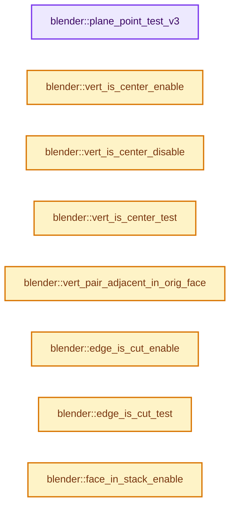
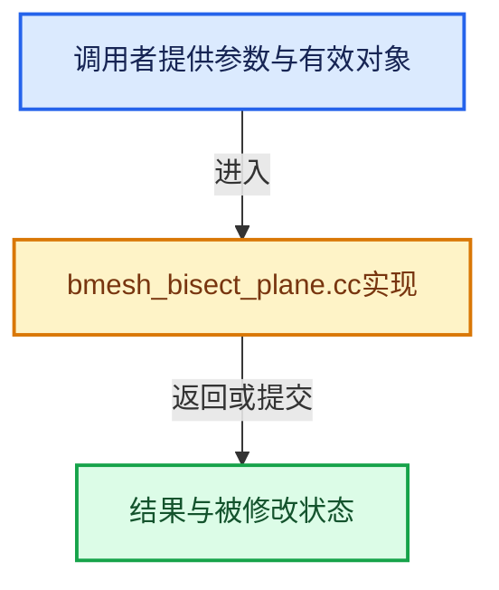

# 实现依赖专题：source/blender/bmesh/tools/bmesh_bisect_plane.cc

[实现依赖导航](../../../README.md) · [符号索引](../../../../00-课程指南/02-源码与提交索引/符号依赖与实现索引.md)

本专题从正文实际调用进入，集中保存共享实现。函数有稳定锚点，可从调用处直接跳到对应完整函数；递归与互相调用通过回链组织。

## 本文件的实现关系






<a id="m-91c7685cf2fb"></a>

## 宏 `BM_VERT_DIR`

<!-- annotated:e6f81f4924fad7 -->

```cpp
#define BM_VERT_DIR(v) ((short *)(&(v)->head.index))[0]  /* Direction -1/0/1 */
#define BM_VERT_SKIP(v) ((short *)(&(v)->head.index))[1] /* Skip Vert 0/1 */
```

<details>
<summary>核对原始源码：source/blender/bmesh/tools/bmesh_bisect_plane.cc · L69—L70</summary>

<!-- original:e6f81f4924fad7:source/blender/bmesh/tools/bmesh_bisect_plane.cc:69:70 -->

```cpp
#define BM_VERT_DIR(v) ((short *)(&(v)->head.index))[0]  /* Direction -1/0/1 */
#define BM_VERT_SKIP(v) ((short *)(&(v)->head.index))[1] /* Skip Vert 0/1 */
```

</details>

宏在预处理阶段展开，参数替换、重复求值和条件编译应直接从该定义检查。与普通函数不同，宏不会自动提供参数类型检查；构建配置选择哪个定义需结合外围条件。

<a id="m-aa22a7005654"></a>

## 宏 `BM_VERT_SKIP`

<!-- annotated:dbf04d0689bb72 -->

```cpp
#define BM_VERT_SKIP(v) ((short *)(&(v)->head.index))[1] /* Skip Vert 0/1 */
#define BM_VERT_DIST(v) ((v)->no[0])                     /* Distance from the plane. */
```

<details>
<summary>核对原始源码：source/blender/bmesh/tools/bmesh_bisect_plane.cc · L70—L71</summary>

<!-- original:dbf04d0689bb72:source/blender/bmesh/tools/bmesh_bisect_plane.cc:70:71 -->

```cpp
#define BM_VERT_SKIP(v) ((short *)(&(v)->head.index))[1] /* Skip Vert 0/1 */
#define BM_VERT_DIST(v) ((v)->no[0])                     /* Distance from the plane. */
```

</details>

宏在预处理阶段展开，参数替换、重复求值和条件编译应直接从该定义检查。与普通函数不同，宏不会自动提供参数类型检查；构建配置选择哪个定义需结合外围条件。

<a id="m-4a2117eb29e4"></a>

## 宏 `BM_VERT_DIST`

<!-- annotated:5a787be4c631d9 -->

```cpp
#define BM_VERT_DIST(v) ((v)->no[0])                     /* Distance from the plane. */
#define BM_VERT_SORTVAL(v) ((v)->no[1])                  /* Temp value for sorting. */
```

<details>
<summary>核对原始源码：source/blender/bmesh/tools/bmesh_bisect_plane.cc · L71—L72</summary>

<!-- original:5a787be4c631d9:source/blender/bmesh/tools/bmesh_bisect_plane.cc:71:72 -->

```cpp
#define BM_VERT_DIST(v) ((v)->no[0])                     /* Distance from the plane. */
#define BM_VERT_SORTVAL(v) ((v)->no[1])                  /* Temp value for sorting. */
```

</details>

宏在预处理阶段展开，参数替换、重复求值和条件编译应直接从该定义检查。与普通函数不同，宏不会自动提供参数类型检查；构建配置选择哪个定义需结合外围条件。

<a id="m-ffde66090326"></a>

## 宏 `BM_VERT_SORTVAL`

<!-- annotated:e2b40e2183e65b -->

```cpp
#define BM_VERT_SORTVAL(v) ((v)->no[1])                  /* Temp value for sorting. */
#define BM_VERT_LOOPINDEX(v) /* The verts index within a face (temp var) */ \
```

<details>
<summary>核对原始源码：source/blender/bmesh/tools/bmesh_bisect_plane.cc · L72—L73</summary>

<!-- original:e2b40e2183e65b:source/blender/bmesh/tools/bmesh_bisect_plane.cc:72:73 -->

```cpp
#define BM_VERT_SORTVAL(v) ((v)->no[1])                  /* Temp value for sorting. */
#define BM_VERT_LOOPINDEX(v) /* The verts index within a face (temp var) */ \
```

</details>

宏在预处理阶段展开，参数替换、重复求值和条件编译应直接从该定义检查。与普通函数不同，宏不会自动提供参数类型检查；构建配置选择哪个定义需结合外围条件。

<a id="m-3cf9f1467f02"></a>

## 宏 `BM_VERT_LOOPINDEX`

<!-- annotated:9cb8d7dc34a65b -->

```cpp
#define BM_VERT_LOOPINDEX(v) /* The verts index within a face (temp var) */ \
  (*((uint *)(&(v)->no[2])))

```

<details>
<summary>核对原始源码：source/blender/bmesh/tools/bmesh_bisect_plane.cc · L73—L75</summary>

<!-- original:9cb8d7dc34a65b:source/blender/bmesh/tools/bmesh_bisect_plane.cc:73:75 -->

```cpp
#define BM_VERT_LOOPINDEX(v) /* The verts index within a face (temp var) */ \
  (*((uint *)(&(v)->no[2])))

```

</details>

宏在预处理阶段展开，参数替换、重复求值和条件编译应直接从该定义检查。与普通函数不同，宏不会自动提供参数类型检查；构建配置选择哪个定义需结合外围条件。

## 完整成员与函数实现

<a id="f-44c8ce60574f2dab"></a>

### `blender::plane_point_test_v3`

实现位置：[source/blender/bmesh/tools/bmesh_bisect_plane.cc](../../../../../../../../source/blender/bmesh/tools/bmesh_bisect_plane.cc) · L42—L57。

接口参数：

- `const float plane[4]`
- `const float co[3]`
- `const float eps`
- `float *r_depth`

**教学注释版**

<!-- annotated:d14ca2957fdbf0 -->

```cpp
static short plane_point_test_v3(const float plane[4],
                                 const float co[3],
                                 const float eps,
                                 float *r_depth)
{
  const float f = plane_point_side_v3(plane, co);
  *r_depth = f;

  if (f <= -eps) {
    return -1;
  }
  if (f >= eps) {
    return 1;
  }
  return 0;
}
```

<details>
<summary>核对原始源码：source/blender/bmesh/tools/bmesh_bisect_plane.cc · L42—L57</summary>

<!-- original:d14ca2957fdbf0:source/blender/bmesh/tools/bmesh_bisect_plane.cc:42:57 -->

```cpp
static short plane_point_test_v3(const float plane[4],
                                 const float co[3],
                                 const float eps,
                                 float *r_depth)
{
  const float f = plane_point_side_v3(plane, co);
  *r_depth = f;

  if (f <= -eps) {
    return -1;
  }
  if (f >= eps) {
    return 1;
  }
  return 0;
}
```

</details>

**结果出口**

- `return -1;`
- `return 1;`
- `return 0;`

**继续追踪实现**

- `plane_point_side_v3` → [blender::plane_point_side_v3 · L124](../../../01-BLI基础库/intern/math_geom_inline.cc.md#f-172f6a5bd676a757)。

<a id="f-622511ea731f1722"></a>

### `blender::vert_is_center_enable`

实现位置：[source/blender/bmesh/tools/bmesh_bisect_plane.cc](../../../../../../../../source/blender/bmesh/tools/bmesh_bisect_plane.cc) · L86—L89。

接口参数：

- `BMVert *v`

**教学注释版**

<!-- annotated:3be83d492e0708 -->

```cpp
BLI_INLINE void vert_is_center_enable(BMVert *v)
{
  BM_elem_flag_enable(v, BM_ELEM_TAG);
}
```

<details>
<summary>核对原始源码：source/blender/bmesh/tools/bmesh_bisect_plane.cc · L86—L89</summary>

<!-- original:3be83d492e0708:source/blender/bmesh/tools/bmesh_bisect_plane.cc:86:89 -->

```cpp
BLI_INLINE void vert_is_center_enable(BMVert *v)
{
  BM_elem_flag_enable(v, BM_ELEM_TAG);
}
```

</details>

**继续追踪实现**

- `BM_elem_flag_enable` → [BM_elem_flag_enable · L23](../intern/bmesh_inline.hh.md#m-4400242f1540)。宏定义由构建条件选择。

<a id="f-13120f7b3d9532d9"></a>

### `blender::vert_is_center_disable`

实现位置：[source/blender/bmesh/tools/bmesh_bisect_plane.cc](../../../../../../../../source/blender/bmesh/tools/bmesh_bisect_plane.cc) · L90—L93。

接口参数：

- `BMVert *v`

**教学注释版**

<!-- annotated:198da53109541a -->

```cpp
BLI_INLINE void vert_is_center_disable(BMVert *v)
{
  BM_elem_flag_disable(v, BM_ELEM_TAG);
}
```

<details>
<summary>核对原始源码：source/blender/bmesh/tools/bmesh_bisect_plane.cc · L90—L93</summary>

<!-- original:198da53109541a:source/blender/bmesh/tools/bmesh_bisect_plane.cc:90:93 -->

```cpp
BLI_INLINE void vert_is_center_disable(BMVert *v)
{
  BM_elem_flag_disable(v, BM_ELEM_TAG);
}
```

</details>

**继续追踪实现**

- `BM_elem_flag_disable` → [BM_elem_flag_disable · L24](../intern/bmesh_inline.hh.md#m-e129d62b6353)。宏定义由构建条件选择。

<a id="f-036ff8b37660371d"></a>

### `blender::vert_is_center_test`

实现位置：[source/blender/bmesh/tools/bmesh_bisect_plane.cc](../../../../../../../../source/blender/bmesh/tools/bmesh_bisect_plane.cc) · L94—L97。

接口参数：

- `BMVert *v`

**教学注释版**

<!-- annotated:d7908d079ffe70 -->

```cpp
BLI_INLINE bool vert_is_center_test(BMVert *v)
{
  return (BM_elem_flag_test(v, BM_ELEM_TAG) != 0);
}
```

<details>
<summary>核对原始源码：source/blender/bmesh/tools/bmesh_bisect_plane.cc · L94—L97</summary>

<!-- original:d7908d079ffe70:source/blender/bmesh/tools/bmesh_bisect_plane.cc:94:97 -->

```cpp
BLI_INLINE bool vert_is_center_test(BMVert *v)
{
  return (BM_elem_flag_test(v, BM_ELEM_TAG) != 0);
}
```

</details>

**结果出口**

- `return (BM_elem_flag_test(v, BM_ELEM_TAG) != 0);`

**继续追踪实现**

- `BM_elem_flag_test` → [BM_elem_flag_test · L21](../intern/bmesh_inline.hh.md#m-2431d1179b41)。宏定义由构建条件选择。

<a id="f-67bb3f01d32155b0"></a>

### `blender::vert_pair_adjacent_in_orig_face`

实现位置：[source/blender/bmesh/tools/bmesh_bisect_plane.cc](../../../../../../../../source/blender/bmesh/tools/bmesh_bisect_plane.cc) · L99—L103。

接口参数：

- `BMVert *v_a`
- `BMVert *v_b`
- `const uint f_len_orig`

**教学注释版**

<!-- annotated:33e3df729bf4fb -->

```cpp
BLI_INLINE bool vert_pair_adjacent_in_orig_face(BMVert *v_a, BMVert *v_b, const uint f_len_orig)
{
  const uint delta = uint(abs(int(BM_VERT_LOOPINDEX(v_a)) - int(BM_VERT_LOOPINDEX(v_b))));
  return ELEM(delta, 1, uint(f_len_orig - 1));
}
```

<details>
<summary>核对原始源码：source/blender/bmesh/tools/bmesh_bisect_plane.cc · L99—L103</summary>

<!-- original:33e3df729bf4fb:source/blender/bmesh/tools/bmesh_bisect_plane.cc:99:103 -->

```cpp
BLI_INLINE bool vert_pair_adjacent_in_orig_face(BMVert *v_a, BMVert *v_b, const uint f_len_orig)
{
  const uint delta = uint(abs(int(BM_VERT_LOOPINDEX(v_a)) - int(BM_VERT_LOOPINDEX(v_b))));
  return ELEM(delta, 1, uint(f_len_orig - 1));
}
```

</details>

**结果出口**

- `return ELEM(delta, 1, uint(f_len_orig - 1));`

**继续追踪实现**

- `abs` → [abs · L104](../../gpu/shaders/compat/gpu_shader_cxx_builtin.hh.md#m-14b5712612c4)。宏定义由构建条件选择。
- `BM_VERT_LOOPINDEX` → [BM_VERT_LOOPINDEX · L73](bmesh_bisect_plane.cc.md#m-3cf9f1467f02)。宏定义由构建条件选择。
- `ELEM` → [ELEM · L88](../../../07-Intern运行时与平台/ghost/intern/GHOST_utildefines.hh.md#m-d28724a15928)；[ELEM · L135](../../../01-BLI基础库/BLI_utildefines.hh.md#m-d6572de7cae0)。宏定义由构建条件选择。

<a id="f-2949fea082d0efe3"></a>

### `blender::edge_is_cut_enable`

实现位置：[source/blender/bmesh/tools/bmesh_bisect_plane.cc](../../../../../../../../source/blender/bmesh/tools/bmesh_bisect_plane.cc) · L106—L109。

接口参数：

- `BMEdge *e`

**教学注释版**

<!-- annotated:2c3807defb6724 -->

```cpp
BLI_INLINE void edge_is_cut_enable(BMEdge *e)
{
  BM_elem_flag_enable(e, BM_ELEM_TAG);
}
```

<details>
<summary>核对原始源码：source/blender/bmesh/tools/bmesh_bisect_plane.cc · L106—L109</summary>

<!-- original:2c3807defb6724:source/blender/bmesh/tools/bmesh_bisect_plane.cc:106:109 -->

```cpp
BLI_INLINE void edge_is_cut_enable(BMEdge *e)
{
  BM_elem_flag_enable(e, BM_ELEM_TAG);
}
```

</details>

**继续追踪实现**

- `BM_elem_flag_enable` → [BM_elem_flag_enable · L23](../intern/bmesh_inline.hh.md#m-4400242f1540)。宏定义由构建条件选择。

<a id="f-e69430bc8d374151"></a>

### `blender::edge_is_cut_test`

实现位置：[source/blender/bmesh/tools/bmesh_bisect_plane.cc](../../../../../../../../source/blender/bmesh/tools/bmesh_bisect_plane.cc) · L114—L117。

接口参数：

- `BMEdge *e`

**教学注释版**

<!-- annotated:68cae7513a8522 -->

```cpp
BLI_INLINE bool edge_is_cut_test(BMEdge *e)
{
  return (BM_elem_flag_test(e, BM_ELEM_TAG) != 0);
}
```

<details>
<summary>核对原始源码：source/blender/bmesh/tools/bmesh_bisect_plane.cc · L114—L117</summary>

<!-- original:68cae7513a8522:source/blender/bmesh/tools/bmesh_bisect_plane.cc:114:117 -->

```cpp
BLI_INLINE bool edge_is_cut_test(BMEdge *e)
{
  return (BM_elem_flag_test(e, BM_ELEM_TAG) != 0);
}
```

</details>

**结果出口**

- `return (BM_elem_flag_test(e, BM_ELEM_TAG) != 0);`

**继续追踪实现**

- `BM_elem_flag_test` → [BM_elem_flag_test · L21](../intern/bmesh_inline.hh.md#m-2431d1179b41)。宏定义由构建条件选择。

<a id="f-91a553fc390bb7d9"></a>

### `blender::face_in_stack_enable`

实现位置：[source/blender/bmesh/tools/bmesh_bisect_plane.cc](../../../../../../../../source/blender/bmesh/tools/bmesh_bisect_plane.cc) · L120—L123。

接口参数：

- `BMFace *f`

**教学注释版**

<!-- annotated:931fc81d89e118 -->

```cpp
BLI_INLINE void face_in_stack_enable(BMFace *f)
{
  BM_elem_flag_disable(f, BM_ELEM_TAG);
}
```

<details>
<summary>核对原始源码：source/blender/bmesh/tools/bmesh_bisect_plane.cc · L120—L123</summary>

<!-- original:931fc81d89e118:source/blender/bmesh/tools/bmesh_bisect_plane.cc:120:123 -->

```cpp
BLI_INLINE void face_in_stack_enable(BMFace *f)
{
  BM_elem_flag_disable(f, BM_ELEM_TAG);
}
```

</details>

**继续追踪实现**

- `BM_elem_flag_disable` → [BM_elem_flag_disable · L24](../intern/bmesh_inline.hh.md#m-e129d62b6353)。宏定义由构建条件选择。

<a id="f-6c6cb2095d770ca9"></a>

### `blender::face_in_stack_disable`

实现位置：[source/blender/bmesh/tools/bmesh_bisect_plane.cc](../../../../../../../../source/blender/bmesh/tools/bmesh_bisect_plane.cc) · L124—L127。

接口参数：

- `BMFace *f`

**教学注释版**

<!-- annotated:371d252bf525d4 -->

```cpp
BLI_INLINE void face_in_stack_disable(BMFace *f)
{
  BM_elem_flag_enable(f, BM_ELEM_TAG);
}
```

<details>
<summary>核对原始源码：source/blender/bmesh/tools/bmesh_bisect_plane.cc · L124—L127</summary>

<!-- original:371d252bf525d4:source/blender/bmesh/tools/bmesh_bisect_plane.cc:124:127 -->

```cpp
BLI_INLINE void face_in_stack_disable(BMFace *f)
{
  BM_elem_flag_enable(f, BM_ELEM_TAG);
}
```

</details>

**继续追踪实现**

- `BM_elem_flag_enable` → [BM_elem_flag_enable · L23](../intern/bmesh_inline.hh.md#m-4400242f1540)。宏定义由构建条件选择。

<a id="f-2689d1602c8a6d6a"></a>

### `blender::face_in_stack_test`

实现位置：[source/blender/bmesh/tools/bmesh_bisect_plane.cc](../../../../../../../../source/blender/bmesh/tools/bmesh_bisect_plane.cc) · L128—L131。

接口参数：

- `BMFace *f`

**教学注释版**

<!-- annotated:9eb77fc74c0c76 -->

```cpp
BLI_INLINE bool face_in_stack_test(BMFace *f)
{
  return (BM_elem_flag_test(f, BM_ELEM_TAG) == 0);
}
```

<details>
<summary>核对原始源码：source/blender/bmesh/tools/bmesh_bisect_plane.cc · L128—L131</summary>

<!-- original:9eb77fc74c0c76:source/blender/bmesh/tools/bmesh_bisect_plane.cc:128:131 -->

```cpp
BLI_INLINE bool face_in_stack_test(BMFace *f)
{
  return (BM_elem_flag_test(f, BM_ELEM_TAG) == 0);
}
```

</details>

**结果出口**

- `return (BM_elem_flag_test(f, BM_ELEM_TAG) == 0);`

**继续追踪实现**

- `BM_elem_flag_test` → [BM_elem_flag_test · L21](../intern/bmesh_inline.hh.md#m-2431d1179b41)。宏定义由构建条件选择。

<a id="f-5192097e23063590"></a>

### `blender::bm_face_bisect_verts`

实现位置：[source/blender/bmesh/tools/bmesh_bisect_plane.cc](../../../../../../../../source/blender/bmesh/tools/bmesh_bisect_plane.cc) · L139—L373。

接口参数：

- `BMesh *bm`
- `BMFace *f`
- `const float plane[4]`
- `const short oflag_center`
- `const short oflag_new`

**教学注释版**

<!-- annotated:6b3ad3e5140a7d -->

```cpp
static void bm_face_bisect_verts(
    BMesh *bm, BMFace *f, const float plane[4], const short oflag_center, const short oflag_new)
{
  /* Unlikely more than 2 verts are needed. */
  const uint f_len_orig = uint(f->len);
  Array<BMVert *, BM_DEFAULT_NGON_STACK_SIZE> vert_split_arr_buf(f_len_orig);
  // [讲解] vert_split_arr_buf.data：提供数组的借用访问入口。
  BMVert **vert_split_arr = vert_split_arr_buf.data();
  STACK_DECLARE(vert_split_arr);
  BMLoop *l_iter, *l_first;
  bool use_dirs[3] = {false, false, false};
  bool is_inside = false;
  /* True when the face contains one or more edges with both it's vertices on the plane.
   * When set, centered loops are walked over to check if they need to be skipped. */
  bool face_has_center_edge = false;

  STACK_INIT(vert_split_arr, f_len_orig);

  l_first = BM_FACE_FIRST_LOOP(f);

  /* Add plane-aligned verts to the stack and check we have verts from both sides in this face
   * (that the face doesn't only have boundary verts on the plane for eg). */
  l_iter = l_first;
  do {
    if (vert_is_center_test(l_iter->v)) {
      BLI_assert(BM_VERT_DIR(l_iter->v) == 0);

      /* If both are -1 or 1, or both are zero: don't flip 'inside' var while walking. */
      BM_VERT_SKIP(l_iter->v) = ((BM_VERT_DIR(l_iter->prev->v) ^ BM_VERT_DIR(l_iter->next->v)) ==
                                 0);

      STACK_PUSH(vert_split_arr, l_iter->v);

      if (face_has_center_edge == false) {
        if (vert_is_center_test(l_iter->prev->v)) {
          face_has_center_edge = true;
        }
      }
    }
    use_dirs[BM_VERT_DIR(l_iter->v) + 1] = true;
  } while ((l_iter = l_iter->next) != l_first);

  if ((STACK_SIZE(vert_split_arr) > 1) && (use_dirs[0] && use_dirs[2])) {
    if (STACK_SIZE(vert_split_arr) == 2) [[likely]] {
      BMLoop *l_new;
      BMLoop *l_a, *l_b;

      l_a = BM_face_vert_share_loop(f, vert_split_arr[0]);
      l_b = BM_face_vert_share_loop(f, vert_split_arr[1]);

      /* Common case, just cut the face once. */
      BM_face_split(bm, f, l_a, l_b, &l_new, nullptr, true);
      if (l_new) {
        if (oflag_center | oflag_new) {
          BMO_edge_flag_enable(bm, l_new->e, oflag_center | oflag_new);
        }
        if (oflag_new) {
          BMO_face_flag_enable(bm, l_new->f, oflag_new);
        }
      }
    }
    else {
      /* Less common case, _complicated_ we need to calculate how to do multiple cuts. */

      uint i = 0;

      /* ---- */
      /* Check contiguous spans of centered vertices (skipping when necessary). */
      if (face_has_center_edge) {

        /* Loop indices need to be set for adjacency checks. */
        l_iter = l_first;
        do {
          BM_VERT_LOOPINDEX(l_iter->v) = i++;
        } while ((l_iter = l_iter->next) != l_first);

        /* Start out on a non-centered vertex so a span of centered vertices can be looped over
         * without having to scan backwards as well as forwards. */
        BMLoop *l_first_non_center = l_first;
        while (vert_is_center_test(l_first_non_center->v)) {
          l_first_non_center = l_first_non_center->next;
        }

        l_iter = l_first_non_center;
        do {
          if (BM_VERT_SKIP(l_iter->v)) {
            continue;
          }
          /* No need to check the previous as the iteration starts on a non-centered vertex. */
          if (!(vert_is_center_test(l_iter->v) && vert_is_center_test(l_iter->next->v))) {
            continue;
          }

          /* Walk over the next loops as long as they are centered. */
          BMLoop *l_prev = l_iter->prev;
          BMLoop *l_next = l_iter->next->next;
          /* No need to scan the previous vertices,
           * these will have been dealt with in previous steps. */
          BLI_assert(!vert_is_center_test(l_prev->v));
          while (vert_is_center_test(l_next->v)) {
            l_next = l_next->next;
          }

          /* Skip all vertices when the edges connected to the beginning/end
           * of the range are on a different side of the bisecting plane. */
          if (!(BM_VERT_DIR(l_prev->v) ^ BM_VERT_DIR(l_next->v))) {
            BLI_assert(!vert_is_center_test(l_prev->v));
            l_iter = l_prev->next;
            while (l_iter != l_next) {
              BLI_assert(vert_is_center_test(l_iter->v));
              BM_VERT_SKIP(l_iter->v) = true;
              l_iter = l_iter->next;
            }
          }
          /* Step over the span already handled, even if skip wasn't set. */
          l_iter = l_next->prev;
        } while ((l_iter = l_iter->next) != l_first_non_center);
      }

      Array<BMFace *, BM_DEFAULT_NGON_STACK_SIZE> face_split_arr_buf(STACK_SIZE(vert_split_arr));
      BMFace **face_split_arr = face_split_arr_buf.data();
      STACK_DECLARE(face_split_arr);

      float sort_dir[3];

      /* ---- */
      /* Calculate the direction to sort verts in the face intersecting the plane */

      /* The exact direction isn't important, vertices just need to be sorted across the face.
       * (`sort_dir` could be flipped either way). */
      BLI_assert(BM_face_is_normal_valid(f));
      cross_v3_v3v3(sort_dir, f->no, plane);
      if (normalize_v3(sort_dir) == 0.0f) [[unlikely]] {
        /* find any 2 verts and get their direction */
        for (i = 0; i < STACK_SIZE(vert_split_arr); i++) {
          if (!equals_v3v3(vert_split_arr[0]->co, vert_split_arr[i]->co)) {
            sub_v3_v3v3(sort_dir, vert_split_arr[0]->co, vert_split_arr[i]->co);
            normalize_v3(sort_dir);
          }
        }
        if (i == STACK_SIZE(vert_split_arr)) [[unlikely]] {
          /* Ok, we can't do anything useful here,
           * face has no area or so, bail out, this is highly unlikely but not impossible. */
          goto finally;
        }
      }

      /* ---- */
      /* Sort the verts across the face from one side to another. */
      for (i = 0; i < STACK_SIZE(vert_split_arr); i++) {
        BMVert *v = vert_split_arr[i];
        BM_VERT_SORTVAL(v) = dot_v3v3(sort_dir, v->co);
      }

      std::sort(
          vert_split_arr,
          vert_split_arr + STACK_SIZE(vert_split_arr),
          [](BMVert *v_a, BMVert *v_b) { return BM_VERT_SORTVAL(v_a) < BM_VERT_SORTVAL(v_b); });

      /* ---- */
      /* Split the face across sorted splits. */

      /* NOTE: we don't know which face gets which splits,
       * so at the moment we have to search all faces for the vert pair,
       * while not all that nice, typically there are < 5 resulting faces,
       * so its not _that_ bad. */

      STACK_INIT(face_split_arr, STACK_SIZE(vert_split_arr));
      STACK_PUSH(face_split_arr, f);

      for (i = 0; i < STACK_SIZE(vert_split_arr) - 1; i++) {
        BMVert *v_a = vert_split_arr[i];
        BMVert *v_b = vert_split_arr[i + 1];

        if (face_has_center_edge) {
          if (vert_pair_adjacent_in_orig_face(v_a, v_b, f_len_orig)) {
            continue;
          }
        }

        if (!BM_VERT_SKIP(v_a)) {
          is_inside = !is_inside;
        }

        if (is_inside) {
          BMLoop *l_a, *l_b;
          bool found = false;
          uint j;

          for (j = 0; j < STACK_SIZE(face_split_arr); j++) {
            /* It would be nice to avoid loop lookup here,
             * but we need to know which face the verts are in. */
            if ((l_a = BM_face_vert_share_loop(face_split_arr[j], v_a)) &&
                (l_b = BM_face_vert_share_loop(face_split_arr[j], v_b)))
            {
              found = true;
              break;
            }
          }

          /* Ideally won't happen, but it can for self-intersecting faces. */
          // BLI_assert(found == true);

          /* In fact this simple test is good enough, test if the loops are adjacent. */
          if (found && !BM_loop_is_adjacent(l_a, l_b)) {
            BMLoop *l_new;
            BMFace *f_tmp;
            f_tmp = BM_face_split(bm, face_split_arr[j], l_a, l_b, &l_new, nullptr, true);

            if (l_new) {
              if (oflag_center | oflag_new) {
                BMO_edge_flag_enable(bm, l_new->e, oflag_center | oflag_new);
              }
              if (oflag_new) {
                BMO_face_flag_enable(bm, l_new->f, oflag_new);
              }
            }

            if (f_tmp) {
              if (f_tmp != face_split_arr[j]) {
                STACK_PUSH(face_split_arr, f_tmp);
                BLI_assert(STACK_SIZE(face_split_arr) <= STACK_SIZE(vert_split_arr));
              }
            }
          }
        }
        else {
          // printf("no intersect\n");
        }
      }
    }
  }

finally:
  (void)vert_split_arr;
}
```

<details>
<summary>核对原始源码：source/blender/bmesh/tools/bmesh_bisect_plane.cc · L139—L373</summary>

<!-- original:6b3ad3e5140a7d:source/blender/bmesh/tools/bmesh_bisect_plane.cc:139:373 -->

```cpp
static void bm_face_bisect_verts(
    BMesh *bm, BMFace *f, const float plane[4], const short oflag_center, const short oflag_new)
{
  /* Unlikely more than 2 verts are needed. */
  const uint f_len_orig = uint(f->len);
  Array<BMVert *, BM_DEFAULT_NGON_STACK_SIZE> vert_split_arr_buf(f_len_orig);
  BMVert **vert_split_arr = vert_split_arr_buf.data();
  STACK_DECLARE(vert_split_arr);
  BMLoop *l_iter, *l_first;
  bool use_dirs[3] = {false, false, false};
  bool is_inside = false;
  /* True when the face contains one or more edges with both it's vertices on the plane.
   * When set, centered loops are walked over to check if they need to be skipped. */
  bool face_has_center_edge = false;

  STACK_INIT(vert_split_arr, f_len_orig);

  l_first = BM_FACE_FIRST_LOOP(f);

  /* Add plane-aligned verts to the stack and check we have verts from both sides in this face
   * (that the face doesn't only have boundary verts on the plane for eg). */
  l_iter = l_first;
  do {
    if (vert_is_center_test(l_iter->v)) {
      BLI_assert(BM_VERT_DIR(l_iter->v) == 0);

      /* If both are -1 or 1, or both are zero: don't flip 'inside' var while walking. */
      BM_VERT_SKIP(l_iter->v) = ((BM_VERT_DIR(l_iter->prev->v) ^ BM_VERT_DIR(l_iter->next->v)) ==
                                 0);

      STACK_PUSH(vert_split_arr, l_iter->v);

      if (face_has_center_edge == false) {
        if (vert_is_center_test(l_iter->prev->v)) {
          face_has_center_edge = true;
        }
      }
    }
    use_dirs[BM_VERT_DIR(l_iter->v) + 1] = true;
  } while ((l_iter = l_iter->next) != l_first);

  if ((STACK_SIZE(vert_split_arr) > 1) && (use_dirs[0] && use_dirs[2])) {
    if (STACK_SIZE(vert_split_arr) == 2) [[likely]] {
      BMLoop *l_new;
      BMLoop *l_a, *l_b;

      l_a = BM_face_vert_share_loop(f, vert_split_arr[0]);
      l_b = BM_face_vert_share_loop(f, vert_split_arr[1]);

      /* Common case, just cut the face once. */
      BM_face_split(bm, f, l_a, l_b, &l_new, nullptr, true);
      if (l_new) {
        if (oflag_center | oflag_new) {
          BMO_edge_flag_enable(bm, l_new->e, oflag_center | oflag_new);
        }
        if (oflag_new) {
          BMO_face_flag_enable(bm, l_new->f, oflag_new);
        }
      }
    }
    else {
      /* Less common case, _complicated_ we need to calculate how to do multiple cuts. */

      uint i = 0;

      /* ---- */
      /* Check contiguous spans of centered vertices (skipping when necessary). */
      if (face_has_center_edge) {

        /* Loop indices need to be set for adjacency checks. */
        l_iter = l_first;
        do {
          BM_VERT_LOOPINDEX(l_iter->v) = i++;
        } while ((l_iter = l_iter->next) != l_first);

        /* Start out on a non-centered vertex so a span of centered vertices can be looped over
         * without having to scan backwards as well as forwards. */
        BMLoop *l_first_non_center = l_first;
        while (vert_is_center_test(l_first_non_center->v)) {
          l_first_non_center = l_first_non_center->next;
        }

        l_iter = l_first_non_center;
        do {
          if (BM_VERT_SKIP(l_iter->v)) {
            continue;
          }
          /* No need to check the previous as the iteration starts on a non-centered vertex. */
          if (!(vert_is_center_test(l_iter->v) && vert_is_center_test(l_iter->next->v))) {
            continue;
          }

          /* Walk over the next loops as long as they are centered. */
          BMLoop *l_prev = l_iter->prev;
          BMLoop *l_next = l_iter->next->next;
          /* No need to scan the previous vertices,
           * these will have been dealt with in previous steps. */
          BLI_assert(!vert_is_center_test(l_prev->v));
          while (vert_is_center_test(l_next->v)) {
            l_next = l_next->next;
          }

          /* Skip all vertices when the edges connected to the beginning/end
           * of the range are on a different side of the bisecting plane. */
          if (!(BM_VERT_DIR(l_prev->v) ^ BM_VERT_DIR(l_next->v))) {
            BLI_assert(!vert_is_center_test(l_prev->v));
            l_iter = l_prev->next;
            while (l_iter != l_next) {
              BLI_assert(vert_is_center_test(l_iter->v));
              BM_VERT_SKIP(l_iter->v) = true;
              l_iter = l_iter->next;
            }
          }
          /* Step over the span already handled, even if skip wasn't set. */
          l_iter = l_next->prev;
        } while ((l_iter = l_iter->next) != l_first_non_center);
      }

      Array<BMFace *, BM_DEFAULT_NGON_STACK_SIZE> face_split_arr_buf(STACK_SIZE(vert_split_arr));
      BMFace **face_split_arr = face_split_arr_buf.data();
      STACK_DECLARE(face_split_arr);

      float sort_dir[3];

      /* ---- */
      /* Calculate the direction to sort verts in the face intersecting the plane */

      /* The exact direction isn't important, vertices just need to be sorted across the face.
       * (`sort_dir` could be flipped either way). */
      BLI_assert(BM_face_is_normal_valid(f));
      cross_v3_v3v3(sort_dir, f->no, plane);
      if (normalize_v3(sort_dir) == 0.0f) [[unlikely]] {
        /* find any 2 verts and get their direction */
        for (i = 0; i < STACK_SIZE(vert_split_arr); i++) {
          if (!equals_v3v3(vert_split_arr[0]->co, vert_split_arr[i]->co)) {
            sub_v3_v3v3(sort_dir, vert_split_arr[0]->co, vert_split_arr[i]->co);
            normalize_v3(sort_dir);
          }
        }
        if (i == STACK_SIZE(vert_split_arr)) [[unlikely]] {
          /* Ok, we can't do anything useful here,
           * face has no area or so, bail out, this is highly unlikely but not impossible. */
          goto finally;
        }
      }

      /* ---- */
      /* Sort the verts across the face from one side to another. */
      for (i = 0; i < STACK_SIZE(vert_split_arr); i++) {
        BMVert *v = vert_split_arr[i];
        BM_VERT_SORTVAL(v) = dot_v3v3(sort_dir, v->co);
      }

      std::sort(
          vert_split_arr,
          vert_split_arr + STACK_SIZE(vert_split_arr),
          [](BMVert *v_a, BMVert *v_b) { return BM_VERT_SORTVAL(v_a) < BM_VERT_SORTVAL(v_b); });

      /* ---- */
      /* Split the face across sorted splits. */

      /* NOTE: we don't know which face gets which splits,
       * so at the moment we have to search all faces for the vert pair,
       * while not all that nice, typically there are < 5 resulting faces,
       * so its not _that_ bad. */

      STACK_INIT(face_split_arr, STACK_SIZE(vert_split_arr));
      STACK_PUSH(face_split_arr, f);

      for (i = 0; i < STACK_SIZE(vert_split_arr) - 1; i++) {
        BMVert *v_a = vert_split_arr[i];
        BMVert *v_b = vert_split_arr[i + 1];

        if (face_has_center_edge) {
          if (vert_pair_adjacent_in_orig_face(v_a, v_b, f_len_orig)) {
            continue;
          }
        }

        if (!BM_VERT_SKIP(v_a)) {
          is_inside = !is_inside;
        }

        if (is_inside) {
          BMLoop *l_a, *l_b;
          bool found = false;
          uint j;

          for (j = 0; j < STACK_SIZE(face_split_arr); j++) {
            /* It would be nice to avoid loop lookup here,
             * but we need to know which face the verts are in. */
            if ((l_a = BM_face_vert_share_loop(face_split_arr[j], v_a)) &&
                (l_b = BM_face_vert_share_loop(face_split_arr[j], v_b)))
            {
              found = true;
              break;
            }
          }

          /* Ideally won't happen, but it can for self-intersecting faces. */
          // BLI_assert(found == true);

          /* In fact this simple test is good enough, test if the loops are adjacent. */
          if (found && !BM_loop_is_adjacent(l_a, l_b)) {
            BMLoop *l_new;
            BMFace *f_tmp;
            f_tmp = BM_face_split(bm, face_split_arr[j], l_a, l_b, &l_new, nullptr, true);

            if (l_new) {
              if (oflag_center | oflag_new) {
                BMO_edge_flag_enable(bm, l_new->e, oflag_center | oflag_new);
              }
              if (oflag_new) {
                BMO_face_flag_enable(bm, l_new->f, oflag_new);
              }
            }

            if (f_tmp) {
              if (f_tmp != face_split_arr[j]) {
                STACK_PUSH(face_split_arr, f_tmp);
                BLI_assert(STACK_SIZE(face_split_arr) <= STACK_SIZE(vert_split_arr));
              }
            }
          }
        }
        else {
          // printf("no intersect\n");
        }
      }
    }
  }

finally:
  (void)vert_split_arr;
}
```

</details>

**沿实际写入检查状态**

- `l_first = BM_FACE_FIRST_LOOP(f);`
- `l_iter = l_first;`
- `face_has_center_edge = true;`
- `l_a = BM_face_vert_share_loop(f, vert_split_arr[0]);`
- `l_b = BM_face_vert_share_loop(f, vert_split_arr[1]);`
- `l_first_non_center = l_first_non_center->next;`
- `l_iter = l_first_non_center;`
- `l_next = l_next->next;`
- `l_iter = l_prev->next;`
- `l_iter = l_iter->next;`
- `l_iter = l_next->prev;`
- `is_inside = !is_inside;`
- `found = true;`
- `f_tmp = BM_face_split(bm, face_split_arr[j], l_a, l_b, &l_new, nullptr, true);`

**继续追踪实现**

- `vert_split_arr_buf.data` → [blender::Array::data · L323](../../../../01-基础容器与现代CPP/08-Array复制移动与销毁.md#f-95648c799002f4ba)；[blender::Array::data · L327](../../../../01-基础容器与现代CPP/08-Array复制移动与销毁.md#f-50c18301f8c40f9e)。同名重载需按实参类型选择。
- `STACK_DECLARE` → [STACK_DECLARE · L16](../../../01-BLI基础库/BLI_utildefines_stack.hh.md#m-f46a6637d868)；[STACK_DECLARE · L26](../../../01-BLI基础库/BLI_utildefines_stack.hh.md#m-8fc157423707)。宏定义由构建条件选择。
- `STACK_INIT` → [STACK_INIT · L17](../../../01-BLI基础库/BLI_utildefines_stack.hh.md#m-4faf42665148)；[STACK_INIT · L27](../../../01-BLI基础库/BLI_utildefines_stack.hh.md#m-dda4483df379)。宏定义由构建条件选择。
- `BM_FACE_FIRST_LOOP` → [BM_FACE_FIRST_LOOP · L697](../bmesh_class.hh.md#m-c7e10ffb38e6)；[BM_FACE_FIRST_LOOP · L699](../bmesh_class.hh.md#m-76a054cc4770)。宏定义由构建条件选择。
- `vert_is_center_test` → [blender::vert_is_center_test · L94](bmesh_bisect_plane.cc.md#f-036ff8b37660371d)。
- `BLI_assert` → [BLI_assert · L48](../../../01-BLI基础库/BLI_assert.hh.md#m-57a88495704d)；[BLI_assert · L63](../../../01-BLI基础库/BLI_assert.hh.md#m-d07050020cb5)。宏定义由构建条件选择。
- `BM_VERT_DIR` → [BM_VERT_DIR · L69](bmesh_bisect_plane.cc.md#m-91c7685cf2fb)。宏定义由构建条件选择。
- `BM_VERT_SKIP` → [BM_VERT_SKIP · L70](bmesh_bisect_plane.cc.md#m-aa22a7005654)。宏定义由构建条件选择。
- `STACK_PUSH` → [STACK_PUSH · L43](../../../01-BLI基础库/BLI_utildefines_stack.hh.md#m-9a5f4720c097)。宏定义由构建条件选择。
- `STACK_SIZE` → [STACK_SIZE · L35](../../../01-BLI基础库/BLI_utildefines_stack.hh.md#m-fc750f4e0a0a)。宏定义由构建条件选择。
- `BM_face_vert_share_loop` → [blender::BM_face_vert_share_loop · L1114](../intern/bmesh_query.cc.md#f-1cd9a48462ab71ad)。
- `BM_face_split` → [blender::BM_face_split · L207](../intern/bmesh_mods.cc.md#f-78df25669fa1d1c1)。
- `BMO_edge_flag_enable` → [BMO_edge_flag_enable · L159](../intern/bmesh_operator_api.hh.md#m-c9656b4d0260)。宏定义由构建条件选择。
- `BMO_face_flag_enable` → [BMO_face_flag_enable · L170](../intern/bmesh_operator_api.hh.md#m-9a51f5573d5e)。宏定义由构建条件选择。
- `BM_VERT_LOOPINDEX` → [BM_VERT_LOOPINDEX · L73](bmesh_bisect_plane.cc.md#m-3cf9f1467f02)。宏定义由构建条件选择。
- `face_split_arr_buf.data` → [blender::Array::data · L323](../../../../01-基础容器与现代CPP/08-Array复制移动与销毁.md#f-95648c799002f4ba)；[blender::Array::data · L327](../../../../01-基础容器与现代CPP/08-Array复制移动与销毁.md#f-50c18301f8c40f9e)。同名重载需按实参类型选择。
- `BM_face_is_normal_valid` → [blender::BM_face_is_normal_valid · L2129](../intern/bmesh_query.cc.md#f-6eb906a3b14c0fa3)。
- `cross_v3_v3v3` → [blender::cross_v3_v3v3 · L690](../../../01-BLI基础库/intern/math_vector_inline.cc.md#f-ac8d04405fb5dad4)。
- `normalize_v3` → [blender::normalize_v3 · L933](../../../01-BLI基础库/intern/math_vector_inline.cc.md#f-5f3257e657ef732c)。
- `equals_v3v3` → [blender::equals_v3v3 · L1006](../../../01-BLI基础库/intern/math_vector_inline.cc.md#f-f49aac9436333b4a)。
- `sub_v3_v3v3` → [blender::sub_v3_v3v3 · L360](../../../01-BLI基础库/intern/math_vector_inline.cc.md#f-23781c252db8b30c)。
- `BM_VERT_SORTVAL` → [BM_VERT_SORTVAL · L72](bmesh_bisect_plane.cc.md#m-ffde66090326)。宏定义由构建条件选择。
- `dot_v3v3` → [blender::dot_v3v3 · L646](../../../01-BLI基础库/intern/math_vector_inline.cc.md#f-c88befa67d07591a)。
- `std::sort` → [外部契约](https://eel.is/c++draft/)：这个边界按实际表达式及所属类型核对参数、返回值、寿命与失败行为。这里提供接口入口，不声称已解释该第三方版本的内部实现。
- `vert_pair_adjacent_in_orig_face` → [blender::vert_pair_adjacent_in_orig_face · L99](bmesh_bisect_plane.cc.md#f-67bb3f01d32155b0)。
- `BM_loop_is_adjacent` → [blender::BM_loop_is_adjacent · L127](../intern/bmesh_query_inline.hh.md#f-62894948dd4628b0)。

<a id="f-e024189daf678734"></a>

### `blender::BM_mesh_bisect_plane`

实现位置：[source/blender/bmesh/tools/bmesh_bisect_plane.cc](../../../../../../../../source/blender/bmesh/tools/bmesh_bisect_plane.cc) · L381—L556。

接口参数：

- `BMesh *bm`
- `const float plane[4]`
- `const bool use_snap_center`
- `const bool use_tag`
- `const short oflag_center`
- `const short oflag_new`
- `const float eps`

**教学注释版**

<!-- annotated:80631115606f0c -->

```cpp
void BM_mesh_bisect_plane(BMesh *bm,
                          const float plane[4],
                          const bool use_snap_center,
                          const bool use_tag,
                          const short oflag_center,
                          const short oflag_new,
                          const float eps)
{
  uint einput_len;
  uint i;
  BMEdge **edges_arr = MEM_new_array_uninitialized<BMEdge *>(size_t(bm->totedge), __func__);

  BLI_LINKSTACK_DECLARE(face_stack, BMFace *);

  BMVert *v;
  BMFace *f;

  BMIter iter;

  /* Needed when `use_snap_center` moves vertices. */
  Set<BMFace *> faces_deferred_normal_update;

  if (use_tag) {
    /* Build tagged edge array. */
    BMEdge *e;
    einput_len = 0;

    /* Flush edge tags to verts. */
    BM_mesh_elem_hflag_disable_all(bm, BM_VERT, BM_ELEM_TAG, false);

    /* Keep face tags as is. */
    BM_ITER_MESH_INDEX (e, &iter, bm, BM_EDGES_OF_MESH, i) {
      if (edge_is_cut_test(e)) {
        edges_arr[einput_len++] = e;

        /* Flush edge tags to verts. */
        BM_elem_flag_enable(e->v1, BM_ELEM_TAG);
        BM_elem_flag_enable(e->v2, BM_ELEM_TAG);
      }
    }

    /* Face tags are set by caller. */
  }
  else {
    BMEdge *e;
    einput_len = uint(bm->totedge);
    BM_ITER_MESH_INDEX (e, &iter, bm, BM_EDGES_OF_MESH, i) {
      edge_is_cut_enable(e);
      edges_arr[i] = e;
    }

    BM_ITER_MESH (f, &iter, bm, BM_FACES_OF_MESH) {
      face_in_stack_disable(f);
    }
  }

  BM_ITER_MESH (v, &iter, bm, BM_VERTS_OF_MESH) {

    if (use_tag && !BM_elem_flag_test(v, BM_ELEM_TAG)) {
      vert_is_center_disable(v);

      /* These should never be accessed. */
      BM_VERT_DIR(v) = 0;
      BM_VERT_DIST(v) = 0.0f;

      continue;
    }

    vert_is_center_disable(v);
    BM_VERT_DIR(v) = plane_point_test_v3(plane, v->co, eps, &BM_VERT_DIST(v));

    if (BM_VERT_DIR(v) == 0) {
      if (oflag_center) {
        BMO_vert_flag_enable(bm, v, oflag_center);
      }
      if (use_snap_center) {
        float co_center[3];
        closest_to_plane_v3(co_center, plane, v->co);
        if (!equals_v3v3(co_center, v->co)) {
          copy_v3_v3(v->co, co_center);
          BMIter itersub;
          BM_ITER_ELEM (f, &itersub, v, BM_FACES_OF_VERT) {
            // [讲解] faces_deferred_normal_update.add：按哈希与相等关系加入键或键值。
            faces_deferred_normal_update.add(f);
          }
        }
      }
    }
  }

  for (BMFace *f_iter : faces_deferred_normal_update) {
    BM_face_normal_update(f_iter);
  }

  /* Store a stack of faces to be evaluated for splitting. */
  BLI_LINKSTACK_INIT(face_stack);

  for (i = 0; i < einput_len; i++) {
    /* We could check `edge_is_cut_test(e)` but there is no point. */
    BMEdge *e = edges_arr[i];
    const int side[2] = {BM_VERT_DIR(e->v1), BM_VERT_DIR(e->v2)};
    const float dist[2] = {BM_VERT_DIST(e->v1), BM_VERT_DIST(e->v2)};

    if (side[0] && side[1] && (side[0] != side[1])) {
      const float e_fac = dist[0] / (dist[0] - dist[1]);
      BMVert *v_new;

      if (e->l) {
        BMLoop *l_iter, *l_first;
        l_iter = l_first = e->l;
        do {
          if (!face_in_stack_test(l_iter->f)) {
            face_in_stack_enable(l_iter->f);
            BLI_LINKSTACK_PUSH(face_stack, l_iter->f);
          }
        } while ((l_iter = l_iter->radial_next) != l_first);
      }

      {
        BMEdge *e_new;
        v_new = BM_edge_split(bm, e, e->v1, &e_new, e_fac);
        if (oflag_new) {
          BMO_edge_flag_enable(bm, e_new, oflag_new);
        }
      }

      vert_is_center_enable(v_new);
      if (oflag_new | oflag_center) {
        BMO_vert_flag_enable(bm, v_new, oflag_new | oflag_center);
      }

      BM_VERT_DIR(v_new) = 0;
      BM_VERT_DIST(v_new) = 0.0f;
    }
    else if (side[0] == 0 || side[1] == 0) {
      /* Check if either edge verts are aligned,
       * if so - tag and push all faces that use it into the stack. */
      uint j;
      BM_ITER_ELEM_INDEX (v, &iter, e, BM_VERTS_OF_EDGE, j) {
        if (side[j] == 0) {
          if (vert_is_center_test(v) == 0) {
            BMIter itersub;
            BMLoop *l_iter;

            vert_is_center_enable(v);

            BM_ITER_ELEM (l_iter, &itersub, v, BM_LOOPS_OF_VERT) {
              if (!face_in_stack_test(l_iter->f)) {
                face_in_stack_enable(l_iter->f);
                BLI_LINKSTACK_PUSH(face_stack, l_iter->f);
              }
            }
          }
        }
      }

      /* If both verts are on the center - tag it. */
      if (oflag_center) {
        if (side[0] == 0 && side[1] == 0) {
          BMO_edge_flag_enable(bm, e, oflag_center);
        }
      }
    }
  }

  MEM_delete(edges_arr);

  while ((f = BLI_LINKSTACK_POP(face_stack))) {
    bm_face_bisect_verts(bm, f, plane, oflag_center, oflag_new);
  }

  /* Caused by access macros: #BM_VERT_DIR, #BM_VERT_SKIP. */
  bm->elem_index_dirty |= BM_VERT;

  /* Now we have all faces to split in the stack. */
  BLI_LINKSTACK_FREE(face_stack);
}
```

<details>
<summary>核对原始源码：source/blender/bmesh/tools/bmesh_bisect_plane.cc · L381—L556</summary>

<!-- original:80631115606f0c:source/blender/bmesh/tools/bmesh_bisect_plane.cc:381:556 -->

```cpp
void BM_mesh_bisect_plane(BMesh *bm,
                          const float plane[4],
                          const bool use_snap_center,
                          const bool use_tag,
                          const short oflag_center,
                          const short oflag_new,
                          const float eps)
{
  uint einput_len;
  uint i;
  BMEdge **edges_arr = MEM_new_array_uninitialized<BMEdge *>(size_t(bm->totedge), __func__);

  BLI_LINKSTACK_DECLARE(face_stack, BMFace *);

  BMVert *v;
  BMFace *f;

  BMIter iter;

  /* Needed when `use_snap_center` moves vertices. */
  Set<BMFace *> faces_deferred_normal_update;

  if (use_tag) {
    /* Build tagged edge array. */
    BMEdge *e;
    einput_len = 0;

    /* Flush edge tags to verts. */
    BM_mesh_elem_hflag_disable_all(bm, BM_VERT, BM_ELEM_TAG, false);

    /* Keep face tags as is. */
    BM_ITER_MESH_INDEX (e, &iter, bm, BM_EDGES_OF_MESH, i) {
      if (edge_is_cut_test(e)) {
        edges_arr[einput_len++] = e;

        /* Flush edge tags to verts. */
        BM_elem_flag_enable(e->v1, BM_ELEM_TAG);
        BM_elem_flag_enable(e->v2, BM_ELEM_TAG);
      }
    }

    /* Face tags are set by caller. */
  }
  else {
    BMEdge *e;
    einput_len = uint(bm->totedge);
    BM_ITER_MESH_INDEX (e, &iter, bm, BM_EDGES_OF_MESH, i) {
      edge_is_cut_enable(e);
      edges_arr[i] = e;
    }

    BM_ITER_MESH (f, &iter, bm, BM_FACES_OF_MESH) {
      face_in_stack_disable(f);
    }
  }

  BM_ITER_MESH (v, &iter, bm, BM_VERTS_OF_MESH) {

    if (use_tag && !BM_elem_flag_test(v, BM_ELEM_TAG)) {
      vert_is_center_disable(v);

      /* These should never be accessed. */
      BM_VERT_DIR(v) = 0;
      BM_VERT_DIST(v) = 0.0f;

      continue;
    }

    vert_is_center_disable(v);
    BM_VERT_DIR(v) = plane_point_test_v3(plane, v->co, eps, &BM_VERT_DIST(v));

    if (BM_VERT_DIR(v) == 0) {
      if (oflag_center) {
        BMO_vert_flag_enable(bm, v, oflag_center);
      }
      if (use_snap_center) {
        float co_center[3];
        closest_to_plane_v3(co_center, plane, v->co);
        if (!equals_v3v3(co_center, v->co)) {
          copy_v3_v3(v->co, co_center);
          BMIter itersub;
          BM_ITER_ELEM (f, &itersub, v, BM_FACES_OF_VERT) {
            faces_deferred_normal_update.add(f);
          }
        }
      }
    }
  }

  for (BMFace *f_iter : faces_deferred_normal_update) {
    BM_face_normal_update(f_iter);
  }

  /* Store a stack of faces to be evaluated for splitting. */
  BLI_LINKSTACK_INIT(face_stack);

  for (i = 0; i < einput_len; i++) {
    /* We could check `edge_is_cut_test(e)` but there is no point. */
    BMEdge *e = edges_arr[i];
    const int side[2] = {BM_VERT_DIR(e->v1), BM_VERT_DIR(e->v2)};
    const float dist[2] = {BM_VERT_DIST(e->v1), BM_VERT_DIST(e->v2)};

    if (side[0] && side[1] && (side[0] != side[1])) {
      const float e_fac = dist[0] / (dist[0] - dist[1]);
      BMVert *v_new;

      if (e->l) {
        BMLoop *l_iter, *l_first;
        l_iter = l_first = e->l;
        do {
          if (!face_in_stack_test(l_iter->f)) {
            face_in_stack_enable(l_iter->f);
            BLI_LINKSTACK_PUSH(face_stack, l_iter->f);
          }
        } while ((l_iter = l_iter->radial_next) != l_first);
      }

      {
        BMEdge *e_new;
        v_new = BM_edge_split(bm, e, e->v1, &e_new, e_fac);
        if (oflag_new) {
          BMO_edge_flag_enable(bm, e_new, oflag_new);
        }
      }

      vert_is_center_enable(v_new);
      if (oflag_new | oflag_center) {
        BMO_vert_flag_enable(bm, v_new, oflag_new | oflag_center);
      }

      BM_VERT_DIR(v_new) = 0;
      BM_VERT_DIST(v_new) = 0.0f;
    }
    else if (side[0] == 0 || side[1] == 0) {
      /* Check if either edge verts are aligned,
       * if so - tag and push all faces that use it into the stack. */
      uint j;
      BM_ITER_ELEM_INDEX (v, &iter, e, BM_VERTS_OF_EDGE, j) {
        if (side[j] == 0) {
          if (vert_is_center_test(v) == 0) {
            BMIter itersub;
            BMLoop *l_iter;

            vert_is_center_enable(v);

            BM_ITER_ELEM (l_iter, &itersub, v, BM_LOOPS_OF_VERT) {
              if (!face_in_stack_test(l_iter->f)) {
                face_in_stack_enable(l_iter->f);
                BLI_LINKSTACK_PUSH(face_stack, l_iter->f);
              }
            }
          }
        }
      }

      /* If both verts are on the center - tag it. */
      if (oflag_center) {
        if (side[0] == 0 && side[1] == 0) {
          BMO_edge_flag_enable(bm, e, oflag_center);
        }
      }
    }
  }

  MEM_delete(edges_arr);

  while ((f = BLI_LINKSTACK_POP(face_stack))) {
    bm_face_bisect_verts(bm, f, plane, oflag_center, oflag_new);
  }

  /* Caused by access macros: #BM_VERT_DIR, #BM_VERT_SKIP. */
  bm->elem_index_dirty |= BM_VERT;

  /* Now we have all faces to split in the stack. */
  BLI_LINKSTACK_FREE(face_stack);
}
```

</details>

**沿实际写入检查状态**

- `einput_len = 0;`
- `einput_len = uint(bm->totedge);`
- `edges_arr[i] = e;`
- `l_iter = l_first = e->l;`
- `v_new = BM_edge_split(bm, e, e->v1, &e_new, e_fac);`
- `bm->elem_index_dirty |= BM_VERT;`

**继续追踪实现**

- `MEM_new_array_uninitialized<BMEdge *>` → [MEM_new_array_uninitialized · L608](../../../07-Intern运行时与平台/guardedalloc/MEM_guardedalloc.h.md#f-b7103eae8eb57b05)；[MEM_new_array_uninitialized · L129](../../../07-Intern运行时与平台/guardedalloc/intern/mallocn.cc.md#f-bf6ef4ddcfb6e5df)。同名重载需按实参类型选择。
- `BM_mesh_elem_hflag_disable_all` → [blender::BM_mesh_elem_hflag_disable_all · L1481](../intern/bmesh_marking.cc.md#f-601d34b24dc72396)。
- `BM_ITER_MESH_INDEX` → [BM_ITER_MESH_INDEX · L76](../intern/bmesh_iterators.hh.md#m-6a0cac4538f9)。宏定义由构建条件选择。
- `edge_is_cut_test` → [blender::edge_is_cut_test · L114](bmesh_bisect_plane.cc.md#f-e69430bc8d374151)。
- `BM_elem_flag_enable` → [BM_elem_flag_enable · L23](../intern/bmesh_inline.hh.md#m-4400242f1540)。宏定义由构建条件选择。
- `edge_is_cut_enable` → [blender::edge_is_cut_enable · L106](bmesh_bisect_plane.cc.md#f-2949fea082d0efe3)。
- `BM_ITER_MESH` → [BM_ITER_MESH · L72](../intern/bmesh_iterators.hh.md#m-cfc837c73218)。宏定义由构建条件选择。
- `face_in_stack_disable` → [blender::face_in_stack_disable · L124](bmesh_bisect_plane.cc.md#f-6c6cb2095d770ca9)。
- `BM_elem_flag_test` → [BM_elem_flag_test · L21](../intern/bmesh_inline.hh.md#m-2431d1179b41)。宏定义由构建条件选择。
- `vert_is_center_disable` → [blender::vert_is_center_disable · L90](bmesh_bisect_plane.cc.md#f-13120f7b3d9532d9)。
- `BM_VERT_DIST` → [BM_VERT_DIST · L71](bmesh_bisect_plane.cc.md#m-4a2117eb29e4)。宏定义由构建条件选择。
- `BM_VERT_DIR` → [BM_VERT_DIR · L69](bmesh_bisect_plane.cc.md#m-91c7685cf2fb)。宏定义由构建条件选择。
- `plane_point_test_v3` → [blender::plane_point_test_v3 · L42](bmesh_bisect_plane.cc.md#f-44c8ce60574f2dab)。
- `BMO_vert_flag_enable` → [BMO_vert_flag_enable · L148](../intern/bmesh_operator_api.hh.md#m-90e32e8aabf0)。宏定义由构建条件选择。
- `closest_to_plane_v3` → [blender::closest_to_plane_v3 · L451](../../../01-BLI基础库/intern/math_geom.cc.md#f-e002476f8e5b4f91)。
- `equals_v3v3` → [blender::equals_v3v3 · L1006](../../../01-BLI基础库/intern/math_vector_inline.cc.md#f-f49aac9436333b4a)。
- `copy_v3_v3` → [blender::copy_v3_v3 · L47](../../../01-BLI基础库/intern/math_vector_inline.cc.md#f-037a0d5fa5060bd6)。
- `BM_ITER_ELEM` → [BM_ITER_ELEM · L97](../intern/bmesh_iterators.hh.md#m-751d15be7ee4)。宏定义由构建条件选择。
- `faces_deferred_normal_update.add` → [blender::Set::add · L248](../../../../02-哈希表与关联数据结构/08-Set与集合语义.md#f-c7498809c2327fba)；[blender::Set::add · L252](../../../../02-哈希表与关联数据结构/08-Set与集合语义.md#f-e3ac8d1c52c03c2b)。同名重载需按实参类型选择。
- `BM_face_normal_update` → [blender::BM_face_normal_update · L851](../intern/bmesh_polygon.cc.md#f-d8c9aad00022af01)。
- `BLI_LINKSTACK_INIT` → [BLI_LINKSTACK_INIT · L30](../../../01-BLI基础库/BLI_linklist_stack.hh.md#m-b02508c85647)。宏定义由构建条件选择。
- `face_in_stack_test` → [blender::face_in_stack_test · L128](bmesh_bisect_plane.cc.md#f-2689d1602c8a6d6a)。
- `face_in_stack_enable` → [blender::face_in_stack_enable · L120](bmesh_bisect_plane.cc.md#f-91a553fc390bb7d9)。
- `BLI_LINKSTACK_PUSH` → [BLI_LINKSTACK_PUSH · L40](../../../01-BLI基础库/BLI_linklist_stack.hh.md#m-9a309cb83e46)。宏定义由构建条件选择。
- `BM_edge_split` → [blender::BM_edge_split · L475](../intern/bmesh_mods.cc.md#f-0555f301f9399e97)。
- `BMO_edge_flag_enable` → [BMO_edge_flag_enable · L159](../intern/bmesh_operator_api.hh.md#m-c9656b4d0260)。宏定义由构建条件选择。
- `vert_is_center_enable` → [blender::vert_is_center_enable · L86](bmesh_bisect_plane.cc.md#f-622511ea731f1722)。
- `BM_ITER_ELEM_INDEX` → [BM_ITER_ELEM_INDEX · L101](../intern/bmesh_iterators.hh.md#m-b74163463a01)。宏定义由构建条件选择。
- `vert_is_center_test` → [blender::vert_is_center_test · L94](bmesh_bisect_plane.cc.md#f-036ff8b37660371d)。
- `MEM_delete` → [MEM_delete · L400](../../../07-Intern运行时与平台/guardedalloc/MEM_guardedalloc.h.md#f-9049ffdd1682887c)。
- `BLI_LINKSTACK_POP` → [BLI_LINKSTACK_POP · L43](../../../01-BLI基础库/BLI_linklist_stack.hh.md#m-87d1552fe96d)。宏定义由构建条件选择。
- `bm_face_bisect_verts` → [blender::bm_face_bisect_verts · L139](bmesh_bisect_plane.cc.md#f-5192097e23063590)。
- `BLI_LINKSTACK_FREE` → [BLI_LINKSTACK_FREE · L56](../../../01-BLI基础库/BLI_linklist_stack.hh.md#m-1e4884061ace)。宏定义由构建条件选择。
