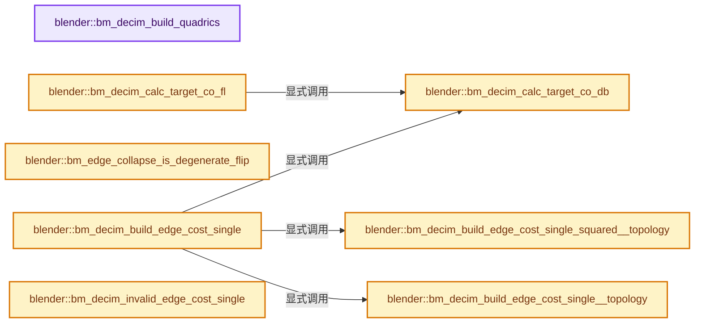
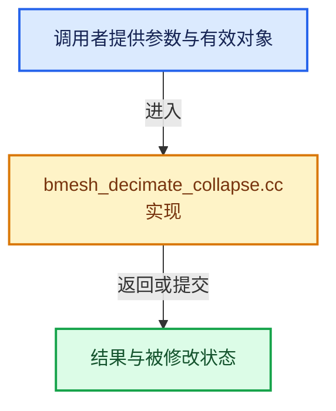

# 实现依赖专题：source/blender/bmesh/tools/bmesh_decimate_collapse.cc

[实现依赖导航](../../../README.md) · [符号索引](../../../../00-课程指南/02-源码与提交索引/符号依赖与实现索引.md)

本专题从正文实际调用进入，集中保存共享实现。函数有稳定锚点，可从调用处直接跳到对应完整函数；递归与互相调用通过回链组织。

## 本文件的实现关系






## 相关类型布局与成员入口

<a id="t-6d235cbe51cb"></a>

### `blender::CD_UseFlag`

原始声明：[source/blender/bmesh/tools/bmesh_decimate_collapse.cc](../../../../../../../../source/blender/bmesh/tools/bmesh_decimate_collapse.cc) · L62—L66。

以下保留类的数据声明与编译条件，成员函数实现通过后面的精确链接阅读。

<!-- annotated:83058bc75d0059 -->

```cpp
enum CD_UseFlag {
  CD_DO_VERT = (1 << 0),
  CD_DO_EDGE = (1 << 1),
  CD_DO_LOOP = (1 << 2),
};
```

<details>
<summary>核对原始源码：source/blender/bmesh/tools/bmesh_decimate_collapse.cc · L62—L66</summary>

<!-- original:83058bc75d0059:source/blender/bmesh/tools/bmesh_decimate_collapse.cc:62:66 -->

```cpp
enum CD_UseFlag {
  CD_DO_VERT = (1 << 0),
  CD_DO_EDGE = (1 << 1),
  CD_DO_LOOP = (1 << 2),
};
```

</details>


## 完整成员与函数实现

<a id="f-1040558a61509c11"></a>

### `blender::bm_decim_build_quadrics`

实现位置：[source/blender/bmesh/tools/bmesh_decimate_collapse.cc](../../../../../../../../source/blender/bmesh/tools/bmesh_decimate_collapse.cc) · L75—L128。

接口参数：

- `BMesh *bm`
- `Quadric *vquadrics`

**教学注释版**

<!-- annotated:057b24384866c4 -->

```cpp
static void bm_decim_build_quadrics(BMesh *bm, Quadric *vquadrics)
{
  BMIter iter;
  BMFace *f;
  BMEdge *e;

  BM_ITER_MESH (f, &iter, bm, BM_FACES_OF_MESH) {
    BMLoop *l_first;
    BMLoop *l_iter;

    float center[3];
    double plane_db[4];
    Quadric q;

    BM_face_calc_center_median(f, center);
    copy_v3db_v3fl(plane_db, f->no);
    plane_db[3] = -dot_v3db_v3fl(plane_db, center);

    BLI_quadric_from_plane(&q, plane_db);

    l_iter = l_first = BM_FACE_FIRST_LOOP(f);
    do {
      BLI_quadric_add_qu_qu(&vquadrics[BM_elem_index_get(l_iter->v)], &q);
    } while ((l_iter = l_iter->next) != l_first);
  }

  /* boundary edges */
  BM_ITER_MESH (e, &iter, bm, BM_EDGES_OF_MESH) {
    if (BM_edge_is_boundary(e)) [[unlikely]] {
      float edge_vector[3];
      float edge_plane[3];
      double edge_plane_db[4];
      sub_v3_v3v3(edge_vector, e->v2->co, e->v1->co);
      f = e->l->f;

      cross_v3_v3v3(edge_plane, edge_vector, f->no);
      copy_v3db_v3fl(edge_plane_db, edge_plane);

      if (normalize_v3_db(edge_plane_db) > double(FLT_EPSILON)) {
        Quadric q;
        float center[3];

        mid_v3_v3v3(center, e->v1->co, e->v2->co);

        edge_plane_db[3] = -dot_v3db_v3fl(edge_plane_db, center);
        BLI_quadric_from_plane(&q, edge_plane_db);
        BLI_quadric_mul(&q, BOUNDARY_PRESERVE_WEIGHT);

        BLI_quadric_add_qu_qu(&vquadrics[BM_elem_index_get(e->v1)], &q);
        BLI_quadric_add_qu_qu(&vquadrics[BM_elem_index_get(e->v2)], &q);
      }
    }
  }
}
```

<details>
<summary>核对原始源码：source/blender/bmesh/tools/bmesh_decimate_collapse.cc · L75—L128</summary>

<!-- original:057b24384866c4:source/blender/bmesh/tools/bmesh_decimate_collapse.cc:75:128 -->

```cpp
static void bm_decim_build_quadrics(BMesh *bm, Quadric *vquadrics)
{
  BMIter iter;
  BMFace *f;
  BMEdge *e;

  BM_ITER_MESH (f, &iter, bm, BM_FACES_OF_MESH) {
    BMLoop *l_first;
    BMLoop *l_iter;

    float center[3];
    double plane_db[4];
    Quadric q;

    BM_face_calc_center_median(f, center);
    copy_v3db_v3fl(plane_db, f->no);
    plane_db[3] = -dot_v3db_v3fl(plane_db, center);

    BLI_quadric_from_plane(&q, plane_db);

    l_iter = l_first = BM_FACE_FIRST_LOOP(f);
    do {
      BLI_quadric_add_qu_qu(&vquadrics[BM_elem_index_get(l_iter->v)], &q);
    } while ((l_iter = l_iter->next) != l_first);
  }

  /* boundary edges */
  BM_ITER_MESH (e, &iter, bm, BM_EDGES_OF_MESH) {
    if (BM_edge_is_boundary(e)) [[unlikely]] {
      float edge_vector[3];
      float edge_plane[3];
      double edge_plane_db[4];
      sub_v3_v3v3(edge_vector, e->v2->co, e->v1->co);
      f = e->l->f;

      cross_v3_v3v3(edge_plane, edge_vector, f->no);
      copy_v3db_v3fl(edge_plane_db, edge_plane);

      if (normalize_v3_db(edge_plane_db) > double(FLT_EPSILON)) {
        Quadric q;
        float center[3];

        mid_v3_v3v3(center, e->v1->co, e->v2->co);

        edge_plane_db[3] = -dot_v3db_v3fl(edge_plane_db, center);
        BLI_quadric_from_plane(&q, edge_plane_db);
        BLI_quadric_mul(&q, BOUNDARY_PRESERVE_WEIGHT);

        BLI_quadric_add_qu_qu(&vquadrics[BM_elem_index_get(e->v1)], &q);
        BLI_quadric_add_qu_qu(&vquadrics[BM_elem_index_get(e->v2)], &q);
      }
    }
  }
}
```

</details>

**沿实际写入检查状态**

- `plane_db[3] = -dot_v3db_v3fl(plane_db, center);`
- `l_iter = l_first = BM_FACE_FIRST_LOOP(f);`
- `f = e->l->f;`
- `edge_plane_db[3] = -dot_v3db_v3fl(edge_plane_db, center);`

**继续追踪实现**

- `BM_ITER_MESH` → [BM_ITER_MESH · L72](../intern/bmesh_iterators.hh.md#m-cfc837c73218)。宏定义由构建条件选择。
- `BM_face_calc_center_median` → [blender::BM_face_calc_center_median · L655](../intern/bmesh_polygon.cc.md#f-ca9310cae0d0c57b)。
- `copy_v3db_v3fl` → [blender::copy_v3db_v3fl · L204](../../../01-BLI基础库/intern/math_vector_inline.cc.md#f-5f291b6849fea907)。
- `dot_v3db_v3fl` → [blender::dot_v3db_v3fl · L670](../../../01-BLI基础库/intern/math_vector_inline.cc.md#f-a4fd0dea12046661)。
- `BLI_quadric_from_plane` → [blender::BLI_quadric_from_plane · L33](../../../01-BLI基础库/intern/quadric.cc.md#f-b0559a1aaabcc477)。
- `BM_FACE_FIRST_LOOP` → [BM_FACE_FIRST_LOOP · L697](../bmesh_class.hh.md#m-c7e10ffb38e6)；[BM_FACE_FIRST_LOOP · L699](../bmesh_class.hh.md#m-76a054cc4770)。宏定义由构建条件选择。
- `BLI_quadric_add_qu_qu` → [blender::BLI_quadric_add_qu_qu · L117](../../../01-BLI基础库/intern/quadric.cc.md#f-756e24f67a667014)。
- `BM_elem_index_get` → [BM_elem_index_get · L120](../intern/bmesh_inline.hh.md#m-201981cdc62d)。宏定义由构建条件选择。
- `BM_edge_is_boundary` → [blender::BM_edge_is_boundary · L111](../intern/bmesh_query_inline.hh.md#f-9626087cfab8be44)；[blender::BM_edge_is_boundary · L117](../intern/bmesh_query_inline.hh.md#f-2fee18c217b38784)。同名重载需按实参类型选择。
- `sub_v3_v3v3` → [blender::sub_v3_v3v3 · L360](../../../01-BLI基础库/intern/math_vector_inline.cc.md#f-23781c252db8b30c)。
- `cross_v3_v3v3` → [blender::cross_v3_v3v3 · L690](../../../01-BLI基础库/intern/math_vector_inline.cc.md#f-ac8d04405fb5dad4)。
- `normalize_v3_db` → [blender::normalize_v3_db · L923](../../../01-BLI基础库/intern/math_vector_inline.cc.md#f-dae48848aa1b146d)。
- `mid_v3_v3v3` → [blender::mid_v3_v3v3 · L183](../../../01-BLI基础库/intern/math_vector.cc.md#f-b748c1b0b472ad9b)。
- `BLI_quadric_mul` → [blender::BLI_quadric_mul · L132](../../../01-BLI基础库/intern/quadric.cc.md#f-b18c18d5809dc014)。

<a id="f-2d0c9811a221eefa"></a>

### `blender::bm_decim_calc_target_co_db`

实现位置：[source/blender/bmesh/tools/bmesh_decimate_collapse.cc](../../../../../../../../source/blender/bmesh/tools/bmesh_decimate_collapse.cc) · L130—L148。

接口参数：

- `BMEdge *e`
- `double optimize_co[3]`
- `const Quadric *vquadrics`

**教学注释版**

<!-- annotated:c6dd46e54a0ebb -->

```cpp
static void bm_decim_calc_target_co_db(BMEdge *e, double optimize_co[3], const Quadric *vquadrics)
{
  /* compute an edge contraction target for edge 'e'
   * this is computed by summing its vertices quadrics and
   * optimizing the result. */
  Quadric q;

  BLI_quadric_add_qu_ququ(
      &q, &vquadrics[BM_elem_index_get(e->v1)], &vquadrics[BM_elem_index_get(e->v2)]);

  if (BLI_quadric_optimize(&q, optimize_co, OPTIMIZE_EPS)) {
    /* all is good */
    return;
  }

  optimize_co[0] = 0.5 * (double(e->v1->co[0]) + double(e->v2->co[0]));
  optimize_co[1] = 0.5 * (double(e->v1->co[1]) + double(e->v2->co[1]));
  optimize_co[2] = 0.5 * (double(e->v1->co[2]) + double(e->v2->co[2]));
}
```

<details>
<summary>核对原始源码：source/blender/bmesh/tools/bmesh_decimate_collapse.cc · L130—L148</summary>

<!-- original:c6dd46e54a0ebb:source/blender/bmesh/tools/bmesh_decimate_collapse.cc:130:148 -->

```cpp
static void bm_decim_calc_target_co_db(BMEdge *e, double optimize_co[3], const Quadric *vquadrics)
{
  /* compute an edge contraction target for edge 'e'
   * this is computed by summing its vertices quadrics and
   * optimizing the result. */
  Quadric q;

  BLI_quadric_add_qu_ququ(
      &q, &vquadrics[BM_elem_index_get(e->v1)], &vquadrics[BM_elem_index_get(e->v2)]);

  if (BLI_quadric_optimize(&q, optimize_co, OPTIMIZE_EPS)) {
    /* all is good */
    return;
  }

  optimize_co[0] = 0.5 * (double(e->v1->co[0]) + double(e->v2->co[0]));
  optimize_co[1] = 0.5 * (double(e->v1->co[1]) + double(e->v2->co[1]));
  optimize_co[2] = 0.5 * (double(e->v1->co[2]) + double(e->v2->co[2]));
}
```

</details>

**沿实际写入检查状态**

- `optimize_co[0] = 0.5 * (double(e->v1->co[0]) + double(e->v2->co[0]));`
- `optimize_co[1] = 0.5 * (double(e->v1->co[1]) + double(e->v2->co[1]));`
- `optimize_co[2] = 0.5 * (double(e->v1->co[2]) + double(e->v2->co[2]));`

**继续追踪实现**

- `BLI_quadric_add_qu_ququ` → [blender::BLI_quadric_add_qu_ququ · L124](../../../01-BLI基础库/intern/quadric.cc.md#f-16f2cddabe308a3a)。
- `BM_elem_index_get` → [BM_elem_index_get · L120](../intern/bmesh_inline.hh.md#m-201981cdc62d)。宏定义由构建条件选择。
- `BLI_quadric_optimize` → [blender::BLI_quadric_optimize · L149](../../../01-BLI基础库/intern/quadric.cc.md#f-d48ffeaf983259a9)。

<a id="f-27e7b38cb54fffd7"></a>

### `blender::bm_decim_calc_target_co_fl`

实现位置：[source/blender/bmesh/tools/bmesh_decimate_collapse.cc](../../../../../../../../source/blender/bmesh/tools/bmesh_decimate_collapse.cc) · L150—L155。

接口参数：

- `BMEdge *e`
- `float optimize_co[3]`
- `const Quadric *vquadrics`

**教学注释版**

<!-- annotated:6db5764a152550 -->

```cpp
static void bm_decim_calc_target_co_fl(BMEdge *e, float optimize_co[3], const Quadric *vquadrics)
{
  double optimize_co_db[3];
  bm_decim_calc_target_co_db(e, optimize_co_db, vquadrics);
  copy_v3fl_v3db(optimize_co, optimize_co_db);
}
```

<details>
<summary>核对原始源码：source/blender/bmesh/tools/bmesh_decimate_collapse.cc · L150—L155</summary>

<!-- original:6db5764a152550:source/blender/bmesh/tools/bmesh_decimate_collapse.cc:150:155 -->

```cpp
static void bm_decim_calc_target_co_fl(BMEdge *e, float optimize_co[3], const Quadric *vquadrics)
{
  double optimize_co_db[3];
  bm_decim_calc_target_co_db(e, optimize_co_db, vquadrics);
  copy_v3fl_v3db(optimize_co, optimize_co_db);
}
```

</details>

**继续追踪实现**

- `bm_decim_calc_target_co_db` → [blender::bm_decim_calc_target_co_db · L130](bmesh_decimate_collapse.cc.md#f-2d0c9811a221eefa)。
- `copy_v3fl_v3db` → [blender::copy_v3fl_v3db · L181](../../../01-BLI基础库/intern/math_vector_inline.cc.md#f-add3848dbbb4c190)。

<a id="f-c6c365a744cbea29"></a>

### `blender::bm_edge_collapse_is_degenerate_flip`

实现位置：[source/blender/bmesh/tools/bmesh_decimate_collapse.cc](../../../../../../../../source/blender/bmesh/tools/bmesh_decimate_collapse.cc) · L157—L211。

接口参数：

- `BMEdge *e`
- `const float optimize_co[3]`

**教学注释版**

<!-- annotated:52fcfef0466384 -->

```cpp
static bool bm_edge_collapse_is_degenerate_flip(BMEdge *e, const float optimize_co[3])
{
  BMIter liter;
  BMLoop *l;
  uint i;

  for (i = 0; i < 2; i++) {
    /* loop over both verts */
    BMVert *v = *((&e->v1) + i);

    BM_ITER_ELEM (l, &liter, v, BM_LOOPS_OF_VERT) {
      if (l->e != e && l->prev->e != e) {
        const float *co_prev = l->prev->v->co;
        const float *co_next = l->next->v->co;
        float cross_exist[3];
        float cross_optim[3];

#if 1
        /* line between the two outer verts, re-use for both cross products */
        float vec_other[3];
        /* before collapse */
        float vec_exist[3];
        /* after collapse */
        float vec_optim[3];

        sub_v3_v3v3(vec_other, co_prev, co_next);
        sub_v3_v3v3(vec_exist, co_prev, v->co);
        sub_v3_v3v3(vec_optim, co_prev, optimize_co);

        cross_v3_v3v3(cross_exist, vec_other, vec_exist);
        cross_v3_v3v3(cross_optim, vec_other, vec_optim);

        /* avoid normalize */
        if (dot_v3v3(cross_exist, cross_optim) <=
            (len_squared_v3(cross_exist) + len_squared_v3(cross_optim)) * 0.01f)
        {
          return true;
        }
#else
        normal_tri_v3(cross_exist, v->co, co_prev, co_next);
        normal_tri_v3(cross_optim, optimize_co, co_prev, co_next);

        /* use a small value rather than zero so we don't flip a face in multiple steps
         * (first making it zero area, then flipping again) */
        if (dot_v3v3(cross_exist, cross_optim) <= FLT_EPSILON) {
          // printf("no flip\n");
          return true;
        }
#endif
      }
    }
  }

  return false;
}
```

<details>
<summary>核对原始源码：source/blender/bmesh/tools/bmesh_decimate_collapse.cc · L157—L211</summary>

<!-- original:52fcfef0466384:source/blender/bmesh/tools/bmesh_decimate_collapse.cc:157:211 -->

```cpp
static bool bm_edge_collapse_is_degenerate_flip(BMEdge *e, const float optimize_co[3])
{
  BMIter liter;
  BMLoop *l;
  uint i;

  for (i = 0; i < 2; i++) {
    /* loop over both verts */
    BMVert *v = *((&e->v1) + i);

    BM_ITER_ELEM (l, &liter, v, BM_LOOPS_OF_VERT) {
      if (l->e != e && l->prev->e != e) {
        const float *co_prev = l->prev->v->co;
        const float *co_next = l->next->v->co;
        float cross_exist[3];
        float cross_optim[3];

#if 1
        /* line between the two outer verts, re-use for both cross products */
        float vec_other[3];
        /* before collapse */
        float vec_exist[3];
        /* after collapse */
        float vec_optim[3];

        sub_v3_v3v3(vec_other, co_prev, co_next);
        sub_v3_v3v3(vec_exist, co_prev, v->co);
        sub_v3_v3v3(vec_optim, co_prev, optimize_co);

        cross_v3_v3v3(cross_exist, vec_other, vec_exist);
        cross_v3_v3v3(cross_optim, vec_other, vec_optim);

        /* avoid normalize */
        if (dot_v3v3(cross_exist, cross_optim) <=
            (len_squared_v3(cross_exist) + len_squared_v3(cross_optim)) * 0.01f)
        {
          return true;
        }
#else
        normal_tri_v3(cross_exist, v->co, co_prev, co_next);
        normal_tri_v3(cross_optim, optimize_co, co_prev, co_next);

        /* use a small value rather than zero so we don't flip a face in multiple steps
         * (first making it zero area, then flipping again) */
        if (dot_v3v3(cross_exist, cross_optim) <= FLT_EPSILON) {
          // printf("no flip\n");
          return true;
        }
#endif
      }
    }
  }

  return false;
}
```

</details>

**结果出口**

- `return true;`
- `return false;`

**继续追踪实现**

- `BM_ITER_ELEM` → [BM_ITER_ELEM · L97](../intern/bmesh_iterators.hh.md#m-751d15be7ee4)。宏定义由构建条件选择。
- `sub_v3_v3v3` → [blender::sub_v3_v3v3 · L360](../../../01-BLI基础库/intern/math_vector_inline.cc.md#f-23781c252db8b30c)。
- `cross_v3_v3v3` → [blender::cross_v3_v3v3 · L690](../../../01-BLI基础库/intern/math_vector_inline.cc.md#f-ac8d04405fb5dad4)。
- `dot_v3v3` → [blender::dot_v3v3 · L646](../../../01-BLI基础库/intern/math_vector_inline.cc.md#f-c88befa67d07591a)。
- `len_squared_v3` → [blender::len_squared_v3 · L724](../../../01-BLI基础库/intern/math_vector_inline.cc.md#f-089409f6f09f82ef)。
- `normal_tri_v3` → [blender::normal_tri_v3 · L45](../../../01-BLI基础库/intern/math_geom.cc.md#f-f574cdfe156b33d2)。

<a id="f-a8326d0d41b2353f"></a>

### `blender::bm_decim_build_edge_cost_single_squared__topology`

实现位置：[source/blender/bmesh/tools/bmesh_decimate_collapse.cc](../../../../../../../../source/blender/bmesh/tools/bmesh_decimate_collapse.cc) · L220—L224。

接口参数：

- `BMEdge *e`

**教学注释版**

<!-- annotated:7762b4701e3681 -->

```cpp
static float bm_decim_build_edge_cost_single_squared__topology(BMEdge *e)
{
  return fabsf(dot_v3v3(e->v1->no, e->v2->no)) /
         min_ff(-len_squared_v3v3(e->v1->co, e->v2->co), -FLT_EPSILON);
}
```

<details>
<summary>核对原始源码：source/blender/bmesh/tools/bmesh_decimate_collapse.cc · L220—L224</summary>

<!-- original:7762b4701e3681:source/blender/bmesh/tools/bmesh_decimate_collapse.cc:220:224 -->

```cpp
static float bm_decim_build_edge_cost_single_squared__topology(BMEdge *e)
{
  return fabsf(dot_v3v3(e->v1->no, e->v2->no)) /
         min_ff(-len_squared_v3v3(e->v1->co, e->v2->co), -FLT_EPSILON);
}
```

</details>

**结果出口**

- `return fabsf(dot_v3v3(e->v1->no, e->v2->no)) /`

**继续追踪实现**

- `fabsf` → [fabsf · L21](../../../07-Intern运行时与平台/cycles/kernel/svm/radial_tiling_shared.h.md#m-02cc4c69cfb3)；[fabsf · L43](../../../07-Intern运行时与平台/cycles/kernel/svm/radial_tiling_shared.h.md#m-04effe61803b)；[fabsf · L74](../../../07-Intern运行时与平台/cycles/kernel/svm/radial_tiling_shared.h.md#m-927dd4eba7dc)；[fabsf · L25](../../../01-BLI基础库/intern/radial_tiling_shared.hh.md#m-8348d6b3d08f)；[fabsf · L47](../../../01-BLI基础库/intern/radial_tiling_shared.hh.md#m-13b7e0b6d84f)；[fabsf · L78](../../../01-BLI基础库/intern/radial_tiling_shared.hh.md#m-326c83464a0d)；[fabsf · L21](../../../07-Intern运行时与平台/cycles/kernel/osl/shaders/node_radial_tiling_shared.h.md#m-7c3ee12fc119)；[fabsf · L43](../../../07-Intern运行时与平台/cycles/kernel/osl/shaders/node_radial_tiling_shared.h.md#m-9112db0e2dd1)；[fabsf · L74](../../../07-Intern运行时与平台/cycles/kernel/osl/shaders/node_radial_tiling_shared.h.md#m-ee4e61908a6f)；[fabsf · L167](../../../07-Intern运行时与平台/cycles/kernel/device/oneapi/compat.h.md#m-b039ee6c1601)；[fabsf · L265](../../../07-Intern运行时与平台/cycles/kernel/device/metal/compat.h.md#m-6b21869e9f3f)。宏定义由构建条件选择。
- `dot_v3v3` → [blender::dot_v3v3 · L646](../../../01-BLI基础库/intern/math_vector_inline.cc.md#f-c88befa67d07591a)。
- `min_ff` → [blender::min_ff · L321](../../../01-BLI基础库/intern/math_base_inline.cc.md#f-5b8d83d6f191be1a)。
- `len_squared_v3v3` → [blender::len_squared_v3v3 · L794](../../../01-BLI基础库/intern/math_vector_inline.cc.md#f-ae487ac3ef64aa87)。

<a id="f-458fb72d57091d88"></a>

### `blender::bm_decim_build_edge_cost_single__topology`

实现位置：[source/blender/bmesh/tools/bmesh_decimate_collapse.cc](../../../../../../../../source/blender/bmesh/tools/bmesh_decimate_collapse.cc) · L225—L229。

接口参数：

- `BMEdge *e`

**教学注释版**

<!-- annotated:f00fa1cbad78f1 -->

```cpp
static float bm_decim_build_edge_cost_single__topology(BMEdge *e)
{
  return fabsf(dot_v3v3(e->v1->no, e->v2->no)) /
         min_ff(-len_v3v3(e->v1->co, e->v2->co), -FLT_EPSILON);
}
```

<details>
<summary>核对原始源码：source/blender/bmesh/tools/bmesh_decimate_collapse.cc · L225—L229</summary>

<!-- original:f00fa1cbad78f1:source/blender/bmesh/tools/bmesh_decimate_collapse.cc:225:229 -->

```cpp
static float bm_decim_build_edge_cost_single__topology(BMEdge *e)
{
  return fabsf(dot_v3v3(e->v1->no, e->v2->no)) /
         min_ff(-len_v3v3(e->v1->co, e->v2->co), -FLT_EPSILON);
}
```

</details>

**结果出口**

- `return fabsf(dot_v3v3(e->v1->no, e->v2->no)) /`

**继续追踪实现**

- `fabsf` → [fabsf · L21](../../../07-Intern运行时与平台/cycles/kernel/svm/radial_tiling_shared.h.md#m-02cc4c69cfb3)；[fabsf · L43](../../../07-Intern运行时与平台/cycles/kernel/svm/radial_tiling_shared.h.md#m-04effe61803b)；[fabsf · L74](../../../07-Intern运行时与平台/cycles/kernel/svm/radial_tiling_shared.h.md#m-927dd4eba7dc)；[fabsf · L25](../../../01-BLI基础库/intern/radial_tiling_shared.hh.md#m-8348d6b3d08f)；[fabsf · L47](../../../01-BLI基础库/intern/radial_tiling_shared.hh.md#m-13b7e0b6d84f)；[fabsf · L78](../../../01-BLI基础库/intern/radial_tiling_shared.hh.md#m-326c83464a0d)；[fabsf · L21](../../../07-Intern运行时与平台/cycles/kernel/osl/shaders/node_radial_tiling_shared.h.md#m-7c3ee12fc119)；[fabsf · L43](../../../07-Intern运行时与平台/cycles/kernel/osl/shaders/node_radial_tiling_shared.h.md#m-9112db0e2dd1)；[fabsf · L74](../../../07-Intern运行时与平台/cycles/kernel/osl/shaders/node_radial_tiling_shared.h.md#m-ee4e61908a6f)；[fabsf · L167](../../../07-Intern运行时与平台/cycles/kernel/device/oneapi/compat.h.md#m-b039ee6c1601)；[fabsf · L265](../../../07-Intern运行时与平台/cycles/kernel/device/metal/compat.h.md#m-6b21869e9f3f)。宏定义由构建条件选择。
- `dot_v3v3` → [blender::dot_v3v3 · L646](../../../01-BLI基础库/intern/math_vector_inline.cc.md#f-c88befa67d07591a)。
- `min_ff` → [blender::min_ff · L321](../../../01-BLI基础库/intern/math_base_inline.cc.md#f-5b8d83d6f191be1a)。
- `len_v3v3` → [blender::len_v3v3 · L826](../../../01-BLI基础库/intern/math_vector_inline.cc.md#f-c873370566848169)。

<a id="f-861b372b4b8bc97c"></a>

### `blender::bm_decim_build_edge_cost_single`

实现位置：[source/blender/bmesh/tools/bmesh_decimate_collapse.cc](../../../../../../../../source/blender/bmesh/tools/bmesh_decimate_collapse.cc) · L233—L329。

接口参数：

- `BMEdge *e`
- `const Quadric *vquadrics`
- `const float *vweights`
- `const float vweight_factor`
- `Heap *eheap`
- `HeapNode **eheap_table`

**教学注释版**

<!-- annotated:7d6c16eef459ec -->

```cpp
static void bm_decim_build_edge_cost_single(BMEdge *e,
                                            const Quadric *vquadrics,
                                            const float *vweights,
                                            const float vweight_factor,
                                            Heap *eheap,
                                            HeapNode **eheap_table)
{
  float cost;

  if (vweights && ((vweights[BM_elem_index_get(e->v1)] == 0.0f) ||
                   (vweights[BM_elem_index_get(e->v2)] == 0.0f))) [[unlikely]]
  {
    goto clear;
  }

  /* Check we can collapse, some edges we better not touch. */
  if (BM_edge_is_boundary(e)) {
    if (e->l->f->len == 3) {
      /* Pass. */
    }
    else {
      /* Only collapse triangles. */
      goto clear;
    }
  }
  else if (BM_edge_is_manifold(e)) {
    if ((e->l->f->len == 3) && (e->l->radial_next->f->len == 3)) {
      /* Pass. */
    }
    else {
      /* Only collapse triangles. */
      goto clear;
    }
  }
  else {
    goto clear;
  }
  /* End sanity check. */

  {
    double optimize_co[3];
    bm_decim_calc_target_co_db(e, optimize_co, vquadrics);

    const Quadric *q1, *q2;
    q1 = &vquadrics[BM_elem_index_get(e->v1)];
    q2 = &vquadrics[BM_elem_index_get(e->v2)];

    cost = (BLI_quadric_evaluate(q1, optimize_co) + BLI_quadric_evaluate(q2, optimize_co));
  }

  /* NOTE: 'cost' shouldn't be negative but happens sometimes with small values.
   * this can cause faces that make up a flat surface to over-collapse, see #37121. */
  cost = fabsf(cost);

#ifdef USE_TOPOLOGY_FALLBACK
  if (cost < TOPOLOGY_FALLBACK_EPS) [[unlikely]] {
    /* subtract existing cost to further differentiate edges from one another
     *
     * keep topology cost below 0.0 so their values don't interfere with quadric cost,
     * (and they get handled first). */
    if (vweights == nullptr) {
      cost = bm_decim_build_edge_cost_single_squared__topology(e) - cost;
    }
    else {
      /* with weights we need to use the real length so we can scale them properly */
      const float e_weight = (vweights[BM_elem_index_get(e->v1)] +
                              vweights[BM_elem_index_get(e->v2)]);
      cost = bm_decim_build_edge_cost_single__topology(e) - cost;
      /* NOTE: this is rather arbitrary max weight is 2 here,
       * allow for skipping edges 4x the length, based on weights */
      if (e_weight) {
        cost *= 1.0f + (e_weight * vweight_factor);
      }

      BLI_assert(cost <= 0.0f);
    }
  }
  else
#endif
      if (vweights)
  {
    const float e_weight = 2.0f - (vweights[BM_elem_index_get(e->v1)] +
                                   vweights[BM_elem_index_get(e->v2)]);
    if (e_weight) {
      cost += (BM_edge_calc_length(e) * (e_weight * vweight_factor));
    }
  }

  BLI_heap_insert_or_update(eheap, &eheap_table[BM_elem_index_get(e)], cost, e);
  return;

clear:
  if (eheap_table[BM_elem_index_get(e)]) {
    BLI_heap_remove(eheap, eheap_table[BM_elem_index_get(e)]);
  }
  eheap_table[BM_elem_index_get(e)] = nullptr;
}
```

<details>
<summary>核对原始源码：source/blender/bmesh/tools/bmesh_decimate_collapse.cc · L233—L329</summary>

<!-- original:7d6c16eef459ec:source/blender/bmesh/tools/bmesh_decimate_collapse.cc:233:329 -->

```cpp
static void bm_decim_build_edge_cost_single(BMEdge *e,
                                            const Quadric *vquadrics,
                                            const float *vweights,
                                            const float vweight_factor,
                                            Heap *eheap,
                                            HeapNode **eheap_table)
{
  float cost;

  if (vweights && ((vweights[BM_elem_index_get(e->v1)] == 0.0f) ||
                   (vweights[BM_elem_index_get(e->v2)] == 0.0f))) [[unlikely]]
  {
    goto clear;
  }

  /* Check we can collapse, some edges we better not touch. */
  if (BM_edge_is_boundary(e)) {
    if (e->l->f->len == 3) {
      /* Pass. */
    }
    else {
      /* Only collapse triangles. */
      goto clear;
    }
  }
  else if (BM_edge_is_manifold(e)) {
    if ((e->l->f->len == 3) && (e->l->radial_next->f->len == 3)) {
      /* Pass. */
    }
    else {
      /* Only collapse triangles. */
      goto clear;
    }
  }
  else {
    goto clear;
  }
  /* End sanity check. */

  {
    double optimize_co[3];
    bm_decim_calc_target_co_db(e, optimize_co, vquadrics);

    const Quadric *q1, *q2;
    q1 = &vquadrics[BM_elem_index_get(e->v1)];
    q2 = &vquadrics[BM_elem_index_get(e->v2)];

    cost = (BLI_quadric_evaluate(q1, optimize_co) + BLI_quadric_evaluate(q2, optimize_co));
  }

  /* NOTE: 'cost' shouldn't be negative but happens sometimes with small values.
   * this can cause faces that make up a flat surface to over-collapse, see #37121. */
  cost = fabsf(cost);

#ifdef USE_TOPOLOGY_FALLBACK
  if (cost < TOPOLOGY_FALLBACK_EPS) [[unlikely]] {
    /* subtract existing cost to further differentiate edges from one another
     *
     * keep topology cost below 0.0 so their values don't interfere with quadric cost,
     * (and they get handled first). */
    if (vweights == nullptr) {
      cost = bm_decim_build_edge_cost_single_squared__topology(e) - cost;
    }
    else {
      /* with weights we need to use the real length so we can scale them properly */
      const float e_weight = (vweights[BM_elem_index_get(e->v1)] +
                              vweights[BM_elem_index_get(e->v2)]);
      cost = bm_decim_build_edge_cost_single__topology(e) - cost;
      /* NOTE: this is rather arbitrary max weight is 2 here,
       * allow for skipping edges 4x the length, based on weights */
      if (e_weight) {
        cost *= 1.0f + (e_weight * vweight_factor);
      }

      BLI_assert(cost <= 0.0f);
    }
  }
  else
#endif
      if (vweights)
  {
    const float e_weight = 2.0f - (vweights[BM_elem_index_get(e->v1)] +
                                   vweights[BM_elem_index_get(e->v2)]);
    if (e_weight) {
      cost += (BM_edge_calc_length(e) * (e_weight * vweight_factor));
    }
  }

  BLI_heap_insert_or_update(eheap, &eheap_table[BM_elem_index_get(e)], cost, e);
  return;

clear:
  if (eheap_table[BM_elem_index_get(e)]) {
    BLI_heap_remove(eheap, eheap_table[BM_elem_index_get(e)]);
  }
  eheap_table[BM_elem_index_get(e)] = nullptr;
}
```

</details>

**沿实际写入检查状态**

- `q1 = &vquadrics[BM_elem_index_get(e->v1)];`
- `q2 = &vquadrics[BM_elem_index_get(e->v2)];`
- `cost = (BLI_quadric_evaluate(q1, optimize_co) + BLI_quadric_evaluate(q2, optimize_co));`
- `cost = fabsf(cost);`
- `cost = bm_decim_build_edge_cost_single_squared__topology(e) - cost;`
- `cost = bm_decim_build_edge_cost_single__topology(e) - cost;`
- `cost *= 1.0f + (e_weight * vweight_factor);`
- `cost += (BM_edge_calc_length(e) * (e_weight * vweight_factor));`

**继续追踪实现**

- `BM_elem_index_get` → [BM_elem_index_get · L120](../intern/bmesh_inline.hh.md#m-201981cdc62d)。宏定义由构建条件选择。
- `BM_edge_is_boundary` → [blender::BM_edge_is_boundary · L111](../intern/bmesh_query_inline.hh.md#f-9626087cfab8be44)；[blender::BM_edge_is_boundary · L117](../intern/bmesh_query_inline.hh.md#f-2fee18c217b38784)。同名重载需按实参类型选择。
- `BM_edge_is_manifold` → [blender::BM_edge_is_manifold · L79](../intern/bmesh_query_inline.hh.md#f-4944cfa861683f59)；[blender::BM_edge_is_manifold · L86](../intern/bmesh_query_inline.hh.md#f-f07686548bcc2440)。同名重载需按实参类型选择。
- `bm_decim_calc_target_co_db` → [blender::bm_decim_calc_target_co_db · L130](bmesh_decimate_collapse.cc.md#f-2d0c9811a221eefa)。
- `BLI_quadric_evaluate` → [blender::BLI_quadric_evaluate · L137](../../../01-BLI基础库/intern/quadric.cc.md#f-6e7601f05dc5b201)。
- `fabsf` → [fabsf · L21](../../../07-Intern运行时与平台/cycles/kernel/svm/radial_tiling_shared.h.md#m-02cc4c69cfb3)；[fabsf · L43](../../../07-Intern运行时与平台/cycles/kernel/svm/radial_tiling_shared.h.md#m-04effe61803b)；[fabsf · L74](../../../07-Intern运行时与平台/cycles/kernel/svm/radial_tiling_shared.h.md#m-927dd4eba7dc)；[fabsf · L25](../../../01-BLI基础库/intern/radial_tiling_shared.hh.md#m-8348d6b3d08f)；[fabsf · L47](../../../01-BLI基础库/intern/radial_tiling_shared.hh.md#m-13b7e0b6d84f)；[fabsf · L78](../../../01-BLI基础库/intern/radial_tiling_shared.hh.md#m-326c83464a0d)；[fabsf · L21](../../../07-Intern运行时与平台/cycles/kernel/osl/shaders/node_radial_tiling_shared.h.md#m-7c3ee12fc119)；[fabsf · L43](../../../07-Intern运行时与平台/cycles/kernel/osl/shaders/node_radial_tiling_shared.h.md#m-9112db0e2dd1)；[fabsf · L74](../../../07-Intern运行时与平台/cycles/kernel/osl/shaders/node_radial_tiling_shared.h.md#m-ee4e61908a6f)；[fabsf · L167](../../../07-Intern运行时与平台/cycles/kernel/device/oneapi/compat.h.md#m-b039ee6c1601)；[fabsf · L265](../../../07-Intern运行时与平台/cycles/kernel/device/metal/compat.h.md#m-6b21869e9f3f)。宏定义由构建条件选择。
- `bm_decim_build_edge_cost_single_squared__topology` → [blender::bm_decim_build_edge_cost_single_squared__topology · L220](bmesh_decimate_collapse.cc.md#f-a8326d0d41b2353f)。
- `bm_decim_build_edge_cost_single__topology` → [blender::bm_decim_build_edge_cost_single__topology · L225](bmesh_decimate_collapse.cc.md#f-458fb72d57091d88)。
- `BLI_assert` → [BLI_assert · L48](../../../01-BLI基础库/BLI_assert.hh.md#m-57a88495704d)；[BLI_assert · L63](../../../01-BLI基础库/BLI_assert.hh.md#m-d07050020cb5)。宏定义由构建条件选择。
- `BM_edge_calc_length` → [blender::BM_edge_calc_length · L540](../intern/bmesh_query.cc.md#f-bc3c0cb2a1cc6c46)。
- `BLI_heap_insert_or_update` → [blender::BLI_heap_insert_or_update · L261](../../../01-BLI基础库/intern/BLI_heap.cc.md#f-23bdfc00946eb15b)。
- `BLI_heap_remove` → [blender::BLI_heap_remove · L309](../../../01-BLI基础库/intern/BLI_heap.cc.md#f-73577ad583f99473)。

<a id="f-8cf9f239e7fadb6b"></a>

### `blender::bm_decim_invalid_edge_cost_single`

实现位置：[source/blender/bmesh/tools/bmesh_decimate_collapse.cc](../../../../../../../../source/blender/bmesh/tools/bmesh_decimate_collapse.cc) · L333—L337。

接口参数：

- `BMEdge *e`
- `Heap *eheap`
- `HeapNode **eheap_table`

**教学注释版**

<!-- annotated:ed63d84bb2ab47 -->

```cpp
static void bm_decim_invalid_edge_cost_single(BMEdge *e, Heap *eheap, HeapNode **eheap_table)
{
  BLI_assert(eheap_table[BM_elem_index_get(e)] == nullptr);
  eheap_table[BM_elem_index_get(e)] = BLI_heap_insert(eheap, COST_INVALID, e);
}
```

<details>
<summary>核对原始源码：source/blender/bmesh/tools/bmesh_decimate_collapse.cc · L333—L337</summary>

<!-- original:ed63d84bb2ab47:source/blender/bmesh/tools/bmesh_decimate_collapse.cc:333:337 -->

```cpp
static void bm_decim_invalid_edge_cost_single(BMEdge *e, Heap *eheap, HeapNode **eheap_table)
{
  BLI_assert(eheap_table[BM_elem_index_get(e)] == nullptr);
  eheap_table[BM_elem_index_get(e)] = BLI_heap_insert(eheap, COST_INVALID, e);
}
```

</details>

**继续追踪实现**

- `BLI_assert` → [BLI_assert · L48](../../../01-BLI基础库/BLI_assert.hh.md#m-57a88495704d)；[BLI_assert · L63](../../../01-BLI基础库/BLI_assert.hh.md#m-d07050020cb5)。宏定义由构建条件选择。
- `BM_elem_index_get` → [BM_elem_index_get · L120](../intern/bmesh_inline.hh.md#m-201981cdc62d)。宏定义由构建条件选择。
- `BLI_heap_insert` → [blender::BLI_heap_insert · L236](../../../01-BLI基础库/intern/BLI_heap.cc.md#f-fd05ef9c93ed9d92)。

<a id="f-e9e40deda9d853d1"></a>

### `blender::bm_decim_build_edge_cost`

实现位置：[source/blender/bmesh/tools/bmesh_decimate_collapse.cc](../../../../../../../../source/blender/bmesh/tools/bmesh_decimate_collapse.cc) · L339—L357。

接口参数：

- `BMesh *bm`
- `const Quadric *vquadrics`
- `const float *vweights`
- `const float vweight_factor`
- `Heap *eheap`
- `HeapNode **eheap_table`

**教学注释版**

<!-- annotated:e2a73b34f38ebb -->

```cpp
static void bm_decim_build_edge_cost(BMesh *bm,
                                     const Quadric *vquadrics,
                                     const float *vweights,
                                     const float vweight_factor,
                                     Heap *eheap,
                                     HeapNode **eheap_table)
{
  BMIter iter;
  BMEdge *e;
  uint i;

  BM_ITER_MESH_INDEX (e, &iter, bm, BM_EDGES_OF_MESH, i) {
    BM_elem_index_set(e, i); /* set_inline */
    /* keep sanity check happy */
    eheap_table[i] = nullptr;
    bm_decim_build_edge_cost_single(e, vquadrics, vweights, vweight_factor, eheap, eheap_table);
  }
  bm->elem_index_dirty &= ~BM_EDGE;
}
```

<details>
<summary>核对原始源码：source/blender/bmesh/tools/bmesh_decimate_collapse.cc · L339—L357</summary>

<!-- original:e2a73b34f38ebb:source/blender/bmesh/tools/bmesh_decimate_collapse.cc:339:357 -->

```cpp
static void bm_decim_build_edge_cost(BMesh *bm,
                                     const Quadric *vquadrics,
                                     const float *vweights,
                                     const float vweight_factor,
                                     Heap *eheap,
                                     HeapNode **eheap_table)
{
  BMIter iter;
  BMEdge *e;
  uint i;

  BM_ITER_MESH_INDEX (e, &iter, bm, BM_EDGES_OF_MESH, i) {
    BM_elem_index_set(e, i); /* set_inline */
    /* keep sanity check happy */
    eheap_table[i] = nullptr;
    bm_decim_build_edge_cost_single(e, vquadrics, vweights, vweight_factor, eheap, eheap_table);
  }
  bm->elem_index_dirty &= ~BM_EDGE;
}
```

</details>

**沿实际写入检查状态**

- `eheap_table[i] = nullptr;`
- `bm->elem_index_dirty &= ~BM_EDGE;`

**继续追踪实现**

- `BM_ITER_MESH_INDEX` → [BM_ITER_MESH_INDEX · L76](../intern/bmesh_iterators.hh.md#m-6a0cac4538f9)。宏定义由构建条件选择。
- `BM_elem_index_set` → [BM_elem_index_set · L121](../intern/bmesh_inline.hh.md#m-7bd559c53007)。宏定义由构建条件选择。
- `bm_decim_build_edge_cost_single` → [blender::bm_decim_build_edge_cost_single · L233](bmesh_decimate_collapse.cc.md#f-861b372b4b8bc97c)。

<a id="f-ea6ed2820b899815"></a>

### `blender::bm_edge_symmetry_check_cb`

实现位置：[source/blender/bmesh/tools/bmesh_decimate_collapse.cc](../../../../../../../../source/blender/bmesh/tools/bmesh_decimate_collapse.cc) · L374—L403。

接口参数：

- `void *user_data`
- `int index`
- `const float3 &`
- `float`

**教学注释版**

<!-- annotated:7f449e84729bde -->

```cpp
static bool bm_edge_symmetry_check_cb(void *user_data,
                                      int index,
                                      const float3 & /*co*/,
                                      float /*dist_sq*/)
{
  KD_Symmetry_Data *sym_data = static_cast<KD_Symmetry_Data *>(user_data);
  BMEdge *e_other = sym_data->etable[index];
  float e_other_dir[3];

  sub_v3_v3v3(e_other_dir, e_other->v2->co, e_other->v1->co);

  if (dot_v3v3(e_other_dir, sym_data->e_dir) > 0.0f) {
    if ((len_squared_v3v3(sym_data->e_v1_co, e_other->v1->co) > sym_data->limit_sq) ||
        (len_squared_v3v3(sym_data->e_v2_co, e_other->v2->co) > sym_data->limit_sq))
    {
      return true;
    }
  }
  else {
    if ((len_squared_v3v3(sym_data->e_v1_co, e_other->v2->co) > sym_data->limit_sq) ||
        (len_squared_v3v3(sym_data->e_v2_co, e_other->v1->co) > sym_data->limit_sq))
    {
      return true;
    }
  }

  /* exit on first-hit, this is OK since the search range is very small */
  sym_data->e_found_index = index;
  return false;
}
```

<details>
<summary>核对原始源码：source/blender/bmesh/tools/bmesh_decimate_collapse.cc · L374—L403</summary>

<!-- original:7f449e84729bde:source/blender/bmesh/tools/bmesh_decimate_collapse.cc:374:403 -->

```cpp
static bool bm_edge_symmetry_check_cb(void *user_data,
                                      int index,
                                      const float3 & /*co*/,
                                      float /*dist_sq*/)
{
  KD_Symmetry_Data *sym_data = static_cast<KD_Symmetry_Data *>(user_data);
  BMEdge *e_other = sym_data->etable[index];
  float e_other_dir[3];

  sub_v3_v3v3(e_other_dir, e_other->v2->co, e_other->v1->co);

  if (dot_v3v3(e_other_dir, sym_data->e_dir) > 0.0f) {
    if ((len_squared_v3v3(sym_data->e_v1_co, e_other->v1->co) > sym_data->limit_sq) ||
        (len_squared_v3v3(sym_data->e_v2_co, e_other->v2->co) > sym_data->limit_sq))
    {
      return true;
    }
  }
  else {
    if ((len_squared_v3v3(sym_data->e_v1_co, e_other->v2->co) > sym_data->limit_sq) ||
        (len_squared_v3v3(sym_data->e_v2_co, e_other->v1->co) > sym_data->limit_sq))
    {
      return true;
    }
  }

  /* exit on first-hit, this is OK since the search range is very small */
  sym_data->e_found_index = index;
  return false;
}
```

</details>

**沿实际写入检查状态**

- `sym_data->e_found_index = index;`

**结果出口**

- `return true;`
- `return false;`

**继续追踪实现**

- `sub_v3_v3v3` → [blender::sub_v3_v3v3 · L360](../../../01-BLI基础库/intern/math_vector_inline.cc.md#f-23781c252db8b30c)。
- `dot_v3v3` → [blender::dot_v3v3 · L646](../../../01-BLI基础库/intern/math_vector_inline.cc.md#f-c88befa67d07591a)。
- `len_squared_v3v3` → [blender::len_squared_v3v3 · L794](../../../01-BLI基础库/intern/math_vector_inline.cc.md#f-ae487ac3ef64aa87)。

<a id="f-694646615497db70"></a>

### `blender::bm_edge_symmetry_map`

实现位置：[source/blender/bmesh/tools/bmesh_decimate_collapse.cc](../../../../../../../../source/blender/bmesh/tools/bmesh_decimate_collapse.cc) · L405—L463。

接口参数：

- `BMesh *bm`
- `uint symmetry_axis`
- `float limit`

**教学注释版**

<!-- annotated:d2015c8c9ff237 -->

```cpp
static int *bm_edge_symmetry_map(BMesh *bm, uint symmetry_axis, float limit)
{
  KD_Symmetry_Data sym_data;
  BMIter iter;
  BMEdge *e, **etable;
  uint i;
  int *edge_symmetry_map;
  const float limit_sq = square_f(limit);
  KDTree<float3> *tree;

  tree = kdtree_new<float3>(bm->totedge);

  etable = MEM_new_array_uninitialized<BMEdge *>(bm->totedge, __func__);
  edge_symmetry_map = MEM_new_array_uninitialized<int>(bm->totedge, __func__);

  BM_ITER_MESH_INDEX (e, &iter, bm, BM_EDGES_OF_MESH, i) {
    float co[3];
    mid_v3_v3v3(co, e->v1->co, e->v2->co);
    kdtree_insert<float3>(tree, i, co);
    etable[i] = e;
    edge_symmetry_map[i] = -1;
  }

  kdtree_balance<float3>(tree);

  sym_data.etable = etable;
  sym_data.limit_sq = limit_sq;

  BM_ITER_MESH_INDEX (e, &iter, bm, BM_EDGES_OF_MESH, i) {
    if (edge_symmetry_map[i] == -1) {
      float co[3];
      mid_v3_v3v3(co, e->v1->co, e->v2->co);
      co[symmetry_axis] *= -1.0f;

      copy_v3_v3(sym_data.e_v1_co, e->v1->co);
      copy_v3_v3(sym_data.e_v2_co, e->v2->co);
      sym_data.e_v1_co[symmetry_axis] *= -1.0f;
      sym_data.e_v2_co[symmetry_axis] *= -1.0f;
      sub_v3_v3v3(sym_data.e_dir, sym_data.e_v2_co, sym_data.e_v1_co);
      sym_data.e_found_index = -1;

      kdtree_range_search_cb<float3>(
          tree, co, limit, [&](int index, const float3 &co, float dist_sq) {
            return bm_edge_symmetry_check_cb(&sym_data, index, co, dist_sq);
          });

      if (sym_data.e_found_index != -1) {
        const int i_other = sym_data.e_found_index;
        edge_symmetry_map[i] = i_other;
        edge_symmetry_map[i_other] = i;
      }
    }
  }

  MEM_delete(etable);
  kdtree_free<float3>(tree);

  return edge_symmetry_map;
}
```

<details>
<summary>核对原始源码：source/blender/bmesh/tools/bmesh_decimate_collapse.cc · L405—L463</summary>

<!-- original:d2015c8c9ff237:source/blender/bmesh/tools/bmesh_decimate_collapse.cc:405:463 -->

```cpp
static int *bm_edge_symmetry_map(BMesh *bm, uint symmetry_axis, float limit)
{
  KD_Symmetry_Data sym_data;
  BMIter iter;
  BMEdge *e, **etable;
  uint i;
  int *edge_symmetry_map;
  const float limit_sq = square_f(limit);
  KDTree<float3> *tree;

  tree = kdtree_new<float3>(bm->totedge);

  etable = MEM_new_array_uninitialized<BMEdge *>(bm->totedge, __func__);
  edge_symmetry_map = MEM_new_array_uninitialized<int>(bm->totedge, __func__);

  BM_ITER_MESH_INDEX (e, &iter, bm, BM_EDGES_OF_MESH, i) {
    float co[3];
    mid_v3_v3v3(co, e->v1->co, e->v2->co);
    kdtree_insert<float3>(tree, i, co);
    etable[i] = e;
    edge_symmetry_map[i] = -1;
  }

  kdtree_balance<float3>(tree);

  sym_data.etable = etable;
  sym_data.limit_sq = limit_sq;

  BM_ITER_MESH_INDEX (e, &iter, bm, BM_EDGES_OF_MESH, i) {
    if (edge_symmetry_map[i] == -1) {
      float co[3];
      mid_v3_v3v3(co, e->v1->co, e->v2->co);
      co[symmetry_axis] *= -1.0f;

      copy_v3_v3(sym_data.e_v1_co, e->v1->co);
      copy_v3_v3(sym_data.e_v2_co, e->v2->co);
      sym_data.e_v1_co[symmetry_axis] *= -1.0f;
      sym_data.e_v2_co[symmetry_axis] *= -1.0f;
      sub_v3_v3v3(sym_data.e_dir, sym_data.e_v2_co, sym_data.e_v1_co);
      sym_data.e_found_index = -1;

      kdtree_range_search_cb<float3>(
          tree, co, limit, [&](int index, const float3 &co, float dist_sq) {
            return bm_edge_symmetry_check_cb(&sym_data, index, co, dist_sq);
          });

      if (sym_data.e_found_index != -1) {
        const int i_other = sym_data.e_found_index;
        edge_symmetry_map[i] = i_other;
        edge_symmetry_map[i_other] = i;
      }
    }
  }

  MEM_delete(etable);
  kdtree_free<float3>(tree);

  return edge_symmetry_map;
}
```

</details>

**沿实际写入检查状态**

- `tree = kdtree_new<float3>(bm->totedge);`
- `etable = MEM_new_array_uninitialized<BMEdge *>(bm->totedge, __func__);`
- `edge_symmetry_map = MEM_new_array_uninitialized<int>(bm->totedge, __func__);`
- `etable[i] = e;`
- `edge_symmetry_map[i] = -1;`
- `sym_data.etable = etable;`
- `sym_data.limit_sq = limit_sq;`
- `co[symmetry_axis] *= -1.0f;`
- `sym_data.e_v1_co[symmetry_axis] *= -1.0f;`
- `sym_data.e_v2_co[symmetry_axis] *= -1.0f;`
- `sym_data.e_found_index = -1;`
- `edge_symmetry_map[i] = i_other;`
- `edge_symmetry_map[i_other] = i;`

**结果出口**

- `return bm_edge_symmetry_check_cb(&sym_data, index, co, dist_sq);`
- `return edge_symmetry_map;`

**继续追踪实现**

- `square_f` → [blender::square_f · L302](../../../01-BLI基础库/intern/math_base_inline.cc.md#f-30f1dde493a37e0d)。
- `kdtree_new<float3>` → [blender::kdtree_new · L65](../../../01-BLI基础库/BLI_kdtree.hh.md#f-46a3316dfd09a49e)。
- `MEM_new_array_uninitialized<BMEdge *>` → [MEM_new_array_uninitialized · L608](../../../07-Intern运行时与平台/guardedalloc/MEM_guardedalloc.h.md#f-b7103eae8eb57b05)；[MEM_new_array_uninitialized · L129](../../../07-Intern运行时与平台/guardedalloc/intern/mallocn.cc.md#f-bf6ef4ddcfb6e5df)。同名重载需按实参类型选择。
- `MEM_new_array_uninitialized<int>` → [MEM_new_array_uninitialized · L608](../../../07-Intern运行时与平台/guardedalloc/MEM_guardedalloc.h.md#f-b7103eae8eb57b05)；[MEM_new_array_uninitialized · L129](../../../07-Intern运行时与平台/guardedalloc/intern/mallocn.cc.md#f-bf6ef4ddcfb6e5df)。同名重载需按实参类型选择。
- `BM_ITER_MESH_INDEX` → [BM_ITER_MESH_INDEX · L76](../intern/bmesh_iterators.hh.md#m-6a0cac4538f9)。宏定义由构建条件选择。
- `mid_v3_v3v3` → [blender::mid_v3_v3v3 · L183](../../../01-BLI基础库/intern/math_vector.cc.md#f-b748c1b0b472ad9b)。
- `kdtree_insert<float3>` → [blender::kdtree_insert · L95](../../../01-BLI基础库/BLI_kdtree.hh.md#f-ed9cb6449add9ae9)。
- `kdtree_balance<float3>` → [blender::kdtree_balance · L183](../../../01-BLI基础库/BLI_kdtree.hh.md#f-c4ab209b5302fead)。
- `copy_v3_v3` → [blender::copy_v3_v3 · L47](../../../01-BLI基础库/intern/math_vector_inline.cc.md#f-037a0d5fa5060bd6)。
- `sub_v3_v3v3` → [blender::sub_v3_v3v3 · L360](../../../01-BLI基础库/intern/math_vector_inline.cc.md#f-23781c252db8b30c)。
- `kdtree_range_search_cb<float3>` → [blender::kdtree_range_search_cb · L587](../../../01-BLI基础库/BLI_kdtree.hh.md#f-6082cb903efb12de)。
- `bm_edge_symmetry_check_cb` → [blender::bm_edge_symmetry_check_cb · L374](bmesh_decimate_collapse.cc.md#f-ea6ed2820b899815)。
- `MEM_delete` → [MEM_delete · L400](../../../07-Intern运行时与平台/guardedalloc/MEM_guardedalloc.h.md#f-9049ffdd1682887c)。
- `kdtree_free<float3>` → [blender::kdtree_free · L84](../../../01-BLI基础库/BLI_kdtree.hh.md#f-29e79484de22f4be)。

<a id="f-3638013961a16d19"></a>

### `blender::bm_face_triangulate`

实现位置：[source/blender/bmesh/tools/bmesh_decimate_collapse.cc](../../../../../../../../source/blender/bmesh/tools/bmesh_decimate_collapse.cc) · L482—L531。

接口参数：

- `BMesh *bm`
- `BMFace *f_base`
- `LinkNode **r_faces_double`
- `int *r_edges_tri_tot`
- `MemArena *pf_arena`
- `Heap *pf_heap`

**教学注释版**

<!-- annotated:a5d5022d73ad01 -->

```cpp
static bool bm_face_triangulate(BMesh *bm,
                                BMFace *f_base,
                                LinkNode **r_faces_double,
                                int *r_edges_tri_tot,

                                MemArena *pf_arena,
                                /* use for MOD_TRIANGULATE_NGON_BEAUTY only! */
                                Heap *pf_heap)
{
  const int f_base_len = f_base->len;
  int faces_array_tot = f_base_len - 3;
  int edges_array_tot = f_base_len - 3;
  Array<BMFace *, BM_DEFAULT_NGON_STACK_SIZE> faces_array(faces_array_tot);
  Array<BMEdge *, BM_DEFAULT_NGON_STACK_SIZE> edges_array(edges_array_tot);
  const int quad_method = 0, ngon_method = 0; /* beauty */

  bool has_cut = false;

  const int f_index = BM_elem_index_get(f_base);

  BM_face_triangulate(bm,
                      f_base,
                      // [讲解] faces_array.data：提供数组的借用访问入口。
                      faces_array.data(),
                      &faces_array_tot,
                      edges_array.data(),
                      &edges_array_tot,
                      r_faces_double,
                      quad_method,
                      ngon_method,
                      false,
                      pf_arena,
                      pf_heap);

  for (int i = 0; i < edges_array_tot; i++) {
    BMLoop *l_iter, *l_first;
    l_iter = l_first = edges_array[i]->l;
    do {
      BM_elem_index_set(l_iter, f_index); /* set_dirty */
      has_cut = true;
    } while ((l_iter = l_iter->radial_next) != l_first);
  }

  for (int i = 0; i < faces_array_tot; i++) {
    BM_face_normal_update(faces_array[i]);
  }

  *r_edges_tri_tot += edges_array_tot;

  return has_cut;
}
```

<details>
<summary>核对原始源码：source/blender/bmesh/tools/bmesh_decimate_collapse.cc · L482—L531</summary>

<!-- original:a5d5022d73ad01:source/blender/bmesh/tools/bmesh_decimate_collapse.cc:482:531 -->

```cpp
static bool bm_face_triangulate(BMesh *bm,
                                BMFace *f_base,
                                LinkNode **r_faces_double,
                                int *r_edges_tri_tot,

                                MemArena *pf_arena,
                                /* use for MOD_TRIANGULATE_NGON_BEAUTY only! */
                                Heap *pf_heap)
{
  const int f_base_len = f_base->len;
  int faces_array_tot = f_base_len - 3;
  int edges_array_tot = f_base_len - 3;
  Array<BMFace *, BM_DEFAULT_NGON_STACK_SIZE> faces_array(faces_array_tot);
  Array<BMEdge *, BM_DEFAULT_NGON_STACK_SIZE> edges_array(edges_array_tot);
  const int quad_method = 0, ngon_method = 0; /* beauty */

  bool has_cut = false;

  const int f_index = BM_elem_index_get(f_base);

  BM_face_triangulate(bm,
                      f_base,
                      faces_array.data(),
                      &faces_array_tot,
                      edges_array.data(),
                      &edges_array_tot,
                      r_faces_double,
                      quad_method,
                      ngon_method,
                      false,
                      pf_arena,
                      pf_heap);

  for (int i = 0; i < edges_array_tot; i++) {
    BMLoop *l_iter, *l_first;
    l_iter = l_first = edges_array[i]->l;
    do {
      BM_elem_index_set(l_iter, f_index); /* set_dirty */
      has_cut = true;
    } while ((l_iter = l_iter->radial_next) != l_first);
  }

  for (int i = 0; i < faces_array_tot; i++) {
    BM_face_normal_update(faces_array[i]);
  }

  *r_edges_tri_tot += edges_array_tot;

  return has_cut;
}
```

</details>

**沿实际写入检查状态**

- `l_iter = l_first = edges_array[i]->l;`
- `has_cut = true;`

**结果出口**

- `return has_cut;`

**继续追踪实现**

- `BM_elem_index_get` → [BM_elem_index_get · L120](../intern/bmesh_inline.hh.md#m-201981cdc62d)。宏定义由构建条件选择。
- `BM_face_triangulate` → [blender::BM_face_triangulate · L1105](../intern/bmesh_polygon.cc.md#f-8d73b1b09152f5c5)。
- `faces_array.data` → [blender::Array::data · L323](../../../../01-基础容器与现代CPP/08-Array复制移动与销毁.md#f-95648c799002f4ba)；[blender::Array::data · L327](../../../../01-基础容器与现代CPP/08-Array复制移动与销毁.md#f-50c18301f8c40f9e)。同名重载需按实参类型选择。
- `edges_array.data` → [blender::Array::data · L323](../../../../01-基础容器与现代CPP/08-Array复制移动与销毁.md#f-95648c799002f4ba)；[blender::Array::data · L327](../../../../01-基础容器与现代CPP/08-Array复制移动与销毁.md#f-50c18301f8c40f9e)。同名重载需按实参类型选择。
- `BM_elem_index_set` → [BM_elem_index_set · L121](../intern/bmesh_inline.hh.md#m-7bd559c53007)。宏定义由构建条件选择。
- `BM_face_normal_update` → [blender::BM_face_normal_update · L851](../intern/bmesh_polygon.cc.md#f-d8c9aad00022af01)。

<a id="f-3d1b24cb2f686d2c"></a>

### `blender::bm_decim_triangulate_begin`

实现位置：[source/blender/bmesh/tools/bmesh_decimate_collapse.cc](../../../../../../../../source/blender/bmesh/tools/bmesh_decimate_collapse.cc) · L533—L608。

接口参数：

- `BMesh *bm`
- `int *r_edges_tri_tot`

**教学注释版**

<!-- annotated:c6e285ed0af425 -->

```cpp
static bool bm_decim_triangulate_begin(BMesh *bm, int *r_edges_tri_tot)
{
  BMIter iter;
  BMFace *f;
  bool has_ngon = false;
  bool has_cut = false;

  BLI_assert((bm->elem_index_dirty & BM_VERT) == 0);

  /* first clear loop index values */
  BM_ITER_MESH (f, &iter, bm, BM_FACES_OF_MESH) {
    BMLoop *l_iter;
    BMLoop *l_first;

    l_iter = l_first = BM_FACE_FIRST_LOOP(f);
    do {
      BM_elem_index_set(l_iter, -1); /* set_dirty */
    } while ((l_iter = l_iter->next) != l_first);

    has_ngon |= (f->len > 4);
  }

  bm->elem_index_dirty |= BM_LOOP;

  {
    MemArena *pf_arena;
    Heap *pf_heap;

    LinkNode *faces_double = nullptr;

    if (has_ngon) {
      pf_arena = BLI_memarena_new(BLI_POLYFILL_ARENA_SIZE, __func__);
      pf_heap = BLI_heap_new_ex(BLI_POLYFILL_ALLOC_NGON_RESERVE);
    }
    else {
      pf_arena = nullptr;
      pf_heap = nullptr;
    }

    /* Adding new faces as we loop over faces
     * is normally best avoided, however in this case its not so bad because any face touched twice
     * will already be triangulated. */
    BM_ITER_MESH (f, &iter, bm, BM_FACES_OF_MESH) {
      if (f->len > 3) {
        has_cut |= bm_face_triangulate(bm,
                                       f,
                                       &faces_double,
                                       r_edges_tri_tot,

                                       pf_arena,
                                       pf_heap);
      }
    }

    while (faces_double) {
      LinkNode *next = faces_double->next;
      BM_face_kill(bm, static_cast<BMFace *>(faces_double->link));
      MEM_delete(faces_double);
      faces_double = next;
    }

    if (has_ngon) {
      BLI_memarena_free(pf_arena);
      BLI_heap_free(pf_heap, nullptr);
    }

    BLI_assert((bm->elem_index_dirty & BM_VERT) == 0);

    if (has_cut) {
      /* now triangulation is done we need to correct index values */
      BM_mesh_elem_index_ensure(bm, BM_EDGE | BM_FACE);
    }
  }

  return has_cut;
}
```

<details>
<summary>核对原始源码：source/blender/bmesh/tools/bmesh_decimate_collapse.cc · L533—L608</summary>

<!-- original:c6e285ed0af425:source/blender/bmesh/tools/bmesh_decimate_collapse.cc:533:608 -->

```cpp
static bool bm_decim_triangulate_begin(BMesh *bm, int *r_edges_tri_tot)
{
  BMIter iter;
  BMFace *f;
  bool has_ngon = false;
  bool has_cut = false;

  BLI_assert((bm->elem_index_dirty & BM_VERT) == 0);

  /* first clear loop index values */
  BM_ITER_MESH (f, &iter, bm, BM_FACES_OF_MESH) {
    BMLoop *l_iter;
    BMLoop *l_first;

    l_iter = l_first = BM_FACE_FIRST_LOOP(f);
    do {
      BM_elem_index_set(l_iter, -1); /* set_dirty */
    } while ((l_iter = l_iter->next) != l_first);

    has_ngon |= (f->len > 4);
  }

  bm->elem_index_dirty |= BM_LOOP;

  {
    MemArena *pf_arena;
    Heap *pf_heap;

    LinkNode *faces_double = nullptr;

    if (has_ngon) {
      pf_arena = BLI_memarena_new(BLI_POLYFILL_ARENA_SIZE, __func__);
      pf_heap = BLI_heap_new_ex(BLI_POLYFILL_ALLOC_NGON_RESERVE);
    }
    else {
      pf_arena = nullptr;
      pf_heap = nullptr;
    }

    /* Adding new faces as we loop over faces
     * is normally best avoided, however in this case its not so bad because any face touched twice
     * will already be triangulated. */
    BM_ITER_MESH (f, &iter, bm, BM_FACES_OF_MESH) {
      if (f->len > 3) {
        has_cut |= bm_face_triangulate(bm,
                                       f,
                                       &faces_double,
                                       r_edges_tri_tot,

                                       pf_arena,
                                       pf_heap);
      }
    }

    while (faces_double) {
      LinkNode *next = faces_double->next;
      BM_face_kill(bm, static_cast<BMFace *>(faces_double->link));
      MEM_delete(faces_double);
      faces_double = next;
    }

    if (has_ngon) {
      BLI_memarena_free(pf_arena);
      BLI_heap_free(pf_heap, nullptr);
    }

    BLI_assert((bm->elem_index_dirty & BM_VERT) == 0);

    if (has_cut) {
      /* now triangulation is done we need to correct index values */
      BM_mesh_elem_index_ensure(bm, BM_EDGE | BM_FACE);
    }
  }

  return has_cut;
}
```

</details>

**沿实际写入检查状态**

- `l_iter = l_first = BM_FACE_FIRST_LOOP(f);`
- `has_ngon |= (f->len > 4);`
- `bm->elem_index_dirty |= BM_LOOP;`
- `pf_arena = BLI_memarena_new(BLI_POLYFILL_ARENA_SIZE, __func__);`
- `pf_heap = BLI_heap_new_ex(BLI_POLYFILL_ALLOC_NGON_RESERVE);`
- `pf_arena = nullptr;`
- `pf_heap = nullptr;`
- `has_cut |= bm_face_triangulate(bm,`
- `faces_double = next;`

**结果出口**

- `return has_cut;`

**继续追踪实现**

- `BLI_assert` → [BLI_assert · L48](../../../01-BLI基础库/BLI_assert.hh.md#m-57a88495704d)；[BLI_assert · L63](../../../01-BLI基础库/BLI_assert.hh.md#m-d07050020cb5)。宏定义由构建条件选择。
- `BM_ITER_MESH` → [BM_ITER_MESH · L72](../intern/bmesh_iterators.hh.md#m-cfc837c73218)。宏定义由构建条件选择。
- `BM_FACE_FIRST_LOOP` → [BM_FACE_FIRST_LOOP · L697](../bmesh_class.hh.md#m-c7e10ffb38e6)；[BM_FACE_FIRST_LOOP · L699](../bmesh_class.hh.md#m-76a054cc4770)。宏定义由构建条件选择。
- `BM_elem_index_set` → [BM_elem_index_set · L121](../intern/bmesh_inline.hh.md#m-7bd559c53007)。宏定义由构建条件选择。
- `BLI_memarena_new` → [blender::BLI_memarena_new · L73](../../../01-BLI基础库/intern/BLI_memarena.cc.md#f-590ef4f6ab548c98)。
- `BLI_heap_new_ex` → [blender::BLI_heap_new_ex · L173](../../../01-BLI基础库/intern/BLI_heap.cc.md#f-f7be2a63ad410ef3)。
- `bm_face_triangulate` → [blender::bm_face_triangulate · L482](bmesh_decimate_collapse.cc.md#f-3638013961a16d19)。
- `BM_face_kill` → [blender::BM_face_kill · L957](../intern/bmesh_core.cc.md#f-fbdcd02b85e7db02)。
- `MEM_delete` → [MEM_delete · L400](../../../07-Intern运行时与平台/guardedalloc/MEM_guardedalloc.h.md#f-9049ffdd1682887c)。
- `BLI_memarena_free` → [blender::BLI_memarena_free · L103](../../../01-BLI基础库/intern/BLI_memarena.cc.md#f-a655794ad41d1bdf)。
- `BLI_heap_free` → [blender::BLI_heap_free · L193](../../../01-BLI基础库/intern/BLI_heap.cc.md#f-8460909856d9ccf1)。
- `BM_mesh_elem_index_ensure` → [blender::BM_mesh_elem_index_ensure · L453](../intern/bmesh_mesh.cc.md#f-bd47fe96d72a16e4)。

<a id="f-b8581173c6b435a4"></a>

### `blender::bm_decim_triangulate_end`

实现位置：[source/blender/bmesh/tools/bmesh_decimate_collapse.cc](../../../../../../../../source/blender/bmesh/tools/bmesh_decimate_collapse.cc) · L610—L690。

接口参数：

- `BMesh *bm`
- `const int edges_tri_tot`

**教学注释版**

<!-- annotated:8dbcc42994b418 -->

```cpp
static void bm_decim_triangulate_end(BMesh *bm, const int edges_tri_tot)
{
  /* decimation finished, now re-join */
  BMIter iter;
  BMEdge *e;

  /* we need to collect before merging for ngons since the loops indices will be lost */
  // [讲解] std::min：按比较关系选取较小值；截断范围时还需先满足非负和可表示范围，min本身不会证明边界安全。
  BMEdge **edges_tri = MEM_new_array_uninitialized<BMEdge *>(std::min(edges_tri_tot, bm->totedge),
                                                             __func__);
  STACK_DECLARE(edges_tri);

  STACK_INIT(edges_tri, std::min(edges_tri_tot, bm->totedge));

  /* boundary edges */
  BM_ITER_MESH (e, &iter, bm, BM_EDGES_OF_MESH) {
    BMLoop *l_a, *l_b;
    if (BM_edge_loop_pair(e, &l_a, &l_b)) {
      const int l_a_index = BM_elem_index_get(l_a);
      if (l_a_index != -1) {
        const int l_b_index = BM_elem_index_get(l_b);
        if (l_a_index == l_b_index) {
          if (l_a->v != l_b->v) { /* if this is the case, faces have become flipped */
                                  /* check we are not making a degenerate quad */

#  define CAN_LOOP_MERGE(l) \
    (BM_loop_is_manifold(l) && ((l)->v != (l)->radial_next->v) && \
     (l_a_index == BM_elem_index_get(l)) && (l_a_index == BM_elem_index_get((l)->radial_next)))

            if ((l_a->f->len == 3 && l_b->f->len == 3) && !CAN_LOOP_MERGE(l_a->next) &&
                !CAN_LOOP_MERGE(l_a->prev) && !CAN_LOOP_MERGE(l_b->next) &&
                !CAN_LOOP_MERGE(l_b->prev))
            {
              BMVert *vquad[4] = {
                  e->v1,
                  BM_vert_in_edge(e, l_a->next->v) ? l_a->prev->v : l_a->next->v,
                  e->v2,
                  BM_vert_in_edge(e, l_b->next->v) ? l_b->prev->v : l_b->next->v,
              };

              BLI_assert(ELEM(vquad[0], vquad[1], vquad[2], vquad[3]) == false);
              BLI_assert(ELEM(vquad[1], vquad[0], vquad[2], vquad[3]) == false);
              BLI_assert(ELEM(vquad[2], vquad[1], vquad[0], vquad[3]) == false);
              BLI_assert(ELEM(vquad[3], vquad[1], vquad[2], vquad[0]) == false);

              if (!is_quad_convex_v3(vquad[0]->co, vquad[1]->co, vquad[2]->co, vquad[3]->co)) {
                continue;
              }
            }
#  undef CAN_LOOP_MERGE

            /* highly unlikely to fail, but prevents possible double-ups */
            STACK_PUSH(edges_tri, e);
          }
        }
      }
    }
  }

  for (int i = 0; i < STACK_SIZE(edges_tri); i++) {
    BMLoop *l_a, *l_b;
    e = edges_tri[i];
    if (BM_edge_loop_pair(e, &l_a, &l_b)) {
      BMFace *f_double;

      BMFace *f_array[2] = {l_a->f, l_b->f};
      BMFace *f_join = BM_faces_join(bm, f_array, 2, false, &f_double);
      /* In practice - duplicates should be quite rare - but we can't guarantee
       * that merging faces does *not* create a duplicate.
       * Since duplicates are not allowed in the resulting mesh (see #BM_mesh_validate),
       * they must be removed here, see: #159549. */
      if (f_double != nullptr) [[unlikely]] {
        BM_face_kill(bm, f_join);
      }

      if (e->l == nullptr) {
        BM_edge_kill(bm, e);
      }
    }
  }
  MEM_delete(edges_tri);
}
```

<details>
<summary>核对原始源码：source/blender/bmesh/tools/bmesh_decimate_collapse.cc · L610—L690</summary>

<!-- original:8dbcc42994b418:source/blender/bmesh/tools/bmesh_decimate_collapse.cc:610:690 -->

```cpp
static void bm_decim_triangulate_end(BMesh *bm, const int edges_tri_tot)
{
  /* decimation finished, now re-join */
  BMIter iter;
  BMEdge *e;

  /* we need to collect before merging for ngons since the loops indices will be lost */
  BMEdge **edges_tri = MEM_new_array_uninitialized<BMEdge *>(std::min(edges_tri_tot, bm->totedge),
                                                             __func__);
  STACK_DECLARE(edges_tri);

  STACK_INIT(edges_tri, std::min(edges_tri_tot, bm->totedge));

  /* boundary edges */
  BM_ITER_MESH (e, &iter, bm, BM_EDGES_OF_MESH) {
    BMLoop *l_a, *l_b;
    if (BM_edge_loop_pair(e, &l_a, &l_b)) {
      const int l_a_index = BM_elem_index_get(l_a);
      if (l_a_index != -1) {
        const int l_b_index = BM_elem_index_get(l_b);
        if (l_a_index == l_b_index) {
          if (l_a->v != l_b->v) { /* if this is the case, faces have become flipped */
                                  /* check we are not making a degenerate quad */

#  define CAN_LOOP_MERGE(l) \
    (BM_loop_is_manifold(l) && ((l)->v != (l)->radial_next->v) && \
     (l_a_index == BM_elem_index_get(l)) && (l_a_index == BM_elem_index_get((l)->radial_next)))

            if ((l_a->f->len == 3 && l_b->f->len == 3) && !CAN_LOOP_MERGE(l_a->next) &&
                !CAN_LOOP_MERGE(l_a->prev) && !CAN_LOOP_MERGE(l_b->next) &&
                !CAN_LOOP_MERGE(l_b->prev))
            {
              BMVert *vquad[4] = {
                  e->v1,
                  BM_vert_in_edge(e, l_a->next->v) ? l_a->prev->v : l_a->next->v,
                  e->v2,
                  BM_vert_in_edge(e, l_b->next->v) ? l_b->prev->v : l_b->next->v,
              };

              BLI_assert(ELEM(vquad[0], vquad[1], vquad[2], vquad[3]) == false);
              BLI_assert(ELEM(vquad[1], vquad[0], vquad[2], vquad[3]) == false);
              BLI_assert(ELEM(vquad[2], vquad[1], vquad[0], vquad[3]) == false);
              BLI_assert(ELEM(vquad[3], vquad[1], vquad[2], vquad[0]) == false);

              if (!is_quad_convex_v3(vquad[0]->co, vquad[1]->co, vquad[2]->co, vquad[3]->co)) {
                continue;
              }
            }
#  undef CAN_LOOP_MERGE

            /* highly unlikely to fail, but prevents possible double-ups */
            STACK_PUSH(edges_tri, e);
          }
        }
      }
    }
  }

  for (int i = 0; i < STACK_SIZE(edges_tri); i++) {
    BMLoop *l_a, *l_b;
    e = edges_tri[i];
    if (BM_edge_loop_pair(e, &l_a, &l_b)) {
      BMFace *f_double;

      BMFace *f_array[2] = {l_a->f, l_b->f};
      BMFace *f_join = BM_faces_join(bm, f_array, 2, false, &f_double);
      /* In practice - duplicates should be quite rare - but we can't guarantee
       * that merging faces does *not* create a duplicate.
       * Since duplicates are not allowed in the resulting mesh (see #BM_mesh_validate),
       * they must be removed here, see: #159549. */
      if (f_double != nullptr) [[unlikely]] {
        BM_face_kill(bm, f_join);
      }

      if (e->l == nullptr) {
        BM_edge_kill(bm, e);
      }
    }
  }
  MEM_delete(edges_tri);
}
```

</details>

**沿实际写入检查状态**

- `e = edges_tri[i];`

**继续追踪实现**

- `MEM_new_array_uninitialized<BMEdge *>` → [MEM_new_array_uninitialized · L608](../../../07-Intern运行时与平台/guardedalloc/MEM_guardedalloc.h.md#f-b7103eae8eb57b05)；[MEM_new_array_uninitialized · L129](../../../07-Intern运行时与平台/guardedalloc/intern/mallocn.cc.md#f-bf6ef4ddcfb6e5df)。同名重载需按实参类型选择。
- `std::min` → [外部契约](https://eel.is/c++draft/alg.min.max)：按比较关系选取较小值；截断范围时还需先满足非负和可表示范围，min本身不会证明边界安全。
- `STACK_DECLARE` → [STACK_DECLARE · L16](../../../01-BLI基础库/BLI_utildefines_stack.hh.md#m-f46a6637d868)；[STACK_DECLARE · L26](../../../01-BLI基础库/BLI_utildefines_stack.hh.md#m-8fc157423707)。宏定义由构建条件选择。
- `STACK_INIT` → [STACK_INIT · L17](../../../01-BLI基础库/BLI_utildefines_stack.hh.md#m-4faf42665148)；[STACK_INIT · L27](../../../01-BLI基础库/BLI_utildefines_stack.hh.md#m-dda4483df379)。宏定义由构建条件选择。
- `BM_ITER_MESH` → [BM_ITER_MESH · L72](../intern/bmesh_iterators.hh.md#m-cfc837c73218)。宏定义由构建条件选择。
- `BM_edge_loop_pair` → [blender::BM_edge_loop_pair · L565](../intern/bmesh_query.cc.md#f-18337b6d26e6aa9d)。
- `BM_elem_index_get` → [BM_elem_index_get · L120](../intern/bmesh_inline.hh.md#m-201981cdc62d)。宏定义由构建条件选择。
- `CAN_LOOP_MERGE` → [调用协议](../../../../00-课程指南/01-路线与规范/模板宏与动态分派协议.md)：函数指针、局部可调用对象或未展开的宏；必须结合调用者环境。调用位置L638。
- `BM_vert_in_edge` → [blender::BM_vert_in_edge · L24](../intern/bmesh_query_inline.hh.md#f-bca1d91adf4264fd)。
- `BLI_assert` → [BLI_assert · L48](../../../01-BLI基础库/BLI_assert.hh.md#m-57a88495704d)；[BLI_assert · L63](../../../01-BLI基础库/BLI_assert.hh.md#m-d07050020cb5)。宏定义由构建条件选择。
- `ELEM` → [ELEM · L88](../../../07-Intern运行时与平台/ghost/intern/GHOST_utildefines.hh.md#m-d28724a15928)；[ELEM · L135](../../../01-BLI基础库/BLI_utildefines.hh.md#m-d6572de7cae0)。宏定义由构建条件选择。
- `is_quad_convex_v3` → [blender::is_quad_convex_v3 · L5544](../../../01-BLI基础库/intern/math_geom.cc.md#f-86cb32e679e8d1da)。
- `STACK_PUSH` → [STACK_PUSH · L43](../../../01-BLI基础库/BLI_utildefines_stack.hh.md#m-9a5f4720c097)。宏定义由构建条件选择。
- `STACK_SIZE` → [STACK_SIZE · L35](../../../01-BLI基础库/BLI_utildefines_stack.hh.md#m-fc750f4e0a0a)。宏定义由构建条件选择。
- `BM_faces_join` → [blender::BM_faces_join · L1252](../intern/bmesh_core.cc.md#f-09db837c1b24f3d0)。
- `BM_face_kill` → [blender::BM_face_kill · L957](../intern/bmesh_core.cc.md#f-fbdcd02b85e7db02)。
- `BM_edge_kill` → [blender::BM_edge_kill · L1056](../intern/bmesh_core.cc.md#f-e0ef5c4dacb541b2)。
- `MEM_delete` → [MEM_delete · L400](../../../07-Intern运行时与平台/guardedalloc/MEM_guardedalloc.h.md#f-9049ffdd1682887c)。

<a id="f-9a7e5279e239c8ce"></a>

### `blender::bm_edge_collapse_loop_customdata`

实现位置：[source/blender/bmesh/tools/bmesh_decimate_collapse.cc](../../../../../../../../source/blender/bmesh/tools/bmesh_decimate_collapse.cc) · L702—L809。

接口参数：

- `BMesh *bm`
- `BMLoop *l`
- `BMVert *v_clear`
- `BMVert *v_other`
- `const float customdata_fac`

**教学注释版**

<!-- annotated:d37457330fd617 -->

```cpp
static void bm_edge_collapse_loop_customdata(
    BMesh *bm, BMLoop *l, BMVert *v_clear, BMVert *v_other, const float customdata_fac)
{
  /* Disable seam check - the seam check would have to be done per layer,
   * its not really that important. */
  // #define USE_SEAM
  /* these don't need to be updated, since they will get removed when the edge collapses */
  BMLoop *l_clear, *l_other;
  const bool is_manifold = BM_edge_is_manifold(l->e);
  int side;

  /* first find the loop of 'v_other' that's attached to the face of 'l' */
  if (l->v == v_clear) {
    l_clear = l;
    l_other = l->next;
  }
  else {
    l_clear = l->next;
    l_other = l;
  }

  BLI_assert(l_clear->v == v_clear);
  BLI_assert(l_other->v == v_other);
  /* quiet warnings for release */
  (void)v_other;

  /* now we have both corners of the face 'l->f' */
  for (side = 0; side < 2; side++) {
#  ifdef USE_SEAM
    bool is_seam = false;
#  endif
    void *src[2];
    BMFace *f_exit = is_manifold ? l->radial_next->f : nullptr;
    BMEdge *e_prev = l->e;
    BMLoop *l_first;
    BMLoop *l_iter;
    float w[2];

    if (side == 0) {
      l_iter = l_first = l_clear;
      src[0] = l_clear->head.data;
      src[1] = l_other->head.data;

      w[0] = customdata_fac;
      w[1] = 1.0f - customdata_fac;
    }
    else {
      l_iter = l_first = l_other;
      src[0] = l_other->head.data;
      src[1] = l_clear->head.data;

      w[0] = 1.0f - customdata_fac;
      w[1] = customdata_fac;
    }

    // print_v2("weights", w);

    /* WATCH IT! - should NOT reference (_clear or _other) vars for this while loop */

    /* walk around the fan using 'e_prev' */
    while (((l_iter = BM_vert_step_fan_loop(l_iter, &e_prev)) != l_first) && (l_iter != nullptr)) {
      int i;
      /* quit once we hit the opposite face, if we have one */
      if (f_exit && UNLIKELY(f_exit == l_iter->f)) {
        break;
      }

#  ifdef USE_SEAM
      /* break out unless we find a match */
      is_seam = true;
#  endif

      /* ok. we have a loop. now be smart with it! */
      for (i = 0; i < bm->ldata.totlayer; i++) {
        if (CustomData_layer_has_math(&bm->ldata, i)) {
          const int offset = bm->ldata.layers[i].offset;
          const int type = bm->ldata.layers[i].type;
          const void *cd_src[2] = {
              POINTER_OFFSET(src[0], offset),
              POINTER_OFFSET(src[1], offset),
          };
          void *cd_iter = POINTER_OFFSET(l_iter->head.data, offset);

          /* detect seams */
          if (CustomData_data_equals(eCustomDataType(type), cd_src[0], cd_iter)) {
            CustomData_bmesh_interp_n(&bm->ldata,
                                      cd_src,
                                      w,
                                      ARRAY_SIZE(cd_src),
                                      POINTER_OFFSET(l_iter->head.data, offset),
                                      i);
#  ifdef USE_SEAM
            is_seam = false;
#  endif
          }
        }
      }

#  ifdef USE_SEAM
      if (is_seam) {
        break;
      }
#  endif
    }
  }

  // #undef USE_SEAM
}
```

<details>
<summary>核对原始源码：source/blender/bmesh/tools/bmesh_decimate_collapse.cc · L702—L809</summary>

<!-- original:d37457330fd617:source/blender/bmesh/tools/bmesh_decimate_collapse.cc:702:809 -->

```cpp
static void bm_edge_collapse_loop_customdata(
    BMesh *bm, BMLoop *l, BMVert *v_clear, BMVert *v_other, const float customdata_fac)
{
  /* Disable seam check - the seam check would have to be done per layer,
   * its not really that important. */
  // #define USE_SEAM
  /* these don't need to be updated, since they will get removed when the edge collapses */
  BMLoop *l_clear, *l_other;
  const bool is_manifold = BM_edge_is_manifold(l->e);
  int side;

  /* first find the loop of 'v_other' that's attached to the face of 'l' */
  if (l->v == v_clear) {
    l_clear = l;
    l_other = l->next;
  }
  else {
    l_clear = l->next;
    l_other = l;
  }

  BLI_assert(l_clear->v == v_clear);
  BLI_assert(l_other->v == v_other);
  /* quiet warnings for release */
  (void)v_other;

  /* now we have both corners of the face 'l->f' */
  for (side = 0; side < 2; side++) {
#  ifdef USE_SEAM
    bool is_seam = false;
#  endif
    void *src[2];
    BMFace *f_exit = is_manifold ? l->radial_next->f : nullptr;
    BMEdge *e_prev = l->e;
    BMLoop *l_first;
    BMLoop *l_iter;
    float w[2];

    if (side == 0) {
      l_iter = l_first = l_clear;
      src[0] = l_clear->head.data;
      src[1] = l_other->head.data;

      w[0] = customdata_fac;
      w[1] = 1.0f - customdata_fac;
    }
    else {
      l_iter = l_first = l_other;
      src[0] = l_other->head.data;
      src[1] = l_clear->head.data;

      w[0] = 1.0f - customdata_fac;
      w[1] = customdata_fac;
    }

    // print_v2("weights", w);

    /* WATCH IT! - should NOT reference (_clear or _other) vars for this while loop */

    /* walk around the fan using 'e_prev' */
    while (((l_iter = BM_vert_step_fan_loop(l_iter, &e_prev)) != l_first) && (l_iter != nullptr)) {
      int i;
      /* quit once we hit the opposite face, if we have one */
      if (f_exit && UNLIKELY(f_exit == l_iter->f)) {
        break;
      }

#  ifdef USE_SEAM
      /* break out unless we find a match */
      is_seam = true;
#  endif

      /* ok. we have a loop. now be smart with it! */
      for (i = 0; i < bm->ldata.totlayer; i++) {
        if (CustomData_layer_has_math(&bm->ldata, i)) {
          const int offset = bm->ldata.layers[i].offset;
          const int type = bm->ldata.layers[i].type;
          const void *cd_src[2] = {
              POINTER_OFFSET(src[0], offset),
              POINTER_OFFSET(src[1], offset),
          };
          void *cd_iter = POINTER_OFFSET(l_iter->head.data, offset);

          /* detect seams */
          if (CustomData_data_equals(eCustomDataType(type), cd_src[0], cd_iter)) {
            CustomData_bmesh_interp_n(&bm->ldata,
                                      cd_src,
                                      w,
                                      ARRAY_SIZE(cd_src),
                                      POINTER_OFFSET(l_iter->head.data, offset),
                                      i);
#  ifdef USE_SEAM
            is_seam = false;
#  endif
          }
        }
      }

#  ifdef USE_SEAM
      if (is_seam) {
        break;
      }
#  endif
    }
  }

  // #undef USE_SEAM
}
```

</details>

**沿实际写入检查状态**

- `l_clear = l;`
- `l_other = l->next;`
- `l_clear = l->next;`
- `l_other = l;`
- `l_iter = l_first = l_clear;`
- `src[0] = l_clear->head.data;`
- `src[1] = l_other->head.data;`
- `w[0] = customdata_fac;`
- `w[1] = 1.0f - customdata_fac;`
- `l_iter = l_first = l_other;`
- `src[0] = l_other->head.data;`
- `src[1] = l_clear->head.data;`
- `w[0] = 1.0f - customdata_fac;`
- `w[1] = customdata_fac;`
- `is_seam = true;`
- `is_seam = false;`

**继续追踪实现**

- `BM_edge_is_manifold` → [blender::BM_edge_is_manifold · L79](../intern/bmesh_query_inline.hh.md#f-4944cfa861683f59)；[blender::BM_edge_is_manifold · L86](../intern/bmesh_query_inline.hh.md#f-f07686548bcc2440)。同名重载需按实参类型选择。
- `BLI_assert` → [BLI_assert · L48](../../../01-BLI基础库/BLI_assert.hh.md#m-57a88495704d)；[BLI_assert · L63](../../../01-BLI基础库/BLI_assert.hh.md#m-d07050020cb5)。宏定义由构建条件选择。
- `BM_vert_step_fan_loop` → [blender::BM_vert_step_fan_loop · L473](../intern/bmesh_query.cc.md#f-4429900071157825)。
- `UNLIKELY` → [UNLIKELY · L52](../../../07-Intern运行时与平台/guardedalloc/intern/mallocn_intern.hh.md#m-b66d81651173)；[UNLIKELY · L55](../../../07-Intern运行时与平台/guardedalloc/intern/mallocn_intern.hh.md#m-43069123e9fe)；[UNLIKELY · L108](../../../07-Intern运行时与平台/cycles/util/defines.h.md#m-c50729f638e8)；[UNLIKELY · L111](../../../07-Intern运行时与平台/cycles/util/defines.h.md#m-08e633831622)；[UNLIKELY · L25](../../../01-BLI基础库/intern/math_base_inline.cc.md#m-beab6e34c61e)；[UNLIKELY · L27](../../../01-BLI基础库/intern/math_base_inline.cc.md#m-9b279ffdd95b)；[UNLIKELY · L544](../../../01-BLI基础库/BLI_utildefines.hh.md#m-74644b8209a0)；[UNLIKELY · L547](../../../01-BLI基础库/BLI_utildefines.hh.md#m-3a47ebab6298)。宏定义由构建条件选择。
- `CustomData_layer_has_math` → [blender::CustomData_layer_has_math · L3777](../../../02-BKE几何与数据/intern/customdata.cc.md#f-77d142519574142b)。
- `POINTER_OFFSET` → [POINTER_OFFSET · L316](../../../01-BLI基础库/BLI_utildefines.hh.md#m-c812e199f26c)。宏定义由构建条件选择。
- `CustomData_data_equals` → [blender::CustomData_data_equals · L3873](../../../02-BKE几何与数据/intern/customdata.cc.md#f-9c44e5087570523f)。
- `eCustomDataType` → [blender::eCustomDataType](../../makesdna/DNA_customdata_types.h.md#t-dfbf4a4ce0e1)。
- `CustomData_bmesh_interp_n` → [blender::CustomData_bmesh_interp_n · L3938](../../../02-BKE几何与数据/intern/customdata.cc.md#f-4bf61db6ed5370aa)。
- `ARRAY_SIZE` → [blender::ARRAY_SIZE · L608](../../../01-BLI基础库/BLI_utildefines.hh.md#f-eaec3a7e47b85c7c)。

<a id="f-28fee5af50875022"></a>

### `blender::bm_edge_tag_enable`

实现位置：[source/blender/bmesh/tools/bmesh_decimate_collapse.cc](../../../../../../../../source/blender/bmesh/tools/bmesh_decimate_collapse.cc) · L821—L831。

接口参数：

- `BMEdge *e`

**教学注释版**

<!-- annotated:f22c7d58ebd8a8 -->

```cpp
static void bm_edge_tag_enable(BMEdge *e)
{
  BM_elem_flag_enable(e->v1, BM_ELEM_TAG);
  BM_elem_flag_enable(e->v2, BM_ELEM_TAG);
  if (e->l) {
    BM_elem_flag_enable(e->l->f, BM_ELEM_TAG);
    if (e->l != e->l->radial_next) {
      BM_elem_flag_enable(e->l->radial_next->f, BM_ELEM_TAG);
    }
  }
}
```

<details>
<summary>核对原始源码：source/blender/bmesh/tools/bmesh_decimate_collapse.cc · L821—L831</summary>

<!-- original:f22c7d58ebd8a8:source/blender/bmesh/tools/bmesh_decimate_collapse.cc:821:831 -->

```cpp
static void bm_edge_tag_enable(BMEdge *e)
{
  BM_elem_flag_enable(e->v1, BM_ELEM_TAG);
  BM_elem_flag_enable(e->v2, BM_ELEM_TAG);
  if (e->l) {
    BM_elem_flag_enable(e->l->f, BM_ELEM_TAG);
    if (e->l != e->l->radial_next) {
      BM_elem_flag_enable(e->l->radial_next->f, BM_ELEM_TAG);
    }
  }
}
```

</details>

**继续追踪实现**

- `BM_elem_flag_enable` → [BM_elem_flag_enable · L23](../intern/bmesh_inline.hh.md#m-4400242f1540)。宏定义由构建条件选择。

<a id="f-d7f334ccb43eb3b8"></a>

### `blender::bm_edge_tag_disable`

实现位置：[source/blender/bmesh/tools/bmesh_decimate_collapse.cc](../../../../../../../../source/blender/bmesh/tools/bmesh_decimate_collapse.cc) · L833—L843。

接口参数：

- `BMEdge *e`

**教学注释版**

<!-- annotated:287169e84aefa4 -->

```cpp
static void bm_edge_tag_disable(BMEdge *e)
{
  BM_elem_flag_disable(e->v1, BM_ELEM_TAG);
  BM_elem_flag_disable(e->v2, BM_ELEM_TAG);
  if (e->l) {
    BM_elem_flag_disable(e->l->f, BM_ELEM_TAG);
    if (e->l != e->l->radial_next) {
      BM_elem_flag_disable(e->l->radial_next->f, BM_ELEM_TAG);
    }
  }
}
```

<details>
<summary>核对原始源码：source/blender/bmesh/tools/bmesh_decimate_collapse.cc · L833—L843</summary>

<!-- original:287169e84aefa4:source/blender/bmesh/tools/bmesh_decimate_collapse.cc:833:843 -->

```cpp
static void bm_edge_tag_disable(BMEdge *e)
{
  BM_elem_flag_disable(e->v1, BM_ELEM_TAG);
  BM_elem_flag_disable(e->v2, BM_ELEM_TAG);
  if (e->l) {
    BM_elem_flag_disable(e->l->f, BM_ELEM_TAG);
    if (e->l != e->l->radial_next) {
      BM_elem_flag_disable(e->l->radial_next->f, BM_ELEM_TAG);
    }
  }
}
```

</details>

**继续追踪实现**

- `BM_elem_flag_disable` → [BM_elem_flag_disable · L24](../intern/bmesh_inline.hh.md#m-e129d62b6353)。宏定义由构建条件选择。

<a id="f-894420008ee9855d"></a>

### `blender::bm_edge_tag_test`

实现位置：[source/blender/bmesh/tools/bmesh_decimate_collapse.cc](../../../../../../../../source/blender/bmesh/tools/bmesh_decimate_collapse.cc) · L845—L852。

接口参数：

- `BMEdge *e`

**教学注释版**

<!-- annotated:905d04af5d4941 -->

```cpp
static bool bm_edge_tag_test(BMEdge *e)
{
  /* is the edge or one of its faces tagged? */
  return (BM_elem_flag_test(e->v1, BM_ELEM_TAG) || BM_elem_flag_test(e->v2, BM_ELEM_TAG) ||
          (e->l &&
           (BM_elem_flag_test(e->l->f, BM_ELEM_TAG) ||
            (e->l != e->l->radial_next && BM_elem_flag_test(e->l->radial_next->f, BM_ELEM_TAG)))));
}
```

<details>
<summary>核对原始源码：source/blender/bmesh/tools/bmesh_decimate_collapse.cc · L845—L852</summary>

<!-- original:905d04af5d4941:source/blender/bmesh/tools/bmesh_decimate_collapse.cc:845:852 -->

```cpp
static bool bm_edge_tag_test(BMEdge *e)
{
  /* is the edge or one of its faces tagged? */
  return (BM_elem_flag_test(e->v1, BM_ELEM_TAG) || BM_elem_flag_test(e->v2, BM_ELEM_TAG) ||
          (e->l &&
           (BM_elem_flag_test(e->l->f, BM_ELEM_TAG) ||
            (e->l != e->l->radial_next && BM_elem_flag_test(e->l->radial_next->f, BM_ELEM_TAG)))));
}
```

</details>

**结果出口**

- `return (BM_elem_flag_test(e->v1, BM_ELEM_TAG) || BM_elem_flag_test(e->v2, BM_ELEM_TAG) ||`

**继续追踪实现**

- `BM_elem_flag_test` → [BM_elem_flag_test · L21](../intern/bmesh_inline.hh.md#m-2431d1179b41)。宏定义由构建条件选择。

<a id="f-995b4e61cfe375a3"></a>

### `blender::bm_edge_is_manifold_or_boundary`

实现位置：[source/blender/bmesh/tools/bmesh_decimate_collapse.cc](../../../../../../../../source/blender/bmesh/tools/bmesh_decimate_collapse.cc) · L855—L864。

接口参数：

- `BMLoop *l`

**教学注释版**

<!-- annotated:6cebe9f437b536 -->

```cpp
BLI_INLINE int bm_edge_is_manifold_or_boundary(BMLoop *l)
{
#if 0
  /* less optimized version of check below */
  return (BM_edge_is_manifold(l->e) || BM_edge_is_boundary(l->e);
#else
  /* if the edge is a boundary it points to itself, else this must be a manifold */
  return LIKELY(l) && LIKELY(l->radial_next->radial_next == l);
#endif
}
```

<details>
<summary>核对原始源码：source/blender/bmesh/tools/bmesh_decimate_collapse.cc · L855—L864</summary>

<!-- original:6cebe9f437b536:source/blender/bmesh/tools/bmesh_decimate_collapse.cc:855:864 -->

```cpp
BLI_INLINE int bm_edge_is_manifold_or_boundary(BMLoop *l)
{
#if 0
  /* less optimized version of check below */
  return (BM_edge_is_manifold(l->e) || BM_edge_is_boundary(l->e);
#else
  /* if the edge is a boundary it points to itself, else this must be a manifold */
  return LIKELY(l) && LIKELY(l->radial_next->radial_next == l);
#endif
}
```

</details>

**结果出口**

- `return (BM_edge_is_manifold(l->e) || BM_edge_is_boundary(l->e);`
- `return LIKELY(l) && LIKELY(l->radial_next->radial_next == l);`

**继续追踪实现**

- `BM_edge_is_manifold` → [blender::BM_edge_is_manifold · L79](../intern/bmesh_query_inline.hh.md#f-4944cfa861683f59)；[blender::BM_edge_is_manifold · L86](../intern/bmesh_query_inline.hh.md#f-f07686548bcc2440)。同名重载需按实参类型选择。
- `BM_edge_is_boundary` → [blender::BM_edge_is_boundary · L111](../intern/bmesh_query_inline.hh.md#f-9626087cfab8be44)；[blender::BM_edge_is_boundary · L117](../intern/bmesh_query_inline.hh.md#f-2fee18c217b38784)。同名重载需按实参类型选择。
- `LIKELY` → [LIKELY · L51](../../../07-Intern运行时与平台/guardedalloc/intern/mallocn_intern.hh.md#m-53ea5e2ff73b)；[LIKELY · L54](../../../07-Intern运行时与平台/guardedalloc/intern/mallocn_intern.hh.md#m-bb82bdeee493)；[LIKELY · L107](../../../07-Intern运行时与平台/cycles/util/defines.h.md#m-bd6166173f61)；[LIKELY · L110](../../../07-Intern运行时与平台/cycles/util/defines.h.md#m-2c2ad9a348a5)；[LIKELY · L543](../../../01-BLI基础库/BLI_utildefines.hh.md#m-eeacc3e1dee8)；[LIKELY · L546](../../../01-BLI基础库/BLI_utildefines.hh.md#m-26b4114d7b77)。宏定义由构建条件选择。

<a id="f-2f6406e9444f59b0"></a>

### `blender::bm_edge_collapse_is_degenerate_topology`

实现位置：[source/blender/bmesh/tools/bmesh_decimate_collapse.cc](../../../../../../../../source/blender/bmesh/tools/bmesh_decimate_collapse.cc) · L866—L946。

接口参数：

- `BMEdge *e_first`

**教学注释版**

<!-- annotated:afdec9709fdf42 -->

```cpp
static bool bm_edge_collapse_is_degenerate_topology(BMEdge *e_first)
{
  /* simply check that there is no overlap between faces and edges of each vert,
   * (excluding the 2 faces attached to 'e' and 'e' itself) */

  BMEdge *e_iter;

  /* clear flags on both disks */
  e_iter = e_first;
  do {
    if (!bm_edge_is_manifold_or_boundary(e_iter->l)) {
      return true;
    }
    bm_edge_tag_disable(e_iter);
  } while ((e_iter = bmesh_disk_edge_next(e_iter, e_first->v1)) != e_first);

  e_iter = e_first;
  do {
    if (!bm_edge_is_manifold_or_boundary(e_iter->l)) {
      return true;
    }
    bm_edge_tag_disable(e_iter);
  } while ((e_iter = bmesh_disk_edge_next(e_iter, e_first->v2)) != e_first);

  /* now enable one side... */
  e_iter = e_first;
  do {
    bm_edge_tag_enable(e_iter);
  } while ((e_iter = bmesh_disk_edge_next(e_iter, e_first->v1)) != e_first);

  /* ... except for the edge we will collapse, we know that's shared,
   * disable this to avoid false positive. We could be smart and never enable these
   * face/edge tags in the first place but easier to do this */
  // bm_edge_tag_disable(e_first);
  /* do inline... */
  {
#if 0
    BMIter iter;
    BMIter liter;
    BMLoop *l;
    BMVert *v;
    BM_ITER_ELEM (l, &liter, e_first, BM_LOOPS_OF_EDGE) {
      BM_elem_flag_disable(l->f, BM_ELEM_TAG);
      BM_ITER_ELEM (v, &iter, l->f, BM_VERTS_OF_FACE) {
        BM_elem_flag_disable(v, BM_ELEM_TAG);
      }
    }
#else
    /* we know each face is a triangle, no looping/iterators needed here */

    BMLoop *l_radial;
    BMLoop *l_face;

    l_radial = e_first->l;
    l_face = l_radial;
    BLI_assert(l_face->f->len == 3);
    BM_elem_flag_disable(l_face->f, BM_ELEM_TAG);
    BM_elem_flag_disable((l_face = l_radial)->v, BM_ELEM_TAG);
    BM_elem_flag_disable((l_face = l_face->next)->v, BM_ELEM_TAG);
    BM_elem_flag_disable((l_face->next)->v, BM_ELEM_TAG);
    l_face = l_radial->radial_next;
    if (l_radial != l_face) {
      BLI_assert(l_face->f->len == 3);
      BM_elem_flag_disable(l_face->f, BM_ELEM_TAG);
      BM_elem_flag_disable((l_face = l_radial->radial_next)->v, BM_ELEM_TAG);
      BM_elem_flag_disable((l_face = l_face->next)->v, BM_ELEM_TAG);
      BM_elem_flag_disable((l_face->next)->v, BM_ELEM_TAG);
    }
#endif
  }

  /* and check for overlap */
  e_iter = e_first;
  do {
    if (bm_edge_tag_test(e_iter)) {
      return true;
    }
  } while ((e_iter = bmesh_disk_edge_next(e_iter, e_first->v2)) != e_first);

  return false;
}
```

<details>
<summary>核对原始源码：source/blender/bmesh/tools/bmesh_decimate_collapse.cc · L866—L946</summary>

<!-- original:afdec9709fdf42:source/blender/bmesh/tools/bmesh_decimate_collapse.cc:866:946 -->

```cpp
static bool bm_edge_collapse_is_degenerate_topology(BMEdge *e_first)
{
  /* simply check that there is no overlap between faces and edges of each vert,
   * (excluding the 2 faces attached to 'e' and 'e' itself) */

  BMEdge *e_iter;

  /* clear flags on both disks */
  e_iter = e_first;
  do {
    if (!bm_edge_is_manifold_or_boundary(e_iter->l)) {
      return true;
    }
    bm_edge_tag_disable(e_iter);
  } while ((e_iter = bmesh_disk_edge_next(e_iter, e_first->v1)) != e_first);

  e_iter = e_first;
  do {
    if (!bm_edge_is_manifold_or_boundary(e_iter->l)) {
      return true;
    }
    bm_edge_tag_disable(e_iter);
  } while ((e_iter = bmesh_disk_edge_next(e_iter, e_first->v2)) != e_first);

  /* now enable one side... */
  e_iter = e_first;
  do {
    bm_edge_tag_enable(e_iter);
  } while ((e_iter = bmesh_disk_edge_next(e_iter, e_first->v1)) != e_first);

  /* ... except for the edge we will collapse, we know that's shared,
   * disable this to avoid false positive. We could be smart and never enable these
   * face/edge tags in the first place but easier to do this */
  // bm_edge_tag_disable(e_first);
  /* do inline... */
  {
#if 0
    BMIter iter;
    BMIter liter;
    BMLoop *l;
    BMVert *v;
    BM_ITER_ELEM (l, &liter, e_first, BM_LOOPS_OF_EDGE) {
      BM_elem_flag_disable(l->f, BM_ELEM_TAG);
      BM_ITER_ELEM (v, &iter, l->f, BM_VERTS_OF_FACE) {
        BM_elem_flag_disable(v, BM_ELEM_TAG);
      }
    }
#else
    /* we know each face is a triangle, no looping/iterators needed here */

    BMLoop *l_radial;
    BMLoop *l_face;

    l_radial = e_first->l;
    l_face = l_radial;
    BLI_assert(l_face->f->len == 3);
    BM_elem_flag_disable(l_face->f, BM_ELEM_TAG);
    BM_elem_flag_disable((l_face = l_radial)->v, BM_ELEM_TAG);
    BM_elem_flag_disable((l_face = l_face->next)->v, BM_ELEM_TAG);
    BM_elem_flag_disable((l_face->next)->v, BM_ELEM_TAG);
    l_face = l_radial->radial_next;
    if (l_radial != l_face) {
      BLI_assert(l_face->f->len == 3);
      BM_elem_flag_disable(l_face->f, BM_ELEM_TAG);
      BM_elem_flag_disable((l_face = l_radial->radial_next)->v, BM_ELEM_TAG);
      BM_elem_flag_disable((l_face = l_face->next)->v, BM_ELEM_TAG);
      BM_elem_flag_disable((l_face->next)->v, BM_ELEM_TAG);
    }
#endif
  }

  /* and check for overlap */
  e_iter = e_first;
  do {
    if (bm_edge_tag_test(e_iter)) {
      return true;
    }
  } while ((e_iter = bmesh_disk_edge_next(e_iter, e_first->v2)) != e_first);

  return false;
}
```

</details>

**沿实际写入检查状态**

- `e_iter = e_first;`
- `l_radial = e_first->l;`
- `l_face = l_radial;`
- `l_face = l_radial->radial_next;`

**结果出口**

- `return true;`
- `return false;`

**继续追踪实现**

- `bm_edge_is_manifold_or_boundary` → [blender::bm_edge_is_manifold_or_boundary · L855](bmesh_decimate_collapse.cc.md#f-995b4e61cfe375a3)。
- `bm_edge_tag_disable` → [blender::bm_edge_tag_disable · L833](bmesh_decimate_collapse.cc.md#f-d7f334ccb43eb3b8)。
- `bmesh_disk_edge_next` → [blender::bmesh_disk_edge_next · L59](../intern/bmesh_structure_inline.hh.md#f-bde0a66632cf5785)。
- `bm_edge_tag_enable` → [blender::bm_edge_tag_enable · L821](bmesh_decimate_collapse.cc.md#f-28fee5af50875022)。
- `BM_ITER_ELEM` → [BM_ITER_ELEM · L97](../intern/bmesh_iterators.hh.md#m-751d15be7ee4)。宏定义由构建条件选择。
- `BM_elem_flag_disable` → [BM_elem_flag_disable · L24](../intern/bmesh_inline.hh.md#m-e129d62b6353)。宏定义由构建条件选择。
- `BLI_assert` → [BLI_assert · L48](../../../01-BLI基础库/BLI_assert.hh.md#m-57a88495704d)；[BLI_assert · L63](../../../01-BLI基础库/BLI_assert.hh.md#m-d07050020cb5)。宏定义由构建条件选择。
- `bm_edge_tag_test` → [blender::bm_edge_tag_test · L845](bmesh_decimate_collapse.cc.md#f-894420008ee9855d)。

<a id="f-b82d5eb15287d3ff"></a>

### `blender::bm_edge_collapse`

实现位置：[source/blender/bmesh/tools/bmesh_decimate_collapse.cc](../../../../../../../../source/blender/bmesh/tools/bmesh_decimate_collapse.cc) · L958—L1129。

接口参数：

- `BMesh *bm`
- `BMEdge *e_clear`
- `BMVert *v_clear`
- `int r_e_clear_other[2]`
- `USE_SYMMETRY
                              int *edge_symmetry_map`
- `USE_CUSTOMDATA
                              const CD_UseFlag customdata_flag`
- `const float customdata_fac`
- `const float`

**教学注释版**

<!-- annotated:1269e9a7570d8c -->

```cpp
static bool bm_edge_collapse(BMesh *bm,
                             BMEdge *e_clear,
                             BMVert *v_clear,
                             int r_e_clear_other[2],
#ifdef USE_SYMMETRY
                             int *edge_symmetry_map,
#endif
#ifdef USE_CUSTOMDATA
                             const CD_UseFlag customdata_flag,
                             const float customdata_fac
#else
                             const CD_UseFlag /*customdata_flag*/,
                             const float /*customdata_fac*/
#endif
)
{
  BMVert *v_other;

  v_other = BM_edge_other_vert(e_clear, v_clear);
  BLI_assert(v_other != nullptr);

  if (BM_edge_is_manifold(e_clear)) {
    BMLoop *l_a, *l_b;
    BMEdge *e_a_other[2], *e_b_other[2];
    bool ok;

    ok = BM_edge_loop_pair(e_clear, &l_a, &l_b);

    BLI_assert(ok == true);
    BLI_assert(l_a->f->len == 3);
    BLI_assert(l_b->f->len == 3);
    UNUSED_VARS_NDEBUG(ok);

    /* keep 'v_clear' 0th */
    if (BM_vert_in_edge(l_a->prev->e, v_clear)) {
      e_a_other[0] = l_a->prev->e;
      e_a_other[1] = l_a->next->e;
    }
    else {
      e_a_other[1] = l_a->prev->e;
      e_a_other[0] = l_a->next->e;
    }

    if (BM_vert_in_edge(l_b->prev->e, v_clear)) {
      e_b_other[0] = l_b->prev->e;
      e_b_other[1] = l_b->next->e;
    }
    else {
      e_b_other[1] = l_b->prev->e;
      e_b_other[0] = l_b->next->e;
    }

/* we could assert this case, but better just bail out */
#if 0
    BLI_assert(e_a_other[0] != e_b_other[0]);
    BLI_assert(e_a_other[0] != e_b_other[1]);
    BLI_assert(e_b_other[0] != e_a_other[0]);
    BLI_assert(e_b_other[0] != e_a_other[1]);
#endif
    /* not totally common but we want to avoid */
    if (ELEM(e_a_other[0], e_b_other[0], e_b_other[1]) ||
        ELEM(e_a_other[1], e_b_other[0], e_b_other[1]))
    {
      return false;
    }

    BLI_assert(BM_edge_share_vert(e_a_other[0], e_b_other[0]));
    BLI_assert(BM_edge_share_vert(e_a_other[1], e_b_other[1]));

    r_e_clear_other[0] = BM_elem_index_get(e_a_other[0]);
    r_e_clear_other[1] = BM_elem_index_get(e_b_other[0]);

#ifdef USE_CUSTOMDATA
    /* before killing, do customdata */
    if (customdata_flag & CD_DO_VERT) {
      BM_data_interp_from_verts(bm, v_other, v_clear, v_other, customdata_fac);
    }
    if (customdata_flag & CD_DO_EDGE) {
      BM_data_interp_from_edges(bm, e_a_other[1], e_a_other[0], e_a_other[1], customdata_fac);
      BM_data_interp_from_edges(bm, e_b_other[1], e_b_other[0], e_b_other[1], customdata_fac);
    }
    if (customdata_flag & CD_DO_LOOP) {
      bm_edge_collapse_loop_customdata(bm, e_clear->l, v_clear, v_other, customdata_fac);
      bm_edge_collapse_loop_customdata(
          bm, e_clear->l->radial_next, v_clear, v_other, customdata_fac);
    }
#endif

    BM_edge_kill(bm, e_clear);

    v_other->head.hflag |= v_clear->head.hflag;
    BM_vert_splice(bm, v_other, v_clear);

    e_a_other[1]->head.hflag |= e_a_other[0]->head.hflag;
    e_b_other[1]->head.hflag |= e_b_other[0]->head.hflag;
    BM_edge_splice(bm, e_a_other[1], e_a_other[0]);
    BM_edge_splice(bm, e_b_other[1], e_b_other[0]);

#ifdef USE_SYMMETRY
    /* update mirror map */
    if (edge_symmetry_map) {
      if (edge_symmetry_map[r_e_clear_other[0]] != -1) {
        edge_symmetry_map[edge_symmetry_map[r_e_clear_other[0]]] = BM_elem_index_get(e_a_other[1]);
      }
      if (edge_symmetry_map[r_e_clear_other[1]] != -1) {
        edge_symmetry_map[edge_symmetry_map[r_e_clear_other[1]]] = BM_elem_index_get(e_b_other[1]);
      }
    }
#endif

    // BM_mesh_is_valid(bm);

    return true;
  }
  if (BM_edge_is_boundary(e_clear)) {
    /* same as above but only one triangle */
    BMLoop *l_a;
    BMEdge *e_a_other[2];

    l_a = e_clear->l;

    BLI_assert(l_a->f->len == 3);

    /* keep 'v_clear' 0th */
    if (BM_vert_in_edge(l_a->prev->e, v_clear)) {
      e_a_other[0] = l_a->prev->e;
      e_a_other[1] = l_a->next->e;
    }
    else {
      e_a_other[1] = l_a->prev->e;
      e_a_other[0] = l_a->next->e;
    }

    r_e_clear_other[0] = BM_elem_index_get(e_a_other[0]);
    r_e_clear_other[1] = -1;

#ifdef USE_CUSTOMDATA
    /* before killing, do customdata */
    if (customdata_flag & CD_DO_VERT) {
      BM_data_interp_from_verts(bm, v_other, v_clear, v_other, customdata_fac);
    }
    if (customdata_flag & CD_DO_EDGE) {
      BM_data_interp_from_edges(bm, e_a_other[1], e_a_other[0], e_a_other[1], customdata_fac);
    }
    if (customdata_flag & CD_DO_LOOP) {
      bm_edge_collapse_loop_customdata(bm, e_clear->l, v_clear, v_other, customdata_fac);
    }
#endif

    BM_edge_kill(bm, e_clear);

    v_other->head.hflag |= v_clear->head.hflag;
    BM_vert_splice(bm, v_other, v_clear);

    e_a_other[1]->head.hflag |= e_a_other[0]->head.hflag;
    BM_edge_splice(bm, e_a_other[1], e_a_other[0]);

#ifdef USE_SYMMETRY
    /* update mirror map */
    if (edge_symmetry_map) {
      if (edge_symmetry_map[r_e_clear_other[0]] != -1) {
        edge_symmetry_map[edge_symmetry_map[r_e_clear_other[0]]] = BM_elem_index_get(e_a_other[1]);
      }
    }
#endif

    // BM_mesh_is_valid(bm);

    return true;
  }
  return false;
}
```

<details>
<summary>核对原始源码：source/blender/bmesh/tools/bmesh_decimate_collapse.cc · L958—L1129</summary>

<!-- original:1269e9a7570d8c:source/blender/bmesh/tools/bmesh_decimate_collapse.cc:958:1129 -->

```cpp
static bool bm_edge_collapse(BMesh *bm,
                             BMEdge *e_clear,
                             BMVert *v_clear,
                             int r_e_clear_other[2],
#ifdef USE_SYMMETRY
                             int *edge_symmetry_map,
#endif
#ifdef USE_CUSTOMDATA
                             const CD_UseFlag customdata_flag,
                             const float customdata_fac
#else
                             const CD_UseFlag /*customdata_flag*/,
                             const float /*customdata_fac*/
#endif
)
{
  BMVert *v_other;

  v_other = BM_edge_other_vert(e_clear, v_clear);
  BLI_assert(v_other != nullptr);

  if (BM_edge_is_manifold(e_clear)) {
    BMLoop *l_a, *l_b;
    BMEdge *e_a_other[2], *e_b_other[2];
    bool ok;

    ok = BM_edge_loop_pair(e_clear, &l_a, &l_b);

    BLI_assert(ok == true);
    BLI_assert(l_a->f->len == 3);
    BLI_assert(l_b->f->len == 3);
    UNUSED_VARS_NDEBUG(ok);

    /* keep 'v_clear' 0th */
    if (BM_vert_in_edge(l_a->prev->e, v_clear)) {
      e_a_other[0] = l_a->prev->e;
      e_a_other[1] = l_a->next->e;
    }
    else {
      e_a_other[1] = l_a->prev->e;
      e_a_other[0] = l_a->next->e;
    }

    if (BM_vert_in_edge(l_b->prev->e, v_clear)) {
      e_b_other[0] = l_b->prev->e;
      e_b_other[1] = l_b->next->e;
    }
    else {
      e_b_other[1] = l_b->prev->e;
      e_b_other[0] = l_b->next->e;
    }

/* we could assert this case, but better just bail out */
#if 0
    BLI_assert(e_a_other[0] != e_b_other[0]);
    BLI_assert(e_a_other[0] != e_b_other[1]);
    BLI_assert(e_b_other[0] != e_a_other[0]);
    BLI_assert(e_b_other[0] != e_a_other[1]);
#endif
    /* not totally common but we want to avoid */
    if (ELEM(e_a_other[0], e_b_other[0], e_b_other[1]) ||
        ELEM(e_a_other[1], e_b_other[0], e_b_other[1]))
    {
      return false;
    }

    BLI_assert(BM_edge_share_vert(e_a_other[0], e_b_other[0]));
    BLI_assert(BM_edge_share_vert(e_a_other[1], e_b_other[1]));

    r_e_clear_other[0] = BM_elem_index_get(e_a_other[0]);
    r_e_clear_other[1] = BM_elem_index_get(e_b_other[0]);

#ifdef USE_CUSTOMDATA
    /* before killing, do customdata */
    if (customdata_flag & CD_DO_VERT) {
      BM_data_interp_from_verts(bm, v_other, v_clear, v_other, customdata_fac);
    }
    if (customdata_flag & CD_DO_EDGE) {
      BM_data_interp_from_edges(bm, e_a_other[1], e_a_other[0], e_a_other[1], customdata_fac);
      BM_data_interp_from_edges(bm, e_b_other[1], e_b_other[0], e_b_other[1], customdata_fac);
    }
    if (customdata_flag & CD_DO_LOOP) {
      bm_edge_collapse_loop_customdata(bm, e_clear->l, v_clear, v_other, customdata_fac);
      bm_edge_collapse_loop_customdata(
          bm, e_clear->l->radial_next, v_clear, v_other, customdata_fac);
    }
#endif

    BM_edge_kill(bm, e_clear);

    v_other->head.hflag |= v_clear->head.hflag;
    BM_vert_splice(bm, v_other, v_clear);

    e_a_other[1]->head.hflag |= e_a_other[0]->head.hflag;
    e_b_other[1]->head.hflag |= e_b_other[0]->head.hflag;
    BM_edge_splice(bm, e_a_other[1], e_a_other[0]);
    BM_edge_splice(bm, e_b_other[1], e_b_other[0]);

#ifdef USE_SYMMETRY
    /* update mirror map */
    if (edge_symmetry_map) {
      if (edge_symmetry_map[r_e_clear_other[0]] != -1) {
        edge_symmetry_map[edge_symmetry_map[r_e_clear_other[0]]] = BM_elem_index_get(e_a_other[1]);
      }
      if (edge_symmetry_map[r_e_clear_other[1]] != -1) {
        edge_symmetry_map[edge_symmetry_map[r_e_clear_other[1]]] = BM_elem_index_get(e_b_other[1]);
      }
    }
#endif

    // BM_mesh_is_valid(bm);

    return true;
  }
  if (BM_edge_is_boundary(e_clear)) {
    /* same as above but only one triangle */
    BMLoop *l_a;
    BMEdge *e_a_other[2];

    l_a = e_clear->l;

    BLI_assert(l_a->f->len == 3);

    /* keep 'v_clear' 0th */
    if (BM_vert_in_edge(l_a->prev->e, v_clear)) {
      e_a_other[0] = l_a->prev->e;
      e_a_other[1] = l_a->next->e;
    }
    else {
      e_a_other[1] = l_a->prev->e;
      e_a_other[0] = l_a->next->e;
    }

    r_e_clear_other[0] = BM_elem_index_get(e_a_other[0]);
    r_e_clear_other[1] = -1;

#ifdef USE_CUSTOMDATA
    /* before killing, do customdata */
    if (customdata_flag & CD_DO_VERT) {
      BM_data_interp_from_verts(bm, v_other, v_clear, v_other, customdata_fac);
    }
    if (customdata_flag & CD_DO_EDGE) {
      BM_data_interp_from_edges(bm, e_a_other[1], e_a_other[0], e_a_other[1], customdata_fac);
    }
    if (customdata_flag & CD_DO_LOOP) {
      bm_edge_collapse_loop_customdata(bm, e_clear->l, v_clear, v_other, customdata_fac);
    }
#endif

    BM_edge_kill(bm, e_clear);

    v_other->head.hflag |= v_clear->head.hflag;
    BM_vert_splice(bm, v_other, v_clear);

    e_a_other[1]->head.hflag |= e_a_other[0]->head.hflag;
    BM_edge_splice(bm, e_a_other[1], e_a_other[0]);

#ifdef USE_SYMMETRY
    /* update mirror map */
    if (edge_symmetry_map) {
      if (edge_symmetry_map[r_e_clear_other[0]] != -1) {
        edge_symmetry_map[edge_symmetry_map[r_e_clear_other[0]]] = BM_elem_index_get(e_a_other[1]);
      }
    }
#endif

    // BM_mesh_is_valid(bm);

    return true;
  }
  return false;
}
```

</details>

**沿实际写入检查状态**

- `v_other = BM_edge_other_vert(e_clear, v_clear);`
- `ok = BM_edge_loop_pair(e_clear, &l_a, &l_b);`
- `e_a_other[0] = l_a->prev->e;`
- `e_a_other[1] = l_a->next->e;`
- `e_a_other[1] = l_a->prev->e;`
- `e_a_other[0] = l_a->next->e;`
- `e_b_other[0] = l_b->prev->e;`
- `e_b_other[1] = l_b->next->e;`
- `e_b_other[1] = l_b->prev->e;`
- `e_b_other[0] = l_b->next->e;`
- `r_e_clear_other[0] = BM_elem_index_get(e_a_other[0]);`
- `r_e_clear_other[1] = BM_elem_index_get(e_b_other[0]);`
- `v_other->head.hflag |= v_clear->head.hflag;`
- `e_a_other[1]->head.hflag |= e_a_other[0]->head.hflag;`
- `e_b_other[1]->head.hflag |= e_b_other[0]->head.hflag;`
- `edge_symmetry_map[edge_symmetry_map[r_e_clear_other[0]]] = BM_elem_index_get(e_a_other[1]);`
- `edge_symmetry_map[edge_symmetry_map[r_e_clear_other[1]]] = BM_elem_index_get(e_b_other[1]);`
- `l_a = e_clear->l;`
- `r_e_clear_other[1] = -1;`

**结果出口**

- `return false;`
- `return true;`

**继续追踪实现**

- `BM_edge_other_vert` → [blender::BM_edge_other_vert · L52](../intern/bmesh_query_inline.hh.md#f-464fb9614b23d180)。
- `BLI_assert` → [BLI_assert · L48](../../../01-BLI基础库/BLI_assert.hh.md#m-57a88495704d)；[BLI_assert · L63](../../../01-BLI基础库/BLI_assert.hh.md#m-d07050020cb5)。宏定义由构建条件选择。
- `BM_edge_is_manifold` → [blender::BM_edge_is_manifold · L79](../intern/bmesh_query_inline.hh.md#f-4944cfa861683f59)；[blender::BM_edge_is_manifold · L86](../intern/bmesh_query_inline.hh.md#f-f07686548bcc2440)。同名重载需按实参类型选择。
- `BM_edge_loop_pair` → [blender::BM_edge_loop_pair · L565](../intern/bmesh_query.cc.md#f-18337b6d26e6aa9d)。
- `UNUSED_VARS_NDEBUG` → [UNUSED_VARS_NDEBUG · L526](../../../01-BLI基础库/BLI_utildefines.hh.md#m-fea439f7d366)；[UNUSED_VARS_NDEBUG · L528](../../../01-BLI基础库/BLI_utildefines.hh.md#m-a8f8cfac06c0)。宏定义由构建条件选择。
- `BM_vert_in_edge` → [blender::BM_vert_in_edge · L24](../intern/bmesh_query_inline.hh.md#f-bca1d91adf4264fd)。
- `ELEM` → [ELEM · L88](../../../07-Intern运行时与平台/ghost/intern/GHOST_utildefines.hh.md#m-d28724a15928)；[ELEM · L135](../../../01-BLI基础库/BLI_utildefines.hh.md#m-d6572de7cae0)。宏定义由构建条件选择。
- `BM_edge_share_vert` → [blender::BM_edge_share_vert · L1093](../intern/bmesh_query.cc.md#f-3757af78ffa7b19a)。
- `BM_elem_index_get` → [BM_elem_index_get · L120](../intern/bmesh_inline.hh.md#m-201981cdc62d)。宏定义由构建条件选择。
- `BM_data_interp_from_verts` → [blender::BM_data_interp_from_verts · L75](../intern/bmesh_interp.cc.md#f-45595550baec6862)。
- `BM_data_interp_from_edges` → [blender::BM_data_interp_from_edges · L85](../intern/bmesh_interp.cc.md#f-0175d59c404ee1db)。
- `bm_edge_collapse_loop_customdata` → [blender::bm_edge_collapse_loop_customdata · L702](bmesh_decimate_collapse.cc.md#f-9a7e5279e239c8ce)。
- `BM_edge_kill` → [blender::BM_edge_kill · L1056](../intern/bmesh_core.cc.md#f-e0ef5c4dacb541b2)。
- `BM_vert_splice` → [blender::BM_vert_splice · L2396](../intern/bmesh_core.cc.md#f-344e9a87a73bd09a)。
- `BM_edge_splice` → [blender::BM_edge_splice · L2679](../intern/bmesh_core.cc.md#f-63acb7c4916e84ad)。
- `BM_edge_is_boundary` → [blender::BM_edge_is_boundary · L111](../intern/bmesh_query_inline.hh.md#f-9626087cfab8be44)；[blender::BM_edge_is_boundary · L117](../intern/bmesh_query_inline.hh.md#f-2fee18c217b38784)。同名重载需按实参类型选择。

<a id="f-92cfb4d9b2a2c41e"></a>

### `blender::bm_decim_edge_collapse`

实现位置：[source/blender/bmesh/tools/bmesh_decimate_collapse.cc](../../../../../../../../source/blender/bmesh/tools/bmesh_decimate_collapse.cc) · L1136—L1288。

接口参数：

- `BMesh *bm`
- `BMEdge *e`
- `Quadric *vquadrics`
- `float *vweights`
- `const float vweight_factor`
- `Heap *eheap`
- `HeapNode **eheap_table`
- `USE_SYMMETRY
                                    int *edge_symmetry_map`
- `const CD_UseFlag customdata_flag`
- `float optimize_co[3]`
- `bool optimize_co_calc`

**教学注释版**

<!-- annotated:054446d325ea25 -->

```cpp
static bool bm_decim_edge_collapse(BMesh *bm,
                                   BMEdge *e,
                                   Quadric *vquadrics,
                                   float *vweights,
                                   const float vweight_factor,
                                   Heap *eheap,
                                   HeapNode **eheap_table,
#ifdef USE_SYMMETRY
                                   int *edge_symmetry_map,
#endif
                                   const CD_UseFlag customdata_flag,
                                   float optimize_co[3],
                                   bool optimize_co_calc)
{
  int e_clear_other[2];
  BMVert *v_other = e->v1;
  const int v_other_index = BM_elem_index_get(e->v1);
  /* the vert is removed so only store the index */
  const int v_clear_index = BM_elem_index_get(e->v2);
  float customdata_fac;

#ifdef USE_VERT_NORMAL_INTERP
  float v_clear_no[3];
  copy_v3_v3(v_clear_no, e->v2->no);
#endif

  /* when false, use without degenerate checks */
  if (optimize_co_calc) {
    /* disallow collapsing which results in degenerate cases */
    if (bm_edge_collapse_is_degenerate_topology(e)) [[unlikely]] {
      /* add back with a high cost */
      bm_decim_invalid_edge_cost_single(e, eheap, eheap_table);
      return false;
    }

    bm_decim_calc_target_co_fl(e, optimize_co, vquadrics);

    /* check if this would result in an overlapping face */
    if (bm_edge_collapse_is_degenerate_flip(e, optimize_co)) [[unlikely]] {
      /* add back with a high cost */
      bm_decim_invalid_edge_cost_single(e, eheap, eheap_table);
      return false;
    }
  }

  /* use for customdata merging */
  if (compare_v3v3(e->v1->co, e->v2->co, FLT_EPSILON) == false) [[likely]] {
    customdata_fac = line_point_factor_v3(optimize_co, e->v1->co, e->v2->co);
#if 0
    /* simple test for stupid collapse */
    if (customdata_fac < 0.0 - FLT_EPSILON || customdata_fac > 1.0f + FLT_EPSILON) {
      return false;
    }
#endif
  }
  else {
    /* avoid divide by zero */
    customdata_fac = 0.5f;
  }

  if (bm_edge_collapse(bm,
                       e,
                       e->v2,
                       e_clear_other,
#ifdef USE_SYMMETRY
                       edge_symmetry_map,
#endif
                       customdata_flag,
                       customdata_fac))
  {
    /* update collapse info */
    int i;

    if (vweights) {
      float v_other_weight = interpf(
          vweights[v_other_index], vweights[v_clear_index], customdata_fac);
      CLAMP(v_other_weight, 0.0f, 1.0f);
      vweights[v_other_index] = v_other_weight;
    }

    /* paranoid safety check */
    e = nullptr;

    copy_v3_v3(v_other->co, optimize_co);

    /* remove eheap */
    for (i = 0; i < 2; i++) {
      /* highly unlikely 'eheap_table[ke_other[i]]' would be nullptr, but do for sanity sake */
      if ((e_clear_other[i] != -1) && (eheap_table[e_clear_other[i]] != nullptr)) {
        BLI_heap_remove(eheap, eheap_table[e_clear_other[i]]);
        eheap_table[e_clear_other[i]] = nullptr;
      }
    }

    /* update vertex quadric, add kept vertex from killed vertex */
    BLI_quadric_add_qu_qu(&vquadrics[v_other_index], &vquadrics[v_clear_index]);

/* update connected normals */

/* in fact face normals are not used for progressive updates, no need to update them */
// BM_vert_normal_update_all(v);
#ifdef USE_VERT_NORMAL_INTERP
    interp_v3_v3v3(v_other->no, v_other->no, v_clear_no, customdata_fac);
    normalize_v3(v_other->no);
#else
    BM_vert_normal_update(v_other);
#endif

    /* update error costs and the eheap */
    if (v_other->e) [[likely]] {
      BMEdge *e_iter;
      BMEdge *e_first;
      e_iter = e_first = v_other->e;
      do {
        BLI_assert(BM_edge_find_double(e_iter) == nullptr);
        bm_decim_build_edge_cost_single(
            e_iter, vquadrics, vweights, vweight_factor, eheap, eheap_table);
      } while ((e_iter = bmesh_disk_edge_next(e_iter, v_other)) != e_first);
    }

/* this block used to be disabled,
 * but enable now since surrounding faces may have been
 * set to COST_INVALID because of a face overlap that no longer occurs */
#if 1
    /* optional, update edges around the vertex face fan */
    {
      BMIter liter;
      BMLoop *l;
      BM_ITER_ELEM (l, &liter, v_other, BM_LOOPS_OF_VERT) {
        if (l->f->len == 3) {
          BMEdge *e_outer;
          if (BM_vert_in_edge(l->prev->e, l->v)) {
            e_outer = l->next->e;
          }
          else {
            e_outer = l->prev->e;
          }

          BLI_assert(BM_vert_in_edge(e_outer, l->v) == false);

          bm_decim_build_edge_cost_single(
              e_outer, vquadrics, vweights, vweight_factor, eheap, eheap_table);
        }
      }
    }
    /* end optional update */
    return true;
#endif
  }
  /* add back with a high cost */
  bm_decim_invalid_edge_cost_single(e, eheap, eheap_table);
  return false;
}
```

<details>
<summary>核对原始源码：source/blender/bmesh/tools/bmesh_decimate_collapse.cc · L1136—L1288</summary>

<!-- original:054446d325ea25:source/blender/bmesh/tools/bmesh_decimate_collapse.cc:1136:1288 -->

```cpp
static bool bm_decim_edge_collapse(BMesh *bm,
                                   BMEdge *e,
                                   Quadric *vquadrics,
                                   float *vweights,
                                   const float vweight_factor,
                                   Heap *eheap,
                                   HeapNode **eheap_table,
#ifdef USE_SYMMETRY
                                   int *edge_symmetry_map,
#endif
                                   const CD_UseFlag customdata_flag,
                                   float optimize_co[3],
                                   bool optimize_co_calc)
{
  int e_clear_other[2];
  BMVert *v_other = e->v1;
  const int v_other_index = BM_elem_index_get(e->v1);
  /* the vert is removed so only store the index */
  const int v_clear_index = BM_elem_index_get(e->v2);
  float customdata_fac;

#ifdef USE_VERT_NORMAL_INTERP
  float v_clear_no[3];
  copy_v3_v3(v_clear_no, e->v2->no);
#endif

  /* when false, use without degenerate checks */
  if (optimize_co_calc) {
    /* disallow collapsing which results in degenerate cases */
    if (bm_edge_collapse_is_degenerate_topology(e)) [[unlikely]] {
      /* add back with a high cost */
      bm_decim_invalid_edge_cost_single(e, eheap, eheap_table);
      return false;
    }

    bm_decim_calc_target_co_fl(e, optimize_co, vquadrics);

    /* check if this would result in an overlapping face */
    if (bm_edge_collapse_is_degenerate_flip(e, optimize_co)) [[unlikely]] {
      /* add back with a high cost */
      bm_decim_invalid_edge_cost_single(e, eheap, eheap_table);
      return false;
    }
  }

  /* use for customdata merging */
  if (compare_v3v3(e->v1->co, e->v2->co, FLT_EPSILON) == false) [[likely]] {
    customdata_fac = line_point_factor_v3(optimize_co, e->v1->co, e->v2->co);
#if 0
    /* simple test for stupid collapse */
    if (customdata_fac < 0.0 - FLT_EPSILON || customdata_fac > 1.0f + FLT_EPSILON) {
      return false;
    }
#endif
  }
  else {
    /* avoid divide by zero */
    customdata_fac = 0.5f;
  }

  if (bm_edge_collapse(bm,
                       e,
                       e->v2,
                       e_clear_other,
#ifdef USE_SYMMETRY
                       edge_symmetry_map,
#endif
                       customdata_flag,
                       customdata_fac))
  {
    /* update collapse info */
    int i;

    if (vweights) {
      float v_other_weight = interpf(
          vweights[v_other_index], vweights[v_clear_index], customdata_fac);
      CLAMP(v_other_weight, 0.0f, 1.0f);
      vweights[v_other_index] = v_other_weight;
    }

    /* paranoid safety check */
    e = nullptr;

    copy_v3_v3(v_other->co, optimize_co);

    /* remove eheap */
    for (i = 0; i < 2; i++) {
      /* highly unlikely 'eheap_table[ke_other[i]]' would be nullptr, but do for sanity sake */
      if ((e_clear_other[i] != -1) && (eheap_table[e_clear_other[i]] != nullptr)) {
        BLI_heap_remove(eheap, eheap_table[e_clear_other[i]]);
        eheap_table[e_clear_other[i]] = nullptr;
      }
    }

    /* update vertex quadric, add kept vertex from killed vertex */
    BLI_quadric_add_qu_qu(&vquadrics[v_other_index], &vquadrics[v_clear_index]);

/* update connected normals */

/* in fact face normals are not used for progressive updates, no need to update them */
// BM_vert_normal_update_all(v);
#ifdef USE_VERT_NORMAL_INTERP
    interp_v3_v3v3(v_other->no, v_other->no, v_clear_no, customdata_fac);
    normalize_v3(v_other->no);
#else
    BM_vert_normal_update(v_other);
#endif

    /* update error costs and the eheap */
    if (v_other->e) [[likely]] {
      BMEdge *e_iter;
      BMEdge *e_first;
      e_iter = e_first = v_other->e;
      do {
        BLI_assert(BM_edge_find_double(e_iter) == nullptr);
        bm_decim_build_edge_cost_single(
            e_iter, vquadrics, vweights, vweight_factor, eheap, eheap_table);
      } while ((e_iter = bmesh_disk_edge_next(e_iter, v_other)) != e_first);
    }

/* this block used to be disabled,
 * but enable now since surrounding faces may have been
 * set to COST_INVALID because of a face overlap that no longer occurs */
#if 1
    /* optional, update edges around the vertex face fan */
    {
      BMIter liter;
      BMLoop *l;
      BM_ITER_ELEM (l, &liter, v_other, BM_LOOPS_OF_VERT) {
        if (l->f->len == 3) {
          BMEdge *e_outer;
          if (BM_vert_in_edge(l->prev->e, l->v)) {
            e_outer = l->next->e;
          }
          else {
            e_outer = l->prev->e;
          }

          BLI_assert(BM_vert_in_edge(e_outer, l->v) == false);

          bm_decim_build_edge_cost_single(
              e_outer, vquadrics, vweights, vweight_factor, eheap, eheap_table);
        }
      }
    }
    /* end optional update */
    return true;
#endif
  }
  /* add back with a high cost */
  bm_decim_invalid_edge_cost_single(e, eheap, eheap_table);
  return false;
}
```

</details>

**沿实际写入检查状态**

- `customdata_fac = line_point_factor_v3(optimize_co, e->v1->co, e->v2->co);`
- `customdata_fac = 0.5f;`
- `vweights[v_other_index] = v_other_weight;`
- `e = nullptr;`
- `eheap_table[e_clear_other[i]] = nullptr;`
- `e_iter = e_first = v_other->e;`
- `e_outer = l->next->e;`
- `e_outer = l->prev->e;`

**结果出口**

- `return false;`
- `return true;`

**继续追踪实现**

- `BM_elem_index_get` → [BM_elem_index_get · L120](../intern/bmesh_inline.hh.md#m-201981cdc62d)。宏定义由构建条件选择。
- `copy_v3_v3` → [blender::copy_v3_v3 · L47](../../../01-BLI基础库/intern/math_vector_inline.cc.md#f-037a0d5fa5060bd6)。
- `bm_edge_collapse_is_degenerate_topology` → [blender::bm_edge_collapse_is_degenerate_topology · L866](bmesh_decimate_collapse.cc.md#f-2f6406e9444f59b0)。
- `bm_decim_invalid_edge_cost_single` → [blender::bm_decim_invalid_edge_cost_single · L333](bmesh_decimate_collapse.cc.md#f-8cf9f239e7fadb6b)。
- `bm_decim_calc_target_co_fl` → [blender::bm_decim_calc_target_co_fl · L150](bmesh_decimate_collapse.cc.md#f-27e7b38cb54fffd7)。
- `bm_edge_collapse_is_degenerate_flip` → [blender::bm_edge_collapse_is_degenerate_flip · L157](bmesh_decimate_collapse.cc.md#f-c6c365a744cbea29)。
- `compare_v3v3` → [blender::compare_v3v3 · L1026](../../../01-BLI基础库/intern/math_vector_inline.cc.md#f-201177e3ff1f8b64)。
- `line_point_factor_v3` → [blender::line_point_factor_v3 · L3425](../../../01-BLI基础库/intern/math_geom.cc.md#f-8007e153e8d379bc)。
- `bm_edge_collapse` → [blender::bm_edge_collapse · L958](bmesh_decimate_collapse.cc.md#f-b82d5eb15287d3ff)。
- `interpf` → [blender::interpf · L78](../../../01-BLI基础库/intern/math_base_inline.cc.md#f-b3f626d354a18194)。
- `CLAMP` → [CLAMP · L200](../../../01-BLI基础库/BLI_utildefines.hh.md#m-69703e497120)。宏定义由构建条件选择。
- `BLI_heap_remove` → [blender::BLI_heap_remove · L309](../../../01-BLI基础库/intern/BLI_heap.cc.md#f-73577ad583f99473)。
- `BLI_quadric_add_qu_qu` → [blender::BLI_quadric_add_qu_qu · L117](../../../01-BLI基础库/intern/quadric.cc.md#f-756e24f67a667014)。
- `interp_v3_v3v3` → [blender::interp_v3_v3v3 · L41](../../../01-BLI基础库/intern/math_vector.cc.md#f-18251c70c00824d7)。
- `normalize_v3` → [blender::normalize_v3 · L933](../../../01-BLI基础库/intern/math_vector_inline.cc.md#f-5f3257e657ef732c)。
- `BM_vert_normal_update` → [blender::BM_vert_normal_update · L820](../intern/bmesh_polygon.cc.md#f-0b7995e57c57863c)。
- `BLI_assert` → [BLI_assert · L48](../../../01-BLI基础库/BLI_assert.hh.md#m-57a88495704d)；[BLI_assert · L63](../../../01-BLI基础库/BLI_assert.hh.md#m-d07050020cb5)。宏定义由构建条件选择。
- `BM_edge_find_double` → [blender::BM_edge_find_double · L1596](../intern/bmesh_query.cc.md#f-e8fe1abc12f9ca2c)。
- `bm_decim_build_edge_cost_single` → [blender::bm_decim_build_edge_cost_single · L233](bmesh_decimate_collapse.cc.md#f-861b372b4b8bc97c)。
- `bmesh_disk_edge_next` → [blender::bmesh_disk_edge_next · L59](../intern/bmesh_structure_inline.hh.md#f-bde0a66632cf5785)。
- `BM_ITER_ELEM` → [BM_ITER_ELEM · L97](../intern/bmesh_iterators.hh.md#m-751d15be7ee4)。宏定义由构建条件选择。
- `BM_vert_in_edge` → [blender::BM_vert_in_edge · L24](../intern/bmesh_query_inline.hh.md#f-bca1d91adf4264fd)。

<a id="f-686fd233a6957e08"></a>

### `blender::BM_mesh_decimate_collapse`

实现位置：[source/blender/bmesh/tools/bmesh_decimate_collapse.cc](../../../../../../../../source/blender/bmesh/tools/bmesh_decimate_collapse.cc) · L1293—L1547。

接口参数：

- `BMesh *bm`
- `const float factor`
- `float *vweights`
- `float vweight_factor`
- `const bool do_triangulate`
- `const int symmetry_axis`
- `const float symmetry_eps`

**教学注释版**

<!-- annotated:836d9942aa8eee -->

```cpp
void BM_mesh_decimate_collapse(BMesh *bm,
                               const float factor,
                               float *vweights,
                               float vweight_factor,
                               const bool do_triangulate,
                               const int symmetry_axis,
                               const float symmetry_eps)
{
  /* edge heap */
  Heap *eheap;
  /* edge index aligned table pointing to the eheap */
  HeapNode **eheap_table;
  /* vert index aligned quadrics */
  Quadric *vquadrics;
  int tot_edge_orig;
  int face_tot_target;

  CD_UseFlag customdata_flag = CD_UseFlag(0);

#ifdef USE_SYMMETRY
  bool use_symmetry = (symmetry_axis != -1);
  int *edge_symmetry_map;
#endif

#ifdef USE_TRIANGULATE
  int edges_tri_tot = 0;
  /* temp convert quads to triangles */
  bool use_triangulate = bm_decim_triangulate_begin(bm, &edges_tri_tot);
#else
  UNUSED_VARS(do_triangulate);
#endif

  /* Edge indices are used to index into `eheap_table`, ensure they're valid.
   * Needed since callers may pass a mesh with dirty edge indices,
   * for example running the decimate operator twice in edit-mode. */
  BM_mesh_elem_index_ensure(bm, BM_EDGE);

  /* Allocate variables. */
  vquadrics = MEM_new_array_zeroed<Quadric>(bm->totvert, __func__);
  /* Since some edges may be degenerate, we might be over allocating a little here. */
  eheap = BLI_heap_new_ex(bm->totedge);
  eheap_table = MEM_new_array_uninitialized<HeapNode *>(bm->totedge, __func__);
  tot_edge_orig = bm->totedge;

  /* build initial edge collapse cost data */
  bm_decim_build_quadrics(bm, vquadrics);

  bm_decim_build_edge_cost(bm, vquadrics, vweights, vweight_factor, eheap, eheap_table);

  face_tot_target = bm->totface * factor;
  bm->elem_index_dirty |= BM_ALL;

#ifdef USE_SYMMETRY
  edge_symmetry_map = (use_symmetry) ? bm_edge_symmetry_map(bm, symmetry_axis, symmetry_eps) :
                                       nullptr;
#else
  UNUSED_VARS(symmetry_axis, symmetry_eps);
#endif

#ifdef USE_CUSTOMDATA
  /* initialize customdata flag, we only need math for loops */
  if (CustomData_has_interp(&bm->vdata)) {
    customdata_flag |= CD_DO_VERT;
  }
  if (CustomData_has_interp(&bm->edata)) {
    customdata_flag |= CD_DO_EDGE;
  }
  if (CustomData_has_math(&bm->ldata)) {
    customdata_flag |= CD_DO_LOOP;
  }
#endif

/* iterative edge collapse and maintain the eheap */
#ifdef USE_SYMMETRY
  if (use_symmetry == false)
#endif
  {
    /* simple non-mirror case */
    while ((bm->totface > face_tot_target) && (BLI_heap_is_empty(eheap) == false) &&
           (BLI_heap_top_value(eheap) != COST_INVALID))
    {
      // const float value = BLI_heap_node_value(BLI_heap_top(eheap));
      BMEdge *e = static_cast<BMEdge *>(BLI_heap_pop_min(eheap));
      float optimize_co[3];
      /* handy to detect corruptions elsewhere */
      BLI_assert(BM_elem_index_get(e) < tot_edge_orig);

      /* Under normal conditions won't be accessed again,
       * but nullptr just in case so we don't use freed node. */
      eheap_table[BM_elem_index_get(e)] = nullptr;

      bm_decim_edge_collapse(bm,
                             e,
                             vquadrics,
                             vweights,
                             vweight_factor,
                             eheap,
                             eheap_table,
#ifdef USE_SYMMETRY
                             edge_symmetry_map,
#endif
                             customdata_flag,
                             optimize_co,
                             true);
    }
  }
#ifdef USE_SYMMETRY
  else {
    while ((bm->totface > face_tot_target) && (BLI_heap_is_empty(eheap) == false) &&
           (BLI_heap_top_value(eheap) != COST_INVALID))
    {
      /* NOTE:
       * - `eheap_table[e_index_mirr]` is only removed from the heap at the last moment
       *   since its possible (in theory) for collapsing `e` to remove `e_mirr`.
       * - edges sharing a vertex are ignored, so the pivot vertex isn't moved to one side.
       */

      BMEdge *e = static_cast<BMEdge *>(BLI_heap_pop_min(eheap));
      const int e_index = BM_elem_index_get(e);
      const int e_index_mirr = edge_symmetry_map[e_index];
      BMEdge *e_mirr = nullptr;
      float optimize_co[3];
      char e_invalidate = 0;

      BLI_assert(e_index < tot_edge_orig);

      eheap_table[e_index] = nullptr;

      if (e_index_mirr != -1) {
        if (e_index_mirr == e_index) {
          /* pass */
        }
        else if (eheap_table[e_index_mirr]) {
          e_mirr = static_cast<BMEdge *>(BLI_heap_node_ptr(eheap_table[e_index_mirr]));
          /* for now ignore edges with a shared vertex */
          if (BM_edge_share_vert_check(e, e_mirr)) {
            /* ignore permanently!
             * Otherwise we would keep re-evaluating and attempting to collapse. */
            // e_invalidate |= (1 | 2);
            goto invalidate;
          }
        }
        else {
          /* mirror edge can't be operated on (happens with asymmetrical meshes) */
          e_invalidate |= 1;
          goto invalidate;
        }
      }

      /* when false, use without degenerate checks */
      {
        /* run both before checking (since they invalidate surrounding geometry) */
        bool ok_a, ok_b;

        ok_a = !bm_edge_collapse_is_degenerate_topology(e);
        ok_b = e_mirr ? !bm_edge_collapse_is_degenerate_topology(e_mirr) : true;

        /* disallow collapsing which results in degenerate cases */

        if (!ok_a || !ok_b) [[unlikely]] {
          e_invalidate |= (1 | (e_mirr ? 2 : 0));
          goto invalidate;
        }

        bm_decim_calc_target_co_fl(e, optimize_co, vquadrics);

        if (e_index_mirr == e_index) {
          optimize_co[symmetry_axis] = 0.0f;
        }

        /* check if this would result in an overlapping face */
        if (bm_edge_collapse_is_degenerate_flip(e, optimize_co)) [[unlikely]] {
          e_invalidate |= (1 | (e_mirr ? 2 : 0));
          goto invalidate;
        }
      }

      if (bm_decim_edge_collapse(bm,
                                 e,
                                 vquadrics,
                                 vweights,
                                 vweight_factor,
                                 eheap,
                                 eheap_table,
                                 edge_symmetry_map,
                                 customdata_flag,
                                 optimize_co,
                                 false))
      {
        if (e_mirr && (eheap_table[e_index_mirr])) {
          BLI_assert(e_index_mirr != e_index);
          BLI_heap_remove(eheap, eheap_table[e_index_mirr]);
          eheap_table[e_index_mirr] = nullptr;
          optimize_co[symmetry_axis] *= -1.0f;
          bm_decim_edge_collapse(bm,
                                 e_mirr,
                                 vquadrics,
                                 vweights,
                                 vweight_factor,
                                 eheap,
                                 eheap_table,
                                 edge_symmetry_map,
                                 customdata_flag,
                                 optimize_co,
                                 false);
        }
      }
      else {
        if (e_mirr && (eheap_table[e_index_mirr])) {
          e_invalidate |= 2;
          goto invalidate;
        }
      }

      BLI_assert(e_invalidate == 0);
      continue;

    invalidate:
      if (e_invalidate & 1) {
        bm_decim_invalid_edge_cost_single(e, eheap, eheap_table);
      }

      if (e_invalidate & 2) {
        BLI_assert(eheap_table[e_index_mirr] != nullptr);
        BLI_heap_remove(eheap, eheap_table[e_index_mirr]);
        eheap_table[e_index_mirr] = nullptr;
        bm_decim_invalid_edge_cost_single(e_mirr, eheap, eheap_table);
      }
    }

    MEM_delete(edge_symmetry_map);
  }
#endif /* USE_SYMMETRY */

#ifdef USE_TRIANGULATE
  if (do_triangulate == false) {
    /* its possible we only had triangles, skip this step in that case */
    if (use_triangulate) [[likely]] {
      /* temp convert quads to triangles */
      bm_decim_triangulate_end(bm, edges_tri_tot);
    }
  }
#endif

  /* free vars */
  MEM_delete(vquadrics);
  MEM_delete(eheap_table);
  BLI_heap_free(eheap, nullptr);

  /* testing only */
  // BM_mesh_is_valid(bm);

  /* quiet release build warning */
  (void)tot_edge_orig;
}
```

<details>
<summary>核对原始源码：source/blender/bmesh/tools/bmesh_decimate_collapse.cc · L1293—L1547</summary>

<!-- original:836d9942aa8eee:source/blender/bmesh/tools/bmesh_decimate_collapse.cc:1293:1547 -->

```cpp
void BM_mesh_decimate_collapse(BMesh *bm,
                               const float factor,
                               float *vweights,
                               float vweight_factor,
                               const bool do_triangulate,
                               const int symmetry_axis,
                               const float symmetry_eps)
{
  /* edge heap */
  Heap *eheap;
  /* edge index aligned table pointing to the eheap */
  HeapNode **eheap_table;
  /* vert index aligned quadrics */
  Quadric *vquadrics;
  int tot_edge_orig;
  int face_tot_target;

  CD_UseFlag customdata_flag = CD_UseFlag(0);

#ifdef USE_SYMMETRY
  bool use_symmetry = (symmetry_axis != -1);
  int *edge_symmetry_map;
#endif

#ifdef USE_TRIANGULATE
  int edges_tri_tot = 0;
  /* temp convert quads to triangles */
  bool use_triangulate = bm_decim_triangulate_begin(bm, &edges_tri_tot);
#else
  UNUSED_VARS(do_triangulate);
#endif

  /* Edge indices are used to index into `eheap_table`, ensure they're valid.
   * Needed since callers may pass a mesh with dirty edge indices,
   * for example running the decimate operator twice in edit-mode. */
  BM_mesh_elem_index_ensure(bm, BM_EDGE);

  /* Allocate variables. */
  vquadrics = MEM_new_array_zeroed<Quadric>(bm->totvert, __func__);
  /* Since some edges may be degenerate, we might be over allocating a little here. */
  eheap = BLI_heap_new_ex(bm->totedge);
  eheap_table = MEM_new_array_uninitialized<HeapNode *>(bm->totedge, __func__);
  tot_edge_orig = bm->totedge;

  /* build initial edge collapse cost data */
  bm_decim_build_quadrics(bm, vquadrics);

  bm_decim_build_edge_cost(bm, vquadrics, vweights, vweight_factor, eheap, eheap_table);

  face_tot_target = bm->totface * factor;
  bm->elem_index_dirty |= BM_ALL;

#ifdef USE_SYMMETRY
  edge_symmetry_map = (use_symmetry) ? bm_edge_symmetry_map(bm, symmetry_axis, symmetry_eps) :
                                       nullptr;
#else
  UNUSED_VARS(symmetry_axis, symmetry_eps);
#endif

#ifdef USE_CUSTOMDATA
  /* initialize customdata flag, we only need math for loops */
  if (CustomData_has_interp(&bm->vdata)) {
    customdata_flag |= CD_DO_VERT;
  }
  if (CustomData_has_interp(&bm->edata)) {
    customdata_flag |= CD_DO_EDGE;
  }
  if (CustomData_has_math(&bm->ldata)) {
    customdata_flag |= CD_DO_LOOP;
  }
#endif

/* iterative edge collapse and maintain the eheap */
#ifdef USE_SYMMETRY
  if (use_symmetry == false)
#endif
  {
    /* simple non-mirror case */
    while ((bm->totface > face_tot_target) && (BLI_heap_is_empty(eheap) == false) &&
           (BLI_heap_top_value(eheap) != COST_INVALID))
    {
      // const float value = BLI_heap_node_value(BLI_heap_top(eheap));
      BMEdge *e = static_cast<BMEdge *>(BLI_heap_pop_min(eheap));
      float optimize_co[3];
      /* handy to detect corruptions elsewhere */
      BLI_assert(BM_elem_index_get(e) < tot_edge_orig);

      /* Under normal conditions won't be accessed again,
       * but nullptr just in case so we don't use freed node. */
      eheap_table[BM_elem_index_get(e)] = nullptr;

      bm_decim_edge_collapse(bm,
                             e,
                             vquadrics,
                             vweights,
                             vweight_factor,
                             eheap,
                             eheap_table,
#ifdef USE_SYMMETRY
                             edge_symmetry_map,
#endif
                             customdata_flag,
                             optimize_co,
                             true);
    }
  }
#ifdef USE_SYMMETRY
  else {
    while ((bm->totface > face_tot_target) && (BLI_heap_is_empty(eheap) == false) &&
           (BLI_heap_top_value(eheap) != COST_INVALID))
    {
      /* NOTE:
       * - `eheap_table[e_index_mirr]` is only removed from the heap at the last moment
       *   since its possible (in theory) for collapsing `e` to remove `e_mirr`.
       * - edges sharing a vertex are ignored, so the pivot vertex isn't moved to one side.
       */

      BMEdge *e = static_cast<BMEdge *>(BLI_heap_pop_min(eheap));
      const int e_index = BM_elem_index_get(e);
      const int e_index_mirr = edge_symmetry_map[e_index];
      BMEdge *e_mirr = nullptr;
      float optimize_co[3];
      char e_invalidate = 0;

      BLI_assert(e_index < tot_edge_orig);

      eheap_table[e_index] = nullptr;

      if (e_index_mirr != -1) {
        if (e_index_mirr == e_index) {
          /* pass */
        }
        else if (eheap_table[e_index_mirr]) {
          e_mirr = static_cast<BMEdge *>(BLI_heap_node_ptr(eheap_table[e_index_mirr]));
          /* for now ignore edges with a shared vertex */
          if (BM_edge_share_vert_check(e, e_mirr)) {
            /* ignore permanently!
             * Otherwise we would keep re-evaluating and attempting to collapse. */
            // e_invalidate |= (1 | 2);
            goto invalidate;
          }
        }
        else {
          /* mirror edge can't be operated on (happens with asymmetrical meshes) */
          e_invalidate |= 1;
          goto invalidate;
        }
      }

      /* when false, use without degenerate checks */
      {
        /* run both before checking (since they invalidate surrounding geometry) */
        bool ok_a, ok_b;

        ok_a = !bm_edge_collapse_is_degenerate_topology(e);
        ok_b = e_mirr ? !bm_edge_collapse_is_degenerate_topology(e_mirr) : true;

        /* disallow collapsing which results in degenerate cases */

        if (!ok_a || !ok_b) [[unlikely]] {
          e_invalidate |= (1 | (e_mirr ? 2 : 0));
          goto invalidate;
        }

        bm_decim_calc_target_co_fl(e, optimize_co, vquadrics);

        if (e_index_mirr == e_index) {
          optimize_co[symmetry_axis] = 0.0f;
        }

        /* check if this would result in an overlapping face */
        if (bm_edge_collapse_is_degenerate_flip(e, optimize_co)) [[unlikely]] {
          e_invalidate |= (1 | (e_mirr ? 2 : 0));
          goto invalidate;
        }
      }

      if (bm_decim_edge_collapse(bm,
                                 e,
                                 vquadrics,
                                 vweights,
                                 vweight_factor,
                                 eheap,
                                 eheap_table,
                                 edge_symmetry_map,
                                 customdata_flag,
                                 optimize_co,
                                 false))
      {
        if (e_mirr && (eheap_table[e_index_mirr])) {
          BLI_assert(e_index_mirr != e_index);
          BLI_heap_remove(eheap, eheap_table[e_index_mirr]);
          eheap_table[e_index_mirr] = nullptr;
          optimize_co[symmetry_axis] *= -1.0f;
          bm_decim_edge_collapse(bm,
                                 e_mirr,
                                 vquadrics,
                                 vweights,
                                 vweight_factor,
                                 eheap,
                                 eheap_table,
                                 edge_symmetry_map,
                                 customdata_flag,
                                 optimize_co,
                                 false);
        }
      }
      else {
        if (e_mirr && (eheap_table[e_index_mirr])) {
          e_invalidate |= 2;
          goto invalidate;
        }
      }

      BLI_assert(e_invalidate == 0);
      continue;

    invalidate:
      if (e_invalidate & 1) {
        bm_decim_invalid_edge_cost_single(e, eheap, eheap_table);
      }

      if (e_invalidate & 2) {
        BLI_assert(eheap_table[e_index_mirr] != nullptr);
        BLI_heap_remove(eheap, eheap_table[e_index_mirr]);
        eheap_table[e_index_mirr] = nullptr;
        bm_decim_invalid_edge_cost_single(e_mirr, eheap, eheap_table);
      }
    }

    MEM_delete(edge_symmetry_map);
  }
#endif /* USE_SYMMETRY */

#ifdef USE_TRIANGULATE
  if (do_triangulate == false) {
    /* its possible we only had triangles, skip this step in that case */
    if (use_triangulate) [[likely]] {
      /* temp convert quads to triangles */
      bm_decim_triangulate_end(bm, edges_tri_tot);
    }
  }
#endif

  /* free vars */
  MEM_delete(vquadrics);
  MEM_delete(eheap_table);
  BLI_heap_free(eheap, nullptr);

  /* testing only */
  // BM_mesh_is_valid(bm);

  /* quiet release build warning */
  (void)tot_edge_orig;
}
```

</details>

**沿实际写入检查状态**

- `vquadrics = MEM_new_array_zeroed<Quadric>(bm->totvert, __func__);`
- `eheap = BLI_heap_new_ex(bm->totedge);`
- `eheap_table = MEM_new_array_uninitialized<HeapNode *>(bm->totedge, __func__);`
- `tot_edge_orig = bm->totedge;`
- `face_tot_target = bm->totface * factor;`
- `bm->elem_index_dirty |= BM_ALL;`
- `edge_symmetry_map = (use_symmetry) ? bm_edge_symmetry_map(bm, symmetry_axis, symmetry_eps) :`
- `customdata_flag |= CD_DO_VERT;`
- `customdata_flag |= CD_DO_EDGE;`
- `customdata_flag |= CD_DO_LOOP;`
- `eheap_table[e_index] = nullptr;`
- `e_mirr = static_cast<BMEdge *>(BLI_heap_node_ptr(eheap_table[e_index_mirr]));`
- `e_invalidate |= 1;`
- `ok_a = !bm_edge_collapse_is_degenerate_topology(e);`
- `ok_b = e_mirr ? !bm_edge_collapse_is_degenerate_topology(e_mirr) : true;`
- `e_invalidate |= (1 | (e_mirr ? 2 : 0));`
- `optimize_co[symmetry_axis] = 0.0f;`
- `eheap_table[e_index_mirr] = nullptr;`
- `optimize_co[symmetry_axis] *= -1.0f;`
- `e_invalidate |= 2;`

**继续追踪实现**

- `CD_UseFlag` → [blender::CD_UseFlag](bmesh_decimate_collapse.cc.md#t-6d235cbe51cb)。
- `bm_decim_triangulate_begin` → [blender::bm_decim_triangulate_begin · L533](bmesh_decimate_collapse.cc.md#f-3d1b24cb2f686d2c)。
- `UNUSED_VARS` → [UNUSED_VARS · L522](../../../01-BLI基础库/BLI_utildefines.hh.md#m-013582537634)；[UNUSED_VARS · L41](../../gpu/GPU_shader_shared_utils.hh.md#m-05d9d7a33da0)；[UNUSED_VARS · L62](../../gpu/GPU_shader_shared_utils.hh.md#m-e12c683a4aca)。宏定义由构建条件选择。
- `BM_mesh_elem_index_ensure` → [blender::BM_mesh_elem_index_ensure · L453](../intern/bmesh_mesh.cc.md#f-bd47fe96d72a16e4)。
- `MEM_new_array_zeroed<Quadric>` → [MEM_new_array_zeroed · L566](../../../07-Intern运行时与平台/guardedalloc/MEM_guardedalloc.h.md#f-3a0cf63fb5216500)；[MEM_new_array_zeroed · L119](../../../07-Intern运行时与平台/guardedalloc/intern/mallocn.cc.md#f-6825557da566fdbe)。同名重载需按实参类型选择。
- `BLI_heap_new_ex` → [blender::BLI_heap_new_ex · L173](../../../01-BLI基础库/intern/BLI_heap.cc.md#f-f7be2a63ad410ef3)。
- `MEM_new_array_uninitialized<HeapNode *>` → [MEM_new_array_uninitialized · L608](../../../07-Intern运行时与平台/guardedalloc/MEM_guardedalloc.h.md#f-b7103eae8eb57b05)；[MEM_new_array_uninitialized · L129](../../../07-Intern运行时与平台/guardedalloc/intern/mallocn.cc.md#f-bf6ef4ddcfb6e5df)。同名重载需按实参类型选择。
- `bm_decim_build_quadrics` → [blender::bm_decim_build_quadrics · L75](bmesh_decimate_collapse.cc.md#f-1040558a61509c11)。
- `bm_decim_build_edge_cost` → [blender::bm_decim_build_edge_cost · L339](bmesh_decimate_collapse.cc.md#f-e9e40deda9d853d1)。
- `bm_edge_symmetry_map` → [blender::bm_edge_symmetry_map · L405](bmesh_decimate_collapse.cc.md#f-694646615497db70)。
- `CustomData_has_interp` → [blender::CustomData_has_interp · L3824](../../../02-BKE几何与数据/intern/customdata.cc.md#f-794d5c79b0e8c321)。
- `CustomData_has_math` → [blender::CustomData_has_math · L3801](../../../02-BKE几何与数据/intern/customdata.cc.md#f-130cbbd65a50d1ac)。
- `BLI_heap_is_empty` → [blender::BLI_heap_is_empty · L271](../../../01-BLI基础库/intern/BLI_heap.cc.md#f-91631934a9f3b1cc)。
- `BLI_heap_top_value` → [blender::BLI_heap_top_value · L286](../../../01-BLI基础库/intern/BLI_heap.cc.md#f-8eed4f3f48b448bc)。
- `BLI_heap_pop_min` → [blender::BLI_heap_pop_min · L293](../../../01-BLI基础库/intern/BLI_heap.cc.md#f-eab86680abd97371)。
- `BLI_assert` → [BLI_assert · L48](../../../01-BLI基础库/BLI_assert.hh.md#m-57a88495704d)；[BLI_assert · L63](../../../01-BLI基础库/BLI_assert.hh.md#m-d07050020cb5)。宏定义由构建条件选择。
- `BM_elem_index_get` → [BM_elem_index_get · L120](../intern/bmesh_inline.hh.md#m-201981cdc62d)。宏定义由构建条件选择。
- `bm_decim_edge_collapse` → [blender::bm_decim_edge_collapse · L1136](bmesh_decimate_collapse.cc.md#f-92cfb4d9b2a2c41e)。
- `while` → [调用协议](../../../../00-课程指南/01-路线与规范/模板宏与动态分派协议.md)：函数指针、局部可调用对象或未展开的宏；必须结合调用者环境。调用位置L1401。
- `eheap_table[e_index] = nullptr` → [调用协议](../../../../00-课程指南/01-路线与规范/模板宏与动态分派协议.md)：局部可调用对象，须结合其初始化与捕获环境。调用位置L1419。
- `if` → [if · L262](../../../01-BLI基础库/tests/BLI_path_utils_test.cc.md#m-e5db1d122630)。宏定义由构建条件选择。
- `e_mirr = static_cast<BMEdge *>(BLI_heap_node_ptr(eheap_table[e_index_mirr]))` → [调用协议](../../../../00-课程指南/01-路线与规范/模板宏与动态分派协议.md)：函数指针、局部可调用对象或未展开的宏；必须结合调用者环境。调用位置L1426。
- `BLI_heap_node_ptr` → [blender::BLI_heap_node_ptr · L354](../../../01-BLI基础库/intern/BLI_heap.cc.md#f-a09efc3a9a0dd254)。
- `BM_edge_share_vert_check` → [blender::BM_edge_share_vert_check · L1088](../intern/bmesh_query.cc.md#f-f08b18ff7ca721b2)。
- `bm_edge_collapse_is_degenerate_topology` → [blender::bm_edge_collapse_is_degenerate_topology · L866](bmesh_decimate_collapse.cc.md#f-2f6406e9444f59b0)。
- `bm_decim_calc_target_co_fl` → [blender::bm_decim_calc_target_co_fl · L150](bmesh_decimate_collapse.cc.md#f-27e7b38cb54fffd7)。
- `bm_edge_collapse_is_degenerate_flip` → [blender::bm_edge_collapse_is_degenerate_flip · L157](bmesh_decimate_collapse.cc.md#f-c6c365a744cbea29)。
- `BLI_heap_remove` → [blender::BLI_heap_remove · L309](../../../01-BLI基础库/intern/BLI_heap.cc.md#f-73577ad583f99473)。
- `bm_decim_invalid_edge_cost_single` → [blender::bm_decim_invalid_edge_cost_single · L333](bmesh_decimate_collapse.cc.md#f-8cf9f239e7fadb6b)。
- `MEM_delete` → [MEM_delete · L400](../../../07-Intern运行时与平台/guardedalloc/MEM_guardedalloc.h.md#f-9049ffdd1682887c)。
- `bm_decim_triangulate_end` → [blender::bm_decim_triangulate_end · L610](bmesh_decimate_collapse.cc.md#f-b8581173c6b435a4)。
- `BLI_heap_free` → [blender::BLI_heap_free · L193](../../../01-BLI基础库/intern/BLI_heap.cc.md#f-8460909856d9ccf1)。
