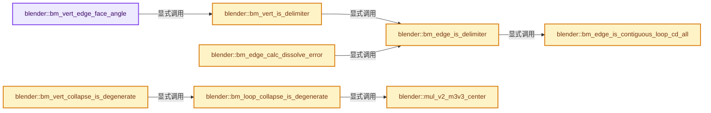
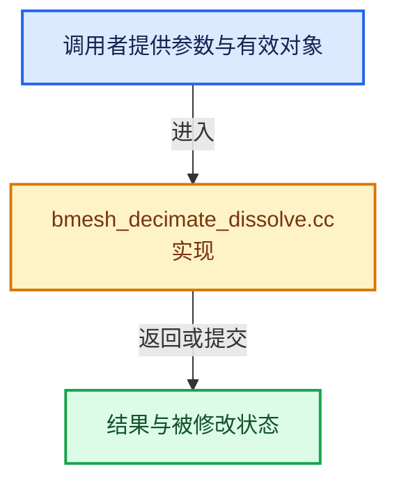

# 实现依赖专题：source/blender/bmesh/tools/bmesh_decimate_dissolve.cc

[实现依赖导航](../../../README.md) · [符号索引](../../../../00-课程指南/02-源码与提交索引/符号依赖与实现索引.md)

本专题从正文实际调用进入，集中保存共享实现。函数有稳定锚点，可从调用处直接跳到对应完整函数；递归与互相调用通过回链组织。

## 本文件的实现关系






## 完整成员与函数实现

<a id="f-a398d5b8eaecd137"></a>

### `blender::bm_vert_edge_face_angle`

实现位置：[source/blender/bmesh/tools/bmesh_decimate_dissolve.cc](../../../../../../../../source/blender/bmesh/tools/bmesh_decimate_dissolve.cc) · L53—L78。

接口参数：

- `BMVert *v`
- `const BMO_Delimit delimit`
- `const DelimitData *delimit_data`

**教学注释版**

<!-- annotated:e234ccc8f314f5 -->

```cpp
static float bm_vert_edge_face_angle(BMVert *v,
                                     const BMO_Delimit delimit,
                                     const DelimitData *delimit_data)
{
#define UNIT_TO_ANGLE DEG2RADF(90.0f)
#define ANGLE_TO_UNIT (1.0f / UNIT_TO_ANGLE)

  const float angle = BM_vert_calc_edge_angle(v);
  /* NOTE: could be either edge, it doesn't matter. */
  if (v->e && BM_edge_is_manifold(v->e)) {
    /* Checking delimited is important here,
     * otherwise, for example, the boundary between two materials
     * will collapse if the faces on either side of the edge have a small angle.
     *
     * This way, delimiting edges are treated like boundary edges,
     * the detail between two delimiting regions won't over-collapse. */
    if (!bm_vert_is_delimiter(v, delimit, delimit_data)) {
      return ((angle * ANGLE_TO_UNIT) * (BM_edge_calc_face_angle(v->e) * ANGLE_TO_UNIT)) *
             UNIT_TO_ANGLE;
    }
  }
  return angle;

#undef UNIT_TO_ANGLE
#undef ANGLE_TO_UNIT
}
```

<details>
<summary>核对原始源码：source/blender/bmesh/tools/bmesh_decimate_dissolve.cc · L53—L78</summary>

<!-- original:e234ccc8f314f5:source/blender/bmesh/tools/bmesh_decimate_dissolve.cc:53:78 -->

```cpp
static float bm_vert_edge_face_angle(BMVert *v,
                                     const BMO_Delimit delimit,
                                     const DelimitData *delimit_data)
{
#define UNIT_TO_ANGLE DEG2RADF(90.0f)
#define ANGLE_TO_UNIT (1.0f / UNIT_TO_ANGLE)

  const float angle = BM_vert_calc_edge_angle(v);
  /* NOTE: could be either edge, it doesn't matter. */
  if (v->e && BM_edge_is_manifold(v->e)) {
    /* Checking delimited is important here,
     * otherwise, for example, the boundary between two materials
     * will collapse if the faces on either side of the edge have a small angle.
     *
     * This way, delimiting edges are treated like boundary edges,
     * the detail between two delimiting regions won't over-collapse. */
    if (!bm_vert_is_delimiter(v, delimit, delimit_data)) {
      return ((angle * ANGLE_TO_UNIT) * (BM_edge_calc_face_angle(v->e) * ANGLE_TO_UNIT)) *
             UNIT_TO_ANGLE;
    }
  }
  return angle;

#undef UNIT_TO_ANGLE
#undef ANGLE_TO_UNIT
}
```

</details>

**结果出口**

- `return ((angle * ANGLE_TO_UNIT) * (BM_edge_calc_face_angle(v->e) * ANGLE_TO_UNIT)) *`
- `return angle;`

**继续追踪实现**

- `BM_vert_calc_edge_angle` → [blender::BM_vert_calc_edge_angle · L1430](../intern/bmesh_query.cc.md#f-d59959f62064e4c0)。
- `BM_edge_is_manifold` → [blender::BM_edge_is_manifold · L79](../intern/bmesh_query_inline.hh.md#f-4944cfa861683f59)；[blender::BM_edge_is_manifold · L86](../intern/bmesh_query_inline.hh.md#f-f07686548bcc2440)。同名重载需按实参类型选择。
- `bm_vert_is_delimiter` → [blender::bm_vert_is_delimiter · L133](bmesh_decimate_dissolve.cc.md#f-37f861c694c7ebd0)。
- `BM_edge_calc_face_angle` → [blender::BM_edge_calc_face_angle · L1352](../intern/bmesh_query.cc.md#f-1b99d89301d10486)。

<a id="f-d467f33fcd3f5586"></a>

### `blender::bm_edge_is_contiguous_loop_cd_all`

实现位置：[source/blender/bmesh/tools/bmesh_decimate_dissolve.cc](../../../../../../../../source/blender/bmesh/tools/bmesh_decimate_dissolve.cc) · L80—L93。

接口参数：

- `const BMEdge *e`
- `const DelimitData *delimit_data`

**教学注释版**

<!-- annotated:f150beaf373b29 -->

```cpp
static bool bm_edge_is_contiguous_loop_cd_all(const BMEdge *e, const DelimitData *delimit_data)
{
  int cd_loop_offset;
  for (cd_loop_offset = delimit_data->cd_loop_offset;
       cd_loop_offset < delimit_data->cd_loop_offset_end;
       cd_loop_offset += delimit_data->cd_loop_size)
  {
    if (BM_edge_is_contiguous_loop_cd(e, delimit_data->cd_loop_type, cd_loop_offset) == false) {
      return false;
    }
  }

  return true;
}
```

<details>
<summary>核对原始源码：source/blender/bmesh/tools/bmesh_decimate_dissolve.cc · L80—L93</summary>

<!-- original:f150beaf373b29:source/blender/bmesh/tools/bmesh_decimate_dissolve.cc:80:93 -->

```cpp
static bool bm_edge_is_contiguous_loop_cd_all(const BMEdge *e, const DelimitData *delimit_data)
{
  int cd_loop_offset;
  for (cd_loop_offset = delimit_data->cd_loop_offset;
       cd_loop_offset < delimit_data->cd_loop_offset_end;
       cd_loop_offset += delimit_data->cd_loop_size)
  {
    if (BM_edge_is_contiguous_loop_cd(e, delimit_data->cd_loop_type, cd_loop_offset) == false) {
      return false;
    }
  }

  return true;
}
```

</details>

**沿实际写入检查状态**

- `cd_loop_offset += delimit_data->cd_loop_size)`

**结果出口**

- `return false;`
- `return true;`

**继续追踪实现**

- `BM_edge_is_contiguous_loop_cd` → [blender::BM_edge_is_contiguous_loop_cd · L887](../intern/bmesh_query.cc.md#f-f3dbfb60b79bce81)。

<a id="f-7a9e3b5fa1a8bff4"></a>

### `blender::bm_edge_is_delimiter`

实现位置：[source/blender/bmesh/tools/bmesh_decimate_dissolve.cc](../../../../../../../../source/blender/bmesh/tools/bmesh_decimate_dissolve.cc) · L95—L131。

接口参数：

- `const BMEdge *e`
- `const BMO_Delimit delimit`
- `const DelimitData *delimit_data`

**教学注释版**

<!-- annotated:7074f0ed923d59 -->

```cpp
static bool bm_edge_is_delimiter(const BMEdge *e,
                                 const BMO_Delimit delimit,
                                 const DelimitData *delimit_data)
{
  /* Caller must ensure. */
  BLI_assert(BM_edge_is_manifold(e));

  if (delimit != 0) {
    if (delimit & BMO_DELIM_SEAM) {
      if (BM_elem_flag_test(e, BM_ELEM_SEAM)) {
        return true;
      }
    }
    if (delimit & BMO_DELIM_SHARP) {
      if (BM_elem_flag_test(e, BM_ELEM_SMOOTH) == 0) {
        return true;
      }
    }
    if (delimit & BMO_DELIM_MATERIAL) {
      if (e->l->f->mat_nr != e->l->radial_next->f->mat_nr) {
        return true;
      }
    }
    if (delimit & BMO_DELIM_NORMAL) {
      if (!BM_edge_is_contiguous(e)) {
        return true;
      }
    }
    if (delimit & BMO_DELIM_UV) {
      if (bm_edge_is_contiguous_loop_cd_all(e, delimit_data) == 0) {
        return true;
      }
    }
  }

  return false;
}
```

<details>
<summary>核对原始源码：source/blender/bmesh/tools/bmesh_decimate_dissolve.cc · L95—L131</summary>

<!-- original:7074f0ed923d59:source/blender/bmesh/tools/bmesh_decimate_dissolve.cc:95:131 -->

```cpp
static bool bm_edge_is_delimiter(const BMEdge *e,
                                 const BMO_Delimit delimit,
                                 const DelimitData *delimit_data)
{
  /* Caller must ensure. */
  BLI_assert(BM_edge_is_manifold(e));

  if (delimit != 0) {
    if (delimit & BMO_DELIM_SEAM) {
      if (BM_elem_flag_test(e, BM_ELEM_SEAM)) {
        return true;
      }
    }
    if (delimit & BMO_DELIM_SHARP) {
      if (BM_elem_flag_test(e, BM_ELEM_SMOOTH) == 0) {
        return true;
      }
    }
    if (delimit & BMO_DELIM_MATERIAL) {
      if (e->l->f->mat_nr != e->l->radial_next->f->mat_nr) {
        return true;
      }
    }
    if (delimit & BMO_DELIM_NORMAL) {
      if (!BM_edge_is_contiguous(e)) {
        return true;
      }
    }
    if (delimit & BMO_DELIM_UV) {
      if (bm_edge_is_contiguous_loop_cd_all(e, delimit_data) == 0) {
        return true;
      }
    }
  }

  return false;
}
```

</details>

**结果出口**

- `return true;`
- `return false;`

**继续追踪实现**

- `BLI_assert` → [BLI_assert · L48](../../../01-BLI基础库/BLI_assert.hh.md#m-57a88495704d)；[BLI_assert · L63](../../../01-BLI基础库/BLI_assert.hh.md#m-d07050020cb5)。宏定义由构建条件选择。
- `BM_edge_is_manifold` → [blender::BM_edge_is_manifold · L79](../intern/bmesh_query_inline.hh.md#f-4944cfa861683f59)；[blender::BM_edge_is_manifold · L86](../intern/bmesh_query_inline.hh.md#f-f07686548bcc2440)。同名重载需按实参类型选择。
- `BM_elem_flag_test` → [BM_elem_flag_test · L21](../intern/bmesh_inline.hh.md#m-2431d1179b41)。宏定义由构建条件选择。
- `BM_edge_is_contiguous` → [blender::BM_edge_is_contiguous · L96](../intern/bmesh_query_inline.hh.md#f-58967a5b1ddd71cb)。
- `bm_edge_is_contiguous_loop_cd_all` → [blender::bm_edge_is_contiguous_loop_cd_all · L80](bmesh_decimate_dissolve.cc.md#f-d467f33fcd3f5586)。

<a id="f-37f861c694c7ebd0"></a>

### `blender::bm_vert_is_delimiter`

实现位置：[source/blender/bmesh/tools/bmesh_decimate_dissolve.cc](../../../../../../../../source/blender/bmesh/tools/bmesh_decimate_dissolve.cc) · L133—L151。

接口参数：

- `const BMVert *v`
- `const BMO_Delimit delimit`
- `const DelimitData *delimit_data`

**教学注释版**

<!-- annotated:272b119983e2a2 -->

```cpp
static bool bm_vert_is_delimiter(const BMVert *v,
                                 const BMO_Delimit delimit,
                                 const DelimitData *delimit_data)
{
  BLI_assert(v->e != nullptr);

  if (delimit != 0) {
    const BMEdge *e, *e_first;
    e = e_first = v->e;
    do {
      if (BM_edge_is_manifold(e)) {
        if (bm_edge_is_delimiter(e, delimit, delimit_data)) {
          return true;
        }
      }
    } while ((e = BM_DISK_EDGE_NEXT(e, v)) != e_first);
  }
  return false;
}
```

<details>
<summary>核对原始源码：source/blender/bmesh/tools/bmesh_decimate_dissolve.cc · L133—L151</summary>

<!-- original:272b119983e2a2:source/blender/bmesh/tools/bmesh_decimate_dissolve.cc:133:151 -->

```cpp
static bool bm_vert_is_delimiter(const BMVert *v,
                                 const BMO_Delimit delimit,
                                 const DelimitData *delimit_data)
{
  BLI_assert(v->e != nullptr);

  if (delimit != 0) {
    const BMEdge *e, *e_first;
    e = e_first = v->e;
    do {
      if (BM_edge_is_manifold(e)) {
        if (bm_edge_is_delimiter(e, delimit, delimit_data)) {
          return true;
        }
      }
    } while ((e = BM_DISK_EDGE_NEXT(e, v)) != e_first);
  }
  return false;
}
```

</details>

**沿实际写入检查状态**

- `e = e_first = v->e;`

**结果出口**

- `return true;`
- `return false;`

**继续追踪实现**

- `BLI_assert` → [BLI_assert · L48](../../../01-BLI基础库/BLI_assert.hh.md#m-57a88495704d)；[BLI_assert · L63](../../../01-BLI基础库/BLI_assert.hh.md#m-d07050020cb5)。宏定义由构建条件选择。
- `BM_edge_is_manifold` → [blender::BM_edge_is_manifold · L79](../intern/bmesh_query_inline.hh.md#f-4944cfa861683f59)；[blender::BM_edge_is_manifold · L86](../intern/bmesh_query_inline.hh.md#f-f07686548bcc2440)。同名重载需按实参类型选择。
- `bm_edge_is_delimiter` → [blender::bm_edge_is_delimiter · L95](bmesh_decimate_dissolve.cc.md#f-7a9e3b5fa1a8bff4)。
- `BM_DISK_EDGE_NEXT` → [BM_DISK_EDGE_NEXT · L702](../bmesh_class.hh.md#m-5b55b3533de2)。宏定义由构建条件选择。

<a id="f-105c59167348ee60"></a>

### `blender::bm_edge_calc_dissolve_error`

实现位置：[source/blender/bmesh/tools/bmesh_decimate_dissolve.cc](../../../../../../../../source/blender/bmesh/tools/bmesh_decimate_dissolve.cc) · L153—L166。

接口参数：

- `const BMEdge *e`
- `const BMO_Delimit delimit`
- `const DelimitData *delimit_data`

**教学注释版**

<!-- annotated:db6c389dec6759 -->

```cpp
static float bm_edge_calc_dissolve_error(const BMEdge *e,
                                         const BMO_Delimit delimit,
                                         const DelimitData *delimit_data)
{
  if (BM_edge_is_manifold(e) && !bm_edge_is_delimiter(e, delimit, delimit_data)) {
    float angle_cos_neg = dot_v3v3(e->l->f->no, e->l->radial_next->f->no);
    if (BM_edge_is_contiguous(e)) {
      angle_cos_neg *= -1;
    }
    return angle_cos_neg;
  }

  return COST_INVALID;
}
```

<details>
<summary>核对原始源码：source/blender/bmesh/tools/bmesh_decimate_dissolve.cc · L153—L166</summary>

<!-- original:db6c389dec6759:source/blender/bmesh/tools/bmesh_decimate_dissolve.cc:153:166 -->

```cpp
static float bm_edge_calc_dissolve_error(const BMEdge *e,
                                         const BMO_Delimit delimit,
                                         const DelimitData *delimit_data)
{
  if (BM_edge_is_manifold(e) && !bm_edge_is_delimiter(e, delimit, delimit_data)) {
    float angle_cos_neg = dot_v3v3(e->l->f->no, e->l->radial_next->f->no);
    if (BM_edge_is_contiguous(e)) {
      angle_cos_neg *= -1;
    }
    return angle_cos_neg;
  }

  return COST_INVALID;
}
```

</details>

**沿实际写入检查状态**

- `angle_cos_neg *= -1;`

**结果出口**

- `return angle_cos_neg;`
- `return COST_INVALID;`

**继续追踪实现**

- `BM_edge_is_manifold` → [blender::BM_edge_is_manifold · L79](../intern/bmesh_query_inline.hh.md#f-4944cfa861683f59)；[blender::BM_edge_is_manifold · L86](../intern/bmesh_query_inline.hh.md#f-f07686548bcc2440)。同名重载需按实参类型选择。
- `bm_edge_is_delimiter` → [blender::bm_edge_is_delimiter · L95](bmesh_decimate_dissolve.cc.md#f-7a9e3b5fa1a8bff4)。
- `dot_v3v3` → [blender::dot_v3v3 · L646](../../../01-BLI基础库/intern/math_vector_inline.cc.md#f-c88befa67d07591a)。
- `BM_edge_is_contiguous` → [blender::BM_edge_is_contiguous · L96](../intern/bmesh_query_inline.hh.md#f-58967a5b1ddd71cb)。

<a id="f-92a3ee366d3ae330"></a>

### `blender::mul_v2_m3v3_center`

实现位置：[source/blender/bmesh/tools/bmesh_decimate_dissolve.cc](../../../../../../../../source/blender/bmesh/tools/bmesh_decimate_dissolve.cc) · L170—L183。

接口参数：

- `float r[2]`
- `const float m[3][3]`
- `const float a[3]`
- `const float center[3]`

**教学注释版**

<!-- annotated:d5fbc217b5bd98 -->

```cpp
static void mul_v2_m3v3_center(float r[2],
                               const float m[3][3],
                               const float a[3],
                               const float center[3])
{
  BLI_assert(r != a);
  BLI_assert(r != center);

  float co[3];
  sub_v3_v3v3(co, a, center);

  r[0] = m[0][0] * co[0] + m[1][0] * co[1] + m[2][0] * co[2];
  r[1] = m[0][1] * co[0] + m[1][1] * co[1] + m[2][1] * co[2];
}
```

<details>
<summary>核对原始源码：source/blender/bmesh/tools/bmesh_decimate_dissolve.cc · L170—L183</summary>

<!-- original:d5fbc217b5bd98:source/blender/bmesh/tools/bmesh_decimate_dissolve.cc:170:183 -->

```cpp
static void mul_v2_m3v3_center(float r[2],
                               const float m[3][3],
                               const float a[3],
                               const float center[3])
{
  BLI_assert(r != a);
  BLI_assert(r != center);

  float co[3];
  sub_v3_v3v3(co, a, center);

  r[0] = m[0][0] * co[0] + m[1][0] * co[1] + m[2][0] * co[2];
  r[1] = m[0][1] * co[0] + m[1][1] * co[1] + m[2][1] * co[2];
}
```

</details>

**沿实际写入检查状态**

- `r[0] = m[0][0] * co[0] + m[1][0] * co[1] + m[2][0] * co[2];`
- `r[1] = m[0][1] * co[0] + m[1][1] * co[1] + m[2][1] * co[2];`

**继续追踪实现**

- `BLI_assert` → [BLI_assert · L48](../../../01-BLI基础库/BLI_assert.hh.md#m-57a88495704d)；[BLI_assert · L63](../../../01-BLI基础库/BLI_assert.hh.md#m-d07050020cb5)。宏定义由构建条件选择。
- `sub_v3_v3v3` → [blender::sub_v3_v3v3 · L360](../../../01-BLI基础库/intern/math_vector_inline.cc.md#f-23781c252db8b30c)。

<a id="f-64945a5ded1db568"></a>

### `blender::bm_loop_collapse_is_degenerate`

实现位置：[source/blender/bmesh/tools/bmesh_decimate_dissolve.cc](../../../../../../../../source/blender/bmesh/tools/bmesh_decimate_dissolve.cc) · L185—L250。

接口参数：

- `BMLoop *l_ear`

**教学注释版**

<!-- annotated:e1206625d9d6cb -->

```cpp
static bool bm_loop_collapse_is_degenerate(BMLoop *l_ear)
{
  /* Calculate relative to the central vertex for higher precision. */
  const float *center = l_ear->v->co;

  float tri_2d[3][2];
  float axis_mat[3][3];

  axis_dominant_v3_to_m3(axis_mat, l_ear->f->no);

  {
    mul_v2_m3v3_center(tri_2d[0], axis_mat, l_ear->prev->v->co, center);
#  if 0
    mul_v2_m3v3_center(tri_2d[1], axis_mat, l_ear->v->co, center);
#  else
    zero_v2(tri_2d[1]);
#  endif
    mul_v2_m3v3_center(tri_2d[2], axis_mat, l_ear->next->v->co, center);
  }

  /* check we're not flipping face corners before or after the ear */
  {
    float adjacent_2d[2];

    if (!BM_vert_is_edge_pair(l_ear->prev->v)) {
      mul_v2_m3v3_center(adjacent_2d, axis_mat, l_ear->prev->prev->v->co, center);
      if (signum_i(cross_tri_v2(adjacent_2d, tri_2d[0], tri_2d[1])) !=
          signum_i(cross_tri_v2(adjacent_2d, tri_2d[0], tri_2d[2])))
      {
        return true;
      }
    }

    if (!BM_vert_is_edge_pair(l_ear->next->v)) {
      mul_v2_m3v3_center(adjacent_2d, axis_mat, l_ear->next->next->v->co, center);
      if (signum_i(cross_tri_v2(adjacent_2d, tri_2d[2], tri_2d[1])) !=
          signum_i(cross_tri_v2(adjacent_2d, tri_2d[2], tri_2d[0])))
      {
        return true;
      }
    }
  }

  /* check no existing verts are inside the triangle */
  {
    /* triangle may be concave, if so - flip so we can use clockwise check */
    if (cross_tri_v2(UNPACK3(tri_2d)) < 0.0f) {
      swap_v2_v2(tri_2d[1], tri_2d[2]);
    }

    /* skip l_ear and adjacent verts */
    BMLoop *l_iter, *l_first;

    l_iter = l_ear->next->next;
    l_first = l_ear->prev;
    do {
      float co_2d[2];
      mul_v2_m3v3_center(co_2d, axis_mat, l_iter->v->co, center);
      if (isect_point_tri_v2_cw(co_2d, tri_2d[0], tri_2d[1], tri_2d[2])) {
        return true;
      }
    } while ((l_iter = l_iter->next) != l_first);
  }

  return false;
}
```

<details>
<summary>核对原始源码：source/blender/bmesh/tools/bmesh_decimate_dissolve.cc · L185—L250</summary>

<!-- original:e1206625d9d6cb:source/blender/bmesh/tools/bmesh_decimate_dissolve.cc:185:250 -->

```cpp
static bool bm_loop_collapse_is_degenerate(BMLoop *l_ear)
{
  /* Calculate relative to the central vertex for higher precision. */
  const float *center = l_ear->v->co;

  float tri_2d[3][2];
  float axis_mat[3][3];

  axis_dominant_v3_to_m3(axis_mat, l_ear->f->no);

  {
    mul_v2_m3v3_center(tri_2d[0], axis_mat, l_ear->prev->v->co, center);
#  if 0
    mul_v2_m3v3_center(tri_2d[1], axis_mat, l_ear->v->co, center);
#  else
    zero_v2(tri_2d[1]);
#  endif
    mul_v2_m3v3_center(tri_2d[2], axis_mat, l_ear->next->v->co, center);
  }

  /* check we're not flipping face corners before or after the ear */
  {
    float adjacent_2d[2];

    if (!BM_vert_is_edge_pair(l_ear->prev->v)) {
      mul_v2_m3v3_center(adjacent_2d, axis_mat, l_ear->prev->prev->v->co, center);
      if (signum_i(cross_tri_v2(adjacent_2d, tri_2d[0], tri_2d[1])) !=
          signum_i(cross_tri_v2(adjacent_2d, tri_2d[0], tri_2d[2])))
      {
        return true;
      }
    }

    if (!BM_vert_is_edge_pair(l_ear->next->v)) {
      mul_v2_m3v3_center(adjacent_2d, axis_mat, l_ear->next->next->v->co, center);
      if (signum_i(cross_tri_v2(adjacent_2d, tri_2d[2], tri_2d[1])) !=
          signum_i(cross_tri_v2(adjacent_2d, tri_2d[2], tri_2d[0])))
      {
        return true;
      }
    }
  }

  /* check no existing verts are inside the triangle */
  {
    /* triangle may be concave, if so - flip so we can use clockwise check */
    if (cross_tri_v2(UNPACK3(tri_2d)) < 0.0f) {
      swap_v2_v2(tri_2d[1], tri_2d[2]);
    }

    /* skip l_ear and adjacent verts */
    BMLoop *l_iter, *l_first;

    l_iter = l_ear->next->next;
    l_first = l_ear->prev;
    do {
      float co_2d[2];
      mul_v2_m3v3_center(co_2d, axis_mat, l_iter->v->co, center);
      if (isect_point_tri_v2_cw(co_2d, tri_2d[0], tri_2d[1], tri_2d[2])) {
        return true;
      }
    } while ((l_iter = l_iter->next) != l_first);
  }

  return false;
}
```

</details>

**沿实际写入检查状态**

- `l_iter = l_ear->next->next;`
- `l_first = l_ear->prev;`

**结果出口**

- `return true;`
- `return false;`

**继续追踪实现**

- `axis_dominant_v3_to_m3` → [blender::axis_dominant_v3_to_m3 · L3702](../../../01-BLI基础库/intern/math_geom.cc.md#f-3e28943552d479d7)。
- `mul_v2_m3v3_center` → [blender::mul_v2_m3v3_center · L170](bmesh_decimate_dissolve.cc.md#f-92a3ee366d3ae330)。
- `zero_v2` → [blender::zero_v2 · L20](../../../01-BLI基础库/intern/math_vector_inline.cc.md#f-3f0f4c37141bd4f2)。
- `BM_vert_is_edge_pair` → [blender::BM_vert_is_edge_pair · L580](../intern/bmesh_query.cc.md#f-8d6c36b5c1589dd2)。
- `signum_i` → [blender::signum_i · L552](../../../01-BLI基础库/intern/math_base_inline.cc.md#f-558816aeb6234c99)。
- `cross_tri_v2` → [blender::cross_tri_v2 · L24](../../../01-BLI基础库/intern/math_geom_inline.cc.md#f-fcd2bb2eeabb870e)。
- `UNPACK3` → [UNPACK3 · L23](../../../07-Intern运行时与平台/ghost/intern/GHOST_utildefines.hh.md#m-f882324eb80a)；[UNPACK3 · L235](../../../01-BLI基础库/BLI_utildefines.hh.md#m-bbbbdcf09d3b)；[UNPACK3 · L14](../../gpu/shaders/common/gpu_shader_utildefines.bsl.hh.md#m-b4e3357a0310)。宏定义由构建条件选择。
- `swap_v2_v2` → [blender::swap_v2_v2 · L211](../../../01-BLI基础库/intern/math_vector_inline.cc.md#f-9d47a9745feb554d)。
- `isect_point_tri_v2_cw` → [blender::isect_point_tri_v2_cw · L1618](../../../01-BLI基础库/intern/math_geom.cc.md#f-5255f1f3fc58b63b)。

<a id="f-e65bcc55adeb73b6"></a>

### `blender::bm_vert_collapse_is_degenerate`

实现位置：[source/blender/bmesh/tools/bmesh_decimate_dissolve.cc](../../../../../../../../source/blender/bmesh/tools/bmesh_decimate_dissolve.cc) · L252—L283。

接口参数：

- `BMVert *v`

**教学注释版**

<!-- annotated:c588b770aef945 -->

```cpp
static bool bm_vert_collapse_is_degenerate(BMVert *v)
{
  BMEdge *e_pair[2];
  BMVert *v_pair[2];

  if (BM_vert_edge_pair(v, &e_pair[0], &e_pair[1])) {

    /* allow wire edges */
    if (BM_edge_is_wire(e_pair[0]) || BM_edge_is_wire(e_pair[1])) {
      return false;
    }

    v_pair[0] = BM_edge_other_vert(e_pair[0], v);
    v_pair[1] = BM_edge_other_vert(e_pair[1], v);

    if (fabsf(cos_v3v3v3(v_pair[0]->co, v->co, v_pair[1]->co)) < (1.0f - FLT_EPSILON)) {
      BMLoop *l_iter, *l_first;
      l_iter = l_first = e_pair[1]->l;
      do {
        if (l_iter->f->len > 3) {
          BMLoop *l_pivot = (l_iter->v == v ? l_iter : l_iter->next);
          BLI_assert(v == l_pivot->v);
          if (bm_loop_collapse_is_degenerate(l_pivot)) {
            return true;
          }
        }
      } while ((l_iter = l_iter->radial_next) != l_first);
    }
    return false;
  }
  return true;
}
```

<details>
<summary>核对原始源码：source/blender/bmesh/tools/bmesh_decimate_dissolve.cc · L252—L283</summary>

<!-- original:c588b770aef945:source/blender/bmesh/tools/bmesh_decimate_dissolve.cc:252:283 -->

```cpp
static bool bm_vert_collapse_is_degenerate(BMVert *v)
{
  BMEdge *e_pair[2];
  BMVert *v_pair[2];

  if (BM_vert_edge_pair(v, &e_pair[0], &e_pair[1])) {

    /* allow wire edges */
    if (BM_edge_is_wire(e_pair[0]) || BM_edge_is_wire(e_pair[1])) {
      return false;
    }

    v_pair[0] = BM_edge_other_vert(e_pair[0], v);
    v_pair[1] = BM_edge_other_vert(e_pair[1], v);

    if (fabsf(cos_v3v3v3(v_pair[0]->co, v->co, v_pair[1]->co)) < (1.0f - FLT_EPSILON)) {
      BMLoop *l_iter, *l_first;
      l_iter = l_first = e_pair[1]->l;
      do {
        if (l_iter->f->len > 3) {
          BMLoop *l_pivot = (l_iter->v == v ? l_iter : l_iter->next);
          BLI_assert(v == l_pivot->v);
          if (bm_loop_collapse_is_degenerate(l_pivot)) {
            return true;
          }
        }
      } while ((l_iter = l_iter->radial_next) != l_first);
    }
    return false;
  }
  return true;
}
```

</details>

**沿实际写入检查状态**

- `v_pair[0] = BM_edge_other_vert(e_pair[0], v);`
- `v_pair[1] = BM_edge_other_vert(e_pair[1], v);`
- `l_iter = l_first = e_pair[1]->l;`

**结果出口**

- `return false;`
- `return true;`

**继续追踪实现**

- `BM_vert_edge_pair` → [blender::BM_vert_edge_pair · L602](../intern/bmesh_query.cc.md#f-4663b13982695891)。
- `BM_edge_is_wire` → [blender::BM_edge_is_wire · L68](../intern/bmesh_query_inline.hh.md#f-8171635700fdb320)。
- `BM_edge_other_vert` → [blender::BM_edge_other_vert · L52](../intern/bmesh_query_inline.hh.md#f-464fb9614b23d180)。
- `fabsf` → [fabsf · L21](../../../07-Intern运行时与平台/cycles/kernel/svm/radial_tiling_shared.h.md#m-02cc4c69cfb3)；[fabsf · L43](../../../07-Intern运行时与平台/cycles/kernel/svm/radial_tiling_shared.h.md#m-04effe61803b)；[fabsf · L74](../../../07-Intern运行时与平台/cycles/kernel/svm/radial_tiling_shared.h.md#m-927dd4eba7dc)；[fabsf · L25](../../../01-BLI基础库/intern/radial_tiling_shared.hh.md#m-8348d6b3d08f)；[fabsf · L47](../../../01-BLI基础库/intern/radial_tiling_shared.hh.md#m-13b7e0b6d84f)；[fabsf · L78](../../../01-BLI基础库/intern/radial_tiling_shared.hh.md#m-326c83464a0d)；[fabsf · L21](../../../07-Intern运行时与平台/cycles/kernel/osl/shaders/node_radial_tiling_shared.h.md#m-7c3ee12fc119)；[fabsf · L43](../../../07-Intern运行时与平台/cycles/kernel/osl/shaders/node_radial_tiling_shared.h.md#m-9112db0e2dd1)；[fabsf · L74](../../../07-Intern运行时与平台/cycles/kernel/osl/shaders/node_radial_tiling_shared.h.md#m-ee4e61908a6f)；[fabsf · L167](../../../07-Intern运行时与平台/cycles/kernel/device/oneapi/compat.h.md#m-b039ee6c1601)；[fabsf · L265](../../../07-Intern运行时与平台/cycles/kernel/device/metal/compat.h.md#m-6b21869e9f3f)。宏定义由构建条件选择。
- `cos_v3v3v3` → [blender::cos_v3v3v3 · L264](../../../01-BLI基础库/intern/math_vector.cc.md#f-1c0745d8bc333af3)。
- `BLI_assert` → [BLI_assert · L48](../../../01-BLI基础库/BLI_assert.hh.md#m-57a88495704d)；[BLI_assert · L63](../../../01-BLI基础库/BLI_assert.hh.md#m-d07050020cb5)。宏定义由构建条件选择。
- `bm_loop_collapse_is_degenerate` → [blender::bm_loop_collapse_is_degenerate · L185](bmesh_decimate_dissolve.cc.md#f-64945a5ded1db568)。

<a id="f-7d4f1645995f3c35"></a>

### `blender::BM_mesh_decimate_dissolve_ex`

实现位置：[source/blender/bmesh/tools/bmesh_decimate_dissolve.cc](../../../../../../../../source/blender/bmesh/tools/bmesh_decimate_dissolve.cc) · L286—L549。

接口参数：

- `BMesh *bm`
- `const float angle_limit`
- `const bool do_dissolve_boundaries`
- `BMO_Delimit delimit`
- `BMVert **vinput_arr`
- `const int vinput_len`
- `BMEdge **einput_arr`
- `const int einput_len`
- `const short oflag_out`

**教学注释版**

<!-- annotated:8bc43a0255bfab -->

```cpp
void BM_mesh_decimate_dissolve_ex(BMesh *bm,
                                  const float angle_limit,
                                  const bool do_dissolve_boundaries,
                                  BMO_Delimit delimit,
                                  BMVert **vinput_arr,
                                  const int vinput_len,
                                  BMEdge **einput_arr,
                                  const int einput_len,
                                  const short oflag_out)
{
  const float angle_limit_cos_neg = -cosf(angle_limit);
  DelimitData delimit_data = {0};
  const int eheap_table_len = do_dissolve_boundaries ? einput_len : max_ii(einput_len, vinput_len);
  void *_heap_table = MEM_new_array_uninitialized<HeapNode *>(eheap_table_len, __func__);

  int i;

  if (delimit & BMO_DELIM_UV) {
    const int layer_len = CustomData_number_of_layers(&bm->ldata, CD_PROP_FLOAT2);
    if (layer_len == 0) {
      delimit &= ~BMO_DELIM_UV;
    }
    else {
      delimit_data.cd_loop_type = CD_PROP_FLOAT2;
      delimit_data.cd_loop_size = CustomData_sizeof(eCustomDataType(delimit_data.cd_loop_type));
      delimit_data.cd_loop_offset = CustomData_get_n_offset(&bm->ldata, CD_PROP_FLOAT2, 0);
      delimit_data.cd_loop_offset_end = delimit_data.cd_loop_offset +
                                        delimit_data.cd_loop_size * layer_len;
    }
  }

  /* --- first edges --- */
  if (true) {
    BMEdge **earray;
    Heap *eheap;
    HeapNode **eheap_table = static_cast<HeapNode **>(_heap_table);
    HeapNode *enode_top;
    int *vert_reverse_lookup;
    BMIter iter;
    BMEdge *e_iter;

    /* --- setup heap --- */
    eheap = BLI_heap_new_ex(einput_len);

    /* wire -> tag */
    BM_ITER_MESH (e_iter, &iter, bm, BM_EDGES_OF_MESH) {
      BM_elem_flag_set(e_iter, BM_ELEM_TAG, BM_edge_is_wire(e_iter));
      BM_elem_index_set(e_iter, -1); /* set dirty */
    }
    bm->elem_index_dirty |= BM_EDGE;

    /* build heap */
    for (i = 0; i < einput_len; i++) {
      BMEdge *e = einput_arr[i];
      const float cost = bm_edge_calc_dissolve_error(e, delimit, &delimit_data);
      eheap_table[i] = BLI_heap_insert(eheap, cost, e);
      BM_elem_index_set(e, i); /* set dirty */
    }

    while ((BLI_heap_is_empty(eheap) == false) &&
           (BLI_heap_node_value(enode_top = BLI_heap_top(eheap)) < angle_limit_cos_neg))
    {
      BMFace *f_new = nullptr;
      BMEdge *e;

      e = static_cast<BMEdge *>(BLI_heap_node_ptr(enode_top));
      i = BM_elem_index_get(e);

      if (BM_edge_is_manifold(e)) {
        /* The `f_new` may be an existing face, see #144383.
         * In this case it's still flagged as output so the selection
         * isn't "lost" when dissolving, see: !144653. */
        f_new = BM_faces_join_pair(bm, e->l, e->l->radial_next, false, nullptr);

        if (f_new) {
          BMLoop *l_first, *l_iter;

          BLI_heap_remove(eheap, enode_top);
          eheap_table[i] = nullptr;

          /* update normal */
          BM_face_normal_update(f_new);
          if (oflag_out) {
            BMO_face_flag_enable(bm, f_new, oflag_out);
          }

          /* re-calculate costs */
          l_iter = l_first = BM_FACE_FIRST_LOOP(f_new);
          do {
            const int j = BM_elem_index_get(l_iter->e);
            if (j != -1 && eheap_table[j]) {
              const float cost = bm_edge_calc_dissolve_error(l_iter->e, delimit, &delimit_data);
              BLI_heap_node_value_update(eheap, eheap_table[j], cost);
            }
          } while ((l_iter = l_iter->next) != l_first);
        }
      }

      if (f_new == nullptr) [[unlikely]] {
        BLI_heap_node_value_update(eheap, enode_top, COST_INVALID);
      }
    }

    /* prepare for cleanup */
    BM_mesh_elem_index_ensure(bm, BM_VERT);
    vert_reverse_lookup = MEM_new_array_uninitialized<int>(bm->totvert, __func__);
    std::fill_n(vert_reverse_lookup, bm->totvert, -1);
    for (i = 0; i < vinput_len; i++) {
      BMVert *v = vinput_arr[i];
      vert_reverse_lookup[BM_elem_index_get(v)] = i;
    }

    /* --- cleanup --- */
    earray = MEM_new_array_uninitialized<BMEdge *>(bm->totedge, __func__);
    BM_ITER_MESH_INDEX (e_iter, &iter, bm, BM_EDGES_OF_MESH, i) {
      earray[i] = e_iter;
    }
    /* Remove all edges/verts left behind from dissolving,
     * nulling the vertex array so we don't re-use. */
    for (i = bm->totedge - 1; i != -1; i--) {
      e_iter = earray[i];

      if (BM_edge_is_wire(e_iter) && (BM_elem_flag_test(e_iter, BM_ELEM_TAG) == false)) {
        /* edge has become wire */
        int vidx_reverse;
        BMVert *v1 = e_iter->v1;
        BMVert *v2 = e_iter->v2;
        BM_edge_kill(bm, e_iter);
        if (v1->e == nullptr) {
          vidx_reverse = vert_reverse_lookup[BM_elem_index_get(v1)];
          if (vidx_reverse != -1) {
            vinput_arr[vidx_reverse] = nullptr;
          }
          BM_vert_kill(bm, v1);
        }
        if (v2->e == nullptr) {
          vidx_reverse = vert_reverse_lookup[BM_elem_index_get(v2)];
          if (vidx_reverse != -1) {
            vinput_arr[vidx_reverse] = nullptr;
          }
          BM_vert_kill(bm, v2);
        }
      }
    }
    MEM_delete(vert_reverse_lookup);
    MEM_delete(earray);

    BLI_heap_free(eheap, nullptr);
  }

  /* --- second verts --- */
  if (do_dissolve_boundaries) {
    /* simple version of the branch below, since we will dissolve _all_ verts that use 2 edges */
    for (i = 0; i < vinput_len; i++) {
      BMVert *v = vinput_arr[i];
      if (LIKELY(v != nullptr) && BM_vert_is_edge_pair(v)) {
        BM_vert_collapse_edge(bm, v->e, v, true, true, true); /* join edges */
      }
    }
  }
  else {
    Heap *vheap;
    HeapNode **vheap_table = static_cast<HeapNode **>(_heap_table);
    HeapNode *vnode_top;

    BMVert *v_iter;
    BMIter iter;

    BM_ITER_MESH (v_iter, &iter, bm, BM_VERTS_OF_MESH) {
      BM_elem_index_set(v_iter, -1); /* set dirty */
    }
    bm->elem_index_dirty |= BM_VERT;

    vheap = BLI_heap_new_ex(vinput_len);

    for (i = 0; i < vinput_len; i++) {
      BMVert *v = vinput_arr[i];
      if (v != nullptr) [[likely]] {
        const float cost = bm_vert_edge_face_angle(v, delimit, &delimit_data);
        vheap_table[i] = BLI_heap_insert(vheap, cost, v);
        BM_elem_index_set(v, i); /* set dirty */
      }
    }

    while ((BLI_heap_is_empty(vheap) == false) &&
           (BLI_heap_node_value(vnode_top = BLI_heap_top(vheap)) < angle_limit))
    {
      BMEdge *e_new = nullptr;
      BMVert *v;

      v = static_cast<BMVert *>(BLI_heap_node_ptr(vnode_top));
      i = BM_elem_index_get(v);

      if (
#ifdef USE_DEGENERATE_CHECK
          !bm_vert_collapse_is_degenerate(v)
#else
          BM_vert_is_edge_pair(v)
#endif
      )
      {
        e_new = BM_vert_collapse_edge(bm, v->e, v, true, true, true); /* join edges */

        if (e_new) {

          BLI_heap_remove(vheap, vnode_top);
          vheap_table[i] = nullptr;

          /* update normal */
          if (e_new->l) {
            BMLoop *l_first, *l_iter;
            l_iter = l_first = e_new->l;
            do {
              BM_face_normal_update(l_iter->f);
            } while ((l_iter = l_iter->radial_next) != l_first);
          }

          /* re-calculate costs */
          BM_ITER_ELEM (v_iter, &iter, e_new, BM_VERTS_OF_EDGE) {
            const int j = BM_elem_index_get(v_iter);
            if (j != -1 && vheap_table[j]) {
              const float cost = bm_vert_edge_face_angle(v_iter, delimit, &delimit_data);
              BLI_heap_node_value_update(vheap, vheap_table[j], cost);
            }
          }

#ifdef USE_DEGENERATE_CHECK
          /* dissolving a vertex may mean vertices we previously weren't able to dissolve
           * can now be re-evaluated. */
          if (e_new->l) {
            BMLoop *l_first, *l_iter;
            l_iter = l_first = e_new->l;
            do {
              /* skip vertices part of this edge, evaluated above */
              BMLoop *l_cycle_first, *l_cycle_iter;
              l_cycle_iter = l_iter->next->next;
              l_cycle_first = l_iter->prev;
              do {
                const int j = BM_elem_index_get(l_cycle_iter->v);
                if (j != -1 && vheap_table[j] &&
                    (BLI_heap_node_value(vheap_table[j]) == COST_INVALID))
                {
                  const float cost = bm_vert_edge_face_angle(
                      l_cycle_iter->v, delimit, &delimit_data);
                  BLI_heap_node_value_update(vheap, vheap_table[j], cost);
                }
              } while ((l_cycle_iter = l_cycle_iter->next) != l_cycle_first);

            } while ((l_iter = l_iter->radial_next) != l_first);
          }
#endif /* USE_DEGENERATE_CHECK */
        }
      }

      if (e_new == nullptr) [[unlikely]] {
        BLI_heap_node_value_update(vheap, vnode_top, COST_INVALID);
      }
    }

    BLI_heap_free(vheap, nullptr);
  }

  // [讲解] MEM_delete_void：以原始存储释放约定调用当前后端。
  MEM_delete_void(_heap_table);
}
```

<details>
<summary>核对原始源码：source/blender/bmesh/tools/bmesh_decimate_dissolve.cc · L286—L549</summary>

<!-- original:8bc43a0255bfab:source/blender/bmesh/tools/bmesh_decimate_dissolve.cc:286:549 -->

```cpp
void BM_mesh_decimate_dissolve_ex(BMesh *bm,
                                  const float angle_limit,
                                  const bool do_dissolve_boundaries,
                                  BMO_Delimit delimit,
                                  BMVert **vinput_arr,
                                  const int vinput_len,
                                  BMEdge **einput_arr,
                                  const int einput_len,
                                  const short oflag_out)
{
  const float angle_limit_cos_neg = -cosf(angle_limit);
  DelimitData delimit_data = {0};
  const int eheap_table_len = do_dissolve_boundaries ? einput_len : max_ii(einput_len, vinput_len);
  void *_heap_table = MEM_new_array_uninitialized<HeapNode *>(eheap_table_len, __func__);

  int i;

  if (delimit & BMO_DELIM_UV) {
    const int layer_len = CustomData_number_of_layers(&bm->ldata, CD_PROP_FLOAT2);
    if (layer_len == 0) {
      delimit &= ~BMO_DELIM_UV;
    }
    else {
      delimit_data.cd_loop_type = CD_PROP_FLOAT2;
      delimit_data.cd_loop_size = CustomData_sizeof(eCustomDataType(delimit_data.cd_loop_type));
      delimit_data.cd_loop_offset = CustomData_get_n_offset(&bm->ldata, CD_PROP_FLOAT2, 0);
      delimit_data.cd_loop_offset_end = delimit_data.cd_loop_offset +
                                        delimit_data.cd_loop_size * layer_len;
    }
  }

  /* --- first edges --- */
  if (true) {
    BMEdge **earray;
    Heap *eheap;
    HeapNode **eheap_table = static_cast<HeapNode **>(_heap_table);
    HeapNode *enode_top;
    int *vert_reverse_lookup;
    BMIter iter;
    BMEdge *e_iter;

    /* --- setup heap --- */
    eheap = BLI_heap_new_ex(einput_len);

    /* wire -> tag */
    BM_ITER_MESH (e_iter, &iter, bm, BM_EDGES_OF_MESH) {
      BM_elem_flag_set(e_iter, BM_ELEM_TAG, BM_edge_is_wire(e_iter));
      BM_elem_index_set(e_iter, -1); /* set dirty */
    }
    bm->elem_index_dirty |= BM_EDGE;

    /* build heap */
    for (i = 0; i < einput_len; i++) {
      BMEdge *e = einput_arr[i];
      const float cost = bm_edge_calc_dissolve_error(e, delimit, &delimit_data);
      eheap_table[i] = BLI_heap_insert(eheap, cost, e);
      BM_elem_index_set(e, i); /* set dirty */
    }

    while ((BLI_heap_is_empty(eheap) == false) &&
           (BLI_heap_node_value(enode_top = BLI_heap_top(eheap)) < angle_limit_cos_neg))
    {
      BMFace *f_new = nullptr;
      BMEdge *e;

      e = static_cast<BMEdge *>(BLI_heap_node_ptr(enode_top));
      i = BM_elem_index_get(e);

      if (BM_edge_is_manifold(e)) {
        /* The `f_new` may be an existing face, see #144383.
         * In this case it's still flagged as output so the selection
         * isn't "lost" when dissolving, see: !144653. */
        f_new = BM_faces_join_pair(bm, e->l, e->l->radial_next, false, nullptr);

        if (f_new) {
          BMLoop *l_first, *l_iter;

          BLI_heap_remove(eheap, enode_top);
          eheap_table[i] = nullptr;

          /* update normal */
          BM_face_normal_update(f_new);
          if (oflag_out) {
            BMO_face_flag_enable(bm, f_new, oflag_out);
          }

          /* re-calculate costs */
          l_iter = l_first = BM_FACE_FIRST_LOOP(f_new);
          do {
            const int j = BM_elem_index_get(l_iter->e);
            if (j != -1 && eheap_table[j]) {
              const float cost = bm_edge_calc_dissolve_error(l_iter->e, delimit, &delimit_data);
              BLI_heap_node_value_update(eheap, eheap_table[j], cost);
            }
          } while ((l_iter = l_iter->next) != l_first);
        }
      }

      if (f_new == nullptr) [[unlikely]] {
        BLI_heap_node_value_update(eheap, enode_top, COST_INVALID);
      }
    }

    /* prepare for cleanup */
    BM_mesh_elem_index_ensure(bm, BM_VERT);
    vert_reverse_lookup = MEM_new_array_uninitialized<int>(bm->totvert, __func__);
    std::fill_n(vert_reverse_lookup, bm->totvert, -1);
    for (i = 0; i < vinput_len; i++) {
      BMVert *v = vinput_arr[i];
      vert_reverse_lookup[BM_elem_index_get(v)] = i;
    }

    /* --- cleanup --- */
    earray = MEM_new_array_uninitialized<BMEdge *>(bm->totedge, __func__);
    BM_ITER_MESH_INDEX (e_iter, &iter, bm, BM_EDGES_OF_MESH, i) {
      earray[i] = e_iter;
    }
    /* Remove all edges/verts left behind from dissolving,
     * nulling the vertex array so we don't re-use. */
    for (i = bm->totedge - 1; i != -1; i--) {
      e_iter = earray[i];

      if (BM_edge_is_wire(e_iter) && (BM_elem_flag_test(e_iter, BM_ELEM_TAG) == false)) {
        /* edge has become wire */
        int vidx_reverse;
        BMVert *v1 = e_iter->v1;
        BMVert *v2 = e_iter->v2;
        BM_edge_kill(bm, e_iter);
        if (v1->e == nullptr) {
          vidx_reverse = vert_reverse_lookup[BM_elem_index_get(v1)];
          if (vidx_reverse != -1) {
            vinput_arr[vidx_reverse] = nullptr;
          }
          BM_vert_kill(bm, v1);
        }
        if (v2->e == nullptr) {
          vidx_reverse = vert_reverse_lookup[BM_elem_index_get(v2)];
          if (vidx_reverse != -1) {
            vinput_arr[vidx_reverse] = nullptr;
          }
          BM_vert_kill(bm, v2);
        }
      }
    }
    MEM_delete(vert_reverse_lookup);
    MEM_delete(earray);

    BLI_heap_free(eheap, nullptr);
  }

  /* --- second verts --- */
  if (do_dissolve_boundaries) {
    /* simple version of the branch below, since we will dissolve _all_ verts that use 2 edges */
    for (i = 0; i < vinput_len; i++) {
      BMVert *v = vinput_arr[i];
      if (LIKELY(v != nullptr) && BM_vert_is_edge_pair(v)) {
        BM_vert_collapse_edge(bm, v->e, v, true, true, true); /* join edges */
      }
    }
  }
  else {
    Heap *vheap;
    HeapNode **vheap_table = static_cast<HeapNode **>(_heap_table);
    HeapNode *vnode_top;

    BMVert *v_iter;
    BMIter iter;

    BM_ITER_MESH (v_iter, &iter, bm, BM_VERTS_OF_MESH) {
      BM_elem_index_set(v_iter, -1); /* set dirty */
    }
    bm->elem_index_dirty |= BM_VERT;

    vheap = BLI_heap_new_ex(vinput_len);

    for (i = 0; i < vinput_len; i++) {
      BMVert *v = vinput_arr[i];
      if (v != nullptr) [[likely]] {
        const float cost = bm_vert_edge_face_angle(v, delimit, &delimit_data);
        vheap_table[i] = BLI_heap_insert(vheap, cost, v);
        BM_elem_index_set(v, i); /* set dirty */
      }
    }

    while ((BLI_heap_is_empty(vheap) == false) &&
           (BLI_heap_node_value(vnode_top = BLI_heap_top(vheap)) < angle_limit))
    {
      BMEdge *e_new = nullptr;
      BMVert *v;

      v = static_cast<BMVert *>(BLI_heap_node_ptr(vnode_top));
      i = BM_elem_index_get(v);

      if (
#ifdef USE_DEGENERATE_CHECK
          !bm_vert_collapse_is_degenerate(v)
#else
          BM_vert_is_edge_pair(v)
#endif
      )
      {
        e_new = BM_vert_collapse_edge(bm, v->e, v, true, true, true); /* join edges */

        if (e_new) {

          BLI_heap_remove(vheap, vnode_top);
          vheap_table[i] = nullptr;

          /* update normal */
          if (e_new->l) {
            BMLoop *l_first, *l_iter;
            l_iter = l_first = e_new->l;
            do {
              BM_face_normal_update(l_iter->f);
            } while ((l_iter = l_iter->radial_next) != l_first);
          }

          /* re-calculate costs */
          BM_ITER_ELEM (v_iter, &iter, e_new, BM_VERTS_OF_EDGE) {
            const int j = BM_elem_index_get(v_iter);
            if (j != -1 && vheap_table[j]) {
              const float cost = bm_vert_edge_face_angle(v_iter, delimit, &delimit_data);
              BLI_heap_node_value_update(vheap, vheap_table[j], cost);
            }
          }

#ifdef USE_DEGENERATE_CHECK
          /* dissolving a vertex may mean vertices we previously weren't able to dissolve
           * can now be re-evaluated. */
          if (e_new->l) {
            BMLoop *l_first, *l_iter;
            l_iter = l_first = e_new->l;
            do {
              /* skip vertices part of this edge, evaluated above */
              BMLoop *l_cycle_first, *l_cycle_iter;
              l_cycle_iter = l_iter->next->next;
              l_cycle_first = l_iter->prev;
              do {
                const int j = BM_elem_index_get(l_cycle_iter->v);
                if (j != -1 && vheap_table[j] &&
                    (BLI_heap_node_value(vheap_table[j]) == COST_INVALID))
                {
                  const float cost = bm_vert_edge_face_angle(
                      l_cycle_iter->v, delimit, &delimit_data);
                  BLI_heap_node_value_update(vheap, vheap_table[j], cost);
                }
              } while ((l_cycle_iter = l_cycle_iter->next) != l_cycle_first);

            } while ((l_iter = l_iter->radial_next) != l_first);
          }
#endif /* USE_DEGENERATE_CHECK */
        }
      }

      if (e_new == nullptr) [[unlikely]] {
        BLI_heap_node_value_update(vheap, vnode_top, COST_INVALID);
      }
    }

    BLI_heap_free(vheap, nullptr);
  }

  MEM_delete_void(_heap_table);
}
```

</details>

**沿实际写入检查状态**

- `delimit &= ~BMO_DELIM_UV;`
- `delimit_data.cd_loop_type = CD_PROP_FLOAT2;`
- `delimit_data.cd_loop_size = CustomData_sizeof(eCustomDataType(delimit_data.cd_loop_type));`
- `delimit_data.cd_loop_offset = CustomData_get_n_offset(&bm->ldata, CD_PROP_FLOAT2, 0);`
- `delimit_data.cd_loop_offset_end = delimit_data.cd_loop_offset +`
- `eheap = BLI_heap_new_ex(einput_len);`
- `bm->elem_index_dirty |= BM_EDGE;`
- `eheap_table[i] = BLI_heap_insert(eheap, cost, e);`
- `e = static_cast<BMEdge *>(BLI_heap_node_ptr(enode_top));`
- `i = BM_elem_index_get(e);`
- `f_new = BM_faces_join_pair(bm, e->l, e->l->radial_next, false, nullptr);`
- `eheap_table[i] = nullptr;`
- `l_iter = l_first = BM_FACE_FIRST_LOOP(f_new);`
- `vert_reverse_lookup = MEM_new_array_uninitialized<int>(bm->totvert, __func__);`
- `earray = MEM_new_array_uninitialized<BMEdge *>(bm->totedge, __func__);`
- `earray[i] = e_iter;`
- `e_iter = earray[i];`
- `vidx_reverse = vert_reverse_lookup[BM_elem_index_get(v1)];`
- `vinput_arr[vidx_reverse] = nullptr;`
- `vidx_reverse = vert_reverse_lookup[BM_elem_index_get(v2)];`
- `bm->elem_index_dirty |= BM_VERT;`
- `vheap = BLI_heap_new_ex(vinput_len);`
- `vheap_table[i] = BLI_heap_insert(vheap, cost, v);`
- `v = static_cast<BMVert *>(BLI_heap_node_ptr(vnode_top));`
- `i = BM_elem_index_get(v);`
- `e_new = BM_vert_collapse_edge(bm, v->e, v, true, true, true); /* join edges */`
- `vheap_table[i] = nullptr;`
- `l_iter = l_first = e_new->l;`
- `l_cycle_iter = l_iter->next->next;`
- `l_cycle_first = l_iter->prev;`

**继续追踪实现**

- `cosf` → [cosf · L20](../../../07-Intern运行时与平台/cycles/kernel/svm/radial_tiling_shared.h.md#m-cee9ebf67d86)；[cosf · L42](../../../07-Intern运行时与平台/cycles/kernel/svm/radial_tiling_shared.h.md#m-346533627567)；[cosf · L73](../../../07-Intern运行时与平台/cycles/kernel/svm/radial_tiling_shared.h.md#m-e01b94a43b72)；[cosf · L24](../../../01-BLI基础库/intern/radial_tiling_shared.hh.md#m-c317cb08dec6)；[cosf · L46](../../../01-BLI基础库/intern/radial_tiling_shared.hh.md#m-93325b515297)；[cosf · L77](../../../01-BLI基础库/intern/radial_tiling_shared.hh.md#m-d3058af0b490)；[cosf · L20](../../../07-Intern运行时与平台/cycles/kernel/osl/shaders/node_radial_tiling_shared.h.md#m-4c6aea22a560)；[cosf · L42](../../../07-Intern运行时与平台/cycles/kernel/osl/shaders/node_radial_tiling_shared.h.md#m-1fd6a5414477)；[cosf · L73](../../../07-Intern运行时与平台/cycles/kernel/osl/shaders/node_radial_tiling_shared.h.md#m-de2402f85270)；[cosf · L186](../../../07-Intern运行时与平台/cycles/kernel/device/oneapi/compat.h.md#m-7fdbd99009e0)；[cosf · L288](../../../07-Intern运行时与平台/cycles/kernel/device/metal/compat.h.md#m-68fe984e8b68)；[cosf · L93](../../../07-Intern运行时与平台/cycles/kernel/device/hip/compat.h.md#m-21bb557a23f1)；[cosf · L91](../../../07-Intern运行时与平台/cycles/kernel/device/cuda/compat.h.md#m-7721be419a49)；[cosf · L43](../../gpu/GPU_shader_shared_utils.hh.md#m-25d02fd11b3b)；[cosf · L64](../../gpu/GPU_shader_shared_utils.hh.md#m-698fc51ccda3)。宏定义由构建条件选择。
- `max_ii` → [blender::max_ii · L368](../../../01-BLI基础库/intern/math_base_inline.cc.md#f-c45aa7b373adb94c)。
- `MEM_new_array_uninitialized<HeapNode *>` → [MEM_new_array_uninitialized · L608](../../../07-Intern运行时与平台/guardedalloc/MEM_guardedalloc.h.md#f-b7103eae8eb57b05)；[MEM_new_array_uninitialized · L129](../../../07-Intern运行时与平台/guardedalloc/intern/mallocn.cc.md#f-bf6ef4ddcfb6e5df)。同名重载需按实参类型选择。
- `CustomData_number_of_layers` → [blender::CustomData_number_of_layers · L3010](../../../02-BKE几何与数据/intern/customdata.cc.md#f-32d0d8916c76103d)。
- `CustomData_sizeof` → [blender::CustomData_sizeof · L4001](../../../02-BKE几何与数据/intern/customdata.cc.md#f-5a32f4bddfe23041)。
- `eCustomDataType` → [blender::eCustomDataType](../../makesdna/DNA_customdata_types.h.md#t-dfbf4a4ce0e1)。
- `CustomData_get_n_offset` → [blender::CustomData_get_n_offset · L3388](../../../02-BKE几何与数据/intern/customdata.cc.md#f-46b812b051a02779)。
- `BLI_heap_new_ex` → [blender::BLI_heap_new_ex · L173](../../../01-BLI基础库/intern/BLI_heap.cc.md#f-f7be2a63ad410ef3)。
- `BM_ITER_MESH` → [BM_ITER_MESH · L72](../intern/bmesh_iterators.hh.md#m-cfc837c73218)。宏定义由构建条件选择。
- `BM_elem_flag_set` → [BM_elem_flag_set · L25](../intern/bmesh_inline.hh.md#m-5023b35f9b0b)。宏定义由构建条件选择。
- `BM_edge_is_wire` → [blender::BM_edge_is_wire · L68](../intern/bmesh_query_inline.hh.md#f-8171635700fdb320)。
- `BM_elem_index_set` → [BM_elem_index_set · L121](../intern/bmesh_inline.hh.md#m-7bd559c53007)。宏定义由构建条件选择。
- `bm_edge_calc_dissolve_error` → [blender::bm_edge_calc_dissolve_error · L153](bmesh_decimate_dissolve.cc.md#f-105c59167348ee60)。
- `BLI_heap_insert` → [blender::BLI_heap_insert · L236](../../../01-BLI基础库/intern/BLI_heap.cc.md#f-fd05ef9c93ed9d92)。
- `BLI_heap_is_empty` → [blender::BLI_heap_is_empty · L271](../../../01-BLI基础库/intern/BLI_heap.cc.md#f-91631934a9f3b1cc)。
- `BLI_heap_node_value` → [blender::BLI_heap_node_value · L349](../../../01-BLI基础库/intern/BLI_heap.cc.md#f-a1d7268cfbcb005b)。
- `BLI_heap_top` → [blender::BLI_heap_top · L281](../../../01-BLI基础库/intern/BLI_heap.cc.md#f-8d7e3ffdff7e5695)。
- `BLI_heap_node_ptr` → [blender::BLI_heap_node_ptr · L354](../../../01-BLI基础库/intern/BLI_heap.cc.md#f-a09efc3a9a0dd254)。
- `BM_elem_index_get` → [BM_elem_index_get · L120](../intern/bmesh_inline.hh.md#m-201981cdc62d)。宏定义由构建条件选择。
- `BM_edge_is_manifold` → [blender::BM_edge_is_manifold · L79](../intern/bmesh_query_inline.hh.md#f-4944cfa861683f59)；[blender::BM_edge_is_manifold · L86](../intern/bmesh_query_inline.hh.md#f-f07686548bcc2440)。同名重载需按实参类型选择。
- `BM_faces_join_pair` → [blender::BM_faces_join_pair · L193](../intern/bmesh_mods.cc.md#f-6b83fe95e12b0cee)。
- `BLI_heap_remove` → [blender::BLI_heap_remove · L309](../../../01-BLI基础库/intern/BLI_heap.cc.md#f-73577ad583f99473)。
- `BM_face_normal_update` → [blender::BM_face_normal_update · L851](../intern/bmesh_polygon.cc.md#f-d8c9aad00022af01)。
- `BMO_face_flag_enable` → [BMO_face_flag_enable · L170](../intern/bmesh_operator_api.hh.md#m-9a51f5573d5e)。宏定义由构建条件选择。
- `BM_FACE_FIRST_LOOP` → [BM_FACE_FIRST_LOOP · L697](../bmesh_class.hh.md#m-c7e10ffb38e6)；[BM_FACE_FIRST_LOOP · L699](../bmesh_class.hh.md#m-76a054cc4770)。宏定义由构建条件选择。
- `BLI_heap_node_value_update` → [blender::BLI_heap_node_value_update · L324](../../../01-BLI基础库/intern/BLI_heap.cc.md#f-e2edad304c3f1ab9)。
- `BM_mesh_elem_index_ensure` → [blender::BM_mesh_elem_index_ensure · L453](../intern/bmesh_mesh.cc.md#f-bd47fe96d72a16e4)。
- `MEM_new_array_uninitialized<int>` → [MEM_new_array_uninitialized · L608](../../../07-Intern运行时与平台/guardedalloc/MEM_guardedalloc.h.md#f-b7103eae8eb57b05)；[MEM_new_array_uninitialized · L129](../../../07-Intern运行时与平台/guardedalloc/intern/mallocn.cc.md#f-bf6ef4ddcfb6e5df)。同名重载需按实参类型选择。
- `std::fill_n` → [外部契约](https://eel.is/c++draft/)：这个边界按实际表达式及所属类型核对参数、返回值、寿命与失败行为。这里提供接口入口，不声称已解释该第三方版本的内部实现。
- `MEM_new_array_uninitialized<BMEdge *>` → [MEM_new_array_uninitialized · L608](../../../07-Intern运行时与平台/guardedalloc/MEM_guardedalloc.h.md#f-b7103eae8eb57b05)；[MEM_new_array_uninitialized · L129](../../../07-Intern运行时与平台/guardedalloc/intern/mallocn.cc.md#f-bf6ef4ddcfb6e5df)。同名重载需按实参类型选择。
- `BM_ITER_MESH_INDEX` → [BM_ITER_MESH_INDEX · L76](../intern/bmesh_iterators.hh.md#m-6a0cac4538f9)。宏定义由构建条件选择。
- `BM_elem_flag_test` → [BM_elem_flag_test · L21](../intern/bmesh_inline.hh.md#m-2431d1179b41)。宏定义由构建条件选择。
- `BM_edge_kill` → [blender::BM_edge_kill · L1056](../intern/bmesh_core.cc.md#f-e0ef5c4dacb541b2)。
- `BM_vert_kill` → [blender::BM_vert_kill · L1068](../intern/bmesh_core.cc.md#f-0895632efe77ce45)。
- `MEM_delete` → [MEM_delete · L400](../../../07-Intern运行时与平台/guardedalloc/MEM_guardedalloc.h.md#f-9049ffdd1682887c)。
- `BLI_heap_free` → [blender::BLI_heap_free · L193](../../../01-BLI基础库/intern/BLI_heap.cc.md#f-8460909856d9ccf1)。
- `LIKELY` → [LIKELY · L51](../../../07-Intern运行时与平台/guardedalloc/intern/mallocn_intern.hh.md#m-53ea5e2ff73b)；[LIKELY · L54](../../../07-Intern运行时与平台/guardedalloc/intern/mallocn_intern.hh.md#m-bb82bdeee493)；[LIKELY · L107](../../../07-Intern运行时与平台/cycles/util/defines.h.md#m-bd6166173f61)；[LIKELY · L110](../../../07-Intern运行时与平台/cycles/util/defines.h.md#m-2c2ad9a348a5)；[LIKELY · L543](../../../01-BLI基础库/BLI_utildefines.hh.md#m-eeacc3e1dee8)；[LIKELY · L546](../../../01-BLI基础库/BLI_utildefines.hh.md#m-26b4114d7b77)。宏定义由构建条件选择。
- `BM_vert_is_edge_pair` → [blender::BM_vert_is_edge_pair · L580](../intern/bmesh_query.cc.md#f-8d6c36b5c1589dd2)。
- `BM_vert_collapse_edge` → [blender::BM_vert_collapse_edge · L429](../intern/bmesh_mods.cc.md#f-ef4ded8bbee4c726)。
- `bm_vert_edge_face_angle` → [blender::bm_vert_edge_face_angle · L53](bmesh_decimate_dissolve.cc.md#f-a398d5b8eaecd137)。
- `bm_vert_collapse_is_degenerate` → [blender::bm_vert_collapse_is_degenerate · L252](bmesh_decimate_dissolve.cc.md#f-e65bcc55adeb73b6)。
- `BM_ITER_ELEM` → [BM_ITER_ELEM · L97](../intern/bmesh_iterators.hh.md#m-751d15be7ee4)。宏定义由构建条件选择。
- `MEM_delete_void` → [MEM_delete_void · L647](../../../07-Intern运行时与平台/guardedalloc/MEM_guardedalloc.h.md#f-642896c7c62ff8b9)；[MEM_delete_void · L109](../../../07-Intern运行时与平台/guardedalloc/intern/mallocn.cc.md#f-9a07b26421f2bee6)。同名重载需按实参类型选择。

<a id="f-dded4913bbc5b108"></a>

### `blender::BM_mesh_decimate_dissolve`

实现位置：[source/blender/bmesh/tools/bmesh_decimate_dissolve.cc](../../../../../../../../source/blender/bmesh/tools/bmesh_decimate_dissolve.cc) · L551—L576。

接口参数：

- `BMesh *bm`
- `const float angle_limit`
- `const bool do_dissolve_boundaries`
- `const BMO_Delimit delimit`

**教学注释版**

<!-- annotated:253b6511d76ab8 -->

```cpp
void BM_mesh_decimate_dissolve(BMesh *bm,
                               const float angle_limit,
                               const bool do_dissolve_boundaries,
                               const BMO_Delimit delimit)
{
  int vinput_len;
  int einput_len;

  BMVert **vinput_arr = static_cast<BMVert **>(
      BM_iter_as_arrayN(bm, BM_VERTS_OF_MESH, nullptr, &vinput_len, nullptr, 0));
  BMEdge **einput_arr = static_cast<BMEdge **>(
      BM_iter_as_arrayN(bm, BM_EDGES_OF_MESH, nullptr, &einput_len, nullptr, 0));

  BM_mesh_decimate_dissolve_ex(bm,
                               angle_limit,
                               do_dissolve_boundaries,
                               delimit,
                               vinput_arr,
                               vinput_len,
                               einput_arr,
                               einput_len,
                               0);

  MEM_delete(vinput_arr);
  MEM_delete(einput_arr);
}
```

<details>
<summary>核对原始源码：source/blender/bmesh/tools/bmesh_decimate_dissolve.cc · L551—L576</summary>

<!-- original:253b6511d76ab8:source/blender/bmesh/tools/bmesh_decimate_dissolve.cc:551:576 -->

```cpp
void BM_mesh_decimate_dissolve(BMesh *bm,
                               const float angle_limit,
                               const bool do_dissolve_boundaries,
                               const BMO_Delimit delimit)
{
  int vinput_len;
  int einput_len;

  BMVert **vinput_arr = static_cast<BMVert **>(
      BM_iter_as_arrayN(bm, BM_VERTS_OF_MESH, nullptr, &vinput_len, nullptr, 0));
  BMEdge **einput_arr = static_cast<BMEdge **>(
      BM_iter_as_arrayN(bm, BM_EDGES_OF_MESH, nullptr, &einput_len, nullptr, 0));

  BM_mesh_decimate_dissolve_ex(bm,
                               angle_limit,
                               do_dissolve_boundaries,
                               delimit,
                               vinput_arr,
                               vinput_len,
                               einput_arr,
                               einput_len,
                               0);

  MEM_delete(vinput_arr);
  MEM_delete(einput_arr);
}
```

</details>

**继续追踪实现**

- `BM_iter_as_arrayN` → [blender::BM_iter_as_arrayN · L130](../intern/bmesh_iterators.cc.md#f-03d9ab4819723c90)。
- `BM_mesh_decimate_dissolve_ex` → [blender::BM_mesh_decimate_dissolve_ex · L286](bmesh_decimate_dissolve.cc.md#f-7d4f1645995f3c35)。
- `MEM_delete` → [MEM_delete · L400](../../../07-Intern运行时与平台/guardedalloc/MEM_guardedalloc.h.md#f-9049ffdd1682887c)。
