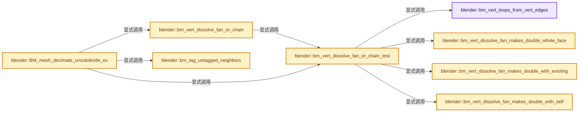
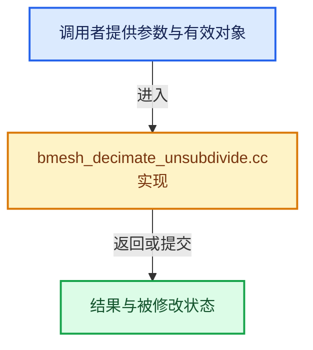

# 实现依赖专题：source/blender/bmesh/tools/bmesh_decimate_unsubdivide.cc

[实现依赖导航](../../../README.md) · [符号索引](../../../../00-课程指南/02-源码与提交索引/符号依赖与实现索引.md)

本专题从正文实际调用进入，集中保存共享实现。函数有稳定锚点，可从调用处直接跳到对应完整函数；递归与互相调用通过回链组织。

## 本文件的实现关系






## 完整成员与函数实现

<a id="f-4a8829bd30cd6d0b"></a>

### `blender::bm_vert_loops_from_vert_edges`

实现位置：[source/blender/bmesh/tools/bmesh_decimate_unsubdivide.cc](../../../../../../../../source/blender/bmesh/tools/bmesh_decimate_unsubdivide.cc) · L57—L80。

接口参数：

- `const BMVert *v`
- `BMEdge **v_edges`
- `const int v_edges_num`
- `BMLoop *v_loops[VERT_DISSOLVE_MAX]`

**教学注释版**

<!-- annotated:c58bb7b77b3e50 -->

```cpp
static int bm_vert_loops_from_vert_edges(const BMVert *v,
                                         BMEdge **v_edges,
                                         const int v_edges_num,
                                         BMLoop *v_loops[VERT_DISSOLVE_MAX])
{
  int v_loops_num = 0;
  for (int i = 0; i < v_edges_num; i++) {
    const BMEdge *e = v_edges[i];
    if (e->l != nullptr) {
      BMLoop *l_radial_iter = e->l;
      do {
        if (l_radial_iter->v == v) {
          /* Shouldn't be exceeded, more of a guard against corrupt topology. */
          if (v_loops_num == VERT_DISSOLVE_MAX) [[unlikely]] {
            BLI_assert_unreachable();
            return v_loops_num;
          }
          v_loops[v_loops_num++] = l_radial_iter;
        }
      } while ((l_radial_iter = l_radial_iter->radial_next) != e->l);
    }
  }
  return v_loops_num;
}
```

<details>
<summary>核对原始源码：source/blender/bmesh/tools/bmesh_decimate_unsubdivide.cc · L57—L80</summary>

<!-- original:c58bb7b77b3e50:source/blender/bmesh/tools/bmesh_decimate_unsubdivide.cc:57:80 -->

```cpp
static int bm_vert_loops_from_vert_edges(const BMVert *v,
                                         BMEdge **v_edges,
                                         const int v_edges_num,
                                         BMLoop *v_loops[VERT_DISSOLVE_MAX])
{
  int v_loops_num = 0;
  for (int i = 0; i < v_edges_num; i++) {
    const BMEdge *e = v_edges[i];
    if (e->l != nullptr) {
      BMLoop *l_radial_iter = e->l;
      do {
        if (l_radial_iter->v == v) {
          /* Shouldn't be exceeded, more of a guard against corrupt topology. */
          if (v_loops_num == VERT_DISSOLVE_MAX) [[unlikely]] {
            BLI_assert_unreachable();
            return v_loops_num;
          }
          v_loops[v_loops_num++] = l_radial_iter;
        }
      } while ((l_radial_iter = l_radial_iter->radial_next) != e->l);
    }
  }
  return v_loops_num;
}
```

</details>

**结果出口**

- `return v_loops_num;`

**继续追踪实现**

- `BLI_assert_unreachable` → [BLI_assert_unreachable · L77](../../../01-BLI基础库/BLI_assert.hh.md#m-7a2d91a67d8e)。宏定义由构建条件选择。

<a id="f-5cb968e85b9b08a6"></a>

### `blender::bm_vert_dissolve_fan_makes_double_whole_face`

实现位置：[source/blender/bmesh/tools/bmesh_decimate_unsubdivide.cc](../../../../../../../../source/blender/bmesh/tools/bmesh_decimate_unsubdivide.cc) · L82—L113。

接口参数：

- `BMLoop **v_loops_all`
- `const int v_loops_all_num`

**教学注释版**

<!-- annotated:703b17884795cb -->

```cpp
static bool bm_vert_dissolve_fan_makes_double_whole_face(BMLoop **v_loops_all,
                                                         const int v_loops_all_num)
{
  BMEdge *edges_from_loop_ear[VERT_DISSOLVE_MAX];
  uint edges_from_loop_ear_num = 0;

  for (int i = 0; i < v_loops_all_num; i++) {
    BMLoop *l = v_loops_all[i];
    BMEdge *e_opposite;
    if (l->f->len > 3) {
      e_opposite = BM_edge_exists(l->prev->v, l->next->v);
      if (e_opposite == nullptr) {
        return false;
      }
      if (edges_from_loop_ear_num == VERT_DISSOLVE_MAX) {
        return false;
      }
    }
    else {
      e_opposite = l->next->e;
    }
    edges_from_loop_ear[edges_from_loop_ear_num++] = e_opposite;
  }

  if (edges_from_loop_ear_num >= 3) {
    if (BM_face_exists_multi_edge(edges_from_loop_ear, edges_from_loop_ear_num)) {
      return true;
    }
  }

  return false;
}
```

<details>
<summary>核对原始源码：source/blender/bmesh/tools/bmesh_decimate_unsubdivide.cc · L82—L113</summary>

<!-- original:703b17884795cb:source/blender/bmesh/tools/bmesh_decimate_unsubdivide.cc:82:113 -->

```cpp
static bool bm_vert_dissolve_fan_makes_double_whole_face(BMLoop **v_loops_all,
                                                         const int v_loops_all_num)
{
  BMEdge *edges_from_loop_ear[VERT_DISSOLVE_MAX];
  uint edges_from_loop_ear_num = 0;

  for (int i = 0; i < v_loops_all_num; i++) {
    BMLoop *l = v_loops_all[i];
    BMEdge *e_opposite;
    if (l->f->len > 3) {
      e_opposite = BM_edge_exists(l->prev->v, l->next->v);
      if (e_opposite == nullptr) {
        return false;
      }
      if (edges_from_loop_ear_num == VERT_DISSOLVE_MAX) {
        return false;
      }
    }
    else {
      e_opposite = l->next->e;
    }
    edges_from_loop_ear[edges_from_loop_ear_num++] = e_opposite;
  }

  if (edges_from_loop_ear_num >= 3) {
    if (BM_face_exists_multi_edge(edges_from_loop_ear, edges_from_loop_ear_num)) {
      return true;
    }
  }

  return false;
}
```

</details>

**沿实际写入检查状态**

- `e_opposite = BM_edge_exists(l->prev->v, l->next->v);`
- `e_opposite = l->next->e;`

**结果出口**

- `return false;`
- `return true;`

**继续追踪实现**

- `BM_edge_exists` → [blender::BM_edge_exists · L1551](../intern/bmesh_query.cc.md#f-f9a007e7659d480b)；[blender::BM_edge_exists · L1568](../intern/bmesh_query.cc.md#f-e774a553f01590ed)。同名重载需按实参类型选择。
- `BM_face_exists_multi_edge` → [blender::BM_face_exists_multi_edge · L1873](../intern/bmesh_query.cc.md#f-d768d5c81d7793e8)。

<a id="f-e17f48c4a7f9c68d"></a>

### `blender::bm_vert_dissolve_fan_makes_double_with_existing`

实现位置：[source/blender/bmesh/tools/bmesh_decimate_unsubdivide.cc](../../../../../../../../source/blender/bmesh/tools/bmesh_decimate_unsubdivide.cc) · L124—L136。

接口参数：

- `BMLoop **v_loops_all`
- `const int v_loops_all_num`

**教学注释版**

<!-- annotated:67abdcfd3464d6 -->

```cpp
static bool bm_vert_dissolve_fan_makes_double_with_existing(BMLoop **v_loops_all,
                                                            const int v_loops_all_num)
{
  for (int i = 0; i < v_loops_all_num; i++) {
    BMLoop *l = v_loops_all[i];
    if (l->f->len > 3) {
      if (BM_face_split_check_double_face(l->prev, l->next, 3)) {
        return true;
      }
    }
  }
  return false;
}
```

<details>
<summary>核对原始源码：source/blender/bmesh/tools/bmesh_decimate_unsubdivide.cc · L124—L136</summary>

<!-- original:67abdcfd3464d6:source/blender/bmesh/tools/bmesh_decimate_unsubdivide.cc:124:136 -->

```cpp
static bool bm_vert_dissolve_fan_makes_double_with_existing(BMLoop **v_loops_all,
                                                            const int v_loops_all_num)
{
  for (int i = 0; i < v_loops_all_num; i++) {
    BMLoop *l = v_loops_all[i];
    if (l->f->len > 3) {
      if (BM_face_split_check_double_face(l->prev, l->next, 3)) {
        return true;
      }
    }
  }
  return false;
}
```

</details>

**结果出口**

- `return true;`
- `return false;`

**继续追踪实现**

- `BM_face_split_check_double_face` → [blender::BM_face_split_check_double_face · L2384](../intern/bmesh_core.cc.md#f-8f229b7055073a31)。

<a id="f-df2cde54f8241105"></a>

### `blender::bm_vert_dissolve_fan_makes_double_with_self`

实现位置：[source/blender/bmesh/tools/bmesh_decimate_unsubdivide.cc](../../../../../../../../source/blender/bmesh/tools/bmesh_decimate_unsubdivide.cc) · L153—L239。

接口参数：

- `BMLoop **v_loops_all`
- `const int v_loops_all_num`

**教学注释版**

<!-- annotated:6f07c49a07ef1c -->

```cpp
static bool bm_vert_dissolve_fan_makes_double_with_self(BMLoop **v_loops_all,
                                                        const int v_loops_all_num)
{
  BLI_assert(v_loops_all_num <= VERT_DISSOLVE_MAX);
  if (v_loops_all_num < 2) {
    return false;
  }

  BMLoop *v_loops[VERT_DISSOLVE_MAX];
  int v_loops_num = 0;
  for (int i = 0; i < v_loops_all_num; i++) {
    BLI_assert(v_loops_all[i]->v == v_loops_all[0]->v);
    BMLoop *l = v_loops_all[i];
    if (l->f->len > 3) {
      v_loops[v_loops_num++] = l;
    }
  }
  if (v_loops_num < 2) {
    return false;
  }

  std::ranges::sort(v_loops, v_loops + v_loops_num, {}, [](const BMLoop *l) { return l->f->len; });

  using VertArray = Array<BMVert *, BM_DEFAULT_NGON_STACK_SIZE>;

  /* Return the vertices left forming a face when the central vertex is collapsed out,
   * canonicalized so two faces that collapse to the same loop compare equal. */
  auto verts_canonical_collapsed_fn = [](const BMLoop *l_vert) -> VertArray {
    const int verts_num = l_vert->f->len - 1;
    VertArray verts(verts_num, NoInitialization());
    int verts_index = 0;
    for (const BMLoop *l = l_vert->next; l != l_vert; l = l->next) {
      verts[verts_index++] = l->v;
    }
    BLI_assert(verts_index == verts_num);

    /* Canonicalize using the minimum pointer, with the order
     * defined by the next adjacent minimum. */
    int i_min = 0;
    for (int i = 1; i < verts_num; i++) {
      if (verts[i] < verts[i_min]) {
        i_min = i;
      }
    }
    const int i_next = (i_min + 1 == verts_num) ? 0 : i_min + 1;
    const int i_prev = (i_min == 0) ? verts_num - 1 : i_min - 1;
    /* A step of `verts_num - 1` moves one place backward & wraps. */
    const int step = (verts[i_next] < verts[i_prev]) ? 1 : (verts_num - 1);

    VertArray verts_ordered(verts_num, NoInitialization());
    for (int i = 0, j = i_min; i < verts_num; i++) {
      verts_ordered[i] = verts[j];
      j += step;
      if (j >= verts_num) {
        j -= verts_num;
      }
    }
    return verts_ordered;
  };

  /* Only perform the relatively expensive unique face checks for
   * groups of faces with matching numbers of sides. */
  for (int group_beg = 0; group_beg < v_loops_num;) {
    const int group_f_len = v_loops[group_beg]->f->len;
    int group_end = group_beg + 1;
    while (group_end < v_loops_num && v_loops[group_end]->f->len == group_f_len) {
      group_end++;
    }

    const int group_len = group_end - group_beg;
    if (group_len >= 2) {
      VertArray collapsed[VERT_DISSOLVE_MAX];
      for (int i = 0; i < group_len; i++) {
        collapsed[i] = verts_canonical_collapsed_fn(v_loops[group_beg + i]);
      }
      for (int i = 0; i + 1 < group_len; i++) {
        for (int j = i + 1; j < group_len; j++) {
          if (std::ranges::equal(collapsed[i], collapsed[j])) {
            return true;
          }
        }
      }
    }
    group_beg = group_end;
  }
  return false;
}
```

<details>
<summary>核对原始源码：source/blender/bmesh/tools/bmesh_decimate_unsubdivide.cc · L153—L239</summary>

<!-- original:6f07c49a07ef1c:source/blender/bmesh/tools/bmesh_decimate_unsubdivide.cc:153:239 -->

```cpp
static bool bm_vert_dissolve_fan_makes_double_with_self(BMLoop **v_loops_all,
                                                        const int v_loops_all_num)
{
  BLI_assert(v_loops_all_num <= VERT_DISSOLVE_MAX);
  if (v_loops_all_num < 2) {
    return false;
  }

  BMLoop *v_loops[VERT_DISSOLVE_MAX];
  int v_loops_num = 0;
  for (int i = 0; i < v_loops_all_num; i++) {
    BLI_assert(v_loops_all[i]->v == v_loops_all[0]->v);
    BMLoop *l = v_loops_all[i];
    if (l->f->len > 3) {
      v_loops[v_loops_num++] = l;
    }
  }
  if (v_loops_num < 2) {
    return false;
  }

  std::ranges::sort(v_loops, v_loops + v_loops_num, {}, [](const BMLoop *l) { return l->f->len; });

  using VertArray = Array<BMVert *, BM_DEFAULT_NGON_STACK_SIZE>;

  /* Return the vertices left forming a face when the central vertex is collapsed out,
   * canonicalized so two faces that collapse to the same loop compare equal. */
  auto verts_canonical_collapsed_fn = [](const BMLoop *l_vert) -> VertArray {
    const int verts_num = l_vert->f->len - 1;
    VertArray verts(verts_num, NoInitialization());
    int verts_index = 0;
    for (const BMLoop *l = l_vert->next; l != l_vert; l = l->next) {
      verts[verts_index++] = l->v;
    }
    BLI_assert(verts_index == verts_num);

    /* Canonicalize using the minimum pointer, with the order
     * defined by the next adjacent minimum. */
    int i_min = 0;
    for (int i = 1; i < verts_num; i++) {
      if (verts[i] < verts[i_min]) {
        i_min = i;
      }
    }
    const int i_next = (i_min + 1 == verts_num) ? 0 : i_min + 1;
    const int i_prev = (i_min == 0) ? verts_num - 1 : i_min - 1;
    /* A step of `verts_num - 1` moves one place backward & wraps. */
    const int step = (verts[i_next] < verts[i_prev]) ? 1 : (verts_num - 1);

    VertArray verts_ordered(verts_num, NoInitialization());
    for (int i = 0, j = i_min; i < verts_num; i++) {
      verts_ordered[i] = verts[j];
      j += step;
      if (j >= verts_num) {
        j -= verts_num;
      }
    }
    return verts_ordered;
  };

  /* Only perform the relatively expensive unique face checks for
   * groups of faces with matching numbers of sides. */
  for (int group_beg = 0; group_beg < v_loops_num;) {
    const int group_f_len = v_loops[group_beg]->f->len;
    int group_end = group_beg + 1;
    while (group_end < v_loops_num && v_loops[group_end]->f->len == group_f_len) {
      group_end++;
    }

    const int group_len = group_end - group_beg;
    if (group_len >= 2) {
      VertArray collapsed[VERT_DISSOLVE_MAX];
      for (int i = 0; i < group_len; i++) {
        collapsed[i] = verts_canonical_collapsed_fn(v_loops[group_beg + i]);
      }
      for (int i = 0; i + 1 < group_len; i++) {
        for (int j = i + 1; j < group_len; j++) {
          if (std::ranges::equal(collapsed[i], collapsed[j])) {
            return true;
          }
        }
      }
    }
    group_beg = group_end;
  }
  return false;
}
```

</details>

**沿实际写入检查状态**

- `i_min = i;`
- `verts_ordered[i] = verts[j];`
- `j += step;`
- `j -= verts_num;`
- `collapsed[i] = verts_canonical_collapsed_fn(v_loops[group_beg + i]);`
- `group_beg = group_end;`

**结果出口**

- `return false;`
- `return verts_ordered;`
- `return true;`

**继续追踪实现**

- `BLI_assert` → [BLI_assert · L48](../../../01-BLI基础库/BLI_assert.hh.md#m-57a88495704d)；[BLI_assert · L63](../../../01-BLI基础库/BLI_assert.hh.md#m-d07050020cb5)。宏定义由构建条件选择。
- `std::ranges::sort` → [外部契约](https://eel.is/c++draft/)：这个边界按实际表达式及所属类型核对参数、返回值、寿命与失败行为。这里提供接口入口，不声称已解释该第三方版本的内部实现。
- `verts_canonical_collapsed_fn` → [调用协议](../../../../00-课程指南/01-路线与规范/模板宏与动态分派协议.md)：局部可调用对象，须结合其初始化与捕获环境。调用位置L226。
- `std::ranges::equal` → [外部契约](https://eel.is/c++draft/)：这个边界按实际表达式及所属类型核对参数、返回值、寿命与失败行为。这里提供接口入口，不声称已解释该第三方版本的内部实现。

<a id="f-b58d6c9d5b2675a9"></a>

### `blender::bm_vert_dissolve_fan_or_chain_test`

实现位置：[source/blender/bmesh/tools/bmesh_decimate_unsubdivide.cc](../../../../../../../../source/blender/bmesh/tools/bmesh_decimate_unsubdivide.cc) · L256—L369。

接口参数：

- `BMVert *v`
- `const bool check_for_duplicates`
- `BMLoop *v_loops[VERT_DISSOLVE_MAX]`
- `int *v_loops_num_p`

**教学注释版**

<!-- annotated:01a5a179f2c2c8 -->

```cpp
static std::optional<VertDissolveMethod> bm_vert_dissolve_fan_or_chain_test(
    BMVert *v,
    const bool check_for_duplicates,
    BMLoop *v_loops[VERT_DISSOLVE_MAX],
    int *v_loops_num_p)
{
  BMIter iter;
  BMEdge *e;

  /* All edges connected to `v`. */
  BMEdge *v_edges[VERT_DISSOLVE_MAX];

  /* Boundary edges, only check for 2 because cases with more than 2 are ignored. */
  BMEdge *e_boundary[2];
  uint e_boundary_num = 0;

  uint tot_edge = 0;
  uint tot_edge_boundary = 0;
  uint tot_edge_manifold = 0;
  uint tot_edge_wire = 0;

  /* In this loop we try to bail out early and gather data to be used later.
   * Avoid expensive queries up front. */
  BM_ITER_ELEM (e, &iter, v, BM_EDGES_OF_VERT) {
    if (BM_edge_is_boundary(e)) {
      if (e_boundary_num < ARRAY_SIZE(e_boundary)) {
        e_boundary[e_boundary_num] = e;
      }
      e_boundary_num++;
      tot_edge_boundary++;
    }
    else if (BM_edge_is_manifold(e)) {
      tot_edge_manifold++;
    }
    else if (BM_edge_is_wire(e)) {
      tot_edge_wire++;
    }
    else {
      return std::nullopt;
    }

    if (tot_edge == VERT_DISSOLVE_MAX) {
      return std::nullopt;
    }

    v_edges[tot_edge] = e;
    tot_edge++;
  }

  if (((tot_edge == 4) && (tot_edge_boundary == 0) && (tot_edge_manifold == 4)) ||
      ((tot_edge == 3) && (tot_edge_boundary == 0) && (tot_edge_manifold == 3)))
  {
    if (check_for_duplicates) {
      const int v_loops_num = bm_vert_loops_from_vert_edges(v, v_edges, tot_edge, v_loops);

      /* Check the corners around `v` don't already form a face. */
      if (bm_vert_dissolve_fan_makes_double_whole_face(v_loops, v_loops_num)) {
        return std::nullopt;
      }

      /* Check if splits would create a duplicate (with existing or between each other). */
      if (bm_vert_dissolve_fan_makes_double_with_existing(v_loops, v_loops_num) ||
          bm_vert_dissolve_fan_makes_double_with_self(v_loops, v_loops_num))
      {
        return std::nullopt;
      }

      *v_loops_num_p = v_loops_num;
    }
    return VertDissolveMethod::InteriorFan;
  }
  if ((tot_edge == 3) && (tot_edge_boundary == 2) && (tot_edge_manifold == 1)) {
    if (check_for_duplicates) {
      BLI_assert(e_boundary_num == 2);

      if (const BMEdge *e_span = BM_edge_exists(BM_edge_other_vert(e_boundary[0], v),
                                                BM_edge_other_vert(e_boundary[1], v)))
      {
        if (e_span->l) {
          /* Boundary dissolving connects the two boundary edges into `e_span`.
           * When `e_span` exists with a face, the dissolve may join across it.
           * In isolation that is "ok" - however it means the dissolve may remove vertices
           * other than `v`, causing the main un-subdivide loop to operate on freed geometry.
           *
           * NOTE(@ideasman42): If this was an important use case it's possible to inspect the
           * topology and only reject dissolving when it would cause problems.
           * However the situations where this occurs are not so important to support
           * as they tend to be caused by overlapping/bow-tie faces.
           * So it's simpler to reject them. */
          return std::nullopt;
        }
      }

      const int v_loops_num = bm_vert_loops_from_vert_edges(v, v_edges, tot_edge, v_loops);

      /* Check if splits would create a duplicate (with existing or between each other). */
      if (bm_vert_dissolve_fan_makes_double_with_existing(v_loops, v_loops_num) ||
          bm_vert_dissolve_fan_makes_double_with_self(v_loops, v_loops_num))
      {
        return std::nullopt;
      }

      *v_loops_num_p = v_loops_num;
    }
    return VertDissolveMethod::BoundaryFan;
  }
  if ((tot_edge == 2) && (tot_edge_wire == 2)) {
    return VertDissolveMethod::WireChain;
  }
  if ((tot_edge == 2) && (tot_edge_manifold == 2)) {
    return VertDissolveMethod::InteriorChain;
  }
  return std::nullopt;
}
```

<details>
<summary>核对原始源码：source/blender/bmesh/tools/bmesh_decimate_unsubdivide.cc · L256—L369</summary>

<!-- original:01a5a179f2c2c8:source/blender/bmesh/tools/bmesh_decimate_unsubdivide.cc:256:369 -->

```cpp
static std::optional<VertDissolveMethod> bm_vert_dissolve_fan_or_chain_test(
    BMVert *v,
    const bool check_for_duplicates,
    BMLoop *v_loops[VERT_DISSOLVE_MAX],
    int *v_loops_num_p)
{
  BMIter iter;
  BMEdge *e;

  /* All edges connected to `v`. */
  BMEdge *v_edges[VERT_DISSOLVE_MAX];

  /* Boundary edges, only check for 2 because cases with more than 2 are ignored. */
  BMEdge *e_boundary[2];
  uint e_boundary_num = 0;

  uint tot_edge = 0;
  uint tot_edge_boundary = 0;
  uint tot_edge_manifold = 0;
  uint tot_edge_wire = 0;

  /* In this loop we try to bail out early and gather data to be used later.
   * Avoid expensive queries up front. */
  BM_ITER_ELEM (e, &iter, v, BM_EDGES_OF_VERT) {
    if (BM_edge_is_boundary(e)) {
      if (e_boundary_num < ARRAY_SIZE(e_boundary)) {
        e_boundary[e_boundary_num] = e;
      }
      e_boundary_num++;
      tot_edge_boundary++;
    }
    else if (BM_edge_is_manifold(e)) {
      tot_edge_manifold++;
    }
    else if (BM_edge_is_wire(e)) {
      tot_edge_wire++;
    }
    else {
      return std::nullopt;
    }

    if (tot_edge == VERT_DISSOLVE_MAX) {
      return std::nullopt;
    }

    v_edges[tot_edge] = e;
    tot_edge++;
  }

  if (((tot_edge == 4) && (tot_edge_boundary == 0) && (tot_edge_manifold == 4)) ||
      ((tot_edge == 3) && (tot_edge_boundary == 0) && (tot_edge_manifold == 3)))
  {
    if (check_for_duplicates) {
      const int v_loops_num = bm_vert_loops_from_vert_edges(v, v_edges, tot_edge, v_loops);

      /* Check the corners around `v` don't already form a face. */
      if (bm_vert_dissolve_fan_makes_double_whole_face(v_loops, v_loops_num)) {
        return std::nullopt;
      }

      /* Check if splits would create a duplicate (with existing or between each other). */
      if (bm_vert_dissolve_fan_makes_double_with_existing(v_loops, v_loops_num) ||
          bm_vert_dissolve_fan_makes_double_with_self(v_loops, v_loops_num))
      {
        return std::nullopt;
      }

      *v_loops_num_p = v_loops_num;
    }
    return VertDissolveMethod::InteriorFan;
  }
  if ((tot_edge == 3) && (tot_edge_boundary == 2) && (tot_edge_manifold == 1)) {
    if (check_for_duplicates) {
      BLI_assert(e_boundary_num == 2);

      if (const BMEdge *e_span = BM_edge_exists(BM_edge_other_vert(e_boundary[0], v),
                                                BM_edge_other_vert(e_boundary[1], v)))
      {
        if (e_span->l) {
          /* Boundary dissolving connects the two boundary edges into `e_span`.
           * When `e_span` exists with a face, the dissolve may join across it.
           * In isolation that is "ok" - however it means the dissolve may remove vertices
           * other than `v`, causing the main un-subdivide loop to operate on freed geometry.
           *
           * NOTE(@ideasman42): If this was an important use case it's possible to inspect the
           * topology and only reject dissolving when it would cause problems.
           * However the situations where this occurs are not so important to support
           * as they tend to be caused by overlapping/bow-tie faces.
           * So it's simpler to reject them. */
          return std::nullopt;
        }
      }

      const int v_loops_num = bm_vert_loops_from_vert_edges(v, v_edges, tot_edge, v_loops);

      /* Check if splits would create a duplicate (with existing or between each other). */
      if (bm_vert_dissolve_fan_makes_double_with_existing(v_loops, v_loops_num) ||
          bm_vert_dissolve_fan_makes_double_with_self(v_loops, v_loops_num))
      {
        return std::nullopt;
      }

      *v_loops_num_p = v_loops_num;
    }
    return VertDissolveMethod::BoundaryFan;
  }
  if ((tot_edge == 2) && (tot_edge_wire == 2)) {
    return VertDissolveMethod::WireChain;
  }
  if ((tot_edge == 2) && (tot_edge_manifold == 2)) {
    return VertDissolveMethod::InteriorChain;
  }
  return std::nullopt;
}
```

</details>

**沿实际写入检查状态**

- `e_boundary[e_boundary_num] = e;`
- `v_edges[tot_edge] = e;`

**结果出口**

- `return std::nullopt;`
- `return VertDissolveMethod::InteriorFan;`
- `return VertDissolveMethod::BoundaryFan;`
- `return VertDissolveMethod::WireChain;`
- `return VertDissolveMethod::InteriorChain;`

**继续追踪实现**

- `BM_ITER_ELEM` → [BM_ITER_ELEM · L97](../intern/bmesh_iterators.hh.md#m-751d15be7ee4)。宏定义由构建条件选择。
- `BM_edge_is_boundary` → [blender::BM_edge_is_boundary · L111](../intern/bmesh_query_inline.hh.md#f-9626087cfab8be44)；[blender::BM_edge_is_boundary · L117](../intern/bmesh_query_inline.hh.md#f-2fee18c217b38784)。同名重载需按实参类型选择。
- `ARRAY_SIZE` → [blender::ARRAY_SIZE · L608](../../../01-BLI基础库/BLI_utildefines.hh.md#f-eaec3a7e47b85c7c)。
- `BM_edge_is_manifold` → [blender::BM_edge_is_manifold · L79](../intern/bmesh_query_inline.hh.md#f-4944cfa861683f59)；[blender::BM_edge_is_manifold · L86](../intern/bmesh_query_inline.hh.md#f-f07686548bcc2440)。同名重载需按实参类型选择。
- `BM_edge_is_wire` → [blender::BM_edge_is_wire · L68](../intern/bmesh_query_inline.hh.md#f-8171635700fdb320)。
- `bm_vert_loops_from_vert_edges` → [blender::bm_vert_loops_from_vert_edges · L57](bmesh_decimate_unsubdivide.cc.md#f-4a8829bd30cd6d0b)。
- `bm_vert_dissolve_fan_makes_double_whole_face` → [blender::bm_vert_dissolve_fan_makes_double_whole_face · L82](bmesh_decimate_unsubdivide.cc.md#f-5cb968e85b9b08a6)。
- `bm_vert_dissolve_fan_makes_double_with_existing` → [blender::bm_vert_dissolve_fan_makes_double_with_existing · L124](bmesh_decimate_unsubdivide.cc.md#f-e17f48c4a7f9c68d)。
- `bm_vert_dissolve_fan_makes_double_with_self` → [blender::bm_vert_dissolve_fan_makes_double_with_self · L153](bmesh_decimate_unsubdivide.cc.md#f-df2cde54f8241105)。
- `BLI_assert` → [BLI_assert · L48](../../../01-BLI基础库/BLI_assert.hh.md#m-57a88495704d)；[BLI_assert · L63](../../../01-BLI基础库/BLI_assert.hh.md#m-d07050020cb5)。宏定义由构建条件选择。
- `BM_edge_exists` → [blender::BM_edge_exists · L1551](../intern/bmesh_query.cc.md#f-f9a007e7659d480b)；[blender::BM_edge_exists · L1568](../intern/bmesh_query.cc.md#f-e774a553f01590ed)。同名重载需按实参类型选择。
- `BM_edge_other_vert` → [blender::BM_edge_other_vert · L52](../intern/bmesh_query_inline.hh.md#f-464fb9614b23d180)。

<a id="f-e90b61fee339819c"></a>

### `blender::bm_vert_dissolve_fan_or_chain`

实现位置：[source/blender/bmesh/tools/bmesh_decimate_unsubdivide.cc](../../../../../../../../source/blender/bmesh/tools/bmesh_decimate_unsubdivide.cc) · L374—L412。

接口参数：

- `BMesh *bm`
- `BMVert *v`

**教学注释版**

<!-- annotated:3b6176333a1c49 -->

```cpp
static bool bm_vert_dissolve_fan_or_chain(BMesh *bm, BMVert *v)
{
  /* Re-test if dissolve is possible.
   * The surrounding geometry may have changed since the first check,
   * the first call also skips expensive degeneracy checks for this very reason. */
  BMLoop *v_loops[VERT_DISSOLVE_MAX];
  int v_loops_num = 0;
  const std::optional<VertDissolveMethod> dissolve = bm_vert_dissolve_fan_or_chain_test(
      v, true, v_loops, &v_loops_num);
  if (!dissolve) {
    return false;
  }

  switch (*dissolve) {
    case VertDissolveMethod::WireChain:
    case VertDissolveMethod::InteriorChain: {
      return (BM_vert_collapse_edge(bm, v->e, v, true, true, true) != nullptr);
    }
    case VertDissolveMethod::BoundaryFan:
    case VertDissolveMethod::InteriorFan: {
      for (int i = 0; i < v_loops_num; i++) {
        BMLoop *l = v_loops[i];
        if (l->f->len > 3) {
          BMLoop *l_new;
          BLI_assert(l->prev->v != l->next->v);
          /* Must have been rejected by #bm_vert_dissolve_fan_or_chain_test.
           * NOTE(@ideasman42): Assert because it's theoretically possible an edit
           * in this loop creates a duplicate (although incredibly unlikely). */
          BLI_assert(!BM_face_split_check_double_face(l->prev, l->next, 3));
          BM_face_split(bm, l->f, l->prev, l->next, &l_new, nullptr, true);
          BM_elem_flag_merge_into(l_new->e, l->e, l->prev->e);
        }
      }
      return BM_vert_dissolve(bm, v);
    }
  }

  return false;
}
```

<details>
<summary>核对原始源码：source/blender/bmesh/tools/bmesh_decimate_unsubdivide.cc · L374—L412</summary>

<!-- original:3b6176333a1c49:source/blender/bmesh/tools/bmesh_decimate_unsubdivide.cc:374:412 -->

```cpp
static bool bm_vert_dissolve_fan_or_chain(BMesh *bm, BMVert *v)
{
  /* Re-test if dissolve is possible.
   * The surrounding geometry may have changed since the first check,
   * the first call also skips expensive degeneracy checks for this very reason. */
  BMLoop *v_loops[VERT_DISSOLVE_MAX];
  int v_loops_num = 0;
  const std::optional<VertDissolveMethod> dissolve = bm_vert_dissolve_fan_or_chain_test(
      v, true, v_loops, &v_loops_num);
  if (!dissolve) {
    return false;
  }

  switch (*dissolve) {
    case VertDissolveMethod::WireChain:
    case VertDissolveMethod::InteriorChain: {
      return (BM_vert_collapse_edge(bm, v->e, v, true, true, true) != nullptr);
    }
    case VertDissolveMethod::BoundaryFan:
    case VertDissolveMethod::InteriorFan: {
      for (int i = 0; i < v_loops_num; i++) {
        BMLoop *l = v_loops[i];
        if (l->f->len > 3) {
          BMLoop *l_new;
          BLI_assert(l->prev->v != l->next->v);
          /* Must have been rejected by #bm_vert_dissolve_fan_or_chain_test.
           * NOTE(@ideasman42): Assert because it's theoretically possible an edit
           * in this loop creates a duplicate (although incredibly unlikely). */
          BLI_assert(!BM_face_split_check_double_face(l->prev, l->next, 3));
          BM_face_split(bm, l->f, l->prev, l->next, &l_new, nullptr, true);
          BM_elem_flag_merge_into(l_new->e, l->e, l->prev->e);
        }
      }
      return BM_vert_dissolve(bm, v);
    }
  }

  return false;
}
```

</details>

**结果出口**

- `return false;`
- `return (BM_vert_collapse_edge(bm, v->e, v, true, true, true) != nullptr);`
- `return BM_vert_dissolve(bm, v);`

**继续追踪实现**

- `bm_vert_dissolve_fan_or_chain_test` → [blender::bm_vert_dissolve_fan_or_chain_test · L256](bmesh_decimate_unsubdivide.cc.md#f-b58d6c9d5b2675a9)。
- `BM_vert_collapse_edge` → [blender::BM_vert_collapse_edge · L429](../intern/bmesh_mods.cc.md#f-ef4ded8bbee4c726)。
- `BLI_assert` → [BLI_assert · L48](../../../01-BLI基础库/BLI_assert.hh.md#m-57a88495704d)；[BLI_assert · L63](../../../01-BLI基础库/BLI_assert.hh.md#m-d07050020cb5)。宏定义由构建条件选择。
- `BM_face_split_check_double_face` → [blender::BM_face_split_check_double_face · L2384](../intern/bmesh_core.cc.md#f-8f229b7055073a31)。
- `BM_face_split` → [blender::BM_face_split · L207](../intern/bmesh_mods.cc.md#f-78df25669fa1d1c1)。
- `BM_elem_flag_merge_into` → [BM_elem_flag_merge_into · L30](../intern/bmesh_inline.hh.md#m-e3a18086cc5c)。宏定义由构建条件选择。
- `BM_vert_dissolve` → [blender::BM_vert_dissolve · L22](../intern/bmesh_mods.cc.md#f-ec38a2375646aaf9)。

<a id="f-5737167e5cb15e6a"></a>

### `blender::bm_tag_untagged_neighbors`

实现位置：[source/blender/bmesh/tools/bmesh_decimate_unsubdivide.cc](../../../../../../../../source/blender/bmesh/tools/bmesh_decimate_unsubdivide.cc) · L438—L463。

接口参数：

- `BMVert *verts_start[]`
- `const uint verts_start_num`
- `const int desired_tag`
- `BMVert *r_verts_tagged[]`
- `uint &r_verts_tagged_num`

**教学注释版**

<!-- annotated:464a4d911b867e -->

```cpp
static void bm_tag_untagged_neighbors(BMVert *verts_start[],
                                      const uint verts_start_num,
                                      const int desired_tag,
                                      BMVert *r_verts_tagged[],
                                      uint &r_verts_tagged_num)
{

  BMEdge *e;
  BMIter iter;
  r_verts_tagged_num = 0;

  for (int i = 0; i < verts_start_num; i++) {
    BMVert *v = verts_start[i];

    /* Since DO_COLLAPSE and IGNORE are -1 and +1, inverting the sign finds the other. */
    BLI_assert(BM_elem_index_get(v) == -desired_tag);

    BM_ITER_ELEM (e, &iter, v, BM_EDGES_OF_VERT) {
      BMVert *v_other = BM_edge_other_vert(e, v);
      if (BM_elem_index_get(v_other) == VERT_INDEX_INIT) {
        BM_elem_index_set(v_other, desired_tag); /* set_dirty! */
        r_verts_tagged[r_verts_tagged_num++] = v_other;
      }
    }
  }
}
```

<details>
<summary>核对原始源码：source/blender/bmesh/tools/bmesh_decimate_unsubdivide.cc · L438—L463</summary>

<!-- original:464a4d911b867e:source/blender/bmesh/tools/bmesh_decimate_unsubdivide.cc:438:463 -->

```cpp
static void bm_tag_untagged_neighbors(BMVert *verts_start[],
                                      const uint verts_start_num,
                                      const int desired_tag,
                                      BMVert *r_verts_tagged[],
                                      uint &r_verts_tagged_num)
{

  BMEdge *e;
  BMIter iter;
  r_verts_tagged_num = 0;

  for (int i = 0; i < verts_start_num; i++) {
    BMVert *v = verts_start[i];

    /* Since DO_COLLAPSE and IGNORE are -1 and +1, inverting the sign finds the other. */
    BLI_assert(BM_elem_index_get(v) == -desired_tag);

    BM_ITER_ELEM (e, &iter, v, BM_EDGES_OF_VERT) {
      BMVert *v_other = BM_edge_other_vert(e, v);
      if (BM_elem_index_get(v_other) == VERT_INDEX_INIT) {
        BM_elem_index_set(v_other, desired_tag); /* set_dirty! */
        r_verts_tagged[r_verts_tagged_num++] = v_other;
      }
    }
  }
}
```

</details>

**沿实际写入检查状态**

- `r_verts_tagged_num = 0;`

**继续追踪实现**

- `BLI_assert` → [BLI_assert · L48](../../../01-BLI基础库/BLI_assert.hh.md#m-57a88495704d)；[BLI_assert · L63](../../../01-BLI基础库/BLI_assert.hh.md#m-d07050020cb5)。宏定义由构建条件选择。
- `BM_elem_index_get` → [BM_elem_index_get · L120](../intern/bmesh_inline.hh.md#m-201981cdc62d)。宏定义由构建条件选择。
- `BM_ITER_ELEM` → [BM_ITER_ELEM · L97](../intern/bmesh_iterators.hh.md#m-751d15be7ee4)。宏定义由构建条件选择。
- `BM_edge_other_vert` → [blender::BM_edge_other_vert · L52](../intern/bmesh_query_inline.hh.md#f-464fb9614b23d180)。
- `BM_elem_index_set` → [BM_elem_index_set · L121](../intern/bmesh_inline.hh.md#m-7bd559c53007)。宏定义由构建条件选择。

<a id="f-0a19d6bde6ee5fdb"></a>

### `blender::BM_mesh_decimate_unsubdivide_ex`

实现位置：[source/blender/bmesh/tools/bmesh_decimate_unsubdivide.cc](../../../../../../../../source/blender/bmesh/tools/bmesh_decimate_unsubdivide.cc) · L469—L566。

接口参数：

- `BMesh *bm`
- `const int iterations`
- `const bool tag_only`

**教学注释版**

<!-- annotated:5dd6c53f8a6b17 -->

```cpp
void BM_mesh_decimate_unsubdivide_ex(BMesh *bm, const int iterations, const bool tag_only)
{
  /* NOTE: while #BMWalker seems like a logical choice, it results in uneven geometry. */

  BMVert **verts_collapse = MEM_new_array_uninitialized<BMVert *>(bm->totvert, __func__);
  BMVert **verts_ignore = MEM_new_array_uninitialized<BMVert *>(bm->totvert, __func__);
  uint verts_collapse_num = 0;
  uint verts_ignore_num = 0;

  BMIter iter;

  int iter_step;

  /* if tag_only is set, we assume the caller knows what verts to tag
   * needed for the operator */
  if (tag_only == false) {
    BMVert *v;
    BM_ITER_MESH (v, &iter, bm, BM_VERTS_OF_MESH) {
      BM_elem_flag_enable(v, BM_ELEM_TAG);
    }
  }

  /* Perform the number of iteration steps which the user requested. */
  for (iter_step = 0; iter_step < iterations; iter_step++) {
    BMVert *v, *v_next;
    bool verts_were_marked_for_dissolve = false;

    /* Tag all verts which are eligible to be dissolved on this iteration. */
    BM_ITER_MESH (v, &iter, bm, BM_VERTS_OF_MESH) {
      if (BM_elem_flag_test(v, BM_ELEM_TAG) &&
          bm_vert_dissolve_fan_or_chain_test(v, false, nullptr, nullptr))
      {
        BM_elem_index_set(v, VERT_INDEX_INIT); /* set_dirty! */
      }
      else {
        BM_elem_index_set(v, VERT_INDEX_IGNORE); /* set_dirty! */
      }
    }

    /* main loop, keep tagging until we can't tag any more islands */
    BM_ITER_MESH (v, &iter, bm, BM_VERTS_OF_MESH) {

      /* Only process verts which are eligible for dissolve and which have not yet been tagged. */
      if (!(BM_elem_index_get(v) == VERT_INDEX_INIT)) {
        continue;
      }

      /* Set the first #VERT_INDEX_INIT vert as the first starting vert. */
      BM_elem_index_set(v, VERT_INDEX_IGNORE); /* set_dirty! */
      verts_ignore[0] = v;
      verts_ignore_num = 1;

      /* Starting at v, expand outwards, tagging any currently untagged neighbors.
       * verts will be alternately tagged for collapse or ignore.
       * Stop when there are no neighbors left to expand to. */
      while (true) {

        bm_tag_untagged_neighbors(verts_ignore,
                                  verts_ignore_num,
                                  VERT_INDEX_DO_COLLAPSE, /* set_dirty! */
                                  verts_collapse,
                                  verts_collapse_num);
        if (verts_collapse_num == 0) {
          break;
        }
        verts_were_marked_for_dissolve = true;

        bm_tag_untagged_neighbors(verts_collapse,
                                  verts_collapse_num,
                                  VERT_INDEX_IGNORE, /* set_dirty! */
                                  verts_ignore,
                                  verts_ignore_num);
        if (verts_ignore_num == 0) {
          break;
        }
      }
    }

    /* At high iteration levels, later steps can run out of verts that are eligible for dissolve.
     * If this occurs, stop. Future iterations won't find any verts that this iteration didn't. */
    if (!verts_were_marked_for_dissolve) {
      break;
    }

    /* Remove all verts tagged for removal. */
    BM_ITER_MESH_MUTABLE (v, v_next, &iter, bm, BM_VERTS_OF_MESH) {
      if (BM_elem_index_get(v) == VERT_INDEX_DO_COLLAPSE) {
        bm_vert_dissolve_fan_or_chain(bm, v);
      }
    }
  }

  /* Ensure the vert index values will be recomputed. */
  bm->elem_index_dirty |= BM_VERT;

  MEM_delete(verts_collapse);
  MEM_delete(verts_ignore);
}
```

<details>
<summary>核对原始源码：source/blender/bmesh/tools/bmesh_decimate_unsubdivide.cc · L469—L566</summary>

<!-- original:5dd6c53f8a6b17:source/blender/bmesh/tools/bmesh_decimate_unsubdivide.cc:469:566 -->

```cpp
void BM_mesh_decimate_unsubdivide_ex(BMesh *bm, const int iterations, const bool tag_only)
{
  /* NOTE: while #BMWalker seems like a logical choice, it results in uneven geometry. */

  BMVert **verts_collapse = MEM_new_array_uninitialized<BMVert *>(bm->totvert, __func__);
  BMVert **verts_ignore = MEM_new_array_uninitialized<BMVert *>(bm->totvert, __func__);
  uint verts_collapse_num = 0;
  uint verts_ignore_num = 0;

  BMIter iter;

  int iter_step;

  /* if tag_only is set, we assume the caller knows what verts to tag
   * needed for the operator */
  if (tag_only == false) {
    BMVert *v;
    BM_ITER_MESH (v, &iter, bm, BM_VERTS_OF_MESH) {
      BM_elem_flag_enable(v, BM_ELEM_TAG);
    }
  }

  /* Perform the number of iteration steps which the user requested. */
  for (iter_step = 0; iter_step < iterations; iter_step++) {
    BMVert *v, *v_next;
    bool verts_were_marked_for_dissolve = false;

    /* Tag all verts which are eligible to be dissolved on this iteration. */
    BM_ITER_MESH (v, &iter, bm, BM_VERTS_OF_MESH) {
      if (BM_elem_flag_test(v, BM_ELEM_TAG) &&
          bm_vert_dissolve_fan_or_chain_test(v, false, nullptr, nullptr))
      {
        BM_elem_index_set(v, VERT_INDEX_INIT); /* set_dirty! */
      }
      else {
        BM_elem_index_set(v, VERT_INDEX_IGNORE); /* set_dirty! */
      }
    }

    /* main loop, keep tagging until we can't tag any more islands */
    BM_ITER_MESH (v, &iter, bm, BM_VERTS_OF_MESH) {

      /* Only process verts which are eligible for dissolve and which have not yet been tagged. */
      if (!(BM_elem_index_get(v) == VERT_INDEX_INIT)) {
        continue;
      }

      /* Set the first #VERT_INDEX_INIT vert as the first starting vert. */
      BM_elem_index_set(v, VERT_INDEX_IGNORE); /* set_dirty! */
      verts_ignore[0] = v;
      verts_ignore_num = 1;

      /* Starting at v, expand outwards, tagging any currently untagged neighbors.
       * verts will be alternately tagged for collapse or ignore.
       * Stop when there are no neighbors left to expand to. */
      while (true) {

        bm_tag_untagged_neighbors(verts_ignore,
                                  verts_ignore_num,
                                  VERT_INDEX_DO_COLLAPSE, /* set_dirty! */
                                  verts_collapse,
                                  verts_collapse_num);
        if (verts_collapse_num == 0) {
          break;
        }
        verts_were_marked_for_dissolve = true;

        bm_tag_untagged_neighbors(verts_collapse,
                                  verts_collapse_num,
                                  VERT_INDEX_IGNORE, /* set_dirty! */
                                  verts_ignore,
                                  verts_ignore_num);
        if (verts_ignore_num == 0) {
          break;
        }
      }
    }

    /* At high iteration levels, later steps can run out of verts that are eligible for dissolve.
     * If this occurs, stop. Future iterations won't find any verts that this iteration didn't. */
    if (!verts_were_marked_for_dissolve) {
      break;
    }

    /* Remove all verts tagged for removal. */
    BM_ITER_MESH_MUTABLE (v, v_next, &iter, bm, BM_VERTS_OF_MESH) {
      if (BM_elem_index_get(v) == VERT_INDEX_DO_COLLAPSE) {
        bm_vert_dissolve_fan_or_chain(bm, v);
      }
    }
  }

  /* Ensure the vert index values will be recomputed. */
  bm->elem_index_dirty |= BM_VERT;

  MEM_delete(verts_collapse);
  MEM_delete(verts_ignore);
}
```

</details>

**沿实际写入检查状态**

- `verts_ignore[0] = v;`
- `verts_ignore_num = 1;`
- `verts_were_marked_for_dissolve = true;`
- `bm->elem_index_dirty |= BM_VERT;`

**继续追踪实现**

- `MEM_new_array_uninitialized<BMVert *>` → [MEM_new_array_uninitialized · L608](../../../07-Intern运行时与平台/guardedalloc/MEM_guardedalloc.h.md#f-b7103eae8eb57b05)；[MEM_new_array_uninitialized · L129](../../../07-Intern运行时与平台/guardedalloc/intern/mallocn.cc.md#f-bf6ef4ddcfb6e5df)。同名重载需按实参类型选择。
- `BM_ITER_MESH` → [BM_ITER_MESH · L72](../intern/bmesh_iterators.hh.md#m-cfc837c73218)。宏定义由构建条件选择。
- `BM_elem_flag_enable` → [BM_elem_flag_enable · L23](../intern/bmesh_inline.hh.md#m-4400242f1540)。宏定义由构建条件选择。
- `BM_elem_flag_test` → [BM_elem_flag_test · L21](../intern/bmesh_inline.hh.md#m-2431d1179b41)。宏定义由构建条件选择。
- `bm_vert_dissolve_fan_or_chain_test` → [blender::bm_vert_dissolve_fan_or_chain_test · L256](bmesh_decimate_unsubdivide.cc.md#f-b58d6c9d5b2675a9)。
- `BM_elem_index_set` → [BM_elem_index_set · L121](../intern/bmesh_inline.hh.md#m-7bd559c53007)。宏定义由构建条件选择。
- `BM_elem_index_get` → [BM_elem_index_get · L120](../intern/bmesh_inline.hh.md#m-201981cdc62d)。宏定义由构建条件选择。
- `bm_tag_untagged_neighbors` → [blender::bm_tag_untagged_neighbors · L438](bmesh_decimate_unsubdivide.cc.md#f-5737167e5cb15e6a)。
- `BM_ITER_MESH_MUTABLE` → [BM_ITER_MESH_MUTABLE · L83](../intern/bmesh_iterators.hh.md#m-2887500f7f76)；[BM_ITER_MESH_MUTABLE · L91](../intern/bmesh_iterators.hh.md#m-de2c06ab3bfc)。宏定义由构建条件选择。
- `bm_vert_dissolve_fan_or_chain` → [blender::bm_vert_dissolve_fan_or_chain · L374](bmesh_decimate_unsubdivide.cc.md#f-e90b61fee339819c)。
- `MEM_delete` → [MEM_delete · L400](../../../07-Intern运行时与平台/guardedalloc/MEM_guardedalloc.h.md#f-9049ffdd1682887c)。

<a id="f-8578daa87faecb64"></a>

### `blender::BM_mesh_decimate_unsubdivide`

实现位置：[source/blender/bmesh/tools/bmesh_decimate_unsubdivide.cc](../../../../../../../../source/blender/bmesh/tools/bmesh_decimate_unsubdivide.cc) · L568—L571。

接口参数：

- `BMesh *bm`
- `const int iterations`

**教学注释版**

<!-- annotated:8325ed31de7f65 -->

```cpp
void BM_mesh_decimate_unsubdivide(BMesh *bm, const int iterations)
{
  BM_mesh_decimate_unsubdivide_ex(bm, iterations, false);
}
```

<details>
<summary>核对原始源码：source/blender/bmesh/tools/bmesh_decimate_unsubdivide.cc · L568—L571</summary>

<!-- original:8325ed31de7f65:source/blender/bmesh/tools/bmesh_decimate_unsubdivide.cc:568:571 -->

```cpp
void BM_mesh_decimate_unsubdivide(BMesh *bm, const int iterations)
{
  BM_mesh_decimate_unsubdivide_ex(bm, iterations, false);
}
```

</details>

**继续追踪实现**

- `BM_mesh_decimate_unsubdivide_ex` → [blender::BM_mesh_decimate_unsubdivide_ex · L469](bmesh_decimate_unsubdivide.cc.md#f-0a19d6bde6ee5fdb)。
