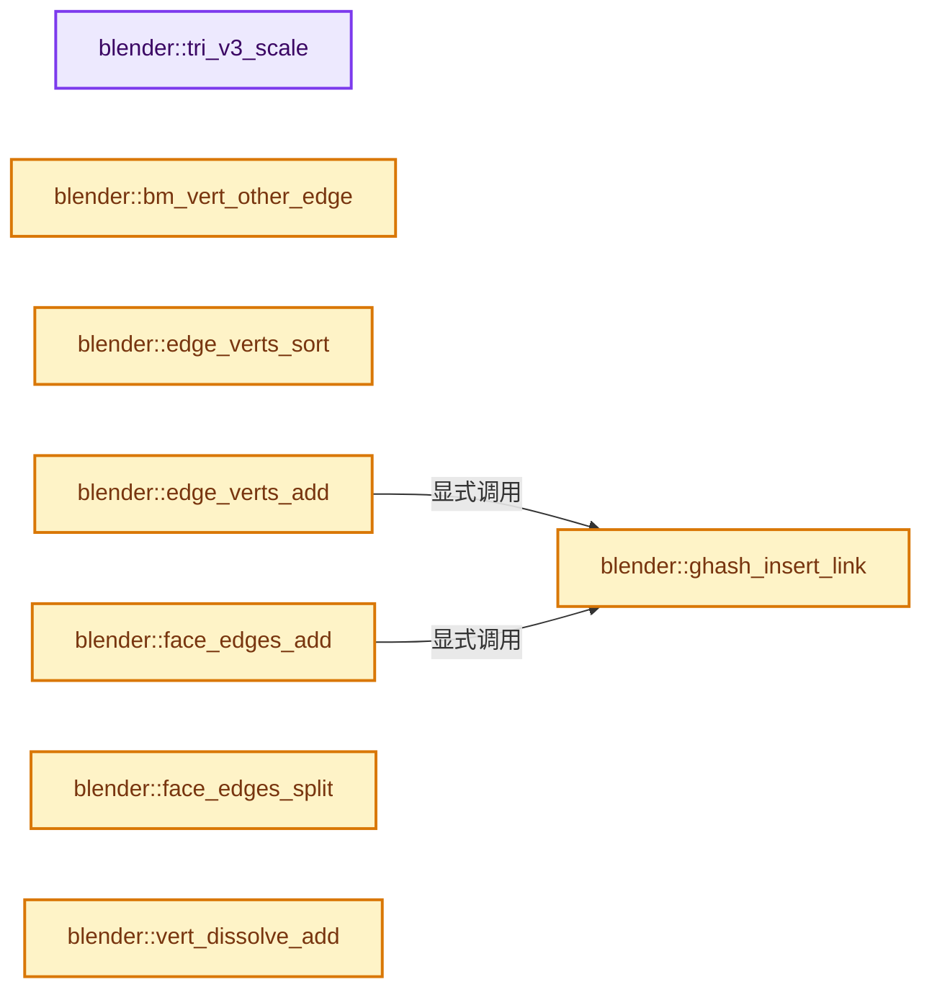

# 实现依赖专题：source/blender/bmesh/tools/bmesh_intersect.cc

[实现依赖导航](../../../README.md) · [符号索引](../../../../00-课程指南/02-源码与提交索引/符号依赖与实现索引.md)

本专题从正文实际调用进入，集中保存共享实现。函数有稳定锚点，可从调用处直接跳到对应完整函数；递归与互相调用通过回链组织。

## 本文件的实现关系




## 相关类型布局与成员入口

<a id="t-61f62dcaa4cd"></a>

### `blender::ISectType`

原始声明：[source/blender/bmesh/tools/bmesh_intersect.cc](../../../../../../../../source/blender/bmesh/tools/bmesh_intersect.cc) · L96—L103。

以下保留类的数据声明与编译条件，成员函数实现通过后面的精确链接阅读。

<!-- annotated:91902fefe1f9bc -->

```cpp
enum ISectType {
  IX_NONE = -1,
  IX_EDGE_TRI_EDGE0,
  IX_EDGE_TRI_EDGE1,
  IX_EDGE_TRI_EDGE2,
  IX_EDGE_TRI,
  IX_TOT,
};
```

<details>
<summary>核对原始源码：source/blender/bmesh/tools/bmesh_intersect.cc · L96—L103</summary>

<!-- original:91902fefe1f9bc:source/blender/bmesh/tools/bmesh_intersect.cc:96:103 -->

```cpp
enum ISectType {
  IX_NONE = -1,
  IX_EDGE_TRI_EDGE0,
  IX_EDGE_TRI_EDGE1,
  IX_EDGE_TRI_EDGE2,
  IX_EDGE_TRI,
  IX_TOT,
};
```

</details>


## 完整成员与函数实现

<a id="f-5ddebd1da1152448"></a>

### `blender::tri_v3_scale`

实现位置：[source/blender/bmesh/tools/bmesh_intersect.cc](../../../../../../../../source/blender/bmesh/tools/bmesh_intersect.cc) · L71—L80。

接口参数：

- `float v1[3]`
- `float v2[3]`
- `float v3[3]`
- `const float t`

**教学注释版**

<!-- annotated:0ec72041873a6c -->

```cpp
static void tri_v3_scale(float v1[3], float v2[3], float v3[3], const float t)
{
  float p[3];

  mid_v3_v3v3v3(p, v1, v2, v3);

  interp_v3_v3v3(v1, p, v1, t);
  interp_v3_v3v3(v2, p, v2, t);
  interp_v3_v3v3(v3, p, v3, t);
}
```

<details>
<summary>核对原始源码：source/blender/bmesh/tools/bmesh_intersect.cc · L71—L80</summary>

<!-- original:0ec72041873a6c:source/blender/bmesh/tools/bmesh_intersect.cc:71:80 -->

```cpp
static void tri_v3_scale(float v1[3], float v2[3], float v3[3], const float t)
{
  float p[3];

  mid_v3_v3v3v3(p, v1, v2, v3);

  interp_v3_v3v3(v1, p, v1, t);
  interp_v3_v3v3(v2, p, v2, t);
  interp_v3_v3v3(v3, p, v3, t);
}
```

</details>

**继续追踪实现**

- `mid_v3_v3v3v3` → [blender::mid_v3_v3v3v3 · L202](../../../01-BLI基础库/intern/math_vector.cc.md#f-f156931a76864a2b)。
- `interp_v3_v3v3` → [blender::interp_v3_v3v3 · L41](../../../01-BLI基础库/intern/math_vector.cc.md#f-18251c70c00824d7)。

<a id="f-f6941703c7710b1b"></a>

### `blender::bm_vert_other_edge`

实现位置：[source/blender/bmesh/tools/bmesh_intersect.cc](../../../../../../../../source/blender/bmesh/tools/bmesh_intersect.cc) · L84—L93。

接口参数：

- `BMVert *v`
- `BMEdge *e`

**教学注释版**

<!-- annotated:8acb5663142345 -->

```cpp
static BMEdge *bm_vert_other_edge(BMVert *v, BMEdge *e)
{
  BLI_assert(BM_vert_is_edge_pair(v));
  BLI_assert(BM_vert_in_edge(e, v));

  if (v->e != e) {
    return v->e;
  }
  return BM_DISK_EDGE_NEXT(v->e, v);
}
```

<details>
<summary>核对原始源码：source/blender/bmesh/tools/bmesh_intersect.cc · L84—L93</summary>

<!-- original:8acb5663142345:source/blender/bmesh/tools/bmesh_intersect.cc:84:93 -->

```cpp
static BMEdge *bm_vert_other_edge(BMVert *v, BMEdge *e)
{
  BLI_assert(BM_vert_is_edge_pair(v));
  BLI_assert(BM_vert_in_edge(e, v));

  if (v->e != e) {
    return v->e;
  }
  return BM_DISK_EDGE_NEXT(v->e, v);
}
```

</details>

**结果出口**

- `return v->e;`
- `return BM_DISK_EDGE_NEXT(v->e, v);`

**继续追踪实现**

- `BLI_assert` → [BLI_assert · L48](../../../01-BLI基础库/BLI_assert.hh.md#m-57a88495704d)；[BLI_assert · L63](../../../01-BLI基础库/BLI_assert.hh.md#m-d07050020cb5)。宏定义由构建条件选择。
- `BM_vert_is_edge_pair` → [blender::BM_vert_is_edge_pair · L580](../intern/bmesh_query.cc.md#f-8d6c36b5c1589dd2)。
- `BM_vert_in_edge` → [blender::BM_vert_in_edge · L24](../intern/bmesh_query_inline.hh.md#f-bca1d91adf4264fd)。
- `BM_DISK_EDGE_NEXT` → [BM_DISK_EDGE_NEXT · L702](../bmesh_class.hh.md#m-5b55b3533de2)。宏定义由构建条件选择。

<a id="f-9a74651f61e74cf1"></a>

### `blender::ghash_insert_link`

实现位置：[source/blender/bmesh/tools/bmesh_intersect.cc](../../../../../../../../source/blender/bmesh/tools/bmesh_intersect.cc) · L133—L159。

接口参数：

- `GHash *gh`
- `void *key`
- `void *val`
- `bool use_test`
- `MemArena *mem_arena`

**教学注释版**

<!-- annotated:e6c54d2ca5824d -->

```cpp
static bool ghash_insert_link(GHash *gh, void *key, void *val, bool use_test, MemArena *mem_arena)
{
  void **ls_base_p;
  LinkBase *ls_base;
  LinkNode *ls;

  if (!BLI_ghash_ensure_p(gh, key, &ls_base_p)) {
    ls_base = static_cast<LinkBase *>(*ls_base_p = BLI_memarena_alloc(mem_arena,
                                                                      sizeof(*ls_base)));
    ls_base->list = nullptr;
    ls_base->list_len = 0;
  }
  else {
    ls_base = static_cast<LinkBase *>(*ls_base_p);
    if (use_test && (BLI_linklist_index(ls_base->list, val) != -1)) {
      return false;
    }
  }

  ls = static_cast<LinkNode *>(BLI_memarena_alloc(mem_arena, sizeof(*ls)));
  ls->next = ls_base->list;
  ls->link = val;
  ls_base->list = ls;
  ls_base->list_len += 1;

  return true;
}
```

<details>
<summary>核对原始源码：source/blender/bmesh/tools/bmesh_intersect.cc · L133—L159</summary>

<!-- original:e6c54d2ca5824d:source/blender/bmesh/tools/bmesh_intersect.cc:133:159 -->

```cpp
static bool ghash_insert_link(GHash *gh, void *key, void *val, bool use_test, MemArena *mem_arena)
{
  void **ls_base_p;
  LinkBase *ls_base;
  LinkNode *ls;

  if (!BLI_ghash_ensure_p(gh, key, &ls_base_p)) {
    ls_base = static_cast<LinkBase *>(*ls_base_p = BLI_memarena_alloc(mem_arena,
                                                                      sizeof(*ls_base)));
    ls_base->list = nullptr;
    ls_base->list_len = 0;
  }
  else {
    ls_base = static_cast<LinkBase *>(*ls_base_p);
    if (use_test && (BLI_linklist_index(ls_base->list, val) != -1)) {
      return false;
    }
  }

  ls = static_cast<LinkNode *>(BLI_memarena_alloc(mem_arena, sizeof(*ls)));
  ls->next = ls_base->list;
  ls->link = val;
  ls_base->list = ls;
  ls_base->list_len += 1;

  return true;
}
```

</details>

**沿实际写入检查状态**

- `ls_base = static_cast<LinkBase *>(*ls_base_p = BLI_memarena_alloc(mem_arena,`
- `ls_base->list = nullptr;`
- `ls_base->list_len = 0;`
- `ls_base = static_cast<LinkBase *>(*ls_base_p);`
- `ls = static_cast<LinkNode *>(BLI_memarena_alloc(mem_arena, sizeof(*ls)));`
- `ls->next = ls_base->list;`
- `ls->link = val;`
- `ls_base->list = ls;`
- `ls_base->list_len += 1;`

**结果出口**

- `return false;`
- `return true;`

**继续追踪实现**

- `BLI_ghash_ensure_p` → [blender::BLI_ghash_ensure_p · L756](../../../01-BLI基础库/intern/BLI_ghash.cc.md#f-5a495dbb4db7a86c)。
- `BLI_memarena_alloc` → [blender::BLI_memarena_alloc · L125](../../../01-BLI基础库/intern/BLI_memarena.cc.md#f-ae79828c3629e134)；[blender::BLI_memarena_alloc · L43](../../../01-BLI基础库/BLI_memarena.hh.md#f-3c7ccf0d8384021b)。同名重载需按实参类型选择。
- `BLI_linklist_index` → [blender::BLI_linklist_index · L37](../../../01-BLI基础库/intern/BLI_linklist.cc.md#f-9fc579e49cf5406f)。

<a id="f-c0f55006521e73cd"></a>

### `blender::edge_verts_sort`

实现位置：[source/blender/bmesh/tools/bmesh_intersect.cc](../../../../../../../../source/blender/bmesh/tools/bmesh_intersect.cc) · L167—L188。

接口参数：

- `const float co[3]`
- `LinkBase *v_ls_base`

**教学注释版**

<!-- annotated:5c7d808d798535 -->

```cpp
static void edge_verts_sort(const float co[3], LinkBase *v_ls_base)
{
  /* not optimal but list will be typically < 5 */
  uint i;
  Array<VertSort, BM_DEFAULT_TOPOLOGY_STACK_SIZE> vert_sort(v_ls_base->list_len);
  LinkNode *node;

  BLI_assert(v_ls_base->list_len > 1);

  for (i = 0, node = v_ls_base->list; i < v_ls_base->list_len; i++, node = node->next) {
    BMVert *v = static_cast<BMVert *>(node->link);
    BLI_assert(v->head.htype == BM_VERT);
    vert_sort[i].val = len_squared_v3v3(co, v->co);
    vert_sort[i].v = v;
  }

  std::ranges::sort(vert_sort, [](const VertSort &a, const VertSort &b) { return a.val < b.val; });

  for (i = 0, node = v_ls_base->list; i < v_ls_base->list_len; i++, node = node->next) {
    node->link = vert_sort[i].v;
  }
}
```

<details>
<summary>核对原始源码：source/blender/bmesh/tools/bmesh_intersect.cc · L167—L188</summary>

<!-- original:5c7d808d798535:source/blender/bmesh/tools/bmesh_intersect.cc:167:188 -->

```cpp
static void edge_verts_sort(const float co[3], LinkBase *v_ls_base)
{
  /* not optimal but list will be typically < 5 */
  uint i;
  Array<VertSort, BM_DEFAULT_TOPOLOGY_STACK_SIZE> vert_sort(v_ls_base->list_len);
  LinkNode *node;

  BLI_assert(v_ls_base->list_len > 1);

  for (i = 0, node = v_ls_base->list; i < v_ls_base->list_len; i++, node = node->next) {
    BMVert *v = static_cast<BMVert *>(node->link);
    BLI_assert(v->head.htype == BM_VERT);
    vert_sort[i].val = len_squared_v3v3(co, v->co);
    vert_sort[i].v = v;
  }

  std::ranges::sort(vert_sort, [](const VertSort &a, const VertSort &b) { return a.val < b.val; });

  for (i = 0, node = v_ls_base->list; i < v_ls_base->list_len; i++, node = node->next) {
    node->link = vert_sort[i].v;
  }
}
```

</details>

**沿实际写入检查状态**

- `vert_sort[i].val = len_squared_v3v3(co, v->co);`
- `vert_sort[i].v = v;`
- `node->link = vert_sort[i].v;`

**继续追踪实现**

- `BLI_assert` → [BLI_assert · L48](../../../01-BLI基础库/BLI_assert.hh.md#m-57a88495704d)；[BLI_assert · L63](../../../01-BLI基础库/BLI_assert.hh.md#m-d07050020cb5)。宏定义由构建条件选择。
- `len_squared_v3v3` → [blender::len_squared_v3v3 · L794](../../../01-BLI基础库/intern/math_vector_inline.cc.md#f-ae487ac3ef64aa87)。
- `std::ranges::sort` → [外部契约](https://eel.is/c++draft/)：这个边界按实际表达式及所属类型核对参数、返回值、寿命与失败行为。这里提供接口入口，不声称已解释该第三方版本的内部实现。

<a id="f-b7d38236b52a314f"></a>

### `blender::edge_verts_add`

实现位置：[source/blender/bmesh/tools/bmesh_intersect.cc](../../../../../../../../source/blender/bmesh/tools/bmesh_intersect.cc) · L191—L196。

接口参数：

- `ISectState *s`
- `BMEdge *e`
- `BMVert *v`
- `const bool use_test`

**教学注释版**

<!-- annotated:5edcff89f700f6 -->

```cpp
static void edge_verts_add(ISectState *s, BMEdge *e, BMVert *v, const bool use_test)
{
  BLI_assert(e->head.htype == BM_EDGE);
  BLI_assert(v->head.htype == BM_VERT);
  ghash_insert_link(s->edge_verts, static_cast<void *>(e), v, use_test, s->mem_arena);
}
```

<details>
<summary>核对原始源码：source/blender/bmesh/tools/bmesh_intersect.cc · L191—L196</summary>

<!-- original:5edcff89f700f6:source/blender/bmesh/tools/bmesh_intersect.cc:191:196 -->

```cpp
static void edge_verts_add(ISectState *s, BMEdge *e, BMVert *v, const bool use_test)
{
  BLI_assert(e->head.htype == BM_EDGE);
  BLI_assert(v->head.htype == BM_VERT);
  ghash_insert_link(s->edge_verts, static_cast<void *>(e), v, use_test, s->mem_arena);
}
```

</details>

**继续追踪实现**

- `BLI_assert` → [BLI_assert · L48](../../../01-BLI基础库/BLI_assert.hh.md#m-57a88495704d)；[BLI_assert · L63](../../../01-BLI基础库/BLI_assert.hh.md#m-d07050020cb5)。宏定义由构建条件选择。
- `ghash_insert_link` → [blender::ghash_insert_link · L133](bmesh_intersect.cc.md#f-9a74651f61e74cf1)。

<a id="f-dfece19fee2c5fff"></a>

### `blender::face_edges_add`

实现位置：[source/blender/bmesh/tools/bmesh_intersect.cc](../../../../../../../../source/blender/bmesh/tools/bmesh_intersect.cc) · L198—L206。

接口参数：

- `ISectState *s`
- `const int f_index`
- `BMEdge *e`
- `const bool use_test`

**教学注释版**

<!-- annotated:e61b6c417dfb5d -->

```cpp
static void face_edges_add(ISectState *s, const int f_index, BMEdge *e, const bool use_test)
{
  void *f_index_key = POINTER_FROM_INT(f_index);
  BLI_assert(e->head.htype == BM_EDGE);
  BLI_assert(BM_edge_in_face(e, s->bm->ftable[f_index]) == false);
  BLI_assert(BM_elem_index_get(s->bm->ftable[f_index]) == f_index);

  ghash_insert_link(s->face_edges, f_index_key, e, use_test, s->mem_arena);
}
```

<details>
<summary>核对原始源码：source/blender/bmesh/tools/bmesh_intersect.cc · L198—L206</summary>

<!-- original:e61b6c417dfb5d:source/blender/bmesh/tools/bmesh_intersect.cc:198:206 -->

```cpp
static void face_edges_add(ISectState *s, const int f_index, BMEdge *e, const bool use_test)
{
  void *f_index_key = POINTER_FROM_INT(f_index);
  BLI_assert(e->head.htype == BM_EDGE);
  BLI_assert(BM_edge_in_face(e, s->bm->ftable[f_index]) == false);
  BLI_assert(BM_elem_index_get(s->bm->ftable[f_index]) == f_index);

  ghash_insert_link(s->face_edges, f_index_key, e, use_test, s->mem_arena);
}
```

</details>

**继续追踪实现**

- `POINTER_FROM_INT` → [POINTER_FROM_INT · L321](../../../01-BLI基础库/BLI_utildefines.hh.md#m-17841357bb5a)。宏定义由构建条件选择。
- `BLI_assert` → [BLI_assert · L48](../../../01-BLI基础库/BLI_assert.hh.md#m-57a88495704d)；[BLI_assert · L63](../../../01-BLI基础库/BLI_assert.hh.md#m-d07050020cb5)。宏定义由构建条件选择。
- `BM_edge_in_face` → [blender::BM_edge_in_face · L432](../intern/bmesh_query.cc.md#f-35ed5d132fbe244d)。
- `BM_elem_index_get` → [BM_elem_index_get · L120](../intern/bmesh_inline.hh.md#m-201981cdc62d)。宏定义由构建条件选择。
- `ghash_insert_link` → [blender::ghash_insert_link · L133](bmesh_intersect.cc.md#f-9a74651f61e74cf1)。

<a id="f-ea5d9cac89068db3"></a>

### `blender::face_edges_split`

实现位置：[source/blender/bmesh/tools/bmesh_intersect.cc](../../../../../../../../source/blender/bmesh/tools/bmesh_intersect.cc) · L209—L255。

接口参数：

- `BMesh *bm`
- `BMFace *f`
- `LinkBase *e_ls_base`
- `bool use_island_connect`
- `bool use_partial_connect`
- `MemArena *mem_arena_edgenet`

**教学注释版**

<!-- annotated:5d5e333208ffaa -->

```cpp
static void face_edges_split(BMesh *bm,
                             BMFace *f,
                             LinkBase *e_ls_base,
                             bool use_island_connect,
                             bool use_partial_connect,
                             MemArena *mem_arena_edgenet)
{
  uint i;
  uint edge_arr_len = e_ls_base->list_len;
  /* NOTE: `edge_arr` pointer may be reassigned to arena memory below. */
  Array<BMEdge *, BM_DEFAULT_TOPOLOGY_STACK_SIZE> edge_arr_buf(edge_arr_len);
  // [讲解] edge_arr_buf.data：提供数组的借用访问入口。
  BMEdge **edge_arr = edge_arr_buf.data();
  LinkNode *node;
  BLI_assert(f->head.htype == BM_FACE);

  for (i = 0, node = e_ls_base->list; i < e_ls_base->list_len; i++, node = node->next) {
    edge_arr[i] = static_cast<BMEdge *>(node->link);
  }
  BLI_assert(node == nullptr);

#  ifdef USE_DUMP
  printf("# %s: %d %u\n", __func__, BM_elem_index_get(f), e_ls_base->list_len);
#  endif

#  ifdef USE_NET_ISLAND_CONNECT
  if (use_island_connect) {
    uint edge_arr_holes_len;
    BMEdge **edge_arr_holes;
    if (BM_face_split_edgenet_connect_islands(bm,
                                              f,
                                              edge_arr,
                                              edge_arr_len,
                                              use_partial_connect,
                                              mem_arena_edgenet,
                                              &edge_arr_holes,
                                              &edge_arr_holes_len))
    {
      edge_arr_len = edge_arr_holes_len;
      edge_arr = edge_arr_holes; /* owned by the arena */
    }
  }
#  else
  UNUSED_VARS(use_island_connect, mem_arena_edgenet);
#  endif

  BM_face_split_edgenet(bm, f, edge_arr, int(edge_arr_len), nullptr);
}
```

<details>
<summary>核对原始源码：source/blender/bmesh/tools/bmesh_intersect.cc · L209—L255</summary>

<!-- original:5d5e333208ffaa:source/blender/bmesh/tools/bmesh_intersect.cc:209:255 -->

```cpp
static void face_edges_split(BMesh *bm,
                             BMFace *f,
                             LinkBase *e_ls_base,
                             bool use_island_connect,
                             bool use_partial_connect,
                             MemArena *mem_arena_edgenet)
{
  uint i;
  uint edge_arr_len = e_ls_base->list_len;
  /* NOTE: `edge_arr` pointer may be reassigned to arena memory below. */
  Array<BMEdge *, BM_DEFAULT_TOPOLOGY_STACK_SIZE> edge_arr_buf(edge_arr_len);
  BMEdge **edge_arr = edge_arr_buf.data();
  LinkNode *node;
  BLI_assert(f->head.htype == BM_FACE);

  for (i = 0, node = e_ls_base->list; i < e_ls_base->list_len; i++, node = node->next) {
    edge_arr[i] = static_cast<BMEdge *>(node->link);
  }
  BLI_assert(node == nullptr);

#  ifdef USE_DUMP
  printf("# %s: %d %u\n", __func__, BM_elem_index_get(f), e_ls_base->list_len);
#  endif

#  ifdef USE_NET_ISLAND_CONNECT
  if (use_island_connect) {
    uint edge_arr_holes_len;
    BMEdge **edge_arr_holes;
    if (BM_face_split_edgenet_connect_islands(bm,
                                              f,
                                              edge_arr,
                                              edge_arr_len,
                                              use_partial_connect,
                                              mem_arena_edgenet,
                                              &edge_arr_holes,
                                              &edge_arr_holes_len))
    {
      edge_arr_len = edge_arr_holes_len;
      edge_arr = edge_arr_holes; /* owned by the arena */
    }
  }
#  else
  UNUSED_VARS(use_island_connect, mem_arena_edgenet);
#  endif

  BM_face_split_edgenet(bm, f, edge_arr, int(edge_arr_len), nullptr);
}
```

</details>

**沿实际写入检查状态**

- `edge_arr[i] = static_cast<BMEdge *>(node->link);`
- `edge_arr_len = edge_arr_holes_len;`
- `edge_arr = edge_arr_holes; /* owned by the arena */`

**继续追踪实现**

- `edge_arr_buf.data` → [blender::Array::data · L323](../../../../01-基础容器与现代CPP/08-Array复制移动与销毁.md#f-95648c799002f4ba)；[blender::Array::data · L327](../../../../01-基础容器与现代CPP/08-Array复制移动与销毁.md#f-50c18301f8c40f9e)。同名重载需按实参类型选择。
- `BLI_assert` → [BLI_assert · L48](../../../01-BLI基础库/BLI_assert.hh.md#m-57a88495704d)；[BLI_assert · L63](../../../01-BLI基础库/BLI_assert.hh.md#m-d07050020cb5)。宏定义由构建条件选择。
- `printf` → [外部契约](https://eel.is/c++draft/)：这个边界按实际表达式及所属类型核对参数、返回值、寿命与失败行为。这里提供接口入口，不声称已解释该第三方版本的内部实现。
- `BM_elem_index_get` → [BM_elem_index_get · L120](../intern/bmesh_inline.hh.md#m-201981cdc62d)。宏定义由构建条件选择。
- `BM_face_split_edgenet_connect_islands` → [blender::BM_face_split_edgenet_connect_islands · L1248](../intern/bmesh_polygon_edgenet.cc.md#f-9273ad113d22dc8d)。
- `UNUSED_VARS` → [UNUSED_VARS · L522](../../../01-BLI基础库/BLI_utildefines.hh.md#m-013582537634)；[UNUSED_VARS · L41](../../gpu/GPU_shader_shared_utils.hh.md#m-05d9d7a33da0)；[UNUSED_VARS · L62](../../gpu/GPU_shader_shared_utils.hh.md#m-e12c683a4aca)。宏定义由构建条件选择。
- `BM_face_split_edgenet` → [blender::BM_face_split_edgenet · L477](../intern/bmesh_polygon_edgenet.cc.md#f-4d9a3bc8f5d3d976)。

<a id="f-e0c321b704848453"></a>

### `blender::vert_dissolve_add`

实现位置：[source/blender/bmesh/tools/bmesh_intersect.cc](../../../../../../../../source/blender/bmesh/tools/bmesh_intersect.cc) · L259—L267。

接口参数：

- `ISectState *s`
- `BMVert *v`

**教学注释版**

<!-- annotated:fe8bf8933b1546 -->

```cpp
static void vert_dissolve_add(ISectState *s, BMVert *v)
{
  BLI_assert(v->head.htype == BM_VERT);
  BLI_assert(!BM_elem_flag_test(v, BM_ELEM_TAG));
  BLI_assert(BLI_linklist_index(s->vert_dissolve, v) == -1);

  BM_elem_flag_enable(v, BM_ELEM_TAG);
  BLI_linklist_prepend_arena(&s->vert_dissolve, v, s->mem_arena);
}
```

<details>
<summary>核对原始源码：source/blender/bmesh/tools/bmesh_intersect.cc · L259—L267</summary>

<!-- original:fe8bf8933b1546:source/blender/bmesh/tools/bmesh_intersect.cc:259:267 -->

```cpp
static void vert_dissolve_add(ISectState *s, BMVert *v)
{
  BLI_assert(v->head.htype == BM_VERT);
  BLI_assert(!BM_elem_flag_test(v, BM_ELEM_TAG));
  BLI_assert(BLI_linklist_index(s->vert_dissolve, v) == -1);

  BM_elem_flag_enable(v, BM_ELEM_TAG);
  BLI_linklist_prepend_arena(&s->vert_dissolve, v, s->mem_arena);
}
```

</details>

**继续追踪实现**

- `BLI_assert` → [BLI_assert · L48](../../../01-BLI基础库/BLI_assert.hh.md#m-57a88495704d)；[BLI_assert · L63](../../../01-BLI基础库/BLI_assert.hh.md#m-d07050020cb5)。宏定义由构建条件选择。
- `BM_elem_flag_test` → [BM_elem_flag_test · L21](../intern/bmesh_inline.hh.md#m-2431d1179b41)。宏定义由构建条件选择。
- `BLI_linklist_index` → [blender::BLI_linklist_index · L37](../../../01-BLI基础库/intern/BLI_linklist.cc.md#f-9fc579e49cf5406f)。
- `BM_elem_flag_enable` → [BM_elem_flag_enable · L23](../intern/bmesh_inline.hh.md#m-4400242f1540)。宏定义由构建条件选择。
- `BLI_linklist_prepend_arena` → [blender::BLI_linklist_prepend_arena · L169](../../../01-BLI基础库/intern/BLI_linklist.cc.md#f-de98ab9b60371015)。

<a id="f-5c2c9cd692819179"></a>

### `blender::intersect_line_tri`

实现位置：[source/blender/bmesh/tools/bmesh_intersect.cc](../../../../../../../../source/blender/bmesh/tools/bmesh_intersect.cc) · L270—L339。

接口参数：

- `const float p0[3]`
- `const float p1[3]`
- `const float *t_cos[3]`
- `const float t_nor[3]`
- `float r_ix[3]`
- `const ISectEpsilon *e`

**教学注释版**

<!-- annotated:2b9cc4bb5349f5 -->

```cpp
static enum ISectType intersect_line_tri(const float p0[3],
                                         const float p1[3],
                                         const float *t_cos[3],
                                         const float t_nor[3],
                                         float r_ix[3],
                                         const ISectEpsilon *e)
{
  float p_dir[3];
  uint i_t0;
  float fac;

  sub_v3_v3v3(p_dir, p0, p1);
  normalize_v3(p_dir);

  for (i_t0 = 0; i_t0 < 3; i_t0++) {
    const uint i_t1 = (i_t0 + 1) % 3;
    float te_dir[3];

    sub_v3_v3v3(te_dir, t_cos[i_t0], t_cos[i_t1]);
    normalize_v3(te_dir);
    if (fabsf(dot_v3v3(p_dir, te_dir)) >= 1.0f - e->eps) {
      /* co-linear */
    }
    else {
      float ix_pair[2][3];
      int ix_pair_type;

      ix_pair_type = isect_line_line_epsilon_v3(
          p0, p1, t_cos[i_t0], t_cos[i_t1], ix_pair[0], ix_pair[1], 0.0f);

      if (ix_pair_type != 0) {
        if (ix_pair_type == 1) {
          copy_v3_v3(ix_pair[1], ix_pair[0]);
        }

        if ((ix_pair_type == 1) || (len_squared_v3v3(ix_pair[0], ix_pair[1]) <= e->eps_margin_sq))
        {
          fac = line_point_factor_v3(ix_pair[1], t_cos[i_t0], t_cos[i_t1]);
          if ((fac >= e->eps_margin) && (fac <= 1.0f - e->eps_margin)) {
            fac = line_point_factor_v3(ix_pair[0], p0, p1);
            if ((fac >= e->eps_margin) && (fac <= 1.0f - e->eps_margin)) {
              copy_v3_v3(r_ix, ix_pair[0]);
              return ISectType(IX_EDGE_TRI_EDGE0 + static_cast<enum ISectType>(i_t0));
            }
          }
        }
      }
    }
  }

  /* check ray isn't planar with tri */
  if (fabsf(dot_v3v3(p_dir, t_nor)) >= e->eps) {
    if (isect_line_segment_tri_epsilon_v3(
            p0, p1, t_cos[0], t_cos[1], t_cos[2], &fac, nullptr, 0.0f))
    {
      if ((fac >= e->eps_margin) && (fac <= 1.0f - e->eps_margin)) {
        interp_v3_v3v3(r_ix, p0, p1, fac);
        // [讲解] std::min：按比较关系选取较小值；截断范围时还需先满足非负和可表示范围，min本身不会证明边界安全。
        if (std::min({len_squared_v3v3(t_cos[0], r_ix),
                      len_squared_v3v3(t_cos[1], r_ix),
                      len_squared_v3v3(t_cos[2], r_ix)}) >= e->eps_margin_sq)
        {
          return IX_EDGE_TRI;
        }
      }
    }
  }

  /* r_ix may be unset */
  return IX_NONE;
}
```

<details>
<summary>核对原始源码：source/blender/bmesh/tools/bmesh_intersect.cc · L270—L339</summary>

<!-- original:2b9cc4bb5349f5:source/blender/bmesh/tools/bmesh_intersect.cc:270:339 -->

```cpp
static enum ISectType intersect_line_tri(const float p0[3],
                                         const float p1[3],
                                         const float *t_cos[3],
                                         const float t_nor[3],
                                         float r_ix[3],
                                         const ISectEpsilon *e)
{
  float p_dir[3];
  uint i_t0;
  float fac;

  sub_v3_v3v3(p_dir, p0, p1);
  normalize_v3(p_dir);

  for (i_t0 = 0; i_t0 < 3; i_t0++) {
    const uint i_t1 = (i_t0 + 1) % 3;
    float te_dir[3];

    sub_v3_v3v3(te_dir, t_cos[i_t0], t_cos[i_t1]);
    normalize_v3(te_dir);
    if (fabsf(dot_v3v3(p_dir, te_dir)) >= 1.0f - e->eps) {
      /* co-linear */
    }
    else {
      float ix_pair[2][3];
      int ix_pair_type;

      ix_pair_type = isect_line_line_epsilon_v3(
          p0, p1, t_cos[i_t0], t_cos[i_t1], ix_pair[0], ix_pair[1], 0.0f);

      if (ix_pair_type != 0) {
        if (ix_pair_type == 1) {
          copy_v3_v3(ix_pair[1], ix_pair[0]);
        }

        if ((ix_pair_type == 1) || (len_squared_v3v3(ix_pair[0], ix_pair[1]) <= e->eps_margin_sq))
        {
          fac = line_point_factor_v3(ix_pair[1], t_cos[i_t0], t_cos[i_t1]);
          if ((fac >= e->eps_margin) && (fac <= 1.0f - e->eps_margin)) {
            fac = line_point_factor_v3(ix_pair[0], p0, p1);
            if ((fac >= e->eps_margin) && (fac <= 1.0f - e->eps_margin)) {
              copy_v3_v3(r_ix, ix_pair[0]);
              return ISectType(IX_EDGE_TRI_EDGE0 + static_cast<enum ISectType>(i_t0));
            }
          }
        }
      }
    }
  }

  /* check ray isn't planar with tri */
  if (fabsf(dot_v3v3(p_dir, t_nor)) >= e->eps) {
    if (isect_line_segment_tri_epsilon_v3(
            p0, p1, t_cos[0], t_cos[1], t_cos[2], &fac, nullptr, 0.0f))
    {
      if ((fac >= e->eps_margin) && (fac <= 1.0f - e->eps_margin)) {
        interp_v3_v3v3(r_ix, p0, p1, fac);
        if (std::min({len_squared_v3v3(t_cos[0], r_ix),
                      len_squared_v3v3(t_cos[1], r_ix),
                      len_squared_v3v3(t_cos[2], r_ix)}) >= e->eps_margin_sq)
        {
          return IX_EDGE_TRI;
        }
      }
    }
  }

  /* r_ix may be unset */
  return IX_NONE;
}
```

</details>

**沿实际写入检查状态**

- `ix_pair_type = isect_line_line_epsilon_v3(`
- `fac = line_point_factor_v3(ix_pair[1], t_cos[i_t0], t_cos[i_t1]);`
- `fac = line_point_factor_v3(ix_pair[0], p0, p1);`

**结果出口**

- `return ISectType(IX_EDGE_TRI_EDGE0 + static_cast<enum ISectType>(i_t0));`
- `return IX_EDGE_TRI;`
- `return IX_NONE;`

**继续追踪实现**

- `sub_v3_v3v3` → [blender::sub_v3_v3v3 · L360](../../../01-BLI基础库/intern/math_vector_inline.cc.md#f-23781c252db8b30c)。
- `normalize_v3` → [blender::normalize_v3 · L933](../../../01-BLI基础库/intern/math_vector_inline.cc.md#f-5f3257e657ef732c)。
- `fabsf` → [fabsf · L21](../../../07-Intern运行时与平台/cycles/kernel/svm/radial_tiling_shared.h.md#m-02cc4c69cfb3)；[fabsf · L43](../../../07-Intern运行时与平台/cycles/kernel/svm/radial_tiling_shared.h.md#m-04effe61803b)；[fabsf · L74](../../../07-Intern运行时与平台/cycles/kernel/svm/radial_tiling_shared.h.md#m-927dd4eba7dc)；[fabsf · L25](../../../01-BLI基础库/intern/radial_tiling_shared.hh.md#m-8348d6b3d08f)；[fabsf · L47](../../../01-BLI基础库/intern/radial_tiling_shared.hh.md#m-13b7e0b6d84f)；[fabsf · L78](../../../01-BLI基础库/intern/radial_tiling_shared.hh.md#m-326c83464a0d)；[fabsf · L21](../../../07-Intern运行时与平台/cycles/kernel/osl/shaders/node_radial_tiling_shared.h.md#m-7c3ee12fc119)；[fabsf · L43](../../../07-Intern运行时与平台/cycles/kernel/osl/shaders/node_radial_tiling_shared.h.md#m-9112db0e2dd1)；[fabsf · L74](../../../07-Intern运行时与平台/cycles/kernel/osl/shaders/node_radial_tiling_shared.h.md#m-ee4e61908a6f)；[fabsf · L167](../../../07-Intern运行时与平台/cycles/kernel/device/oneapi/compat.h.md#m-b039ee6c1601)；[fabsf · L265](../../../07-Intern运行时与平台/cycles/kernel/device/metal/compat.h.md#m-6b21869e9f3f)。宏定义由构建条件选择。
- `dot_v3v3` → [blender::dot_v3v3 · L646](../../../01-BLI基础库/intern/math_vector_inline.cc.md#f-c88befa67d07591a)。
- `isect_line_line_epsilon_v3` → [blender::isect_line_line_epsilon_v3 · L3049](../../../01-BLI基础库/intern/math_geom.cc.md#f-ffe5c1ee4a0e4b55)。
- `copy_v3_v3` → [blender::copy_v3_v3 · L47](../../../01-BLI基础库/intern/math_vector_inline.cc.md#f-037a0d5fa5060bd6)。
- `len_squared_v3v3` → [blender::len_squared_v3v3 · L794](../../../01-BLI基础库/intern/math_vector_inline.cc.md#f-ae487ac3ef64aa87)。
- `line_point_factor_v3` → [blender::line_point_factor_v3 · L3425](../../../01-BLI基础库/intern/math_geom.cc.md#f-8007e153e8d379bc)。
- `ISectType` → [blender::ISectType](bmesh_intersect.cc.md#t-61f62dcaa4cd)。
- `isect_line_segment_tri_epsilon_v3` → [blender::isect_line_segment_tri_epsilon_v3 · L1761](../../../01-BLI基础库/intern/math_geom.cc.md#f-8abbd30ecea9c43c)。
- `interp_v3_v3v3` → [blender::interp_v3_v3v3 · L41](../../../01-BLI基础库/intern/math_vector.cc.md#f-18251c70c00824d7)。
- `std::min` → [外部契约](https://eel.is/c++draft/alg.min.max)：按比较关系选取较小值；截断范围时还需先满足非负和可表示范围，min本身不会证明边界安全。

<a id="f-152e5420a8bb45cb"></a>

### `blender::bm_isect_edge_tri`

实现位置：[source/blender/bmesh/tools/bmesh_intersect.cc](../../../../../../../../source/blender/bmesh/tools/bmesh_intersect.cc) · L341—L471。

接口参数：

- `ISectState *s`
- `BMVert *e_v0`
- `BMVert *e_v1`
- `BMVert *t[3]`
- `const int t_index`
- `const float *t_cos[3]`
- `const float t_nor[3]`
- `enum ISectType *r_side`

**教学注释版**

<!-- annotated:43f7ddadd2d293 -->

```cpp
static BMVert *bm_isect_edge_tri(ISectState *s,
                                 BMVert *e_v0,
                                 BMVert *e_v1,
                                 BMVert *t[3],
                                 const int t_index,
                                 const float *t_cos[3],
                                 const float t_nor[3],
                                 enum ISectType *r_side)
{
  BMesh *bm = s->bm;
  int k_arr[IX_TOT][4];
  uint i;
  const int ti[3] = {UNPACK3_EX(BM_elem_index_get, t, )};
  float ix[3];

  if (BM_elem_index_get(e_v0) > BM_elem_index_get(e_v1)) {
    std::swap(e_v0, e_v1);
  }

#ifdef USE_PARANOID
  BLI_assert(len_squared_v3v3(e_v0->co, t[0]->co) >= s->epsilon.eps_sq);
  BLI_assert(len_squared_v3v3(e_v0->co, t[1]->co) >= s->epsilon.eps_sq);
  BLI_assert(len_squared_v3v3(e_v0->co, t[2]->co) >= s->epsilon.eps_sq);
  BLI_assert(len_squared_v3v3(e_v1->co, t[0]->co) >= s->epsilon.eps_sq);
  BLI_assert(len_squared_v3v3(e_v1->co, t[1]->co) >= s->epsilon.eps_sq);
  BLI_assert(len_squared_v3v3(e_v1->co, t[2]->co) >= s->epsilon.eps_sq);
#endif

#define KEY_SET(k, i0, i1, i2, i3) \
  { \
    (k)[0] = i0; \
    (k)[1] = i1; \
    (k)[2] = i2; \
    (k)[3] = i3; \
  } \
  (void)0

/* Order tri, then order (1-2, 2-3). */
#define KEY_EDGE_TRI_ORDER(k) \
  { \
    if (k[2] > k[3]) { \
      std::swap(k[2], k[3]); \
    } \
    if (k[0] > k[2]) { \
      std::swap(k[0], k[2]); \
      std::swap(k[1], k[3]); \
    } \
  } \
  (void)0

  KEY_SET(k_arr[IX_EDGE_TRI], BM_elem_index_get(e_v0), BM_elem_index_get(e_v1), t_index, -1);
  /* need to order here */
  KEY_SET(
      k_arr[IX_EDGE_TRI_EDGE0], BM_elem_index_get(e_v0), BM_elem_index_get(e_v1), ti[0], ti[1]);
  KEY_SET(
      k_arr[IX_EDGE_TRI_EDGE1], BM_elem_index_get(e_v0), BM_elem_index_get(e_v1), ti[1], ti[2]);
  KEY_SET(
      k_arr[IX_EDGE_TRI_EDGE2], BM_elem_index_get(e_v0), BM_elem_index_get(e_v1), ti[2], ti[0]);

  KEY_EDGE_TRI_ORDER(k_arr[IX_EDGE_TRI_EDGE0]);
  KEY_EDGE_TRI_ORDER(k_arr[IX_EDGE_TRI_EDGE1]);
  KEY_EDGE_TRI_ORDER(k_arr[IX_EDGE_TRI_EDGE2]);

#undef KEY_SET
#undef KEY_EDGE_TRI_ORDER

  for (i = 0; i < ARRAY_SIZE(k_arr); i++) {
    BMVert *iv;

    iv = static_cast<BMVert *>(BLI_ghash_lookup(s->edgetri_cache, k_arr[i]));

    if (iv) {
#ifdef USE_DUMP
      printf("# cache hit (%d, %d, %d, %d)\n", UNPACK4(k_arr[i]));
#endif
      *r_side = static_cast<enum ISectType>(i);
      return iv;
    }
  }

  *r_side = intersect_line_tri(e_v0->co, e_v1->co, t_cos, t_nor, ix, &s->epsilon);
  if (*r_side != IX_NONE) {
    BMVert *iv;
    BMEdge *e;
#ifdef USE_DUMP
    printf("# new vertex (%.6f, %.6f, %.6f) %d\n", UNPACK3(ix), *r_side);
#endif

#ifdef USE_PARANOID
    BLI_assert(len_squared_v3v3(ix, e_v0->co) > s->epsilon.eps_sq);
    BLI_assert(len_squared_v3v3(ix, e_v1->co) > s->epsilon.eps_sq);
    BLI_assert(len_squared_v3v3(ix, t[0]->co) > s->epsilon.eps_sq);
    BLI_assert(len_squared_v3v3(ix, t[1]->co) > s->epsilon.eps_sq);
    BLI_assert(len_squared_v3v3(ix, t[2]->co) > s->epsilon.eps_sq);
#endif
    iv = BM_vert_create(bm, ix, nullptr, eBMCreateFlag(0));

    e = BM_edge_exists(e_v0, e_v1);
    if (e) {
#ifdef USE_DUMP
      printf("# adding to edge %d\n", BM_elem_index_get(e));
#endif
      edge_verts_add(s, e, iv, false);
    }
    else {
#ifdef USE_DISSOLVE
      vert_dissolve_add(s, iv);
#endif
    }

    if ((*r_side >= IX_EDGE_TRI_EDGE0) && (*r_side <= IX_EDGE_TRI_EDGE2)) {
      i = uint(*r_side - IX_EDGE_TRI_EDGE0);
      e = BM_edge_exists(t[i], t[(i + 1) % 3]);
      if (e) {
        edge_verts_add(s, e, iv, false);
      }
    }

    {
      int *k = static_cast<int *>(BLI_memarena_alloc(s->mem_arena, sizeof(int[4])));
      // [讲解] memcpy：复制字节，源与目标不应重叠。类型生命周期、对齐和可复制表示须由调用者证明，不是任意对象的复制构造。
      memcpy(k, k_arr[*r_side], sizeof(int[4]));
      BLI_ghash_insert(s->edgetri_cache, k, iv);
    }

    return iv;
  }

  *r_side = IX_NONE;

  return nullptr;
}
```

<details>
<summary>核对原始源码：source/blender/bmesh/tools/bmesh_intersect.cc · L341—L471</summary>

<!-- original:43f7ddadd2d293:source/blender/bmesh/tools/bmesh_intersect.cc:341:471 -->

```cpp
static BMVert *bm_isect_edge_tri(ISectState *s,
                                 BMVert *e_v0,
                                 BMVert *e_v1,
                                 BMVert *t[3],
                                 const int t_index,
                                 const float *t_cos[3],
                                 const float t_nor[3],
                                 enum ISectType *r_side)
{
  BMesh *bm = s->bm;
  int k_arr[IX_TOT][4];
  uint i;
  const int ti[3] = {UNPACK3_EX(BM_elem_index_get, t, )};
  float ix[3];

  if (BM_elem_index_get(e_v0) > BM_elem_index_get(e_v1)) {
    std::swap(e_v0, e_v1);
  }

#ifdef USE_PARANOID
  BLI_assert(len_squared_v3v3(e_v0->co, t[0]->co) >= s->epsilon.eps_sq);
  BLI_assert(len_squared_v3v3(e_v0->co, t[1]->co) >= s->epsilon.eps_sq);
  BLI_assert(len_squared_v3v3(e_v0->co, t[2]->co) >= s->epsilon.eps_sq);
  BLI_assert(len_squared_v3v3(e_v1->co, t[0]->co) >= s->epsilon.eps_sq);
  BLI_assert(len_squared_v3v3(e_v1->co, t[1]->co) >= s->epsilon.eps_sq);
  BLI_assert(len_squared_v3v3(e_v1->co, t[2]->co) >= s->epsilon.eps_sq);
#endif

#define KEY_SET(k, i0, i1, i2, i3) \
  { \
    (k)[0] = i0; \
    (k)[1] = i1; \
    (k)[2] = i2; \
    (k)[3] = i3; \
  } \
  (void)0

/* Order tri, then order (1-2, 2-3). */
#define KEY_EDGE_TRI_ORDER(k) \
  { \
    if (k[2] > k[3]) { \
      std::swap(k[2], k[3]); \
    } \
    if (k[0] > k[2]) { \
      std::swap(k[0], k[2]); \
      std::swap(k[1], k[3]); \
    } \
  } \
  (void)0

  KEY_SET(k_arr[IX_EDGE_TRI], BM_elem_index_get(e_v0), BM_elem_index_get(e_v1), t_index, -1);
  /* need to order here */
  KEY_SET(
      k_arr[IX_EDGE_TRI_EDGE0], BM_elem_index_get(e_v0), BM_elem_index_get(e_v1), ti[0], ti[1]);
  KEY_SET(
      k_arr[IX_EDGE_TRI_EDGE1], BM_elem_index_get(e_v0), BM_elem_index_get(e_v1), ti[1], ti[2]);
  KEY_SET(
      k_arr[IX_EDGE_TRI_EDGE2], BM_elem_index_get(e_v0), BM_elem_index_get(e_v1), ti[2], ti[0]);

  KEY_EDGE_TRI_ORDER(k_arr[IX_EDGE_TRI_EDGE0]);
  KEY_EDGE_TRI_ORDER(k_arr[IX_EDGE_TRI_EDGE1]);
  KEY_EDGE_TRI_ORDER(k_arr[IX_EDGE_TRI_EDGE2]);

#undef KEY_SET
#undef KEY_EDGE_TRI_ORDER

  for (i = 0; i < ARRAY_SIZE(k_arr); i++) {
    BMVert *iv;

    iv = static_cast<BMVert *>(BLI_ghash_lookup(s->edgetri_cache, k_arr[i]));

    if (iv) {
#ifdef USE_DUMP
      printf("# cache hit (%d, %d, %d, %d)\n", UNPACK4(k_arr[i]));
#endif
      *r_side = static_cast<enum ISectType>(i);
      return iv;
    }
  }

  *r_side = intersect_line_tri(e_v0->co, e_v1->co, t_cos, t_nor, ix, &s->epsilon);
  if (*r_side != IX_NONE) {
    BMVert *iv;
    BMEdge *e;
#ifdef USE_DUMP
    printf("# new vertex (%.6f, %.6f, %.6f) %d\n", UNPACK3(ix), *r_side);
#endif

#ifdef USE_PARANOID
    BLI_assert(len_squared_v3v3(ix, e_v0->co) > s->epsilon.eps_sq);
    BLI_assert(len_squared_v3v3(ix, e_v1->co) > s->epsilon.eps_sq);
    BLI_assert(len_squared_v3v3(ix, t[0]->co) > s->epsilon.eps_sq);
    BLI_assert(len_squared_v3v3(ix, t[1]->co) > s->epsilon.eps_sq);
    BLI_assert(len_squared_v3v3(ix, t[2]->co) > s->epsilon.eps_sq);
#endif
    iv = BM_vert_create(bm, ix, nullptr, eBMCreateFlag(0));

    e = BM_edge_exists(e_v0, e_v1);
    if (e) {
#ifdef USE_DUMP
      printf("# adding to edge %d\n", BM_elem_index_get(e));
#endif
      edge_verts_add(s, e, iv, false);
    }
    else {
#ifdef USE_DISSOLVE
      vert_dissolve_add(s, iv);
#endif
    }

    if ((*r_side >= IX_EDGE_TRI_EDGE0) && (*r_side <= IX_EDGE_TRI_EDGE2)) {
      i = uint(*r_side - IX_EDGE_TRI_EDGE0);
      e = BM_edge_exists(t[i], t[(i + 1) % 3]);
      if (e) {
        edge_verts_add(s, e, iv, false);
      }
    }

    {
      int *k = static_cast<int *>(BLI_memarena_alloc(s->mem_arena, sizeof(int[4])));
      memcpy(k, k_arr[*r_side], sizeof(int[4]));
      BLI_ghash_insert(s->edgetri_cache, k, iv);
    }

    return iv;
  }

  *r_side = IX_NONE;

  return nullptr;
}
```

</details>

**沿实际写入检查状态**

- `iv = static_cast<BMVert *>(BLI_ghash_lookup(s->edgetri_cache, k_arr[i]));`
- `iv = BM_vert_create(bm, ix, nullptr, eBMCreateFlag(0));`
- `e = BM_edge_exists(e_v0, e_v1);`
- `i = uint(*r_side - IX_EDGE_TRI_EDGE0);`
- `e = BM_edge_exists(t[i], t[(i + 1) % 3]);`

**结果出口**

- `return iv;`
- `return nullptr;`

**继续追踪实现**

- `UNPACK3_EX` → [UNPACK3_EX · L27](../../../07-Intern运行时与平台/ghost/intern/GHOST_utildefines.hh.md#m-dc91e463eff3)；[UNPACK3_EX · L239](../../../01-BLI基础库/BLI_utildefines.hh.md#m-5f3153de9317)。宏定义由构建条件选择。
- `BM_elem_index_get` → [BM_elem_index_get · L120](../intern/bmesh_inline.hh.md#m-201981cdc62d)。宏定义由构建条件选择。
- `std::swap` → [外部契约](https://eel.is/c++draft/)：这个边界按实际表达式及所属类型核对参数、返回值、寿命与失败行为。这里提供接口入口，不声称已解释该第三方版本的内部实现。
- `BLI_assert` → [BLI_assert · L48](../../../01-BLI基础库/BLI_assert.hh.md#m-57a88495704d)；[BLI_assert · L63](../../../01-BLI基础库/BLI_assert.hh.md#m-d07050020cb5)。宏定义由构建条件选择。
- `len_squared_v3v3` → [blender::len_squared_v3v3 · L794](../../../01-BLI基础库/intern/math_vector_inline.cc.md#f-ae487ac3ef64aa87)。
- `KEY_SET` → [调用协议](../../../../00-课程指南/01-路线与规范/模板宏与动态分派协议.md)：函数指针、局部可调用对象或未展开的宏；必须结合调用者环境。调用位置L391。
- `KEY_EDGE_TRI_ORDER` → [调用协议](../../../../00-课程指南/01-路线与规范/模板宏与动态分派协议.md)：函数指针、局部可调用对象或未展开的宏；必须结合调用者环境。调用位置L400。
- `ARRAY_SIZE` → [blender::ARRAY_SIZE · L608](../../../01-BLI基础库/BLI_utildefines.hh.md#f-eaec3a7e47b85c7c)。
- `BLI_ghash_lookup` → [blender::BLI_ghash_lookup · L735](../../../01-BLI基础库/intern/BLI_ghash.cc.md#f-8937b91445541501)。
- `printf` → [外部契约](https://eel.is/c++draft/)：这个边界按实际表达式及所属类型核对参数、返回值、寿命与失败行为。这里提供接口入口，不声称已解释该第三方版本的内部实现。
- `UNPACK4` → [UNPACK4 · L24](../../../07-Intern运行时与平台/ghost/intern/GHOST_utildefines.hh.md#m-b619f32aee40)；[UNPACK4 · L236](../../../01-BLI基础库/BLI_utildefines.hh.md#m-42ac26c4645f)；[UNPACK4 · L15](../../gpu/shaders/common/gpu_shader_utildefines.bsl.hh.md#m-7d8078767f53)。宏定义由构建条件选择。
- `intersect_line_tri` → [blender::intersect_line_tri · L270](bmesh_intersect.cc.md#f-5c2c9cd692819179)。
- `UNPACK3` → [UNPACK3 · L23](../../../07-Intern运行时与平台/ghost/intern/GHOST_utildefines.hh.md#m-f882324eb80a)；[UNPACK3 · L235](../../../01-BLI基础库/BLI_utildefines.hh.md#m-bbbbdcf09d3b)；[UNPACK3 · L14](../../gpu/shaders/common/gpu_shader_utildefines.bsl.hh.md#m-b4e3357a0310)。宏定义由构建条件选择。
- `BM_vert_create` → [blender::BM_vert_create · L130](../intern/bmesh_core.cc.md#f-dfad50d18825b328)。
- `eBMCreateFlag` → [blender::eBMCreateFlag](../intern/bmesh_core.hh.md#t-e556bb14cda2)。
- `BM_edge_exists` → [blender::BM_edge_exists · L1551](../intern/bmesh_query.cc.md#f-f9a007e7659d480b)；[blender::BM_edge_exists · L1568](../intern/bmesh_query.cc.md#f-e774a553f01590ed)。同名重载需按实参类型选择。
- `edge_verts_add` → [blender::edge_verts_add · L191](bmesh_intersect.cc.md#f-b7d38236b52a314f)。
- `vert_dissolve_add` → [blender::vert_dissolve_add · L259](bmesh_intersect.cc.md#f-e0c321b704848453)。
- `BLI_memarena_alloc` → [blender::BLI_memarena_alloc · L125](../../../01-BLI基础库/intern/BLI_memarena.cc.md#f-ae79828c3629e134)；[blender::BLI_memarena_alloc · L43](../../../01-BLI基础库/BLI_memarena.hh.md#f-3c7ccf0d8384021b)。同名重载需按实参类型选择。
- `memcpy` → [外部契约](https://eel.is/c++draft/cstring.syn)：复制字节，源与目标不应重叠。类型生命周期、对齐和可复制表示须由调用者证明，不是任意对象的复制构造。
- `BLI_ghash_insert` → [blender::BLI_ghash_insert · L711](../../../01-BLI基础库/intern/BLI_ghash.cc.md#f-b42d4e109f8d76f5)。

<a id="f-8b6f0e578de6f9f6"></a>

### `blender::bm_isect_tri_tri`

实现位置：[source/blender/bmesh/tools/bmesh_intersect.cc](../../../../../../../../source/blender/bmesh/tools/bmesh_intersect.cc) · L505—L846。

接口参数：

- `ISectState *s`
- `int a_index`
- `int b_index`
- `const std::array<BMLoop *, 3> &a`
- `const std::array<BMLoop *, 3> &b`
- `bool no_shared`

**教学注释版**

<!-- annotated:e32ae7b4374fd7 -->

```cpp
static void bm_isect_tri_tri(ISectState *s,
                             int a_index,
                             int b_index,
                             const std::array<BMLoop *, 3> &a,
                             const std::array<BMLoop *, 3> &b,
                             bool no_shared)
{
  BMFace *f_a = a[0]->f;
  BMFace *f_b = b[0]->f;
  BMVert *fv_a[3] = {UNPACK3_EX(, a, ->v)};
  BMVert *fv_b[3] = {UNPACK3_EX(, b, ->v)};
  const float *f_a_cos[3] = {UNPACK3_EX(, fv_a, ->co)};
  const float *f_b_cos[3] = {UNPACK3_EX(, fv_b, ->co)};
  float f_a_nor[3];
  float f_b_nor[3];
  uint i;

  /* should be enough but may need to bump */
  BMVert *iv_ls_a[8];
  BMVert *iv_ls_b[8];
  STACK_DECLARE(iv_ls_a);
  STACK_DECLARE(iv_ls_b);

  if (no_shared) {
    if (ELEM(fv_a[0], UNPACK3(fv_b)) || ELEM(fv_a[1], UNPACK3(fv_b)) ||
        ELEM(fv_a[2], UNPACK3(fv_b))) [[unlikely]]
    {
      return;
    }
  }
  else {
    if (BM_face_share_edge_check(f_a, f_b)) [[unlikely]] {
      return;
    }
  }

  STACK_INIT(iv_ls_a, ARRAY_SIZE(iv_ls_a));
  STACK_INIT(iv_ls_b, ARRAY_SIZE(iv_ls_b));

#define VERT_VISIT_A _FLAG_WALK
#define VERT_VISIT_B _FLAG_WALK_ALT

#define STACK_PUSH_TEST_A(ele) \
  if (BM_ELEM_API_FLAG_TEST(ele, VERT_VISIT_A) == 0) { \
    BM_ELEM_API_FLAG_ENABLE(ele, VERT_VISIT_A); \
    STACK_PUSH(iv_ls_a, ele); \
  } \
  ((void)0)

#define STACK_PUSH_TEST_B(ele) \
  if (BM_ELEM_API_FLAG_TEST(ele, VERT_VISIT_B) == 0) { \
    BM_ELEM_API_FLAG_ENABLE(ele, VERT_VISIT_B); \
    STACK_PUSH(iv_ls_b, ele); \
  } \
  ((void)0)

  /* vert-vert
   * --------- */
  {
    /* first check if any verts are touching
     * (any case where we won't create new verts)
     */
    uint i_a;
    for (i_a = 0; i_a < 3; i_a++) {
      uint i_b;
      for (i_b = 0; i_b < 3; i_b++) {
        if (len_squared_v3v3(fv_a[i_a]->co, fv_b[i_b]->co) <= s->epsilon.eps2x_sq) {
#ifdef USE_DUMP
          if (BM_ELEM_API_FLAG_TEST(fv_a[i_a], VERT_VISIT_A) == 0) {
            printf("  ('VERT-VERT-A') %u, %d),\n", i_a, BM_elem_index_get(fv_a[i_a]));
          }
          if (BM_ELEM_API_FLAG_TEST(fv_b[i_b], VERT_VISIT_B) == 0) {
            printf("  ('VERT-VERT-B') %u, %d),\n", i_b, BM_elem_index_get(fv_b[i_b]));
          }
#endif
          STACK_PUSH_TEST_A(fv_a[i_a]);
          STACK_PUSH_TEST_B(fv_b[i_b]);
        }
      }
    }
  }

  /* vert-edge
   * --------- */
  {
    uint i_a;
    for (i_a = 0; i_a < 3; i_a++) {
      if (BM_ELEM_API_FLAG_TEST(fv_a[i_a], VERT_VISIT_A) == 0) {
        uint i_b_e0;
        for (i_b_e0 = 0; i_b_e0 < 3; i_b_e0++) {
          uint i_b_e1 = (i_b_e0 + 1) % 3;

          if (BM_ELEM_API_FLAG_TEST(fv_b[i_b_e0], VERT_VISIT_B) ||
              BM_ELEM_API_FLAG_TEST(fv_b[i_b_e1], VERT_VISIT_B))
          {
            continue;
          }

          const float fac = line_point_factor_v3(
              fv_a[i_a]->co, fv_b[i_b_e0]->co, fv_b[i_b_e1]->co);
          if ((fac > 0.0f - s->epsilon.eps) && (fac < 1.0f + s->epsilon.eps)) {
            float ix[3];
            interp_v3_v3v3(ix, fv_b[i_b_e0]->co, fv_b[i_b_e1]->co, fac);
            if (len_squared_v3v3(ix, fv_a[i_a]->co) <= s->epsilon.eps2x_sq) {
              BMEdge *e;
              STACK_PUSH_TEST_B(fv_a[i_a]);
              // STACK_PUSH_TEST_A(fv_a[i_a]);
              e = BM_edge_exists(fv_b[i_b_e0], fv_b[i_b_e1]);
#ifdef USE_DUMP
              printf("  ('VERT-EDGE-A', %d, %d),\n",
                     BM_elem_index_get(fv_b[i_b_e0]),
                     BM_elem_index_get(fv_b[i_b_e1]));
#endif
              if (e) {
#ifdef USE_DUMP
                printf("# adding to edge %d\n", BM_elem_index_get(e));
#endif
                edge_verts_add(s, e, fv_a[i_a], true);
              }
              break;
            }
          }
        }
      }
    }
  }

  {
    uint i_b;
    for (i_b = 0; i_b < 3; i_b++) {
      if (BM_ELEM_API_FLAG_TEST(fv_b[i_b], VERT_VISIT_B) == 0) {
        uint i_a_e0;
        for (i_a_e0 = 0; i_a_e0 < 3; i_a_e0++) {
          uint i_a_e1 = (i_a_e0 + 1) % 3;

          if (BM_ELEM_API_FLAG_TEST(fv_a[i_a_e0], VERT_VISIT_A) ||
              BM_ELEM_API_FLAG_TEST(fv_a[i_a_e1], VERT_VISIT_A))
          {
            continue;
          }

          const float fac = line_point_factor_v3(
              fv_b[i_b]->co, fv_a[i_a_e0]->co, fv_a[i_a_e1]->co);
          if ((fac > 0.0f - s->epsilon.eps) && (fac < 1.0f + s->epsilon.eps)) {
            float ix[3];
            interp_v3_v3v3(ix, fv_a[i_a_e0]->co, fv_a[i_a_e1]->co, fac);
            if (len_squared_v3v3(ix, fv_b[i_b]->co) <= s->epsilon.eps2x_sq) {
              BMEdge *e;
              STACK_PUSH_TEST_A(fv_b[i_b]);
              // STACK_PUSH_NOTEST(iv_ls_b, fv_b[i_b]);
              e = BM_edge_exists(fv_a[i_a_e0], fv_a[i_a_e1]);
#ifdef USE_DUMP
              printf("  ('VERT-EDGE-B', %d, %d),\n",
                     BM_elem_index_get(fv_a[i_a_e0]),
                     BM_elem_index_get(fv_a[i_a_e1]));
#endif
              if (e) {
#ifdef USE_DUMP
                printf("# adding to edge %d\n", BM_elem_index_get(e));
#endif
                edge_verts_add(s, e, fv_b[i_b], true);
              }
              break;
            }
          }
        }
      }
    }
  }

  /* vert-tri
   * -------- */
  {

    float t_scale[3][3];
    uint i_a;

    copy_v3_v3(t_scale[0], fv_b[0]->co);
    copy_v3_v3(t_scale[1], fv_b[1]->co);
    copy_v3_v3(t_scale[2], fv_b[2]->co);
    tri_v3_scale(UNPACK3(t_scale), 1.0f - s->epsilon.eps2x);

    /* second check for verts intersecting the triangle */
    for (i_a = 0; i_a < 3; i_a++) {
      if (BM_ELEM_API_FLAG_TEST(fv_a[i_a], VERT_VISIT_A)) {
        continue;
      }

      float ix[3];
      if (isect_point_tri_v3(fv_a[i_a]->co, UNPACK3(t_scale), ix)) {
        if (len_squared_v3v3(ix, fv_a[i_a]->co) <= s->epsilon.eps2x_sq) {
          STACK_PUSH_TEST_A(fv_a[i_a]);
          STACK_PUSH_TEST_B(fv_a[i_a]);
#ifdef USE_DUMP
          printf("  'VERT TRI-A',\n");
#endif
        }
      }
    }
  }

  {
    float t_scale[3][3];
    uint i_b;

    copy_v3_v3(t_scale[0], fv_a[0]->co);
    copy_v3_v3(t_scale[1], fv_a[1]->co);
    copy_v3_v3(t_scale[2], fv_a[2]->co);
    tri_v3_scale(UNPACK3(t_scale), 1.0f - s->epsilon.eps2x);

    for (i_b = 0; i_b < 3; i_b++) {
      if (BM_ELEM_API_FLAG_TEST(fv_b[i_b], VERT_VISIT_B)) {
        continue;
      }

      float ix[3];
      if (isect_point_tri_v3(fv_b[i_b]->co, UNPACK3(t_scale), ix)) {
        if (len_squared_v3v3(ix, fv_b[i_b]->co) <= s->epsilon.eps2x_sq) {
          STACK_PUSH_TEST_A(fv_b[i_b]);
          STACK_PUSH_TEST_B(fv_b[i_b]);
#ifdef USE_DUMP
          printf("  'VERT TRI-B',\n");
#endif
        }
      }
    }
  }

  if ((STACK_SIZE(iv_ls_a) >= 3) && (STACK_SIZE(iv_ls_b) >= 3)) {
#ifdef USE_DUMP
    printf("# OVERLAP\n");
#endif
    goto finally;
  }

  normal_tri_v3(f_a_nor, UNPACK3(f_a_cos));
  normal_tri_v3(f_b_nor, UNPACK3(f_b_cos));

  /* edge-tri & edge-edge
   * -------------------- */
  {
    for (uint i_a_e0 = 0; i_a_e0 < 3; i_a_e0++) {
      uint i_a_e1 = (i_a_e0 + 1) % 3;
      enum ISectType side;
      BMVert *iv;

      if (BM_ELEM_API_FLAG_TEST(fv_a[i_a_e0], VERT_VISIT_A) ||
          BM_ELEM_API_FLAG_TEST(fv_a[i_a_e1], VERT_VISIT_A))
      {
        continue;
      }

      iv = bm_isect_edge_tri(
          s, fv_a[i_a_e0], fv_a[i_a_e1], fv_b, b_index, f_b_cos, f_b_nor, &side);
      if (iv) {
        STACK_PUSH_TEST_A(iv);
        STACK_PUSH_TEST_B(iv);
#ifdef USE_DUMP
        printf("  ('EDGE-TRI-A', %d),\n", side);
#endif
      }
    }

    for (uint i_b_e0 = 0; i_b_e0 < 3; i_b_e0++) {
      uint i_b_e1 = (i_b_e0 + 1) % 3;
      enum ISectType side;
      BMVert *iv;

      if (BM_ELEM_API_FLAG_TEST(fv_b[i_b_e0], VERT_VISIT_B) ||
          BM_ELEM_API_FLAG_TEST(fv_b[i_b_e1], VERT_VISIT_B))
      {
        continue;
      }

      iv = bm_isect_edge_tri(
          s, fv_b[i_b_e0], fv_b[i_b_e1], fv_a, a_index, f_a_cos, f_a_nor, &side);
      if (iv) {
        STACK_PUSH_TEST_A(iv);
        STACK_PUSH_TEST_B(iv);
#ifdef USE_DUMP
        printf("  ('EDGE-TRI-B', %d),\n", side);
#endif
      }
    }
  }

  {
    for (i = 0; i < 2; i++) {
      BMVert **ie_vs;
      BMFace *f;
      bool ie_exists;
      BMEdge *ie;

      if (i == 0) {
        if (STACK_SIZE(iv_ls_a) != 2) {
          continue;
        }
        ie_vs = iv_ls_a;
        f = f_a;
      }
      else {
        if (STACK_SIZE(iv_ls_b) != 2) {
          continue;
        }
        ie_vs = iv_ls_b;
        f = f_b;
      }

      /* possible but unlikely we get this - for edge-edge intersection */
      ie = BM_edge_exists(UNPACK2(ie_vs));
      if (ie == nullptr) {
        ie_exists = false;
        /* one of the verts must be new if we are making an edge
         * ...no, we need this in case 2x quads intersect at either ends.
         * if not (ie_vs[0].index == -1 or ie_vs[1].index == -1):
         *     continue */
        ie = BM_edge_create(s->bm, UNPACK2(ie_vs), nullptr, eBMCreateFlag(0));
        s->wire_edges->add(ie);
      }
      else {
        ie_exists = true;
        /* may already exist */
        s->wire_edges->add(ie);

        if (BM_edge_in_face(ie, f)) {
          continue;
        }
      }

      face_edges_add(s, BM_elem_index_get(f), ie, ie_exists);
      // BLI_assert(len(ie_vs) <= 2)
    }
  }

finally:
  for (i = 0; i < STACK_SIZE(iv_ls_a); i++) {
    BM_ELEM_API_FLAG_DISABLE(iv_ls_a[i], VERT_VISIT_A);
  }
  for (i = 0; i < STACK_SIZE(iv_ls_b); i++) {
    BM_ELEM_API_FLAG_DISABLE(iv_ls_b[i], VERT_VISIT_B);
  }
}
```

<details>
<summary>核对原始源码：source/blender/bmesh/tools/bmesh_intersect.cc · L505—L846</summary>

<!-- original:e32ae7b4374fd7:source/blender/bmesh/tools/bmesh_intersect.cc:505:846 -->

```cpp
static void bm_isect_tri_tri(ISectState *s,
                             int a_index,
                             int b_index,
                             const std::array<BMLoop *, 3> &a,
                             const std::array<BMLoop *, 3> &b,
                             bool no_shared)
{
  BMFace *f_a = a[0]->f;
  BMFace *f_b = b[0]->f;
  BMVert *fv_a[3] = {UNPACK3_EX(, a, ->v)};
  BMVert *fv_b[3] = {UNPACK3_EX(, b, ->v)};
  const float *f_a_cos[3] = {UNPACK3_EX(, fv_a, ->co)};
  const float *f_b_cos[3] = {UNPACK3_EX(, fv_b, ->co)};
  float f_a_nor[3];
  float f_b_nor[3];
  uint i;

  /* should be enough but may need to bump */
  BMVert *iv_ls_a[8];
  BMVert *iv_ls_b[8];
  STACK_DECLARE(iv_ls_a);
  STACK_DECLARE(iv_ls_b);

  if (no_shared) {
    if (ELEM(fv_a[0], UNPACK3(fv_b)) || ELEM(fv_a[1], UNPACK3(fv_b)) ||
        ELEM(fv_a[2], UNPACK3(fv_b))) [[unlikely]]
    {
      return;
    }
  }
  else {
    if (BM_face_share_edge_check(f_a, f_b)) [[unlikely]] {
      return;
    }
  }

  STACK_INIT(iv_ls_a, ARRAY_SIZE(iv_ls_a));
  STACK_INIT(iv_ls_b, ARRAY_SIZE(iv_ls_b));

#define VERT_VISIT_A _FLAG_WALK
#define VERT_VISIT_B _FLAG_WALK_ALT

#define STACK_PUSH_TEST_A(ele) \
  if (BM_ELEM_API_FLAG_TEST(ele, VERT_VISIT_A) == 0) { \
    BM_ELEM_API_FLAG_ENABLE(ele, VERT_VISIT_A); \
    STACK_PUSH(iv_ls_a, ele); \
  } \
  ((void)0)

#define STACK_PUSH_TEST_B(ele) \
  if (BM_ELEM_API_FLAG_TEST(ele, VERT_VISIT_B) == 0) { \
    BM_ELEM_API_FLAG_ENABLE(ele, VERT_VISIT_B); \
    STACK_PUSH(iv_ls_b, ele); \
  } \
  ((void)0)

  /* vert-vert
   * --------- */
  {
    /* first check if any verts are touching
     * (any case where we won't create new verts)
     */
    uint i_a;
    for (i_a = 0; i_a < 3; i_a++) {
      uint i_b;
      for (i_b = 0; i_b < 3; i_b++) {
        if (len_squared_v3v3(fv_a[i_a]->co, fv_b[i_b]->co) <= s->epsilon.eps2x_sq) {
#ifdef USE_DUMP
          if (BM_ELEM_API_FLAG_TEST(fv_a[i_a], VERT_VISIT_A) == 0) {
            printf("  ('VERT-VERT-A') %u, %d),\n", i_a, BM_elem_index_get(fv_a[i_a]));
          }
          if (BM_ELEM_API_FLAG_TEST(fv_b[i_b], VERT_VISIT_B) == 0) {
            printf("  ('VERT-VERT-B') %u, %d),\n", i_b, BM_elem_index_get(fv_b[i_b]));
          }
#endif
          STACK_PUSH_TEST_A(fv_a[i_a]);
          STACK_PUSH_TEST_B(fv_b[i_b]);
        }
      }
    }
  }

  /* vert-edge
   * --------- */
  {
    uint i_a;
    for (i_a = 0; i_a < 3; i_a++) {
      if (BM_ELEM_API_FLAG_TEST(fv_a[i_a], VERT_VISIT_A) == 0) {
        uint i_b_e0;
        for (i_b_e0 = 0; i_b_e0 < 3; i_b_e0++) {
          uint i_b_e1 = (i_b_e0 + 1) % 3;

          if (BM_ELEM_API_FLAG_TEST(fv_b[i_b_e0], VERT_VISIT_B) ||
              BM_ELEM_API_FLAG_TEST(fv_b[i_b_e1], VERT_VISIT_B))
          {
            continue;
          }

          const float fac = line_point_factor_v3(
              fv_a[i_a]->co, fv_b[i_b_e0]->co, fv_b[i_b_e1]->co);
          if ((fac > 0.0f - s->epsilon.eps) && (fac < 1.0f + s->epsilon.eps)) {
            float ix[3];
            interp_v3_v3v3(ix, fv_b[i_b_e0]->co, fv_b[i_b_e1]->co, fac);
            if (len_squared_v3v3(ix, fv_a[i_a]->co) <= s->epsilon.eps2x_sq) {
              BMEdge *e;
              STACK_PUSH_TEST_B(fv_a[i_a]);
              // STACK_PUSH_TEST_A(fv_a[i_a]);
              e = BM_edge_exists(fv_b[i_b_e0], fv_b[i_b_e1]);
#ifdef USE_DUMP
              printf("  ('VERT-EDGE-A', %d, %d),\n",
                     BM_elem_index_get(fv_b[i_b_e0]),
                     BM_elem_index_get(fv_b[i_b_e1]));
#endif
              if (e) {
#ifdef USE_DUMP
                printf("# adding to edge %d\n", BM_elem_index_get(e));
#endif
                edge_verts_add(s, e, fv_a[i_a], true);
              }
              break;
            }
          }
        }
      }
    }
  }

  {
    uint i_b;
    for (i_b = 0; i_b < 3; i_b++) {
      if (BM_ELEM_API_FLAG_TEST(fv_b[i_b], VERT_VISIT_B) == 0) {
        uint i_a_e0;
        for (i_a_e0 = 0; i_a_e0 < 3; i_a_e0++) {
          uint i_a_e1 = (i_a_e0 + 1) % 3;

          if (BM_ELEM_API_FLAG_TEST(fv_a[i_a_e0], VERT_VISIT_A) ||
              BM_ELEM_API_FLAG_TEST(fv_a[i_a_e1], VERT_VISIT_A))
          {
            continue;
          }

          const float fac = line_point_factor_v3(
              fv_b[i_b]->co, fv_a[i_a_e0]->co, fv_a[i_a_e1]->co);
          if ((fac > 0.0f - s->epsilon.eps) && (fac < 1.0f + s->epsilon.eps)) {
            float ix[3];
            interp_v3_v3v3(ix, fv_a[i_a_e0]->co, fv_a[i_a_e1]->co, fac);
            if (len_squared_v3v3(ix, fv_b[i_b]->co) <= s->epsilon.eps2x_sq) {
              BMEdge *e;
              STACK_PUSH_TEST_A(fv_b[i_b]);
              // STACK_PUSH_NOTEST(iv_ls_b, fv_b[i_b]);
              e = BM_edge_exists(fv_a[i_a_e0], fv_a[i_a_e1]);
#ifdef USE_DUMP
              printf("  ('VERT-EDGE-B', %d, %d),\n",
                     BM_elem_index_get(fv_a[i_a_e0]),
                     BM_elem_index_get(fv_a[i_a_e1]));
#endif
              if (e) {
#ifdef USE_DUMP
                printf("# adding to edge %d\n", BM_elem_index_get(e));
#endif
                edge_verts_add(s, e, fv_b[i_b], true);
              }
              break;
            }
          }
        }
      }
    }
  }

  /* vert-tri
   * -------- */
  {

    float t_scale[3][3];
    uint i_a;

    copy_v3_v3(t_scale[0], fv_b[0]->co);
    copy_v3_v3(t_scale[1], fv_b[1]->co);
    copy_v3_v3(t_scale[2], fv_b[2]->co);
    tri_v3_scale(UNPACK3(t_scale), 1.0f - s->epsilon.eps2x);

    /* second check for verts intersecting the triangle */
    for (i_a = 0; i_a < 3; i_a++) {
      if (BM_ELEM_API_FLAG_TEST(fv_a[i_a], VERT_VISIT_A)) {
        continue;
      }

      float ix[3];
      if (isect_point_tri_v3(fv_a[i_a]->co, UNPACK3(t_scale), ix)) {
        if (len_squared_v3v3(ix, fv_a[i_a]->co) <= s->epsilon.eps2x_sq) {
          STACK_PUSH_TEST_A(fv_a[i_a]);
          STACK_PUSH_TEST_B(fv_a[i_a]);
#ifdef USE_DUMP
          printf("  'VERT TRI-A',\n");
#endif
        }
      }
    }
  }

  {
    float t_scale[3][3];
    uint i_b;

    copy_v3_v3(t_scale[0], fv_a[0]->co);
    copy_v3_v3(t_scale[1], fv_a[1]->co);
    copy_v3_v3(t_scale[2], fv_a[2]->co);
    tri_v3_scale(UNPACK3(t_scale), 1.0f - s->epsilon.eps2x);

    for (i_b = 0; i_b < 3; i_b++) {
      if (BM_ELEM_API_FLAG_TEST(fv_b[i_b], VERT_VISIT_B)) {
        continue;
      }

      float ix[3];
      if (isect_point_tri_v3(fv_b[i_b]->co, UNPACK3(t_scale), ix)) {
        if (len_squared_v3v3(ix, fv_b[i_b]->co) <= s->epsilon.eps2x_sq) {
          STACK_PUSH_TEST_A(fv_b[i_b]);
          STACK_PUSH_TEST_B(fv_b[i_b]);
#ifdef USE_DUMP
          printf("  'VERT TRI-B',\n");
#endif
        }
      }
    }
  }

  if ((STACK_SIZE(iv_ls_a) >= 3) && (STACK_SIZE(iv_ls_b) >= 3)) {
#ifdef USE_DUMP
    printf("# OVERLAP\n");
#endif
    goto finally;
  }

  normal_tri_v3(f_a_nor, UNPACK3(f_a_cos));
  normal_tri_v3(f_b_nor, UNPACK3(f_b_cos));

  /* edge-tri & edge-edge
   * -------------------- */
  {
    for (uint i_a_e0 = 0; i_a_e0 < 3; i_a_e0++) {
      uint i_a_e1 = (i_a_e0 + 1) % 3;
      enum ISectType side;
      BMVert *iv;

      if (BM_ELEM_API_FLAG_TEST(fv_a[i_a_e0], VERT_VISIT_A) ||
          BM_ELEM_API_FLAG_TEST(fv_a[i_a_e1], VERT_VISIT_A))
      {
        continue;
      }

      iv = bm_isect_edge_tri(
          s, fv_a[i_a_e0], fv_a[i_a_e1], fv_b, b_index, f_b_cos, f_b_nor, &side);
      if (iv) {
        STACK_PUSH_TEST_A(iv);
        STACK_PUSH_TEST_B(iv);
#ifdef USE_DUMP
        printf("  ('EDGE-TRI-A', %d),\n", side);
#endif
      }
    }

    for (uint i_b_e0 = 0; i_b_e0 < 3; i_b_e0++) {
      uint i_b_e1 = (i_b_e0 + 1) % 3;
      enum ISectType side;
      BMVert *iv;

      if (BM_ELEM_API_FLAG_TEST(fv_b[i_b_e0], VERT_VISIT_B) ||
          BM_ELEM_API_FLAG_TEST(fv_b[i_b_e1], VERT_VISIT_B))
      {
        continue;
      }

      iv = bm_isect_edge_tri(
          s, fv_b[i_b_e0], fv_b[i_b_e1], fv_a, a_index, f_a_cos, f_a_nor, &side);
      if (iv) {
        STACK_PUSH_TEST_A(iv);
        STACK_PUSH_TEST_B(iv);
#ifdef USE_DUMP
        printf("  ('EDGE-TRI-B', %d),\n", side);
#endif
      }
    }
  }

  {
    for (i = 0; i < 2; i++) {
      BMVert **ie_vs;
      BMFace *f;
      bool ie_exists;
      BMEdge *ie;

      if (i == 0) {
        if (STACK_SIZE(iv_ls_a) != 2) {
          continue;
        }
        ie_vs = iv_ls_a;
        f = f_a;
      }
      else {
        if (STACK_SIZE(iv_ls_b) != 2) {
          continue;
        }
        ie_vs = iv_ls_b;
        f = f_b;
      }

      /* possible but unlikely we get this - for edge-edge intersection */
      ie = BM_edge_exists(UNPACK2(ie_vs));
      if (ie == nullptr) {
        ie_exists = false;
        /* one of the verts must be new if we are making an edge
         * ...no, we need this in case 2x quads intersect at either ends.
         * if not (ie_vs[0].index == -1 or ie_vs[1].index == -1):
         *     continue */
        ie = BM_edge_create(s->bm, UNPACK2(ie_vs), nullptr, eBMCreateFlag(0));
        s->wire_edges->add(ie);
      }
      else {
        ie_exists = true;
        /* may already exist */
        s->wire_edges->add(ie);

        if (BM_edge_in_face(ie, f)) {
          continue;
        }
      }

      face_edges_add(s, BM_elem_index_get(f), ie, ie_exists);
      // BLI_assert(len(ie_vs) <= 2)
    }
  }

finally:
  for (i = 0; i < STACK_SIZE(iv_ls_a); i++) {
    BM_ELEM_API_FLAG_DISABLE(iv_ls_a[i], VERT_VISIT_A);
  }
  for (i = 0; i < STACK_SIZE(iv_ls_b); i++) {
    BM_ELEM_API_FLAG_DISABLE(iv_ls_b[i], VERT_VISIT_B);
  }
}
```

</details>

**沿实际写入检查状态**

- `e = BM_edge_exists(fv_b[i_b_e0], fv_b[i_b_e1]);`
- `e = BM_edge_exists(fv_a[i_a_e0], fv_a[i_a_e1]);`
- `iv = bm_isect_edge_tri(`
- `ie_vs = iv_ls_a;`
- `f = f_a;`
- `ie_vs = iv_ls_b;`
- `f = f_b;`
- `ie = BM_edge_exists(UNPACK2(ie_vs));`
- `ie_exists = false;`
- `ie = BM_edge_create(s->bm, UNPACK2(ie_vs), nullptr, eBMCreateFlag(0));`
- `ie_exists = true;`

**继续追踪实现**

- `UNPACK3_EX` → [UNPACK3_EX · L27](../../../07-Intern运行时与平台/ghost/intern/GHOST_utildefines.hh.md#m-dc91e463eff3)；[UNPACK3_EX · L239](../../../01-BLI基础库/BLI_utildefines.hh.md#m-5f3153de9317)。宏定义由构建条件选择。
- `STACK_DECLARE` → [STACK_DECLARE · L16](../../../01-BLI基础库/BLI_utildefines_stack.hh.md#m-f46a6637d868)；[STACK_DECLARE · L26](../../../01-BLI基础库/BLI_utildefines_stack.hh.md#m-8fc157423707)。宏定义由构建条件选择。
- `ELEM` → [ELEM · L88](../../../07-Intern运行时与平台/ghost/intern/GHOST_utildefines.hh.md#m-d28724a15928)；[ELEM · L135](../../../01-BLI基础库/BLI_utildefines.hh.md#m-d6572de7cae0)。宏定义由构建条件选择。
- `UNPACK3` → [UNPACK3 · L23](../../../07-Intern运行时与平台/ghost/intern/GHOST_utildefines.hh.md#m-f882324eb80a)；[UNPACK3 · L235](../../../01-BLI基础库/BLI_utildefines.hh.md#m-bbbbdcf09d3b)；[UNPACK3 · L14](../../gpu/shaders/common/gpu_shader_utildefines.bsl.hh.md#m-b4e3357a0310)。宏定义由构建条件选择。
- `BM_face_share_edge_check` → [blender::BM_face_share_edge_check · L998](../intern/bmesh_query.cc.md#f-e4b1add4f98ef7d1)。
- `STACK_INIT` → [STACK_INIT · L17](../../../01-BLI基础库/BLI_utildefines_stack.hh.md#m-4faf42665148)；[STACK_INIT · L27](../../../01-BLI基础库/BLI_utildefines_stack.hh.md#m-dda4483df379)。宏定义由构建条件选择。
- `ARRAY_SIZE` → [blender::ARRAY_SIZE · L608](../../../01-BLI基础库/BLI_utildefines.hh.md#f-eaec3a7e47b85c7c)。
- `len_squared_v3v3` → [blender::len_squared_v3v3 · L794](../../../01-BLI基础库/intern/math_vector_inline.cc.md#f-ae487ac3ef64aa87)。
- `BM_ELEM_API_FLAG_TEST` → [BM_ELEM_API_FLAG_TEST · L77](../intern/bmesh_private.hh.md#m-633a16510ffa)。宏定义由构建条件选择。
- `printf` → [外部契约](https://eel.is/c++draft/)：这个边界按实际表达式及所属类型核对参数、返回值、寿命与失败行为。这里提供接口入口，不声称已解释该第三方版本的内部实现。
- `BM_elem_index_get` → [BM_elem_index_get · L120](../intern/bmesh_inline.hh.md#m-201981cdc62d)。宏定义由构建条件选择。
- `STACK_PUSH_TEST_A` → [调用协议](../../../../00-课程指南/01-路线与规范/模板宏与动态分派协议.md)：函数指针、局部可调用对象或未展开的宏；必须结合调用者环境。调用位置L580。
- `STACK_PUSH_TEST_B` → [调用协议](../../../../00-课程指南/01-路线与规范/模板宏与动态分派协议.md)：函数指针、局部可调用对象或未展开的宏；必须结合调用者环境。调用位置L581。
- `line_point_factor_v3` → [blender::line_point_factor_v3 · L3425](../../../01-BLI基础库/intern/math_geom.cc.md#f-8007e153e8d379bc)。
- `interp_v3_v3v3` → [blender::interp_v3_v3v3 · L41](../../../01-BLI基础库/intern/math_vector.cc.md#f-18251c70c00824d7)。
- `BM_edge_exists` → [blender::BM_edge_exists · L1551](../intern/bmesh_query.cc.md#f-f9a007e7659d480b)；[blender::BM_edge_exists · L1568](../intern/bmesh_query.cc.md#f-e774a553f01590ed)。同名重载需按实参类型选择。
- `edge_verts_add` → [blender::edge_verts_add · L191](bmesh_intersect.cc.md#f-b7d38236b52a314f)。
- `copy_v3_v3` → [blender::copy_v3_v3 · L47](../../../01-BLI基础库/intern/math_vector_inline.cc.md#f-037a0d5fa5060bd6)。
- `tri_v3_scale` → [blender::tri_v3_scale · L71](bmesh_intersect.cc.md#f-5ddebd1da1152448)。
- `isect_point_tri_v3` → [blender::isect_point_tri_v3 · L3568](../../../01-BLI基础库/intern/math_geom.cc.md#f-9e5d81ac1eb30679)。
- `STACK_SIZE` → [STACK_SIZE · L35](../../../01-BLI基础库/BLI_utildefines_stack.hh.md#m-fc750f4e0a0a)。宏定义由构建条件选择。
- `normal_tri_v3` → [blender::normal_tri_v3 · L45](../../../01-BLI基础库/intern/math_geom.cc.md#f-f574cdfe156b33d2)。
- `bm_isect_edge_tri` → [blender::bm_isect_edge_tri · L341](bmesh_intersect.cc.md#f-152e5420a8bb45cb)。
- `UNPACK2` → [UNPACK2 · L22](../../../07-Intern运行时与平台/ghost/intern/GHOST_utildefines.hh.md#m-00ad768fe1c1)；[UNPACK2 · L234](../../../01-BLI基础库/BLI_utildefines.hh.md#m-96ff8266d239)；[UNPACK2 · L13](../../gpu/shaders/common/gpu_shader_utildefines.bsl.hh.md#m-8316603fb9a6)。宏定义由构建条件选择。
- `BM_edge_create` → [blender::BM_edge_create · L213](../intern/bmesh_core.cc.md#f-fc71228706cebaf6)。
- `eBMCreateFlag` → [blender::eBMCreateFlag](../intern/bmesh_core.hh.md#t-e556bb14cda2)。
- `s->wire_edges->add` → [调用协议](../../../../00-课程指南/01-路线与规范/模板宏与动态分派协议.md)：接收对象类型依赖auto、返回值或模板实例；不按同名猜测目标。调用位置L822。
- `BM_edge_in_face` → [blender::BM_edge_in_face · L432](../intern/bmesh_query.cc.md#f-35ed5d132fbe244d)。
- `face_edges_add` → [blender::face_edges_add · L198](bmesh_intersect.cc.md#f-dfece19fee2c5fff)。
- `BM_ELEM_API_FLAG_DISABLE` → [BM_ELEM_API_FLAG_DISABLE · L72](../intern/bmesh_private.hh.md#m-2d2cdca90e2f)。宏定义由构建条件选择。

<a id="f-0a32bceec5fc9223"></a>

### `blender::isect_bvhtree_point_v3`

实现位置：[source/blender/bmesh/tools/bmesh_intersect.cc](../../../../../../../../source/blender/bmesh/tools/bmesh_intersect.cc) · L899—L951。

接口参数：

- `BVHTree *tree`
- `const float **looptris`
- `const float co[3]`

**教学注释版**

<!-- annotated:7596a9c04425fa -->

```cpp
static int isect_bvhtree_point_v3(BVHTree *tree, const float **looptris, const float co[3])
{
  Vector<float, 64> z_buffer;

  RaycastData raycast_data = {
      looptris,
      &z_buffer,
  };
  BVHTreeRayHit hit = {0};
  const float dir[3] = {1.0f, 0.0f, 0.0f};

  /* Need to initialize hit even tho it's not used.
   * This is to make it so KD-tree believes we didn't intersect anything and
   * keeps calling the intersect callback.
   */
  hit.index = -1;
  hit.dist = BVH_RAYCAST_DIST_MAX;

  BLI_bvhtree_ray_cast(tree, co, dir, 0.0f, &hit, raycast_callback, &raycast_data);

#  ifdef USE_DUMP
  printf("%s: Total intersections: %zu\n", __func__, z_buffer.count);
#  endif

  int num_isect;

  if (z_buffer.is_empty()) {
    num_isect = 0;
  }
  // [讲解] z_buffer.size：用end_减begin_得到活元素数量。
  else if (z_buffer.size() == 1) {
    num_isect = 1;
  }
  else {
    /* 2 or more */
    const float eps = FLT_EPSILON * 10;
    num_isect = 1; /* always count first */

    std::ranges::sort(z_buffer);

    // [讲解] z_buffer.data：提供当前存储或有效范围的地址。
    const float *depth_arr = z_buffer.data();
    float depth_last = depth_arr[0];

    for (uint i = 1; i < z_buffer.size(); i++) {
      if (depth_arr[i] - depth_last > eps) {
        depth_last = depth_arr[i];
        num_isect++;
      }
    }
  }

  //  return (num_isect & 1) == 1;
  return num_isect;
}
```

<details>
<summary>核对原始源码：source/blender/bmesh/tools/bmesh_intersect.cc · L899—L951</summary>

<!-- original:7596a9c04425fa:source/blender/bmesh/tools/bmesh_intersect.cc:899:951 -->

```cpp
static int isect_bvhtree_point_v3(BVHTree *tree, const float **looptris, const float co[3])
{
  Vector<float, 64> z_buffer;

  RaycastData raycast_data = {
      looptris,
      &z_buffer,
  };
  BVHTreeRayHit hit = {0};
  const float dir[3] = {1.0f, 0.0f, 0.0f};

  /* Need to initialize hit even tho it's not used.
   * This is to make it so KD-tree believes we didn't intersect anything and
   * keeps calling the intersect callback.
   */
  hit.index = -1;
  hit.dist = BVH_RAYCAST_DIST_MAX;

  BLI_bvhtree_ray_cast(tree, co, dir, 0.0f, &hit, raycast_callback, &raycast_data);

#  ifdef USE_DUMP
  printf("%s: Total intersections: %zu\n", __func__, z_buffer.count);
#  endif

  int num_isect;

  if (z_buffer.is_empty()) {
    num_isect = 0;
  }
  else if (z_buffer.size() == 1) {
    num_isect = 1;
  }
  else {
    /* 2 or more */
    const float eps = FLT_EPSILON * 10;
    num_isect = 1; /* always count first */

    std::ranges::sort(z_buffer);

    const float *depth_arr = z_buffer.data();
    float depth_last = depth_arr[0];

    for (uint i = 1; i < z_buffer.size(); i++) {
      if (depth_arr[i] - depth_last > eps) {
        depth_last = depth_arr[i];
        num_isect++;
      }
    }
  }

  //  return (num_isect & 1) == 1;
  return num_isect;
}
```

</details>

**沿实际写入检查状态**

- `hit.index = -1;`
- `hit.dist = BVH_RAYCAST_DIST_MAX;`
- `num_isect = 0;`
- `num_isect = 1;`
- `num_isect = 1; /* always count first */`
- `depth_last = depth_arr[i];`

**结果出口**

- `return num_isect;`

**继续追踪实现**

- `BLI_bvhtree_ray_cast` → [blender::BLI_bvhtree_ray_cast · L2024](../../../01-BLI基础库/intern/BLI_kdopbvh.cc.md#f-08a730292e373fbd)。
- `printf` → [外部契约](https://eel.is/c++draft/)：这个边界按实际表达式及所属类型核对参数、返回值、寿命与失败行为。这里提供接口入口，不声称已解释该第三方版本的内部实现。
- `z_buffer.is_empty` → [blender::Vector::is_empty · L792](../../../../01-基础容器与现代CPP/11-Vector插入删除与重排.md#f-937bbd9cb80bdcc8)。
- `z_buffer.size` → [blender::Vector::size · L780](../../../../01-基础容器与现代CPP/11-Vector插入删除与重排.md#f-714773731767349c)。
- `std::ranges::sort` → [外部契约](https://eel.is/c++draft/)：这个边界按实际表达式及所属类型核对参数、返回值、寿命与失败行为。这里提供接口入口，不声称已解释该第三方版本的内部实现。
- `z_buffer.data` → [blender::Vector::data · L954](../../../../01-基础容器与现代CPP/12-Vector异常安全与边界.md#f-6e441591404715bc)；[blender::Vector::data · L962](../../../../01-基础容器与现代CPP/12-Vector异常安全与边界.md#f-4bc78d4954c1021a)。同名重载需按实参类型选择。

<a id="f-d96a66932dd7ab7a"></a>

### `blender::BM_mesh_intersect`

实现位置：[source/blender/bmesh/tools/bmesh_intersect.cc](../../../../../../../../source/blender/bmesh/tools/bmesh_intersect.cc) · L955—L1668。

接口参数：

- `BMesh *bm`
- `const Span<std::array<BMLoop *, 3>> looptris`
- `int (*test_fn)(BMFace *f, void *user_data)`
- `BMFace *f`
- `void *user_data`
- `void *user_data`
- `const bool use_self`
- `const bool use_separate`
- `const bool use_dissolve`
- `const bool use_island_connect`
- `const bool use_partial_connect`
- `const bool use_edge_tag`
- `const int boolean_mode`
- `const float eps`

**教学注释版**

<!-- annotated:631cd5190e6d8f -->

```cpp
bool BM_mesh_intersect(BMesh *bm,
                       const Span<std::array<BMLoop *, 3>> looptris,
                       int (*test_fn)(BMFace *f, void *user_data),
                       void *user_data,
                       const bool use_self,
                       const bool use_separate,
                       const bool use_dissolve,
                       const bool use_island_connect,
                       const bool use_partial_connect,
                       const bool use_edge_tag,
                       const int boolean_mode,
                       const float eps)
{
  ISectState s;
  const int totface_orig = bm->totface;

  /* use to check if we made any changes */
  bool has_edit_isect = false, has_edit_boolean = false;

  /* needed for boolean, since cutting up faces moves the loops within the face */
  const float **looptri_coords = nullptr;

#ifdef USE_BVH
  BVHTree *tree_a, *tree_b;
  uint tree_overlap_tot;
  BVHTreeOverlap *overlap;
#else
  int i_a, i_b;
#endif

  s.bm = bm;

  s.edgetri_cache = BLI_ghash_new(
      BLI_ghashutil_inthash_v4_p, BLI_ghashutil_inthash_v4_cmp, __func__);

  s.edge_verts = BLI_ghash_ptr_new(__func__);
  s.face_edges = BLI_ghash_int_new(__func__);
  s.wire_edges = MEM_new<Set<BMEdge *>>(__func__);
  s.vert_dissolve = nullptr;

  s.mem_arena = BLI_memarena_new(BLI_MEMARENA_STD_BUFSIZE, __func__);

  /* setup epsilon from base */
  s.epsilon.eps = eps;
  s.epsilon.eps2x = eps * 2.0f;
  s.epsilon.eps_margin = s.epsilon.eps2x * 10.0f;

  s.epsilon.eps_sq = s.epsilon.eps * s.epsilon.eps;
  s.epsilon.eps2x_sq = s.epsilon.eps2x * s.epsilon.eps2x;
  s.epsilon.eps_margin_sq = s.epsilon.eps_margin * s.epsilon.eps_margin;

  BM_mesh_elem_index_ensure(bm,
                            BM_VERT | BM_EDGE |
#ifdef USE_NET
                                BM_FACE |
#endif
                                0);

  BM_mesh_elem_table_ensure(bm,
#ifdef USE_SPLICE
                            BM_EDGE |
#endif
#ifdef USE_NET
                                BM_FACE |
#endif
                                0);

#ifdef USE_DISSOLVE
  if (use_dissolve) {
    BM_mesh_elem_hflag_disable_all(bm, BM_EDGE | BM_VERT, BM_ELEM_TAG, false);
  }
#else
  UNUSED_VARS(use_dissolve);
#endif

#ifdef USE_DUMP
  printf("data = [\n");
#endif

  if (boolean_mode != BMESH_ISECT_BOOLEAN_NONE) {
    /* Keep original geometry for ray-cast callbacks. */
    float **cos;
    int i, j;

    // [讲解] looptris.size：查询视图长度或生成对应有效索引区间。
    cos = MEM_new_array_uninitialized<float *>(size_t(looptris.size()) * 3, __func__);
    for (i = 0, j = 0; i < int(looptris.size()); i++) {
      cos[j++] = looptris[i][0]->v->co;
      cos[j++] = looptris[i][1]->v->co;
      cos[j++] = looptris[i][2]->v->co;
    }
    looptri_coords = (const float **)cos;
  }

#ifdef USE_BVH
  {
    int i;
    tree_a = BLI_bvhtree_new(int(looptris.size()), s.epsilon.eps_margin, 8, 8);
    for (i = 0; i < int(looptris.size()); i++) {
      if (test_fn(looptris[i][0]->f, user_data) == 0) {
        const float t_cos[3][3] = {
            {UNPACK3(looptris[i][0]->v->co)},
            {UNPACK3(looptris[i][1]->v->co)},
            {UNPACK3(looptris[i][2]->v->co)},
        };

        BLI_bvhtree_insert(tree_a, i, reinterpret_cast<const float *>(t_cos), 3);
      }
    }
    BLI_bvhtree_balance(tree_a);
  }

  if (use_self == false) {
    int i;
    tree_b = BLI_bvhtree_new(int(looptris.size()), s.epsilon.eps_margin, 8, 8);
    for (i = 0; i < int(looptris.size()); i++) {
      if (test_fn(looptris[i][0]->f, user_data) == 1) {
        const float t_cos[3][3] = {
            {UNPACK3(looptris[i][0]->v->co)},
            {UNPACK3(looptris[i][1]->v->co)},
            {UNPACK3(looptris[i][2]->v->co)},
        };

        BLI_bvhtree_insert(tree_b, i, reinterpret_cast<const float *>(t_cos), 3);
      }
    }
    BLI_bvhtree_balance(tree_b);
  }
  else {
    tree_b = tree_a;
  }

  /* For self intersection this can be useful, sometimes users generate geometry
   * where surfaces that seem disconnected happen to share an edge.
   * So when performing intersection calculation allow shared vertices,
   * just not shared edges. See #75946. */
  const bool isect_tri_tri_no_shared = (boolean_mode != BMESH_ISECT_BOOLEAN_NONE);

  int flag = BVH_OVERLAP_USE_THREADING | BVH_OVERLAP_RETURN_PAIRS;
#  ifndef NDEBUG
  /* The overlap result must match that obtained in Release to succeed
   * in the `bmesh_boolean` test. */
  if (looptris.size() < 1024) {
    flag &= ~BVH_OVERLAP_USE_THREADING;
  }
#  endif
  overlap = BLI_bvhtree_overlap_ex(tree_b, tree_a, &tree_overlap_tot, nullptr, nullptr, 0, flag);

  if (overlap) {
    uint i;

    for (i = 0; i < tree_overlap_tot; i++) {
#  ifdef USE_DUMP
      printf("  ((%d, %d), (\n", overlap[i].indexA, overlap[i].indexB);
#  endif
      bm_isect_tri_tri(&s,
                       overlap[i].indexA,
                       overlap[i].indexB,
                       looptris[overlap[i].indexA],
                       looptris[overlap[i].indexB],
                       isect_tri_tri_no_shared);
#  ifdef USE_DUMP
      printf(")),\n");
#  endif
    }
    MEM_delete(overlap);
  }

  if (boolean_mode == BMESH_ISECT_BOOLEAN_NONE) {
    /* no booleans, just free immediate */
    BLI_bvhtree_free(tree_a);
    if (tree_a != tree_b) {
      BLI_bvhtree_free(tree_b);
    }
  }

#else
  {
    for (i_a = 0; i_a < looptris.size(); i_a++) {
      const int t_a = test_fn(looptris[i_a][0]->f, user_data);
      for (i_b = i_a + 1; i_b < looptris.size(); i_b++) {
        const int t_b = test_fn(looptris[i_b][0]->f, user_data);

        if (use_self) {
          if ((t_a != 0) || (t_b != 0)) {
            continue;
          }
        }
        else {
          if ((t_a != t_b) && !ELEM(-1, t_a, t_b)) {
            continue;
          }
        }

#  ifdef USE_DUMP
        printf("  ((%d, %d), (", i_a, i_b);
#  endif
        bm_isect_tri_tri(&s, i_a, i_b, looptris[i_a], looptris[i_b], isect_tri_tri_no_shared);
#  ifdef USE_DUMP
        printf(")),\n");
#  endif
      }
    }
  }
#endif /* USE_BVH */

#ifdef USE_DUMP
  printf("]\n");
#endif

  /* --------- */

#ifdef USE_SPLICE
  {
    GHashIterator gh_iter;

    GHASH_ITER (gh_iter, s.edge_verts) {
      BMEdge *e = static_cast<BMEdge *>(BLI_ghashIterator_getKey(&gh_iter));
      LinkBase *v_ls_base = static_cast<LinkBase *>(BLI_ghashIterator_getValue(&gh_iter));

      BMVert *v_start;
      BMVert *v_end;
      BMVert *v_prev;
      bool is_wire;

      LinkNode *node;

      /* direction is arbitrary, could be swapped */
      v_start = e->v1;
      v_end = e->v2;

      if (v_ls_base->list_len > 1) {
        edge_verts_sort(v_start->co, v_ls_base);
      }

#  ifdef USE_DUMP
      printf("# SPLITTING EDGE: %d, %u\n", BM_elem_index_get(e), v_ls_base->list_len);
#  endif
      /* intersect */
      is_wire = s.wire_edges->contains(e);

#  ifdef USE_PARANOID
      for (node = v_ls_base->list; node; node = node->next) {
        BMVert *_v = node->link;
        BLI_assert(len_squared_v3v3(_v->co, e->v1->co) > s.epsilon.eps_sq);
        BLI_assert(len_squared_v3v3(_v->co, e->v2->co) > s.epsilon.eps_sq);
      }
#  endif

      v_prev = v_start;

      for (node = v_ls_base->list; node; node = node->next) {
        BMVert *vi = static_cast<BMVert *>(node->link);
        const float fac = line_point_factor_v3(vi->co, e->v1->co, e->v2->co);

        if (BM_vert_in_edge(e, v_prev)) {
          BMEdge *e_split;
          v_prev = BM_edge_split(bm, e, v_prev, &e_split, clamp_f(fac, 0.0f, 1.0f));
          BLI_assert(BM_vert_in_edge(e, v_end));

          if (!BM_edge_exists(v_prev, vi) && !BM_vert_pair_share_face_check(v_prev, vi) &&
              !BM_vert_splice_check_double_edge(v_prev, vi) &&
              !BM_vert_splice_check_double_face(v_prev, vi))
          {
            BM_vert_splice(bm, vi, v_prev);
          }
          else {
            copy_v3_v3(v_prev->co, vi->co);
          }
          v_prev = vi;
          if (is_wire) {
            s.wire_edges->add(e_split);
          }
        }
      }
      UNUSED_VARS_NDEBUG(v_end);
    }
  }
#endif

/* important to handle before edgenet */
#ifdef USE_DISSOLVE
  if (use_dissolve && (boolean_mode == BMESH_ISECT_BOOLEAN_NONE)) {
    /* first pass */
    BMVert *(*splice_ls)[2];
    STACK_DECLARE(splice_ls);
    LinkNode *node;

    for (node = s.vert_dissolve; node; node = node->next) {
      BMVert *v = static_cast<BMVert *>(node->link);
      if (BM_elem_flag_test(v, BM_ELEM_TAG)) {
        if (!BM_vert_is_edge_pair(v)) {
          BM_elem_flag_disable(v, BM_ELEM_TAG);
        }
      }
    }

    splice_ls = MEM_new_array_uninitialized<BMVert *[2]>(size_t(s.wire_edges->size()), __func__);
    STACK_INIT(splice_ls, s.wire_edges->size());

    for (node = s.vert_dissolve; node; node = node->next) {
      BMEdge *e_pair[2];
      BMVert *v = static_cast<BMVert *>(node->link);
      BMVert *v_a, *v_b;

      if (!BM_elem_flag_test(v, BM_ELEM_TAG)) {
        continue;
      }

      /* get chain */
      e_pair[0] = v->e;
      e_pair[1] = BM_DISK_EDGE_NEXT(v->e, v);

      if (BM_elem_flag_test(e_pair[0], BM_ELEM_TAG) || BM_elem_flag_test(e_pair[1], BM_ELEM_TAG)) {
        continue;
      }

      /* It's possible the vertex to dissolve is an edge on an existing face
       * that doesn't divide the face, therefore the edges are not wire
       * and shouldn't be handled here, see: #63787. */
      if (!s.wire_edges->contains(e_pair[0]) || !s.wire_edges->contains(e_pair[1])) {
        continue;
      }

      v_a = BM_edge_other_vert(e_pair[0], v);
      v_b = BM_edge_other_vert(e_pair[1], v);

      /* simple case */
      if (BM_elem_flag_test(v_a, BM_ELEM_TAG) && BM_elem_flag_test(v_b, BM_ELEM_TAG)) {
        /* only start on an edge-case */
        /* pass */
      }
      else if (!BM_elem_flag_test(v_a, BM_ELEM_TAG) && !BM_elem_flag_test(v_b, BM_ELEM_TAG)) {
        /* simple case, single edge spans face */
        BMVert **splice_pair;
        BM_elem_flag_enable(e_pair[1], BM_ELEM_TAG);
        splice_pair = STACK_PUSH_RET(splice_ls);
        splice_pair[0] = v;
        splice_pair[1] = v_b;
#  ifdef USE_DUMP
        printf("# Simple Case!\n");
#  endif
      }
      else {
#  ifdef USE_PARANOID
        BMEdge *e_keep;
#  endif
        BMEdge *e;
        BMEdge *e_step;
        BMVert *v_step;

        /* walk the chain! */
        if (BM_elem_flag_test(v_a, BM_ELEM_TAG)) {
          e = e_pair[0];
#  ifdef USE_PARANOID
          e_keep = e_pair[1];
#  endif
        }
        else {
          std::swap(v_a, v_b);
          e = e_pair[1];
#  ifdef USE_PARANOID
          e_keep = e_pair[0];
#  endif
        }

        /* WALK */
        v_step = v;
        e_step = e;

        while (true) {
          BMEdge *e_next;
          BMVert *v_next;

          v_next = BM_edge_other_vert(e_step, v_step);
          BM_elem_flag_enable(e_step, BM_ELEM_TAG);
          if (!BM_elem_flag_test(v_next, BM_ELEM_TAG)) {
            BMVert **splice_pair;
#  ifdef USE_PARANOID
            BLI_assert(e_step != e_keep);
#  endif
            splice_pair = STACK_PUSH_RET(splice_ls);
            splice_pair[0] = v;
            splice_pair[1] = v_next;
            break;
          }

          e_next = bm_vert_other_edge(v_next, e_step);
          e_step = e_next;
          v_step = v_next;
          BM_elem_flag_enable(e_step, BM_ELEM_TAG);
#  ifdef USE_PARANOID
          BLI_assert(e_step != e_keep);
#  endif
#  ifdef USE_DUMP
          printf("# walk step %p %p\n", e_next, v_next);
#  endif
        }
#  ifdef USE_PARANOID
        BLI_assert(BM_elem_flag_test(e_keep, BM_ELEM_TAG) == 0);
#  endif
      }
    }

    /* Remove edges! */
    {
      GHashIterator gh_iter;

      GHASH_ITER (gh_iter, s.face_edges) {
        LinkBase *e_ls_base = static_cast<LinkBase *>(BLI_ghashIterator_getValue(&gh_iter));
        LinkNode **node_prev_p;

        node_prev_p = &e_ls_base->list;
        for (node = e_ls_base->list; node; node = node->next) {
          BMEdge *e = static_cast<BMEdge *>(node->link);
          if (BM_elem_flag_test(e, BM_ELEM_TAG)) {
            /* allocated by arena, don't free */
            *node_prev_p = node->next;
            e_ls_base->list_len--;
          }
          else {
            node_prev_p = &node->next;
          }
        }
      }
    }

    {
      BMIter eiter;
      BMEdge *e, *e_next;

      BM_ITER_MESH_MUTABLE (e, e_next, &eiter, bm, BM_EDGES_OF_MESH) {
        if (BM_elem_flag_test(e, BM_ELEM_TAG)) {

          /* in rare and annoying cases,
           * there can be faces from 's.face_edges' removed by the edges.
           * These are degenerate cases, so just make sure we don't reference the faces again. */
          if (e->l) {
            BMLoop *l_iter = e->l;
            BMFace **faces;

            faces = bm->ftable;

            do {
              const int f_index = BM_elem_index_get(l_iter->f);
              if (f_index >= 0) {
                BLI_assert(f_index < totface_orig);
                /* we could check if these are in: 's.face_edges', but easier just to remove */
                faces[f_index] = nullptr;
              }
            } while ((l_iter = l_iter->radial_next) != e->l);
          }

          s.wire_edges->remove(e);
          BM_edge_kill(bm, e);
        }
      }
    }

    /* Remove verts! */
    {
      Set<BMVert *> verts_invalid;

      for (node = s.vert_dissolve; node; node = node->next) {
        /* arena allocated, don't free */
        BMVert *v = static_cast<BMVert *>(node->link);
        if (BM_elem_flag_test(v, BM_ELEM_TAG)) {
          if (!v->e) {
            // [讲解] verts_invalid.add：按哈希与相等关系加入键或键值。
            verts_invalid.add(v);
            BM_vert_kill(bm, v);
          }
        }
      }

      {
        uint i;
        for (i = 0; i < STACK_SIZE(splice_ls); i++) {
          // [讲解] verts_invalid.contains：查询活项数量或键是否存在。
          if (!verts_invalid.contains(splice_ls[i][0]) && !verts_invalid.contains(splice_ls[i][1]))
          {
            if (!BM_edge_exists(UNPACK2(splice_ls[i])) &&
                !BM_vert_splice_check_double_edge(UNPACK2(splice_ls[i])) &&
                !BM_vert_splice_check_double_face(UNPACK2(splice_ls[i])))
            {
              BM_vert_splice(bm, splice_ls[i][1], splice_ls[i][0]);
            }
          }
        }
      }
    }

    MEM_delete(splice_ls);
  }
#endif /* USE_DISSOLVE */

/* now split faces */
#ifdef USE_NET
  {
    GHashIterator gh_iter;
    BMFace **faces;

    MemArena *mem_arena_edgenet = BLI_memarena_new(BLI_MEMARENA_STD_BUFSIZE, __func__);

    faces = bm->ftable;

    GHASH_ITER (gh_iter, s.face_edges) {
      const int f_index = POINTER_AS_INT(BLI_ghashIterator_getKey(&gh_iter));
      BMFace *f;
      LinkBase *e_ls_base = static_cast<LinkBase *>(BLI_ghashIterator_getValue(&gh_iter));

      BLI_assert(f_index >= 0 && f_index < totface_orig);

      f = faces[f_index];
      if (f == nullptr) [[unlikely]] {
        continue;
      }

      BLI_assert(BM_elem_index_get(f) == f_index);

      face_edges_split(
          bm, f, e_ls_base, use_island_connect, use_partial_connect, mem_arena_edgenet);

      BLI_memarena_clear(mem_arena_edgenet);
    }

    BLI_memarena_free(mem_arena_edgenet);
  }
#else
  UNUSED_VARS(use_island_connect);
#endif /* USE_NET */
  (void)totface_orig;

#ifdef USE_SEPARATE
  if (use_separate) {
    BM_mesh_elem_hflag_disable_all(bm, BM_EDGE, BM_ELEM_TAG, false);

    for (BMEdge *e : *s.wire_edges) {
      BM_elem_flag_enable(e, BM_ELEM_TAG);
    }

    BM_mesh_edgesplit(bm, false, true, false);
  }
  else if (boolean_mode != BMESH_ISECT_BOOLEAN_NONE || use_edge_tag) {
    /* no need to clear for boolean */
    for (BMEdge *e : *s.wire_edges) {
      BM_elem_flag_enable(e, BM_ELEM_TAG);
    }
  }
#else
  (void)use_separate;
#endif /* USE_SEPARATE */

  if (boolean_mode != BMESH_ISECT_BOOLEAN_NONE) {
    BVHTree *tree_pair[2] = {tree_a, tree_b};

    /* group vars */
    int *groups_array;
    int (*group_index)[2];
    int group_tot;
    int i;
    BMFace **ftable;

    BM_mesh_elem_table_ensure(bm, BM_FACE);
    ftable = bm->ftable;

    /* wrap the face-test callback to make it into an edge-loop delimiter */
    LoopFilterWrap user_data_wrap{};
    user_data_wrap.test_fn = test_fn;
    user_data_wrap.user_data = user_data;

    groups_array = MEM_new_array_uninitialized<int>(size_t(bm->totface), __func__);
    group_tot = BM_mesh_calc_face_groups(
        bm, groups_array, &group_index, bm_loop_filter_fn, nullptr, &user_data_wrap, 0, BM_EDGE);

#ifdef USE_DUMP
    printf("%s: Total face-groups: %d\n", __func__, group_tot);
#endif

    /* Check if island is inside/outside */
    for (i = 0; i < group_tot; i++) {
      int fg = group_index[i][0];
      int fg_end = group_index[i][1] + fg;
      bool do_remove, do_flip;

      {
        /* For now assume this is an OK face to test with (not degenerate!) */
        BMFace *f = ftable[groups_array[fg]];
        float co[3];
        int hits;
        int side = test_fn(f, user_data);

        if (side == -1) {
          continue;
        }
        BLI_assert(ELEM(side, 0, 1));
        side = !side;

        // BM_face_calc_center_median(f, co);
        BM_face_calc_point_in_face(f, co);

        hits = isect_bvhtree_point_v3(tree_pair[side], looptri_coords, co);

        switch (boolean_mode) {
          case BMESH_ISECT_BOOLEAN_ISECT:
            do_remove = ((hits & 1) != 1);
            do_flip = false;
            break;
          case BMESH_ISECT_BOOLEAN_UNION:
            do_remove = ((hits & 1) == 1);
            do_flip = false;
            break;
          case BMESH_ISECT_BOOLEAN_DIFFERENCE:
            do_remove = ((hits & 1) == 1) == side;
            do_flip = (side == 0);
            break;
        }
      }

      if (do_remove) {
        for (; fg != fg_end; fg++) {
          /* postpone killing the face since we access below, mark instead */
          // BM_face_kill_loose(bm, ftable[groups_array[fg]]);
          ftable[groups_array[fg]]->mat_nr = -1;
        }
      }
      else if (do_flip) {
        for (; fg != fg_end; fg++) {
          BM_face_normal_flip(bm, ftable[groups_array[fg]]);
        }
      }

      has_edit_boolean |= (do_flip || do_remove);
    }

    MEM_delete(groups_array);
    MEM_delete(group_index);

#ifdef USE_DISSOLVE
    /* We have dissolve code above, this is alternative logic,
     * we need to do it after the boolean is executed. */
    if (use_dissolve) {
      LinkNode *node;
      for (node = s.vert_dissolve; node; node = node->next) {
        BMVert *v = static_cast<BMVert *>(node->link);
        if (BM_vert_is_edge_pair(v)) {
          /* we won't create degenerate faces from this */
          bool ok = true;

          /* If dissolving would we create a 2-sided-face:
           * don't dissolve this since we may want to access the geometry. */
          if (v->e->l) {
            BMLoop *l_iter = v->e->l;
            do {
              if (l_iter->f->len == 3) {
                ok = false;
                break;
              }
            } while ((l_iter = l_iter->radial_next) != v->e->l);
          }

          /* If dissolving would we create a duplicate face:
           * don't dissolve this otherwise it would be necessary to delete existing geometry.
           * NOTE(@ideasman42) this should only happen with degenerate geometry
           * (exactly overlapping geometry for e.g.).
           * See the complex test file in #150360. */
          if (ok) {
            if (BM_vert_collapse_check_double_face(v)) {
              ok = false;
            }
          }

          if (ok) {
            BM_vert_collapse_edge(bm, v->e, v, true, false, false);
          }
        }
      }
    }
#endif

    {
      int tot = bm->totface;
      for (i = 0; i < tot; i++) {
        if (ftable[i]->mat_nr == -1) {
          BM_face_kill_loose(bm, ftable[i]);
        }
      }
    }
  }

  if (boolean_mode != BMESH_ISECT_BOOLEAN_NONE) {
    MEM_delete(looptri_coords);

    /* no booleans, just free immediate */
    BLI_bvhtree_free(tree_a);
    if (tree_a != tree_b) {
      BLI_bvhtree_free(tree_b);
    }
  }

  has_edit_isect = (BLI_ghash_len(s.face_edges) != 0);

  /* cleanup */
  BLI_ghash_free(s.edgetri_cache, nullptr, nullptr);

  BLI_ghash_free(s.edge_verts, nullptr, nullptr);
  BLI_ghash_free(s.face_edges, nullptr, nullptr);
  MEM_delete(s.wire_edges);

  BLI_memarena_free(s.mem_arena);

  /* It's unlikely the selection history is useful at this point,
   * if this is not called this array would need to be validated, see: #86799. */
  BM_select_history_clear(bm);

  return (has_edit_isect || has_edit_boolean);
}
```

<details>
<summary>核对原始源码：source/blender/bmesh/tools/bmesh_intersect.cc · L955—L1668</summary>

<!-- original:631cd5190e6d8f:source/blender/bmesh/tools/bmesh_intersect.cc:955:1668 -->

```cpp
bool BM_mesh_intersect(BMesh *bm,
                       const Span<std::array<BMLoop *, 3>> looptris,
                       int (*test_fn)(BMFace *f, void *user_data),
                       void *user_data,
                       const bool use_self,
                       const bool use_separate,
                       const bool use_dissolve,
                       const bool use_island_connect,
                       const bool use_partial_connect,
                       const bool use_edge_tag,
                       const int boolean_mode,
                       const float eps)
{
  ISectState s;
  const int totface_orig = bm->totface;

  /* use to check if we made any changes */
  bool has_edit_isect = false, has_edit_boolean = false;

  /* needed for boolean, since cutting up faces moves the loops within the face */
  const float **looptri_coords = nullptr;

#ifdef USE_BVH
  BVHTree *tree_a, *tree_b;
  uint tree_overlap_tot;
  BVHTreeOverlap *overlap;
#else
  int i_a, i_b;
#endif

  s.bm = bm;

  s.edgetri_cache = BLI_ghash_new(
      BLI_ghashutil_inthash_v4_p, BLI_ghashutil_inthash_v4_cmp, __func__);

  s.edge_verts = BLI_ghash_ptr_new(__func__);
  s.face_edges = BLI_ghash_int_new(__func__);
  s.wire_edges = MEM_new<Set<BMEdge *>>(__func__);
  s.vert_dissolve = nullptr;

  s.mem_arena = BLI_memarena_new(BLI_MEMARENA_STD_BUFSIZE, __func__);

  /* setup epsilon from base */
  s.epsilon.eps = eps;
  s.epsilon.eps2x = eps * 2.0f;
  s.epsilon.eps_margin = s.epsilon.eps2x * 10.0f;

  s.epsilon.eps_sq = s.epsilon.eps * s.epsilon.eps;
  s.epsilon.eps2x_sq = s.epsilon.eps2x * s.epsilon.eps2x;
  s.epsilon.eps_margin_sq = s.epsilon.eps_margin * s.epsilon.eps_margin;

  BM_mesh_elem_index_ensure(bm,
                            BM_VERT | BM_EDGE |
#ifdef USE_NET
                                BM_FACE |
#endif
                                0);

  BM_mesh_elem_table_ensure(bm,
#ifdef USE_SPLICE
                            BM_EDGE |
#endif
#ifdef USE_NET
                                BM_FACE |
#endif
                                0);

#ifdef USE_DISSOLVE
  if (use_dissolve) {
    BM_mesh_elem_hflag_disable_all(bm, BM_EDGE | BM_VERT, BM_ELEM_TAG, false);
  }
#else
  UNUSED_VARS(use_dissolve);
#endif

#ifdef USE_DUMP
  printf("data = [\n");
#endif

  if (boolean_mode != BMESH_ISECT_BOOLEAN_NONE) {
    /* Keep original geometry for ray-cast callbacks. */
    float **cos;
    int i, j;

    cos = MEM_new_array_uninitialized<float *>(size_t(looptris.size()) * 3, __func__);
    for (i = 0, j = 0; i < int(looptris.size()); i++) {
      cos[j++] = looptris[i][0]->v->co;
      cos[j++] = looptris[i][1]->v->co;
      cos[j++] = looptris[i][2]->v->co;
    }
    looptri_coords = (const float **)cos;
  }

#ifdef USE_BVH
  {
    int i;
    tree_a = BLI_bvhtree_new(int(looptris.size()), s.epsilon.eps_margin, 8, 8);
    for (i = 0; i < int(looptris.size()); i++) {
      if (test_fn(looptris[i][0]->f, user_data) == 0) {
        const float t_cos[3][3] = {
            {UNPACK3(looptris[i][0]->v->co)},
            {UNPACK3(looptris[i][1]->v->co)},
            {UNPACK3(looptris[i][2]->v->co)},
        };

        BLI_bvhtree_insert(tree_a, i, reinterpret_cast<const float *>(t_cos), 3);
      }
    }
    BLI_bvhtree_balance(tree_a);
  }

  if (use_self == false) {
    int i;
    tree_b = BLI_bvhtree_new(int(looptris.size()), s.epsilon.eps_margin, 8, 8);
    for (i = 0; i < int(looptris.size()); i++) {
      if (test_fn(looptris[i][0]->f, user_data) == 1) {
        const float t_cos[3][3] = {
            {UNPACK3(looptris[i][0]->v->co)},
            {UNPACK3(looptris[i][1]->v->co)},
            {UNPACK3(looptris[i][2]->v->co)},
        };

        BLI_bvhtree_insert(tree_b, i, reinterpret_cast<const float *>(t_cos), 3);
      }
    }
    BLI_bvhtree_balance(tree_b);
  }
  else {
    tree_b = tree_a;
  }

  /* For self intersection this can be useful, sometimes users generate geometry
   * where surfaces that seem disconnected happen to share an edge.
   * So when performing intersection calculation allow shared vertices,
   * just not shared edges. See #75946. */
  const bool isect_tri_tri_no_shared = (boolean_mode != BMESH_ISECT_BOOLEAN_NONE);

  int flag = BVH_OVERLAP_USE_THREADING | BVH_OVERLAP_RETURN_PAIRS;
#  ifndef NDEBUG
  /* The overlap result must match that obtained in Release to succeed
   * in the `bmesh_boolean` test. */
  if (looptris.size() < 1024) {
    flag &= ~BVH_OVERLAP_USE_THREADING;
  }
#  endif
  overlap = BLI_bvhtree_overlap_ex(tree_b, tree_a, &tree_overlap_tot, nullptr, nullptr, 0, flag);

  if (overlap) {
    uint i;

    for (i = 0; i < tree_overlap_tot; i++) {
#  ifdef USE_DUMP
      printf("  ((%d, %d), (\n", overlap[i].indexA, overlap[i].indexB);
#  endif
      bm_isect_tri_tri(&s,
                       overlap[i].indexA,
                       overlap[i].indexB,
                       looptris[overlap[i].indexA],
                       looptris[overlap[i].indexB],
                       isect_tri_tri_no_shared);
#  ifdef USE_DUMP
      printf(")),\n");
#  endif
    }
    MEM_delete(overlap);
  }

  if (boolean_mode == BMESH_ISECT_BOOLEAN_NONE) {
    /* no booleans, just free immediate */
    BLI_bvhtree_free(tree_a);
    if (tree_a != tree_b) {
      BLI_bvhtree_free(tree_b);
    }
  }

#else
  {
    for (i_a = 0; i_a < looptris.size(); i_a++) {
      const int t_a = test_fn(looptris[i_a][0]->f, user_data);
      for (i_b = i_a + 1; i_b < looptris.size(); i_b++) {
        const int t_b = test_fn(looptris[i_b][0]->f, user_data);

        if (use_self) {
          if ((t_a != 0) || (t_b != 0)) {
            continue;
          }
        }
        else {
          if ((t_a != t_b) && !ELEM(-1, t_a, t_b)) {
            continue;
          }
        }

#  ifdef USE_DUMP
        printf("  ((%d, %d), (", i_a, i_b);
#  endif
        bm_isect_tri_tri(&s, i_a, i_b, looptris[i_a], looptris[i_b], isect_tri_tri_no_shared);
#  ifdef USE_DUMP
        printf(")),\n");
#  endif
      }
    }
  }
#endif /* USE_BVH */

#ifdef USE_DUMP
  printf("]\n");
#endif

  /* --------- */

#ifdef USE_SPLICE
  {
    GHashIterator gh_iter;

    GHASH_ITER (gh_iter, s.edge_verts) {
      BMEdge *e = static_cast<BMEdge *>(BLI_ghashIterator_getKey(&gh_iter));
      LinkBase *v_ls_base = static_cast<LinkBase *>(BLI_ghashIterator_getValue(&gh_iter));

      BMVert *v_start;
      BMVert *v_end;
      BMVert *v_prev;
      bool is_wire;

      LinkNode *node;

      /* direction is arbitrary, could be swapped */
      v_start = e->v1;
      v_end = e->v2;

      if (v_ls_base->list_len > 1) {
        edge_verts_sort(v_start->co, v_ls_base);
      }

#  ifdef USE_DUMP
      printf("# SPLITTING EDGE: %d, %u\n", BM_elem_index_get(e), v_ls_base->list_len);
#  endif
      /* intersect */
      is_wire = s.wire_edges->contains(e);

#  ifdef USE_PARANOID
      for (node = v_ls_base->list; node; node = node->next) {
        BMVert *_v = node->link;
        BLI_assert(len_squared_v3v3(_v->co, e->v1->co) > s.epsilon.eps_sq);
        BLI_assert(len_squared_v3v3(_v->co, e->v2->co) > s.epsilon.eps_sq);
      }
#  endif

      v_prev = v_start;

      for (node = v_ls_base->list; node; node = node->next) {
        BMVert *vi = static_cast<BMVert *>(node->link);
        const float fac = line_point_factor_v3(vi->co, e->v1->co, e->v2->co);

        if (BM_vert_in_edge(e, v_prev)) {
          BMEdge *e_split;
          v_prev = BM_edge_split(bm, e, v_prev, &e_split, clamp_f(fac, 0.0f, 1.0f));
          BLI_assert(BM_vert_in_edge(e, v_end));

          if (!BM_edge_exists(v_prev, vi) && !BM_vert_pair_share_face_check(v_prev, vi) &&
              !BM_vert_splice_check_double_edge(v_prev, vi) &&
              !BM_vert_splice_check_double_face(v_prev, vi))
          {
            BM_vert_splice(bm, vi, v_prev);
          }
          else {
            copy_v3_v3(v_prev->co, vi->co);
          }
          v_prev = vi;
          if (is_wire) {
            s.wire_edges->add(e_split);
          }
        }
      }
      UNUSED_VARS_NDEBUG(v_end);
    }
  }
#endif

/* important to handle before edgenet */
#ifdef USE_DISSOLVE
  if (use_dissolve && (boolean_mode == BMESH_ISECT_BOOLEAN_NONE)) {
    /* first pass */
    BMVert *(*splice_ls)[2];
    STACK_DECLARE(splice_ls);
    LinkNode *node;

    for (node = s.vert_dissolve; node; node = node->next) {
      BMVert *v = static_cast<BMVert *>(node->link);
      if (BM_elem_flag_test(v, BM_ELEM_TAG)) {
        if (!BM_vert_is_edge_pair(v)) {
          BM_elem_flag_disable(v, BM_ELEM_TAG);
        }
      }
    }

    splice_ls = MEM_new_array_uninitialized<BMVert *[2]>(size_t(s.wire_edges->size()), __func__);
    STACK_INIT(splice_ls, s.wire_edges->size());

    for (node = s.vert_dissolve; node; node = node->next) {
      BMEdge *e_pair[2];
      BMVert *v = static_cast<BMVert *>(node->link);
      BMVert *v_a, *v_b;

      if (!BM_elem_flag_test(v, BM_ELEM_TAG)) {
        continue;
      }

      /* get chain */
      e_pair[0] = v->e;
      e_pair[1] = BM_DISK_EDGE_NEXT(v->e, v);

      if (BM_elem_flag_test(e_pair[0], BM_ELEM_TAG) || BM_elem_flag_test(e_pair[1], BM_ELEM_TAG)) {
        continue;
      }

      /* It's possible the vertex to dissolve is an edge on an existing face
       * that doesn't divide the face, therefore the edges are not wire
       * and shouldn't be handled here, see: #63787. */
      if (!s.wire_edges->contains(e_pair[0]) || !s.wire_edges->contains(e_pair[1])) {
        continue;
      }

      v_a = BM_edge_other_vert(e_pair[0], v);
      v_b = BM_edge_other_vert(e_pair[1], v);

      /* simple case */
      if (BM_elem_flag_test(v_a, BM_ELEM_TAG) && BM_elem_flag_test(v_b, BM_ELEM_TAG)) {
        /* only start on an edge-case */
        /* pass */
      }
      else if (!BM_elem_flag_test(v_a, BM_ELEM_TAG) && !BM_elem_flag_test(v_b, BM_ELEM_TAG)) {
        /* simple case, single edge spans face */
        BMVert **splice_pair;
        BM_elem_flag_enable(e_pair[1], BM_ELEM_TAG);
        splice_pair = STACK_PUSH_RET(splice_ls);
        splice_pair[0] = v;
        splice_pair[1] = v_b;
#  ifdef USE_DUMP
        printf("# Simple Case!\n");
#  endif
      }
      else {
#  ifdef USE_PARANOID
        BMEdge *e_keep;
#  endif
        BMEdge *e;
        BMEdge *e_step;
        BMVert *v_step;

        /* walk the chain! */
        if (BM_elem_flag_test(v_a, BM_ELEM_TAG)) {
          e = e_pair[0];
#  ifdef USE_PARANOID
          e_keep = e_pair[1];
#  endif
        }
        else {
          std::swap(v_a, v_b);
          e = e_pair[1];
#  ifdef USE_PARANOID
          e_keep = e_pair[0];
#  endif
        }

        /* WALK */
        v_step = v;
        e_step = e;

        while (true) {
          BMEdge *e_next;
          BMVert *v_next;

          v_next = BM_edge_other_vert(e_step, v_step);
          BM_elem_flag_enable(e_step, BM_ELEM_TAG);
          if (!BM_elem_flag_test(v_next, BM_ELEM_TAG)) {
            BMVert **splice_pair;
#  ifdef USE_PARANOID
            BLI_assert(e_step != e_keep);
#  endif
            splice_pair = STACK_PUSH_RET(splice_ls);
            splice_pair[0] = v;
            splice_pair[1] = v_next;
            break;
          }

          e_next = bm_vert_other_edge(v_next, e_step);
          e_step = e_next;
          v_step = v_next;
          BM_elem_flag_enable(e_step, BM_ELEM_TAG);
#  ifdef USE_PARANOID
          BLI_assert(e_step != e_keep);
#  endif
#  ifdef USE_DUMP
          printf("# walk step %p %p\n", e_next, v_next);
#  endif
        }
#  ifdef USE_PARANOID
        BLI_assert(BM_elem_flag_test(e_keep, BM_ELEM_TAG) == 0);
#  endif
      }
    }

    /* Remove edges! */
    {
      GHashIterator gh_iter;

      GHASH_ITER (gh_iter, s.face_edges) {
        LinkBase *e_ls_base = static_cast<LinkBase *>(BLI_ghashIterator_getValue(&gh_iter));
        LinkNode **node_prev_p;

        node_prev_p = &e_ls_base->list;
        for (node = e_ls_base->list; node; node = node->next) {
          BMEdge *e = static_cast<BMEdge *>(node->link);
          if (BM_elem_flag_test(e, BM_ELEM_TAG)) {
            /* allocated by arena, don't free */
            *node_prev_p = node->next;
            e_ls_base->list_len--;
          }
          else {
            node_prev_p = &node->next;
          }
        }
      }
    }

    {
      BMIter eiter;
      BMEdge *e, *e_next;

      BM_ITER_MESH_MUTABLE (e, e_next, &eiter, bm, BM_EDGES_OF_MESH) {
        if (BM_elem_flag_test(e, BM_ELEM_TAG)) {

          /* in rare and annoying cases,
           * there can be faces from 's.face_edges' removed by the edges.
           * These are degenerate cases, so just make sure we don't reference the faces again. */
          if (e->l) {
            BMLoop *l_iter = e->l;
            BMFace **faces;

            faces = bm->ftable;

            do {
              const int f_index = BM_elem_index_get(l_iter->f);
              if (f_index >= 0) {
                BLI_assert(f_index < totface_orig);
                /* we could check if these are in: 's.face_edges', but easier just to remove */
                faces[f_index] = nullptr;
              }
            } while ((l_iter = l_iter->radial_next) != e->l);
          }

          s.wire_edges->remove(e);
          BM_edge_kill(bm, e);
        }
      }
    }

    /* Remove verts! */
    {
      Set<BMVert *> verts_invalid;

      for (node = s.vert_dissolve; node; node = node->next) {
        /* arena allocated, don't free */
        BMVert *v = static_cast<BMVert *>(node->link);
        if (BM_elem_flag_test(v, BM_ELEM_TAG)) {
          if (!v->e) {
            verts_invalid.add(v);
            BM_vert_kill(bm, v);
          }
        }
      }

      {
        uint i;
        for (i = 0; i < STACK_SIZE(splice_ls); i++) {
          if (!verts_invalid.contains(splice_ls[i][0]) && !verts_invalid.contains(splice_ls[i][1]))
          {
            if (!BM_edge_exists(UNPACK2(splice_ls[i])) &&
                !BM_vert_splice_check_double_edge(UNPACK2(splice_ls[i])) &&
                !BM_vert_splice_check_double_face(UNPACK2(splice_ls[i])))
            {
              BM_vert_splice(bm, splice_ls[i][1], splice_ls[i][0]);
            }
          }
        }
      }
    }

    MEM_delete(splice_ls);
  }
#endif /* USE_DISSOLVE */

/* now split faces */
#ifdef USE_NET
  {
    GHashIterator gh_iter;
    BMFace **faces;

    MemArena *mem_arena_edgenet = BLI_memarena_new(BLI_MEMARENA_STD_BUFSIZE, __func__);

    faces = bm->ftable;

    GHASH_ITER (gh_iter, s.face_edges) {
      const int f_index = POINTER_AS_INT(BLI_ghashIterator_getKey(&gh_iter));
      BMFace *f;
      LinkBase *e_ls_base = static_cast<LinkBase *>(BLI_ghashIterator_getValue(&gh_iter));

      BLI_assert(f_index >= 0 && f_index < totface_orig);

      f = faces[f_index];
      if (f == nullptr) [[unlikely]] {
        continue;
      }

      BLI_assert(BM_elem_index_get(f) == f_index);

      face_edges_split(
          bm, f, e_ls_base, use_island_connect, use_partial_connect, mem_arena_edgenet);

      BLI_memarena_clear(mem_arena_edgenet);
    }

    BLI_memarena_free(mem_arena_edgenet);
  }
#else
  UNUSED_VARS(use_island_connect);
#endif /* USE_NET */
  (void)totface_orig;

#ifdef USE_SEPARATE
  if (use_separate) {
    BM_mesh_elem_hflag_disable_all(bm, BM_EDGE, BM_ELEM_TAG, false);

    for (BMEdge *e : *s.wire_edges) {
      BM_elem_flag_enable(e, BM_ELEM_TAG);
    }

    BM_mesh_edgesplit(bm, false, true, false);
  }
  else if (boolean_mode != BMESH_ISECT_BOOLEAN_NONE || use_edge_tag) {
    /* no need to clear for boolean */
    for (BMEdge *e : *s.wire_edges) {
      BM_elem_flag_enable(e, BM_ELEM_TAG);
    }
  }
#else
  (void)use_separate;
#endif /* USE_SEPARATE */

  if (boolean_mode != BMESH_ISECT_BOOLEAN_NONE) {
    BVHTree *tree_pair[2] = {tree_a, tree_b};

    /* group vars */
    int *groups_array;
    int (*group_index)[2];
    int group_tot;
    int i;
    BMFace **ftable;

    BM_mesh_elem_table_ensure(bm, BM_FACE);
    ftable = bm->ftable;

    /* wrap the face-test callback to make it into an edge-loop delimiter */
    LoopFilterWrap user_data_wrap{};
    user_data_wrap.test_fn = test_fn;
    user_data_wrap.user_data = user_data;

    groups_array = MEM_new_array_uninitialized<int>(size_t(bm->totface), __func__);
    group_tot = BM_mesh_calc_face_groups(
        bm, groups_array, &group_index, bm_loop_filter_fn, nullptr, &user_data_wrap, 0, BM_EDGE);

#ifdef USE_DUMP
    printf("%s: Total face-groups: %d\n", __func__, group_tot);
#endif

    /* Check if island is inside/outside */
    for (i = 0; i < group_tot; i++) {
      int fg = group_index[i][0];
      int fg_end = group_index[i][1] + fg;
      bool do_remove, do_flip;

      {
        /* For now assume this is an OK face to test with (not degenerate!) */
        BMFace *f = ftable[groups_array[fg]];
        float co[3];
        int hits;
        int side = test_fn(f, user_data);

        if (side == -1) {
          continue;
        }
        BLI_assert(ELEM(side, 0, 1));
        side = !side;

        // BM_face_calc_center_median(f, co);
        BM_face_calc_point_in_face(f, co);

        hits = isect_bvhtree_point_v3(tree_pair[side], looptri_coords, co);

        switch (boolean_mode) {
          case BMESH_ISECT_BOOLEAN_ISECT:
            do_remove = ((hits & 1) != 1);
            do_flip = false;
            break;
          case BMESH_ISECT_BOOLEAN_UNION:
            do_remove = ((hits & 1) == 1);
            do_flip = false;
            break;
          case BMESH_ISECT_BOOLEAN_DIFFERENCE:
            do_remove = ((hits & 1) == 1) == side;
            do_flip = (side == 0);
            break;
        }
      }

      if (do_remove) {
        for (; fg != fg_end; fg++) {
          /* postpone killing the face since we access below, mark instead */
          // BM_face_kill_loose(bm, ftable[groups_array[fg]]);
          ftable[groups_array[fg]]->mat_nr = -1;
        }
      }
      else if (do_flip) {
        for (; fg != fg_end; fg++) {
          BM_face_normal_flip(bm, ftable[groups_array[fg]]);
        }
      }

      has_edit_boolean |= (do_flip || do_remove);
    }

    MEM_delete(groups_array);
    MEM_delete(group_index);

#ifdef USE_DISSOLVE
    /* We have dissolve code above, this is alternative logic,
     * we need to do it after the boolean is executed. */
    if (use_dissolve) {
      LinkNode *node;
      for (node = s.vert_dissolve; node; node = node->next) {
        BMVert *v = static_cast<BMVert *>(node->link);
        if (BM_vert_is_edge_pair(v)) {
          /* we won't create degenerate faces from this */
          bool ok = true;

          /* If dissolving would we create a 2-sided-face:
           * don't dissolve this since we may want to access the geometry. */
          if (v->e->l) {
            BMLoop *l_iter = v->e->l;
            do {
              if (l_iter->f->len == 3) {
                ok = false;
                break;
              }
            } while ((l_iter = l_iter->radial_next) != v->e->l);
          }

          /* If dissolving would we create a duplicate face:
           * don't dissolve this otherwise it would be necessary to delete existing geometry.
           * NOTE(@ideasman42) this should only happen with degenerate geometry
           * (exactly overlapping geometry for e.g.).
           * See the complex test file in #150360. */
          if (ok) {
            if (BM_vert_collapse_check_double_face(v)) {
              ok = false;
            }
          }

          if (ok) {
            BM_vert_collapse_edge(bm, v->e, v, true, false, false);
          }
        }
      }
    }
#endif

    {
      int tot = bm->totface;
      for (i = 0; i < tot; i++) {
        if (ftable[i]->mat_nr == -1) {
          BM_face_kill_loose(bm, ftable[i]);
        }
      }
    }
  }

  if (boolean_mode != BMESH_ISECT_BOOLEAN_NONE) {
    MEM_delete(looptri_coords);

    /* no booleans, just free immediate */
    BLI_bvhtree_free(tree_a);
    if (tree_a != tree_b) {
      BLI_bvhtree_free(tree_b);
    }
  }

  has_edit_isect = (BLI_ghash_len(s.face_edges) != 0);

  /* cleanup */
  BLI_ghash_free(s.edgetri_cache, nullptr, nullptr);

  BLI_ghash_free(s.edge_verts, nullptr, nullptr);
  BLI_ghash_free(s.face_edges, nullptr, nullptr);
  MEM_delete(s.wire_edges);

  BLI_memarena_free(s.mem_arena);

  /* It's unlikely the selection history is useful at this point,
   * if this is not called this array would need to be validated, see: #86799. */
  BM_select_history_clear(bm);

  return (has_edit_isect || has_edit_boolean);
}
```

</details>

**沿实际写入检查状态**

- `s.bm = bm;`
- `s.edgetri_cache = BLI_ghash_new(`
- `s.edge_verts = BLI_ghash_ptr_new(__func__);`
- `s.face_edges = BLI_ghash_int_new(__func__);`
- `s.wire_edges = MEM_new<Set<BMEdge *>>(__func__);`
- `s.vert_dissolve = nullptr;`
- `s.mem_arena = BLI_memarena_new(BLI_MEMARENA_STD_BUFSIZE, __func__);`
- `s.epsilon.eps = eps;`
- `s.epsilon.eps2x = eps * 2.0f;`
- `s.epsilon.eps_margin = s.epsilon.eps2x * 10.0f;`
- `s.epsilon.eps_sq = s.epsilon.eps * s.epsilon.eps;`
- `s.epsilon.eps2x_sq = s.epsilon.eps2x * s.epsilon.eps2x;`
- `s.epsilon.eps_margin_sq = s.epsilon.eps_margin * s.epsilon.eps_margin;`
- `cos = MEM_new_array_uninitialized<float *>(size_t(looptris.size()) * 3, __func__);`
- `looptri_coords = (const float **)cos;`
- `tree_a = BLI_bvhtree_new(int(looptris.size()), s.epsilon.eps_margin, 8, 8);`
- `tree_b = BLI_bvhtree_new(int(looptris.size()), s.epsilon.eps_margin, 8, 8);`
- `tree_b = tree_a;`
- `flag &= ~BVH_OVERLAP_USE_THREADING;`
- `overlap = BLI_bvhtree_overlap_ex(tree_b, tree_a, &tree_overlap_tot, nullptr, nullptr, 0, flag);`
- `v_start = e->v1;`
- `v_end = e->v2;`
- `is_wire = s.wire_edges->contains(e);`
- `v_prev = v_start;`
- `v_prev = BM_edge_split(bm, e, v_prev, &e_split, clamp_f(fac, 0.0f, 1.0f));`
- `v_prev = vi;`
- `splice_ls = MEM_new_array_uninitialized<BMVert *[2]>(size_t(s.wire_edges->size()), __func__);`
- `e_pair[0] = v->e;`
- `e_pair[1] = BM_DISK_EDGE_NEXT(v->e, v);`
- `v_a = BM_edge_other_vert(e_pair[0], v);`
- `v_b = BM_edge_other_vert(e_pair[1], v);`
- `splice_pair = STACK_PUSH_RET(splice_ls);`
- `splice_pair[0] = v;`
- `splice_pair[1] = v_b;`
- `e = e_pair[0];`
- `e_keep = e_pair[1];`
- `e = e_pair[1];`
- `e_keep = e_pair[0];`
- `v_step = v;`
- `e_step = e;`
- `v_next = BM_edge_other_vert(e_step, v_step);`
- `splice_pair[1] = v_next;`
- `e_next = bm_vert_other_edge(v_next, e_step);`
- `e_step = e_next;`
- `v_step = v_next;`
- `node_prev_p = &e_ls_base->list;`
- `node_prev_p = &node->next;`
- `faces = bm->ftable;`
- `faces[f_index] = nullptr;`
- `f = faces[f_index];`
- `ftable = bm->ftable;`
- `user_data_wrap.test_fn = test_fn;`
- `user_data_wrap.user_data = user_data;`
- `groups_array = MEM_new_array_uninitialized<int>(size_t(bm->totface), __func__);`
- `group_tot = BM_mesh_calc_face_groups(`
- `side = !side;`
- `hits = isect_bvhtree_point_v3(tree_pair[side], looptri_coords, co);`
- `do_remove = ((hits & 1) != 1);`
- `do_flip = false;`
- `do_remove = ((hits & 1) == 1);`
- `do_remove = ((hits & 1) == 1) == side;`
- `do_flip = (side == 0);`
- `ftable[groups_array[fg]]->mat_nr = -1;`
- `has_edit_boolean |= (do_flip || do_remove);`
- `ok = false;`
- `has_edit_isect = (BLI_ghash_len(s.face_edges) != 0);`

**结果出口**

- `return (has_edit_isect || has_edit_boolean);`

**继续追踪实现**

- `BLI_ghash_new` → [blender::BLI_ghash_new · L690](../../../01-BLI基础库/intern/BLI_ghash.cc.md#f-0c5878692f40fa70)。
- `BLI_ghash_ptr_new` → [blender::BLI_ghash_ptr_new · L195](../../../01-BLI基础库/intern/BLI_ghash_utils.cc.md#f-3f62c3ad44129174)。
- `BLI_ghash_int_new` → [blender::BLI_ghash_int_new · L213](../../../01-BLI基础库/intern/BLI_ghash_utils.cc.md#f-0119cac76df32819)。
- `MEM_new<Set<BMEdge *>>` → [MEM_new · L351](../../../07-Intern运行时与平台/guardedalloc/MEM_guardedalloc.h.md#f-115f9b6784f89912)。
- `BLI_memarena_new` → [blender::BLI_memarena_new · L73](../../../01-BLI基础库/intern/BLI_memarena.cc.md#f-590ef4f6ab548c98)。
- `BM_mesh_elem_index_ensure` → [blender::BM_mesh_elem_index_ensure · L453](../intern/bmesh_mesh.cc.md#f-bd47fe96d72a16e4)。
- `BM_mesh_elem_hflag_disable_all` → [blender::BM_mesh_elem_hflag_disable_all · L1481](../intern/bmesh_marking.cc.md#f-601d34b24dc72396)。
- `UNUSED_VARS` → [UNUSED_VARS · L522](../../../01-BLI基础库/BLI_utildefines.hh.md#m-013582537634)；[UNUSED_VARS · L41](../../gpu/GPU_shader_shared_utils.hh.md#m-05d9d7a33da0)；[UNUSED_VARS · L62](../../gpu/GPU_shader_shared_utils.hh.md#m-e12c683a4aca)。宏定义由构建条件选择。
- `printf` → [外部契约](https://eel.is/c++draft/)：这个边界按实际表达式及所属类型核对参数、返回值、寿命与失败行为。这里提供接口入口，不声称已解释该第三方版本的内部实现。
- `MEM_new_array_uninitialized<float *>` → [MEM_new_array_uninitialized · L608](../../../07-Intern运行时与平台/guardedalloc/MEM_guardedalloc.h.md#f-b7103eae8eb57b05)；[MEM_new_array_uninitialized · L129](../../../07-Intern运行时与平台/guardedalloc/intern/mallocn.cc.md#f-bf6ef4ddcfb6e5df)。同名重载需按实参类型选择。
- `looptris.size` → [blender::Span::size · L256](../../../../01-基础容器与现代CPP/05-Span只读连续视图.md#f-5f80fa006089c998)。
- `BLI_bvhtree_new` → [blender::BLI_bvhtree_new · L864](../../../01-BLI基础库/intern/BLI_kdopbvh.cc.md#f-4ec9d64950b835b8)。
- `test_fn` → [调用协议](../../../../00-课程指南/01-路线与规范/模板宏与动态分派协议.md)：局部可调用对象，须结合其初始化与捕获环境。调用位置L1053。
- `UNPACK3` → [UNPACK3 · L23](../../../07-Intern运行时与平台/ghost/intern/GHOST_utildefines.hh.md#m-f882324eb80a)；[UNPACK3 · L235](../../../01-BLI基础库/BLI_utildefines.hh.md#m-bbbbdcf09d3b)；[UNPACK3 · L14](../../gpu/shaders/common/gpu_shader_utildefines.bsl.hh.md#m-b4e3357a0310)。宏定义由构建条件选择。
- `BLI_bvhtree_insert` → [blender::BLI_bvhtree_insert · L988](../../../01-BLI基础库/intern/BLI_kdopbvh.cc.md#f-00e2c6f8e338e6a0)。
- `BLI_bvhtree_balance` → [blender::BLI_bvhtree_balance · L946](../../../01-BLI基础库/intern/BLI_kdopbvh.cc.md#f-623c82143d96130e)。
- `BLI_bvhtree_overlap_ex` → [blender::BLI_bvhtree_overlap_ex · L1329](../../../01-BLI基础库/intern/BLI_kdopbvh.cc.md#f-bedc5db9a5edd8f4)。
- `bm_isect_tri_tri` → [blender::bm_isect_tri_tri · L505](bmesh_intersect.cc.md#f-8b6f0e578de6f9f6)。
- `MEM_delete` → [MEM_delete · L400](../../../07-Intern运行时与平台/guardedalloc/MEM_guardedalloc.h.md#f-9049ffdd1682887c)。
- `BLI_bvhtree_free` → [blender::BLI_bvhtree_free · L935](../../../01-BLI基础库/intern/BLI_kdopbvh.cc.md#f-7dcbdb0a7d2476fe)。
- `ELEM` → [ELEM · L88](../../../07-Intern运行时与平台/ghost/intern/GHOST_utildefines.hh.md#m-d28724a15928)；[ELEM · L135](../../../01-BLI基础库/BLI_utildefines.hh.md#m-d6572de7cae0)。宏定义由构建条件选择。
- `GHASH_ITER` → [GHASH_ITER · L320](../../../01-BLI基础库/BLI_ghash.hh.md#m-1636873020f2)。宏定义由构建条件选择。
- `BLI_ghashIterator_getKey` → [blender::BLI_ghashIterator_getKey · L297](../../../01-BLI基础库/BLI_ghash.hh.md#f-83e8a92cfae5b1bd)。
- `BLI_ghashIterator_getValue` → [blender::BLI_ghashIterator_getValue · L301](../../../01-BLI基础库/BLI_ghash.hh.md#f-cf2b3d00d2f5258a)。
- `edge_verts_sort` → [blender::edge_verts_sort · L167](bmesh_intersect.cc.md#f-c0f55006521e73cd)。
- `BM_elem_index_get` → [BM_elem_index_get · L120](../intern/bmesh_inline.hh.md#m-201981cdc62d)。宏定义由构建条件选择。
- `s.wire_edges->contains` → [调用协议](../../../../00-课程指南/01-路线与规范/模板宏与动态分派协议.md)：接收对象类型依赖auto、返回值或模板实例；不按同名猜测目标。调用位置L1193。
- `BLI_assert` → [BLI_assert · L48](../../../01-BLI基础库/BLI_assert.hh.md#m-57a88495704d)；[BLI_assert · L63](../../../01-BLI基础库/BLI_assert.hh.md#m-d07050020cb5)。宏定义由构建条件选择。
- `len_squared_v3v3` → [blender::len_squared_v3v3 · L794](../../../01-BLI基础库/intern/math_vector_inline.cc.md#f-ae487ac3ef64aa87)。
- `line_point_factor_v3` → [blender::line_point_factor_v3 · L3425](../../../01-BLI基础库/intern/math_geom.cc.md#f-8007e153e8d379bc)。
- `BM_vert_in_edge` → [blender::BM_vert_in_edge · L24](../intern/bmesh_query_inline.hh.md#f-bca1d91adf4264fd)。
- `BM_edge_split` → [blender::BM_edge_split · L475](../intern/bmesh_mods.cc.md#f-0555f301f9399e97)。
- `clamp_f` → [blender::clamp_f · L405](../../../01-BLI基础库/intern/math_base_inline.cc.md#f-abaf19ee32d97de2)。
- `BM_edge_exists` → [blender::BM_edge_exists · L1551](../intern/bmesh_query.cc.md#f-f9a007e7659d480b)；[blender::BM_edge_exists · L1568](../intern/bmesh_query.cc.md#f-e774a553f01590ed)。同名重载需按实参类型选择。
- `BM_vert_pair_share_face_check` → [blender::BM_vert_pair_share_face_check · L110](../intern/bmesh_query.cc.md#f-5245cd1f20da6979)。
- `BM_vert_splice_check_double_edge` → [blender::BM_vert_splice_check_double_edge · L2161](../intern/bmesh_core.cc.md#f-f3cfd9981db3ac74)。
- `BM_vert_splice_check_double_face` → [blender::BM_vert_splice_check_double_face · L2204](../intern/bmesh_core.cc.md#f-8bb113a9a2abc29d)。
- `BM_vert_splice` → [blender::BM_vert_splice · L2396](../intern/bmesh_core.cc.md#f-344e9a87a73bd09a)。
- `copy_v3_v3` → [blender::copy_v3_v3 · L47](../../../01-BLI基础库/intern/math_vector_inline.cc.md#f-037a0d5fa5060bd6)。
- `s.wire_edges->add` → [调用协议](../../../../00-课程指南/01-路线与规范/模板宏与动态分派协议.md)：接收对象类型依赖auto、返回值或模板实例；不按同名猜测目标。调用位置L1225。
- `UNUSED_VARS_NDEBUG` → [UNUSED_VARS_NDEBUG · L526](../../../01-BLI基础库/BLI_utildefines.hh.md#m-fea439f7d366)；[UNUSED_VARS_NDEBUG · L528](../../../01-BLI基础库/BLI_utildefines.hh.md#m-a8f8cfac06c0)。宏定义由构建条件选择。
- `STACK_DECLARE` → [STACK_DECLARE · L16](../../../01-BLI基础库/BLI_utildefines_stack.hh.md#m-f46a6637d868)；[STACK_DECLARE · L26](../../../01-BLI基础库/BLI_utildefines_stack.hh.md#m-8fc157423707)。宏定义由构建条件选择。
- `BM_elem_flag_test` → [BM_elem_flag_test · L21](../intern/bmesh_inline.hh.md#m-2431d1179b41)。宏定义由构建条件选择。
- `BM_vert_is_edge_pair` → [blender::BM_vert_is_edge_pair · L580](../intern/bmesh_query.cc.md#f-8d6c36b5c1589dd2)。
- `BM_elem_flag_disable` → [BM_elem_flag_disable · L24](../intern/bmesh_inline.hh.md#m-e129d62b6353)。宏定义由构建条件选择。
- `MEM_new_array_uninitialized<BMVert *[2]>` → [MEM_new_array_uninitialized · L608](../../../07-Intern运行时与平台/guardedalloc/MEM_guardedalloc.h.md#f-b7103eae8eb57b05)；[MEM_new_array_uninitialized · L129](../../../07-Intern运行时与平台/guardedalloc/intern/mallocn.cc.md#f-bf6ef4ddcfb6e5df)。同名重载需按实参类型选择。
- `s.wire_edges->size` → [调用协议](../../../../00-课程指南/01-路线与规范/模板宏与动态分派协议.md)：接收对象类型依赖auto、返回值或模板实例；不按同名猜测目标。调用位置L1251。
- `STACK_INIT` → [STACK_INIT · L17](../../../01-BLI基础库/BLI_utildefines_stack.hh.md#m-4faf42665148)；[STACK_INIT · L27](../../../01-BLI基础库/BLI_utildefines_stack.hh.md#m-dda4483df379)。宏定义由构建条件选择。
- `BM_DISK_EDGE_NEXT` → [BM_DISK_EDGE_NEXT · L702](../bmesh_class.hh.md#m-5b55b3533de2)。宏定义由构建条件选择。
- `BM_edge_other_vert` → [blender::BM_edge_other_vert · L52](../intern/bmesh_query_inline.hh.md#f-464fb9614b23d180)。
- `BM_elem_flag_enable` → [BM_elem_flag_enable · L23](../intern/bmesh_inline.hh.md#m-4400242f1540)。宏定义由构建条件选择。
- `STACK_PUSH_RET` → [STACK_PUSH_RET · L45](../../../01-BLI基础库/BLI_utildefines_stack.hh.md#m-e28247a32402)。宏定义由构建条件选择。
- `std::swap` → [外部契约](https://eel.is/c++draft/)：这个边界按实际表达式及所属类型核对参数、返回值、寿命与失败行为。这里提供接口入口，不声称已解释该第三方版本的内部实现。
- `bm_vert_other_edge` → [blender::bm_vert_other_edge · L84](bmesh_intersect.cc.md#f-f6941703c7710b1b)。
- `BM_ITER_MESH_MUTABLE` → [BM_ITER_MESH_MUTABLE · L83](../intern/bmesh_iterators.hh.md#m-2887500f7f76)；[BM_ITER_MESH_MUTABLE · L91](../intern/bmesh_iterators.hh.md#m-de2c06ab3bfc)。宏定义由构建条件选择。
- `s.wire_edges->remove` → [调用协议](../../../../00-课程指南/01-路线与规范/模板宏与动态分派协议.md)：接收对象类型依赖auto、返回值或模板实例；不按同名猜测目标。调用位置L1407。
- `BM_edge_kill` → [blender::BM_edge_kill · L1056](../intern/bmesh_core.cc.md#f-e0ef5c4dacb541b2)。
- `verts_invalid.add` → [blender::Set::add · L248](../../../../02-哈希表与关联数据结构/08-Set与集合语义.md#f-c7498809c2327fba)；[blender::Set::add · L252](../../../../02-哈希表与关联数据结构/08-Set与集合语义.md#f-e3ac8d1c52c03c2b)。同名重载需按实参类型选择。
- `BM_vert_kill` → [blender::BM_vert_kill · L1068](../intern/bmesh_core.cc.md#f-0895632efe77ce45)。
- `STACK_SIZE` → [STACK_SIZE · L35](../../../01-BLI基础库/BLI_utildefines_stack.hh.md#m-fc750f4e0a0a)。宏定义由构建条件选择。
- `verts_invalid.contains` → [blender::Set::contains · L310](../../../../02-哈希表与关联数据结构/08-Set与集合语义.md#f-af7099799494350e)。
- `UNPACK2` → [UNPACK2 · L22](../../../07-Intern运行时与平台/ghost/intern/GHOST_utildefines.hh.md#m-00ad768fe1c1)；[UNPACK2 · L234](../../../01-BLI基础库/BLI_utildefines.hh.md#m-96ff8266d239)；[UNPACK2 · L13](../../gpu/shaders/common/gpu_shader_utildefines.bsl.hh.md#m-8316603fb9a6)。宏定义由构建条件选择。
- `POINTER_AS_INT` → [POINTER_AS_INT · L322](../../../01-BLI基础库/BLI_utildefines.hh.md#m-5c041fdc2f74)。宏定义由构建条件选择。
- `face_edges_split` → [blender::face_edges_split · L209](bmesh_intersect.cc.md#f-ea5d9cac89068db3)。
- `BLI_memarena_clear` → [blender::BLI_memarena_clear · L225](../../../01-BLI基础库/intern/BLI_memarena.cc.md#f-58102a3c4f840caa)。
- `BLI_memarena_free` → [blender::BLI_memarena_free · L103](../../../01-BLI基础库/intern/BLI_memarena.cc.md#f-a655794ad41d1bdf)。
- `BM_mesh_edgesplit` → [blender::BM_mesh_edgesplit · L22](bmesh_edgesplit.cc.md#f-bcfd49ce12d30fa9)。
- `BM_mesh_elem_table_ensure` → [blender::BM_mesh_elem_table_ensure · L565](../intern/bmesh_mesh.cc.md#f-09c6d14d1229a707)。
- `MEM_new_array_uninitialized<int>` → [MEM_new_array_uninitialized · L608](../../../07-Intern运行时与平台/guardedalloc/MEM_guardedalloc.h.md#f-b7103eae8eb57b05)；[MEM_new_array_uninitialized · L129](../../../07-Intern运行时与平台/guardedalloc/intern/mallocn.cc.md#f-bf6ef4ddcfb6e5df)。同名重载需按实参类型选择。
- `BM_mesh_calc_face_groups` → [blender::BM_mesh_calc_face_groups · L2191](../intern/bmesh_query.cc.md#f-41662bd11d7afbbe)。
- `BM_face_calc_point_in_face` → [blender::BM_face_calc_point_in_face · L176](../intern/bmesh_polygon.cc.md#f-679f492f1694b95b)。
- `isect_bvhtree_point_v3` → [blender::isect_bvhtree_point_v3 · L899](bmesh_intersect.cc.md#f-0a32bceec5fc9223)。
- `BM_face_normal_flip` → [blender::BM_face_normal_flip · L1077](../intern/bmesh_polygon.cc.md#f-35f45ea789202ddc)。
- `BM_vert_collapse_check_double_face` → [blender::BM_vert_collapse_check_double_face · L2290](../intern/bmesh_core.cc.md#f-9973d8b80b3dc727)。
- `BM_vert_collapse_edge` → [blender::BM_vert_collapse_edge · L429](../intern/bmesh_mods.cc.md#f-ef4ded8bbee4c726)。
- `BM_face_kill_loose` → [blender::BM_face_kill_loose · L1001](../intern/bmesh_core.cc.md#f-0be26686d6edb8e3)。
- `BLI_ghash_len` → [blender::BLI_ghash_len · L706](../../../01-BLI基础库/intern/BLI_ghash.cc.md#f-39953bb4c11ba1a1)。
- `BLI_ghash_free` → [blender::BLI_ghash_free · L866](../../../01-BLI基础库/intern/BLI_ghash.cc.md#f-ab6fda2cc049587d)。
- `BM_select_history_clear` → [blender::BM_select_history_clear · L1211](../intern/bmesh_marking.cc.md#f-463c330be38365c8)。
