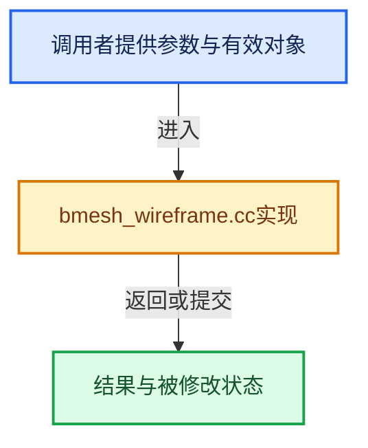

# 实现依赖专题：source/blender/bmesh/tools/bmesh_wireframe.cc

[实现依赖导航](../../../README.md) · [符号索引](../../../../00-课程指南/02-源码与提交索引/符号依赖与实现索引.md)

本专题从正文实际调用进入，集中保存共享实现。函数有稳定锚点，可从调用处直接跳到对应完整函数；递归与互相调用通过回链组织。

## 本文件的实现关系





## 完整成员与函数实现

<a id="f-68932c9565e1675c"></a>

### `blender::bm_edge_tag_faceloop`

实现位置：[source/blender/bmesh/tools/bmesh_wireframe.cc](../../../../../../../../source/blender/bmesh/tools/bmesh_wireframe.cc) · L27—L40。

接口参数：

- `BMEdge *e`

**教学注释版**

<!-- annotated:06eee6eb7804f5 -->

```cpp
static BMLoop *bm_edge_tag_faceloop(BMEdge *e)
{
  BMLoop *l, *l_first;

  l = l_first = e->l;
  do {
    if (BM_elem_flag_test(l->f, BM_ELEM_TAG)) {
      return l;
    }
  } while ((l = l->radial_next) != l_first);

  /* in the case this is used, we know this will never happen */
  return nullptr;
}
```

<details>
<summary>核对原始源码：source/blender/bmesh/tools/bmesh_wireframe.cc · L27—L40</summary>

<!-- original:06eee6eb7804f5:source/blender/bmesh/tools/bmesh_wireframe.cc:27:40 -->

```cpp
static BMLoop *bm_edge_tag_faceloop(BMEdge *e)
{
  BMLoop *l, *l_first;

  l = l_first = e->l;
  do {
    if (BM_elem_flag_test(l->f, BM_ELEM_TAG)) {
      return l;
    }
  } while ((l = l->radial_next) != l_first);

  /* in the case this is used, we know this will never happen */
  return nullptr;
}
```

</details>

**沿实际写入检查状态**

- `l = l_first = e->l;`

**结果出口**

- `return l;`
- `return nullptr;`

**继续追踪实现**

- `BM_elem_flag_test` → [BM_elem_flag_test · L21](../intern/bmesh_inline.hh.md#m-2431d1179b41)。宏定义由构建条件选择。

<a id="f-9e9cacbd8766c0f5"></a>

### `blender::bm_vert_boundary_tangent`

实现位置：[source/blender/bmesh/tools/bmesh_wireframe.cc](../../../../../../../../source/blender/bmesh/tools/bmesh_wireframe.cc) · L42—L126。

接口参数：

- `BMVert *v`
- `float r_no[3]`
- `float r_no_face[3]`
- `BMVert **r_va_other`
- `BMVert **r_vb_other`

**教学注释版**

<!-- annotated:49fa3e7c569fdb -->

```cpp
static void bm_vert_boundary_tangent(
    BMVert *v, float r_no[3], float r_no_face[3], BMVert **r_va_other, BMVert **r_vb_other)
{
  BMIter iter;
  BMEdge *e_iter;

  BMEdge *e_a = nullptr, *e_b = nullptr;
  BMVert *v_a, *v_b;

  BMLoop *l_a, *l_b;

  float no_face[3], no_edge[3];
  float tvec_a[3], tvec_b[3];

  /* get 2 boundary edges, there should only _be_ 2,
   * in case there are more - results won't be valid of course */
  BM_ITER_ELEM (e_iter, &iter, v, BM_EDGES_OF_VERT) {
    if (BM_elem_flag_test(e_iter, BM_ELEM_TAG)) {
      if (e_a == nullptr) {
        e_a = e_iter;
      }
      else {
        e_b = e_iter;
        break;
      }
    }
  }

  if (e_a && e_b) {
    /* NOTE: with an incorrectly flushed selection this can crash. */
    l_a = bm_edge_tag_faceloop(e_a);
    l_b = bm_edge_tag_faceloop(e_b);

    /* average edge face normal */
    add_v3_v3v3(no_face, l_a->f->no, l_b->f->no);
    normalize_v3(no_face);

    /* average edge direction */
    v_a = BM_edge_other_vert(e_a, v);
    v_b = BM_edge_other_vert(e_b, v);

    sub_v3_v3v3(tvec_a, v->co, v_a->co);
    sub_v3_v3v3(tvec_b, v_b->co, v->co);
    normalize_v3(tvec_a);
    normalize_v3(tvec_b);
    add_v3_v3v3(no_edge, tvec_a, tvec_b); /* not unit length but this is ok */

    /* check are we flipped the right way */
    BM_edge_calc_face_tangent(e_a, l_a, tvec_a);
    BM_edge_calc_face_tangent(e_b, l_b, tvec_b);
    add_v3_v3(tvec_a, tvec_b);

    *r_va_other = v_a;
    *r_vb_other = v_b;
  }
  else {
    /* degenerate case - vertex connects a boundary edged face to other faces,
     * so we have only one boundary face - only use it for calculations */
    l_a = bm_edge_tag_faceloop(e_a);

    copy_v3_v3(no_face, l_a->f->no);

    /* edge direction */
    v_a = BM_edge_other_vert(e_a, v);
    v_b = nullptr;

    sub_v3_v3v3(no_edge, v->co, v_a->co);

    /* check are we flipped the right way */
    BM_edge_calc_face_tangent(e_a, l_a, tvec_a);

    *r_va_other = nullptr;
    *r_vb_other = nullptr;
  }

  /* find the normal */
  cross_v3_v3v3(r_no, no_edge, no_face);
  normalize_v3(r_no);

  if (dot_v3v3(r_no, tvec_a) > 0.0f) {
    negate_v3(r_no);
  }

  copy_v3_v3(r_no_face, no_face);
}
```

<details>
<summary>核对原始源码：source/blender/bmesh/tools/bmesh_wireframe.cc · L42—L126</summary>

<!-- original:49fa3e7c569fdb:source/blender/bmesh/tools/bmesh_wireframe.cc:42:126 -->

```cpp
static void bm_vert_boundary_tangent(
    BMVert *v, float r_no[3], float r_no_face[3], BMVert **r_va_other, BMVert **r_vb_other)
{
  BMIter iter;
  BMEdge *e_iter;

  BMEdge *e_a = nullptr, *e_b = nullptr;
  BMVert *v_a, *v_b;

  BMLoop *l_a, *l_b;

  float no_face[3], no_edge[3];
  float tvec_a[3], tvec_b[3];

  /* get 2 boundary edges, there should only _be_ 2,
   * in case there are more - results won't be valid of course */
  BM_ITER_ELEM (e_iter, &iter, v, BM_EDGES_OF_VERT) {
    if (BM_elem_flag_test(e_iter, BM_ELEM_TAG)) {
      if (e_a == nullptr) {
        e_a = e_iter;
      }
      else {
        e_b = e_iter;
        break;
      }
    }
  }

  if (e_a && e_b) {
    /* NOTE: with an incorrectly flushed selection this can crash. */
    l_a = bm_edge_tag_faceloop(e_a);
    l_b = bm_edge_tag_faceloop(e_b);

    /* average edge face normal */
    add_v3_v3v3(no_face, l_a->f->no, l_b->f->no);
    normalize_v3(no_face);

    /* average edge direction */
    v_a = BM_edge_other_vert(e_a, v);
    v_b = BM_edge_other_vert(e_b, v);

    sub_v3_v3v3(tvec_a, v->co, v_a->co);
    sub_v3_v3v3(tvec_b, v_b->co, v->co);
    normalize_v3(tvec_a);
    normalize_v3(tvec_b);
    add_v3_v3v3(no_edge, tvec_a, tvec_b); /* not unit length but this is ok */

    /* check are we flipped the right way */
    BM_edge_calc_face_tangent(e_a, l_a, tvec_a);
    BM_edge_calc_face_tangent(e_b, l_b, tvec_b);
    add_v3_v3(tvec_a, tvec_b);

    *r_va_other = v_a;
    *r_vb_other = v_b;
  }
  else {
    /* degenerate case - vertex connects a boundary edged face to other faces,
     * so we have only one boundary face - only use it for calculations */
    l_a = bm_edge_tag_faceloop(e_a);

    copy_v3_v3(no_face, l_a->f->no);

    /* edge direction */
    v_a = BM_edge_other_vert(e_a, v);
    v_b = nullptr;

    sub_v3_v3v3(no_edge, v->co, v_a->co);

    /* check are we flipped the right way */
    BM_edge_calc_face_tangent(e_a, l_a, tvec_a);

    *r_va_other = nullptr;
    *r_vb_other = nullptr;
  }

  /* find the normal */
  cross_v3_v3v3(r_no, no_edge, no_face);
  normalize_v3(r_no);

  if (dot_v3v3(r_no, tvec_a) > 0.0f) {
    negate_v3(r_no);
  }

  copy_v3_v3(r_no_face, no_face);
}
```

</details>

**沿实际写入检查状态**

- `e_a = e_iter;`
- `e_b = e_iter;`
- `l_a = bm_edge_tag_faceloop(e_a);`
- `l_b = bm_edge_tag_faceloop(e_b);`
- `v_a = BM_edge_other_vert(e_a, v);`
- `v_b = BM_edge_other_vert(e_b, v);`
- `v_b = nullptr;`

**继续追踪实现**

- `BM_ITER_ELEM` → [BM_ITER_ELEM · L97](../intern/bmesh_iterators.hh.md#m-751d15be7ee4)。宏定义由构建条件选择。
- `BM_elem_flag_test` → [BM_elem_flag_test · L21](../intern/bmesh_inline.hh.md#m-2431d1179b41)。宏定义由构建条件选择。
- `bm_edge_tag_faceloop` → [blender::bm_edge_tag_faceloop · L27](bmesh_wireframe.cc.md#f-68932c9565e1675c)。
- `add_v3_v3v3` → [blender::add_v3_v3v3 · L300](../../../01-BLI基础库/intern/math_vector_inline.cc.md#f-7343b459d0d3db69)。
- `normalize_v3` → [blender::normalize_v3 · L933](../../../01-BLI基础库/intern/math_vector_inline.cc.md#f-5f3257e657ef732c)。
- `BM_edge_other_vert` → [blender::BM_edge_other_vert · L52](../intern/bmesh_query_inline.hh.md#f-464fb9614b23d180)。
- `sub_v3_v3v3` → [blender::sub_v3_v3v3 · L360](../../../01-BLI基础库/intern/math_vector_inline.cc.md#f-23781c252db8b30c)。
- `BM_edge_calc_face_tangent` → [blender::BM_edge_calc_face_tangent · L1398](../intern/bmesh_query.cc.md#f-7ee616d6561bc66b)。
- `add_v3_v3` → [blender::add_v3_v3 · L286](../../../01-BLI基础库/intern/math_vector_inline.cc.md#f-e7930c6fdefe462c)。
- `copy_v3_v3` → [blender::copy_v3_v3 · L47](../../../01-BLI基础库/intern/math_vector_inline.cc.md#f-037a0d5fa5060bd6)。
- `cross_v3_v3v3` → [blender::cross_v3_v3v3 · L690](../../../01-BLI基础库/intern/math_vector_inline.cc.md#f-ac8d04405fb5dad4)。
- `dot_v3v3` → [blender::dot_v3v3 · L646](../../../01-BLI基础库/intern/math_vector_inline.cc.md#f-c88befa67d07591a)。
- `negate_v3` → [blender::negate_v3 · L571](../../../01-BLI基础库/intern/math_vector_inline.cc.md#f-10baf09f690bcba8)。

<a id="f-1960dc7645712543"></a>

### `blender::bm_loop_is_radial_boundary`

实现位置：[source/blender/bmesh/tools/bmesh_wireframe.cc](../../../../../../../../source/blender/bmesh/tools/bmesh_wireframe.cc) · L129—L144。

接口参数：

- `BMLoop *l_first`

**教学注释版**

<!-- annotated:651a909caee6c4 -->

```cpp
static bool bm_loop_is_radial_boundary(BMLoop *l_first)
{
  BMLoop *l = l_first->radial_next;

  if (l == l_first) {
    return true; /* a real boundary */
  }

  do {
    if (BM_elem_flag_test(l->f, BM_ELEM_TAG)) {
      return false;
    }
  } while ((l = l->radial_next) != l_first);

  return true;
}
```

<details>
<summary>核对原始源码：source/blender/bmesh/tools/bmesh_wireframe.cc · L129—L144</summary>

<!-- original:651a909caee6c4:source/blender/bmesh/tools/bmesh_wireframe.cc:129:144 -->

```cpp
static bool bm_loop_is_radial_boundary(BMLoop *l_first)
{
  BMLoop *l = l_first->radial_next;

  if (l == l_first) {
    return true; /* a real boundary */
  }

  do {
    if (BM_elem_flag_test(l->f, BM_ELEM_TAG)) {
      return false;
    }
  } while ((l = l->radial_next) != l_first);

  return true;
}
```

</details>

**结果出口**

- `return true; /* a real boundary */`
- `return false;`
- `return true;`

**继续追踪实现**

- `BM_elem_flag_test` → [BM_elem_flag_test · L21](../intern/bmesh_inline.hh.md#m-2431d1179b41)。宏定义由构建条件选择。

<a id="f-b81e4902f56303da"></a>

### `blender::BM_mesh_wireframe`

实现位置：[source/blender/bmesh/tools/bmesh_wireframe.cc](../../../../../../../../source/blender/bmesh/tools/bmesh_wireframe.cc) · L146—L588。

接口参数：

- `BMesh *bm`
- `const float offset`
- `const float offset_fac`
- `const float offset_fac_vg`
- `const bool use_replace`
- `const bool use_boundary`
- `const bool use_even_offset`
- `const bool use_relative_offset`
- `const bool use_crease`
- `const float crease_weight`
- `const int defgrp_index`
- `const bool defgrp_invert`
- `const short mat_offset`
- `const int mat_max`
- `const bool use_tag`

**教学注释版**

<!-- annotated:2863e1ddd86f4e -->

```cpp
void BM_mesh_wireframe(BMesh *bm,
                       const float offset,
                       const float offset_fac,
                       const float offset_fac_vg,
                       const bool use_replace,
                       const bool use_boundary,
                       const bool use_even_offset,
                       const bool use_relative_offset,
                       const bool use_crease,
                       const float crease_weight,
                       const int defgrp_index,
                       const bool defgrp_invert,
                       const short mat_offset,
                       const int mat_max,
                       /* for operators */
                       const bool use_tag)
{
  const float ofs_orig = -(((-offset_fac + 1.0f) * 0.5f) * offset);
  const float ofs_new = offset + ofs_orig;
  const float ofs_mid = (ofs_orig + ofs_new) / 2.0f;
  const float inset = offset / 2.0f;
  int cd_edge_crease_offset = use_crease ? CustomData_get_offset_named(
                                               &bm->edata, CD_PROP_FLOAT, "crease_edge") :
                                           -1;
  const int cd_dvert_offset = (defgrp_index != -1) ?
                                  CustomData_get_offset(&bm->vdata, CD_MDEFORMVERT) :
                                  -1;
  const float offset_fac_vg_inv = 1.0f - offset_fac_vg;

  const int totvert_orig = bm->totvert;

  BMIter iter;
  BMIter itersub;

  /* filled only with boundary verts */
  BMVert **verts_src = MEM_new_array_uninitialized<BMVert *>(totvert_orig, __func__);
  BMVert **verts_neg = MEM_new_array_uninitialized<BMVert *>(totvert_orig, __func__);
  BMVert **verts_pos = MEM_new_array_uninitialized<BMVert *>(totvert_orig, __func__);

  /* Will over-allocate, but makes for easy lookups by index to keep aligned. */
  BMVert **verts_boundary = use_boundary ?
                                MEM_new_array_uninitialized<BMVert *>(totvert_orig, __func__) :
                                nullptr;

  float *verts_relfac = (use_relative_offset || (cd_dvert_offset != -1)) ?
                            MEM_new_array_uninitialized<float>(totvert_orig, __func__) :
                            nullptr;

  /* May over-allocate if not all faces have wire. */
  BMVert **verts_loop;
  int verts_loop_tot = 0;

  BMVert *v_src;

  BMFace *f_src;
  BMLoop *l;

  float tvec[3];
  float fac, fac_shell;

  int i;

  if (use_crease && cd_edge_crease_offset == -1) {
    BM_data_layer_add_named(bm, &bm->edata, CD_PROP_FLOAT, "crease_edge");
    cd_edge_crease_offset = CustomData_get_offset_named(&bm->edata, CD_PROP_FLOAT, "crease_edge");
  }

  BM_ITER_MESH_INDEX (v_src, &iter, bm, BM_VERTS_OF_MESH, i) {
    BM_elem_index_set(v_src, i); /* set_inline */

    verts_src[i] = v_src;
    BM_elem_flag_disable(v_src, BM_ELEM_TAG);
  }
  bm->elem_index_dirty &= ~BM_VERT;

  /* setup tags, all faces and verts will be tagged which will be duplicated */

  BM_ITER_MESH_INDEX (f_src, &iter, bm, BM_FACES_OF_MESH, i) {
    BM_elem_index_set(f_src, i); /* set_inline */

    if (use_tag) {
      if (!BM_elem_flag_test(f_src, BM_ELEM_TAG)) {
        continue;
      }
    }
    else {
      BM_elem_flag_enable(f_src, BM_ELEM_TAG);
    }

    verts_loop_tot += f_src->len;
    BM_ITER_ELEM (l, &itersub, f_src, BM_LOOPS_OF_FACE) {
      BM_elem_flag_enable(l->v, BM_ELEM_TAG);

      /* also tag boundary edges */
      BM_elem_flag_set(l->e, BM_ELEM_TAG, bm_loop_is_radial_boundary(l));
    }
  }
  bm->elem_index_dirty &= ~BM_FACE;

  /* duplicate tagged verts */
  for (i = 0; i < totvert_orig; i++) {
    v_src = verts_src[i];
    if (BM_elem_flag_test(v_src, BM_ELEM_TAG)) {
      fac = 1.0f;

      if (verts_relfac) {
        if (use_relative_offset) {
          verts_relfac[i] = BM_vert_calc_median_tagged_edge_length(v_src);
        }
        else {
          verts_relfac[i] = 1.0f;
        }

        if (cd_dvert_offset != -1) {
          MDeformVert *dvert = static_cast<MDeformVert *>(
              BM_ELEM_CD_GET_VOID_P(v_src, cd_dvert_offset));
          float defgrp_fac = BKE_defvert_find_weight(dvert, defgrp_index);

          if (defgrp_invert) {
            defgrp_fac = 1.0f - defgrp_fac;
          }

          if (offset_fac_vg > 0.0f) {
            defgrp_fac = (offset_fac_vg + (defgrp_fac * offset_fac_vg_inv));
          }

          verts_relfac[i] *= defgrp_fac;
        }

        fac *= verts_relfac[i];
      }

      verts_neg[i] = BM_vert_create(bm, nullptr, v_src, BM_CREATE_NOP);
      verts_pos[i] = BM_vert_create(bm, nullptr, v_src, BM_CREATE_NOP);

      if (offset == 0.0f) {
        madd_v3_v3v3fl(verts_neg[i]->co, v_src->co, v_src->no, ofs_orig * fac);
        madd_v3_v3v3fl(verts_pos[i]->co, v_src->co, v_src->no, ofs_new * fac);
      }
      else {
        madd_v3_v3v3fl(tvec, v_src->co, v_src->no, ofs_mid * fac);

        madd_v3_v3v3fl(verts_neg[i]->co, tvec, v_src->no, (ofs_orig - ofs_mid) * fac);
        madd_v3_v3v3fl(verts_pos[i]->co, tvec, v_src->no, (ofs_new - ofs_mid) * fac);
      }
    }
    else {
      /* could skip this */
      verts_neg[i] = nullptr;
      verts_pos[i] = nullptr;
    }

    /* conflicts with BM_vert_calc_median_tagged_edge_length */
    if (use_relative_offset == false) {
      BM_elem_flag_disable(v_src, BM_ELEM_TAG);
    }
  }

  if (use_relative_offset) {
    BM_mesh_elem_hflag_disable_all(bm, BM_VERT, BM_ELEM_TAG, false);
  }

  verts_loop = MEM_new_array_uninitialized<BMVert *>(verts_loop_tot, __func__);
  verts_loop_tot = 0; /* count up again */

  BM_ITER_MESH (f_src, &iter, bm, BM_FACES_OF_MESH) {

    if (use_tag && !BM_elem_flag_test(f_src, BM_ELEM_TAG)) {
      continue;
    }

    BM_ITER_ELEM (l, &itersub, f_src, BM_LOOPS_OF_FACE) {
      /* Because some faces might be skipped! */
      BM_elem_index_set(l, verts_loop_tot); /* set_dirty */

      BM_loop_calc_face_tangent(l, tvec);

      /* create offset vert */
      fac = 1.0f;

      if (verts_relfac) {
        fac *= verts_relfac[BM_elem_index_get(l->v)];
      }

      fac_shell = fac;
      if (use_even_offset) {
        fac_shell *= shell_angle_to_dist((float(M_PI) - BM_loop_calc_face_angle(l)) * 0.5f);
      }

      madd_v3_v3v3fl(tvec, l->v->co, tvec, inset * fac_shell);
      if (offset != 0.0f) {
        madd_v3_v3fl(tvec, l->v->no, ofs_mid * fac);
      }
      verts_loop[verts_loop_tot] = BM_vert_create(bm, tvec, l->v, BM_CREATE_NOP);

      if (use_boundary) {
        if (BM_elem_flag_test(l->e, BM_ELEM_TAG)) { /* is this a boundary? */
          BMVert *v_pair[2] = {l->v, l->next->v};

          for (i = 0; i < 2; i++) {
            BMVert *v_boundary = v_pair[i];
            if (!BM_elem_flag_test(v_boundary, BM_ELEM_TAG)) {
              const int v_boundary_index = BM_elem_index_get(v_boundary);
              float no_face[3];
              BMVert *va_other;
              BMVert *vb_other;

              BM_elem_flag_enable(v_boundary, BM_ELEM_TAG);

              bm_vert_boundary_tangent(v_boundary, tvec, no_face, &va_other, &vb_other);

              /* create offset vert */
              /* similar to code above but different angle calc */
              fac = 1.0f;

              if (verts_relfac) {
                fac *= verts_relfac[v_boundary_index];
              }

              fac_shell = fac;
              if (use_even_offset) {
                if (va_other) { /* for verts with only one boundary edge - this will be nullptr */
                  fac_shell *= shell_angle_to_dist(
                      (float(M_PI) - angle_on_axis_v3v3v3_v3(
                                         va_other->co, v_boundary->co, vb_other->co, no_face)) *
                      0.5f);
                }
              }

              madd_v3_v3v3fl(tvec, v_boundary->co, tvec, inset * fac_shell);
              if (offset != 0.0f) {
                madd_v3_v3fl(tvec, v_boundary->no, ofs_mid * fac);
              }
              verts_boundary[v_boundary_index] = BM_vert_create(
                  bm, tvec, v_boundary, BM_CREATE_NOP);
            }
          }
        }
      }

      verts_loop_tot++;
    }
  }
  bm->elem_index_dirty |= BM_LOOP;

  BM_ITER_MESH (f_src, &iter, bm, BM_FACES_OF_MESH) {

    /* skip recently added faces */
    if (BM_elem_index_get(f_src) == -1) {
      continue;
    }

    if (use_tag && !BM_elem_flag_test(f_src, BM_ELEM_TAG)) {
      continue;
    }

    BM_elem_flag_disable(f_src, BM_ELEM_TAG);

    BM_ITER_ELEM (l, &itersub, f_src, BM_LOOPS_OF_FACE) {
      BMFace *f_new;
      BMLoop *l_new;
      BMLoop *l_next = l->next;
      BMVert *v_l1 = verts_loop[BM_elem_index_get(l)];
      BMVert *v_l2 = verts_loop[BM_elem_index_get(l_next)];

      BMVert *v_src_l1 = l->v;
      BMVert *v_src_l2 = l_next->v;

      const int i_1 = BM_elem_index_get(v_src_l1);
      const int i_2 = BM_elem_index_get(v_src_l2);

      BMVert *v_neg1 = verts_neg[i_1];
      BMVert *v_neg2 = verts_neg[i_2];

      BMVert *v_pos1 = verts_pos[i_1];
      BMVert *v_pos2 = verts_pos[i_2];

      f_new = BM_face_create_quad_tri(bm, v_l1, v_l2, v_neg2, v_neg1, f_src, BM_CREATE_NOP);
      if (mat_offset) {
        f_new->mat_nr = std::clamp(f_new->mat_nr + mat_offset, 0, mat_max);
      }
      BM_elem_flag_enable(f_new, BM_ELEM_TAG);
      l_new = BM_FACE_FIRST_LOOP(f_new);

      BM_elem_attrs_copy(bm, l, l_new);
      BM_elem_attrs_copy(bm, l, l_new->prev);
      BM_elem_attrs_copy(bm, l_next, l_new->next);
      BM_elem_attrs_copy(bm, l_next, l_new->next->next);

      f_new = BM_face_create_quad_tri(bm, v_l2, v_l1, v_pos1, v_pos2, f_src, BM_CREATE_NOP);

      if (mat_offset) {
        f_new->mat_nr = std::clamp(f_new->mat_nr + mat_offset, 0, mat_max);
      }
      BM_elem_flag_enable(f_new, BM_ELEM_TAG);
      l_new = BM_FACE_FIRST_LOOP(f_new);

      BM_elem_attrs_copy(bm, l_next, l_new);
      BM_elem_attrs_copy(bm, l_next, l_new->prev);
      BM_elem_attrs_copy(bm, l, l_new->next);
      BM_elem_attrs_copy(bm, l, l_new->next->next);

      if (use_boundary) {
        if (BM_elem_flag_test(l->e, BM_ELEM_TAG)) {
          /* we know its a boundary and this is the only face user (which is being wire'd) */
          /* we know we only touch this edge/face once */
          BMVert *v_b1 = verts_boundary[i_1];
          BMVert *v_b2 = verts_boundary[i_2];

          f_new = BM_face_create_quad_tri(bm, v_b2, v_b1, v_neg1, v_neg2, f_src, BM_CREATE_NOP);
          if (mat_offset) {
            f_new->mat_nr = std::clamp(f_new->mat_nr + mat_offset, 0, mat_max);
          }
          BM_elem_flag_enable(f_new, BM_ELEM_TAG);
          l_new = BM_FACE_FIRST_LOOP(f_new);

          BM_elem_attrs_copy(bm, l_next, l_new);
          BM_elem_attrs_copy(bm, l_next, l_new->prev);
          BM_elem_attrs_copy(bm, l, l_new->next);
          BM_elem_attrs_copy(bm, l, l_new->next->next);

          f_new = BM_face_create_quad_tri(bm, v_b1, v_b2, v_pos2, v_pos1, f_src, BM_CREATE_NOP);
          if (mat_offset) {
            f_new->mat_nr = std::clamp(f_new->mat_nr + mat_offset, 0, mat_max);
          }
          BM_elem_flag_enable(f_new, BM_ELEM_TAG);
          l_new = BM_FACE_FIRST_LOOP(f_new);

          BM_elem_attrs_copy(bm, l, l_new);
          BM_elem_attrs_copy(bm, l, l_new->prev);
          BM_elem_attrs_copy(bm, l_next, l_new->next);
          BM_elem_attrs_copy(bm, l_next, l_new->next->next);

          if (use_crease) {
            BMEdge *e_new;
            e_new = BM_edge_exists(v_pos1, v_b1);
            BM_ELEM_CD_SET_FLOAT(e_new, cd_edge_crease_offset, crease_weight);

            e_new = BM_edge_exists(v_pos2, v_b2);
            BM_ELEM_CD_SET_FLOAT(e_new, cd_edge_crease_offset, crease_weight);

            e_new = BM_edge_exists(v_neg1, v_b1);
            BM_ELEM_CD_SET_FLOAT(e_new, cd_edge_crease_offset, crease_weight);

            e_new = BM_edge_exists(v_neg2, v_b2);
            BM_ELEM_CD_SET_FLOAT(e_new, cd_edge_crease_offset, crease_weight);
          }
        }
      }

      if (use_crease) {
        BMEdge *e_new;
        e_new = BM_edge_exists(v_pos1, v_l1);
        BM_ELEM_CD_SET_FLOAT(e_new, cd_edge_crease_offset, crease_weight);

        e_new = BM_edge_exists(v_pos2, v_l2);
        BM_ELEM_CD_SET_FLOAT(e_new, cd_edge_crease_offset, crease_weight);

        e_new = BM_edge_exists(v_neg1, v_l1);
        BM_ELEM_CD_SET_FLOAT(e_new, cd_edge_crease_offset, crease_weight);

        e_new = BM_edge_exists(v_neg2, v_l2);
        BM_ELEM_CD_SET_FLOAT(e_new, cd_edge_crease_offset, crease_weight);
      }
    }
  }

  if (use_boundary) {
    MEM_delete(verts_boundary);
  }

  if (verts_relfac) {
    MEM_delete(verts_relfac);
  }

  if (use_replace) {

    if (use_tag) {
/* only remove faces which are original and used to make wire,
 * use 'verts_pos' and 'verts_neg' to avoid a feedback loop. */

/* vertex must be from 'verts_src' */
#define VERT_DUPE_TEST_ORIG(v) (verts_neg[BM_elem_index_get(v)] != nullptr)
#define VERT_DUPE_TEST(v) (verts_pos[BM_elem_index_get(v)] != nullptr)
#define VERT_DUPE_CLEAR(v) \
  { \
    verts_pos[BM_elem_index_get(v)] = nullptr; \
  } \
  (void)0

      /* first ensure we keep all verts which are used in faces that weren't
       * entirely made into wire. */
      BM_ITER_MESH (f_src, &iter, bm, BM_FACES_OF_MESH) {
        int mix_flag = 0;
        BMLoop *l_iter, *l_first;

        /* skip new faces */
        if (BM_elem_index_get(f_src) == -1) {
          continue;
        }

        l_iter = l_first = BM_FACE_FIRST_LOOP(f_src);
        do {
          mix_flag |= (VERT_DUPE_TEST_ORIG(l_iter->v) ? 1 : 2);
          if (mix_flag == (1 | 2)) {
            break;
          }
        } while ((l_iter = l_iter->next) != l_first);

        if (mix_flag == (1 | 2)) {
          l_iter = l_first = BM_FACE_FIRST_LOOP(f_src);
          do {
            VERT_DUPE_CLEAR(l_iter->v);
          } while ((l_iter = l_iter->next) != l_first);
        }
      }

      /* now remove any verts which were made into wire by all faces */
      for (i = 0; i < totvert_orig; i++) {
        v_src = verts_src[i];
        BLI_assert(i == BM_elem_index_get(v_src));
        if (VERT_DUPE_TEST(v_src)) {
          BM_vert_kill(bm, v_src);
        }
      }

#undef VERT_DUPE_TEST_ORIG
#undef VERT_DUPE_TEST
#undef VERT_DUPE_CLEAR
    }
    else {
      /* simple case, no tags - replace all */
      for (i = 0; i < totvert_orig; i++) {
        BM_vert_kill(bm, verts_src[i]);
      }
    }
  }

  MEM_delete(verts_src);
  MEM_delete(verts_neg);
  MEM_delete(verts_pos);
  MEM_delete(verts_loop);
}
```

<details>
<summary>核对原始源码：source/blender/bmesh/tools/bmesh_wireframe.cc · L146—L588</summary>

<!-- original:2863e1ddd86f4e:source/blender/bmesh/tools/bmesh_wireframe.cc:146:588 -->

```cpp
void BM_mesh_wireframe(BMesh *bm,
                       const float offset,
                       const float offset_fac,
                       const float offset_fac_vg,
                       const bool use_replace,
                       const bool use_boundary,
                       const bool use_even_offset,
                       const bool use_relative_offset,
                       const bool use_crease,
                       const float crease_weight,
                       const int defgrp_index,
                       const bool defgrp_invert,
                       const short mat_offset,
                       const int mat_max,
                       /* for operators */
                       const bool use_tag)
{
  const float ofs_orig = -(((-offset_fac + 1.0f) * 0.5f) * offset);
  const float ofs_new = offset + ofs_orig;
  const float ofs_mid = (ofs_orig + ofs_new) / 2.0f;
  const float inset = offset / 2.0f;
  int cd_edge_crease_offset = use_crease ? CustomData_get_offset_named(
                                               &bm->edata, CD_PROP_FLOAT, "crease_edge") :
                                           -1;
  const int cd_dvert_offset = (defgrp_index != -1) ?
                                  CustomData_get_offset(&bm->vdata, CD_MDEFORMVERT) :
                                  -1;
  const float offset_fac_vg_inv = 1.0f - offset_fac_vg;

  const int totvert_orig = bm->totvert;

  BMIter iter;
  BMIter itersub;

  /* filled only with boundary verts */
  BMVert **verts_src = MEM_new_array_uninitialized<BMVert *>(totvert_orig, __func__);
  BMVert **verts_neg = MEM_new_array_uninitialized<BMVert *>(totvert_orig, __func__);
  BMVert **verts_pos = MEM_new_array_uninitialized<BMVert *>(totvert_orig, __func__);

  /* Will over-allocate, but makes for easy lookups by index to keep aligned. */
  BMVert **verts_boundary = use_boundary ?
                                MEM_new_array_uninitialized<BMVert *>(totvert_orig, __func__) :
                                nullptr;

  float *verts_relfac = (use_relative_offset || (cd_dvert_offset != -1)) ?
                            MEM_new_array_uninitialized<float>(totvert_orig, __func__) :
                            nullptr;

  /* May over-allocate if not all faces have wire. */
  BMVert **verts_loop;
  int verts_loop_tot = 0;

  BMVert *v_src;

  BMFace *f_src;
  BMLoop *l;

  float tvec[3];
  float fac, fac_shell;

  int i;

  if (use_crease && cd_edge_crease_offset == -1) {
    BM_data_layer_add_named(bm, &bm->edata, CD_PROP_FLOAT, "crease_edge");
    cd_edge_crease_offset = CustomData_get_offset_named(&bm->edata, CD_PROP_FLOAT, "crease_edge");
  }

  BM_ITER_MESH_INDEX (v_src, &iter, bm, BM_VERTS_OF_MESH, i) {
    BM_elem_index_set(v_src, i); /* set_inline */

    verts_src[i] = v_src;
    BM_elem_flag_disable(v_src, BM_ELEM_TAG);
  }
  bm->elem_index_dirty &= ~BM_VERT;

  /* setup tags, all faces and verts will be tagged which will be duplicated */

  BM_ITER_MESH_INDEX (f_src, &iter, bm, BM_FACES_OF_MESH, i) {
    BM_elem_index_set(f_src, i); /* set_inline */

    if (use_tag) {
      if (!BM_elem_flag_test(f_src, BM_ELEM_TAG)) {
        continue;
      }
    }
    else {
      BM_elem_flag_enable(f_src, BM_ELEM_TAG);
    }

    verts_loop_tot += f_src->len;
    BM_ITER_ELEM (l, &itersub, f_src, BM_LOOPS_OF_FACE) {
      BM_elem_flag_enable(l->v, BM_ELEM_TAG);

      /* also tag boundary edges */
      BM_elem_flag_set(l->e, BM_ELEM_TAG, bm_loop_is_radial_boundary(l));
    }
  }
  bm->elem_index_dirty &= ~BM_FACE;

  /* duplicate tagged verts */
  for (i = 0; i < totvert_orig; i++) {
    v_src = verts_src[i];
    if (BM_elem_flag_test(v_src, BM_ELEM_TAG)) {
      fac = 1.0f;

      if (verts_relfac) {
        if (use_relative_offset) {
          verts_relfac[i] = BM_vert_calc_median_tagged_edge_length(v_src);
        }
        else {
          verts_relfac[i] = 1.0f;
        }

        if (cd_dvert_offset != -1) {
          MDeformVert *dvert = static_cast<MDeformVert *>(
              BM_ELEM_CD_GET_VOID_P(v_src, cd_dvert_offset));
          float defgrp_fac = BKE_defvert_find_weight(dvert, defgrp_index);

          if (defgrp_invert) {
            defgrp_fac = 1.0f - defgrp_fac;
          }

          if (offset_fac_vg > 0.0f) {
            defgrp_fac = (offset_fac_vg + (defgrp_fac * offset_fac_vg_inv));
          }

          verts_relfac[i] *= defgrp_fac;
        }

        fac *= verts_relfac[i];
      }

      verts_neg[i] = BM_vert_create(bm, nullptr, v_src, BM_CREATE_NOP);
      verts_pos[i] = BM_vert_create(bm, nullptr, v_src, BM_CREATE_NOP);

      if (offset == 0.0f) {
        madd_v3_v3v3fl(verts_neg[i]->co, v_src->co, v_src->no, ofs_orig * fac);
        madd_v3_v3v3fl(verts_pos[i]->co, v_src->co, v_src->no, ofs_new * fac);
      }
      else {
        madd_v3_v3v3fl(tvec, v_src->co, v_src->no, ofs_mid * fac);

        madd_v3_v3v3fl(verts_neg[i]->co, tvec, v_src->no, (ofs_orig - ofs_mid) * fac);
        madd_v3_v3v3fl(verts_pos[i]->co, tvec, v_src->no, (ofs_new - ofs_mid) * fac);
      }
    }
    else {
      /* could skip this */
      verts_neg[i] = nullptr;
      verts_pos[i] = nullptr;
    }

    /* conflicts with BM_vert_calc_median_tagged_edge_length */
    if (use_relative_offset == false) {
      BM_elem_flag_disable(v_src, BM_ELEM_TAG);
    }
  }

  if (use_relative_offset) {
    BM_mesh_elem_hflag_disable_all(bm, BM_VERT, BM_ELEM_TAG, false);
  }

  verts_loop = MEM_new_array_uninitialized<BMVert *>(verts_loop_tot, __func__);
  verts_loop_tot = 0; /* count up again */

  BM_ITER_MESH (f_src, &iter, bm, BM_FACES_OF_MESH) {

    if (use_tag && !BM_elem_flag_test(f_src, BM_ELEM_TAG)) {
      continue;
    }

    BM_ITER_ELEM (l, &itersub, f_src, BM_LOOPS_OF_FACE) {
      /* Because some faces might be skipped! */
      BM_elem_index_set(l, verts_loop_tot); /* set_dirty */

      BM_loop_calc_face_tangent(l, tvec);

      /* create offset vert */
      fac = 1.0f;

      if (verts_relfac) {
        fac *= verts_relfac[BM_elem_index_get(l->v)];
      }

      fac_shell = fac;
      if (use_even_offset) {
        fac_shell *= shell_angle_to_dist((float(M_PI) - BM_loop_calc_face_angle(l)) * 0.5f);
      }

      madd_v3_v3v3fl(tvec, l->v->co, tvec, inset * fac_shell);
      if (offset != 0.0f) {
        madd_v3_v3fl(tvec, l->v->no, ofs_mid * fac);
      }
      verts_loop[verts_loop_tot] = BM_vert_create(bm, tvec, l->v, BM_CREATE_NOP);

      if (use_boundary) {
        if (BM_elem_flag_test(l->e, BM_ELEM_TAG)) { /* is this a boundary? */
          BMVert *v_pair[2] = {l->v, l->next->v};

          for (i = 0; i < 2; i++) {
            BMVert *v_boundary = v_pair[i];
            if (!BM_elem_flag_test(v_boundary, BM_ELEM_TAG)) {
              const int v_boundary_index = BM_elem_index_get(v_boundary);
              float no_face[3];
              BMVert *va_other;
              BMVert *vb_other;

              BM_elem_flag_enable(v_boundary, BM_ELEM_TAG);

              bm_vert_boundary_tangent(v_boundary, tvec, no_face, &va_other, &vb_other);

              /* create offset vert */
              /* similar to code above but different angle calc */
              fac = 1.0f;

              if (verts_relfac) {
                fac *= verts_relfac[v_boundary_index];
              }

              fac_shell = fac;
              if (use_even_offset) {
                if (va_other) { /* for verts with only one boundary edge - this will be nullptr */
                  fac_shell *= shell_angle_to_dist(
                      (float(M_PI) - angle_on_axis_v3v3v3_v3(
                                         va_other->co, v_boundary->co, vb_other->co, no_face)) *
                      0.5f);
                }
              }

              madd_v3_v3v3fl(tvec, v_boundary->co, tvec, inset * fac_shell);
              if (offset != 0.0f) {
                madd_v3_v3fl(tvec, v_boundary->no, ofs_mid * fac);
              }
              verts_boundary[v_boundary_index] = BM_vert_create(
                  bm, tvec, v_boundary, BM_CREATE_NOP);
            }
          }
        }
      }

      verts_loop_tot++;
    }
  }
  bm->elem_index_dirty |= BM_LOOP;

  BM_ITER_MESH (f_src, &iter, bm, BM_FACES_OF_MESH) {

    /* skip recently added faces */
    if (BM_elem_index_get(f_src) == -1) {
      continue;
    }

    if (use_tag && !BM_elem_flag_test(f_src, BM_ELEM_TAG)) {
      continue;
    }

    BM_elem_flag_disable(f_src, BM_ELEM_TAG);

    BM_ITER_ELEM (l, &itersub, f_src, BM_LOOPS_OF_FACE) {
      BMFace *f_new;
      BMLoop *l_new;
      BMLoop *l_next = l->next;
      BMVert *v_l1 = verts_loop[BM_elem_index_get(l)];
      BMVert *v_l2 = verts_loop[BM_elem_index_get(l_next)];

      BMVert *v_src_l1 = l->v;
      BMVert *v_src_l2 = l_next->v;

      const int i_1 = BM_elem_index_get(v_src_l1);
      const int i_2 = BM_elem_index_get(v_src_l2);

      BMVert *v_neg1 = verts_neg[i_1];
      BMVert *v_neg2 = verts_neg[i_2];

      BMVert *v_pos1 = verts_pos[i_1];
      BMVert *v_pos2 = verts_pos[i_2];

      f_new = BM_face_create_quad_tri(bm, v_l1, v_l2, v_neg2, v_neg1, f_src, BM_CREATE_NOP);
      if (mat_offset) {
        f_new->mat_nr = std::clamp(f_new->mat_nr + mat_offset, 0, mat_max);
      }
      BM_elem_flag_enable(f_new, BM_ELEM_TAG);
      l_new = BM_FACE_FIRST_LOOP(f_new);

      BM_elem_attrs_copy(bm, l, l_new);
      BM_elem_attrs_copy(bm, l, l_new->prev);
      BM_elem_attrs_copy(bm, l_next, l_new->next);
      BM_elem_attrs_copy(bm, l_next, l_new->next->next);

      f_new = BM_face_create_quad_tri(bm, v_l2, v_l1, v_pos1, v_pos2, f_src, BM_CREATE_NOP);

      if (mat_offset) {
        f_new->mat_nr = std::clamp(f_new->mat_nr + mat_offset, 0, mat_max);
      }
      BM_elem_flag_enable(f_new, BM_ELEM_TAG);
      l_new = BM_FACE_FIRST_LOOP(f_new);

      BM_elem_attrs_copy(bm, l_next, l_new);
      BM_elem_attrs_copy(bm, l_next, l_new->prev);
      BM_elem_attrs_copy(bm, l, l_new->next);
      BM_elem_attrs_copy(bm, l, l_new->next->next);

      if (use_boundary) {
        if (BM_elem_flag_test(l->e, BM_ELEM_TAG)) {
          /* we know its a boundary and this is the only face user (which is being wire'd) */
          /* we know we only touch this edge/face once */
          BMVert *v_b1 = verts_boundary[i_1];
          BMVert *v_b2 = verts_boundary[i_2];

          f_new = BM_face_create_quad_tri(bm, v_b2, v_b1, v_neg1, v_neg2, f_src, BM_CREATE_NOP);
          if (mat_offset) {
            f_new->mat_nr = std::clamp(f_new->mat_nr + mat_offset, 0, mat_max);
          }
          BM_elem_flag_enable(f_new, BM_ELEM_TAG);
          l_new = BM_FACE_FIRST_LOOP(f_new);

          BM_elem_attrs_copy(bm, l_next, l_new);
          BM_elem_attrs_copy(bm, l_next, l_new->prev);
          BM_elem_attrs_copy(bm, l, l_new->next);
          BM_elem_attrs_copy(bm, l, l_new->next->next);

          f_new = BM_face_create_quad_tri(bm, v_b1, v_b2, v_pos2, v_pos1, f_src, BM_CREATE_NOP);
          if (mat_offset) {
            f_new->mat_nr = std::clamp(f_new->mat_nr + mat_offset, 0, mat_max);
          }
          BM_elem_flag_enable(f_new, BM_ELEM_TAG);
          l_new = BM_FACE_FIRST_LOOP(f_new);

          BM_elem_attrs_copy(bm, l, l_new);
          BM_elem_attrs_copy(bm, l, l_new->prev);
          BM_elem_attrs_copy(bm, l_next, l_new->next);
          BM_elem_attrs_copy(bm, l_next, l_new->next->next);

          if (use_crease) {
            BMEdge *e_new;
            e_new = BM_edge_exists(v_pos1, v_b1);
            BM_ELEM_CD_SET_FLOAT(e_new, cd_edge_crease_offset, crease_weight);

            e_new = BM_edge_exists(v_pos2, v_b2);
            BM_ELEM_CD_SET_FLOAT(e_new, cd_edge_crease_offset, crease_weight);

            e_new = BM_edge_exists(v_neg1, v_b1);
            BM_ELEM_CD_SET_FLOAT(e_new, cd_edge_crease_offset, crease_weight);

            e_new = BM_edge_exists(v_neg2, v_b2);
            BM_ELEM_CD_SET_FLOAT(e_new, cd_edge_crease_offset, crease_weight);
          }
        }
      }

      if (use_crease) {
        BMEdge *e_new;
        e_new = BM_edge_exists(v_pos1, v_l1);
        BM_ELEM_CD_SET_FLOAT(e_new, cd_edge_crease_offset, crease_weight);

        e_new = BM_edge_exists(v_pos2, v_l2);
        BM_ELEM_CD_SET_FLOAT(e_new, cd_edge_crease_offset, crease_weight);

        e_new = BM_edge_exists(v_neg1, v_l1);
        BM_ELEM_CD_SET_FLOAT(e_new, cd_edge_crease_offset, crease_weight);

        e_new = BM_edge_exists(v_neg2, v_l2);
        BM_ELEM_CD_SET_FLOAT(e_new, cd_edge_crease_offset, crease_weight);
      }
    }
  }

  if (use_boundary) {
    MEM_delete(verts_boundary);
  }

  if (verts_relfac) {
    MEM_delete(verts_relfac);
  }

  if (use_replace) {

    if (use_tag) {
/* only remove faces which are original and used to make wire,
 * use 'verts_pos' and 'verts_neg' to avoid a feedback loop. */

/* vertex must be from 'verts_src' */
#define VERT_DUPE_TEST_ORIG(v) (verts_neg[BM_elem_index_get(v)] != nullptr)
#define VERT_DUPE_TEST(v) (verts_pos[BM_elem_index_get(v)] != nullptr)
#define VERT_DUPE_CLEAR(v) \
  { \
    verts_pos[BM_elem_index_get(v)] = nullptr; \
  } \
  (void)0

      /* first ensure we keep all verts which are used in faces that weren't
       * entirely made into wire. */
      BM_ITER_MESH (f_src, &iter, bm, BM_FACES_OF_MESH) {
        int mix_flag = 0;
        BMLoop *l_iter, *l_first;

        /* skip new faces */
        if (BM_elem_index_get(f_src) == -1) {
          continue;
        }

        l_iter = l_first = BM_FACE_FIRST_LOOP(f_src);
        do {
          mix_flag |= (VERT_DUPE_TEST_ORIG(l_iter->v) ? 1 : 2);
          if (mix_flag == (1 | 2)) {
            break;
          }
        } while ((l_iter = l_iter->next) != l_first);

        if (mix_flag == (1 | 2)) {
          l_iter = l_first = BM_FACE_FIRST_LOOP(f_src);
          do {
            VERT_DUPE_CLEAR(l_iter->v);
          } while ((l_iter = l_iter->next) != l_first);
        }
      }

      /* now remove any verts which were made into wire by all faces */
      for (i = 0; i < totvert_orig; i++) {
        v_src = verts_src[i];
        BLI_assert(i == BM_elem_index_get(v_src));
        if (VERT_DUPE_TEST(v_src)) {
          BM_vert_kill(bm, v_src);
        }
      }

#undef VERT_DUPE_TEST_ORIG
#undef VERT_DUPE_TEST
#undef VERT_DUPE_CLEAR
    }
    else {
      /* simple case, no tags - replace all */
      for (i = 0; i < totvert_orig; i++) {
        BM_vert_kill(bm, verts_src[i]);
      }
    }
  }

  MEM_delete(verts_src);
  MEM_delete(verts_neg);
  MEM_delete(verts_pos);
  MEM_delete(verts_loop);
}
```

</details>

**沿实际写入检查状态**

- `cd_edge_crease_offset = CustomData_get_offset_named(&bm->edata, CD_PROP_FLOAT, "crease_edge");`
- `verts_src[i] = v_src;`
- `bm->elem_index_dirty &= ~BM_VERT;`
- `verts_loop_tot += f_src->len;`
- `bm->elem_index_dirty &= ~BM_FACE;`
- `v_src = verts_src[i];`
- `fac = 1.0f;`
- `verts_relfac[i] = BM_vert_calc_median_tagged_edge_length(v_src);`
- `verts_relfac[i] = 1.0f;`
- `defgrp_fac = 1.0f - defgrp_fac;`
- `defgrp_fac = (offset_fac_vg + (defgrp_fac * offset_fac_vg_inv));`
- `verts_relfac[i] *= defgrp_fac;`
- `fac *= verts_relfac[i];`
- `verts_neg[i] = BM_vert_create(bm, nullptr, v_src, BM_CREATE_NOP);`
- `verts_pos[i] = BM_vert_create(bm, nullptr, v_src, BM_CREATE_NOP);`
- `verts_neg[i] = nullptr;`
- `verts_pos[i] = nullptr;`
- `verts_loop = MEM_new_array_uninitialized<BMVert *>(verts_loop_tot, __func__);`
- `verts_loop_tot = 0; /* count up again */`
- `fac *= verts_relfac[BM_elem_index_get(l->v)];`
- `fac_shell = fac;`
- `fac_shell *= shell_angle_to_dist((float(M_PI) - BM_loop_calc_face_angle(l)) * 0.5f);`
- `verts_loop[verts_loop_tot] = BM_vert_create(bm, tvec, l->v, BM_CREATE_NOP);`
- `fac *= verts_relfac[v_boundary_index];`
- `fac_shell *= shell_angle_to_dist(`
- `verts_boundary[v_boundary_index] = BM_vert_create(`
- `bm->elem_index_dirty |= BM_LOOP;`
- `f_new = BM_face_create_quad_tri(bm, v_l1, v_l2, v_neg2, v_neg1, f_src, BM_CREATE_NOP);`
- `f_new->mat_nr = std::clamp(f_new->mat_nr + mat_offset, 0, mat_max);`
- `l_new = BM_FACE_FIRST_LOOP(f_new);`
- `f_new = BM_face_create_quad_tri(bm, v_l2, v_l1, v_pos1, v_pos2, f_src, BM_CREATE_NOP);`
- `f_new = BM_face_create_quad_tri(bm, v_b2, v_b1, v_neg1, v_neg2, f_src, BM_CREATE_NOP);`
- `f_new = BM_face_create_quad_tri(bm, v_b1, v_b2, v_pos2, v_pos1, f_src, BM_CREATE_NOP);`
- `e_new = BM_edge_exists(v_pos1, v_b1);`
- `e_new = BM_edge_exists(v_pos2, v_b2);`
- `e_new = BM_edge_exists(v_neg1, v_b1);`
- `e_new = BM_edge_exists(v_neg2, v_b2);`
- `e_new = BM_edge_exists(v_pos1, v_l1);`
- `e_new = BM_edge_exists(v_pos2, v_l2);`
- `e_new = BM_edge_exists(v_neg1, v_l1);`
- `e_new = BM_edge_exists(v_neg2, v_l2);`
- `l_iter = l_first = BM_FACE_FIRST_LOOP(f_src);`
- `mix_flag |= (VERT_DUPE_TEST_ORIG(l_iter->v) ? 1 : 2);`

**继续追踪实现**

- `CustomData_get_offset_named` → [blender::CustomData_get_offset_named · L3398](../../../02-BKE几何与数据/intern/customdata.cc.md#f-fe199f3da62e9c30)。
- `CustomData_get_offset` → [blender::CustomData_get_offset · L3379](../../../02-BKE几何与数据/intern/customdata.cc.md#f-e0e230c6120acc9a)。
- `MEM_new_array_uninitialized<BMVert *>` → [MEM_new_array_uninitialized · L608](../../../07-Intern运行时与平台/guardedalloc/MEM_guardedalloc.h.md#f-b7103eae8eb57b05)；[MEM_new_array_uninitialized · L129](../../../07-Intern运行时与平台/guardedalloc/intern/mallocn.cc.md#f-bf6ef4ddcfb6e5df)。同名重载需按实参类型选择。
- `MEM_new_array_uninitialized<float>` → [MEM_new_array_uninitialized · L608](../../../07-Intern运行时与平台/guardedalloc/MEM_guardedalloc.h.md#f-b7103eae8eb57b05)；[MEM_new_array_uninitialized · L129](../../../07-Intern运行时与平台/guardedalloc/intern/mallocn.cc.md#f-bf6ef4ddcfb6e5df)。同名重载需按实参类型选择。
- `BM_data_layer_add_named` → [blender::BM_data_layer_add_named · L866](../intern/bmesh_interp.cc.md#f-4683d35b7673494f)。
- `BM_ITER_MESH_INDEX` → [BM_ITER_MESH_INDEX · L76](../intern/bmesh_iterators.hh.md#m-6a0cac4538f9)。宏定义由构建条件选择。
- `BM_elem_index_set` → [BM_elem_index_set · L121](../intern/bmesh_inline.hh.md#m-7bd559c53007)。宏定义由构建条件选择。
- `BM_elem_flag_disable` → [BM_elem_flag_disable · L24](../intern/bmesh_inline.hh.md#m-e129d62b6353)。宏定义由构建条件选择。
- `BM_elem_flag_test` → [BM_elem_flag_test · L21](../intern/bmesh_inline.hh.md#m-2431d1179b41)。宏定义由构建条件选择。
- `BM_elem_flag_enable` → [BM_elem_flag_enable · L23](../intern/bmesh_inline.hh.md#m-4400242f1540)。宏定义由构建条件选择。
- `BM_ITER_ELEM` → [BM_ITER_ELEM · L97](../intern/bmesh_iterators.hh.md#m-751d15be7ee4)。宏定义由构建条件选择。
- `BM_elem_flag_set` → [BM_elem_flag_set · L25](../intern/bmesh_inline.hh.md#m-5023b35f9b0b)。宏定义由构建条件选择。
- `bm_loop_is_radial_boundary` → [blender::bm_loop_is_radial_boundary · L129](bmesh_wireframe.cc.md#f-1960dc7645712543)。
- `BM_vert_calc_median_tagged_edge_length` → [blender::BM_vert_calc_median_tagged_edge_length · L1482](../intern/bmesh_query.cc.md#f-d0b74c3acfe71712)。
- `BM_ELEM_CD_GET_VOID_P` → [BM_ELEM_CD_GET_VOID_P · L610](../bmesh_class.hh.md#m-cdfe9f3023fa)；[BM_ELEM_CD_GET_VOID_P · L618](../bmesh_class.hh.md#m-126b1260772d)。宏定义由构建条件选择。
- `BKE_defvert_find_weight` → [blender::BKE_defvert_find_weight · L779](../../../02-BKE几何与数据/intern/deform.cc.md#f-c117fcd05c4fd453)。
- `BM_vert_create` → [blender::BM_vert_create · L130](../intern/bmesh_core.cc.md#f-dfad50d18825b328)。
- `madd_v3_v3v3fl` → [blender::madd_v3_v3v3fl · L514](../../../01-BLI基础库/intern/math_vector_inline.cc.md#f-862faf7c108f3bb8)。
- `BM_mesh_elem_hflag_disable_all` → [blender::BM_mesh_elem_hflag_disable_all · L1481](../intern/bmesh_marking.cc.md#f-601d34b24dc72396)。
- `BM_ITER_MESH` → [BM_ITER_MESH · L72](../intern/bmesh_iterators.hh.md#m-cfc837c73218)。宏定义由构建条件选择。
- `BM_loop_calc_face_tangent` → [blender::BM_loop_calc_face_tangent · L1313](../intern/bmesh_query.cc.md#f-70ac0da5065c00ba)。
- `BM_elem_index_get` → [BM_elem_index_get · L120](../intern/bmesh_inline.hh.md#m-201981cdc62d)。宏定义由构建条件选择。
- `shell_angle_to_dist` → [blender::shell_angle_to_dist · L129](../../../01-BLI基础库/intern/math_geom_inline.cc.md#f-923663f98378365e)。
- `BM_loop_calc_face_angle` → [blender::BM_loop_calc_face_angle · L1206](../intern/bmesh_query.cc.md#f-2a2942e2b92c346e)。
- `madd_v3_v3fl` → [blender::madd_v3_v3fl · L501](../../../01-BLI基础库/intern/math_vector_inline.cc.md#f-4f81667c5d595c80)。
- `bm_vert_boundary_tangent` → [blender::bm_vert_boundary_tangent · L42](bmesh_wireframe.cc.md#f-9e9cacbd8766c0f5)。
- `angle_on_axis_v3v3v3_v3` → [blender::angle_on_axis_v3v3v3_v3 · L399](../../../01-BLI基础库/intern/math_vector.cc.md#f-18fe8f03d5a5dd9e)。
- `BM_face_create_quad_tri` → [blender::BM_face_create_quad_tri · L67](../intern/bmesh_construct.cc.md#f-ea0746084e51f36e)。
- `std::clamp` → [外部契约](https://eel.is/c++draft/)：这个边界按实际表达式及所属类型核对参数、返回值、寿命与失败行为。这里提供接口入口，不声称已解释该第三方版本的内部实现。
- `BM_FACE_FIRST_LOOP` → [BM_FACE_FIRST_LOOP · L697](../bmesh_class.hh.md#m-c7e10ffb38e6)；[BM_FACE_FIRST_LOOP · L699](../bmesh_class.hh.md#m-76a054cc4770)。宏定义由构建条件选择。
- `BM_elem_attrs_copy` → [blender::BM_elem_attrs_copy · L333](../intern/bmesh_construct.cc.md#f-ec0c0d58a048ea96)；[blender::BM_elem_attrs_copy · L341](../intern/bmesh_construct.cc.md#f-80ae04d80fdc35ae)；[blender::BM_elem_attrs_copy · L348](../intern/bmesh_construct.cc.md#f-dbcbb231c158b98b)；[blender::BM_elem_attrs_copy · L357](../intern/bmesh_construct.cc.md#f-eafdea205e3abf45)；[blender::BM_elem_attrs_copy · L365](../intern/bmesh_construct.cc.md#f-a1b7dd83514bd4e2)；[blender::BM_elem_attrs_copy · L373](../intern/bmesh_construct.cc.md#f-e5833bc564364b26)；[blender::BM_elem_attrs_copy · L380](../intern/bmesh_construct.cc.md#f-297cf479a7b72bc0)；[blender::BM_elem_attrs_copy · L389](../intern/bmesh_construct.cc.md#f-9014de1117364c14)。同名重载需按实参类型选择。
- `BM_edge_exists` → [blender::BM_edge_exists · L1551](../intern/bmesh_query.cc.md#f-f9a007e7659d480b)；[blender::BM_edge_exists · L1568](../intern/bmesh_query.cc.md#f-e774a553f01590ed)。同名重载需按实参类型选择。
- `BM_ELEM_CD_SET_FLOAT` → [BM_ELEM_CD_SET_FLOAT · L622](../bmesh_class.hh.md#m-a59b1072d675)。宏定义由构建条件选择。
- `MEM_delete` → [MEM_delete · L400](../../../07-Intern运行时与平台/guardedalloc/MEM_guardedalloc.h.md#f-9049ffdd1682887c)。
- `VERT_DUPE_TEST_ORIG` → [调用协议](../../../../00-课程指南/01-路线与规范/模板宏与动态分派协议.md)：函数指针、局部可调用对象或未展开的宏；必须结合调用者环境。调用位置L549。
- `VERT_DUPE_CLEAR` → [调用协议](../../../../00-课程指南/01-路线与规范/模板宏与动态分派协议.md)：函数指针、局部可调用对象或未展开的宏；必须结合调用者环境。调用位置L558。
- `BLI_assert` → [BLI_assert · L48](../../../01-BLI基础库/BLI_assert.hh.md#m-57a88495704d)；[BLI_assert · L63](../../../01-BLI基础库/BLI_assert.hh.md#m-d07050020cb5)。宏定义由构建条件选择。
- `VERT_DUPE_TEST` → [调用协议](../../../../00-课程指南/01-路线与规范/模板宏与动态分派协议.md)：函数指针、局部可调用对象或未展开的宏；必须结合调用者环境。调用位置L567。
- `BM_vert_kill` → [blender::BM_vert_kill · L1068](../intern/bmesh_core.cc.md#f-0895632efe77ce45)。
