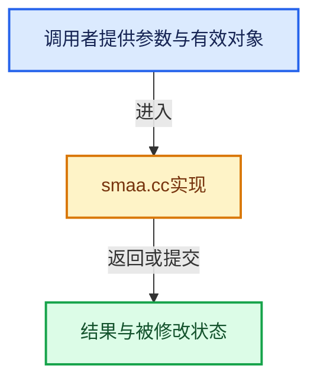

# 实现依赖专题：source/blender/compositor/algorithms/intern/smaa.cc

[实现依赖导航](../../../../README.md) · [符号索引](../../../../../00-课程指南/02-源码与提交索引/符号依赖与实现索引.md)

本专题从正文实际调用进入，集中保存共享实现。函数有稳定锚点，可从调用处直接跳到对应完整函数；递归与互相调用通过回链组织。

## 本文件的实现关系





<a id="m-0ea8254cfdb4"></a>

## 宏 `float3`

<!-- annotated:e6c47f568a859f -->

```cpp
#    define float3 vec3
#    define float4 vec4
```

<details>
<summary>核对原始源码：source/blender/compositor/algorithms/intern/smaa.cc · L641—L642</summary>

<!-- original:e6c47f568a859f:source/blender/compositor/algorithms/intern/smaa.cc:641:642 -->

```cpp
#    define float3 vec3
#    define float4 vec4
```

</details>

宏在预处理阶段展开，参数替换、重复求值和条件编译应直接从该定义检查。与普通函数不同，宏不会自动提供参数类型检查；构建配置选择哪个定义需结合外围条件。

<a id="m-9362daaa821c"></a>

## 宏 `float4`

<!-- annotated:40b5ab407274be -->

```cpp
#    define float4 vec4
#    define int2 ivec2
```

<details>
<summary>核对原始源码：source/blender/compositor/algorithms/intern/smaa.cc · L642—L643</summary>

<!-- original:40b5ab407274be:source/blender/compositor/algorithms/intern/smaa.cc:642:643 -->

```cpp
#    define float4 vec4
#    define int2 ivec2
```

</details>

宏在预处理阶段展开，参数替换、重复求值和条件编译应直接从该定义检查。与普通函数不同，宏不会自动提供参数类型检查；构建配置选择哪个定义需结合外围条件。

<a id="m-8960c8e6139d"></a>

## 宏 `int2`

<!-- annotated:ed110609c24539 -->

```cpp
#    define int2 ivec2
#    define int3 ivec3
```

<details>
<summary>核对原始源码：source/blender/compositor/algorithms/intern/smaa.cc · L643—L644</summary>

<!-- original:ed110609c24539:source/blender/compositor/algorithms/intern/smaa.cc:643:644 -->

```cpp
#    define int2 ivec2
#    define int3 ivec3
```

</details>

宏在预处理阶段展开，参数替换、重复求值和条件编译应直接从该定义检查。与普通函数不同，宏不会自动提供参数类型检查；构建配置选择哪个定义需结合外围条件。

<a id="m-1865e8d83631"></a>

## 宏 `int3`

<!-- annotated:096f27fae3cb40 -->

```cpp
#    define int3 ivec3
#    define int4 ivec4
```

<details>
<summary>核对原始源码：source/blender/compositor/algorithms/intern/smaa.cc · L644—L645</summary>

<!-- original:096f27fae3cb40:source/blender/compositor/algorithms/intern/smaa.cc:644:645 -->

```cpp
#    define int3 ivec3
#    define int4 ivec4
```

</details>

宏在预处理阶段展开，参数替换、重复求值和条件编译应直接从该定义检查。与普通函数不同，宏不会自动提供参数类型检查；构建配置选择哪个定义需结合外围条件。

<a id="m-98b3207edab6"></a>

## 宏 `int4`

<!-- annotated:37704cdd148b2b -->

```cpp
#    define int4 ivec4
#    define bool2 bvec2
```

<details>
<summary>核对原始源码：source/blender/compositor/algorithms/intern/smaa.cc · L645—L646</summary>

<!-- original:37704cdd148b2b:source/blender/compositor/algorithms/intern/smaa.cc:645:646 -->

```cpp
#    define int4 ivec4
#    define bool2 bvec2
```

</details>

宏在预处理阶段展开，参数替换、重复求值和条件编译应直接从该定义检查。与普通函数不同，宏不会自动提供参数类型检查；构建配置选择哪个定义需结合外围条件。

<a id="m-cb10c8f0220e"></a>

## 宏 `bool3`

<!-- annotated:06f4521ab22616 -->

```cpp
#    define bool3 bvec3
#    define bool4 bvec4
```

<details>
<summary>核对原始源码：source/blender/compositor/algorithms/intern/smaa.cc · L647—L648</summary>

<!-- original:06f4521ab22616:source/blender/compositor/algorithms/intern/smaa.cc:647:648 -->

```cpp
#    define bool3 bvec3
#    define bool4 bvec4
```

</details>

宏在预处理阶段展开，参数替换、重复求值和条件编译应直接从该定义检查。与普通函数不同，宏不会自动提供参数类型检查；构建配置选择哪个定义需结合外围条件。

## 完整成员与函数实现
