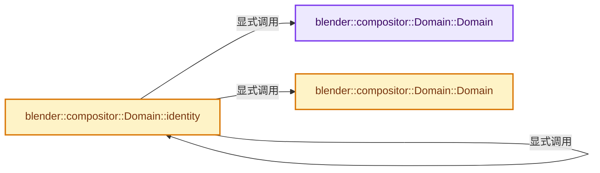
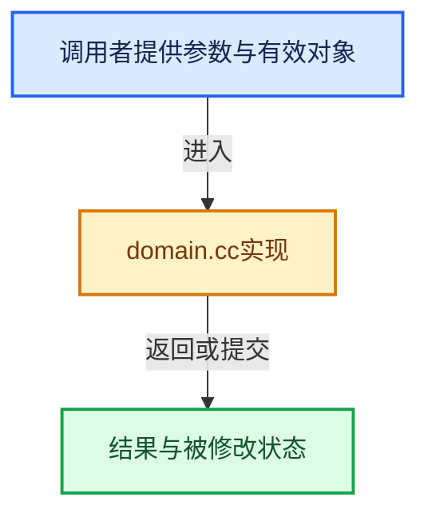

# 实现依赖专题：source/blender/compositor/intern/domain.cc

[实现依赖导航](../../../README.md) · [符号索引](../../../../00-课程指南/02-源码与提交索引/符号依赖与实现索引.md)

本专题从正文实际调用进入，集中保存共享实现。函数有稳定锚点，可从调用处直接跳到对应完整函数；递归与互相调用通过回链组织。

## 本文件的实现关系






## 完整成员与函数实现

<a id="f-4b2b6f4f7ddd48c9"></a>

### `blender::compositor::Domain::Domain`

实现位置：[source/blender/compositor/intern/domain.cc](../../../../../../../../source/blender/compositor/intern/domain.cc) · L20—L26。

接口参数：

- `const int2 &size`

**教学注释版**

<!-- annotated:5fa438a509f125 -->

```cpp
Domain::Domain(const int2 &size)
    : data_size(size),
      display_size(size),
      data_offset(int2(0)),
      transformation(float3x3::identity())
{
}
```

<details>
<summary>核对原始源码：source/blender/compositor/intern/domain.cc · L20—L26</summary>

<!-- original:5fa438a509f125:source/blender/compositor/intern/domain.cc:20:26 -->

```cpp
Domain::Domain(const int2 &size)
    : data_size(size),
      display_size(size),
      data_offset(int2(0)),
      transformation(float3x3::identity())
{
}
```

</details>

**继续追踪实现**

本实现没有需要继续展开的显式调用；检查返回表达式、对象转换和调用者前置条件。

<a id="f-feb1bb0e44265550"></a>

### `blender::compositor::Domain::Domain`

实现位置：[source/blender/compositor/intern/domain.cc](../../../../../../../../source/blender/compositor/intern/domain.cc) · L28—L31。

接口参数：

- `const int2 &size`
- `const float3x3 &transformation`

**教学注释版**

<!-- annotated:35f9dccd9ca8be -->

```cpp
Domain::Domain(const int2 &size, const float3x3 &transformation)
    : data_size(size), display_size(size), data_offset(int2(0)), transformation(transformation)
{
}
```

<details>
<summary>核对原始源码：source/blender/compositor/intern/domain.cc · L28—L31</summary>

<!-- original:35f9dccd9ca8be:source/blender/compositor/intern/domain.cc:28:31 -->

```cpp
Domain::Domain(const int2 &size, const float3x3 &transformation)
    : data_size(size), display_size(size), data_offset(int2(0)), transformation(transformation)
{
}
```

</details>

**继续追踪实现**

本实现没有需要继续展开的显式调用；检查返回表达式、对象转换和调用者前置条件。

<a id="f-87d78f3252c93fc0"></a>

### `blender::compositor::Domain::identity`

实现位置：[source/blender/compositor/intern/domain.cc](../../../../../../../../source/blender/compositor/intern/domain.cc) · L47—L50。

**教学注释版**

<!-- annotated:f83ac75c47a5a2 -->

```cpp
Domain Domain::identity()
{
  return Domain(int2(1), float3x3::identity());
}
```

<details>
<summary>核对原始源码：source/blender/compositor/intern/domain.cc · L47—L50</summary>

<!-- original:f83ac75c47a5a2:source/blender/compositor/intern/domain.cc:47:50 -->

```cpp
Domain Domain::identity()
{
  return Domain(int2(1), float3x3::identity());
}
```

</details>

**结果出口**

- `return Domain(int2(1), float3x3::identity());`

**继续追踪实现**

- `Domain` → [blender::compositor::Domain::Domain · L20](domain.cc.md#f-4b2b6f4f7ddd48c9)；[blender::compositor::Domain::Domain · L28](domain.cc.md#f-feb1bb0e44265550)。同名重载需按实参类型选择。
- `int2` → [int2 · L643](../algorithms/intern/smaa.cc.md#m-8960c8e6139d)。宏定义由构建条件选择。
- `float3x3::identity` → [blender::compositor::Domain::identity · L47](domain.cc.md#f-87d78f3252c93fc0)。
