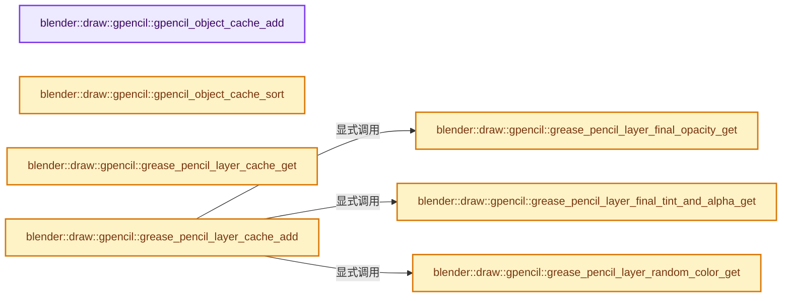
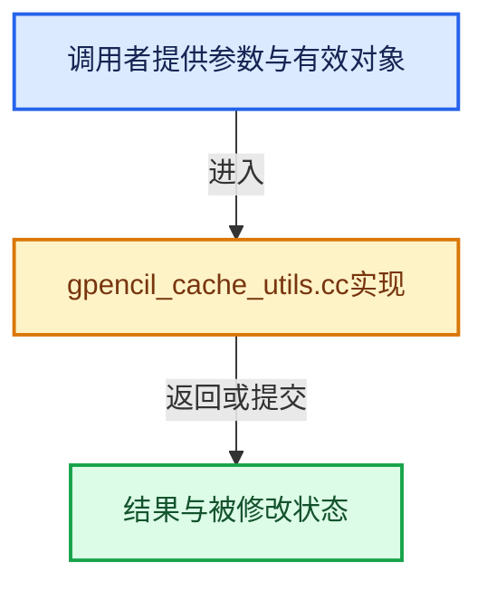

# 实现依赖专题：source/blender/draw/engines/gpencil/gpencil_cache_utils.cc

[实现依赖导航](../../../../README.md) · [符号索引](../../../../../00-课程指南/02-源码与提交索引/符号依赖与实现索引.md)

本专题从正文实际调用进入，集中保存共享实现。函数有稳定锚点，可从调用处直接跳到对应完整函数；递归与互相调用通过回链组织。

## 本文件的实现关系






## 完整成员与函数实现

<a id="f-82c089982da22a04"></a>

### `blender::draw::gpencil::gpencil_object_cache_add`

实现位置：[source/blender/draw/engines/gpencil/gpencil_cache_utils.cc](../../../../../../../../../source/blender/draw/engines/gpencil/gpencil_cache_utils.cc) · L43—L123。

接口参数：

- `Instance *inst`
- `Object *ob`
- `const bool is_stroke_order_3d`
- `const Bounds<float3> bounds`

**教学注释版**

<!-- annotated:4d5322da9f8602 -->

```cpp
tObject *gpencil_object_cache_add(Instance *inst,
                                  Object *ob,
                                  const bool is_stroke_order_3d,
                                  const Bounds<float3> bounds)
{
  tObject *tgp_ob = static_cast<tObject *>(BLI_memblock_alloc(inst->gp_object_pool));

  tgp_ob->layers.first = tgp_ob->layers.last = nullptr;
  tgp_ob->vfx.first = tgp_ob->vfx.last = nullptr;
  tgp_ob->camera_z = dot_v3v3(inst->camera_z_axis, ob->object_to_world().location());
  tgp_ob->is_drawmode3d = is_stroke_order_3d;

  /* Check if any material with holdout flag enabled. */
  tgp_ob->do_mat_holdout = false;
  const int tot_materials = BKE_object_material_used_with_fallback_eval(*ob);
  for (int i = 0; i < tot_materials; i++) {
    MaterialGPencilStyle *gp_style = BKE_gpencil_material_settings(ob, i + 1);
    if (((gp_style != nullptr) && (gp_style->flag & GP_MATERIAL_IS_STROKE_HOLDOUT)) ||
        (gp_style->flag & GP_MATERIAL_IS_FILL_HOLDOUT))
    {
      tgp_ob->do_mat_holdout = true;
      break;
    }
  }

  /* Find the normal most likely to represent the gpObject. */
  /* TODO: This does not work quite well if you use
   * strokes not aligned with the object axes. Maybe we could try to
   * compute the minimum axis of all strokes. But this would be more
   * computationally heavy and should go into the GPData evaluation. */
  float3 size = (bounds.max - bounds.min) * 0.5f;
  float3 center = math::midpoint(bounds.min, bounds.max);
  /* Convert bbox to matrix */
  float mat[4][4];
  unit_m4(mat);
  copy_v3_v3(mat[3], center);
  /* Avoid division by 0.0 later. */
  add_v3_fl(size, 1e-8f);
  rescale_m4(mat, size);
  /* BBox space to World. */
  mul_m4_m4m4(mat, ob->object_to_world().ptr(), mat);
  if (View::default_get().is_persp()) {
    /* BBox center to camera vector. */
    sub_v3_v3v3(tgp_ob->plane_normal, inst->camera_pos, mat[3]);
  }
  else {
    copy_v3_v3(tgp_ob->plane_normal, inst->camera_z_axis);
  }
  /* World to BBox space. */
  invert_m4(mat);
  /* Normalize the vector in BBox space. */
  mul_mat3_m4_v3(mat, tgp_ob->plane_normal);
  normalize_v3(tgp_ob->plane_normal);

  transpose_m4(mat);
  /* mat is now a "normal" matrix which will transform
   * BBox space normal to world space. */
  mul_mat3_m4_v3(mat, tgp_ob->plane_normal);
  normalize_v3(tgp_ob->plane_normal);

  /* Define a matrix that will be used to render a triangle to merge the depth of the rendered
   * gpencil object with the rest of the scene. */
  unit_m4(tgp_ob->plane_mat);
  copy_v3_v3(tgp_ob->plane_mat[2], tgp_ob->plane_normal);
  orthogonalize_m4(tgp_ob->plane_mat, 2);
  mul_mat3_m4_v3(ob->object_to_world().ptr(), size);
  float radius = len_v3(size);
  mul_m4_v3(ob->object_to_world().ptr(), center);
  rescale_m4(tgp_ob->plane_mat, float3{radius, radius, radius});
  copy_v3_v3(tgp_ob->plane_mat[3], center);

  /* Add to corresponding list if is in front. */
  if (ob->dtx & OB_DRAW_IN_FRONT) {
    BLI_LINKS_APPEND(&inst->tobjects_infront, tgp_ob);
  }
  else {
    BLI_LINKS_APPEND(&inst->tobjects, tgp_ob);
  }

  return tgp_ob;
}
```

<details>
<summary>核对原始源码：source/blender/draw/engines/gpencil/gpencil_cache_utils.cc · L43—L123</summary>

<!-- original:4d5322da9f8602:source/blender/draw/engines/gpencil/gpencil_cache_utils.cc:43:123 -->

```cpp
tObject *gpencil_object_cache_add(Instance *inst,
                                  Object *ob,
                                  const bool is_stroke_order_3d,
                                  const Bounds<float3> bounds)
{
  tObject *tgp_ob = static_cast<tObject *>(BLI_memblock_alloc(inst->gp_object_pool));

  tgp_ob->layers.first = tgp_ob->layers.last = nullptr;
  tgp_ob->vfx.first = tgp_ob->vfx.last = nullptr;
  tgp_ob->camera_z = dot_v3v3(inst->camera_z_axis, ob->object_to_world().location());
  tgp_ob->is_drawmode3d = is_stroke_order_3d;

  /* Check if any material with holdout flag enabled. */
  tgp_ob->do_mat_holdout = false;
  const int tot_materials = BKE_object_material_used_with_fallback_eval(*ob);
  for (int i = 0; i < tot_materials; i++) {
    MaterialGPencilStyle *gp_style = BKE_gpencil_material_settings(ob, i + 1);
    if (((gp_style != nullptr) && (gp_style->flag & GP_MATERIAL_IS_STROKE_HOLDOUT)) ||
        (gp_style->flag & GP_MATERIAL_IS_FILL_HOLDOUT))
    {
      tgp_ob->do_mat_holdout = true;
      break;
    }
  }

  /* Find the normal most likely to represent the gpObject. */
  /* TODO: This does not work quite well if you use
   * strokes not aligned with the object axes. Maybe we could try to
   * compute the minimum axis of all strokes. But this would be more
   * computationally heavy and should go into the GPData evaluation. */
  float3 size = (bounds.max - bounds.min) * 0.5f;
  float3 center = math::midpoint(bounds.min, bounds.max);
  /* Convert bbox to matrix */
  float mat[4][4];
  unit_m4(mat);
  copy_v3_v3(mat[3], center);
  /* Avoid division by 0.0 later. */
  add_v3_fl(size, 1e-8f);
  rescale_m4(mat, size);
  /* BBox space to World. */
  mul_m4_m4m4(mat, ob->object_to_world().ptr(), mat);
  if (View::default_get().is_persp()) {
    /* BBox center to camera vector. */
    sub_v3_v3v3(tgp_ob->plane_normal, inst->camera_pos, mat[3]);
  }
  else {
    copy_v3_v3(tgp_ob->plane_normal, inst->camera_z_axis);
  }
  /* World to BBox space. */
  invert_m4(mat);
  /* Normalize the vector in BBox space. */
  mul_mat3_m4_v3(mat, tgp_ob->plane_normal);
  normalize_v3(tgp_ob->plane_normal);

  transpose_m4(mat);
  /* mat is now a "normal" matrix which will transform
   * BBox space normal to world space. */
  mul_mat3_m4_v3(mat, tgp_ob->plane_normal);
  normalize_v3(tgp_ob->plane_normal);

  /* Define a matrix that will be used to render a triangle to merge the depth of the rendered
   * gpencil object with the rest of the scene. */
  unit_m4(tgp_ob->plane_mat);
  copy_v3_v3(tgp_ob->plane_mat[2], tgp_ob->plane_normal);
  orthogonalize_m4(tgp_ob->plane_mat, 2);
  mul_mat3_m4_v3(ob->object_to_world().ptr(), size);
  float radius = len_v3(size);
  mul_m4_v3(ob->object_to_world().ptr(), center);
  rescale_m4(tgp_ob->plane_mat, float3{radius, radius, radius});
  copy_v3_v3(tgp_ob->plane_mat[3], center);

  /* Add to corresponding list if is in front. */
  if (ob->dtx & OB_DRAW_IN_FRONT) {
    BLI_LINKS_APPEND(&inst->tobjects_infront, tgp_ob);
  }
  else {
    BLI_LINKS_APPEND(&inst->tobjects, tgp_ob);
  }

  return tgp_ob;
}
```

</details>

**沿实际写入检查状态**

- `tgp_ob->layers.first = tgp_ob->layers.last = nullptr;`
- `tgp_ob->vfx.first = tgp_ob->vfx.last = nullptr;`
- `tgp_ob->camera_z = dot_v3v3(inst->camera_z_axis, ob->object_to_world().location());`
- `tgp_ob->is_drawmode3d = is_stroke_order_3d;`
- `tgp_ob->do_mat_holdout = false;`
- `tgp_ob->do_mat_holdout = true;`

**结果出口**

- `return tgp_ob;`

**继续追踪实现**

- `BLI_memblock_alloc` → [blender::BLI_memblock_alloc · L118](../../../../01-BLI基础库/intern/BLI_memblock.cc.md#f-190dab22a7827201)。
- `dot_v3v3` → [blender::dot_v3v3 · L646](../../../../01-BLI基础库/intern/math_vector_inline.cc.md#f-c88befa67d07591a)。
- `ob->object_to_world().location` → [调用协议](../../../../../00-课程指南/01-路线与规范/模板宏与动态分派协议.md)：接收对象类型依赖auto、返回值或模板实例；不按同名猜测目标。调用位置L52。
- `ob->object_to_world` → [blender::Object::object_to_world · L5761](../../../../02-BKE几何与数据/intern/object.cc.md#f-12fc20026327d50c)。
- `BKE_object_material_used_with_fallback_eval` → [blender::BKE_object_material_used_with_fallback_eval · L897](../../../../02-BKE几何与数据/intern/material.cc.md#f-db4360f7b410441f)。
- `BKE_gpencil_material_settings` → [blender::BKE_gpencil_material_settings · L991](../../../../02-BKE几何与数据/intern/material.cc.md#f-e93d4158a7af41c3)。
- `math::midpoint` → [blender::math::midpoint · L647](../../../../01-BLI基础库/BLI_math_vector.hh.md#f-383eeed0051cc8bd)；[blender::math::midpoint · L288](../../../../01-BLI基础库/BLI_math_base.hh.md#f-1a01baa0be6c0b84)。同名重载需按实参类型选择。
- `unit_m4` → [blender::unit_m4 · L55](../../../../01-BLI基础库/intern/math_matrix_c.cc.md#f-e6cd812aae119176)。
- `copy_v3_v3` → [调用协议](../../../../../00-课程指南/01-路线与规范/模板宏与动态分派协议.md)：函数指针、局部可调用对象或未展开的宏；必须结合调用者环境。调用位置L78。
- `add_v3_fl` → [blender::add_v3_fl · L267](../../../../01-BLI基础库/intern/math_vector_inline.cc.md#f-ccf32c1ce29b15d8)。
- `rescale_m4` → [blender::rescale_m4 · L2152](../../../../01-BLI基础库/intern/math_matrix_c.cc.md#f-9e3942c439579fa1)。
- `mul_m4_m4m4` → [blender::mul_m4_m4m4 · L217](../../../../01-BLI基础库/intern/math_matrix_c.cc.md#f-b5272136b543b73b)。
- `ob->object_to_world().ptr` → [调用协议](../../../../../00-课程指南/01-路线与规范/模板宏与动态分派协议.md)：接收对象类型依赖auto、返回值或模板实例；不按同名猜测目标。调用位置L83。
- `View::default_get().is_persp` → [调用协议](../../../../../00-课程指南/01-路线与规范/模板宏与动态分派协议.md)：接收对象类型依赖auto、返回值或模板实例；不按同名猜测目标。调用位置L84。
- `View::default_get` → [blender::draw::View::default_get · L317](../../intern/draw_view.cc.md#f-1edfe36a27ed8fa6)。
- `sub_v3_v3v3` → [blender::sub_v3_v3v3 · L360](../../../../01-BLI基础库/intern/math_vector_inline.cc.md#f-23781c252db8b30c)。
- `invert_m4` → [blender::invert_m4 · L1069](../../../../01-BLI基础库/intern/math_matrix_c.cc.md#f-db172dd1e3ce5867)。
- `mul_mat3_m4_v3` → [blender::mul_mat3_m4_v3 · L738](../../../../01-BLI基础库/intern/math_matrix_c.cc.md#f-85a92f87ede557ca)。
- `normalize_v3` → [blender::normalize_v3 · L933](../../../../01-BLI基础库/intern/math_vector_inline.cc.md#f-5f3257e657ef732c)。
- `transpose_m4` → [blender::transpose_m4 · L1244](../../../../01-BLI基础库/intern/math_matrix_c.cc.md#f-21ae38279292b2d6)。
- `orthogonalize_m4` → [blender::orthogonalize_m4 · L1390](../../../../01-BLI基础库/intern/math_matrix_c.cc.md#f-05726d44b8626949)。
- `len_v3` → [blender::len_v3 · L781](../../../../01-BLI基础库/intern/math_vector_inline.cc.md#f-4ad88eb0aa8d70ab)。
- `mul_m4_v3` → [blender::mul_m4_v3 · L677](../../../../01-BLI基础库/intern/math_matrix_c.cc.md#f-14a8c267710d47a3)。
- `BLI_LINKS_APPEND` → [BLI_LINKS_APPEND · L24](../../../../01-BLI基础库/BLI_link_utils.hh.md#m-926e21a59e07)。宏定义由构建条件选择。

<a id="f-b3aca07d31c53bcc"></a>

### `blender::draw::gpencil::gpencil_object_cache_sort`

实现位置：[source/blender/draw/engines/gpencil/gpencil_cache_utils.cc](../../../../../../../../../source/blender/draw/engines/gpencil/gpencil_cache_utils.cc) · L148—L186。

接口参数：

- `Instance *inst`

**教学注释版**

<!-- annotated:cbb28ee6a7d43e -->

```cpp
void gpencil_object_cache_sort(Instance *inst)
{
  if (inst->is_sorted) {
    return;
  }
  /* Sort object by distance to the camera. */
  if (inst->tobjects.first) {
    inst->tobjects.first = gpencil_tobject_sort_fn_r(inst->tobjects.first,
                                                     gpencil_tobject_dist_sort);
    /* Relink last pointer. */
    while (inst->tobjects.last->next) {
      inst->tobjects.last = inst->tobjects.last->next;
    }
  }
  if (inst->tobjects_infront.first) {
    inst->tobjects_infront.first = gpencil_tobject_sort_fn_r(inst->tobjects_infront.first,
                                                             gpencil_tobject_dist_sort);
    /* Relink last pointer. */
    while (inst->tobjects_infront.last->next) {
      inst->tobjects_infront.last = inst->tobjects_infront.last->next;
    }
  }

  /* Join both lists, adding in front. */
  if (inst->tobjects_infront.first != nullptr) {
    if (inst->tobjects.last != nullptr) {
      inst->tobjects.last->next = inst->tobjects_infront.first;
      inst->tobjects.last = inst->tobjects_infront.last;
      inst->tobjects_infront.first = inst->tobjects.last = nullptr;
    }
    else {
      /* Only in front objects. */
      inst->tobjects.first = inst->tobjects_infront.first;
      inst->tobjects.last = inst->tobjects_infront.last;
      inst->tobjects_infront.first = inst->tobjects.last = nullptr;
    }
  }
  inst->is_sorted = true;
}
```

<details>
<summary>核对原始源码：source/blender/draw/engines/gpencil/gpencil_cache_utils.cc · L148—L186</summary>

<!-- original:cbb28ee6a7d43e:source/blender/draw/engines/gpencil/gpencil_cache_utils.cc:148:186 -->

```cpp
void gpencil_object_cache_sort(Instance *inst)
{
  if (inst->is_sorted) {
    return;
  }
  /* Sort object by distance to the camera. */
  if (inst->tobjects.first) {
    inst->tobjects.first = gpencil_tobject_sort_fn_r(inst->tobjects.first,
                                                     gpencil_tobject_dist_sort);
    /* Relink last pointer. */
    while (inst->tobjects.last->next) {
      inst->tobjects.last = inst->tobjects.last->next;
    }
  }
  if (inst->tobjects_infront.first) {
    inst->tobjects_infront.first = gpencil_tobject_sort_fn_r(inst->tobjects_infront.first,
                                                             gpencil_tobject_dist_sort);
    /* Relink last pointer. */
    while (inst->tobjects_infront.last->next) {
      inst->tobjects_infront.last = inst->tobjects_infront.last->next;
    }
  }

  /* Join both lists, adding in front. */
  if (inst->tobjects_infront.first != nullptr) {
    if (inst->tobjects.last != nullptr) {
      inst->tobjects.last->next = inst->tobjects_infront.first;
      inst->tobjects.last = inst->tobjects_infront.last;
      inst->tobjects_infront.first = inst->tobjects.last = nullptr;
    }
    else {
      /* Only in front objects. */
      inst->tobjects.first = inst->tobjects_infront.first;
      inst->tobjects.last = inst->tobjects_infront.last;
      inst->tobjects_infront.first = inst->tobjects.last = nullptr;
    }
  }
  inst->is_sorted = true;
}
```

</details>

**沿实际写入检查状态**

- `inst->tobjects.first = gpencil_tobject_sort_fn_r(inst->tobjects.first,`
- `inst->tobjects.last = inst->tobjects.last->next;`
- `inst->tobjects_infront.first = gpencil_tobject_sort_fn_r(inst->tobjects_infront.first,`
- `inst->tobjects_infront.last = inst->tobjects_infront.last->next;`
- `inst->tobjects.last->next = inst->tobjects_infront.first;`
- `inst->tobjects.last = inst->tobjects_infront.last;`
- `inst->tobjects_infront.first = inst->tobjects.last = nullptr;`
- `inst->tobjects.first = inst->tobjects_infront.first;`
- `inst->is_sorted = true;`

**继续追踪实现**

- `gpencil_tobject_sort_fn_r` → [调用协议](../../../../../00-课程指南/01-路线与规范/模板宏与动态分派协议.md)：函数指针、局部可调用对象或未展开的宏；必须结合调用者环境。调用位置L155。

<a id="f-38cf392870cbc59c"></a>

### `blender::draw::gpencil::grease_pencil_layer_final_opacity_get`

实现位置：[source/blender/draw/engines/gpencil/gpencil_cache_utils.cc](../../../../../../../../../source/blender/draw/engines/gpencil/gpencil_cache_utils.cc) · L194—L214。

接口参数：

- `const Instance *inst`
- `const Object *ob`
- `const GreasePencil &grease_pencil`
- `const bke::greasepencil::Layer &layer`

**教学注释版**

<!-- annotated:df37d4fb40da87 -->

```cpp
static float grease_pencil_layer_final_opacity_get(const Instance *inst,
                                                   const Object *ob,
                                                   const GreasePencil &grease_pencil,
                                                   const bke::greasepencil::Layer &layer)
{
  const bool is_obact = ((inst->obact) && (inst->obact == ob));
  const bool is_fade = (inst->fade_layer_opacity > -1.0f) && (is_obact) &&
                       !grease_pencil.is_layer_active(&layer);

  /* Defines layer opacity. For active object depends of layer opacity factor, and
   * for no active object, depends if the fade grease pencil objects option is enabled. */
  if (!inst->is_render) {
    if (is_obact && is_fade) {
      return layer.opacity * inst->fade_layer_opacity;
    }
    if (!is_obact && (inst->fade_gp_object_opacity > -1.0f)) {
      return layer.opacity * inst->fade_gp_object_opacity;
    }
  }
  return layer.opacity;
}
```

<details>
<summary>核对原始源码：source/blender/draw/engines/gpencil/gpencil_cache_utils.cc · L194—L214</summary>

<!-- original:df37d4fb40da87:source/blender/draw/engines/gpencil/gpencil_cache_utils.cc:194:214 -->

```cpp
static float grease_pencil_layer_final_opacity_get(const Instance *inst,
                                                   const Object *ob,
                                                   const GreasePencil &grease_pencil,
                                                   const bke::greasepencil::Layer &layer)
{
  const bool is_obact = ((inst->obact) && (inst->obact == ob));
  const bool is_fade = (inst->fade_layer_opacity > -1.0f) && (is_obact) &&
                       !grease_pencil.is_layer_active(&layer);

  /* Defines layer opacity. For active object depends of layer opacity factor, and
   * for no active object, depends if the fade grease pencil objects option is enabled. */
  if (!inst->is_render) {
    if (is_obact && is_fade) {
      return layer.opacity * inst->fade_layer_opacity;
    }
    if (!is_obact && (inst->fade_gp_object_opacity > -1.0f)) {
      return layer.opacity * inst->fade_gp_object_opacity;
    }
  }
  return layer.opacity;
}
```

</details>

**结果出口**

- `return layer.opacity * inst->fade_layer_opacity;`
- `return layer.opacity * inst->fade_gp_object_opacity;`
- `return layer.opacity;`

**继续追踪实现**

- `grease_pencil.is_layer_active` → [blender::GreasePencil::is_layer_active · L4061](../../../../02-BKE几何与数据/intern/grease_pencil.cc.md#f-4457fe157225fb06)。

<a id="f-1ec6d4341644a5a6"></a>

### `blender::draw::gpencil::grease_pencil_layer_final_tint_and_alpha_get`

实现位置：[source/blender/draw/engines/gpencil/gpencil_cache_utils.cc](../../../../../../../../../source/blender/draw/engines/gpencil/gpencil_cache_utils.cc) · L216—L263。

接口参数：

- `const Instance *inst`
- `const GreasePencil &grease_pencil`
- `const int onion_id`
- `float *r_alpha`

**教学注释版**

<!-- annotated:502926da5caddb -->

```cpp
static float4 grease_pencil_layer_final_tint_and_alpha_get(const Instance *inst,
                                                           const GreasePencil &grease_pencil,
                                                           const int onion_id,
                                                           float *r_alpha)
{
  const bool use_onion = (onion_id != 0);
  if (use_onion && inst->do_onion) {
    const bool use_onion_custom_col = (grease_pencil.onion_skinning_settings.flag &
                                       GP_ONION_SKINNING_USE_CUSTOM_COLORS) != 0;
    const bool use_onion_fade = (grease_pencil.onion_skinning_settings.flag &
                                 GP_ONION_SKINNING_USE_FADE) != 0;
    const bool use_next_col = onion_id > 0;

    const float onion_factor = grease_pencil.onion_skinning_settings.opacity;

    float3 color_next, color_prev;
    if (use_onion_custom_col) {
      color_next = float3(grease_pencil.onion_skinning_settings.color_after);
      color_prev = float3(grease_pencil.onion_skinning_settings.color_before);
    }
    else {
      ui::theme::get_color_3fv(TH_FRAME_AFTER, color_next);
      ui::theme::get_color_3fv(TH_FRAME_BEFORE, color_prev);
    }

    const float4 onion_col_custom = use_next_col ? float4(color_next, 1.0f) :
                                                   float4(color_prev, 1.0f);

    *r_alpha = use_onion_fade ? (1.0f / abs(onion_id)) : 1.0f;
    *r_alpha *= onion_factor;
    *r_alpha = (onion_factor > 0.0f) ? clamp_f(*r_alpha, 0.1f, 1.0f) :
                                       clamp_f(*r_alpha, 0.01f, 1.0f);
    *r_alpha *= inst->xray_alpha;

    return onion_col_custom;
  }

  /* Layer tint is not a property in GPv3 anymore. It's only used for onion skinning. The previous
   * property is replaced by a tint modifier during conversion. */
  float4 layer_tint(0.0f);
  if (GPENCIL_SIMPLIFY_TINT(inst->scene)) {
    layer_tint[3] = 0.0f;
  }
  *r_alpha = 1.0f;
  *r_alpha *= inst->xray_alpha;

  return layer_tint;
}
```

<details>
<summary>核对原始源码：source/blender/draw/engines/gpencil/gpencil_cache_utils.cc · L216—L263</summary>

<!-- original:502926da5caddb:source/blender/draw/engines/gpencil/gpencil_cache_utils.cc:216:263 -->

```cpp
static float4 grease_pencil_layer_final_tint_and_alpha_get(const Instance *inst,
                                                           const GreasePencil &grease_pencil,
                                                           const int onion_id,
                                                           float *r_alpha)
{
  const bool use_onion = (onion_id != 0);
  if (use_onion && inst->do_onion) {
    const bool use_onion_custom_col = (grease_pencil.onion_skinning_settings.flag &
                                       GP_ONION_SKINNING_USE_CUSTOM_COLORS) != 0;
    const bool use_onion_fade = (grease_pencil.onion_skinning_settings.flag &
                                 GP_ONION_SKINNING_USE_FADE) != 0;
    const bool use_next_col = onion_id > 0;

    const float onion_factor = grease_pencil.onion_skinning_settings.opacity;

    float3 color_next, color_prev;
    if (use_onion_custom_col) {
      color_next = float3(grease_pencil.onion_skinning_settings.color_after);
      color_prev = float3(grease_pencil.onion_skinning_settings.color_before);
    }
    else {
      ui::theme::get_color_3fv(TH_FRAME_AFTER, color_next);
      ui::theme::get_color_3fv(TH_FRAME_BEFORE, color_prev);
    }

    const float4 onion_col_custom = use_next_col ? float4(color_next, 1.0f) :
                                                   float4(color_prev, 1.0f);

    *r_alpha = use_onion_fade ? (1.0f / abs(onion_id)) : 1.0f;
    *r_alpha *= onion_factor;
    *r_alpha = (onion_factor > 0.0f) ? clamp_f(*r_alpha, 0.1f, 1.0f) :
                                       clamp_f(*r_alpha, 0.01f, 1.0f);
    *r_alpha *= inst->xray_alpha;

    return onion_col_custom;
  }

  /* Layer tint is not a property in GPv3 anymore. It's only used for onion skinning. The previous
   * property is replaced by a tint modifier during conversion. */
  float4 layer_tint(0.0f);
  if (GPENCIL_SIMPLIFY_TINT(inst->scene)) {
    layer_tint[3] = 0.0f;
  }
  *r_alpha = 1.0f;
  *r_alpha *= inst->xray_alpha;

  return layer_tint;
}
```

</details>

**沿实际写入检查状态**

- `color_next = float3(grease_pencil.onion_skinning_settings.color_after);`
- `color_prev = float3(grease_pencil.onion_skinning_settings.color_before);`
- `layer_tint[3] = 0.0f;`

**结果出口**

- `return onion_col_custom;`
- `return layer_tint;`

**继续追踪实现**

- `float3` → [float3 · L641](../../../compositor/algorithms/intern/smaa.cc.md#m-0ea8254cfdb4)。宏定义由构建条件选择。
- `ui::theme::get_color_3fv` → [blender::ui::theme::get_color_3fv · L1241](../../../editors/interface/resources.cc.md#f-6ac6719124c421f4)。
- `float4` → [float4 · L56](../../../../07-Intern运行时与平台/cycles/kernel/svm/radial_tiling_shared.h.md#m-f0908e385c5b)；[float4 · L60](../../../../01-BLI基础库/intern/radial_tiling_shared.hh.md#m-7962dcdc288b)；[float4 · L56](../../../../07-Intern运行时与平台/cycles/kernel/osl/shaders/node_radial_tiling_shared.h.md#m-adb8e9e87775)；[float4 · L642](../../../compositor/algorithms/intern/smaa.cc.md#m-9362daaa821c)。宏定义由构建条件选择。
- `abs` → [abs · L104](../../../gpu/shaders/compat/gpu_shader_cxx_builtin.hh.md#m-14b5712612c4)。宏定义由构建条件选择。
- `clamp_f` → [blender::clamp_f · L405](../../../../01-BLI基础库/intern/math_base_inline.cc.md#f-abaf19ee32d97de2)。
- `GPENCIL_SIMPLIFY_TINT` → [GPENCIL_SIMPLIFY_TINT · L57](gpencil_engine_private.hh.md#m-fea076f8f12c)。宏定义由构建条件选择。

<a id="f-62b3c811c0e27070"></a>

### `blender::draw::gpencil::grease_pencil_layer_random_color_get`

实现位置：[source/blender/draw/engines/gpencil/gpencil_cache_utils.cc](../../../../../../../../../source/blender/draw/engines/gpencil/gpencil_cache_utils.cc) · L266—L279。

接口参数：

- `const Object *ob`
- `const bke::greasepencil::Layer &layer`
- `float r_color[3]`

**教学注释版**

<!-- annotated:8c5070b26e47f9 -->

```cpp
static void grease_pencil_layer_random_color_get(const Object *ob,
                                                 const bke::greasepencil::Layer &layer,
                                                 float r_color[3])
{
  const float hsv_saturation = 0.7f;
  const float hsv_value = 0.6f;

  uint ob_hash = BLI_ghashutil_strhash_p_murmur(ob->id.name);
  uint gpl_hash = BLI_ghashutil_strhash_p_murmur(layer.name().c_str());
  float hue = BLI_hash_int_01(ob_hash * gpl_hash);
  const float hsv[3] = {hue, hsv_saturation, hsv_value};
  hsv_to_rgb_v(hsv, r_color);
  IMB_colormanagement_rec709_to_scene_linear(r_color, r_color);
}
```

<details>
<summary>核对原始源码：source/blender/draw/engines/gpencil/gpencil_cache_utils.cc · L266—L279</summary>

<!-- original:8c5070b26e47f9:source/blender/draw/engines/gpencil/gpencil_cache_utils.cc:266:279 -->

```cpp
static void grease_pencil_layer_random_color_get(const Object *ob,
                                                 const bke::greasepencil::Layer &layer,
                                                 float r_color[3])
{
  const float hsv_saturation = 0.7f;
  const float hsv_value = 0.6f;

  uint ob_hash = BLI_ghashutil_strhash_p_murmur(ob->id.name);
  uint gpl_hash = BLI_ghashutil_strhash_p_murmur(layer.name().c_str());
  float hue = BLI_hash_int_01(ob_hash * gpl_hash);
  const float hsv[3] = {hue, hsv_saturation, hsv_value};
  hsv_to_rgb_v(hsv, r_color);
  IMB_colormanagement_rec709_to_scene_linear(r_color, r_color);
}
```

</details>

**继续追踪实现**

- `BLI_ghashutil_strhash_p_murmur` → [blender::BLI_ghashutil_strhash_p_murmur · L146](../../../../01-BLI基础库/intern/BLI_ghash_utils.cc.md#f-4e8630ae4ba9ea6c)。
- `layer.name().c_str` → [调用协议](../../../../../00-课程指南/01-路线与规范/模板宏与动态分派协议.md)：接收对象类型依赖auto、返回值或模板实例；不按同名猜测目标。调用位置L274。
- `layer.name` → [调用协议](../../../../../00-课程指南/01-路线与规范/模板宏与动态分派协议.md)：由接收对象具体类型或运行时策略提供实现。调用位置L274。
- `BLI_hash_int_01` → [blender::BLI_hash_int_01 · L94](../../../../01-BLI基础库/BLI_hash_c.hh.md#f-5f15d616cd371045)。
- `hsv_to_rgb_v` → [blender::hsv_to_rgb_v · L61](../../../../01-BLI基础库/intern/math_color.cc.md#f-d78b8d5b93aafd9e)。
- `IMB_colormanagement_rec709_to_scene_linear` → [blender::IMB_colormanagement_rec709_to_scene_linear · L50](../../../imbuf/intern/colormanagement_inline.h.md#f-065c5dfb0d51c512)。

<a id="f-0c2751ff8751e971"></a>

### `blender::draw::gpencil::grease_pencil_layer_cache_get`

实现位置：[source/blender/draw/engines/gpencil/gpencil_cache_utils.cc](../../../../../../../../../source/blender/draw/engines/gpencil/gpencil_cache_utils.cc) · L281—L293。

接口参数：

- `tObject *tgp_ob`
- `int layer_id`
- `const bool skip_onion`

**教学注释版**

<!-- annotated:b5784b60e965ef -->

```cpp
tLayer *grease_pencil_layer_cache_get(tObject *tgp_ob, int layer_id, const bool skip_onion)
{
  BLI_assert(layer_id >= 0);
  for (tLayer *layer = tgp_ob->layers.first; layer != nullptr; layer = layer->next) {
    if (skip_onion && layer->is_onion) {
      continue;
    }
    if (layer->layer_id == layer_id) {
      return layer;
    }
  }
  return nullptr;
}
```

<details>
<summary>核对原始源码：source/blender/draw/engines/gpencil/gpencil_cache_utils.cc · L281—L293</summary>

<!-- original:b5784b60e965ef:source/blender/draw/engines/gpencil/gpencil_cache_utils.cc:281:293 -->

```cpp
tLayer *grease_pencil_layer_cache_get(tObject *tgp_ob, int layer_id, const bool skip_onion)
{
  BLI_assert(layer_id >= 0);
  for (tLayer *layer = tgp_ob->layers.first; layer != nullptr; layer = layer->next) {
    if (skip_onion && layer->is_onion) {
      continue;
    }
    if (layer->layer_id == layer_id) {
      return layer;
    }
  }
  return nullptr;
}
```

</details>

**结果出口**

- `return layer;`
- `return nullptr;`

**继续追踪实现**

- `BLI_assert` → [BLI_assert · L48](../../../../01-BLI基础库/BLI_assert.hh.md#m-57a88495704d)；[BLI_assert · L63](../../../../01-BLI基础库/BLI_assert.hh.md#m-d07050020cb5)。宏定义由构建条件选择。

<a id="f-24c5b3205e12f561"></a>

### `blender::draw::gpencil::grease_pencil_layer_cache_add`

实现位置：[source/blender/draw/engines/gpencil/gpencil_cache_utils.cc](../../../../../../../../../source/blender/draw/engines/gpencil/gpencil_cache_utils.cc) · L295—L477。

接口参数：

- `Instance *inst`
- `const Object *ob`
- `const bke::greasepencil::Layer &layer`
- `const int onion_id`
- `const bool is_used_as_mask`
- `tObject *tgp_ob`

**教学注释版**

<!-- annotated:507a15f1957d11 -->

```cpp
tLayer *grease_pencil_layer_cache_add(Instance *inst,
                                      const Object *ob,
                                      const bke::greasepencil::Layer &layer,
                                      const int onion_id,
                                      const bool is_used_as_mask,
                                      tObject *tgp_ob)

{
  using namespace bke::greasepencil;
  const GreasePencil &grease_pencil = DRW_object_get_data_for_drawing<GreasePencil>(*ob);

  const bool is_in_front = (ob->dtx & OB_DRAW_IN_FRONT);

  const bool override_vertcol = (inst->v3d_color_type != -1);
  /* In draw mode and vertex paint mode it's possible to draw vertex colors so we want to make sure
   * to render them. Otherwise this can lead to unexpected behavior. */
  const bool is_vert_col_mode = (inst->v3d_color_type == V3D_SHADING_VERTEX_COLOR) ||
                                (ob->mode & OB_MODE_VERTEX_PAINT) != 0 ||
                                (ob->mode & OB_MODE_PAINT_GREASE_PENCIL) != 0 || inst->is_render;
  const bool is_viewlayer_render = inst->is_render && !layer.view_layer_name().is_empty() &&
                                   STREQ(inst->view_layer->name, layer.view_layer_name().c_str());
  const bool disable_masks_render = is_viewlayer_render &&
                                    (layer.base.flag &
                                     GP_LAYER_TREE_NODE_DISABLE_MASKS_IN_VIEWLAYER) != 0;
  bool is_masked = !disable_masks_render && layer.use_masks() && !layer.masks.is_empty();

  const float vert_col_opacity = (override_vertcol) ?
                                     (is_vert_col_mode ? inst->vertex_paint_opacity : 0.0f) :
                                     (inst->is_render ? 1.0f : inst->vertex_paint_opacity);
  /* If the layer is used as a mask (but is otherwise not visible in the render), render it with a
   * opacity of 0 so that it can still mask other layers. */
  const float layer_opacity = !is_used_as_mask ? grease_pencil_layer_final_opacity_get(
                                                     inst, ob, grease_pencil, layer) :
                                                 0.0f;

  float layer_alpha = inst->xray_alpha;
  const float4 layer_tint = grease_pencil_layer_final_tint_and_alpha_get(
      inst, grease_pencil, onion_id, &layer_alpha);

  /* Create the new layer descriptor. */
  int64_t id = inst->gp_layer_pool->append_and_get_index({});
  tLayer *tgp_layer = &(*inst->gp_layer_pool)[id];
  BLI_LINKS_APPEND(&tgp_ob->layers, tgp_layer);
  tgp_layer->layer_id = *grease_pencil.get_layer_index(layer);
  tgp_layer->is_onion = onion_id != 0;
  tgp_layer->mask_bits = nullptr;
  tgp_layer->mask_invert_bits = nullptr;
  tgp_layer->blend_ps = nullptr;

  /* Masking: Go through mask list and extract valid masks in a bitmap. */
  if (is_masked) {
    bool valid_mask = false;
    /* WARNING: only #GP_MAX_MASKBITS amount of bits.
     * TODO(fclem): Find a better system without any limitation. */
    tgp_layer->mask_bits = static_cast<BLI_bitmap *>(BLI_memblock_alloc(inst->gp_maskbit_pool));
    tgp_layer->mask_invert_bits = static_cast<BLI_bitmap *>(
        BLI_memblock_alloc(inst->gp_maskbit_pool));
    BLI_bitmap_set_all(tgp_layer->mask_bits, false, GP_MAX_MASKBITS);

    for (GreasePencilLayerMask &mask : layer.masks) {
      if (mask.flag & GP_LAYER_MASK_HIDE) {
        continue;
      }
      const TreeNode *node = grease_pencil.find_node_by_name(mask.layer_name);
      if (node == nullptr) {
        continue;
      }
      const Layer &mask_layer = node->as_layer();
      if ((&mask_layer == &layer) || !mask_layer.is_visible()) {
        continue;
      }
      const int index = *grease_pencil.get_layer_index(mask_layer);
      if (index < GP_MAX_MASKBITS) {
        const bool invert = (mask.flag & GP_LAYER_MASK_INVERT) != 0;
        BLI_BITMAP_SET(tgp_layer->mask_bits, index, true);
        BLI_BITMAP_SET(tgp_layer->mask_invert_bits, index, invert);
        valid_mask = true;
      }
    }

    if (valid_mask) {
      inst->use_mask_fb = true;
    }
    else {
      tgp_layer->mask_bits = nullptr;
    }
    is_masked = valid_mask;
  }

  /* Blending: Force blending for masked layer. */
  if (is_masked || (layer.blend_mode != GP_LAYER_BLEND_NONE) || (layer_opacity < 1.0f)) {
    DRWState state = DRW_STATE_WRITE_COLOR | DRW_STATE_STENCIL_EQUAL;
    switch (layer.blend_mode) {
      case GP_LAYER_BLEND_NONE:
        state |= DRW_STATE_BLEND_ALPHA_PREMUL;
        break;
      case GP_LAYER_BLEND_ADD:
        state |= DRW_STATE_BLEND_ADD_FULL;
        break;
      case GP_LAYER_BLEND_SUBTRACT:
        state |= DRW_STATE_BLEND_SUB;
        break;
      case GP_LAYER_BLEND_MULTIPLY:
      case GP_LAYER_BLEND_DIVIDE:
      case GP_LAYER_BLEND_HARDLIGHT:
        state |= DRW_STATE_BLEND_MUL;
        break;
    }

    if (ELEM(layer.blend_mode, GP_LAYER_BLEND_SUBTRACT, GP_LAYER_BLEND_HARDLIGHT)) {
      /* For these effect to propagate, we need a signed floating point buffer. */
      inst->use_signed_fb = true;
    }

    if (tgp_layer->blend_ps == nullptr) {
      // [讲解] std::make_unique<PassSimple>：创建独占拥有的对象，拥有关系可移动，get返回的借用指针不自动延长寿命。
      tgp_layer->blend_ps = std::make_unique<PassSimple>("GPencil Blend Layer");
    }
    PassSimple &pass = *tgp_layer->blend_ps;
    pass.init();
    pass.state_set(state);
    pass.shader_set(ShaderCache::get().layer_blend.get());
    pass.push_constant("blend_mode", int(layer.blend_mode));
    pass.push_constant("blend_opacity", layer_opacity);
    pass.bind_texture("color_buf", &inst->color_layer_tx);
    pass.bind_texture("reveal_buf", &inst->reveal_layer_tx);
    pass.bind_texture("mask_buf", (is_masked) ? &inst->mask_tx : &inst->dummy_tx);
    pass.state_stencil(0xFF, 0xFF, 0xFF);
    pass.draw_procedural(GPU_PRIM_TRIS, 1, 3);

    if (layer.blend_mode == GP_LAYER_BLEND_HARDLIGHT) {
      /* We cannot do custom blending on Multi-Target frame-buffers.
       * Workaround by doing 2 passes. */
      pass.state_set((state & ~DRW_STATE_BLEND_MUL) | DRW_STATE_BLEND_ADD_FULL);
      pass.push_constant("blend_mode", 999);
      pass.draw_procedural(GPU_PRIM_TRIS, 1, 3);
    }

    inst->use_layer_fb = true;
  }

  /* Geometry pass */
  {
    if (tgp_layer->geom_ps == nullptr) {
      tgp_layer->geom_ps = std::make_unique<PassSimple>("GPencil Layer");
    }

    PassSimple &pass = *tgp_layer->geom_ps;

    gpu::Texture **depth_tex = (is_in_front) ? &inst->dummy_depth : &inst->scene_depth_tx;
    gpu::Texture **mask_tex = (is_masked) ? &inst->mask_tx : &inst->dummy_tx;

    DRWState state = DRW_STATE_WRITE_COLOR | DRW_STATE_WRITE_DEPTH | DRW_STATE_BLEND_ALPHA_PREMUL;
    /* For 2D mode, we render all strokes with uniform depth (increasing with stroke id). */
    state |= tgp_ob->is_drawmode3d ? DRW_STATE_DEPTH_LESS_EQUAL : DRW_STATE_DEPTH_GREATER;
    /* Always write stencil. Only used as optimization for blending. */
    state |= DRW_STATE_WRITE_STENCIL | DRW_STATE_STENCIL_ALWAYS;

    pass.state_set(state);
    pass.shader_set(ShaderCache::get().geometry.get());
    pass.bind_texture("gp_scene_depth_tx", depth_tex);
    pass.bind_texture("gp_mask_tx", mask_tex);
    pass.push_constant("gp_normal", tgp_ob->plane_normal);
    pass.push_constant("gp_stroke_order3d", tgp_ob->is_drawmode3d);
    pass.push_constant("gp_vertex_color_opacity", vert_col_opacity);

    pass.bind_texture("gp_fill_tx", inst->dummy_tx);
    pass.bind_texture("gp_stroke_tx", inst->dummy_tx);

    /* If random color type, need color by layer. */
    float4 gpl_color;
    copy_v4_v4(gpl_color, layer_tint);
    if (inst->v3d_color_type == V3D_SHADING_RANDOM_COLOR) {
      grease_pencil_layer_random_color_get(ob, layer, gpl_color);
      gpl_color[3] = 1.0f;
    }
    pass.push_constant("gp_layer_tint", gpl_color);

    pass.push_constant("gp_layer_opacity", layer_alpha);
    pass.state_stencil(0xFF, 0xFF, 0xFF);
  }

  return tgp_layer;
}
```

<details>
<summary>核对原始源码：source/blender/draw/engines/gpencil/gpencil_cache_utils.cc · L295—L477</summary>

<!-- original:507a15f1957d11:source/blender/draw/engines/gpencil/gpencil_cache_utils.cc:295:477 -->

```cpp
tLayer *grease_pencil_layer_cache_add(Instance *inst,
                                      const Object *ob,
                                      const bke::greasepencil::Layer &layer,
                                      const int onion_id,
                                      const bool is_used_as_mask,
                                      tObject *tgp_ob)

{
  using namespace bke::greasepencil;
  const GreasePencil &grease_pencil = DRW_object_get_data_for_drawing<GreasePencil>(*ob);

  const bool is_in_front = (ob->dtx & OB_DRAW_IN_FRONT);

  const bool override_vertcol = (inst->v3d_color_type != -1);
  /* In draw mode and vertex paint mode it's possible to draw vertex colors so we want to make sure
   * to render them. Otherwise this can lead to unexpected behavior. */
  const bool is_vert_col_mode = (inst->v3d_color_type == V3D_SHADING_VERTEX_COLOR) ||
                                (ob->mode & OB_MODE_VERTEX_PAINT) != 0 ||
                                (ob->mode & OB_MODE_PAINT_GREASE_PENCIL) != 0 || inst->is_render;
  const bool is_viewlayer_render = inst->is_render && !layer.view_layer_name().is_empty() &&
                                   STREQ(inst->view_layer->name, layer.view_layer_name().c_str());
  const bool disable_masks_render = is_viewlayer_render &&
                                    (layer.base.flag &
                                     GP_LAYER_TREE_NODE_DISABLE_MASKS_IN_VIEWLAYER) != 0;
  bool is_masked = !disable_masks_render && layer.use_masks() && !layer.masks.is_empty();

  const float vert_col_opacity = (override_vertcol) ?
                                     (is_vert_col_mode ? inst->vertex_paint_opacity : 0.0f) :
                                     (inst->is_render ? 1.0f : inst->vertex_paint_opacity);
  /* If the layer is used as a mask (but is otherwise not visible in the render), render it with a
   * opacity of 0 so that it can still mask other layers. */
  const float layer_opacity = !is_used_as_mask ? grease_pencil_layer_final_opacity_get(
                                                     inst, ob, grease_pencil, layer) :
                                                 0.0f;

  float layer_alpha = inst->xray_alpha;
  const float4 layer_tint = grease_pencil_layer_final_tint_and_alpha_get(
      inst, grease_pencil, onion_id, &layer_alpha);

  /* Create the new layer descriptor. */
  int64_t id = inst->gp_layer_pool->append_and_get_index({});
  tLayer *tgp_layer = &(*inst->gp_layer_pool)[id];
  BLI_LINKS_APPEND(&tgp_ob->layers, tgp_layer);
  tgp_layer->layer_id = *grease_pencil.get_layer_index(layer);
  tgp_layer->is_onion = onion_id != 0;
  tgp_layer->mask_bits = nullptr;
  tgp_layer->mask_invert_bits = nullptr;
  tgp_layer->blend_ps = nullptr;

  /* Masking: Go through mask list and extract valid masks in a bitmap. */
  if (is_masked) {
    bool valid_mask = false;
    /* WARNING: only #GP_MAX_MASKBITS amount of bits.
     * TODO(fclem): Find a better system without any limitation. */
    tgp_layer->mask_bits = static_cast<BLI_bitmap *>(BLI_memblock_alloc(inst->gp_maskbit_pool));
    tgp_layer->mask_invert_bits = static_cast<BLI_bitmap *>(
        BLI_memblock_alloc(inst->gp_maskbit_pool));
    BLI_bitmap_set_all(tgp_layer->mask_bits, false, GP_MAX_MASKBITS);

    for (GreasePencilLayerMask &mask : layer.masks) {
      if (mask.flag & GP_LAYER_MASK_HIDE) {
        continue;
      }
      const TreeNode *node = grease_pencil.find_node_by_name(mask.layer_name);
      if (node == nullptr) {
        continue;
      }
      const Layer &mask_layer = node->as_layer();
      if ((&mask_layer == &layer) || !mask_layer.is_visible()) {
        continue;
      }
      const int index = *grease_pencil.get_layer_index(mask_layer);
      if (index < GP_MAX_MASKBITS) {
        const bool invert = (mask.flag & GP_LAYER_MASK_INVERT) != 0;
        BLI_BITMAP_SET(tgp_layer->mask_bits, index, true);
        BLI_BITMAP_SET(tgp_layer->mask_invert_bits, index, invert);
        valid_mask = true;
      }
    }

    if (valid_mask) {
      inst->use_mask_fb = true;
    }
    else {
      tgp_layer->mask_bits = nullptr;
    }
    is_masked = valid_mask;
  }

  /* Blending: Force blending for masked layer. */
  if (is_masked || (layer.blend_mode != GP_LAYER_BLEND_NONE) || (layer_opacity < 1.0f)) {
    DRWState state = DRW_STATE_WRITE_COLOR | DRW_STATE_STENCIL_EQUAL;
    switch (layer.blend_mode) {
      case GP_LAYER_BLEND_NONE:
        state |= DRW_STATE_BLEND_ALPHA_PREMUL;
        break;
      case GP_LAYER_BLEND_ADD:
        state |= DRW_STATE_BLEND_ADD_FULL;
        break;
      case GP_LAYER_BLEND_SUBTRACT:
        state |= DRW_STATE_BLEND_SUB;
        break;
      case GP_LAYER_BLEND_MULTIPLY:
      case GP_LAYER_BLEND_DIVIDE:
      case GP_LAYER_BLEND_HARDLIGHT:
        state |= DRW_STATE_BLEND_MUL;
        break;
    }

    if (ELEM(layer.blend_mode, GP_LAYER_BLEND_SUBTRACT, GP_LAYER_BLEND_HARDLIGHT)) {
      /* For these effect to propagate, we need a signed floating point buffer. */
      inst->use_signed_fb = true;
    }

    if (tgp_layer->blend_ps == nullptr) {
      tgp_layer->blend_ps = std::make_unique<PassSimple>("GPencil Blend Layer");
    }
    PassSimple &pass = *tgp_layer->blend_ps;
    pass.init();
    pass.state_set(state);
    pass.shader_set(ShaderCache::get().layer_blend.get());
    pass.push_constant("blend_mode", int(layer.blend_mode));
    pass.push_constant("blend_opacity", layer_opacity);
    pass.bind_texture("color_buf", &inst->color_layer_tx);
    pass.bind_texture("reveal_buf", &inst->reveal_layer_tx);
    pass.bind_texture("mask_buf", (is_masked) ? &inst->mask_tx : &inst->dummy_tx);
    pass.state_stencil(0xFF, 0xFF, 0xFF);
    pass.draw_procedural(GPU_PRIM_TRIS, 1, 3);

    if (layer.blend_mode == GP_LAYER_BLEND_HARDLIGHT) {
      /* We cannot do custom blending on Multi-Target frame-buffers.
       * Workaround by doing 2 passes. */
      pass.state_set((state & ~DRW_STATE_BLEND_MUL) | DRW_STATE_BLEND_ADD_FULL);
      pass.push_constant("blend_mode", 999);
      pass.draw_procedural(GPU_PRIM_TRIS, 1, 3);
    }

    inst->use_layer_fb = true;
  }

  /* Geometry pass */
  {
    if (tgp_layer->geom_ps == nullptr) {
      tgp_layer->geom_ps = std::make_unique<PassSimple>("GPencil Layer");
    }

    PassSimple &pass = *tgp_layer->geom_ps;

    gpu::Texture **depth_tex = (is_in_front) ? &inst->dummy_depth : &inst->scene_depth_tx;
    gpu::Texture **mask_tex = (is_masked) ? &inst->mask_tx : &inst->dummy_tx;

    DRWState state = DRW_STATE_WRITE_COLOR | DRW_STATE_WRITE_DEPTH | DRW_STATE_BLEND_ALPHA_PREMUL;
    /* For 2D mode, we render all strokes with uniform depth (increasing with stroke id). */
    state |= tgp_ob->is_drawmode3d ? DRW_STATE_DEPTH_LESS_EQUAL : DRW_STATE_DEPTH_GREATER;
    /* Always write stencil. Only used as optimization for blending. */
    state |= DRW_STATE_WRITE_STENCIL | DRW_STATE_STENCIL_ALWAYS;

    pass.state_set(state);
    pass.shader_set(ShaderCache::get().geometry.get());
    pass.bind_texture("gp_scene_depth_tx", depth_tex);
    pass.bind_texture("gp_mask_tx", mask_tex);
    pass.push_constant("gp_normal", tgp_ob->plane_normal);
    pass.push_constant("gp_stroke_order3d", tgp_ob->is_drawmode3d);
    pass.push_constant("gp_vertex_color_opacity", vert_col_opacity);

    pass.bind_texture("gp_fill_tx", inst->dummy_tx);
    pass.bind_texture("gp_stroke_tx", inst->dummy_tx);

    /* If random color type, need color by layer. */
    float4 gpl_color;
    copy_v4_v4(gpl_color, layer_tint);
    if (inst->v3d_color_type == V3D_SHADING_RANDOM_COLOR) {
      grease_pencil_layer_random_color_get(ob, layer, gpl_color);
      gpl_color[3] = 1.0f;
    }
    pass.push_constant("gp_layer_tint", gpl_color);

    pass.push_constant("gp_layer_opacity", layer_alpha);
    pass.state_stencil(0xFF, 0xFF, 0xFF);
  }

  return tgp_layer;
}
```

</details>

**沿实际写入检查状态**

- `tgp_layer->layer_id = *grease_pencil.get_layer_index(layer);`
- `tgp_layer->is_onion = onion_id != 0;`
- `tgp_layer->mask_bits = nullptr;`
- `tgp_layer->mask_invert_bits = nullptr;`
- `tgp_layer->blend_ps = nullptr;`
- `tgp_layer->mask_bits = static_cast<BLI_bitmap *>(BLI_memblock_alloc(inst->gp_maskbit_pool));`
- `tgp_layer->mask_invert_bits = static_cast<BLI_bitmap *>(`
- `valid_mask = true;`
- `inst->use_mask_fb = true;`
- `is_masked = valid_mask;`
- `state |= DRW_STATE_BLEND_ALPHA_PREMUL;`
- `state |= DRW_STATE_BLEND_ADD_FULL;`
- `state |= DRW_STATE_BLEND_SUB;`
- `state |= DRW_STATE_BLEND_MUL;`
- `inst->use_signed_fb = true;`
- `tgp_layer->blend_ps = std::make_unique<PassSimple>("GPencil Blend Layer");`
- `inst->use_layer_fb = true;`
- `tgp_layer->geom_ps = std::make_unique<PassSimple>("GPencil Layer");`
- `state |= tgp_ob->is_drawmode3d ? DRW_STATE_DEPTH_LESS_EQUAL : DRW_STATE_DEPTH_GREATER;`
- `state |= DRW_STATE_WRITE_STENCIL | DRW_STATE_STENCIL_ALWAYS;`
- `gpl_color[3] = 1.0f;`

**结果出口**

- `return tgp_layer;`

**继续追踪实现**

- `DRW_object_get_data_for_drawing<GreasePencil>` → [blender::DRW_object_get_data_for_drawing · L203](../../intern/DRW_render.hh.md#f-dad88423243c219e)；[blender::DRW_object_get_data_for_drawing · L218](../../intern/DRW_render.hh.md#f-223e280efbea59b2)。同名重载需按实参类型选择。
- `layer.view_layer_name().is_empty` → [调用协议](../../../../../00-课程指南/01-路线与规范/模板宏与动态分派协议.md)：接收对象类型依赖auto、返回值或模板实例；不按同名猜测目标。调用位置L314。
- `layer.view_layer_name` → [blender::bke::greasepencil::Layer::view_layer_name · L1996](../../../../02-BKE几何与数据/intern/grease_pencil.cc.md#f-276c0dd7ec873c13)。
- `STREQ` → [STREQ · L112](../../../../07-Intern运行时与平台/ghost/intern/GHOST_utildefines.hh.md#m-9549fb6aafd2)；[STREQ · L451](../../../../01-BLI基础库/BLI_utildefines.hh.md#m-c7b745bcfad2)；[STREQ · L55](../../../../07-Intern运行时与平台/clog/clog.cc.md#m-96e78f386894)。宏定义由构建条件选择。
- `layer.view_layer_name().c_str` → [调用协议](../../../../../00-课程指南/01-路线与规范/模板宏与动态分派协议.md)：接收对象类型依赖auto、返回值或模板实例；不按同名猜测目标。调用位置L315。
- `layer.use_masks` → [blender::bke::greasepencil::TreeNode::use_masks · L922](../../../../02-BKE几何与数据/BKE_grease_pencil.hh.md#f-7cd9f11f68ef911e)。
- `layer.masks.is_empty` → [调用协议](../../../../../00-课程指南/01-路线与规范/模板宏与动态分派协议.md)：接收对象类型依赖auto、返回值或模板实例；不按同名猜测目标。调用位置L319。
- `grease_pencil_layer_final_opacity_get` → [blender::draw::gpencil::grease_pencil_layer_final_opacity_get · L194](gpencil_cache_utils.cc.md#f-38cf392870cbc59c)。
- `grease_pencil_layer_final_tint_and_alpha_get` → [blender::draw::gpencil::grease_pencil_layer_final_tint_and_alpha_get · L216](gpencil_cache_utils.cc.md#f-1ec6d4341644a5a6)。
- `inst->gp_layer_pool->append_and_get_index` → [调用协议](../../../../../00-课程指南/01-路线与规范/模板宏与动态分派协议.md)：接收对象类型依赖auto、返回值或模板实例；不按同名猜测目标。调用位置L335。
- `BLI_LINKS_APPEND` → [BLI_LINKS_APPEND · L24](../../../../01-BLI基础库/BLI_link_utils.hh.md#m-926e21a59e07)。宏定义由构建条件选择。
- `grease_pencil.get_layer_index` → [blender::GreasePencil::get_layer_index · L4019](../../../../02-BKE几何与数据/intern/grease_pencil.cc.md#f-f4a18bb7d4dea78f)。
- `BLI_memblock_alloc` → [blender::BLI_memblock_alloc · L118](../../../../01-BLI基础库/intern/BLI_memblock.cc.md#f-190dab22a7827201)。
- `BLI_bitmap_set_all` → [blender::BLI_bitmap_set_all · L19](../../../../01-BLI基础库/intern/bitmap.cc.md#f-a60aac2bf556a851)。
- `grease_pencil.find_node_by_name` → [blender::GreasePencil::find_node_by_name · L4410](../../../../02-BKE几何与数据/intern/grease_pencil.cc.md#f-be403192e14f50a4)；[blender::GreasePencil::find_node_by_name · L4415](../../../../02-BKE几何与数据/intern/grease_pencil.cc.md#f-0f28b82377e57ff5)。同名重载需按实参类型选择。
- `node->as_layer` → [blender::bke::greasepencil::TreeNode::as_layer · L1473](../../../../02-BKE几何与数据/intern/grease_pencil.cc.md#f-49791c9dada26f0e)；[blender::bke::greasepencil::TreeNode::as_layer · L1483](../../../../02-BKE几何与数据/intern/grease_pencil.cc.md#f-8c7e5294572067b4)。同名重载需按实参类型选择。
- `mask_layer.is_visible` → [调用协议](../../../../../00-课程指南/01-路线与规范/模板宏与动态分派协议.md)：由接收对象具体类型或运行时策略提供实现。调用位置L363。
- `BLI_BITMAP_SET` → [BLI_BITMAP_SET · L101](../../../../01-BLI基础库/BLI_bitmap.hh.md#m-656e1533cf5d)。宏定义由构建条件选择。
- `ELEM` → [ELEM · L88](../../../../07-Intern运行时与平台/ghost/intern/GHOST_utildefines.hh.md#m-d28724a15928)；[ELEM · L135](../../../../01-BLI基础库/BLI_utildefines.hh.md#m-d6572de7cae0)。宏定义由构建条件选择。
- `std::make_unique<PassSimple>` → [外部契约](https://eel.is/c++draft/unique.ptr.create)：创建独占拥有的对象，拥有关系可移动，get返回的借用指针不自动延长寿命。
- `pass.init` → [blender::draw::gpencil::Instance::init · L54](gpencil_engine_c.cc.md#f-f8b5fddb11c4b419)。
- `pass.state_set` → [blender::draw::detail::PassBase<T>::state_set · L1095](../../intern/draw_pass.hh.md#f-97589d4da1cbc8b0)。
- `pass.shader_set` → [blender::draw::detail::PassBase<T>::shader_set · L1112](../../intern/draw_pass.hh.md#f-666f9d02755edac8)。
- `ShaderCache::get().layer_blend.get` → [调用协议](../../../../../00-课程指南/01-路线与规范/模板宏与动态分派协议.md)：接收对象类型依赖auto、返回值或模板实例；不按同名猜测目标。调用位置L415。
- `ShaderCache::get` → [blender::draw::gpencil::ShaderCache::get · L26](gpencil_shader.hh.md#f-89695e85c8cb18ae)。
- `pass.push_constant` → [push_constant · L126](../../../gpu/shaders/compat/gpu_shader_cxx_attribute.hh.md#m-5e91abed202c)。宏定义由构建条件选择。
- `pass.bind_texture` → [调用协议](../../../../../00-课程指南/01-路线与规范/模板宏与动态分派协议.md)：由接收对象具体类型或运行时策略提供实现。调用位置L418。
- `pass.state_stencil` → [blender::draw::detail::PassBase<T>::state_stencil · L1106](../../intern/draw_pass.hh.md#f-b3bb3b9d7496f350)。
- `pass.draw_procedural` → [blender::draw::detail::PassBase<T>::draw_procedural · L975](../../intern/draw_pass.hh.md#f-e3f268cdbf09d46d)。
- `ShaderCache::get().geometry.get` → [调用协议](../../../../../00-课程指南/01-路线与规范/模板宏与动态分派协议.md)：接收对象类型依赖auto、返回值或模板实例；不按同名猜测目标。调用位置L453。
- `copy_v4_v4` → [调用协议](../../../../../00-课程指南/01-路线与规范/模板宏与动态分派协议.md)：函数指针、局部可调用对象或未展开的宏；必须结合调用者环境。调用位置L465。
- `grease_pencil_layer_random_color_get` → [blender::draw::gpencil::grease_pencil_layer_random_color_get · L266](gpencil_cache_utils.cc.md#f-62b3c811c0e27070)。
