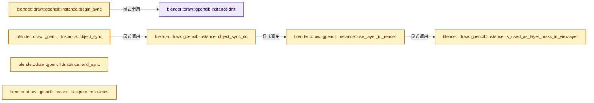

# 实现依赖专题：source/blender/draw/engines/gpencil/gpencil_engine_c.cc

[实现依赖导航](../../../../README.md) · [符号索引](../../../../../00-课程指南/02-源码与提交索引/符号依赖与实现索引.md)

本专题从正文实际调用进入，集中保存共享实现。函数有稳定锚点，可从调用处直接跳到对应完整函数；递归与互相调用通过回链组织。

## 本文件的实现关系




## 完整成员与函数实现

<a id="f-f8b5fddb11c4b419"></a>

### `blender::draw::gpencil::Instance::init`

实现位置：[source/blender/draw/engines/gpencil/gpencil_engine_c.cc](../../../../../../../../../source/blender/draw/engines/gpencil/gpencil_engine_c.cc) · L54—L165。

**教学注释版**

<!-- annotated:86b7ec715fd6a4 -->

```cpp
void Instance::init()
{
  this->draw_ctx = DRW_context_get();

  const View3D *v3d = draw_ctx->v3d;

  if (!dummy_texture.is_valid()) {
    const float pixels[1][4] = {{1.0f, 0.0f, 1.0f, 1.0f}};
    dummy_texture.ensure_2d(
        gpu::TextureFormat::UNORM_8_8_8_8, int2(1), GPU_TEXTURE_USAGE_SHADER_READ, &pixels[0][0]);
  }
  if (!dummy_depth.is_valid()) {
    const float pixels[1] = {1.0f};
    dummy_depth.ensure_2d(
        gpu::TextureFormat::SFLOAT_32_DEPTH, int2(1), GPU_TEXTURE_USAGE_SHADER_READ, &pixels[0]);
  }

  /* Resize and reset memory-blocks. */
  BLI_memblock_clear(this->gp_light_pool, light_pool_free);
  BLI_memblock_clear(this->gp_material_pool, material_pool_free);
  BLI_memblock_clear(this->gp_object_pool, nullptr);
  this->gp_layer_pool->clear();
  this->gp_vfx_pool->clear();
  BLI_memblock_clear(this->gp_maskbit_pool, nullptr);

  this->view_layer = draw_ctx->view_layer;
  this->scene = draw_ctx->scene;
  this->v3d = draw_ctx->v3d;
  this->last_light_pool = nullptr;
  this->last_material_pool = nullptr;
  this->tobjects.first = nullptr;
  this->tobjects.last = nullptr;
  this->tobjects_infront.first = nullptr;
  this->tobjects_infront.last = nullptr;
  this->sbuffer_tobjects.first = nullptr;
  this->sbuffer_tobjects.last = nullptr;
  this->dummy_tx = this->dummy_texture;
  this->draw_wireframe = (v3d && v3d->shading.type == OB_WIRE);
  this->scene_depth_tx = nullptr;
  this->scene_fb = nullptr;
  this->is_render = this->render_depth_tx.is_valid() || (v3d && v3d->shading.type == OB_RENDER);
  this->is_viewport = (v3d != nullptr);
  this->global_light_pool = gpencil_light_pool_add(this);
  this->shadeless_light_pool = gpencil_light_pool_add(this);
  /* Small HACK: we don't want the global pool to be reused,
   * so we set the last light pool to nullptr. */
  this->last_light_pool = nullptr;
  this->is_sorted = false;

  bool use_scene_lights = false;
  bool use_scene_world = false;

  if (v3d) {
    use_scene_lights = V3D_USES_SCENE_LIGHTS(v3d);

    use_scene_world = V3D_USES_SCENE_WORLD(v3d);

    this->v3d_color_type = (v3d->shading.type == OB_SOLID) ? v3d->shading.color_type : -1;
    /* Special case: If we're in Vertex Paint mode, enforce #V3D_SHADING_VERTEX_COLOR setting. */
    if (v3d->shading.type == OB_SOLID && draw_ctx->obact &&
        (draw_ctx->obact->mode & OB_MODE_VERTEX_GREASE_PENCIL) != 0)
    {
      this->v3d_color_type = V3D_SHADING_VERTEX_COLOR;
    }

    copy_v3_v3(this->v3d_single_color, v3d->shading.single_color);

    /* For non active frame, use only lines in multiedit mode. */
    const bool overlays_on = (v3d->flag2 & V3D_HIDE_OVERLAYS) == 0;
    this->use_multiedit_lines_only = overlays_on &&
                                     (v3d->gp_flag & V3D_GP_SHOW_MULTIEDIT_LINES) != 0;

    const bool shmode_xray_support = v3d->shading.type <= OB_SOLID;
    this->xray_alpha = (shmode_xray_support && XRAY_ENABLED(v3d)) ? XRAY_ALPHA(v3d) : 1.0f;
    this->force_stroke_order_3d = v3d->gp_flag & V3D_GP_FORCE_STROKE_ORDER_3D;
  }
  else if (this->is_render) {
    use_scene_lights = true;
    use_scene_world = true;
    this->use_multiedit_lines_only = false;
    this->xray_alpha = 1.0f;
    this->v3d_color_type = -1;
    this->force_stroke_order_3d = false;
  }

  this->use_lighting = (v3d && v3d->shading.type > OB_SOLID) || this->is_render;
  this->use_lights = use_scene_lights;

  gpencil_light_ambient_add(this->shadeless_light_pool, float3{1.0f, 1.0f, 1.0f});

  World *world = draw_ctx->scene->world;
  if (world != nullptr && use_scene_world) {
    gpencil_light_ambient_add(this->global_light_pool, &world->horr);
  }
  else if (v3d) {
    float world_light[3];
    copy_v3_fl(world_light, v3d->shading.studiolight_intensity);
    gpencil_light_ambient_add(this->global_light_pool, world_light);
  }

  float4x4 viewmatinv = View::default_get().viewinv();
  copy_v3_v3(this->camera_z_axis, viewmatinv[2]);
  copy_v3_v3(this->camera_pos, viewmatinv[3]);
  this->camera_z_offset = dot_v3v3(viewmatinv[3], viewmatinv[2]);

  if (draw_ctx && draw_ctx->rv3d && v3d) {
    this->camera = (draw_ctx->rv3d->persp == RV3D_CAMOB) ? v3d->camera : nullptr;
  }
  else {
    this->camera = nullptr;
  }
}
```

<details>
<summary>核对原始源码：source/blender/draw/engines/gpencil/gpencil_engine_c.cc · L54—L165</summary>

<!-- original:86b7ec715fd6a4:source/blender/draw/engines/gpencil/gpencil_engine_c.cc:54:165 -->

```cpp
void Instance::init()
{
  this->draw_ctx = DRW_context_get();

  const View3D *v3d = draw_ctx->v3d;

  if (!dummy_texture.is_valid()) {
    const float pixels[1][4] = {{1.0f, 0.0f, 1.0f, 1.0f}};
    dummy_texture.ensure_2d(
        gpu::TextureFormat::UNORM_8_8_8_8, int2(1), GPU_TEXTURE_USAGE_SHADER_READ, &pixels[0][0]);
  }
  if (!dummy_depth.is_valid()) {
    const float pixels[1] = {1.0f};
    dummy_depth.ensure_2d(
        gpu::TextureFormat::SFLOAT_32_DEPTH, int2(1), GPU_TEXTURE_USAGE_SHADER_READ, &pixels[0]);
  }

  /* Resize and reset memory-blocks. */
  BLI_memblock_clear(this->gp_light_pool, light_pool_free);
  BLI_memblock_clear(this->gp_material_pool, material_pool_free);
  BLI_memblock_clear(this->gp_object_pool, nullptr);
  this->gp_layer_pool->clear();
  this->gp_vfx_pool->clear();
  BLI_memblock_clear(this->gp_maskbit_pool, nullptr);

  this->view_layer = draw_ctx->view_layer;
  this->scene = draw_ctx->scene;
  this->v3d = draw_ctx->v3d;
  this->last_light_pool = nullptr;
  this->last_material_pool = nullptr;
  this->tobjects.first = nullptr;
  this->tobjects.last = nullptr;
  this->tobjects_infront.first = nullptr;
  this->tobjects_infront.last = nullptr;
  this->sbuffer_tobjects.first = nullptr;
  this->sbuffer_tobjects.last = nullptr;
  this->dummy_tx = this->dummy_texture;
  this->draw_wireframe = (v3d && v3d->shading.type == OB_WIRE);
  this->scene_depth_tx = nullptr;
  this->scene_fb = nullptr;
  this->is_render = this->render_depth_tx.is_valid() || (v3d && v3d->shading.type == OB_RENDER);
  this->is_viewport = (v3d != nullptr);
  this->global_light_pool = gpencil_light_pool_add(this);
  this->shadeless_light_pool = gpencil_light_pool_add(this);
  /* Small HACK: we don't want the global pool to be reused,
   * so we set the last light pool to nullptr. */
  this->last_light_pool = nullptr;
  this->is_sorted = false;

  bool use_scene_lights = false;
  bool use_scene_world = false;

  if (v3d) {
    use_scene_lights = V3D_USES_SCENE_LIGHTS(v3d);

    use_scene_world = V3D_USES_SCENE_WORLD(v3d);

    this->v3d_color_type = (v3d->shading.type == OB_SOLID) ? v3d->shading.color_type : -1;
    /* Special case: If we're in Vertex Paint mode, enforce #V3D_SHADING_VERTEX_COLOR setting. */
    if (v3d->shading.type == OB_SOLID && draw_ctx->obact &&
        (draw_ctx->obact->mode & OB_MODE_VERTEX_GREASE_PENCIL) != 0)
    {
      this->v3d_color_type = V3D_SHADING_VERTEX_COLOR;
    }

    copy_v3_v3(this->v3d_single_color, v3d->shading.single_color);

    /* For non active frame, use only lines in multiedit mode. */
    const bool overlays_on = (v3d->flag2 & V3D_HIDE_OVERLAYS) == 0;
    this->use_multiedit_lines_only = overlays_on &&
                                     (v3d->gp_flag & V3D_GP_SHOW_MULTIEDIT_LINES) != 0;

    const bool shmode_xray_support = v3d->shading.type <= OB_SOLID;
    this->xray_alpha = (shmode_xray_support && XRAY_ENABLED(v3d)) ? XRAY_ALPHA(v3d) : 1.0f;
    this->force_stroke_order_3d = v3d->gp_flag & V3D_GP_FORCE_STROKE_ORDER_3D;
  }
  else if (this->is_render) {
    use_scene_lights = true;
    use_scene_world = true;
    this->use_multiedit_lines_only = false;
    this->xray_alpha = 1.0f;
    this->v3d_color_type = -1;
    this->force_stroke_order_3d = false;
  }

  this->use_lighting = (v3d && v3d->shading.type > OB_SOLID) || this->is_render;
  this->use_lights = use_scene_lights;

  gpencil_light_ambient_add(this->shadeless_light_pool, float3{1.0f, 1.0f, 1.0f});

  World *world = draw_ctx->scene->world;
  if (world != nullptr && use_scene_world) {
    gpencil_light_ambient_add(this->global_light_pool, &world->horr);
  }
  else if (v3d) {
    float world_light[3];
    copy_v3_fl(world_light, v3d->shading.studiolight_intensity);
    gpencil_light_ambient_add(this->global_light_pool, world_light);
  }

  float4x4 viewmatinv = View::default_get().viewinv();
  copy_v3_v3(this->camera_z_axis, viewmatinv[2]);
  copy_v3_v3(this->camera_pos, viewmatinv[3]);
  this->camera_z_offset = dot_v3v3(viewmatinv[3], viewmatinv[2]);

  if (draw_ctx && draw_ctx->rv3d && v3d) {
    this->camera = (draw_ctx->rv3d->persp == RV3D_CAMOB) ? v3d->camera : nullptr;
  }
  else {
    this->camera = nullptr;
  }
}
```

</details>

**沿实际写入检查状态**

- `this->draw_ctx = DRW_context_get();`
- `this->view_layer = draw_ctx->view_layer;`
- `this->scene = draw_ctx->scene;`
- `this->v3d = draw_ctx->v3d;`
- `this->last_light_pool = nullptr;`
- `this->last_material_pool = nullptr;`
- `this->tobjects.first = nullptr;`
- `this->tobjects.last = nullptr;`
- `this->tobjects_infront.first = nullptr;`
- `this->tobjects_infront.last = nullptr;`
- `this->sbuffer_tobjects.first = nullptr;`
- `this->sbuffer_tobjects.last = nullptr;`
- `this->dummy_tx = this->dummy_texture;`
- `this->draw_wireframe = (v3d && v3d->shading.type == OB_WIRE);`
- `this->scene_depth_tx = nullptr;`
- `this->scene_fb = nullptr;`
- `this->is_render = this->render_depth_tx.is_valid() || (v3d && v3d->shading.type == OB_RENDER);`
- `this->is_viewport = (v3d != nullptr);`
- `this->global_light_pool = gpencil_light_pool_add(this);`
- `this->shadeless_light_pool = gpencil_light_pool_add(this);`
- `this->is_sorted = false;`
- `use_scene_lights = V3D_USES_SCENE_LIGHTS(v3d);`
- `use_scene_world = V3D_USES_SCENE_WORLD(v3d);`
- `this->v3d_color_type = (v3d->shading.type == OB_SOLID) ? v3d->shading.color_type : -1;`
- `this->v3d_color_type = V3D_SHADING_VERTEX_COLOR;`
- `this->use_multiedit_lines_only = overlays_on &&`
- `this->xray_alpha = (shmode_xray_support && XRAY_ENABLED(v3d)) ? XRAY_ALPHA(v3d) : 1.0f;`
- `this->force_stroke_order_3d = v3d->gp_flag & V3D_GP_FORCE_STROKE_ORDER_3D;`
- `use_scene_lights = true;`
- `use_scene_world = true;`
- `this->use_multiedit_lines_only = false;`
- `this->xray_alpha = 1.0f;`
- `this->v3d_color_type = -1;`
- `this->force_stroke_order_3d = false;`
- `this->use_lighting = (v3d && v3d->shading.type > OB_SOLID) || this->is_render;`
- `this->use_lights = use_scene_lights;`
- `this->camera_z_offset = dot_v3v3(viewmatinv[3], viewmatinv[2]);`
- `this->camera = (draw_ctx->rv3d->persp == RV3D_CAMOB) ? v3d->camera : nullptr;`
- `this->camera = nullptr;`

**继续追踪实现**

- `DRW_context_get` → [blender::DRW_context_get · L2437](../../intern/draw_context.cc.md#f-98f4b7cf23aa98d9)。
- `dummy_texture.is_valid` → [调用协议](../../../../../00-课程指南/01-路线与规范/模板宏与动态分派协议.md)：接收对象类型依赖auto、返回值或模板实例；不按同名猜测目标。调用位置L60。
- `dummy_texture.ensure_2d` → [调用协议](../../../../../00-课程指南/01-路线与规范/模板宏与动态分派协议.md)：接收对象类型依赖auto、返回值或模板实例；不按同名猜测目标。调用位置L62。
- `int2` → [int2 · L643](../../../compositor/algorithms/intern/smaa.cc.md#m-8960c8e6139d)。宏定义由构建条件选择。
- `dummy_depth.is_valid` → [调用协议](../../../../../00-课程指南/01-路线与规范/模板宏与动态分派协议.md)：接收对象类型依赖auto、返回值或模板实例；不按同名猜测目标。调用位置L65。
- `dummy_depth.ensure_2d` → [调用协议](../../../../../00-课程指南/01-路线与规范/模板宏与动态分派协议.md)：接收对象类型依赖auto、返回值或模板实例；不按同名猜测目标。调用位置L67。
- `BLI_memblock_clear` → [blender::BLI_memblock_clear · L88](../../../../01-BLI基础库/intern/BLI_memblock.cc.md#f-a6d13b29e6f9fca7)。
- `this->gp_layer_pool->clear` → [调用协议](../../../../../00-课程指南/01-路线与规范/模板宏与动态分派协议.md)：接收对象类型依赖auto、返回值或模板实例；不按同名猜测目标。调用位置L75。
- `this->gp_vfx_pool->clear` → [调用协议](../../../../../00-课程指南/01-路线与规范/模板宏与动态分派协议.md)：接收对象类型依赖auto、返回值或模板实例；不按同名猜测目标。调用位置L76。
- `this->render_depth_tx.is_valid` → [调用协议](../../../../../00-课程指南/01-路线与规范/模板宏与动态分派协议.md)：接收对象类型依赖auto、返回值或模板实例；不按同名猜测目标。调用位置L94。
- `gpencil_light_pool_add` → [blender::draw::gpencil::gpencil_light_pool_add · L412](gpencil_draw_data.cc.md#f-e41adf2d2b6736a4)。
- `V3D_USES_SCENE_LIGHTS` → [V3D_USES_SCENE_LIGHTS · L262](../../../makesdna/DNA_view3d_types.h.md#m-80bbb3ef24fe)。宏定义由构建条件选择。
- `V3D_USES_SCENE_WORLD` → [V3D_USES_SCENE_WORLD · L267](../../../makesdna/DNA_view3d_types.h.md#m-b9449ddf6101)。宏定义由构建条件选择。
- `copy_v3_v3` → [调用协议](../../../../../00-课程指南/01-路线与规范/模板宏与动态分派协议.md)：函数指针、局部可调用对象或未展开的宏；必须结合调用者环境。调用位置L119。
- `XRAY_ENABLED` → [XRAY_ENABLED · L1396](../../../editors/include/ED_view3d.hh.md#m-0df9c535ca63)。宏定义由构建条件选择。
- `XRAY_ALPHA` → [XRAY_ALPHA · L1386](../../../editors/include/ED_view3d.hh.md#m-f30c73235cdf)。宏定义由构建条件选择。
- `gpencil_light_ambient_add` → [blender::draw::gpencil::gpencil_light_ambient_add · L425](gpencil_draw_data.cc.md#f-d3e514bef646939e)。
- `copy_v3_fl` → [blender::copy_v3_fl · L68](../../../../01-BLI基础库/intern/math_vector_inline.cc.md#f-18676f3d43803485)。
- `View::default_get().viewinv` → [调用协议](../../../../../00-课程指南/01-路线与规范/模板宏与动态分派协议.md)：接收对象类型依赖auto、返回值或模板实例；不按同名猜测目标。调用位置L154。
- `View::default_get` → [blender::draw::View::default_get · L317](../../intern/draw_view.cc.md#f-1edfe36a27ed8fa6)。
- `dot_v3v3` → [blender::dot_v3v3 · L646](../../../../01-BLI基础库/intern/math_vector_inline.cc.md#f-c88befa67d07591a)。

<a id="f-a5a5744628792a9a"></a>

### `blender::draw::gpencil::Instance::begin_sync`

实现位置：[source/blender/draw/engines/gpencil/gpencil_engine_c.cc](../../../../../../../../../source/blender/draw/engines/gpencil/gpencil_engine_c.cc) · L167—L298。

**教学注释版**

<!-- annotated:22b90cbd439b8d -->

```cpp
void Instance::begin_sync()
{
  this->cfra = int(DEG_get_ctime(draw_ctx->depsgraph));
  this->simplify_antialias = GPENCIL_SIMPLIFY_AA(draw_ctx->scene);
  this->use_layer_fb = false;
  this->use_object_fb = false;
  this->use_mask_fb = false;

  const bool use_viewport_compositor = draw_ctx->is_viewport_compositor_used();
  const Set<std::string> needed_passes = bke::compositor::get_used_passes(
      *scene, view_layer, bke::compositor::ExecutionMode::Preview);
  this->need_combined_pass = use_viewport_compositor &&
                             // [讲解] needed_passes.contains：查询活项数量或键是否存在。
                             needed_passes.contains(RE_PASSNAME_COMBINED);
  this->need_grease_pencil_pass = use_viewport_compositor &&
                                  needed_passes.contains(RE_PASSNAME_GREASE_PENCIL);
  this->use_signed_fb = !this->is_viewport;

  if (draw_ctx->v3d) {
    const bool hide_overlay = ((draw_ctx->v3d->flag2 & V3D_HIDE_OVERLAYS) != 0);
    const bool show_onion = ((draw_ctx->v3d->gp_flag & V3D_GP_SHOW_ONION_SKIN) != 0);
    const bool playing = (draw_ctx->evil_C != nullptr) ?
                             ED_screen_animation_playing(CTX_wm_manager(draw_ctx->evil_C)) !=
                                 nullptr :
                             false;
    this->do_onion = show_onion && !hide_overlay && !playing;
    this->do_onion_only_active_object = ((draw_ctx->v3d->gp_flag &
                                          V3D_GP_ONION_SKIN_ACTIVE_OBJECT) != 0);
    this->playing = playing;
    /* Save simplify flags (can change while drawing, so it's better to save). */
    Scene *scene = draw_ctx->scene;
    this->simplify_fill = GPENCIL_SIMPLIFY_FILL(scene, playing);
    this->simplify_fx = GPENCIL_SIMPLIFY_FX(scene, playing) ||
                        (draw_ctx->v3d->shading.type < OB_RENDER);

    /* Fade Layer. */
    const bool is_fade_layer = ((!hide_overlay) && (!this->is_render) &&
                                (draw_ctx->v3d->gp_flag & V3D_GP_FADE_NOACTIVE_LAYERS));
    this->fade_layer_opacity = (is_fade_layer) ? draw_ctx->v3d->overlay.gpencil_fade_layer : -1.0f;
    this->vertex_paint_opacity = draw_ctx->v3d->overlay.gpencil_vertex_paint_opacity;
    /* Fade GPencil Objects. */
    const bool is_fade_object = ((!hide_overlay) && (!this->is_render) &&
                                 (draw_ctx->v3d->gp_flag & V3D_GP_FADE_OBJECTS) &&
                                 (draw_ctx->v3d->gp_flag & V3D_GP_FADE_NOACTIVE_GPENCIL));
    this->fade_gp_object_opacity = (is_fade_object) ?
                                       draw_ctx->v3d->overlay.gpencil_paper_opacity :
                                       -1.0f;
    this->fade_3d_object_opacity = ((!hide_overlay) && (!this->is_render) &&
                                    (draw_ctx->v3d->gp_flag & V3D_GP_FADE_OBJECTS)) ?
                                       draw_ctx->v3d->overlay.gpencil_paper_opacity :
                                       -1.0f;
  }
  else {
    this->do_onion = true;
    Scene *scene = draw_ctx->scene;
    this->simplify_fill = GPENCIL_SIMPLIFY_FILL(scene, false);
    this->simplify_fx = GPENCIL_SIMPLIFY_FX(scene, false);
    this->fade_layer_opacity = -1.0f;
    this->playing = false;
  }

  {
    this->stroke_batch = nullptr;
    this->fill_batch = nullptr;

    this->obact = draw_ctx->obact;
  }

  /* Free unneeded buffers. */
  // [讲解] this->snapshot_depth_tx.free：这个边界按实际表达式及所属类型核对参数、返回值、寿命与失败行为。这里提供接口入口，不声称已解释该第三方版本的内部实现。
  this->snapshot_depth_tx.free();
  this->snapshot_color_tx.free();
  this->snapshot_reveal_tx.free();

  {
    PassSimple &pass = this->merge_depth_ps;
    pass.init();
    pass.state_set(DRW_STATE_WRITE_DEPTH | DRW_STATE_DEPTH_LESS);
    pass.shader_set(ShaderCache::get().depth_merge.get());
    pass.bind_texture("depth_buf", &this->depth_tx);
    pass.push_constant("stroke_order3d", &this->is_stroke_order_3d);
    pass.push_constant("gp_model_matrix", &this->object_bound_mat);
    pass.draw_procedural(GPU_PRIM_TRIS, 1, 3);
  }
  {
    /* Merges the object's depth to the viewport compositor depth pass. */
    PassSimple &pass = this->merge_depth_pass_ps;
    pass.init();
    pass.state_set(DRW_STATE_WRITE_COLOR);
    pass.shader_set(ShaderCache::get().depth_pass_merge.get());
    pass.bind_texture("depth_buf", &this->depth_tx);
    pass.bind_image("depth_pass_img", &this->depth_pass_img);
    pass.push_constant("stroke_order3d", &this->is_stroke_order_3d);
    pass.push_constant("gp_model_matrix", &this->object_bound_mat);
    pass.draw_procedural(GPU_PRIM_TRIS, 1, 3);
  }
  {
    PassSimple &pass = this->mask_invert_ps;
    pass.init();
    pass.state_set(DRW_STATE_WRITE_COLOR | DRW_STATE_LOGIC_INVERT);
    pass.shader_set(ShaderCache::get().mask_invert.get());
    pass.draw_procedural(GPU_PRIM_TRIS, 1, 3);
  }

  Camera *cam = id_cast<Camera *>(
      (this->camera != nullptr && this->camera->type == OB_CAMERA) ? this->camera->data : nullptr);

  /* Pseudo DOF setup. */
  if (cam && (cam->dof.flag & CAM_DOF_ENABLED)) {
    const float2 vp_size = draw_ctx->viewport_size_get();
    float fstop = cam->dof.aperture_fstop;
    float sensor = BKE_camera_sensor_size(cam->sensor_fit, cam->sensor_x, cam->sensor_y);
    float focus_dist = BKE_camera_object_dof_distance(this->camera);
    float focal_len = cam->lens;

    const float scale_camera = 0.001f;
    /* We want radius here for the aperture number. */
    float aperture = 0.5f * scale_camera * focal_len / fstop;
    float focal_len_scaled = scale_camera * focal_len;
    float sensor_scaled = scale_camera * sensor;

    if (draw_ctx->rv3d != nullptr) {
      sensor_scaled *= draw_ctx->rv3d->viewcamtexcofac[0];
    }

    this->dof_params[1] = aperture * fabsf(focal_len_scaled / (focus_dist - focal_len_scaled));
    this->dof_params[1] *= vp_size[0] / sensor_scaled;
    this->dof_params[0] = -focus_dist * this->dof_params[1];
  }
  else {
    /* Disable DoF blur scaling. */
    this->camera = nullptr;
  }
}
```

<details>
<summary>核对原始源码：source/blender/draw/engines/gpencil/gpencil_engine_c.cc · L167—L298</summary>

<!-- original:22b90cbd439b8d:source/blender/draw/engines/gpencil/gpencil_engine_c.cc:167:298 -->

```cpp
void Instance::begin_sync()
{
  this->cfra = int(DEG_get_ctime(draw_ctx->depsgraph));
  this->simplify_antialias = GPENCIL_SIMPLIFY_AA(draw_ctx->scene);
  this->use_layer_fb = false;
  this->use_object_fb = false;
  this->use_mask_fb = false;

  const bool use_viewport_compositor = draw_ctx->is_viewport_compositor_used();
  const Set<std::string> needed_passes = bke::compositor::get_used_passes(
      *scene, view_layer, bke::compositor::ExecutionMode::Preview);
  this->need_combined_pass = use_viewport_compositor &&
                             needed_passes.contains(RE_PASSNAME_COMBINED);
  this->need_grease_pencil_pass = use_viewport_compositor &&
                                  needed_passes.contains(RE_PASSNAME_GREASE_PENCIL);
  this->use_signed_fb = !this->is_viewport;

  if (draw_ctx->v3d) {
    const bool hide_overlay = ((draw_ctx->v3d->flag2 & V3D_HIDE_OVERLAYS) != 0);
    const bool show_onion = ((draw_ctx->v3d->gp_flag & V3D_GP_SHOW_ONION_SKIN) != 0);
    const bool playing = (draw_ctx->evil_C != nullptr) ?
                             ED_screen_animation_playing(CTX_wm_manager(draw_ctx->evil_C)) !=
                                 nullptr :
                             false;
    this->do_onion = show_onion && !hide_overlay && !playing;
    this->do_onion_only_active_object = ((draw_ctx->v3d->gp_flag &
                                          V3D_GP_ONION_SKIN_ACTIVE_OBJECT) != 0);
    this->playing = playing;
    /* Save simplify flags (can change while drawing, so it's better to save). */
    Scene *scene = draw_ctx->scene;
    this->simplify_fill = GPENCIL_SIMPLIFY_FILL(scene, playing);
    this->simplify_fx = GPENCIL_SIMPLIFY_FX(scene, playing) ||
                        (draw_ctx->v3d->shading.type < OB_RENDER);

    /* Fade Layer. */
    const bool is_fade_layer = ((!hide_overlay) && (!this->is_render) &&
                                (draw_ctx->v3d->gp_flag & V3D_GP_FADE_NOACTIVE_LAYERS));
    this->fade_layer_opacity = (is_fade_layer) ? draw_ctx->v3d->overlay.gpencil_fade_layer : -1.0f;
    this->vertex_paint_opacity = draw_ctx->v3d->overlay.gpencil_vertex_paint_opacity;
    /* Fade GPencil Objects. */
    const bool is_fade_object = ((!hide_overlay) && (!this->is_render) &&
                                 (draw_ctx->v3d->gp_flag & V3D_GP_FADE_OBJECTS) &&
                                 (draw_ctx->v3d->gp_flag & V3D_GP_FADE_NOACTIVE_GPENCIL));
    this->fade_gp_object_opacity = (is_fade_object) ?
                                       draw_ctx->v3d->overlay.gpencil_paper_opacity :
                                       -1.0f;
    this->fade_3d_object_opacity = ((!hide_overlay) && (!this->is_render) &&
                                    (draw_ctx->v3d->gp_flag & V3D_GP_FADE_OBJECTS)) ?
                                       draw_ctx->v3d->overlay.gpencil_paper_opacity :
                                       -1.0f;
  }
  else {
    this->do_onion = true;
    Scene *scene = draw_ctx->scene;
    this->simplify_fill = GPENCIL_SIMPLIFY_FILL(scene, false);
    this->simplify_fx = GPENCIL_SIMPLIFY_FX(scene, false);
    this->fade_layer_opacity = -1.0f;
    this->playing = false;
  }

  {
    this->stroke_batch = nullptr;
    this->fill_batch = nullptr;

    this->obact = draw_ctx->obact;
  }

  /* Free unneeded buffers. */
  this->snapshot_depth_tx.free();
  this->snapshot_color_tx.free();
  this->snapshot_reveal_tx.free();

  {
    PassSimple &pass = this->merge_depth_ps;
    pass.init();
    pass.state_set(DRW_STATE_WRITE_DEPTH | DRW_STATE_DEPTH_LESS);
    pass.shader_set(ShaderCache::get().depth_merge.get());
    pass.bind_texture("depth_buf", &this->depth_tx);
    pass.push_constant("stroke_order3d", &this->is_stroke_order_3d);
    pass.push_constant("gp_model_matrix", &this->object_bound_mat);
    pass.draw_procedural(GPU_PRIM_TRIS, 1, 3);
  }
  {
    /* Merges the object's depth to the viewport compositor depth pass. */
    PassSimple &pass = this->merge_depth_pass_ps;
    pass.init();
    pass.state_set(DRW_STATE_WRITE_COLOR);
    pass.shader_set(ShaderCache::get().depth_pass_merge.get());
    pass.bind_texture("depth_buf", &this->depth_tx);
    pass.bind_image("depth_pass_img", &this->depth_pass_img);
    pass.push_constant("stroke_order3d", &this->is_stroke_order_3d);
    pass.push_constant("gp_model_matrix", &this->object_bound_mat);
    pass.draw_procedural(GPU_PRIM_TRIS, 1, 3);
  }
  {
    PassSimple &pass = this->mask_invert_ps;
    pass.init();
    pass.state_set(DRW_STATE_WRITE_COLOR | DRW_STATE_LOGIC_INVERT);
    pass.shader_set(ShaderCache::get().mask_invert.get());
    pass.draw_procedural(GPU_PRIM_TRIS, 1, 3);
  }

  Camera *cam = id_cast<Camera *>(
      (this->camera != nullptr && this->camera->type == OB_CAMERA) ? this->camera->data : nullptr);

  /* Pseudo DOF setup. */
  if (cam && (cam->dof.flag & CAM_DOF_ENABLED)) {
    const float2 vp_size = draw_ctx->viewport_size_get();
    float fstop = cam->dof.aperture_fstop;
    float sensor = BKE_camera_sensor_size(cam->sensor_fit, cam->sensor_x, cam->sensor_y);
    float focus_dist = BKE_camera_object_dof_distance(this->camera);
    float focal_len = cam->lens;

    const float scale_camera = 0.001f;
    /* We want radius here for the aperture number. */
    float aperture = 0.5f * scale_camera * focal_len / fstop;
    float focal_len_scaled = scale_camera * focal_len;
    float sensor_scaled = scale_camera * sensor;

    if (draw_ctx->rv3d != nullptr) {
      sensor_scaled *= draw_ctx->rv3d->viewcamtexcofac[0];
    }

    this->dof_params[1] = aperture * fabsf(focal_len_scaled / (focus_dist - focal_len_scaled));
    this->dof_params[1] *= vp_size[0] / sensor_scaled;
    this->dof_params[0] = -focus_dist * this->dof_params[1];
  }
  else {
    /* Disable DoF blur scaling. */
    this->camera = nullptr;
  }
}
```

</details>

**沿实际写入检查状态**

- `this->cfra = int(DEG_get_ctime(draw_ctx->depsgraph));`
- `this->simplify_antialias = GPENCIL_SIMPLIFY_AA(draw_ctx->scene);`
- `this->use_layer_fb = false;`
- `this->use_object_fb = false;`
- `this->use_mask_fb = false;`
- `this->need_combined_pass = use_viewport_compositor &&`
- `this->need_grease_pencil_pass = use_viewport_compositor &&`
- `this->use_signed_fb = !this->is_viewport;`
- `this->do_onion = show_onion && !hide_overlay && !playing;`
- `this->do_onion_only_active_object = ((draw_ctx->v3d->gp_flag &`
- `this->playing = playing;`
- `this->simplify_fill = GPENCIL_SIMPLIFY_FILL(scene, playing);`
- `this->simplify_fx = GPENCIL_SIMPLIFY_FX(scene, playing) ||`
- `this->fade_layer_opacity = (is_fade_layer) ? draw_ctx->v3d->overlay.gpencil_fade_layer : -1.0f;`
- `this->vertex_paint_opacity = draw_ctx->v3d->overlay.gpencil_vertex_paint_opacity;`
- `this->fade_gp_object_opacity = (is_fade_object) ?`
- `this->fade_3d_object_opacity = ((!hide_overlay) && (!this->is_render) &&`
- `this->do_onion = true;`
- `this->simplify_fill = GPENCIL_SIMPLIFY_FILL(scene, false);`
- `this->simplify_fx = GPENCIL_SIMPLIFY_FX(scene, false);`
- `this->fade_layer_opacity = -1.0f;`
- `this->playing = false;`
- `this->stroke_batch = nullptr;`
- `this->fill_batch = nullptr;`
- `this->obact = draw_ctx->obact;`
- `sensor_scaled *= draw_ctx->rv3d->viewcamtexcofac[0];`
- `this->dof_params[1] = aperture * fabsf(focal_len_scaled / (focus_dist - focal_len_scaled));`
- `this->dof_params[1] *= vp_size[0] / sensor_scaled;`
- `this->dof_params[0] = -focus_dist * this->dof_params[1];`
- `this->camera = nullptr;`

**继续追踪实现**

- `DEG_get_ctime` → [blender::DEG_get_ctime · L105](../../../../06-Depsgraph依赖图/intern/depsgraph_query.cc.md#f-156dee0918a22f2f)。
- `GPENCIL_SIMPLIFY_AA` → [GPENCIL_SIMPLIFY_AA · L59](gpencil_engine_private.hh.md#m-b582329ba5a3)。宏定义由构建条件选择。
- `draw_ctx->is_viewport_compositor_used` → [调用协议](../../../../../00-课程指南/01-路线与规范/模板宏与动态分派协议.md)：接收对象类型依赖auto、返回值或模板实例；不按同名猜测目标。调用位置L175。
- `bke::compositor::get_used_passes` → [blender::bke::compositor::get_used_passes · L574](../../../../02-BKE几何与数据/intern/compositor.cc.md#f-8b69edce43e8bc23)。
- `needed_passes.contains` → [blender::Set::contains · L310](../../../../../02-哈希表与关联数据结构/08-Set与集合语义.md#f-af7099799494350e)。
- `ED_screen_animation_playing` → [blender::ED_screen_animation_playing · L6860](../../../editors/screen/screen_ops.cc.md#f-a214adf804d8afe6)。
- `CTX_wm_manager` → [blender::CTX_wm_manager · L928](../../../../02-BKE几何与数据/intern/context.cc.md#f-158f36db7379fbe8)。
- `GPENCIL_SIMPLIFY_FILL` → [GPENCIL_SIMPLIFY_FILL · L51](gpencil_engine_private.hh.md#m-2f50f8faa811)。宏定义由构建条件选择。
- `GPENCIL_SIMPLIFY_FX` → [GPENCIL_SIMPLIFY_FX · L54](gpencil_engine_private.hh.md#m-6c0eeba994f2)。宏定义由构建条件选择。
- `this->snapshot_depth_tx.free` → [外部契约](https://eel.is/c++draft/)：这个边界按实际表达式及所属类型核对参数、返回值、寿命与失败行为。这里提供接口入口，不声称已解释该第三方版本的内部实现。
- `this->snapshot_color_tx.free` → [外部契约](https://eel.is/c++draft/)：这个边界按实际表达式及所属类型核对参数、返回值、寿命与失败行为。这里提供接口入口，不声称已解释该第三方版本的内部实现。
- `this->snapshot_reveal_tx.free` → [外部契约](https://eel.is/c++draft/)：这个边界按实际表达式及所属类型核对参数、返回值、寿命与失败行为。这里提供接口入口，不声称已解释该第三方版本的内部实现。
- `pass.init` → [blender::draw::gpencil::Instance::init · L54](gpencil_engine_c.cc.md#f-f8b5fddb11c4b419)。
- `pass.state_set` → [blender::draw::detail::PassBase<T>::state_set · L1095](../../intern/draw_pass.hh.md#f-97589d4da1cbc8b0)。
- `pass.shader_set` → [blender::draw::detail::PassBase<T>::shader_set · L1112](../../intern/draw_pass.hh.md#f-666f9d02755edac8)。
- `ShaderCache::get().depth_merge.get` → [调用协议](../../../../../00-课程指南/01-路线与规范/模板宏与动态分派协议.md)：接收对象类型依赖auto、返回值或模板实例；不按同名猜测目标。调用位置L243。
- `ShaderCache::get` → [blender::draw::gpencil::ShaderCache::get · L26](gpencil_shader.hh.md#f-89695e85c8cb18ae)。
- `pass.bind_texture` → [调用协议](../../../../../00-课程指南/01-路线与规范/模板宏与动态分派协议.md)：由接收对象具体类型或运行时策略提供实现。调用位置L244。
- `pass.push_constant` → [push_constant · L126](../../../gpu/shaders/compat/gpu_shader_cxx_attribute.hh.md#m-5e91abed202c)。宏定义由构建条件选择。
- `pass.draw_procedural` → [blender::draw::detail::PassBase<T>::draw_procedural · L975](../../intern/draw_pass.hh.md#f-e3f268cdbf09d46d)。
- `ShaderCache::get().depth_pass_merge.get` → [调用协议](../../../../../00-课程指南/01-路线与规范/模板宏与动态分派协议.md)：接收对象类型依赖auto、返回值或模板实例；不按同名猜测目标。调用位置L254。
- `pass.bind_image` → [调用协议](../../../../../00-课程指南/01-路线与规范/模板宏与动态分派协议.md)：由接收对象具体类型或运行时策略提供实现。调用位置L256。
- `ShaderCache::get().mask_invert.get` → [调用协议](../../../../../00-课程指南/01-路线与规范/模板宏与动态分派协议.md)：接收对象类型依赖auto、返回值或模板实例；不按同名猜测目标。调用位置L265。
- `id_cast<Camera *>` → [blender::id_cast · L1417](../../../makesdna/DNA_ID.h.md#f-6c8ac6412850ac5a)。
- `draw_ctx->viewport_size_get` → [调用协议](../../../../../00-课程指南/01-路线与规范/模板宏与动态分派协议.md)：接收对象类型依赖auto、返回值或模板实例；不按同名猜测目标。调用位置L274。
- `BKE_camera_sensor_size` → [blender::BKE_camera_sensor_size · L329](../../../../02-BKE几何与数据/intern/camera.cc.md#f-af96630710d3f019)。
- `BKE_camera_object_dof_distance` → [blender::BKE_camera_object_dof_distance · L303](../../../../02-BKE几何与数据/intern/camera.cc.md#f-ec120fa2e635e647)。
- `fabsf` → [fabsf · L21](../../../../07-Intern运行时与平台/cycles/kernel/svm/radial_tiling_shared.h.md#m-02cc4c69cfb3)；[fabsf · L43](../../../../07-Intern运行时与平台/cycles/kernel/svm/radial_tiling_shared.h.md#m-04effe61803b)；[fabsf · L74](../../../../07-Intern运行时与平台/cycles/kernel/svm/radial_tiling_shared.h.md#m-927dd4eba7dc)；[fabsf · L25](../../../../01-BLI基础库/intern/radial_tiling_shared.hh.md#m-8348d6b3d08f)；[fabsf · L47](../../../../01-BLI基础库/intern/radial_tiling_shared.hh.md#m-13b7e0b6d84f)；[fabsf · L78](../../../../01-BLI基础库/intern/radial_tiling_shared.hh.md#m-326c83464a0d)；[fabsf · L21](../../../../07-Intern运行时与平台/cycles/kernel/osl/shaders/node_radial_tiling_shared.h.md#m-7c3ee12fc119)；[fabsf · L43](../../../../07-Intern运行时与平台/cycles/kernel/osl/shaders/node_radial_tiling_shared.h.md#m-9112db0e2dd1)；[fabsf · L74](../../../../07-Intern运行时与平台/cycles/kernel/osl/shaders/node_radial_tiling_shared.h.md#m-ee4e61908a6f)；[fabsf · L167](../../../../07-Intern运行时与平台/cycles/kernel/device/oneapi/compat.h.md#m-b039ee6c1601)；[fabsf · L265](../../../../07-Intern运行时与平台/cycles/kernel/device/metal/compat.h.md#m-6b21869e9f3f)。宏定义由构建条件选择。

<a id="f-b90b603f08e254ff"></a>

### `blender::draw::gpencil::Instance::is_used_as_layer_mask_in_viewlayer`

实现位置：[source/blender/draw/engines/gpencil/gpencil_engine_c.cc](../../../../../../../../../source/blender/draw/engines/gpencil/gpencil_engine_c.cc) · L302—L325。

接口参数：

- `const GreasePencil &grease_pencil`
- `const bke::greasepencil::Layer &mask_layer`
- `const ViewLayer &view_layer`

**教学注释版**

<!-- annotated:a129e95218ac55 -->

```cpp
bool Instance::is_used_as_layer_mask_in_viewlayer(const GreasePencil &grease_pencil,
                                                  const bke::greasepencil::Layer &mask_layer,
                                                  const ViewLayer &view_layer)
{
  using namespace bke::greasepencil;
  for (const Layer *layer : grease_pencil.layers()) {
    if (layer->view_layer_name().is_empty() ||
        !STREQ(view_layer.name, layer->view_layer_name().c_str()))
    {
      continue;
    }

    if ((layer->base.flag & GP_LAYER_TREE_NODE_DISABLE_MASKS_IN_VIEWLAYER) != 0) {
      continue;
    }

    for (GreasePencilLayerMask &mask : layer->masks) {
      if (STREQ(mask.layer_name, mask_layer.name().c_str())) {
        return true;
      }
    }
  }
  return false;
}
```

<details>
<summary>核对原始源码：source/blender/draw/engines/gpencil/gpencil_engine_c.cc · L302—L325</summary>

<!-- original:a129e95218ac55:source/blender/draw/engines/gpencil/gpencil_engine_c.cc:302:325 -->

```cpp
bool Instance::is_used_as_layer_mask_in_viewlayer(const GreasePencil &grease_pencil,
                                                  const bke::greasepencil::Layer &mask_layer,
                                                  const ViewLayer &view_layer)
{
  using namespace bke::greasepencil;
  for (const Layer *layer : grease_pencil.layers()) {
    if (layer->view_layer_name().is_empty() ||
        !STREQ(view_layer.name, layer->view_layer_name().c_str()))
    {
      continue;
    }

    if ((layer->base.flag & GP_LAYER_TREE_NODE_DISABLE_MASKS_IN_VIEWLAYER) != 0) {
      continue;
    }

    for (GreasePencilLayerMask &mask : layer->masks) {
      if (STREQ(mask.layer_name, mask_layer.name().c_str())) {
        return true;
      }
    }
  }
  return false;
}
```

</details>

**结果出口**

- `return true;`
- `return false;`

**继续追踪实现**

- `grease_pencil.layers` → [blender::GreasePencil::layers · L3983](../../../../02-BKE几何与数据/intern/grease_pencil.cc.md#f-15d64ed11a2babc0)。
- `layer->view_layer_name().is_empty` → [调用协议](../../../../../00-课程指南/01-路线与规范/模板宏与动态分派协议.md)：接收对象类型依赖auto、返回值或模板实例；不按同名猜测目标。调用位置L308。
- `layer->view_layer_name` → [调用协议](../../../../../00-课程指南/01-路线与规范/模板宏与动态分派协议.md)：接收对象类型依赖auto、返回值或模板实例；不按同名猜测目标。调用位置L308。
- `STREQ` → [STREQ · L112](../../../../07-Intern运行时与平台/ghost/intern/GHOST_utildefines.hh.md#m-9549fb6aafd2)；[STREQ · L451](../../../../01-BLI基础库/BLI_utildefines.hh.md#m-c7b745bcfad2)；[STREQ · L55](../../../../07-Intern运行时与平台/clog/clog.cc.md#m-96e78f386894)。宏定义由构建条件选择。
- `layer->view_layer_name().c_str` → [调用协议](../../../../../00-课程指南/01-路线与规范/模板宏与动态分派协议.md)：接收对象类型依赖auto、返回值或模板实例；不按同名猜测目标。调用位置L309。
- `mask_layer.name().c_str` → [调用协议](../../../../../00-课程指南/01-路线与规范/模板宏与动态分派协议.md)：接收对象类型依赖auto、返回值或模板实例；不按同名猜测目标。调用位置L319。
- `mask_layer.name` → [调用协议](../../../../../00-课程指南/01-路线与规范/模板宏与动态分派协议.md)：由接收对象具体类型或运行时策略提供实现。调用位置L319。

<a id="f-4407296914821ebd"></a>

### `blender::draw::gpencil::Instance::use_layer_in_render`

实现位置：[source/blender/draw/engines/gpencil/gpencil_engine_c.cc](../../../../../../../../../source/blender/draw/engines/gpencil/gpencil_engine_c.cc) · L327—L345。

接口参数：

- `const GreasePencil &grease_pencil`
- `const bke::greasepencil::Layer &layer`
- `const ViewLayer &view_layer`
- `bool &r_is_used_as_mask`

**教学注释版**

<!-- annotated:84a38fba3ea223 -->

```cpp
bool Instance::use_layer_in_render(const GreasePencil &grease_pencil,
                                   const bke::greasepencil::Layer &layer,
                                   const ViewLayer &view_layer,
                                   bool &r_is_used_as_mask)
{
  if (!layer.view_layer_name().is_empty() &&
      !STREQ(view_layer.name, layer.view_layer_name().c_str()))
  {
    /* Do not skip layers that are masks when rendering the viewlayer so that it can still be used
     * to clip/mask other layers. */
    if (is_used_as_layer_mask_in_viewlayer(grease_pencil, layer, view_layer)) {
      r_is_used_as_mask = true;
    }
    else {
      return false;
    }
  }
  return true;
}
```

<details>
<summary>核对原始源码：source/blender/draw/engines/gpencil/gpencil_engine_c.cc · L327—L345</summary>

<!-- original:84a38fba3ea223:source/blender/draw/engines/gpencil/gpencil_engine_c.cc:327:345 -->

```cpp
bool Instance::use_layer_in_render(const GreasePencil &grease_pencil,
                                   const bke::greasepencil::Layer &layer,
                                   const ViewLayer &view_layer,
                                   bool &r_is_used_as_mask)
{
  if (!layer.view_layer_name().is_empty() &&
      !STREQ(view_layer.name, layer.view_layer_name().c_str()))
  {
    /* Do not skip layers that are masks when rendering the viewlayer so that it can still be used
     * to clip/mask other layers. */
    if (is_used_as_layer_mask_in_viewlayer(grease_pencil, layer, view_layer)) {
      r_is_used_as_mask = true;
    }
    else {
      return false;
    }
  }
  return true;
}
```

</details>

**沿实际写入检查状态**

- `r_is_used_as_mask = true;`

**结果出口**

- `return false;`
- `return true;`

**继续追踪实现**

- `layer.view_layer_name().is_empty` → [调用协议](../../../../../00-课程指南/01-路线与规范/模板宏与动态分派协议.md)：接收对象类型依赖auto、返回值或模板实例；不按同名猜测目标。调用位置L332。
- `layer.view_layer_name` → [blender::bke::greasepencil::Layer::view_layer_name · L1996](../../../../02-BKE几何与数据/intern/grease_pencil.cc.md#f-276c0dd7ec873c13)。
- `STREQ` → [STREQ · L112](../../../../07-Intern运行时与平台/ghost/intern/GHOST_utildefines.hh.md#m-9549fb6aafd2)；[STREQ · L451](../../../../01-BLI基础库/BLI_utildefines.hh.md#m-c7b745bcfad2)；[STREQ · L55](../../../../07-Intern运行时与平台/clog/clog.cc.md#m-96e78f386894)。宏定义由构建条件选择。
- `layer.view_layer_name().c_str` → [调用协议](../../../../../00-课程指南/01-路线与规范/模板宏与动态分派协议.md)：接收对象类型依赖auto、返回值或模板实例；不按同名猜测目标。调用位置L333。
- `is_used_as_layer_mask_in_viewlayer` → [blender::draw::gpencil::Instance::is_used_as_layer_mask_in_viewlayer · L302](gpencil_engine_c.cc.md#f-b90b603f08e254ff)。

<a id="f-7e92a5253f60fcb8"></a>

### `blender::draw::gpencil::Instance::object_sync_do`

实现位置：[source/blender/draw/engines/gpencil/gpencil_engine_c.cc](../../../../../../../../../source/blender/draw/engines/gpencil/gpencil_engine_c.cc) · L347—L629。

接口参数：

- `Object *ob`
- `ResourceHandleRange res_handle`

**教学注释版**

<!-- annotated:fd0fe714045b02 -->

```cpp
tObject *Instance::object_sync_do(Object *ob, ResourceHandleRange res_handle)
{
  using namespace ed::greasepencil;
  using namespace bke::greasepencil;
  GreasePencil &grease_pencil = DRW_object_get_data_for_drawing<GreasePencil>(*ob);
  const bool is_vertex_mode = (ob->mode & OB_MODE_VERTEX_PAINT) != 0;
  const Bounds<float3> bounds = grease_pencil.bounds_min_max_eval().value_or(Bounds(float3(0)));

  const bool do_onion = !this->is_render && this->do_onion &&
                        (this->do_onion_only_active_object ? this->obact == ob : true);
  const bool do_multi_frame = (((this->scene->toolsettings->gpencil_flags &
                                 GP_USE_MULTI_FRAME_EDITING) != 0) &&
                               (ob->mode != OB_MODE_OBJECT));
  const bool use_stroke_order_3d = this->force_stroke_order_3d ||
                                   ((grease_pencil.flag & GREASE_PENCIL_STROKE_ORDER_3D) != 0);
  tObject *tgp_ob = gpencil_object_cache_add(this, ob, use_stroke_order_3d, bounds);

  int mat_ofs = 0;
  MaterialPool *matpool = gpencil_material_pool_create(this, ob, &mat_ofs, is_vertex_mode);

  gpu::Texture *tex_fill = this->dummy_tx;
  gpu::Texture *tex_stroke = this->dummy_tx;

  gpu::Batch *iter_geom = nullptr;
  PassSimple *last_pass = nullptr;
  int vfirst = 0;
  int vcount = 0;

  const auto drawcall_flush = [&](PassSimple &pass) {
#if !DISABLE_BATCHING
    if (iter_geom != nullptr) {
      pass.draw(iter_geom, 1, vcount, vfirst, res_handle);
    }
#endif
    iter_geom = nullptr;
    vfirst = -1;
    vcount = 0;
  };

  const auto drawcall_add =
      [&](PassSimple &pass, gpu::Batch *draw_geom, const int v_first, const int v_count) {
#if DISABLE_BATCHING
        pass.draw(iter_geom, 1, vcount, vfirst, res_handle);
        return;
#endif
        int last = vfirst + vcount;
        /* Interrupt draw-call grouping if the sequence is not consecutive. */
        if ((draw_geom != iter_geom) || (v_first - last > 0)) {
          drawcall_flush(pass);
        }
        iter_geom = draw_geom;
        if (vfirst == -1) {
          vfirst = v_first;
        }
        vcount = v_first + v_count - vfirst;
      };

  int t_offset = 0;
  /* Note that we loop over all the drawings (including the onion skinned ones) to make sure we
   * match the offsets of the batch cache. */
  const Vector<DrawingInfo> drawings = retrieve_visible_drawings(
      *this->scene, grease_pencil, true);
  const Span<const Layer *> layers = grease_pencil.layers();
  for (const DrawingInfo info : drawings) {
    const Layer &layer = *layers[info.layer_index];

    const std::optional<GroupedSpan<int3>> triangles = info.drawing.triangles();
    const bke::CurvesGeometry &curves = info.drawing.strokes();
    const OffsetIndices<int> points_by_curve = curves.evaluated_points_by_curve();
    const bke::AttributeAccessor attributes = curves.attributes();
    const VArray<bool> cyclic = *attributes.lookup_or_default<bool>(
        "cyclic", bke::AttrDomain::Curve, false);

    IndexMaskMemory memory;
    const IndexMask visible_strokes = ed::greasepencil::retrieve_visible_strokes(
        *ob, info.drawing, memory);
    const IndexMask visible_fills = ed::greasepencil::retrieve_visible_fills(
        *ob, info.drawing, memory);
    const std::optional<GroupedSpan<int>> fills = info.drawing.fills();
    const int num_fills = fills.has_value() ? fills->size() : 0;

    /* Precompute all the triangle and vertex counts.
     * In case the drawing should not be rendered, we need to compute the offset where the next
     * drawing begins. */
    Array<int> num_triangles_per_fill(num_fills);
    Array<int> num_vertices_per_curve(curves.curves_num());
    int total_num_triangles = 0;
    int total_num_vertices = 0;
    if (triangles) {
      visible_fills.foreach_index([&](const int fill_index) {
        const int num_stroke_triangles = (*triangles)[fill_index].size();
        num_triangles_per_fill[fill_index] = num_stroke_triangles;
        total_num_triangles += num_stroke_triangles;
      });
    }

    visible_strokes.foreach_index([&](const int curve_i) {
      const IndexRange points = points_by_curve[curve_i];
      // [讲解] points.size：读取连续区间或分组的边界信息。
      const int num_stroke_vertices = (points.size() +
                                       int(cyclic[curve_i] && (points.size() >= 3)));
      num_vertices_per_curve[curve_i] = num_stroke_vertices;
      total_num_vertices += num_stroke_vertices;
    });

    bool is_layer_used_as_mask = false;
    const bool show_drawing_in_render = use_layer_in_render(
        grease_pencil, layer, *this->view_layer, is_layer_used_as_mask);
    if (!show_drawing_in_render) {
      /* Skip over the entire drawing. */
      t_offset += total_num_triangles;
      t_offset += total_num_vertices * 2;
      continue;
    }

    if (last_pass) {
      drawcall_flush(*last_pass);
    }

    tLayer *tgp_layer = grease_pencil_layer_cache_add(
        this, ob, layer, info.onion_id, is_layer_used_as_mask, tgp_ob);
    PassSimple &pass = *tgp_layer->geom_ps;
    last_pass = &pass;

    const bool use_lights = this->use_lighting &&
                            ((layer.base.flag & GP_LAYER_TREE_NODE_USE_LIGHTS) != 0) &&
                            (ob->dtx & OB_USE_GPENCIL_LIGHTS);

    gpu::UniformBuf *lights_ubo = (use_lights) ? this->global_light_pool->ubo :
                                                 this->shadeless_light_pool->ubo;

    gpu::UniformBuf *ubo_mat;
    gpencil_material_resources_get(matpool, 0, nullptr, nullptr, &ubo_mat);

    pass.bind_ubo("gp_lights", lights_ubo);
    pass.bind_ubo("gp_materials", ubo_mat);
    pass.bind_texture("gp_fill_tx", tex_fill);
    pass.bind_texture("gp_stroke_tx", tex_stroke);
    pass.push_constant("gp_material_offset", mat_ofs);
    /* Since we don't use the sbuffer in GPv3, this is always 0. */
    pass.push_constant("gp_stroke_index_offset", 0.0f);
    pass.push_constant("viewport_size", float2(draw_ctx->viewport_size_get()));

    const VArray<int> stroke_materials = *attributes.lookup_or_default<int>(
        "material_index", bke::AttrDomain::Curve, 0);
    const VArray<bool> is_fill_guide = *attributes.lookup_or_default<bool>(
        ".is_fill_guide", bke::AttrDomain::Curve, false);

    const VArray<bool> hide_stroke = *attributes.lookup_or_default<bool>(
        "hide_stroke", bke::AttrDomain::Curve, false);
    const VArray<int> fill_ids = *attributes.lookup_or_default<int>(
        "fill_id", bke::AttrDomain::Curve, 0);

    const bool only_lines = !ELEM(ob->mode,
                                  OB_MODE_PAINT_GREASE_PENCIL,
                                  OB_MODE_WEIGHT_GREASE_PENCIL,
                                  OB_MODE_VERTEX_GREASE_PENCIL) &&
                            info.frame_number != this->cfra && this->use_multiedit_lines_only &&
                            do_multi_frame;
    const bool is_onion = info.onion_id != 0;

    int fill_index = 0;

    Array<int> fill_index_by_curves(curves.curves_num(), -1);
    Array<int> first_curves(curves.curves_num());
    array_utils::fill_index_range<int>(first_curves);

    for (const int curve_i : curves.curves_range()) {
      const bool is_filled = fill_ids[curve_i] != 0;
      const bool active_filled = is_filled && (fill_index_by_curves[curve_i] == -1);

      /* Keep track of already rendered fills. */
      if (active_filled) {
        const Span<int> fill = (*fills)[fill_index];
        // [讲解] fill.first：按视图边界访问元素。
        const int first_curve = fill.first();
        // [讲解] fill.index_range：查询视图长度或生成对应有效索引区间。
        for (const int pos : fill.index_range()) {
          const int curve_i = fill[pos];
          fill_index_by_curves[curve_i] = fill_index;
          first_curves[curve_i] = first_curve;
        }

        fill_index++;
      }
    }

    visible_strokes.foreach_index([&](const int curve_i) {
      /* Will be `-1` if not a fill. */
      const int fill_index = fill_index_by_curves[curve_i];

      const bool is_filled = fill_index != -1;
      const bool active_filled = is_filled && (first_curves[curve_i] == curve_i);

      /* The material index is allowed to be negative as it's stored as a generic attribute. We
       * clamp it here to avoid crashing in the rendering code. Any stroke with a material < 0 will
       * use the first material in the first material slot. */
      // [讲解] std::max：按比较关系选取较大值。本讲解中的增长公式同时满足最低请求和几何增长；若保存返回引用，还需注意实参寿命。
      const int material_index = std::max(stroke_materials[curve_i], 0);
      const MaterialGPencilStyle *gp_style = BKE_gpencil_material_settings(ob, material_index + 1);

      const bool is_fill_guide_stroke = is_fill_guide[curve_i];

      const bool has_triangles = active_filled && triangles && !triangles->is_empty() &&
                                 !(*triangles)[fill_index].is_empty();

      const bool hide_material = (gp_style->flag & GP_MATERIAL_HIDE) != 0;
      const bool show_stroke = !hide_stroke[curve_i] || is_fill_guide_stroke;
      const bool show_fill = (has_triangles) && active_filled && (!this->simplify_fill) &&
                             !is_fill_guide_stroke;
      const bool hide_onion = is_onion && ((gp_style->flag & GP_MATERIAL_HIDE_ONIONSKIN) != 0 ||
                                           (!do_onion && !do_multi_frame));
      const bool skip_stroke = hide_material || (!show_stroke && !show_fill) ||
                               (only_lines && !do_onion && is_onion) || hide_onion;

      if (skip_stroke) {
        if (active_filled) {
          t_offset += num_triangles_per_fill[fill_index];
        }
        t_offset += num_vertices_per_curve[curve_i] * 2;

        return;
      }

      gpu::UniformBuf *new_ubo_mat;
      gpu::Texture *new_tex_fill = nullptr;
      gpu::Texture *new_tex_stroke = nullptr;
      gpencil_material_resources_get(
          matpool, mat_ofs + material_index, &new_tex_stroke, &new_tex_fill, &new_ubo_mat);

      const bool resource_changed = (ubo_mat != new_ubo_mat) ||
                                    (new_tex_fill && (new_tex_fill != tex_fill)) ||
                                    (new_tex_stroke && (new_tex_stroke != tex_stroke));

      if (resource_changed) {
        drawcall_flush(pass);

        if (new_ubo_mat != ubo_mat) {
          pass.bind_ubo("gp_materials", new_ubo_mat);
          ubo_mat = new_ubo_mat;
        }
        if (new_tex_fill) {
          pass.bind_texture("gp_fill_tx", new_tex_fill);
          tex_fill = new_tex_fill;
        }
        if (new_tex_stroke) {
          pass.bind_texture("gp_stroke_tx", new_tex_stroke);
          tex_stroke = new_tex_stroke;
        }
      }

      gpu::Batch *geom = DRW_cache_grease_pencil_get(this->scene, ob);
      if (iter_geom != geom) {
        drawcall_flush(pass);

        gpu::VertBuf *position_tx = DRW_cache_grease_pencil_position_buffer_get(this->scene, ob);
        gpu::VertBuf *color_tx = DRW_cache_grease_pencil_color_buffer_get(this->scene, ob);
        pass.bind_texture("gp_pos_tx", position_tx);
        pass.bind_texture("gp_col_tx", color_tx);
      }

      if (show_fill) {
        const int v_first = t_offset * 3;
        const int v_count = num_triangles_per_fill[fill_index] * 3;
        drawcall_add(pass, geom, v_first, v_count);
      }

      if (active_filled) {
        t_offset += num_triangles_per_fill[fill_index];
      }

      if (show_stroke) {
        const int v_first = t_offset * 3;
        const int v_count = num_vertices_per_curve[curve_i] * 2 * 3;
        drawcall_add(pass, geom, v_first, v_count);
      }

      t_offset += num_vertices_per_curve[curve_i] * 2;
    });
  }

  if (last_pass) {
    drawcall_flush(*last_pass);
  }

  return tgp_ob;
}
```

<details>
<summary>核对原始源码：source/blender/draw/engines/gpencil/gpencil_engine_c.cc · L347—L629</summary>

<!-- original:fd0fe714045b02:source/blender/draw/engines/gpencil/gpencil_engine_c.cc:347:629 -->

```cpp
tObject *Instance::object_sync_do(Object *ob, ResourceHandleRange res_handle)
{
  using namespace ed::greasepencil;
  using namespace bke::greasepencil;
  GreasePencil &grease_pencil = DRW_object_get_data_for_drawing<GreasePencil>(*ob);
  const bool is_vertex_mode = (ob->mode & OB_MODE_VERTEX_PAINT) != 0;
  const Bounds<float3> bounds = grease_pencil.bounds_min_max_eval().value_or(Bounds(float3(0)));

  const bool do_onion = !this->is_render && this->do_onion &&
                        (this->do_onion_only_active_object ? this->obact == ob : true);
  const bool do_multi_frame = (((this->scene->toolsettings->gpencil_flags &
                                 GP_USE_MULTI_FRAME_EDITING) != 0) &&
                               (ob->mode != OB_MODE_OBJECT));
  const bool use_stroke_order_3d = this->force_stroke_order_3d ||
                                   ((grease_pencil.flag & GREASE_PENCIL_STROKE_ORDER_3D) != 0);
  tObject *tgp_ob = gpencil_object_cache_add(this, ob, use_stroke_order_3d, bounds);

  int mat_ofs = 0;
  MaterialPool *matpool = gpencil_material_pool_create(this, ob, &mat_ofs, is_vertex_mode);

  gpu::Texture *tex_fill = this->dummy_tx;
  gpu::Texture *tex_stroke = this->dummy_tx;

  gpu::Batch *iter_geom = nullptr;
  PassSimple *last_pass = nullptr;
  int vfirst = 0;
  int vcount = 0;

  const auto drawcall_flush = [&](PassSimple &pass) {
#if !DISABLE_BATCHING
    if (iter_geom != nullptr) {
      pass.draw(iter_geom, 1, vcount, vfirst, res_handle);
    }
#endif
    iter_geom = nullptr;
    vfirst = -1;
    vcount = 0;
  };

  const auto drawcall_add =
      [&](PassSimple &pass, gpu::Batch *draw_geom, const int v_first, const int v_count) {
#if DISABLE_BATCHING
        pass.draw(iter_geom, 1, vcount, vfirst, res_handle);
        return;
#endif
        int last = vfirst + vcount;
        /* Interrupt draw-call grouping if the sequence is not consecutive. */
        if ((draw_geom != iter_geom) || (v_first - last > 0)) {
          drawcall_flush(pass);
        }
        iter_geom = draw_geom;
        if (vfirst == -1) {
          vfirst = v_first;
        }
        vcount = v_first + v_count - vfirst;
      };

  int t_offset = 0;
  /* Note that we loop over all the drawings (including the onion skinned ones) to make sure we
   * match the offsets of the batch cache. */
  const Vector<DrawingInfo> drawings = retrieve_visible_drawings(
      *this->scene, grease_pencil, true);
  const Span<const Layer *> layers = grease_pencil.layers();
  for (const DrawingInfo info : drawings) {
    const Layer &layer = *layers[info.layer_index];

    const std::optional<GroupedSpan<int3>> triangles = info.drawing.triangles();
    const bke::CurvesGeometry &curves = info.drawing.strokes();
    const OffsetIndices<int> points_by_curve = curves.evaluated_points_by_curve();
    const bke::AttributeAccessor attributes = curves.attributes();
    const VArray<bool> cyclic = *attributes.lookup_or_default<bool>(
        "cyclic", bke::AttrDomain::Curve, false);

    IndexMaskMemory memory;
    const IndexMask visible_strokes = ed::greasepencil::retrieve_visible_strokes(
        *ob, info.drawing, memory);
    const IndexMask visible_fills = ed::greasepencil::retrieve_visible_fills(
        *ob, info.drawing, memory);
    const std::optional<GroupedSpan<int>> fills = info.drawing.fills();
    const int num_fills = fills.has_value() ? fills->size() : 0;

    /* Precompute all the triangle and vertex counts.
     * In case the drawing should not be rendered, we need to compute the offset where the next
     * drawing begins. */
    Array<int> num_triangles_per_fill(num_fills);
    Array<int> num_vertices_per_curve(curves.curves_num());
    int total_num_triangles = 0;
    int total_num_vertices = 0;
    if (triangles) {
      visible_fills.foreach_index([&](const int fill_index) {
        const int num_stroke_triangles = (*triangles)[fill_index].size();
        num_triangles_per_fill[fill_index] = num_stroke_triangles;
        total_num_triangles += num_stroke_triangles;
      });
    }

    visible_strokes.foreach_index([&](const int curve_i) {
      const IndexRange points = points_by_curve[curve_i];
      const int num_stroke_vertices = (points.size() +
                                       int(cyclic[curve_i] && (points.size() >= 3)));
      num_vertices_per_curve[curve_i] = num_stroke_vertices;
      total_num_vertices += num_stroke_vertices;
    });

    bool is_layer_used_as_mask = false;
    const bool show_drawing_in_render = use_layer_in_render(
        grease_pencil, layer, *this->view_layer, is_layer_used_as_mask);
    if (!show_drawing_in_render) {
      /* Skip over the entire drawing. */
      t_offset += total_num_triangles;
      t_offset += total_num_vertices * 2;
      continue;
    }

    if (last_pass) {
      drawcall_flush(*last_pass);
    }

    tLayer *tgp_layer = grease_pencil_layer_cache_add(
        this, ob, layer, info.onion_id, is_layer_used_as_mask, tgp_ob);
    PassSimple &pass = *tgp_layer->geom_ps;
    last_pass = &pass;

    const bool use_lights = this->use_lighting &&
                            ((layer.base.flag & GP_LAYER_TREE_NODE_USE_LIGHTS) != 0) &&
                            (ob->dtx & OB_USE_GPENCIL_LIGHTS);

    gpu::UniformBuf *lights_ubo = (use_lights) ? this->global_light_pool->ubo :
                                                 this->shadeless_light_pool->ubo;

    gpu::UniformBuf *ubo_mat;
    gpencil_material_resources_get(matpool, 0, nullptr, nullptr, &ubo_mat);

    pass.bind_ubo("gp_lights", lights_ubo);
    pass.bind_ubo("gp_materials", ubo_mat);
    pass.bind_texture("gp_fill_tx", tex_fill);
    pass.bind_texture("gp_stroke_tx", tex_stroke);
    pass.push_constant("gp_material_offset", mat_ofs);
    /* Since we don't use the sbuffer in GPv3, this is always 0. */
    pass.push_constant("gp_stroke_index_offset", 0.0f);
    pass.push_constant("viewport_size", float2(draw_ctx->viewport_size_get()));

    const VArray<int> stroke_materials = *attributes.lookup_or_default<int>(
        "material_index", bke::AttrDomain::Curve, 0);
    const VArray<bool> is_fill_guide = *attributes.lookup_or_default<bool>(
        ".is_fill_guide", bke::AttrDomain::Curve, false);

    const VArray<bool> hide_stroke = *attributes.lookup_or_default<bool>(
        "hide_stroke", bke::AttrDomain::Curve, false);
    const VArray<int> fill_ids = *attributes.lookup_or_default<int>(
        "fill_id", bke::AttrDomain::Curve, 0);

    const bool only_lines = !ELEM(ob->mode,
                                  OB_MODE_PAINT_GREASE_PENCIL,
                                  OB_MODE_WEIGHT_GREASE_PENCIL,
                                  OB_MODE_VERTEX_GREASE_PENCIL) &&
                            info.frame_number != this->cfra && this->use_multiedit_lines_only &&
                            do_multi_frame;
    const bool is_onion = info.onion_id != 0;

    int fill_index = 0;

    Array<int> fill_index_by_curves(curves.curves_num(), -1);
    Array<int> first_curves(curves.curves_num());
    array_utils::fill_index_range<int>(first_curves);

    for (const int curve_i : curves.curves_range()) {
      const bool is_filled = fill_ids[curve_i] != 0;
      const bool active_filled = is_filled && (fill_index_by_curves[curve_i] == -1);

      /* Keep track of already rendered fills. */
      if (active_filled) {
        const Span<int> fill = (*fills)[fill_index];
        const int first_curve = fill.first();
        for (const int pos : fill.index_range()) {
          const int curve_i = fill[pos];
          fill_index_by_curves[curve_i] = fill_index;
          first_curves[curve_i] = first_curve;
        }

        fill_index++;
      }
    }

    visible_strokes.foreach_index([&](const int curve_i) {
      /* Will be `-1` if not a fill. */
      const int fill_index = fill_index_by_curves[curve_i];

      const bool is_filled = fill_index != -1;
      const bool active_filled = is_filled && (first_curves[curve_i] == curve_i);

      /* The material index is allowed to be negative as it's stored as a generic attribute. We
       * clamp it here to avoid crashing in the rendering code. Any stroke with a material < 0 will
       * use the first material in the first material slot. */
      const int material_index = std::max(stroke_materials[curve_i], 0);
      const MaterialGPencilStyle *gp_style = BKE_gpencil_material_settings(ob, material_index + 1);

      const bool is_fill_guide_stroke = is_fill_guide[curve_i];

      const bool has_triangles = active_filled && triangles && !triangles->is_empty() &&
                                 !(*triangles)[fill_index].is_empty();

      const bool hide_material = (gp_style->flag & GP_MATERIAL_HIDE) != 0;
      const bool show_stroke = !hide_stroke[curve_i] || is_fill_guide_stroke;
      const bool show_fill = (has_triangles) && active_filled && (!this->simplify_fill) &&
                             !is_fill_guide_stroke;
      const bool hide_onion = is_onion && ((gp_style->flag & GP_MATERIAL_HIDE_ONIONSKIN) != 0 ||
                                           (!do_onion && !do_multi_frame));
      const bool skip_stroke = hide_material || (!show_stroke && !show_fill) ||
                               (only_lines && !do_onion && is_onion) || hide_onion;

      if (skip_stroke) {
        if (active_filled) {
          t_offset += num_triangles_per_fill[fill_index];
        }
        t_offset += num_vertices_per_curve[curve_i] * 2;

        return;
      }

      gpu::UniformBuf *new_ubo_mat;
      gpu::Texture *new_tex_fill = nullptr;
      gpu::Texture *new_tex_stroke = nullptr;
      gpencil_material_resources_get(
          matpool, mat_ofs + material_index, &new_tex_stroke, &new_tex_fill, &new_ubo_mat);

      const bool resource_changed = (ubo_mat != new_ubo_mat) ||
                                    (new_tex_fill && (new_tex_fill != tex_fill)) ||
                                    (new_tex_stroke && (new_tex_stroke != tex_stroke));

      if (resource_changed) {
        drawcall_flush(pass);

        if (new_ubo_mat != ubo_mat) {
          pass.bind_ubo("gp_materials", new_ubo_mat);
          ubo_mat = new_ubo_mat;
        }
        if (new_tex_fill) {
          pass.bind_texture("gp_fill_tx", new_tex_fill);
          tex_fill = new_tex_fill;
        }
        if (new_tex_stroke) {
          pass.bind_texture("gp_stroke_tx", new_tex_stroke);
          tex_stroke = new_tex_stroke;
        }
      }

      gpu::Batch *geom = DRW_cache_grease_pencil_get(this->scene, ob);
      if (iter_geom != geom) {
        drawcall_flush(pass);

        gpu::VertBuf *position_tx = DRW_cache_grease_pencil_position_buffer_get(this->scene, ob);
        gpu::VertBuf *color_tx = DRW_cache_grease_pencil_color_buffer_get(this->scene, ob);
        pass.bind_texture("gp_pos_tx", position_tx);
        pass.bind_texture("gp_col_tx", color_tx);
      }

      if (show_fill) {
        const int v_first = t_offset * 3;
        const int v_count = num_triangles_per_fill[fill_index] * 3;
        drawcall_add(pass, geom, v_first, v_count);
      }

      if (active_filled) {
        t_offset += num_triangles_per_fill[fill_index];
      }

      if (show_stroke) {
        const int v_first = t_offset * 3;
        const int v_count = num_vertices_per_curve[curve_i] * 2 * 3;
        drawcall_add(pass, geom, v_first, v_count);
      }

      t_offset += num_vertices_per_curve[curve_i] * 2;
    });
  }

  if (last_pass) {
    drawcall_flush(*last_pass);
  }

  return tgp_ob;
}
```

</details>

**沿实际写入检查状态**

- `iter_geom = nullptr;`
- `vfirst = -1;`
- `vcount = 0;`
- `iter_geom = draw_geom;`
- `vfirst = v_first;`
- `vcount = v_first + v_count - vfirst;`
- `num_triangles_per_fill[fill_index] = num_stroke_triangles;`
- `total_num_triangles += num_stroke_triangles;`
- `num_vertices_per_curve[curve_i] = num_stroke_vertices;`
- `total_num_vertices += num_stroke_vertices;`
- `t_offset += total_num_triangles;`
- `t_offset += total_num_vertices * 2;`
- `last_pass = &pass;`
- `fill_index_by_curves[curve_i] = fill_index;`
- `first_curves[curve_i] = first_curve;`
- `t_offset += num_triangles_per_fill[fill_index];`
- `t_offset += num_vertices_per_curve[curve_i] * 2;`
- `ubo_mat = new_ubo_mat;`
- `tex_fill = new_tex_fill;`
- `tex_stroke = new_tex_stroke;`

**结果出口**

- `return tgp_ob;`

**继续追踪实现**

- `DRW_object_get_data_for_drawing<GreasePencil>` → [blender::DRW_object_get_data_for_drawing · L203](../../intern/DRW_render.hh.md#f-dad88423243c219e)；[blender::DRW_object_get_data_for_drawing · L218](../../intern/DRW_render.hh.md#f-223e280efbea59b2)。同名重载需按实参类型选择。
- `grease_pencil.bounds_min_max_eval().value_or` → [调用协议](../../../../../00-课程指南/01-路线与规范/模板宏与动态分派协议.md)：接收对象类型依赖auto、返回值或模板实例；不按同名猜测目标。调用位置L353。
- `grease_pencil.bounds_min_max_eval` → [blender::GreasePencil::bounds_min_max_eval · L3942](../../../../02-BKE几何与数据/intern/grease_pencil.cc.md#f-f2b961f319385dd6)。
- `Bounds` → [blender::Bounds](../../../../01-BLI基础库/BLI_bounds_types.hh.md#t-034e001bc6d9)；[blender::Bounds](../../../io/usd/intern/usd_writer_abstract.hh.md#t-c611d2724544)；[blender::Bounds](../../../makesdna/DNA_mesh_types.h.md#t-3124dc634817)；[blender::draw::overlay::Bounds](../overlay/overlay_bounds.hh.md#t-1e10f8dc8848)。
- `float3` → [float3 · L641](../../../compositor/algorithms/intern/smaa.cc.md#m-0ea8254cfdb4)。宏定义由构建条件选择。
- `gpencil_object_cache_add` → [blender::draw::gpencil::gpencil_object_cache_add · L43](gpencil_cache_utils.cc.md#f-82c089982da22a04)。
- `gpencil_material_pool_create` → [blender::draw::gpencil::gpencil_material_pool_create · L194](gpencil_draw_data.cc.md#f-68fcb04465e0ab7e)。
- `pass.draw` → [blender::draw::gpencil::Instance::draw · L868](gpencil_engine_c.cc.md#f-4ef402b301a74d8b)。
- `drawcall_flush` → [调用协议](../../../../../00-课程指南/01-路线与规范/模板宏与动态分派协议.md)：局部可调用对象，须结合其初始化与捕获环境。调用位置L395。
- `retrieve_visible_drawings` → [blender::ed::greasepencil::retrieve_visible_drawings · L890](../../../editors/grease_pencil/intern/grease_pencil_utils.cc.md#f-9a0d684a08cda427)。
- `grease_pencil.layers` → [blender::GreasePencil::layers · L3983](../../../../02-BKE几何与数据/intern/grease_pencil.cc.md#f-15d64ed11a2babc0)。
- `info.drawing.triangles` → [调用协议](../../../../../00-课程指南/01-路线与规范/模板宏与动态分派协议.md)：接收对象类型依赖auto、返回值或模板实例；不按同名猜测目标。调用位置L413。
- `info.drawing.strokes` → [调用协议](../../../../../00-课程指南/01-路线与规范/模板宏与动态分派协议.md)：接收对象类型依赖auto、返回值或模板实例；不按同名猜测目标。调用位置L414。
- `curves.evaluated_points_by_curve` → [blender::bke::CurvesGeometry::evaluated_points_by_curve · L706](../../../../02-BKE几何与数据/intern/curves_geometry.cc.md#f-50a98b54f67dd20c)。
- `curves.attributes` → [blender::bke::CurvesGeometry::attributes · L1908](../../../../02-BKE几何与数据/intern/curves_geometry.cc.md#f-8e24fbf758862a22)。
- `attributes.lookup_or_default<bool>` → [blender::bke::AttributeAccessor::lookup_or_default · L415](../../../../02-BKE几何与数据/intern/attribute_access.cc.md#f-a0cc3e316f1da4bd)；[blender::bke::AttributeAccessor::lookup_or_default · L643](../../../../../05-几何存储与拓扑映射/08-AttributeAccessor接口.md#f-e3d2ed81ebe0af61)。同名重载需按实参类型选择。
- `ed::greasepencil::retrieve_visible_strokes` → [blender::ed::greasepencil::retrieve_visible_strokes · L1109](../../../editors/grease_pencil/intern/grease_pencil_utils.cc.md#f-97a04ce613cbc6c6)。
- `ed::greasepencil::retrieve_visible_fills` → [blender::ed::greasepencil::retrieve_visible_fills · L1236](../../../editors/grease_pencil/intern/grease_pencil_utils.cc.md#f-9e0ff78f51cf60c0)。
- `info.drawing.fills` → [调用协议](../../../../../00-课程指南/01-路线与规范/模板宏与动态分派协议.md)：接收对象类型依赖auto、返回值或模板实例；不按同名猜测目标。调用位置L425。
- `fills.has_value` → [外部契约](https://eel.is/c++draft/)：这个边界按实际表达式及所属类型核对参数、返回值、寿命与失败行为。这里提供接口入口，不声称已解释该第三方版本的内部实现。
- `fills->size` → [外部契约](https://eel.is/c++draft/)：这个边界按实际表达式及所属类型核对参数、返回值、寿命与失败行为。这里提供接口入口，不声称已解释该第三方版本的内部实现。
- `curves.curves_num` → [blender::bke::CurvesGeometry::curves_num · L1005](../../../../../05-几何存储与拓扑映射/04-CurvesGeometry存储.md#f-eabb3f0e5d3c57be)。
- `visible_fills.foreach_index` → [blender::index_mask::IndexMask::foreach_index · L855](../../../../../04-虚拟数组与索引选择/09-分段存储与遍历.md#f-cd6cd317e2e2812c)。
- `(*triangles)[fill_index].size` → [调用协议](../../../../../00-课程指南/01-路线与规范/模板宏与动态分派协议.md)：接收对象类型依赖auto、返回值或模板实例；不按同名猜测目标。调用位置L437。
- `visible_strokes.foreach_index` → [blender::index_mask::IndexMask::foreach_index · L855](../../../../../04-虚拟数组与索引选择/09-分段存储与遍历.md#f-cd6cd317e2e2812c)。
- `points.size` → [blender::IndexRange::size · L156](../../../../../01-基础容器与现代CPP/04-IndexRange连续整数区间.md#f-05f66c3ebb2fdfec)。
- `use_layer_in_render` → [blender::draw::gpencil::Instance::use_layer_in_render · L327](gpencil_engine_c.cc.md#f-4407296914821ebd)。
- `grease_pencil_layer_cache_add` → [blender::draw::gpencil::grease_pencil_layer_cache_add · L295](gpencil_cache_utils.cc.md#f-24c5b3205e12f561)。
- `gpencil_material_resources_get` → [blender::draw::gpencil::gpencil_material_resources_get · L384](gpencil_draw_data.cc.md#f-c8600745d568f6bc)。
- `pass.bind_ubo` → [blender::draw::detail::PassBase<T>::bind_ubo · L1273](../../intern/draw_pass.hh.md#f-2ff33a6b723e476e)；[blender::draw::detail::PassBase<T>::bind_ubo · L1373](../../intern/draw_pass.hh.md#f-a15d6a10dbc63f67)；[blender::draw::detail::PassBase<T>::bind_ubo · L1416](../../intern/draw_pass.hh.md#f-72ed3eafe1d22591)；[blender::draw::detail::PassBase<T>::bind_ubo · L1444](../../intern/draw_pass.hh.md#f-13d371c544cb15af)。同名重载需按实参类型选择。
- `pass.bind_texture` → [调用协议](../../../../../00-课程指南/01-路线与规范/模板宏与动态分派协议.md)：由接收对象具体类型或运行时策略提供实现。调用位置L482。
- `pass.push_constant` → [push_constant · L126](../../../gpu/shaders/compat/gpu_shader_cxx_attribute.hh.md#m-5e91abed202c)。宏定义由构建条件选择。
- `float2` → [float2::float2 · L45](../../../../07-Intern运行时与平台/sky/source/sky_math.h.md#f-04c2783f21f996aa)；[float2::float2 · L47](../../../../07-Intern运行时与平台/sky/source/sky_math.h.md#f-dba79c4c10e5ea46)；[float2::float2 · L49](../../../../07-Intern运行时与平台/sky/source/sky_math.h.md#f-920ca90efa37bf0b)；[float2::float2 · L51](../../../../07-Intern运行时与平台/sky/source/sky_math.h.md#f-4b3fbf848d719a63)；[float2::float2 · L53](../../../../07-Intern运行时与平台/sky/source/sky_math.h.md#f-9b2acd8475cc2843)；[float2::float2 · L55](../../../../07-Intern运行时与平台/sky/source/sky_math.h.md#f-1e9233a9a231be51)。同名重载需按实参类型选择。
- `draw_ctx->viewport_size_get` → [调用协议](../../../../../00-课程指南/01-路线与规范/模板宏与动态分派协议.md)：接收对象类型依赖auto、返回值或模板实例；不按同名猜测目标。调用位置L487。
- `attributes.lookup_or_default<int>` → [blender::bke::AttributeAccessor::lookup_or_default · L415](../../../../02-BKE几何与数据/intern/attribute_access.cc.md#f-a0cc3e316f1da4bd)；[blender::bke::AttributeAccessor::lookup_or_default · L643](../../../../../05-几何存储与拓扑映射/08-AttributeAccessor接口.md#f-e3d2ed81ebe0af61)。同名重载需按实参类型选择。
- `ELEM` → [ELEM · L88](../../../../07-Intern运行时与平台/ghost/intern/GHOST_utildefines.hh.md#m-d28724a15928)；[ELEM · L135](../../../../01-BLI基础库/BLI_utildefines.hh.md#m-d6572de7cae0)。宏定义由构建条件选择。
- `array_utils::fill_index_range<int>` → [blender::array_utils::fill_index_range · L434](../../../../../05-几何存储与拓扑映射/07-分组访问与反向索引.md#f-f8128b104d76df0f)；[blender::array_utils::fill_index_range · L439](../../../../../05-几何存储与拓扑映射/07-分组访问与反向索引.md#f-95ca84458bfc7e7e)；[blender::array_utils::fill_index_range · L445](../../../../../05-几何存储与拓扑映射/07-分组访问与反向索引.md#f-c11b114c213cd61a)。同名重载需按实参类型选择。
- `curves.curves_range` → [blender::bke::CurvesGeometry::curves_range · L1023](../../../../../05-几何存储与拓扑映射/04-CurvesGeometry存储.md#f-9aedfb1afc5ebcfb)。
- `fill.first` → [blender::Span::first · L319](../../../../../01-基础容器与现代CPP/05-Span只读连续视图.md#f-d8c9bcc3e9757248)。
- `fill.index_range` → [blender::Span::index_range · L405](../../../../../01-基础容器与现代CPP/05-Span只读连续视图.md#f-caaa9b06e13e53e0)。
- `std::max` → [外部契约](https://eel.is/c++draft/alg.min.max)：按比较关系选取较大值。本讲解中的增长公式同时满足最低请求和几何增长；若保存返回引用，还需注意实参寿命。
- `BKE_gpencil_material_settings` → [blender::BKE_gpencil_material_settings · L991](../../../../02-BKE几何与数据/intern/material.cc.md#f-e93d4158a7af41c3)。
- `triangles->is_empty` → [外部契约](https://eel.is/c++draft/)：这个边界按实际表达式及所属类型核对参数、返回值、寿命与失败行为。这里提供接口入口，不声称已解释该第三方版本的内部实现。
- `(*triangles)[fill_index].is_empty` → [调用协议](../../../../../00-课程指南/01-路线与规范/模板宏与动态分派协议.md)：接收对象类型依赖auto、返回值或模板实例；不按同名猜测目标。调用位置L547。
- `DRW_cache_grease_pencil_get` → [blender::draw::DRW_cache_grease_pencil_get · L1952](../../intern/draw_cache_impl_grease_pencil.cc.md#f-625f46de295ba0bf)。
- `DRW_cache_grease_pencil_position_buffer_get` → [blender::draw::DRW_cache_grease_pencil_position_buffer_get · L1991](../../intern/draw_cache_impl_grease_pencil.cc.md#f-3d7129798bfd422e)。
- `DRW_cache_grease_pencil_color_buffer_get` → [blender::draw::DRW_cache_grease_pencil_color_buffer_get · L2000](../../intern/draw_cache_impl_grease_pencil.cc.md#f-dcdf6f632595adb5)。
- `drawcall_add` → [调用协议](../../../../../00-课程指南/01-路线与规范/模板宏与动态分派协议.md)：局部可调用对象，须结合其初始化与捕获环境。调用位置L607。

<a id="f-5b67f1e2c24a9046"></a>

### `blender::draw::gpencil::Instance::object_sync`

实现位置：[source/blender/draw/engines/gpencil/gpencil_engine_c.cc](../../../../../../../../../source/blender/draw/engines/gpencil/gpencil_engine_c.cc) · L631—L650。

接口参数：

- `ObjectRef &ob_ref`
- `Manager &manager`

**教学注释版**

<!-- annotated:d631a186a84af6 -->

```cpp
void Instance::object_sync(ObjectRef &ob_ref, Manager &manager)
{
  Object *ob = ob_ref.object;

  /* object must be visible */
  if (!(DRW_object_visibility_in_active_context(ob) & OB_VISIBLE_SELF)) {
    return;
  }

  if (ob->data && (ob->type == OB_GREASE_PENCIL) && (ob->dt >= OB_SOLID)) {
    ResourceHandleRange res_handle = manager.unique_handle(ob_ref);

    tObject *tgp_ob = object_sync_do(ob, res_handle);
    vfx_sync(ob, tgp_ob);
  }

  if (ob->type == OB_LAMP && this->use_lights) {
    gpencil_light_pool_populate(this->global_light_pool, ob);
  }
}
```

<details>
<summary>核对原始源码：source/blender/draw/engines/gpencil/gpencil_engine_c.cc · L631—L650</summary>

<!-- original:d631a186a84af6:source/blender/draw/engines/gpencil/gpencil_engine_c.cc:631:650 -->

```cpp
void Instance::object_sync(ObjectRef &ob_ref, Manager &manager)
{
  Object *ob = ob_ref.object;

  /* object must be visible */
  if (!(DRW_object_visibility_in_active_context(ob) & OB_VISIBLE_SELF)) {
    return;
  }

  if (ob->data && (ob->type == OB_GREASE_PENCIL) && (ob->dt >= OB_SOLID)) {
    ResourceHandleRange res_handle = manager.unique_handle(ob_ref);

    tObject *tgp_ob = object_sync_do(ob, res_handle);
    vfx_sync(ob, tgp_ob);
  }

  if (ob->type == OB_LAMP && this->use_lights) {
    gpencil_light_pool_populate(this->global_light_pool, ob);
  }
}
```

</details>

**继续追踪实现**

- `DRW_object_visibility_in_active_context` → [blender::DRW_object_visibility_in_active_context · L308](../../intern/draw_context.cc.md#f-ab53c6fc4a9c9deb)。
- `manager.unique_handle` → [blender::draw::Manager::unique_handle · L367](../../intern/draw_manager.hh.md#f-1fe544aeb04550f1)。
- `object_sync_do` → [blender::draw::gpencil::Instance::object_sync_do · L347](gpencil_engine_c.cc.md#f-7e92a5253f60fcb8)。
- `vfx_sync` → [blender::draw::gpencil::Instance::vfx_sync · L568](gpencil_shader_fx.cc.md#f-1eead042636ac6a6)。
- `gpencil_light_pool_populate` → [blender::draw::gpencil::gpencil_light_pool_populate · L454](gpencil_draw_data.cc.md#f-fc60bcf6ec66b57f)。

<a id="f-f06492793585f320"></a>

### `blender::draw::gpencil::Instance::end_sync`

实现位置：[source/blender/draw/engines/gpencil/gpencil_engine_c.cc](../../../../../../../../../source/blender/draw/engines/gpencil/gpencil_engine_c.cc) · L652—L667。

**教学注释版**

<!-- annotated:cf21d1217ed615 -->

```cpp
void Instance::end_sync()
{
  /* Upload UBO data. */
  BLI_memblock_iter iter;
  BLI_memblock_iternew(this->gp_material_pool, &iter);
  MaterialPool *pool;
  while ((pool = static_cast<MaterialPool *>(BLI_memblock_iterstep(&iter)))) {
    GPU_uniformbuf_update(pool->ubo, pool->mat_data);
  }

  BLI_memblock_iternew(this->gp_light_pool, &iter);
  LightPool *lpool;
  while ((lpool = static_cast<LightPool *>(BLI_memblock_iterstep(&iter)))) {
    GPU_uniformbuf_update(lpool->ubo, lpool->light_data);
  }
}
```

<details>
<summary>核对原始源码：source/blender/draw/engines/gpencil/gpencil_engine_c.cc · L652—L667</summary>

<!-- original:cf21d1217ed615:source/blender/draw/engines/gpencil/gpencil_engine_c.cc:652:667 -->

```cpp
void Instance::end_sync()
{
  /* Upload UBO data. */
  BLI_memblock_iter iter;
  BLI_memblock_iternew(this->gp_material_pool, &iter);
  MaterialPool *pool;
  while ((pool = static_cast<MaterialPool *>(BLI_memblock_iterstep(&iter)))) {
    GPU_uniformbuf_update(pool->ubo, pool->mat_data);
  }

  BLI_memblock_iternew(this->gp_light_pool, &iter);
  LightPool *lpool;
  while ((lpool = static_cast<LightPool *>(BLI_memblock_iterstep(&iter)))) {
    GPU_uniformbuf_update(lpool->ubo, lpool->light_data);
  }
}
```

</details>

**继续追踪实现**

- `BLI_memblock_iternew` → [blender::BLI_memblock_iternew · L147](../../../../01-BLI基础库/intern/BLI_memblock.cc.md#f-52fb1466bf6f1e1b)。
- `BLI_memblock_iterstep` → [blender::BLI_memblock_iterstep · L159](../../../../01-BLI基础库/intern/BLI_memblock.cc.md#f-a0debeabd7fa0878)。
- `GPU_uniformbuf_update` → [blender::GPU_uniformbuf_update · L344](../../../gpu/intern/gpu_uniform_buffer.cc.md#f-b41c810e912d857a)。

<a id="f-0d7ced246d6e9f02"></a>

### `blender::draw::gpencil::Instance::acquire_resources`

实现位置：[source/blender/draw/engines/gpencil/gpencil_engine_c.cc](../../../../../../../../../source/blender/draw/engines/gpencil/gpencil_engine_c.cc) · L669—L744。

**教学注释版**

<!-- annotated:4620b2d72d1e57 -->

```cpp
void Instance::acquire_resources()
{
  /* Create frame-buffers only if needed. */
  if (this->tobjects.first == nullptr) {
    return;
  }

  const int2 size = int2(draw_ctx->viewport_size_get());

  const gpu::TextureFormat format_color = gpu::TextureFormat::SFLOAT_16_16_16_16;
  const gpu::TextureFormat format_reveal = this->use_signed_fb ?
                                               gpu::TextureFormat::SFLOAT_16_16_16_16 :
                                               gpu::TextureFormat::UNORM_10_10_10_2;

  this->depth_tx.acquire_2d(size, gpu::TextureFormat::SFLOAT_32_DEPTH_UINT_8);
  this->color_tx.acquire_2d(size, format_color);
  this->reveal_tx.acquire_2d(size, format_reveal);

  this->gpencil_fb.ensure(GPU_ATTACHMENT_TEXTURE(this->depth_tx),
                          GPU_ATTACHMENT_TEXTURE(this->color_tx),
                          GPU_ATTACHMENT_TEXTURE(this->reveal_tx));

  if (this->use_layer_fb) {
    this->color_layer_tx.acquire_2d(size, format_color);
    this->reveal_layer_tx.acquire_2d(size, format_reveal);

    this->layer_fb.ensure(GPU_ATTACHMENT_TEXTURE(this->depth_tx),
                          GPU_ATTACHMENT_TEXTURE(this->color_layer_tx),
                          GPU_ATTACHMENT_TEXTURE(this->reveal_layer_tx));
  }

  if (this->use_object_fb) {
    this->color_object_tx.acquire_2d(size, format_color);
    this->reveal_object_tx.acquire_2d(size, format_reveal);

    this->object_fb.ensure(GPU_ATTACHMENT_TEXTURE(this->depth_tx),
                           GPU_ATTACHMENT_TEXTURE(this->color_object_tx),
                           GPU_ATTACHMENT_TEXTURE(this->reveal_object_tx));
  }

  if (this->use_mask_fb) {
    /* Use high quality format for render. */
    const gpu::TextureFormat mask_format = this->is_render ? gpu::TextureFormat::UNORM_16 :
                                                             gpu::TextureFormat::UNORM_8;
    /* We need an extra depth to not disturb the normal drawing. */
    this->mask_depth_tx.acquire_2d(size, gpu::TextureFormat::SFLOAT_32_DEPTH_UINT_8);
    /* The mask_color_tx is needed for frame-buffer completeness. */
    this->mask_color_tx.acquire_2d(size, gpu::TextureFormat::UNORM_8);
    this->mask_tx.acquire_2d(size, mask_format);

    this->mask_fb.ensure(GPU_ATTACHMENT_TEXTURE(this->mask_depth_tx),
                         GPU_ATTACHMENT_TEXTURE(this->mask_color_tx),
                         GPU_ATTACHMENT_TEXTURE(this->mask_tx));
  }

  /* The engine might not support passes, so check if the combined pass actually exists before
   * rendering grease pencil to it. */
  const bool combined_pass_exists = DRW_viewport_pass_texture_exists(RE_PASSNAME_COMBINED);
  if (this->need_combined_pass && combined_pass_exists) {
    draw::TextureFromPool &combined_pass = DRW_viewport_pass_texture_get(RE_PASSNAME_COMBINED);
    this->combined_pass_fb.ensure(GPU_ATTACHMENT_NONE, GPU_ATTACHMENT_TEXTURE(combined_pass));
  }

  if (this->need_grease_pencil_pass) {
    const int2 size = int2(draw_ctx->viewport_size_get());
    draw::TextureFromPool &grease_pencil_pass = DRW_viewport_pass_texture_get(
        RE_PASSNAME_GREASE_PENCIL);
    grease_pencil_pass.acquire_2d(size, gpu::TextureFormat::SFLOAT_16_16_16_16);
    this->gpencil_pass_fb.ensure(GPU_ATTACHMENT_NONE, GPU_ATTACHMENT_TEXTURE(grease_pencil_pass));
  }

  if (DRW_viewport_pass_texture_exists(RE_PASSNAME_DEPTH)) {
    draw::TextureFromPool &depth_pass = DRW_viewport_pass_texture_get(RE_PASSNAME_DEPTH);
    this->depth_pass_img = depth_pass.gpu_texture();
  }
}
```

<details>
<summary>核对原始源码：source/blender/draw/engines/gpencil/gpencil_engine_c.cc · L669—L744</summary>

<!-- original:4620b2d72d1e57:source/blender/draw/engines/gpencil/gpencil_engine_c.cc:669:744 -->

```cpp
void Instance::acquire_resources()
{
  /* Create frame-buffers only if needed. */
  if (this->tobjects.first == nullptr) {
    return;
  }

  const int2 size = int2(draw_ctx->viewport_size_get());

  const gpu::TextureFormat format_color = gpu::TextureFormat::SFLOAT_16_16_16_16;
  const gpu::TextureFormat format_reveal = this->use_signed_fb ?
                                               gpu::TextureFormat::SFLOAT_16_16_16_16 :
                                               gpu::TextureFormat::UNORM_10_10_10_2;

  this->depth_tx.acquire_2d(size, gpu::TextureFormat::SFLOAT_32_DEPTH_UINT_8);
  this->color_tx.acquire_2d(size, format_color);
  this->reveal_tx.acquire_2d(size, format_reveal);

  this->gpencil_fb.ensure(GPU_ATTACHMENT_TEXTURE(this->depth_tx),
                          GPU_ATTACHMENT_TEXTURE(this->color_tx),
                          GPU_ATTACHMENT_TEXTURE(this->reveal_tx));

  if (this->use_layer_fb) {
    this->color_layer_tx.acquire_2d(size, format_color);
    this->reveal_layer_tx.acquire_2d(size, format_reveal);

    this->layer_fb.ensure(GPU_ATTACHMENT_TEXTURE(this->depth_tx),
                          GPU_ATTACHMENT_TEXTURE(this->color_layer_tx),
                          GPU_ATTACHMENT_TEXTURE(this->reveal_layer_tx));
  }

  if (this->use_object_fb) {
    this->color_object_tx.acquire_2d(size, format_color);
    this->reveal_object_tx.acquire_2d(size, format_reveal);

    this->object_fb.ensure(GPU_ATTACHMENT_TEXTURE(this->depth_tx),
                           GPU_ATTACHMENT_TEXTURE(this->color_object_tx),
                           GPU_ATTACHMENT_TEXTURE(this->reveal_object_tx));
  }

  if (this->use_mask_fb) {
    /* Use high quality format for render. */
    const gpu::TextureFormat mask_format = this->is_render ? gpu::TextureFormat::UNORM_16 :
                                                             gpu::TextureFormat::UNORM_8;
    /* We need an extra depth to not disturb the normal drawing. */
    this->mask_depth_tx.acquire_2d(size, gpu::TextureFormat::SFLOAT_32_DEPTH_UINT_8);
    /* The mask_color_tx is needed for frame-buffer completeness. */
    this->mask_color_tx.acquire_2d(size, gpu::TextureFormat::UNORM_8);
    this->mask_tx.acquire_2d(size, mask_format);

    this->mask_fb.ensure(GPU_ATTACHMENT_TEXTURE(this->mask_depth_tx),
                         GPU_ATTACHMENT_TEXTURE(this->mask_color_tx),
                         GPU_ATTACHMENT_TEXTURE(this->mask_tx));
  }

  /* The engine might not support passes, so check if the combined pass actually exists before
   * rendering grease pencil to it. */
  const bool combined_pass_exists = DRW_viewport_pass_texture_exists(RE_PASSNAME_COMBINED);
  if (this->need_combined_pass && combined_pass_exists) {
    draw::TextureFromPool &combined_pass = DRW_viewport_pass_texture_get(RE_PASSNAME_COMBINED);
    this->combined_pass_fb.ensure(GPU_ATTACHMENT_NONE, GPU_ATTACHMENT_TEXTURE(combined_pass));
  }

  if (this->need_grease_pencil_pass) {
    const int2 size = int2(draw_ctx->viewport_size_get());
    draw::TextureFromPool &grease_pencil_pass = DRW_viewport_pass_texture_get(
        RE_PASSNAME_GREASE_PENCIL);
    grease_pencil_pass.acquire_2d(size, gpu::TextureFormat::SFLOAT_16_16_16_16);
    this->gpencil_pass_fb.ensure(GPU_ATTACHMENT_NONE, GPU_ATTACHMENT_TEXTURE(grease_pencil_pass));
  }

  if (DRW_viewport_pass_texture_exists(RE_PASSNAME_DEPTH)) {
    draw::TextureFromPool &depth_pass = DRW_viewport_pass_texture_get(RE_PASSNAME_DEPTH);
    this->depth_pass_img = depth_pass.gpu_texture();
  }
}
```

</details>

**沿实际写入检查状态**

- `this->depth_pass_img = depth_pass.gpu_texture();`

**继续追踪实现**

- `int2` → [int2 · L643](../../../compositor/algorithms/intern/smaa.cc.md#m-8960c8e6139d)。宏定义由构建条件选择。
- `draw_ctx->viewport_size_get` → [调用协议](../../../../../00-课程指南/01-路线与规范/模板宏与动态分派协议.md)：接收对象类型依赖auto、返回值或模板实例；不按同名猜测目标。调用位置L676。
- `this->depth_tx.acquire_2d` → [调用协议](../../../../../00-课程指南/01-路线与规范/模板宏与动态分派协议.md)：接收对象类型依赖auto、返回值或模板实例；不按同名猜测目标。调用位置L683。
- `this->color_tx.acquire_2d` → [调用协议](../../../../../00-课程指南/01-路线与规范/模板宏与动态分派协议.md)：接收对象类型依赖auto、返回值或模板实例；不按同名猜测目标。调用位置L684。
- `this->reveal_tx.acquire_2d` → [调用协议](../../../../../00-课程指南/01-路线与规范/模板宏与动态分派协议.md)：接收对象类型依赖auto、返回值或模板实例；不按同名猜测目标。调用位置L685。
- `this->gpencil_fb.ensure` → [调用协议](../../../../../00-课程指南/01-路线与规范/模板宏与动态分派协议.md)：接收对象类型依赖auto、返回值或模板实例；不按同名猜测目标。调用位置L687。
- `GPU_ATTACHMENT_TEXTURE` → [GPU_ATTACHMENT_TEXTURE · L275](../../../gpu/GPU_framebuffer.hh.md#m-8822354717b4)。宏定义由构建条件选择。
- `this->color_layer_tx.acquire_2d` → [调用协议](../../../../../00-课程指南/01-路线与规范/模板宏与动态分派协议.md)：接收对象类型依赖auto、返回值或模板实例；不按同名猜测目标。调用位置L692。
- `this->reveal_layer_tx.acquire_2d` → [调用协议](../../../../../00-课程指南/01-路线与规范/模板宏与动态分派协议.md)：接收对象类型依赖auto、返回值或模板实例；不按同名猜测目标。调用位置L693。
- `this->layer_fb.ensure` → [调用协议](../../../../../00-课程指南/01-路线与规范/模板宏与动态分派协议.md)：接收对象类型依赖auto、返回值或模板实例；不按同名猜测目标。调用位置L695。
- `this->color_object_tx.acquire_2d` → [调用协议](../../../../../00-课程指南/01-路线与规范/模板宏与动态分派协议.md)：接收对象类型依赖auto、返回值或模板实例；不按同名猜测目标。调用位置L701。
- `this->reveal_object_tx.acquire_2d` → [调用协议](../../../../../00-课程指南/01-路线与规范/模板宏与动态分派协议.md)：接收对象类型依赖auto、返回值或模板实例；不按同名猜测目标。调用位置L702。
- `this->object_fb.ensure` → [调用协议](../../../../../00-课程指南/01-路线与规范/模板宏与动态分派协议.md)：接收对象类型依赖auto、返回值或模板实例；不按同名猜测目标。调用位置L704。
- `this->mask_depth_tx.acquire_2d` → [调用协议](../../../../../00-课程指南/01-路线与规范/模板宏与动态分派协议.md)：接收对象类型依赖auto、返回值或模板实例；不按同名猜测目标。调用位置L714。
- `this->mask_color_tx.acquire_2d` → [调用协议](../../../../../00-课程指南/01-路线与规范/模板宏与动态分派协议.md)：接收对象类型依赖auto、返回值或模板实例；不按同名猜测目标。调用位置L716。
- `this->mask_tx.acquire_2d` → [调用协议](../../../../../00-课程指南/01-路线与规范/模板宏与动态分派协议.md)：接收对象类型依赖auto、返回值或模板实例；不按同名猜测目标。调用位置L717。
- `this->mask_fb.ensure` → [调用协议](../../../../../00-课程指南/01-路线与规范/模板宏与动态分派协议.md)：接收对象类型依赖auto、返回值或模板实例；不按同名猜测目标。调用位置L719。
- `DRW_viewport_pass_texture_exists` → [blender::DRW_viewport_pass_texture_exists · L527](../../intern/draw_context.cc.md#f-1f9c9090d2d73dc8)。
- `DRW_viewport_pass_texture_get` → [blender::DRW_viewport_pass_texture_get · L521](../../intern/draw_context.cc.md#f-10b72f3a4d0749a2)。
- `this->combined_pass_fb.ensure` → [调用协议](../../../../../00-课程指南/01-路线与规范/模板宏与动态分派协议.md)：接收对象类型依赖auto、返回值或模板实例；不按同名猜测目标。调用位置L729。
- `grease_pencil_pass.acquire_2d` → [TextureFromPool::acquire_2d · L1111](../../intern/DRW_gpu_wrapper.hh.md#f-e467543ae458a060)。
- `this->gpencil_pass_fb.ensure` → [调用协议](../../../../../00-课程指南/01-路线与规范/模板宏与动态分派协议.md)：接收对象类型依赖auto、返回值或模板实例；不按同名猜测目标。调用位置L737。
- `depth_pass.gpu_texture` → [调用协议](../../../../../00-课程指南/01-路线与规范/模板宏与动态分派协议.md)：由接收对象具体类型或运行时策略提供实现。调用位置L742。

<a id="f-eeedd7142f69fe3c"></a>

### `blender::draw::gpencil::Instance::release_resources`

实现位置：[source/blender/draw/engines/gpencil/gpencil_engine_c.cc](../../../../../../../../../source/blender/draw/engines/gpencil/gpencil_engine_c.cc) · L746—L760。

**教学注释版**

<!-- annotated:9735af2d3a2a94 -->

```cpp
void Instance::release_resources()
{
  this->depth_tx.release();
  this->color_tx.release();
  this->reveal_tx.release();
  this->color_layer_tx.release();
  this->reveal_layer_tx.release();
  this->color_object_tx.release();
  this->reveal_object_tx.release();
  this->mask_depth_tx.release();
  this->mask_color_tx.release();
  this->mask_tx.release();
  this->smaa_edge_tx.release();
  this->smaa_weight_tx.release();
}
```

<details>
<summary>核对原始源码：source/blender/draw/engines/gpencil/gpencil_engine_c.cc · L746—L760</summary>

<!-- original:9735af2d3a2a94:source/blender/draw/engines/gpencil/gpencil_engine_c.cc:746:760 -->

```cpp
void Instance::release_resources()
{
  this->depth_tx.release();
  this->color_tx.release();
  this->reveal_tx.release();
  this->color_layer_tx.release();
  this->reveal_layer_tx.release();
  this->color_object_tx.release();
  this->reveal_object_tx.release();
  this->mask_depth_tx.release();
  this->mask_color_tx.release();
  this->mask_tx.release();
  this->smaa_edge_tx.release();
  this->smaa_weight_tx.release();
}
```

</details>

**继续追踪实现**

- `this->depth_tx.release` → [调用协议](../../../../../00-课程指南/01-路线与规范/模板宏与动态分派协议.md)：接收对象类型依赖auto、返回值或模板实例；不按同名猜测目标。调用位置L748。
- `this->color_tx.release` → [调用协议](../../../../../00-课程指南/01-路线与规范/模板宏与动态分派协议.md)：接收对象类型依赖auto、返回值或模板实例；不按同名猜测目标。调用位置L749。
- `this->reveal_tx.release` → [调用协议](../../../../../00-课程指南/01-路线与规范/模板宏与动态分派协议.md)：接收对象类型依赖auto、返回值或模板实例；不按同名猜测目标。调用位置L750。
- `this->color_layer_tx.release` → [调用协议](../../../../../00-课程指南/01-路线与规范/模板宏与动态分派协议.md)：接收对象类型依赖auto、返回值或模板实例；不按同名猜测目标。调用位置L751。
- `this->reveal_layer_tx.release` → [调用协议](../../../../../00-课程指南/01-路线与规范/模板宏与动态分派协议.md)：接收对象类型依赖auto、返回值或模板实例；不按同名猜测目标。调用位置L752。
- `this->color_object_tx.release` → [调用协议](../../../../../00-课程指南/01-路线与规范/模板宏与动态分派协议.md)：接收对象类型依赖auto、返回值或模板实例；不按同名猜测目标。调用位置L753。
- `this->reveal_object_tx.release` → [调用协议](../../../../../00-课程指南/01-路线与规范/模板宏与动态分派协议.md)：接收对象类型依赖auto、返回值或模板实例；不按同名猜测目标。调用位置L754。
- `this->mask_depth_tx.release` → [调用协议](../../../../../00-课程指南/01-路线与规范/模板宏与动态分派协议.md)：接收对象类型依赖auto、返回值或模板实例；不按同名猜测目标。调用位置L755。
- `this->mask_color_tx.release` → [调用协议](../../../../../00-课程指南/01-路线与规范/模板宏与动态分派协议.md)：接收对象类型依赖auto、返回值或模板实例；不按同名猜测目标。调用位置L756。
- `this->mask_tx.release` → [调用协议](../../../../../00-课程指南/01-路线与规范/模板宏与动态分派协议.md)：接收对象类型依赖auto、返回值或模板实例；不按同名猜测目标。调用位置L757。
- `this->smaa_edge_tx.release` → [调用协议](../../../../../00-课程指南/01-路线与规范/模板宏与动态分派协议.md)：接收对象类型依赖auto、返回值或模板实例；不按同名猜测目标。调用位置L758。
- `this->smaa_weight_tx.release` → [调用协议](../../../../../00-课程指南/01-路线与规范/模板宏与动态分派协议.md)：接收对象类型依赖auto、返回值或模板实例；不按同名猜测目标。调用位置L759。

<a id="f-4dd8d0d650b2462d"></a>

### `blender::draw::gpencil::Instance::draw_mask`

实现位置：[source/blender/draw/engines/gpencil/gpencil_engine_c.cc](../../../../../../../../../source/blender/draw/engines/gpencil/gpencil_engine_c.cc) · L762—L808。

接口参数：

- `View &view`
- `tObject *ob`
- `tLayer *layer`

**教学注释版**

<!-- annotated:f28af1d35bfd89 -->

```cpp
void Instance::draw_mask(View &view, tObject *ob, tLayer *layer)
{
  Manager *manager = DRW_manager_get();

  bool inverted = false;
  /* OPTI(@fclem): we could optimize by only clearing if the new mask_bits does not contain all
   * the masks already rendered in the buffer, and drawing only the layers not already drawn. */
  bool cleared = false;

  GPU_debug_group_begin("GPencil Mask");

  GPU_framebuffer_bind(this->mask_fb);

  for (int i = 0; i < GP_MAX_MASKBITS; i++) {
    if (!BLI_BITMAP_TEST(layer->mask_bits, i)) {
      continue;
    }

    if (BLI_BITMAP_TEST_BOOL(layer->mask_invert_bits, i) != inverted) {
      if (cleared) {
        manager->submit(this->mask_invert_ps);
      }
      inverted = !inverted;
    }

    if (!cleared) {
      cleared = true;
      GPU_framebuffer_clear_color_depth(
          this->mask_fb, {1.0, 1.0, 1.0, 1.0}, ob->is_drawmode3d ? 1.0f : 0.0f);
    }

    tLayer *mask_layer = grease_pencil_layer_cache_get(ob, i, true);
    /* When filtering by view-layer, the mask could be null and must be ignored. */
    if (mask_layer == nullptr) {
      continue;
    }

    manager->submit(*mask_layer->geom_ps, view);
  }

  if (!inverted) {
    /* Blend shader expect an opacity mask not a revealage buffer. */
    manager->submit(this->mask_invert_ps);
  }

  GPU_debug_group_end();
}
```

<details>
<summary>核对原始源码：source/blender/draw/engines/gpencil/gpencil_engine_c.cc · L762—L808</summary>

<!-- original:f28af1d35bfd89:source/blender/draw/engines/gpencil/gpencil_engine_c.cc:762:808 -->

```cpp
void Instance::draw_mask(View &view, tObject *ob, tLayer *layer)
{
  Manager *manager = DRW_manager_get();

  bool inverted = false;
  /* OPTI(@fclem): we could optimize by only clearing if the new mask_bits does not contain all
   * the masks already rendered in the buffer, and drawing only the layers not already drawn. */
  bool cleared = false;

  GPU_debug_group_begin("GPencil Mask");

  GPU_framebuffer_bind(this->mask_fb);

  for (int i = 0; i < GP_MAX_MASKBITS; i++) {
    if (!BLI_BITMAP_TEST(layer->mask_bits, i)) {
      continue;
    }

    if (BLI_BITMAP_TEST_BOOL(layer->mask_invert_bits, i) != inverted) {
      if (cleared) {
        manager->submit(this->mask_invert_ps);
      }
      inverted = !inverted;
    }

    if (!cleared) {
      cleared = true;
      GPU_framebuffer_clear_color_depth(
          this->mask_fb, {1.0, 1.0, 1.0, 1.0}, ob->is_drawmode3d ? 1.0f : 0.0f);
    }

    tLayer *mask_layer = grease_pencil_layer_cache_get(ob, i, true);
    /* When filtering by view-layer, the mask could be null and must be ignored. */
    if (mask_layer == nullptr) {
      continue;
    }

    manager->submit(*mask_layer->geom_ps, view);
  }

  if (!inverted) {
    /* Blend shader expect an opacity mask not a revealage buffer. */
    manager->submit(this->mask_invert_ps);
  }

  GPU_debug_group_end();
}
```

</details>

**沿实际写入检查状态**

- `inverted = !inverted;`
- `cleared = true;`

**继续追踪实现**

- `DRW_manager_get` → [blender::DRW_manager_get · L132](../../intern/draw_view_data.cc.md#f-5119622e7911956f)。
- `GPU_debug_group_begin` → [blender::GPU_debug_group_begin · L23](../../../gpu/intern/gpu_debug.cc.md#f-c74a16ba40e0e7a7)。
- `GPU_framebuffer_bind` → [blender::GPU_framebuffer_bind · L245](../../../gpu/intern/gpu_framebuffer.cc.md#f-0d0c4adf5c9771fd)。
- `BLI_BITMAP_TEST` → [BLI_BITMAP_TEST · L63](../../../../01-BLI基础库/BLI_bitmap.hh.md#m-631c4702a77d)。宏定义由构建条件选择。
- `BLI_BITMAP_TEST_BOOL` → [BLI_BITMAP_TEST_BOOL · L73](../../../../01-BLI基础库/BLI_bitmap.hh.md#m-7695fe80c8ba)。宏定义由构建条件选择。
- `manager->submit` → [blender::draw::Manager::submit · L358](../../intern/draw_manager.cc.md#f-958bd41ad5c7e105)；[blender::draw::Manager::submit · L377](../../intern/draw_manager.cc.md#f-cee9c3109323befa)；[blender::draw::Manager::submit · L388](../../intern/draw_manager.cc.md#f-b3167b29791fe895)；[blender::draw::Manager::submit · L412](../../intern/draw_manager.cc.md#f-9bc48ed8603f6ea9)。同名重载需按实参类型选择。
- `GPU_framebuffer_clear_color_depth` → [blender::GPU_framebuffer_clear_color_depth · L481](../../../gpu/intern/gpu_framebuffer.cc.md#f-657653aed1d79ab4)。
- `grease_pencil_layer_cache_get` → [blender::draw::gpencil::grease_pencil_layer_cache_get · L281](gpencil_cache_utils.cc.md#f-0c2751ff8751e971)。
- `GPU_debug_group_end` → [blender::GPU_debug_group_end · L34](../../../gpu/intern/gpu_debug.cc.md#f-6d1ac356d118d5ac)。

<a id="f-fc86ce8d3371c817"></a>

### `blender::draw::gpencil::Instance::draw_object`

实现位置：[source/blender/draw/engines/gpencil/gpencil_engine_c.cc](../../../../../../../../../source/blender/draw/engines/gpencil/gpencil_engine_c.cc) · L810—L866。

接口参数：

- `View &view`
- `tObject *ob`

**教学注释版**

<!-- annotated:c19ec7d609cd29 -->

```cpp
void Instance::draw_object(View &view, tObject *ob)
{
  Manager *manager = DRW_manager_get();

  const std::array<double4, 2> clear_cols = {double4{0, 0, 0, 0}, double4{1, 1, 1, 1}};

  GPU_debug_group_begin("GPencil Object");

  gpu::FrameBuffer *fb_object = (ob->vfx.first) ? this->object_fb : this->gpencil_fb;

  GPU_framebuffer_bind(fb_object);
  GPU_framebuffer_clear_depth_stencil(fb_object, ob->is_drawmode3d ? 1.0f : 0.0f, 0x00);

  if (ob->vfx.first) {
    GPU_framebuffer_multi_clear(fb_object, clear_cols);
  }

  for (tLayer *layer = ob->layers.first; layer; layer = layer->next) {
    if (layer->mask_bits) {
      draw_mask(view, ob, layer);
    }

    if (layer->blend_ps) {
      GPU_framebuffer_bind(this->layer_fb);
      GPU_framebuffer_multi_clear(this->layer_fb, clear_cols);
    }
    else {
      GPU_framebuffer_bind(fb_object);
    }

    manager->submit(*layer->geom_ps, view);

    if (layer->blend_ps) {
      GPU_framebuffer_bind(fb_object);
      manager->submit(*layer->blend_ps);
    }
  }

  for (tVfx *vfx = ob->vfx.first; vfx; vfx = vfx->next) {
    GPU_framebuffer_bind(*(vfx->target_fb));
    manager->submit(*vfx->vfx_ps);
  }

  this->object_bound_mat = float4x4(ob->plane_mat);
  this->is_stroke_order_3d = ob->is_drawmode3d;

  if (this->scene_fb) {
    GPU_framebuffer_bind(this->scene_fb);
    manager->submit(this->merge_depth_ps, view);
  }

  if (DRW_viewport_pass_texture_exists(RE_PASSNAME_DEPTH)) {
    manager->submit(this->merge_depth_pass_ps, view);
  }

  GPU_debug_group_end();
}
```

<details>
<summary>核对原始源码：source/blender/draw/engines/gpencil/gpencil_engine_c.cc · L810—L866</summary>

<!-- original:c19ec7d609cd29:source/blender/draw/engines/gpencil/gpencil_engine_c.cc:810:866 -->

```cpp
void Instance::draw_object(View &view, tObject *ob)
{
  Manager *manager = DRW_manager_get();

  const std::array<double4, 2> clear_cols = {double4{0, 0, 0, 0}, double4{1, 1, 1, 1}};

  GPU_debug_group_begin("GPencil Object");

  gpu::FrameBuffer *fb_object = (ob->vfx.first) ? this->object_fb : this->gpencil_fb;

  GPU_framebuffer_bind(fb_object);
  GPU_framebuffer_clear_depth_stencil(fb_object, ob->is_drawmode3d ? 1.0f : 0.0f, 0x00);

  if (ob->vfx.first) {
    GPU_framebuffer_multi_clear(fb_object, clear_cols);
  }

  for (tLayer *layer = ob->layers.first; layer; layer = layer->next) {
    if (layer->mask_bits) {
      draw_mask(view, ob, layer);
    }

    if (layer->blend_ps) {
      GPU_framebuffer_bind(this->layer_fb);
      GPU_framebuffer_multi_clear(this->layer_fb, clear_cols);
    }
    else {
      GPU_framebuffer_bind(fb_object);
    }

    manager->submit(*layer->geom_ps, view);

    if (layer->blend_ps) {
      GPU_framebuffer_bind(fb_object);
      manager->submit(*layer->blend_ps);
    }
  }

  for (tVfx *vfx = ob->vfx.first; vfx; vfx = vfx->next) {
    GPU_framebuffer_bind(*(vfx->target_fb));
    manager->submit(*vfx->vfx_ps);
  }

  this->object_bound_mat = float4x4(ob->plane_mat);
  this->is_stroke_order_3d = ob->is_drawmode3d;

  if (this->scene_fb) {
    GPU_framebuffer_bind(this->scene_fb);
    manager->submit(this->merge_depth_ps, view);
  }

  if (DRW_viewport_pass_texture_exists(RE_PASSNAME_DEPTH)) {
    manager->submit(this->merge_depth_pass_ps, view);
  }

  GPU_debug_group_end();
}
```

</details>

**沿实际写入检查状态**

- `this->object_bound_mat = float4x4(ob->plane_mat);`
- `this->is_stroke_order_3d = ob->is_drawmode3d;`

**继续追踪实现**

- `DRW_manager_get` → [blender::DRW_manager_get · L132](../../intern/draw_view_data.cc.md#f-5119622e7911956f)。
- `GPU_debug_group_begin` → [blender::GPU_debug_group_begin · L23](../../../gpu/intern/gpu_debug.cc.md#f-c74a16ba40e0e7a7)。
- `GPU_framebuffer_bind` → [blender::GPU_framebuffer_bind · L245](../../../gpu/intern/gpu_framebuffer.cc.md#f-0d0c4adf5c9771fd)。
- `GPU_framebuffer_clear_depth_stencil` → [blender::GPU_framebuffer_clear_depth_stencil · L493](../../../gpu/intern/gpu_framebuffer.cc.md#f-18e7d39b0677df33)。
- `GPU_framebuffer_multi_clear` → [blender::GPU_framebuffer_multi_clear · L510](../../../gpu/intern/gpu_framebuffer.cc.md#f-6f89e84d183c8852)。
- `draw_mask` → [blender::draw::gpencil::Instance::draw_mask · L762](gpencil_engine_c.cc.md#f-4dd8d0d650b2462d)。
- `manager->submit` → [blender::draw::Manager::submit · L358](../../intern/draw_manager.cc.md#f-958bd41ad5c7e105)；[blender::draw::Manager::submit · L377](../../intern/draw_manager.cc.md#f-cee9c3109323befa)；[blender::draw::Manager::submit · L388](../../intern/draw_manager.cc.md#f-b3167b29791fe895)；[blender::draw::Manager::submit · L412](../../intern/draw_manager.cc.md#f-9bc48ed8603f6ea9)。同名重载需按实参类型选择。
- `float4x4` → [调用协议](../../../../../00-课程指南/01-路线与规范/模板宏与动态分派协议.md)：函数指针、局部可调用对象或未展开的宏；必须结合调用者环境。调用位置L853。
- `DRW_viewport_pass_texture_exists` → [blender::DRW_viewport_pass_texture_exists · L527](../../intern/draw_context.cc.md#f-1f9c9090d2d73dc8)。
- `GPU_debug_group_end` → [blender::GPU_debug_group_end · L34](../../../gpu/intern/gpu_debug.cc.md#f-6d1ac356d118d5ac)。

<a id="f-4ef402b301a74d8b"></a>

### `blender::draw::gpencil::Instance::draw`

实现位置：[source/blender/draw/engines/gpencil/gpencil_engine_c.cc](../../../../../../../../../source/blender/draw/engines/gpencil/gpencil_engine_c.cc) · L868—L931。

接口参数：

- `Manager &manager`

**教学注释版**

<!-- annotated:305257ce7980ff -->

```cpp
void Instance::draw(Manager &manager)
{
  DefaultTextureList *dtxl = draw_ctx->viewport_texture_list_get();
  DefaultFramebufferList *dfbl = draw_ctx->viewport_framebuffer_list_get();

  if (this->render_depth_tx.is_valid()) {
    this->scene_depth_tx = this->render_depth_tx;
    this->scene_fb = this->render_fb;
  }
  else {
    this->scene_fb = dfbl->default_fb;
    this->scene_depth_tx = dtxl->depth;
  }
  BLI_assert(this->scene_depth_tx);

  std::array<double4, 2> clear_cols = {double4{0.0f, 0.0f, 0.0f, 0.0f},
                                       double4{1.0f, 1.0f, 1.0f, 1.0f}};

  /* Fade 3D objects. */
  if ((!this->is_render) && (this->fade_3d_object_opacity > -1.0f) && (this->obact != nullptr) &&
      ELEM(this->obact->type, OB_GREASE_PENCIL))
  {
    float3 background_color;
    ED_view3d_background_color_get(this->scene, this->v3d, background_color);
    /* Blend color. */
    background_color = math::interpolate(
        background_color, float3(clear_cols[0]), this->fade_3d_object_opacity);

    clear_cols[0] = double4(background_color, 0.0f);
    clear_cols[1] = double4(float4(clear_cols[1]) * this->fade_3d_object_opacity);
  }

  /* Sort object by decreasing Z to avoid most of alpha ordering issues. */
  gpencil_object_cache_sort(this);

  if (this->tobjects.first == nullptr) {
    return;
  }

  DRW_submission_start();

  antialiasing_init();

  this->acquire_resources();

  if (this->tobjects.first) {
    GPU_framebuffer_bind(this->gpencil_fb);
    GPU_framebuffer_multi_clear(this->gpencil_fb, clear_cols);
  }

  View &view = View::default_get();

  for (tObject *ob = this->tobjects.first; ob; ob = ob->next) {
    draw_object(view, ob);
  }

  if (this->scene_fb) {
    antialiasing_draw(manager);
  }

  this->release_resources();

  DRW_submission_end();
}
```

<details>
<summary>核对原始源码：source/blender/draw/engines/gpencil/gpencil_engine_c.cc · L868—L931</summary>

<!-- original:305257ce7980ff:source/blender/draw/engines/gpencil/gpencil_engine_c.cc:868:931 -->

```cpp
void Instance::draw(Manager &manager)
{
  DefaultTextureList *dtxl = draw_ctx->viewport_texture_list_get();
  DefaultFramebufferList *dfbl = draw_ctx->viewport_framebuffer_list_get();

  if (this->render_depth_tx.is_valid()) {
    this->scene_depth_tx = this->render_depth_tx;
    this->scene_fb = this->render_fb;
  }
  else {
    this->scene_fb = dfbl->default_fb;
    this->scene_depth_tx = dtxl->depth;
  }
  BLI_assert(this->scene_depth_tx);

  std::array<double4, 2> clear_cols = {double4{0.0f, 0.0f, 0.0f, 0.0f},
                                       double4{1.0f, 1.0f, 1.0f, 1.0f}};

  /* Fade 3D objects. */
  if ((!this->is_render) && (this->fade_3d_object_opacity > -1.0f) && (this->obact != nullptr) &&
      ELEM(this->obact->type, OB_GREASE_PENCIL))
  {
    float3 background_color;
    ED_view3d_background_color_get(this->scene, this->v3d, background_color);
    /* Blend color. */
    background_color = math::interpolate(
        background_color, float3(clear_cols[0]), this->fade_3d_object_opacity);

    clear_cols[0] = double4(background_color, 0.0f);
    clear_cols[1] = double4(float4(clear_cols[1]) * this->fade_3d_object_opacity);
  }

  /* Sort object by decreasing Z to avoid most of alpha ordering issues. */
  gpencil_object_cache_sort(this);

  if (this->tobjects.first == nullptr) {
    return;
  }

  DRW_submission_start();

  antialiasing_init();

  this->acquire_resources();

  if (this->tobjects.first) {
    GPU_framebuffer_bind(this->gpencil_fb);
    GPU_framebuffer_multi_clear(this->gpencil_fb, clear_cols);
  }

  View &view = View::default_get();

  for (tObject *ob = this->tobjects.first; ob; ob = ob->next) {
    draw_object(view, ob);
  }

  if (this->scene_fb) {
    antialiasing_draw(manager);
  }

  this->release_resources();

  DRW_submission_end();
}
```

</details>

**沿实际写入检查状态**

- `this->scene_depth_tx = this->render_depth_tx;`
- `this->scene_fb = this->render_fb;`
- `this->scene_fb = dfbl->default_fb;`
- `this->scene_depth_tx = dtxl->depth;`
- `background_color = math::interpolate(`
- `clear_cols[0] = double4(background_color, 0.0f);`
- `clear_cols[1] = double4(float4(clear_cols[1]) * this->fade_3d_object_opacity);`

**继续追踪实现**

- `draw_ctx->viewport_texture_list_get` → [调用协议](../../../../../00-课程指南/01-路线与规范/模板宏与动态分派协议.md)：接收对象类型依赖auto、返回值或模板实例；不按同名猜测目标。调用位置L870。
- `draw_ctx->viewport_framebuffer_list_get` → [调用协议](../../../../../00-课程指南/01-路线与规范/模板宏与动态分派协议.md)：接收对象类型依赖auto、返回值或模板实例；不按同名猜测目标。调用位置L871。
- `this->render_depth_tx.is_valid` → [调用协议](../../../../../00-课程指南/01-路线与规范/模板宏与动态分派协议.md)：接收对象类型依赖auto、返回值或模板实例；不按同名猜测目标。调用位置L873。
- `BLI_assert` → [BLI_assert · L48](../../../../01-BLI基础库/BLI_assert.hh.md#m-57a88495704d)；[BLI_assert · L63](../../../../01-BLI基础库/BLI_assert.hh.md#m-d07050020cb5)。宏定义由构建条件选择。
- `ELEM` → [ELEM · L88](../../../../07-Intern运行时与平台/ghost/intern/GHOST_utildefines.hh.md#m-d28724a15928)；[ELEM · L135](../../../../01-BLI基础库/BLI_utildefines.hh.md#m-d6572de7cae0)。宏定义由构建条件选择。
- `ED_view3d_background_color_get` → [blender::ED_view3d_background_color_get · L74](../../../editors/space_view3d/view3d_utils.cc.md#f-b1b650d1661c68bc)。
- `math::interpolate` → [blender::math::interpolate · L335](../../../../01-BLI基础库/intern/math_matrix.cc.md#f-91e7f517ebd72fb5)；[blender::math::interpolate · L379](../../../../01-BLI基础库/intern/math_matrix.cc.md#f-a1be14e86ce595c2)；[blender::math::interpolate · L636](../../../../01-BLI基础库/BLI_math_vector.hh.md#f-d612b6d6ab1b6e7c)；[blender::math::interpolate · L303](../../../../01-BLI基础库/BLI_math_quaternion.hh.md#f-48b9ace2a9c6185c)；[blender::math::interpolate · L17](../../../../01-BLI基础库/BLI_math_color.hh.md#f-eb5ef92b0f8c0926)；[blender::math::interpolate · L28](../../../../01-BLI基础库/BLI_math_color.hh.md#f-2a9e33ec55979ab6)；[blender::math::interpolate · L278](../../../../01-BLI基础库/BLI_math_base.hh.md#f-2629b871528f6528)。同名重载需按实参类型选择。
- `float3` → [float3 · L641](../../../compositor/algorithms/intern/smaa.cc.md#m-0ea8254cfdb4)。宏定义由构建条件选择。
- `double4` → [调用协议](../../../../../00-课程指南/01-路线与规范/模板宏与动态分派协议.md)：函数指针、局部可调用对象或未展开的宏；必须结合调用者环境。调用位置L896。
- `float4` → [float4 · L56](../../../../07-Intern运行时与平台/cycles/kernel/svm/radial_tiling_shared.h.md#m-f0908e385c5b)；[float4 · L60](../../../../01-BLI基础库/intern/radial_tiling_shared.hh.md#m-7962dcdc288b)；[float4 · L56](../../../../07-Intern运行时与平台/cycles/kernel/osl/shaders/node_radial_tiling_shared.h.md#m-adb8e9e87775)；[float4 · L642](../../../compositor/algorithms/intern/smaa.cc.md#m-9362daaa821c)。宏定义由构建条件选择。
- `gpencil_object_cache_sort` → [blender::draw::gpencil::gpencil_object_cache_sort · L148](gpencil_cache_utils.cc.md#f-b3aca07d31c53bcc)。
- `DRW_submission_start` → [blender::DRW_submission_start · L60](../../intern/draw_gpu_context.cc.md#f-57273afd566a69bb)。
- `antialiasing_init` → [blender::draw::gpencil::Instance::antialiasing_init · L19](gpencil_antialiasing.cc.md#f-eadda2d01654a22c)。
- `this->acquire_resources` → [blender::draw::gpencil::Instance::acquire_resources · L669](gpencil_engine_c.cc.md#f-0d7ced246d6e9f02)。
- `GPU_framebuffer_bind` → [blender::GPU_framebuffer_bind · L245](../../../gpu/intern/gpu_framebuffer.cc.md#f-0d0c4adf5c9771fd)。
- `GPU_framebuffer_multi_clear` → [blender::GPU_framebuffer_multi_clear · L510](../../../gpu/intern/gpu_framebuffer.cc.md#f-6f89e84d183c8852)。
- `View::default_get` → [blender::draw::View::default_get · L317](../../intern/draw_view.cc.md#f-1edfe36a27ed8fa6)。
- `draw_object` → [blender::draw::gpencil::Instance::draw_object · L810](gpencil_engine_c.cc.md#f-fc86ce8d3371c817)。
- `antialiasing_draw` → [blender::draw::gpencil::Instance::antialiasing_draw · L110](gpencil_antialiasing.cc.md#f-75a8d6708b617ece)。
- `this->release_resources` → [blender::draw::gpencil::Instance::release_resources · L746](gpencil_engine_c.cc.md#f-eeedd7142f69fe3c)。
- `DRW_submission_end` → [blender::DRW_submission_end · L68](../../intern/draw_gpu_context.cc.md#f-6cc549be55e77d77)。
