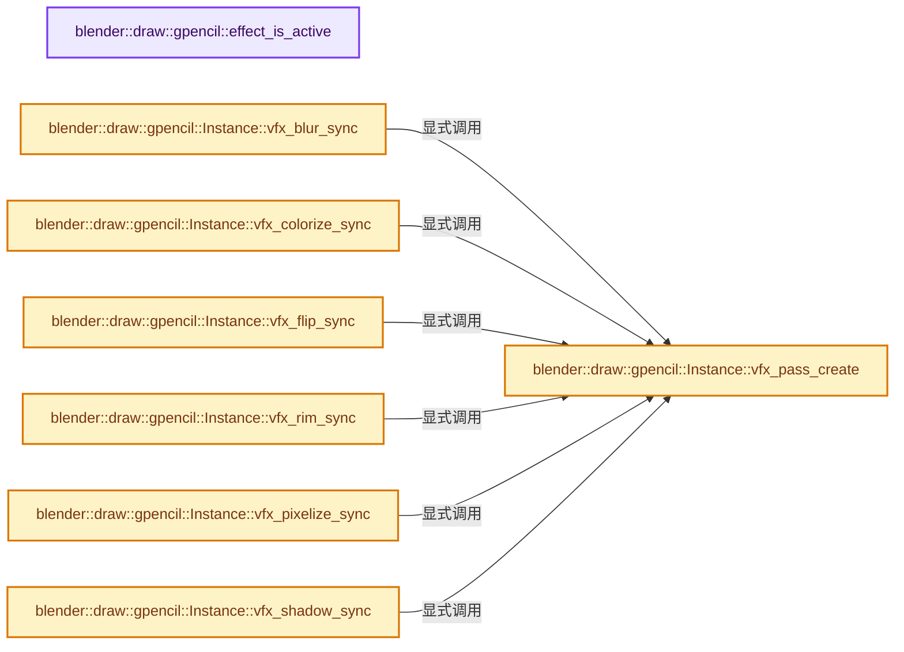

# 实现依赖专题：source/blender/draw/engines/gpencil/gpencil_shader_fx.cc

[实现依赖导航](../../../../README.md) · [符号索引](../../../../../00-课程指南/02-源码与提交索引/符号依赖与实现索引.md)

本专题从正文实际调用进入，集中保存共享实现。函数有稳定锚点，可从调用处直接跳到对应完整函数；递归与互相调用通过回链组织。

## 本文件的实现关系




## 完整成员与函数实现

<a id="f-e98a6906e327e04c"></a>

### `blender::draw::gpencil::effect_is_active`

实现位置：[source/blender/draw/engines/gpencil/gpencil_shader_fx.cc](../../../../../../../../../source/blender/draw/engines/gpencil/gpencil_shader_fx.cc) · L26—L43。

接口参数：

- `ShaderFxData *fx`
- `bool is_edit`
- `bool is_viewport`

**教学注释版**

<!-- annotated:080957da753e66 -->

```cpp
static bool effect_is_active(ShaderFxData *fx, bool is_edit, bool is_viewport)
{
  if (fx == nullptr) {
    return false;
  }

  if (((fx->mode & eShaderFxMode_Editmode) == 0) && (is_edit) && (is_viewport)) {
    return false;
  }

  if (((fx->mode & eShaderFxMode_Realtime) && (is_viewport == true)) ||
      ((fx->mode & eShaderFxMode_Render) && (is_viewport == false)))
  {
    return true;
  }

  return false;
}
```

<details>
<summary>核对原始源码：source/blender/draw/engines/gpencil/gpencil_shader_fx.cc · L26—L43</summary>

<!-- original:080957da753e66:source/blender/draw/engines/gpencil/gpencil_shader_fx.cc:26:43 -->

```cpp
static bool effect_is_active(ShaderFxData *fx, bool is_edit, bool is_viewport)
{
  if (fx == nullptr) {
    return false;
  }

  if (((fx->mode & eShaderFxMode_Editmode) == 0) && (is_edit) && (is_viewport)) {
    return false;
  }

  if (((fx->mode & eShaderFxMode_Realtime) && (is_viewport == true)) ||
      ((fx->mode & eShaderFxMode_Render) && (is_viewport == false)))
  {
    return true;
  }

  return false;
}
```

</details>

**结果出口**

- `return false;`
- `return true;`

**继续追踪实现**

本实现没有需要继续展开的显式调用；检查返回表达式、对象转换和调用者前置条件。

<a id="f-95ac5535dd2715ed"></a>

### `blender::draw::gpencil::Instance::vfx_pass_create`

实现位置：[source/blender/draw/engines/gpencil/gpencil_shader_fx.cc](../../../../../../../../../source/blender/draw/engines/gpencil/gpencil_shader_fx.cc) · L45—L66。

接口参数：

- `const char *name`
- `DRWState state`
- `gpu::Shader *sh`
- `tObject *tgp_ob`
- `GPUSamplerState sampler`

**教学注释版**

<!-- annotated:bf5cdeb1066466 -->

```cpp
PassSimple &Instance::vfx_pass_create(
    const char *name, DRWState state, gpu::Shader *sh, tObject *tgp_ob, GPUSamplerState sampler)
{
  UNUSED_VARS(name);

  int64_t id = gp_vfx_pool->append_and_get_index({});
  tVfx &tgp_vfx = (*gp_vfx_pool)[id];
  tgp_vfx.target_fb = vfx_swapchain_.next().fb;

  PassSimple &pass = *tgp_vfx.vfx_ps;
  pass.init();
  pass.state_set(state);
  pass.shader_set(sh);
  pass.bind_texture("color_buf", vfx_swapchain_.current().color_tx, sampler);
  pass.bind_texture("reveal_buf", vfx_swapchain_.current().reveal_tx, sampler);

  vfx_swapchain_.swap();

  BLI_LINKS_APPEND(&tgp_ob->vfx, &tgp_vfx);

  return pass;
}
```

<details>
<summary>核对原始源码：source/blender/draw/engines/gpencil/gpencil_shader_fx.cc · L45—L66</summary>

<!-- original:bf5cdeb1066466:source/blender/draw/engines/gpencil/gpencil_shader_fx.cc:45:66 -->

```cpp
PassSimple &Instance::vfx_pass_create(
    const char *name, DRWState state, gpu::Shader *sh, tObject *tgp_ob, GPUSamplerState sampler)
{
  UNUSED_VARS(name);

  int64_t id = gp_vfx_pool->append_and_get_index({});
  tVfx &tgp_vfx = (*gp_vfx_pool)[id];
  tgp_vfx.target_fb = vfx_swapchain_.next().fb;

  PassSimple &pass = *tgp_vfx.vfx_ps;
  pass.init();
  pass.state_set(state);
  pass.shader_set(sh);
  pass.bind_texture("color_buf", vfx_swapchain_.current().color_tx, sampler);
  pass.bind_texture("reveal_buf", vfx_swapchain_.current().reveal_tx, sampler);

  vfx_swapchain_.swap();

  BLI_LINKS_APPEND(&tgp_ob->vfx, &tgp_vfx);

  return pass;
}
```

</details>

**沿实际写入检查状态**

- `tgp_vfx.target_fb = vfx_swapchain_.next().fb;`

**结果出口**

- `return pass;`

**继续追踪实现**

- `UNUSED_VARS` → [UNUSED_VARS · L522](../../../../01-BLI基础库/BLI_utildefines.hh.md#m-013582537634)；[UNUSED_VARS · L41](../../../gpu/GPU_shader_shared_utils.hh.md#m-05d9d7a33da0)；[UNUSED_VARS · L62](../../../gpu/GPU_shader_shared_utils.hh.md#m-e12c683a4aca)。宏定义由构建条件选择。
- `gp_vfx_pool->append_and_get_index` → [调用协议](../../../../../00-课程指南/01-路线与规范/模板宏与动态分派协议.md)：接收对象类型依赖auto、返回值或模板实例；不按同名猜测目标。调用位置L50。
- `vfx_swapchain_.next` → [调用协议](../../../../../00-课程指南/01-路线与规范/模板宏与动态分派协议.md)：接收对象类型依赖auto、返回值或模板实例；不按同名猜测目标。调用位置L52。
- `pass.init` → [blender::draw::gpencil::Instance::init · L54](gpencil_engine_c.cc.md#f-f8b5fddb11c4b419)。
- `pass.state_set` → [blender::draw::detail::PassBase<T>::state_set · L1095](../../intern/draw_pass.hh.md#f-97589d4da1cbc8b0)。
- `pass.shader_set` → [blender::draw::detail::PassBase<T>::shader_set · L1112](../../intern/draw_pass.hh.md#f-666f9d02755edac8)。
- `pass.bind_texture` → [调用协议](../../../../../00-课程指南/01-路线与规范/模板宏与动态分派协议.md)：由接收对象具体类型或运行时策略提供实现。调用位置L58。
- `vfx_swapchain_.current` → [调用协议](../../../../../00-课程指南/01-路线与规范/模板宏与动态分派协议.md)：接收对象类型依赖auto、返回值或模板实例；不按同名猜测目标。调用位置L58。
- `vfx_swapchain_.swap` → [调用协议](../../../../../00-课程指南/01-路线与规范/模板宏与动态分派协议.md)：接收对象类型依赖auto、返回值或模板实例；不按同名猜测目标。调用位置L61。
- `BLI_LINKS_APPEND` → [BLI_LINKS_APPEND · L24](../../../../01-BLI基础库/BLI_link_utils.hh.md#m-926e21a59e07)。宏定义由构建条件选择。

<a id="f-d62d022d910c564d"></a>

### `blender::draw::gpencil::Instance::vfx_blur_sync`

实现位置：[source/blender/draw/engines/gpencil/gpencil_shader_fx.cc](../../../../../../../../../source/blender/draw/engines/gpencil/gpencil_shader_fx.cc) · L68—L117。

接口参数：

- `BlurShaderFxData *fx`
- `Object *ob`
- `tObject *tgp_ob`

**教学注释版**

<!-- annotated:5d738636aab5a3 -->

```cpp
void Instance::vfx_blur_sync(BlurShaderFxData *fx, Object *ob, tObject *tgp_ob)
{
  if ((fx->samples == 0.0f) || (fx->radius[0] == 0.0f && fx->radius[1] == 0.0f)) {
    return;
  }

  if ((fx->flag & FX_BLUR_DOF_MODE) && this->camera == nullptr) {
    /* No blur outside camera view (or when DOF is disabled on the camera). */
    return;
  }

  const float s = sin(fx->rotation);
  const float c = cos(fx->rotation);

  float4x4 winmat, persmat;
  float blur_size[2] = {fx->radius[0], fx->radius[1]};
  persmat = View::default_get().persmat();
  const float w = fabsf(mul_project_m4_v3_zfac(persmat.ptr(), ob->object_to_world().location()));

  if (fx->flag & FX_BLUR_DOF_MODE) {
    /* Compute circle of confusion size. */
    float coc = (this->dof_params[0] / -w) - this->dof_params[1];
    copy_v2_fl(blur_size, fabsf(coc));
  }
  else {
    /* Modify by distance to camera and object scale. */
    winmat = View::default_get().winmat();
    const float2 vp_size = this->draw_ctx->viewport_size_get();
    float world_pixel_scale = 1.0f / GPENCIL_PIXEL_FACTOR;
    float scale = mat4_to_scale(ob->object_to_world().ptr());
    float distance_factor = world_pixel_scale * scale * winmat[1][1] * vp_size[1] / w;
    mul_v2_fl(blur_size, distance_factor);
  }

  gpu::Shader *sh = ShaderCache::get().fx_blur.get();

  DRWState state = DRW_STATE_WRITE_COLOR;
  if (blur_size[0] > 0.0f) {
    auto &grp = vfx_pass_create("Fx Blur H", state, sh, tgp_ob);
    grp.push_constant("offset", float2(blur_size[0] * c, blur_size[0] * s));
    grp.push_constant("samp_count", max_ii(1, min_ii(fx->samples, blur_size[0])));
    grp.draw_procedural(GPU_PRIM_TRIS, 1, 3);
  }
  if (blur_size[1] > 0.0f) {
    auto &grp = vfx_pass_create("Fx Blur V", state, sh, tgp_ob);
    grp.push_constant("offset", float2(-blur_size[1] * s, blur_size[1] * c));
    grp.push_constant("samp_count", max_ii(1, min_ii(fx->samples, blur_size[1])));
    grp.draw_procedural(GPU_PRIM_TRIS, 1, 3);
  }
}
```

<details>
<summary>核对原始源码：source/blender/draw/engines/gpencil/gpencil_shader_fx.cc · L68—L117</summary>

<!-- original:5d738636aab5a3:source/blender/draw/engines/gpencil/gpencil_shader_fx.cc:68:117 -->

```cpp
void Instance::vfx_blur_sync(BlurShaderFxData *fx, Object *ob, tObject *tgp_ob)
{
  if ((fx->samples == 0.0f) || (fx->radius[0] == 0.0f && fx->radius[1] == 0.0f)) {
    return;
  }

  if ((fx->flag & FX_BLUR_DOF_MODE) && this->camera == nullptr) {
    /* No blur outside camera view (or when DOF is disabled on the camera). */
    return;
  }

  const float s = sin(fx->rotation);
  const float c = cos(fx->rotation);

  float4x4 winmat, persmat;
  float blur_size[2] = {fx->radius[0], fx->radius[1]};
  persmat = View::default_get().persmat();
  const float w = fabsf(mul_project_m4_v3_zfac(persmat.ptr(), ob->object_to_world().location()));

  if (fx->flag & FX_BLUR_DOF_MODE) {
    /* Compute circle of confusion size. */
    float coc = (this->dof_params[0] / -w) - this->dof_params[1];
    copy_v2_fl(blur_size, fabsf(coc));
  }
  else {
    /* Modify by distance to camera and object scale. */
    winmat = View::default_get().winmat();
    const float2 vp_size = this->draw_ctx->viewport_size_get();
    float world_pixel_scale = 1.0f / GPENCIL_PIXEL_FACTOR;
    float scale = mat4_to_scale(ob->object_to_world().ptr());
    float distance_factor = world_pixel_scale * scale * winmat[1][1] * vp_size[1] / w;
    mul_v2_fl(blur_size, distance_factor);
  }

  gpu::Shader *sh = ShaderCache::get().fx_blur.get();

  DRWState state = DRW_STATE_WRITE_COLOR;
  if (blur_size[0] > 0.0f) {
    auto &grp = vfx_pass_create("Fx Blur H", state, sh, tgp_ob);
    grp.push_constant("offset", float2(blur_size[0] * c, blur_size[0] * s));
    grp.push_constant("samp_count", max_ii(1, min_ii(fx->samples, blur_size[0])));
    grp.draw_procedural(GPU_PRIM_TRIS, 1, 3);
  }
  if (blur_size[1] > 0.0f) {
    auto &grp = vfx_pass_create("Fx Blur V", state, sh, tgp_ob);
    grp.push_constant("offset", float2(-blur_size[1] * s, blur_size[1] * c));
    grp.push_constant("samp_count", max_ii(1, min_ii(fx->samples, blur_size[1])));
    grp.draw_procedural(GPU_PRIM_TRIS, 1, 3);
  }
}
```

</details>

**沿实际写入检查状态**

- `persmat = View::default_get().persmat();`
- `winmat = View::default_get().winmat();`

**继续追踪实现**

- `sin` → [外部契约](https://eel.is/c++draft/)：这个边界按实际表达式及所属类型核对参数、返回值、寿命与失败行为。这里提供接口入口，不声称已解释该第三方版本的内部实现。
- `cos` → [外部契约](https://eel.is/c++draft/)：这个边界按实际表达式及所属类型核对参数、返回值、寿命与失败行为。这里提供接口入口，不声称已解释该第三方版本的内部实现。
- `View::default_get().persmat` → [调用协议](../../../../../00-课程指南/01-路线与规范/模板宏与动态分派协议.md)：接收对象类型依赖auto、返回值或模板实例；不按同名猜测目标。调用位置L84。
- `View::default_get` → [blender::draw::View::default_get · L317](../../intern/draw_view.cc.md#f-1edfe36a27ed8fa6)。
- `fabsf` → [fabsf · L21](../../../../07-Intern运行时与平台/cycles/kernel/svm/radial_tiling_shared.h.md#m-02cc4c69cfb3)；[fabsf · L43](../../../../07-Intern运行时与平台/cycles/kernel/svm/radial_tiling_shared.h.md#m-04effe61803b)；[fabsf · L74](../../../../07-Intern运行时与平台/cycles/kernel/svm/radial_tiling_shared.h.md#m-927dd4eba7dc)；[fabsf · L25](../../../../01-BLI基础库/intern/radial_tiling_shared.hh.md#m-8348d6b3d08f)；[fabsf · L47](../../../../01-BLI基础库/intern/radial_tiling_shared.hh.md#m-13b7e0b6d84f)；[fabsf · L78](../../../../01-BLI基础库/intern/radial_tiling_shared.hh.md#m-326c83464a0d)；[fabsf · L21](../../../../07-Intern运行时与平台/cycles/kernel/osl/shaders/node_radial_tiling_shared.h.md#m-7c3ee12fc119)；[fabsf · L43](../../../../07-Intern运行时与平台/cycles/kernel/osl/shaders/node_radial_tiling_shared.h.md#m-9112db0e2dd1)；[fabsf · L74](../../../../07-Intern运行时与平台/cycles/kernel/osl/shaders/node_radial_tiling_shared.h.md#m-ee4e61908a6f)；[fabsf · L167](../../../../07-Intern运行时与平台/cycles/kernel/device/oneapi/compat.h.md#m-b039ee6c1601)；[fabsf · L265](../../../../07-Intern运行时与平台/cycles/kernel/device/metal/compat.h.md#m-6b21869e9f3f)。宏定义由构建条件选择。
- `mul_project_m4_v3_zfac` → [blender::mul_project_m4_v3_zfac · L464](../../../../01-BLI基础库/intern/math_vector_inline.cc.md#f-feb0217278781607)。
- `persmat.ptr` → [调用协议](../../../../../00-课程指南/01-路线与规范/模板宏与动态分派协议.md)：接收对象类型依赖auto、返回值或模板实例；不按同名猜测目标。调用位置L85。
- `ob->object_to_world().location` → [调用协议](../../../../../00-课程指南/01-路线与规范/模板宏与动态分派协议.md)：接收对象类型依赖auto、返回值或模板实例；不按同名猜测目标。调用位置L85。
- `ob->object_to_world` → [blender::Object::object_to_world · L5761](../../../../02-BKE几何与数据/intern/object.cc.md#f-12fc20026327d50c)。
- `copy_v2_fl` → [blender::copy_v2_fl · L62](../../../../01-BLI基础库/intern/math_vector_inline.cc.md#f-cf07ce4f241d3a3c)。
- `View::default_get().winmat` → [调用协议](../../../../../00-课程指南/01-路线与规范/模板宏与动态分派协议.md)：接收对象类型依赖auto、返回值或模板实例；不按同名猜测目标。调用位置L94。
- `this->draw_ctx->viewport_size_get` → [调用协议](../../../../../00-课程指南/01-路线与规范/模板宏与动态分派协议.md)：接收对象类型依赖auto、返回值或模板实例；不按同名猜测目标。调用位置L95。
- `mat4_to_scale` → [blender::mat4_to_scale · L2010](../../../../01-BLI基础库/intern/math_matrix_c.cc.md#f-f3b0ab6283aee20c)。
- `ob->object_to_world().ptr` → [调用协议](../../../../../00-课程指南/01-路线与规范/模板宏与动态分派协议.md)：接收对象类型依赖auto、返回值或模板实例；不按同名猜测目标。调用位置L97。
- `mul_v2_fl` → [blender::mul_v2_fl · L402](../../../../01-BLI基础库/intern/math_vector_inline.cc.md#f-01449ccd8e2e1640)。
- `ShaderCache::get().fx_blur.get` → [调用协议](../../../../../00-课程指南/01-路线与规范/模板宏与动态分派协议.md)：接收对象类型依赖auto、返回值或模板实例；不按同名猜测目标。调用位置L102。
- `ShaderCache::get` → [blender::draw::gpencil::ShaderCache::get · L26](gpencil_shader.hh.md#f-89695e85c8cb18ae)。
- `vfx_pass_create` → [blender::draw::gpencil::Instance::vfx_pass_create · L45](gpencil_shader_fx.cc.md#f-95ac5535dd2715ed)。
- `grp.push_constant` → [调用协议](../../../../../00-课程指南/01-路线与规范/模板宏与动态分派协议.md)：接收对象类型依赖auto、返回值或模板实例；不按同名猜测目标。调用位置L107。
- `float2` → [float2::float2 · L45](../../../../07-Intern运行时与平台/sky/source/sky_math.h.md#f-04c2783f21f996aa)；[float2::float2 · L47](../../../../07-Intern运行时与平台/sky/source/sky_math.h.md#f-dba79c4c10e5ea46)；[float2::float2 · L49](../../../../07-Intern运行时与平台/sky/source/sky_math.h.md#f-920ca90efa37bf0b)；[float2::float2 · L51](../../../../07-Intern运行时与平台/sky/source/sky_math.h.md#f-4b3fbf848d719a63)；[float2::float2 · L53](../../../../07-Intern运行时与平台/sky/source/sky_math.h.md#f-9b2acd8475cc2843)；[float2::float2 · L55](../../../../07-Intern运行时与平台/sky/source/sky_math.h.md#f-1e9233a9a231be51)。同名重载需按实参类型选择。
- `max_ii` → [blender::max_ii · L368](../../../../01-BLI基础库/intern/math_base_inline.cc.md#f-c45aa7b373adb94c)。
- `min_ii` → [blender::min_ii · L364](../../../../01-BLI基础库/intern/math_base_inline.cc.md#f-30336db35b2810b8)。
- `grp.draw_procedural` → [调用协议](../../../../../00-课程指南/01-路线与规范/模板宏与动态分派协议.md)：接收对象类型依赖auto、返回值或模板实例；不按同名猜测目标。调用位置L109。

<a id="f-ab35584be3541fee"></a>

### `blender::draw::gpencil::Instance::vfx_colorize_sync`

实现位置：[source/blender/draw/engines/gpencil/gpencil_shader_fx.cc](../../../../../../../../../source/blender/draw/engines/gpencil/gpencil_shader_fx.cc) · L119—L130。

接口参数：

- `ColorizeShaderFxData *fx`
- `Object *`
- `tObject *tgp_ob`

**教学注释版**

<!-- annotated:b4821c4eaa251a -->

```cpp
void Instance::vfx_colorize_sync(ColorizeShaderFxData *fx, Object * /*ob*/, tObject *tgp_ob)
{
  gpu::Shader *sh = ShaderCache::get().fx_colorize.get();

  DRWState state = DRW_STATE_WRITE_COLOR;
  auto &grp = vfx_pass_create("Fx Colorize", state, sh, tgp_ob);
  grp.push_constant("low_color", float3(fx->low_color));
  grp.push_constant("high_color", float3(fx->high_color));
  grp.push_constant("factor", fx->factor);
  grp.push_constant("mode", fx->mode);
  grp.draw_procedural(GPU_PRIM_TRIS, 1, 3);
}
```

<details>
<summary>核对原始源码：source/blender/draw/engines/gpencil/gpencil_shader_fx.cc · L119—L130</summary>

<!-- original:b4821c4eaa251a:source/blender/draw/engines/gpencil/gpencil_shader_fx.cc:119:130 -->

```cpp
void Instance::vfx_colorize_sync(ColorizeShaderFxData *fx, Object * /*ob*/, tObject *tgp_ob)
{
  gpu::Shader *sh = ShaderCache::get().fx_colorize.get();

  DRWState state = DRW_STATE_WRITE_COLOR;
  auto &grp = vfx_pass_create("Fx Colorize", state, sh, tgp_ob);
  grp.push_constant("low_color", float3(fx->low_color));
  grp.push_constant("high_color", float3(fx->high_color));
  grp.push_constant("factor", fx->factor);
  grp.push_constant("mode", fx->mode);
  grp.draw_procedural(GPU_PRIM_TRIS, 1, 3);
}
```

</details>

**继续追踪实现**

- `ShaderCache::get().fx_colorize.get` → [调用协议](../../../../../00-课程指南/01-路线与规范/模板宏与动态分派协议.md)：接收对象类型依赖auto、返回值或模板实例；不按同名猜测目标。调用位置L121。
- `ShaderCache::get` → [blender::draw::gpencil::ShaderCache::get · L26](gpencil_shader.hh.md#f-89695e85c8cb18ae)。
- `vfx_pass_create` → [blender::draw::gpencil::Instance::vfx_pass_create · L45](gpencil_shader_fx.cc.md#f-95ac5535dd2715ed)。
- `grp.push_constant` → [调用协议](../../../../../00-课程指南/01-路线与规范/模板宏与动态分派协议.md)：接收对象类型依赖auto、返回值或模板实例；不按同名猜测目标。调用位置L125。
- `float3` → [float3 · L641](../../../compositor/algorithms/intern/smaa.cc.md#m-0ea8254cfdb4)。宏定义由构建条件选择。
- `grp.draw_procedural` → [调用协议](../../../../../00-课程指南/01-路线与规范/模板宏与动态分派协议.md)：接收对象类型依赖auto、返回值或模板实例；不按同名猜测目标。调用位置L129。

<a id="f-36ad1226bf102ee5"></a>

### `blender::draw::gpencil::Instance::vfx_flip_sync`

实现位置：[source/blender/draw/engines/gpencil/gpencil_shader_fx.cc](../../../../../../../../../source/blender/draw/engines/gpencil/gpencil_shader_fx.cc) · L132—L146。

接口参数：

- `FlipShaderFxData *fx`
- `Object *`
- `tObject *tgp_ob`

**教学注释版**

<!-- annotated:7c259d52442831 -->

```cpp
void Instance::vfx_flip_sync(FlipShaderFxData *fx, Object * /*ob*/, tObject *tgp_ob)
{
  float axis_flip[2];
  axis_flip[0] = (fx->flag & FX_FLIP_HORIZONTAL) ? -1.0f : 1.0f;
  axis_flip[1] = (fx->flag & FX_FLIP_VERTICAL) ? -1.0f : 1.0f;

  gpu::Shader *sh = ShaderCache::get().fx_transform.get();

  DRWState state = DRW_STATE_WRITE_COLOR;
  auto &grp = vfx_pass_create("Fx Flip", state, sh, tgp_ob);
  grp.push_constant("axis_flip", float2(axis_flip));
  grp.push_constant("wave_offset", float2(0.0f, 0.0f));
  grp.push_constant("swirl_radius", 0.0f);
  grp.draw_procedural(GPU_PRIM_TRIS, 1, 3);
}
```

<details>
<summary>核对原始源码：source/blender/draw/engines/gpencil/gpencil_shader_fx.cc · L132—L146</summary>

<!-- original:7c259d52442831:source/blender/draw/engines/gpencil/gpencil_shader_fx.cc:132:146 -->

```cpp
void Instance::vfx_flip_sync(FlipShaderFxData *fx, Object * /*ob*/, tObject *tgp_ob)
{
  float axis_flip[2];
  axis_flip[0] = (fx->flag & FX_FLIP_HORIZONTAL) ? -1.0f : 1.0f;
  axis_flip[1] = (fx->flag & FX_FLIP_VERTICAL) ? -1.0f : 1.0f;

  gpu::Shader *sh = ShaderCache::get().fx_transform.get();

  DRWState state = DRW_STATE_WRITE_COLOR;
  auto &grp = vfx_pass_create("Fx Flip", state, sh, tgp_ob);
  grp.push_constant("axis_flip", float2(axis_flip));
  grp.push_constant("wave_offset", float2(0.0f, 0.0f));
  grp.push_constant("swirl_radius", 0.0f);
  grp.draw_procedural(GPU_PRIM_TRIS, 1, 3);
}
```

</details>

**沿实际写入检查状态**

- `axis_flip[0] = (fx->flag & FX_FLIP_HORIZONTAL) ? -1.0f : 1.0f;`
- `axis_flip[1] = (fx->flag & FX_FLIP_VERTICAL) ? -1.0f : 1.0f;`

**继续追踪实现**

- `ShaderCache::get().fx_transform.get` → [调用协议](../../../../../00-课程指南/01-路线与规范/模板宏与动态分派协议.md)：接收对象类型依赖auto、返回值或模板实例；不按同名猜测目标。调用位置L138。
- `ShaderCache::get` → [blender::draw::gpencil::ShaderCache::get · L26](gpencil_shader.hh.md#f-89695e85c8cb18ae)。
- `vfx_pass_create` → [blender::draw::gpencil::Instance::vfx_pass_create · L45](gpencil_shader_fx.cc.md#f-95ac5535dd2715ed)。
- `grp.push_constant` → [调用协议](../../../../../00-课程指南/01-路线与规范/模板宏与动态分派协议.md)：接收对象类型依赖auto、返回值或模板实例；不按同名猜测目标。调用位置L142。
- `float2` → [float2::float2 · L45](../../../../07-Intern运行时与平台/sky/source/sky_math.h.md#f-04c2783f21f996aa)；[float2::float2 · L47](../../../../07-Intern运行时与平台/sky/source/sky_math.h.md#f-dba79c4c10e5ea46)；[float2::float2 · L49](../../../../07-Intern运行时与平台/sky/source/sky_math.h.md#f-920ca90efa37bf0b)；[float2::float2 · L51](../../../../07-Intern运行时与平台/sky/source/sky_math.h.md#f-4b3fbf848d719a63)；[float2::float2 · L53](../../../../07-Intern运行时与平台/sky/source/sky_math.h.md#f-9b2acd8475cc2843)；[float2::float2 · L55](../../../../07-Intern运行时与平台/sky/source/sky_math.h.md#f-1e9233a9a231be51)。同名重载需按实参类型选择。
- `grp.draw_procedural` → [调用协议](../../../../../00-课程指南/01-路线与规范/模板宏与动态分派协议.md)：接收对象类型依赖auto、返回值或模板实例；不按同名猜测目标。调用位置L145。

<a id="f-c7ecbb0155c17eb0"></a>

### `blender::draw::gpencil::Instance::vfx_rim_sync`

实现位置：[source/blender/draw/engines/gpencil/gpencil_shader_fx.cc](../../../../../../../../../source/blender/draw/engines/gpencil/gpencil_shader_fx.cc) · L148—L219。

接口参数：

- `RimShaderFxData *fx`
- `Object *ob`
- `tObject *tgp_ob`

**教学注释版**

<!-- annotated:bbcd4532c4e921 -->

```cpp
void Instance::vfx_rim_sync(RimShaderFxData *fx, Object *ob, tObject *tgp_ob)
{
  float4x4 winmat, persmat;
  float offset[2] = {float(fx->offset[0]), float(fx->offset[1])};
  float blur_size[2] = {float(fx->blur[0]), float(fx->blur[1])};
  winmat = View::default_get().winmat();
  persmat = View::default_get().persmat();
  const float2 vp_size = this->draw_ctx->viewport_size_get();
  const float2 vp_size_inv = 1.0f / vp_size;

  const float w = fabsf(mul_project_m4_v3_zfac(persmat.ptr(), ob->object_to_world().location()));

  /* Modify by distance to camera and object scale. */
  float world_pixel_scale = 1.0f / GPENCIL_PIXEL_FACTOR;
  float scale = mat4_to_scale(ob->object_to_world().ptr());
  float distance_factor = (world_pixel_scale * scale * winmat[1][1] * vp_size[1]) / w;
  mul_v2_fl(offset, distance_factor);
  mul_v2_v2(offset, vp_size_inv);
  mul_v2_fl(blur_size, distance_factor);

  gpu::Shader *sh = ShaderCache::get().fx_rim.get();

  {
    DRWState state = DRW_STATE_WRITE_COLOR;
    auto &grp = vfx_pass_create("Fx Rim H", state, sh, tgp_ob);
    grp.push_constant("blur_dir", float2(blur_size[0] * vp_size_inv[0], 0.0f));
    grp.push_constant("uv_offset", float2(offset));
    grp.push_constant("samp_count", max_ii(1, min_ii(fx->samples, blur_size[0])));
    grp.push_constant("mask_color", float3(fx->mask_rgb));
    grp.push_constant("is_first_pass", true);
    grp.draw_procedural(GPU_PRIM_TRIS, 1, 3);
  }

  {
    DRWState state = DRW_STATE_WRITE_COLOR;
    switch (fx->mode) {
      case eShaderFxRimMode_Normal:
        state |= DRW_STATE_BLEND_ALPHA_PREMUL;
        break;
      case eShaderFxRimMode_Add:
        state |= DRW_STATE_BLEND_ADD_FULL;
        break;
      case eShaderFxRimMode_Subtract:
        state |= DRW_STATE_BLEND_SUB;
        break;
      case eShaderFxRimMode_Multiply:
      case eShaderFxRimMode_Divide:
      case eShaderFxRimMode_Overlay:
        state |= DRW_STATE_BLEND_MUL;
        break;
    }

    zero_v2(offset);

    auto &grp = vfx_pass_create("Fx Rim V", state, sh, tgp_ob);
    grp.push_constant("blur_dir", float2(0.0f, blur_size[1] * vp_size_inv[1]));
    grp.push_constant("uv_offset", float2(offset));
    grp.push_constant("rim_color", float3(fx->rim_rgb));
    grp.push_constant("samp_count", max_ii(1, min_ii(fx->samples, blur_size[1])));
    grp.push_constant("blend_mode", fx->mode);
    grp.push_constant("is_first_pass", false);
    grp.draw_procedural(GPU_PRIM_TRIS, 1, 3);

    if (fx->mode == eShaderFxRimMode_Overlay) {
      /* We cannot do custom blending on multi-target frame-buffers.
       * Workaround by doing 2 passes. */
      grp.state_set(DRW_STATE_WRITE_COLOR | DRW_STATE_BLEND_ADD_FULL);
      grp.push_constant("blend_mode", 999);
      grp.draw_procedural(GPU_PRIM_TRIS, 1, 3);
    }
  }
}
```

<details>
<summary>核对原始源码：source/blender/draw/engines/gpencil/gpencil_shader_fx.cc · L148—L219</summary>

<!-- original:bbcd4532c4e921:source/blender/draw/engines/gpencil/gpencil_shader_fx.cc:148:219 -->

```cpp
void Instance::vfx_rim_sync(RimShaderFxData *fx, Object *ob, tObject *tgp_ob)
{
  float4x4 winmat, persmat;
  float offset[2] = {float(fx->offset[0]), float(fx->offset[1])};
  float blur_size[2] = {float(fx->blur[0]), float(fx->blur[1])};
  winmat = View::default_get().winmat();
  persmat = View::default_get().persmat();
  const float2 vp_size = this->draw_ctx->viewport_size_get();
  const float2 vp_size_inv = 1.0f / vp_size;

  const float w = fabsf(mul_project_m4_v3_zfac(persmat.ptr(), ob->object_to_world().location()));

  /* Modify by distance to camera and object scale. */
  float world_pixel_scale = 1.0f / GPENCIL_PIXEL_FACTOR;
  float scale = mat4_to_scale(ob->object_to_world().ptr());
  float distance_factor = (world_pixel_scale * scale * winmat[1][1] * vp_size[1]) / w;
  mul_v2_fl(offset, distance_factor);
  mul_v2_v2(offset, vp_size_inv);
  mul_v2_fl(blur_size, distance_factor);

  gpu::Shader *sh = ShaderCache::get().fx_rim.get();

  {
    DRWState state = DRW_STATE_WRITE_COLOR;
    auto &grp = vfx_pass_create("Fx Rim H", state, sh, tgp_ob);
    grp.push_constant("blur_dir", float2(blur_size[0] * vp_size_inv[0], 0.0f));
    grp.push_constant("uv_offset", float2(offset));
    grp.push_constant("samp_count", max_ii(1, min_ii(fx->samples, blur_size[0])));
    grp.push_constant("mask_color", float3(fx->mask_rgb));
    grp.push_constant("is_first_pass", true);
    grp.draw_procedural(GPU_PRIM_TRIS, 1, 3);
  }

  {
    DRWState state = DRW_STATE_WRITE_COLOR;
    switch (fx->mode) {
      case eShaderFxRimMode_Normal:
        state |= DRW_STATE_BLEND_ALPHA_PREMUL;
        break;
      case eShaderFxRimMode_Add:
        state |= DRW_STATE_BLEND_ADD_FULL;
        break;
      case eShaderFxRimMode_Subtract:
        state |= DRW_STATE_BLEND_SUB;
        break;
      case eShaderFxRimMode_Multiply:
      case eShaderFxRimMode_Divide:
      case eShaderFxRimMode_Overlay:
        state |= DRW_STATE_BLEND_MUL;
        break;
    }

    zero_v2(offset);

    auto &grp = vfx_pass_create("Fx Rim V", state, sh, tgp_ob);
    grp.push_constant("blur_dir", float2(0.0f, blur_size[1] * vp_size_inv[1]));
    grp.push_constant("uv_offset", float2(offset));
    grp.push_constant("rim_color", float3(fx->rim_rgb));
    grp.push_constant("samp_count", max_ii(1, min_ii(fx->samples, blur_size[1])));
    grp.push_constant("blend_mode", fx->mode);
    grp.push_constant("is_first_pass", false);
    grp.draw_procedural(GPU_PRIM_TRIS, 1, 3);

    if (fx->mode == eShaderFxRimMode_Overlay) {
      /* We cannot do custom blending on multi-target frame-buffers.
       * Workaround by doing 2 passes. */
      grp.state_set(DRW_STATE_WRITE_COLOR | DRW_STATE_BLEND_ADD_FULL);
      grp.push_constant("blend_mode", 999);
      grp.draw_procedural(GPU_PRIM_TRIS, 1, 3);
    }
  }
}
```

</details>

**沿实际写入检查状态**

- `winmat = View::default_get().winmat();`
- `persmat = View::default_get().persmat();`
- `state |= DRW_STATE_BLEND_ALPHA_PREMUL;`
- `state |= DRW_STATE_BLEND_ADD_FULL;`
- `state |= DRW_STATE_BLEND_SUB;`
- `state |= DRW_STATE_BLEND_MUL;`

**继续追踪实现**

- `View::default_get().winmat` → [调用协议](../../../../../00-课程指南/01-路线与规范/模板宏与动态分派协议.md)：接收对象类型依赖auto、返回值或模板实例；不按同名猜测目标。调用位置L153。
- `View::default_get` → [blender::draw::View::default_get · L317](../../intern/draw_view.cc.md#f-1edfe36a27ed8fa6)。
- `View::default_get().persmat` → [调用协议](../../../../../00-课程指南/01-路线与规范/模板宏与动态分派协议.md)：接收对象类型依赖auto、返回值或模板实例；不按同名猜测目标。调用位置L154。
- `this->draw_ctx->viewport_size_get` → [调用协议](../../../../../00-课程指南/01-路线与规范/模板宏与动态分派协议.md)：接收对象类型依赖auto、返回值或模板实例；不按同名猜测目标。调用位置L155。
- `fabsf` → [fabsf · L21](../../../../07-Intern运行时与平台/cycles/kernel/svm/radial_tiling_shared.h.md#m-02cc4c69cfb3)；[fabsf · L43](../../../../07-Intern运行时与平台/cycles/kernel/svm/radial_tiling_shared.h.md#m-04effe61803b)；[fabsf · L74](../../../../07-Intern运行时与平台/cycles/kernel/svm/radial_tiling_shared.h.md#m-927dd4eba7dc)；[fabsf · L25](../../../../01-BLI基础库/intern/radial_tiling_shared.hh.md#m-8348d6b3d08f)；[fabsf · L47](../../../../01-BLI基础库/intern/radial_tiling_shared.hh.md#m-13b7e0b6d84f)；[fabsf · L78](../../../../01-BLI基础库/intern/radial_tiling_shared.hh.md#m-326c83464a0d)；[fabsf · L21](../../../../07-Intern运行时与平台/cycles/kernel/osl/shaders/node_radial_tiling_shared.h.md#m-7c3ee12fc119)；[fabsf · L43](../../../../07-Intern运行时与平台/cycles/kernel/osl/shaders/node_radial_tiling_shared.h.md#m-9112db0e2dd1)；[fabsf · L74](../../../../07-Intern运行时与平台/cycles/kernel/osl/shaders/node_radial_tiling_shared.h.md#m-ee4e61908a6f)；[fabsf · L167](../../../../07-Intern运行时与平台/cycles/kernel/device/oneapi/compat.h.md#m-b039ee6c1601)；[fabsf · L265](../../../../07-Intern运行时与平台/cycles/kernel/device/metal/compat.h.md#m-6b21869e9f3f)。宏定义由构建条件选择。
- `mul_project_m4_v3_zfac` → [blender::mul_project_m4_v3_zfac · L464](../../../../01-BLI基础库/intern/math_vector_inline.cc.md#f-feb0217278781607)。
- `persmat.ptr` → [调用协议](../../../../../00-课程指南/01-路线与规范/模板宏与动态分派协议.md)：接收对象类型依赖auto、返回值或模板实例；不按同名猜测目标。调用位置L158。
- `ob->object_to_world().location` → [调用协议](../../../../../00-课程指南/01-路线与规范/模板宏与动态分派协议.md)：接收对象类型依赖auto、返回值或模板实例；不按同名猜测目标。调用位置L158。
- `ob->object_to_world` → [blender::Object::object_to_world · L5761](../../../../02-BKE几何与数据/intern/object.cc.md#f-12fc20026327d50c)。
- `mat4_to_scale` → [blender::mat4_to_scale · L2010](../../../../01-BLI基础库/intern/math_matrix_c.cc.md#f-f3b0ab6283aee20c)。
- `ob->object_to_world().ptr` → [调用协议](../../../../../00-课程指南/01-路线与规范/模板宏与动态分派协议.md)：接收对象类型依赖auto、返回值或模板实例；不按同名猜测目标。调用位置L162。
- `mul_v2_fl` → [blender::mul_v2_fl · L402](../../../../01-BLI基础库/intern/math_vector_inline.cc.md#f-01449ccd8e2e1640)。
- `mul_v2_v2` → [blender::mul_v2_v2 · L435](../../../../01-BLI基础库/intern/math_vector_inline.cc.md#f-628c0e4f1d2deb5b)。
- `ShaderCache::get().fx_rim.get` → [调用协议](../../../../../00-课程指南/01-路线与规范/模板宏与动态分派协议.md)：接收对象类型依赖auto、返回值或模板实例；不按同名猜测目标。调用位置L168。
- `ShaderCache::get` → [blender::draw::gpencil::ShaderCache::get · L26](gpencil_shader.hh.md#f-89695e85c8cb18ae)。
- `vfx_pass_create` → [blender::draw::gpencil::Instance::vfx_pass_create · L45](gpencil_shader_fx.cc.md#f-95ac5535dd2715ed)。
- `grp.push_constant` → [调用协议](../../../../../00-课程指南/01-路线与规范/模板宏与动态分派协议.md)：接收对象类型依赖auto、返回值或模板实例；不按同名猜测目标。调用位置L173。
- `float2` → [float2::float2 · L45](../../../../07-Intern运行时与平台/sky/source/sky_math.h.md#f-04c2783f21f996aa)；[float2::float2 · L47](../../../../07-Intern运行时与平台/sky/source/sky_math.h.md#f-dba79c4c10e5ea46)；[float2::float2 · L49](../../../../07-Intern运行时与平台/sky/source/sky_math.h.md#f-920ca90efa37bf0b)；[float2::float2 · L51](../../../../07-Intern运行时与平台/sky/source/sky_math.h.md#f-4b3fbf848d719a63)；[float2::float2 · L53](../../../../07-Intern运行时与平台/sky/source/sky_math.h.md#f-9b2acd8475cc2843)；[float2::float2 · L55](../../../../07-Intern运行时与平台/sky/source/sky_math.h.md#f-1e9233a9a231be51)。同名重载需按实参类型选择。
- `max_ii` → [blender::max_ii · L368](../../../../01-BLI基础库/intern/math_base_inline.cc.md#f-c45aa7b373adb94c)。
- `min_ii` → [blender::min_ii · L364](../../../../01-BLI基础库/intern/math_base_inline.cc.md#f-30336db35b2810b8)。
- `float3` → [float3 · L641](../../../compositor/algorithms/intern/smaa.cc.md#m-0ea8254cfdb4)。宏定义由构建条件选择。
- `grp.draw_procedural` → [调用协议](../../../../../00-课程指南/01-路线与规范/模板宏与动态分派协议.md)：接收对象类型依赖auto、返回值或模板实例；不按同名猜测目标。调用位置L178。
- `zero_v2` → [blender::zero_v2 · L20](../../../../01-BLI基础库/intern/math_vector_inline.cc.md#f-3f0f4c37141bd4f2)。
- `grp.state_set` → [调用协议](../../../../../00-课程指南/01-路线与规范/模板宏与动态分派协议.md)：接收对象类型依赖auto、返回值或模板实例；不按同名猜测目标。调用位置L214。

<a id="f-f2e1bad3a698e868"></a>

### `blender::draw::gpencil::Instance::vfx_pixelize_sync`

实现位置：[source/blender/draw/engines/gpencil/gpencil_shader_fx.cc](../../../../../../../../../source/blender/draw/engines/gpencil/gpencil_shader_fx.cc) · L221—L281。

接口参数：

- `PixelShaderFxData *fx`
- `Object *ob`
- `tObject *tgp_ob`

**教学注释版**

<!-- annotated:686f4f971e0cb5 -->

```cpp
void Instance::vfx_pixelize_sync(PixelShaderFxData *fx, Object *ob, tObject *tgp_ob)
{
  float4x4 persmat, winmat;
  float ob_center[3], pixsize_uniform[2];
  winmat = View::default_get().winmat();
  persmat = View::default_get().persmat();
  const float2 vp_size = this->draw_ctx->viewport_size_get();
  const float2 vp_size_inv = 1.0f / vp_size;
  float pixel_size[2] = {float(fx->size[0]), float(fx->size[1])};
  mul_v2_v2(pixel_size, vp_size_inv);

  /* Fixed pixelisation center from object center. */
  const float w = fabsf(mul_project_m4_v3_zfac(persmat.ptr(), ob->object_to_world().location()));
  mul_v3_m4v3(ob_center, persmat.ptr(), ob->object_to_world().location());
  mul_v3_fl(ob_center, 1.0f / w);

  const bool use_antialiasing = ((fx->flag & FX_PIXEL_FILTER_NEAREST) == 0);

  /* Convert to uvs. */
  mul_v2_fl(ob_center, 0.5f);
  add_v2_fl(ob_center, 0.5f);

  /* Modify by distance to camera and object scale. */
  float world_pixel_scale = 1.0f / GPENCIL_PIXEL_FACTOR;
  float scale = mat4_to_scale(ob->object_to_world().ptr());
  mul_v2_fl(pixel_size, (world_pixel_scale * scale * winmat[1][1] * vp_size[1]) / w);

  /* Center to texel */
  madd_v2_v2fl(ob_center, pixel_size, -0.5f);

  gpu::Shader *sh = ShaderCache::get().fx_pixelize.get();

  DRWState state = DRW_STATE_WRITE_COLOR;

  /* Only if pixelated effect is bigger than 1px. */
  if (pixel_size[0] > vp_size_inv[0]) {
    copy_v2_fl2(pixsize_uniform, pixel_size[0], vp_size_inv[1]);
    GPUSamplerState sampler = (use_antialiasing) ? GPUSamplerState::internal_sampler() :
                                                   GPUSamplerState::default_sampler();

    auto &grp = vfx_pass_create("Fx Pixelize X", state, sh, tgp_ob, sampler);
    grp.push_constant("target_pixel_size", float2(pixsize_uniform));
    grp.push_constant("target_pixel_offset", float2(ob_center));
    grp.push_constant("accum_offset", float2(pixel_size[0], 0.0f));
    int samp_count = (pixel_size[0] / vp_size_inv[0] > 3.0) ? 2 : 1;
    grp.push_constant("samp_count", (use_antialiasing ? samp_count : 0));
    grp.draw_procedural(GPU_PRIM_TRIS, 1, 3);
  }

  if (pixel_size[1] > vp_size_inv[1]) {
    GPUSamplerState sampler = (use_antialiasing) ? GPUSamplerState::internal_sampler() :
                                                   GPUSamplerState::default_sampler();
    copy_v2_fl2(pixsize_uniform, vp_size_inv[0], pixel_size[1]);
    auto &grp = vfx_pass_create("Fx Pixelize Y", state, sh, tgp_ob, sampler);
    grp.push_constant("target_pixel_size", float2(pixsize_uniform));
    grp.push_constant("accum_offset", float2(0.0f, pixel_size[1]));
    int samp_count = (pixel_size[1] / vp_size_inv[1] > 3.0) ? 2 : 1;
    grp.push_constant("samp_count", (use_antialiasing ? samp_count : 0));
    grp.draw_procedural(GPU_PRIM_TRIS, 1, 3);
  }
}
```

<details>
<summary>核对原始源码：source/blender/draw/engines/gpencil/gpencil_shader_fx.cc · L221—L281</summary>

<!-- original:686f4f971e0cb5:source/blender/draw/engines/gpencil/gpencil_shader_fx.cc:221:281 -->

```cpp
void Instance::vfx_pixelize_sync(PixelShaderFxData *fx, Object *ob, tObject *tgp_ob)
{
  float4x4 persmat, winmat;
  float ob_center[3], pixsize_uniform[2];
  winmat = View::default_get().winmat();
  persmat = View::default_get().persmat();
  const float2 vp_size = this->draw_ctx->viewport_size_get();
  const float2 vp_size_inv = 1.0f / vp_size;
  float pixel_size[2] = {float(fx->size[0]), float(fx->size[1])};
  mul_v2_v2(pixel_size, vp_size_inv);

  /* Fixed pixelisation center from object center. */
  const float w = fabsf(mul_project_m4_v3_zfac(persmat.ptr(), ob->object_to_world().location()));
  mul_v3_m4v3(ob_center, persmat.ptr(), ob->object_to_world().location());
  mul_v3_fl(ob_center, 1.0f / w);

  const bool use_antialiasing = ((fx->flag & FX_PIXEL_FILTER_NEAREST) == 0);

  /* Convert to uvs. */
  mul_v2_fl(ob_center, 0.5f);
  add_v2_fl(ob_center, 0.5f);

  /* Modify by distance to camera and object scale. */
  float world_pixel_scale = 1.0f / GPENCIL_PIXEL_FACTOR;
  float scale = mat4_to_scale(ob->object_to_world().ptr());
  mul_v2_fl(pixel_size, (world_pixel_scale * scale * winmat[1][1] * vp_size[1]) / w);

  /* Center to texel */
  madd_v2_v2fl(ob_center, pixel_size, -0.5f);

  gpu::Shader *sh = ShaderCache::get().fx_pixelize.get();

  DRWState state = DRW_STATE_WRITE_COLOR;

  /* Only if pixelated effect is bigger than 1px. */
  if (pixel_size[0] > vp_size_inv[0]) {
    copy_v2_fl2(pixsize_uniform, pixel_size[0], vp_size_inv[1]);
    GPUSamplerState sampler = (use_antialiasing) ? GPUSamplerState::internal_sampler() :
                                                   GPUSamplerState::default_sampler();

    auto &grp = vfx_pass_create("Fx Pixelize X", state, sh, tgp_ob, sampler);
    grp.push_constant("target_pixel_size", float2(pixsize_uniform));
    grp.push_constant("target_pixel_offset", float2(ob_center));
    grp.push_constant("accum_offset", float2(pixel_size[0], 0.0f));
    int samp_count = (pixel_size[0] / vp_size_inv[0] > 3.0) ? 2 : 1;
    grp.push_constant("samp_count", (use_antialiasing ? samp_count : 0));
    grp.draw_procedural(GPU_PRIM_TRIS, 1, 3);
  }

  if (pixel_size[1] > vp_size_inv[1]) {
    GPUSamplerState sampler = (use_antialiasing) ? GPUSamplerState::internal_sampler() :
                                                   GPUSamplerState::default_sampler();
    copy_v2_fl2(pixsize_uniform, vp_size_inv[0], pixel_size[1]);
    auto &grp = vfx_pass_create("Fx Pixelize Y", state, sh, tgp_ob, sampler);
    grp.push_constant("target_pixel_size", float2(pixsize_uniform));
    grp.push_constant("accum_offset", float2(0.0f, pixel_size[1]));
    int samp_count = (pixel_size[1] / vp_size_inv[1] > 3.0) ? 2 : 1;
    grp.push_constant("samp_count", (use_antialiasing ? samp_count : 0));
    grp.draw_procedural(GPU_PRIM_TRIS, 1, 3);
  }
}
```

</details>

**沿实际写入检查状态**

- `winmat = View::default_get().winmat();`
- `persmat = View::default_get().persmat();`

**继续追踪实现**

- `View::default_get().winmat` → [调用协议](../../../../../00-课程指南/01-路线与规范/模板宏与动态分派协议.md)：接收对象类型依赖auto、返回值或模板实例；不按同名猜测目标。调用位置L225。
- `View::default_get` → [blender::draw::View::default_get · L317](../../intern/draw_view.cc.md#f-1edfe36a27ed8fa6)。
- `View::default_get().persmat` → [调用协议](../../../../../00-课程指南/01-路线与规范/模板宏与动态分派协议.md)：接收对象类型依赖auto、返回值或模板实例；不按同名猜测目标。调用位置L226。
- `this->draw_ctx->viewport_size_get` → [调用协议](../../../../../00-课程指南/01-路线与规范/模板宏与动态分派协议.md)：接收对象类型依赖auto、返回值或模板实例；不按同名猜测目标。调用位置L227。
- `mul_v2_v2` → [blender::mul_v2_v2 · L435](../../../../01-BLI基础库/intern/math_vector_inline.cc.md#f-628c0e4f1d2deb5b)。
- `fabsf` → [fabsf · L21](../../../../07-Intern运行时与平台/cycles/kernel/svm/radial_tiling_shared.h.md#m-02cc4c69cfb3)；[fabsf · L43](../../../../07-Intern运行时与平台/cycles/kernel/svm/radial_tiling_shared.h.md#m-04effe61803b)；[fabsf · L74](../../../../07-Intern运行时与平台/cycles/kernel/svm/radial_tiling_shared.h.md#m-927dd4eba7dc)；[fabsf · L25](../../../../01-BLI基础库/intern/radial_tiling_shared.hh.md#m-8348d6b3d08f)；[fabsf · L47](../../../../01-BLI基础库/intern/radial_tiling_shared.hh.md#m-13b7e0b6d84f)；[fabsf · L78](../../../../01-BLI基础库/intern/radial_tiling_shared.hh.md#m-326c83464a0d)；[fabsf · L21](../../../../07-Intern运行时与平台/cycles/kernel/osl/shaders/node_radial_tiling_shared.h.md#m-7c3ee12fc119)；[fabsf · L43](../../../../07-Intern运行时与平台/cycles/kernel/osl/shaders/node_radial_tiling_shared.h.md#m-9112db0e2dd1)；[fabsf · L74](../../../../07-Intern运行时与平台/cycles/kernel/osl/shaders/node_radial_tiling_shared.h.md#m-ee4e61908a6f)；[fabsf · L167](../../../../07-Intern运行时与平台/cycles/kernel/device/oneapi/compat.h.md#m-b039ee6c1601)；[fabsf · L265](../../../../07-Intern运行时与平台/cycles/kernel/device/metal/compat.h.md#m-6b21869e9f3f)。宏定义由构建条件选择。
- `mul_project_m4_v3_zfac` → [blender::mul_project_m4_v3_zfac · L464](../../../../01-BLI基础库/intern/math_vector_inline.cc.md#f-feb0217278781607)。
- `persmat.ptr` → [调用协议](../../../../../00-课程指南/01-路线与规范/模板宏与动态分派协议.md)：由接收对象具体类型或运行时策略提供实现。调用位置L233。
- `ob->object_to_world().location` → [调用协议](../../../../../00-课程指南/01-路线与规范/模板宏与动态分派协议.md)：接收对象类型依赖auto、返回值或模板实例；不按同名猜测目标。调用位置L233。
- `ob->object_to_world` → [blender::Object::object_to_world · L5761](../../../../02-BKE几何与数据/intern/object.cc.md#f-12fc20026327d50c)。
- `mul_v3_m4v3` → [blender::mul_v3_m4v3 · L687](../../../../01-BLI基础库/intern/math_matrix_c.cc.md#f-31076c71c40783a8)。
- `mul_v3_fl` → [blender::mul_v3_fl · L414](../../../../01-BLI基础库/intern/math_vector_inline.cc.md#f-00165156a06d1224)。
- `mul_v2_fl` → [blender::mul_v2_fl · L402](../../../../01-BLI基础库/intern/math_vector_inline.cc.md#f-01449ccd8e2e1640)。
- `add_v2_fl` → [blender::add_v2_fl · L261](../../../../01-BLI基础库/intern/math_vector_inline.cc.md#f-003a451165720800)。
- `mat4_to_scale` → [blender::mat4_to_scale · L2010](../../../../01-BLI基础库/intern/math_matrix_c.cc.md#f-f3b0ab6283aee20c)。
- `ob->object_to_world().ptr` → [调用协议](../../../../../00-课程指南/01-路线与规范/模板宏与动态分派协议.md)：接收对象类型依赖auto、返回值或模板实例；不按同名猜测目标。调用位置L245。
- `madd_v2_v2fl` → [blender::madd_v2_v2fl · L495](../../../../01-BLI基础库/intern/math_vector_inline.cc.md#f-d85ecc12b2970448)。
- `ShaderCache::get().fx_pixelize.get` → [调用协议](../../../../../00-课程指南/01-路线与规范/模板宏与动态分派协议.md)：接收对象类型依赖auto、返回值或模板实例；不按同名猜测目标。调用位置L251。
- `ShaderCache::get` → [blender::draw::gpencil::ShaderCache::get · L26](gpencil_shader.hh.md#f-89695e85c8cb18ae)。
- `copy_v2_fl2` → [blender::copy_v2_fl2 · L234](../../../../01-BLI基础库/intern/math_vector_inline.cc.md#f-226daf6ca03c8844)。
- `GPUSamplerState::internal_sampler` → [blender::GPUSamplerState::internal_sampler · L522](../../../gpu/GPU_texture.hh.md#f-3e0da63b622aa843)。
- `GPUSamplerState::default_sampler` → [blender::GPUSamplerState::default_sampler · L505](../../../gpu/GPU_texture.hh.md#f-c7a2363cd391bd35)。
- `vfx_pass_create` → [blender::draw::gpencil::Instance::vfx_pass_create · L45](gpencil_shader_fx.cc.md#f-95ac5535dd2715ed)。
- `grp.push_constant` → [调用协议](../../../../../00-课程指南/01-路线与规范/模板宏与动态分派协议.md)：接收对象类型依赖auto、返回值或模板实例；不按同名猜测目标。调用位置L262。
- `float2` → [float2::float2 · L45](../../../../07-Intern运行时与平台/sky/source/sky_math.h.md#f-04c2783f21f996aa)；[float2::float2 · L47](../../../../07-Intern运行时与平台/sky/source/sky_math.h.md#f-dba79c4c10e5ea46)；[float2::float2 · L49](../../../../07-Intern运行时与平台/sky/source/sky_math.h.md#f-920ca90efa37bf0b)；[float2::float2 · L51](../../../../07-Intern运行时与平台/sky/source/sky_math.h.md#f-4b3fbf848d719a63)；[float2::float2 · L53](../../../../07-Intern运行时与平台/sky/source/sky_math.h.md#f-9b2acd8475cc2843)；[float2::float2 · L55](../../../../07-Intern运行时与平台/sky/source/sky_math.h.md#f-1e9233a9a231be51)。同名重载需按实参类型选择。
- `grp.draw_procedural` → [调用协议](../../../../../00-课程指南/01-路线与规范/模板宏与动态分派协议.md)：接收对象类型依赖auto、返回值或模板实例；不按同名猜测目标。调用位置L267。

<a id="f-466e70e1eda11662"></a>

### `blender::draw::gpencil::Instance::vfx_shadow_sync`

实现位置：[source/blender/draw/engines/gpencil/gpencil_shader_fx.cc](../../../../../../../../../source/blender/draw/engines/gpencil/gpencil_shader_fx.cc) · L283—L398。

接口参数：

- `ShadowShaderFxData *fx`
- `Object *ob`
- `tObject *tgp_ob`

**教学注释版**

<!-- annotated:deee3116486efa -->

```cpp
void Instance::vfx_shadow_sync(ShadowShaderFxData *fx, Object *ob, tObject *tgp_ob)
{
  const bool use_obj_pivot = (fx->flag & FX_SHADOW_USE_OBJECT) != 0;
  const bool use_wave = (fx->flag & FX_SHADOW_USE_WAVE) != 0;

  float4x4 uv_mat, winmat, persmat;
  float rot_center[3];
  float wave_ofs[3], wave_dir[3], wave_phase, blur_dir[2], tmp[2];
  float offset[2] = {float(fx->offset[0]), float(fx->offset[1])};
  float blur_size[2] = {float(fx->blur[0]), float(fx->blur[1])};
  winmat = View::default_get().winmat();
  persmat = View::default_get().persmat();
  const float2 vp_size = this->draw_ctx->viewport_size_get();
  const float2 vp_size_inv = 1.0f / vp_size;
  const float ratio = vp_size_inv[1] / vp_size_inv[0];

  copy_v3_v3(rot_center,
             (use_obj_pivot && fx->object) ? fx->object->object_to_world().location() :
                                             ob->object_to_world().location());

  const float w = fabsf(mul_project_m4_v3_zfac(persmat.ptr(), rot_center));
  mul_v3_m4v3(rot_center, persmat.ptr(), rot_center);
  mul_v3_fl(rot_center, 1.0f / w);

  /* Modify by distance to camera and object scale. */
  float world_pixel_scale = 1.0f / GPENCIL_PIXEL_FACTOR;
  float scale = mat4_to_scale(ob->object_to_world().ptr());
  float distance_factor = (world_pixel_scale * scale * winmat[1][1] * vp_size[1]) / w;
  mul_v2_fl(offset, distance_factor);
  mul_v2_v2(offset, vp_size_inv);
  mul_v2_fl(blur_size, distance_factor);

  rot_center[0] = rot_center[0] * 0.5f + 0.5f;
  rot_center[1] = rot_center[1] * 0.5f + 0.5f;

  /* UV transform matrix. (loc, rot, scale) Sent to shader as 2x3 matrix. */
  unit_m4(uv_mat.ptr());
  translate_m4(uv_mat.ptr(), rot_center[0], rot_center[1], 0.0f);
  rescale_m4(uv_mat.ptr(), float3{1.0f / fx->scale[0], 1.0f / fx->scale[1], 1.0f});
  translate_m4(uv_mat.ptr(), -offset[0], -offset[1], 0.0f);
  rescale_m4(uv_mat.ptr(), float3{1.0f / ratio, 1.0f, 1.0f});
  rotate_m4(uv_mat.ptr(), 'Z', fx->rotation);
  rescale_m4(uv_mat.ptr(), float3{ratio, 1.0f, 1.0f});
  translate_m4(uv_mat.ptr(), -rot_center[0], -rot_center[1], 0.0f);

  if (use_wave) {
    float dir[2];
    if (fx->orientation == 0) {
      /* Horizontal */
      copy_v2_fl2(dir, 1.0f, 0.0f);
    }
    else {
      /* Vertical */
      copy_v2_fl2(dir, 0.0f, 1.0f);
    }
    /* This is applied after rotation. Counter the rotation to keep aligned with global axis. */
    rotate_v2_v2fl(wave_dir, dir, fx->rotation);
    /* Rotate 90 degrees. */
    copy_v2_v2(wave_ofs, wave_dir);
    std::swap(wave_ofs[0], wave_ofs[1]);
    wave_ofs[1] *= -1.0f;
    /* Keep world space scaling and aspect ratio. */
    mul_v2_fl(wave_dir, 1.0f / (max_ff(1e-8f, fx->period) * distance_factor));
    mul_v2_v2(wave_dir, vp_size);
    mul_v2_fl(wave_ofs, fx->amplitude * distance_factor);
    mul_v2_v2(wave_ofs, vp_size_inv);
    /* Phase start at shadow center. */
    wave_phase = fx->phase - dot_v2v2(rot_center, wave_dir);
  }
  else {
    zero_v2(wave_dir);
    zero_v2(wave_ofs);
    wave_phase = 0.0f;
  }

  gpu::Shader *sh = ShaderCache::get().fx_shadow.get();

  copy_v2_fl2(blur_dir, blur_size[0] * vp_size_inv[0], 0.0f);

  {
    DRWState state = DRW_STATE_WRITE_COLOR;
    auto &grp = vfx_pass_create("Fx Shadow H", state, sh, tgp_ob);
    grp.push_constant("blur_dir", float2(blur_dir));
    grp.push_constant("wave_dir", float2(wave_dir));
    grp.push_constant("wave_offset", float2(wave_ofs));
    grp.push_constant("wave_phase", wave_phase);
    grp.push_constant("uv_rot_x", float2(uv_mat[0]));
    grp.push_constant("uv_rot_y", float2(uv_mat[1]));
    grp.push_constant("uv_offset", float2(uv_mat[3]));
    grp.push_constant("samp_count", max_ii(1, min_ii(fx->samples, blur_size[0])));
    grp.push_constant("is_first_pass", true);
    grp.draw_procedural(GPU_PRIM_TRIS, 1, 3);
  }

  unit_m4(uv_mat.ptr());
  zero_v2(wave_ofs);

  /* Reset the `uv_mat` to account for rotation in the Y-axis (Shadow-V parameter). */
  copy_v2_fl2(tmp, 0.0f, blur_size[1]);
  rotate_v2_v2fl(blur_dir, tmp, -fx->rotation);
  mul_v2_v2(blur_dir, vp_size_inv);

  {
    DRWState state = DRW_STATE_WRITE_COLOR | DRW_STATE_BLEND_ALPHA_PREMUL;
    auto &grp = vfx_pass_create("Fx Shadow V", state, sh, tgp_ob);
    grp.push_constant("shadow_color", float4(fx->shadow_rgba));
    grp.push_constant("blur_dir", float2(blur_dir));
    grp.push_constant("wave_offset", float2(wave_ofs));
    grp.push_constant("uv_rot_x", float2(uv_mat[0]));
    grp.push_constant("uv_rot_y", float2(uv_mat[1]));
    grp.push_constant("uv_offset", float2(uv_mat[3]));
    grp.push_constant("samp_count", max_ii(1, min_ii(fx->samples, blur_size[1])));
    grp.push_constant("is_first_pass", false);
    grp.draw_procedural(GPU_PRIM_TRIS, 1, 3);
  }
}
```

<details>
<summary>核对原始源码：source/blender/draw/engines/gpencil/gpencil_shader_fx.cc · L283—L398</summary>

<!-- original:deee3116486efa:source/blender/draw/engines/gpencil/gpencil_shader_fx.cc:283:398 -->

```cpp
void Instance::vfx_shadow_sync(ShadowShaderFxData *fx, Object *ob, tObject *tgp_ob)
{
  const bool use_obj_pivot = (fx->flag & FX_SHADOW_USE_OBJECT) != 0;
  const bool use_wave = (fx->flag & FX_SHADOW_USE_WAVE) != 0;

  float4x4 uv_mat, winmat, persmat;
  float rot_center[3];
  float wave_ofs[3], wave_dir[3], wave_phase, blur_dir[2], tmp[2];
  float offset[2] = {float(fx->offset[0]), float(fx->offset[1])};
  float blur_size[2] = {float(fx->blur[0]), float(fx->blur[1])};
  winmat = View::default_get().winmat();
  persmat = View::default_get().persmat();
  const float2 vp_size = this->draw_ctx->viewport_size_get();
  const float2 vp_size_inv = 1.0f / vp_size;
  const float ratio = vp_size_inv[1] / vp_size_inv[0];

  copy_v3_v3(rot_center,
             (use_obj_pivot && fx->object) ? fx->object->object_to_world().location() :
                                             ob->object_to_world().location());

  const float w = fabsf(mul_project_m4_v3_zfac(persmat.ptr(), rot_center));
  mul_v3_m4v3(rot_center, persmat.ptr(), rot_center);
  mul_v3_fl(rot_center, 1.0f / w);

  /* Modify by distance to camera and object scale. */
  float world_pixel_scale = 1.0f / GPENCIL_PIXEL_FACTOR;
  float scale = mat4_to_scale(ob->object_to_world().ptr());
  float distance_factor = (world_pixel_scale * scale * winmat[1][1] * vp_size[1]) / w;
  mul_v2_fl(offset, distance_factor);
  mul_v2_v2(offset, vp_size_inv);
  mul_v2_fl(blur_size, distance_factor);

  rot_center[0] = rot_center[0] * 0.5f + 0.5f;
  rot_center[1] = rot_center[1] * 0.5f + 0.5f;

  /* UV transform matrix. (loc, rot, scale) Sent to shader as 2x3 matrix. */
  unit_m4(uv_mat.ptr());
  translate_m4(uv_mat.ptr(), rot_center[0], rot_center[1], 0.0f);
  rescale_m4(uv_mat.ptr(), float3{1.0f / fx->scale[0], 1.0f / fx->scale[1], 1.0f});
  translate_m4(uv_mat.ptr(), -offset[0], -offset[1], 0.0f);
  rescale_m4(uv_mat.ptr(), float3{1.0f / ratio, 1.0f, 1.0f});
  rotate_m4(uv_mat.ptr(), 'Z', fx->rotation);
  rescale_m4(uv_mat.ptr(), float3{ratio, 1.0f, 1.0f});
  translate_m4(uv_mat.ptr(), -rot_center[0], -rot_center[1], 0.0f);

  if (use_wave) {
    float dir[2];
    if (fx->orientation == 0) {
      /* Horizontal */
      copy_v2_fl2(dir, 1.0f, 0.0f);
    }
    else {
      /* Vertical */
      copy_v2_fl2(dir, 0.0f, 1.0f);
    }
    /* This is applied after rotation. Counter the rotation to keep aligned with global axis. */
    rotate_v2_v2fl(wave_dir, dir, fx->rotation);
    /* Rotate 90 degrees. */
    copy_v2_v2(wave_ofs, wave_dir);
    std::swap(wave_ofs[0], wave_ofs[1]);
    wave_ofs[1] *= -1.0f;
    /* Keep world space scaling and aspect ratio. */
    mul_v2_fl(wave_dir, 1.0f / (max_ff(1e-8f, fx->period) * distance_factor));
    mul_v2_v2(wave_dir, vp_size);
    mul_v2_fl(wave_ofs, fx->amplitude * distance_factor);
    mul_v2_v2(wave_ofs, vp_size_inv);
    /* Phase start at shadow center. */
    wave_phase = fx->phase - dot_v2v2(rot_center, wave_dir);
  }
  else {
    zero_v2(wave_dir);
    zero_v2(wave_ofs);
    wave_phase = 0.0f;
  }

  gpu::Shader *sh = ShaderCache::get().fx_shadow.get();

  copy_v2_fl2(blur_dir, blur_size[0] * vp_size_inv[0], 0.0f);

  {
    DRWState state = DRW_STATE_WRITE_COLOR;
    auto &grp = vfx_pass_create("Fx Shadow H", state, sh, tgp_ob);
    grp.push_constant("blur_dir", float2(blur_dir));
    grp.push_constant("wave_dir", float2(wave_dir));
    grp.push_constant("wave_offset", float2(wave_ofs));
    grp.push_constant("wave_phase", wave_phase);
    grp.push_constant("uv_rot_x", float2(uv_mat[0]));
    grp.push_constant("uv_rot_y", float2(uv_mat[1]));
    grp.push_constant("uv_offset", float2(uv_mat[3]));
    grp.push_constant("samp_count", max_ii(1, min_ii(fx->samples, blur_size[0])));
    grp.push_constant("is_first_pass", true);
    grp.draw_procedural(GPU_PRIM_TRIS, 1, 3);
  }

  unit_m4(uv_mat.ptr());
  zero_v2(wave_ofs);

  /* Reset the `uv_mat` to account for rotation in the Y-axis (Shadow-V parameter). */
  copy_v2_fl2(tmp, 0.0f, blur_size[1]);
  rotate_v2_v2fl(blur_dir, tmp, -fx->rotation);
  mul_v2_v2(blur_dir, vp_size_inv);

  {
    DRWState state = DRW_STATE_WRITE_COLOR | DRW_STATE_BLEND_ALPHA_PREMUL;
    auto &grp = vfx_pass_create("Fx Shadow V", state, sh, tgp_ob);
    grp.push_constant("shadow_color", float4(fx->shadow_rgba));
    grp.push_constant("blur_dir", float2(blur_dir));
    grp.push_constant("wave_offset", float2(wave_ofs));
    grp.push_constant("uv_rot_x", float2(uv_mat[0]));
    grp.push_constant("uv_rot_y", float2(uv_mat[1]));
    grp.push_constant("uv_offset", float2(uv_mat[3]));
    grp.push_constant("samp_count", max_ii(1, min_ii(fx->samples, blur_size[1])));
    grp.push_constant("is_first_pass", false);
    grp.draw_procedural(GPU_PRIM_TRIS, 1, 3);
  }
}
```

</details>

**沿实际写入检查状态**

- `winmat = View::default_get().winmat();`
- `persmat = View::default_get().persmat();`
- `rot_center[0] = rot_center[0] * 0.5f + 0.5f;`
- `rot_center[1] = rot_center[1] * 0.5f + 0.5f;`
- `wave_ofs[1] *= -1.0f;`
- `wave_phase = fx->phase - dot_v2v2(rot_center, wave_dir);`
- `wave_phase = 0.0f;`

**继续追踪实现**

- `View::default_get().winmat` → [调用协议](../../../../../00-课程指南/01-路线与规范/模板宏与动态分派协议.md)：接收对象类型依赖auto、返回值或模板实例；不按同名猜测目标。调用位置L293。
- `View::default_get` → [blender::draw::View::default_get · L317](../../intern/draw_view.cc.md#f-1edfe36a27ed8fa6)。
- `View::default_get().persmat` → [调用协议](../../../../../00-课程指南/01-路线与规范/模板宏与动态分派协议.md)：接收对象类型依赖auto、返回值或模板实例；不按同名猜测目标。调用位置L294。
- `this->draw_ctx->viewport_size_get` → [调用协议](../../../../../00-课程指南/01-路线与规范/模板宏与动态分派协议.md)：接收对象类型依赖auto、返回值或模板实例；不按同名猜测目标。调用位置L295。
- `copy_v3_v3` → [调用协议](../../../../../00-课程指南/01-路线与规范/模板宏与动态分派协议.md)：函数指针、局部可调用对象或未展开的宏；必须结合调用者环境。调用位置L299。
- `fx->object->object_to_world().location` → [调用协议](../../../../../00-课程指南/01-路线与规范/模板宏与动态分派协议.md)：接收对象类型依赖auto、返回值或模板实例；不按同名猜测目标。调用位置L300。
- `fx->object->object_to_world` → [调用协议](../../../../../00-课程指南/01-路线与规范/模板宏与动态分派协议.md)：接收对象类型依赖auto、返回值或模板实例；不按同名猜测目标。调用位置L300。
- `ob->object_to_world().location` → [调用协议](../../../../../00-课程指南/01-路线与规范/模板宏与动态分派协议.md)：接收对象类型依赖auto、返回值或模板实例；不按同名猜测目标。调用位置L301。
- `ob->object_to_world` → [blender::Object::object_to_world · L5761](../../../../02-BKE几何与数据/intern/object.cc.md#f-12fc20026327d50c)。
- `fabsf` → [fabsf · L21](../../../../07-Intern运行时与平台/cycles/kernel/svm/radial_tiling_shared.h.md#m-02cc4c69cfb3)；[fabsf · L43](../../../../07-Intern运行时与平台/cycles/kernel/svm/radial_tiling_shared.h.md#m-04effe61803b)；[fabsf · L74](../../../../07-Intern运行时与平台/cycles/kernel/svm/radial_tiling_shared.h.md#m-927dd4eba7dc)；[fabsf · L25](../../../../01-BLI基础库/intern/radial_tiling_shared.hh.md#m-8348d6b3d08f)；[fabsf · L47](../../../../01-BLI基础库/intern/radial_tiling_shared.hh.md#m-13b7e0b6d84f)；[fabsf · L78](../../../../01-BLI基础库/intern/radial_tiling_shared.hh.md#m-326c83464a0d)；[fabsf · L21](../../../../07-Intern运行时与平台/cycles/kernel/osl/shaders/node_radial_tiling_shared.h.md#m-7c3ee12fc119)；[fabsf · L43](../../../../07-Intern运行时与平台/cycles/kernel/osl/shaders/node_radial_tiling_shared.h.md#m-9112db0e2dd1)；[fabsf · L74](../../../../07-Intern运行时与平台/cycles/kernel/osl/shaders/node_radial_tiling_shared.h.md#m-ee4e61908a6f)；[fabsf · L167](../../../../07-Intern运行时与平台/cycles/kernel/device/oneapi/compat.h.md#m-b039ee6c1601)；[fabsf · L265](../../../../07-Intern运行时与平台/cycles/kernel/device/metal/compat.h.md#m-6b21869e9f3f)。宏定义由构建条件选择。
- `mul_project_m4_v3_zfac` → [blender::mul_project_m4_v3_zfac · L464](../../../../01-BLI基础库/intern/math_vector_inline.cc.md#f-feb0217278781607)。
- `persmat.ptr` → [调用协议](../../../../../00-课程指南/01-路线与规范/模板宏与动态分派协议.md)：接收对象类型依赖auto、返回值或模板实例；不按同名猜测目标。调用位置L303。
- `mul_v3_m4v3` → [blender::mul_v3_m4v3 · L687](../../../../01-BLI基础库/intern/math_matrix_c.cc.md#f-31076c71c40783a8)。
- `mul_v3_fl` → [blender::mul_v3_fl · L414](../../../../01-BLI基础库/intern/math_vector_inline.cc.md#f-00165156a06d1224)。
- `mat4_to_scale` → [blender::mat4_to_scale · L2010](../../../../01-BLI基础库/intern/math_matrix_c.cc.md#f-f3b0ab6283aee20c)。
- `ob->object_to_world().ptr` → [调用协议](../../../../../00-课程指南/01-路线与规范/模板宏与动态分派协议.md)：接收对象类型依赖auto、返回值或模板实例；不按同名猜测目标。调用位置L309。
- `mul_v2_fl` → [blender::mul_v2_fl · L402](../../../../01-BLI基础库/intern/math_vector_inline.cc.md#f-01449ccd8e2e1640)。
- `mul_v2_v2` → [blender::mul_v2_v2 · L435](../../../../01-BLI基础库/intern/math_vector_inline.cc.md#f-628c0e4f1d2deb5b)。
- `unit_m4` → [blender::unit_m4 · L55](../../../../01-BLI基础库/intern/math_matrix_c.cc.md#f-e6cd812aae119176)。
- `uv_mat.ptr` → [调用协议](../../../../../00-课程指南/01-路线与规范/模板宏与动态分派协议.md)：由接收对象具体类型或运行时策略提供实现。调用位置L319。
- `translate_m4` → [blender::translate_m4 · L2108](../../../../01-BLI基础库/intern/math_matrix_c.cc.md#f-e05a7854c4f638e6)。
- `rescale_m4` → [blender::rescale_m4 · L2152](../../../../01-BLI基础库/intern/math_matrix_c.cc.md#f-9e3942c439579fa1)。
- `rotate_m4` → [blender::rotate_m4 · L2115](../../../../01-BLI基础库/intern/math_matrix_c.cc.md#f-c255c473f69e9d03)。
- `copy_v2_fl2` → [blender::copy_v2_fl2 · L234](../../../../01-BLI基础库/intern/math_vector_inline.cc.md#f-226daf6ca03c8844)。
- `rotate_v2_v2fl` → [blender::rotate_v2_v2fl · L626](../../../../01-BLI基础库/intern/math_vector.cc.md#f-bd8a2ec4854d5f40)。
- `copy_v2_v2` → [blender::copy_v2_v2 · L41](../../../../01-BLI基础库/intern/math_vector_inline.cc.md#f-e736ee2dd71cd821)。
- `std::swap` → [外部契约](https://eel.is/c++draft/)：这个边界按实际表达式及所属类型核对参数、返回值、寿命与失败行为。这里提供接口入口，不声称已解释该第三方版本的内部实现。
- `max_ff` → [blender::max_ff · L325](../../../../01-BLI基础库/intern/math_base_inline.cc.md#f-05a351a3afd7dc2a)。
- `dot_v2v2` → [blender::dot_v2v2 · L636](../../../../01-BLI基础库/intern/math_vector_inline.cc.md#f-48540c18a12b0f43)。
- `zero_v2` → [blender::zero_v2 · L20](../../../../01-BLI基础库/intern/math_vector_inline.cc.md#f-3f0f4c37141bd4f2)。
- `ShaderCache::get().fx_shadow.get` → [调用协议](../../../../../00-课程指南/01-路线与规范/模板宏与动态分派协议.md)：接收对象类型依赖auto、返回值或模板实例；不按同名猜测目标。调用位置L358。
- `ShaderCache::get` → [blender::draw::gpencil::ShaderCache::get · L26](gpencil_shader.hh.md#f-89695e85c8cb18ae)。
- `vfx_pass_create` → [blender::draw::gpencil::Instance::vfx_pass_create · L45](gpencil_shader_fx.cc.md#f-95ac5535dd2715ed)。
- `grp.push_constant` → [调用协议](../../../../../00-课程指南/01-路线与规范/模板宏与动态分派协议.md)：接收对象类型依赖auto、返回值或模板实例；不按同名猜测目标。调用位置L365。
- `float2` → [float2::float2 · L45](../../../../07-Intern运行时与平台/sky/source/sky_math.h.md#f-04c2783f21f996aa)；[float2::float2 · L47](../../../../07-Intern运行时与平台/sky/source/sky_math.h.md#f-dba79c4c10e5ea46)；[float2::float2 · L49](../../../../07-Intern运行时与平台/sky/source/sky_math.h.md#f-920ca90efa37bf0b)；[float2::float2 · L51](../../../../07-Intern运行时与平台/sky/source/sky_math.h.md#f-4b3fbf848d719a63)；[float2::float2 · L53](../../../../07-Intern运行时与平台/sky/source/sky_math.h.md#f-9b2acd8475cc2843)；[float2::float2 · L55](../../../../07-Intern运行时与平台/sky/source/sky_math.h.md#f-1e9233a9a231be51)。同名重载需按实参类型选择。
- `max_ii` → [blender::max_ii · L368](../../../../01-BLI基础库/intern/math_base_inline.cc.md#f-c45aa7b373adb94c)。
- `min_ii` → [blender::min_ii · L364](../../../../01-BLI基础库/intern/math_base_inline.cc.md#f-30336db35b2810b8)。
- `grp.draw_procedural` → [调用协议](../../../../../00-课程指南/01-路线与规范/模板宏与动态分派协议.md)：接收对象类型依赖auto、返回值或模板实例；不按同名猜测目标。调用位置L374。
- `float4` → [float4 · L56](../../../../07-Intern运行时与平台/cycles/kernel/svm/radial_tiling_shared.h.md#m-f0908e385c5b)；[float4 · L60](../../../../01-BLI基础库/intern/radial_tiling_shared.hh.md#m-7962dcdc288b)；[float4 · L56](../../../../07-Intern运行时与平台/cycles/kernel/osl/shaders/node_radial_tiling_shared.h.md#m-adb8e9e87775)；[float4 · L642](../../../compositor/algorithms/intern/smaa.cc.md#m-9362daaa821c)。宏定义由构建条件选择。

<a id="f-f89be09e193c1254"></a>

### `blender::draw::gpencil::Instance::vfx_glow_sync`

实现位置：[source/blender/draw/engines/gpencil/gpencil_shader_fx.cc](../../../../../../../../../source/blender/draw/engines/gpencil/gpencil_shader_fx.cc) · L400—L468。

接口参数：

- `GlowShaderFxData *fx`
- `Object *`
- `tObject *tgp_ob`

**教学注释版**

<!-- annotated:086f23206f3732 -->

```cpp
void Instance::vfx_glow_sync(GlowShaderFxData *fx, Object * /*ob*/, tObject *tgp_ob)
{
  const bool use_glow_under = (fx->flag & FX_GLOW_USE_ALPHA) != 0;
  const float s = sin(fx->rotation);
  const float c = cos(fx->rotation);

  gpu::Shader *sh = ShaderCache::get().fx_glow.get();

  float ref_col[4];

  if (fx->mode == eShaderFxGlowMode_Luminance) {
    /* Only pass in the first value for luminance. */
    ref_col[0] = fx->threshold;
    ref_col[1] = -1.0f;
    ref_col[2] = -1.0f;
    ref_col[3] = -1.0f;
  }
  else {
    /* First three values are the RGB for the selected color, last value the threshold. */
    copy_v3_v3(ref_col, fx->select_color);
    ref_col[3] = fx->threshold;
  }

  DRWState state = DRW_STATE_WRITE_COLOR;
  auto &grp = vfx_pass_create("Fx Glow H", state, sh, tgp_ob);
  grp.push_constant("offset", float2(fx->blur[0] * c, fx->blur[0] * s));
  grp.push_constant("samp_count", max_ii(1, min_ii(fx->samples, fx->blur[0])));
  grp.push_constant("threshold", float4(ref_col));
  grp.push_constant("glow_color", float4(fx->glow_color));
  grp.push_constant("glow_under", use_glow_under);
  grp.push_constant("first_pass", true);
  grp.draw_procedural(GPU_PRIM_TRIS, 1, 3);

  state = DRW_STATE_WRITE_COLOR;
  /* Blending: Force blending. */
  switch (fx->blend_mode) {
    case eGplBlendMode_Regular:
      state |= DRW_STATE_BLEND_ALPHA_PREMUL;
      break;
    case eGplBlendMode_Add:
      state |= DRW_STATE_BLEND_ADD_FULL;
      break;
    case eGplBlendMode_Subtract:
      state |= DRW_STATE_BLEND_SUB;
      break;
    case eGplBlendMode_Multiply:
    case eGplBlendMode_Divide:
      state |= DRW_STATE_BLEND_MUL;
      break;
  }

  /* Small Hack: We ask for RGBA16F buffer if using use_glow_under to store original
   * revealage in alpha channel. */
  if (fx->blend_mode == eGplBlendMode_Subtract || use_glow_under) {
    /* For this effect to propagate, we need a signed floating point buffer. */
    this->use_signed_fb = true;
  }

  {
    auto &grp = vfx_pass_create("Fx Glow V", state, sh, tgp_ob);
    grp.push_constant("offset", float2(-fx->blur[1] * s, fx->blur[1] * c));
    grp.push_constant("samp_count", max_ii(1, min_ii(fx->samples, fx->blur[0])));
    grp.push_constant("threshold", float4{-1.0f, -1.0f, -1.0f, -1.0});
    grp.push_constant("glow_color", float4{1.0f, 1.0f, 1.0f, fx->glow_color[3]});
    grp.push_constant("first_pass", false);
    grp.push_constant("blend_mode", fx->blend_mode);
    grp.draw_procedural(GPU_PRIM_TRIS, 1, 3);
  }
}
```

<details>
<summary>核对原始源码：source/blender/draw/engines/gpencil/gpencil_shader_fx.cc · L400—L468</summary>

<!-- original:086f23206f3732:source/blender/draw/engines/gpencil/gpencil_shader_fx.cc:400:468 -->

```cpp
void Instance::vfx_glow_sync(GlowShaderFxData *fx, Object * /*ob*/, tObject *tgp_ob)
{
  const bool use_glow_under = (fx->flag & FX_GLOW_USE_ALPHA) != 0;
  const float s = sin(fx->rotation);
  const float c = cos(fx->rotation);

  gpu::Shader *sh = ShaderCache::get().fx_glow.get();

  float ref_col[4];

  if (fx->mode == eShaderFxGlowMode_Luminance) {
    /* Only pass in the first value for luminance. */
    ref_col[0] = fx->threshold;
    ref_col[1] = -1.0f;
    ref_col[2] = -1.0f;
    ref_col[3] = -1.0f;
  }
  else {
    /* First three values are the RGB for the selected color, last value the threshold. */
    copy_v3_v3(ref_col, fx->select_color);
    ref_col[3] = fx->threshold;
  }

  DRWState state = DRW_STATE_WRITE_COLOR;
  auto &grp = vfx_pass_create("Fx Glow H", state, sh, tgp_ob);
  grp.push_constant("offset", float2(fx->blur[0] * c, fx->blur[0] * s));
  grp.push_constant("samp_count", max_ii(1, min_ii(fx->samples, fx->blur[0])));
  grp.push_constant("threshold", float4(ref_col));
  grp.push_constant("glow_color", float4(fx->glow_color));
  grp.push_constant("glow_under", use_glow_under);
  grp.push_constant("first_pass", true);
  grp.draw_procedural(GPU_PRIM_TRIS, 1, 3);

  state = DRW_STATE_WRITE_COLOR;
  /* Blending: Force blending. */
  switch (fx->blend_mode) {
    case eGplBlendMode_Regular:
      state |= DRW_STATE_BLEND_ALPHA_PREMUL;
      break;
    case eGplBlendMode_Add:
      state |= DRW_STATE_BLEND_ADD_FULL;
      break;
    case eGplBlendMode_Subtract:
      state |= DRW_STATE_BLEND_SUB;
      break;
    case eGplBlendMode_Multiply:
    case eGplBlendMode_Divide:
      state |= DRW_STATE_BLEND_MUL;
      break;
  }

  /* Small Hack: We ask for RGBA16F buffer if using use_glow_under to store original
   * revealage in alpha channel. */
  if (fx->blend_mode == eGplBlendMode_Subtract || use_glow_under) {
    /* For this effect to propagate, we need a signed floating point buffer. */
    this->use_signed_fb = true;
  }

  {
    auto &grp = vfx_pass_create("Fx Glow V", state, sh, tgp_ob);
    grp.push_constant("offset", float2(-fx->blur[1] * s, fx->blur[1] * c));
    grp.push_constant("samp_count", max_ii(1, min_ii(fx->samples, fx->blur[0])));
    grp.push_constant("threshold", float4{-1.0f, -1.0f, -1.0f, -1.0});
    grp.push_constant("glow_color", float4{1.0f, 1.0f, 1.0f, fx->glow_color[3]});
    grp.push_constant("first_pass", false);
    grp.push_constant("blend_mode", fx->blend_mode);
    grp.draw_procedural(GPU_PRIM_TRIS, 1, 3);
  }
}
```

</details>

**沿实际写入检查状态**

- `ref_col[0] = fx->threshold;`
- `ref_col[1] = -1.0f;`
- `ref_col[2] = -1.0f;`
- `ref_col[3] = -1.0f;`
- `ref_col[3] = fx->threshold;`
- `state = DRW_STATE_WRITE_COLOR;`
- `state |= DRW_STATE_BLEND_ALPHA_PREMUL;`
- `state |= DRW_STATE_BLEND_ADD_FULL;`
- `state |= DRW_STATE_BLEND_SUB;`
- `state |= DRW_STATE_BLEND_MUL;`
- `this->use_signed_fb = true;`

**继续追踪实现**

- `sin` → [外部契约](https://eel.is/c++draft/)：这个边界按实际表达式及所属类型核对参数、返回值、寿命与失败行为。这里提供接口入口，不声称已解释该第三方版本的内部实现。
- `cos` → [外部契约](https://eel.is/c++draft/)：这个边界按实际表达式及所属类型核对参数、返回值、寿命与失败行为。这里提供接口入口，不声称已解释该第三方版本的内部实现。
- `ShaderCache::get().fx_glow.get` → [调用协议](../../../../../00-课程指南/01-路线与规范/模板宏与动态分派协议.md)：接收对象类型依赖auto、返回值或模板实例；不按同名猜测目标。调用位置L406。
- `ShaderCache::get` → [blender::draw::gpencil::ShaderCache::get · L26](gpencil_shader.hh.md#f-89695e85c8cb18ae)。
- `copy_v3_v3` → [调用协议](../../../../../00-课程指南/01-路线与规范/模板宏与动态分派协议.md)：函数指针、局部可调用对象或未展开的宏；必须结合调用者环境。调用位置L419。
- `vfx_pass_create` → [blender::draw::gpencil::Instance::vfx_pass_create · L45](gpencil_shader_fx.cc.md#f-95ac5535dd2715ed)。
- `grp.push_constant` → [调用协议](../../../../../00-课程指南/01-路线与规范/模板宏与动态分派协议.md)：接收对象类型依赖auto、返回值或模板实例；不按同名猜测目标。调用位置L425。
- `float2` → [float2::float2 · L45](../../../../07-Intern运行时与平台/sky/source/sky_math.h.md#f-04c2783f21f996aa)；[float2::float2 · L47](../../../../07-Intern运行时与平台/sky/source/sky_math.h.md#f-dba79c4c10e5ea46)；[float2::float2 · L49](../../../../07-Intern运行时与平台/sky/source/sky_math.h.md#f-920ca90efa37bf0b)；[float2::float2 · L51](../../../../07-Intern运行时与平台/sky/source/sky_math.h.md#f-4b3fbf848d719a63)；[float2::float2 · L53](../../../../07-Intern运行时与平台/sky/source/sky_math.h.md#f-9b2acd8475cc2843)；[float2::float2 · L55](../../../../07-Intern运行时与平台/sky/source/sky_math.h.md#f-1e9233a9a231be51)。同名重载需按实参类型选择。
- `max_ii` → [blender::max_ii · L368](../../../../01-BLI基础库/intern/math_base_inline.cc.md#f-c45aa7b373adb94c)。
- `min_ii` → [blender::min_ii · L364](../../../../01-BLI基础库/intern/math_base_inline.cc.md#f-30336db35b2810b8)。
- `float4` → [float4 · L56](../../../../07-Intern运行时与平台/cycles/kernel/svm/radial_tiling_shared.h.md#m-f0908e385c5b)；[float4 · L60](../../../../01-BLI基础库/intern/radial_tiling_shared.hh.md#m-7962dcdc288b)；[float4 · L56](../../../../07-Intern运行时与平台/cycles/kernel/osl/shaders/node_radial_tiling_shared.h.md#m-adb8e9e87775)；[float4 · L642](../../../compositor/algorithms/intern/smaa.cc.md#m-9362daaa821c)。宏定义由构建条件选择。
- `grp.draw_procedural` → [调用协议](../../../../../00-课程指南/01-路线与规范/模板宏与动态分派协议.md)：接收对象类型依赖auto、返回值或模板实例；不按同名猜测目标。调用位置L431。

<a id="f-99cf3664244c5dd3"></a>

### `blender::draw::gpencil::Instance::vfx_wave_sync`

实现位置：[source/blender/draw/engines/gpencil/gpencil_shader_fx.cc](../../../../../../../../../source/blender/draw/engines/gpencil/gpencil_shader_fx.cc) · L470—L522。

接口参数：

- `WaveShaderFxData *fx`
- `Object *ob`
- `tObject *tgp_ob`

**教学注释版**

<!-- annotated:5102d4a125cf97 -->

```cpp
void Instance::vfx_wave_sync(WaveShaderFxData *fx, Object *ob, tObject *tgp_ob)
{
  float4x4 winmat, persmat;
  float wave_center[3];
  float wave_ofs[3], wave_dir[3], wave_phase;
  winmat = View::default_get().winmat();
  persmat = View::default_get().persmat();
  const float2 vp_size = this->draw_ctx->viewport_size_get();
  const float2 vp_size_inv = 1.0f / vp_size;

  const float w = fabsf(mul_project_m4_v3_zfac(persmat.ptr(), ob->object_to_world().location()));
  mul_v3_m4v3(wave_center, persmat.ptr(), ob->object_to_world().location());
  mul_v3_fl(wave_center, 1.0f / w);

  /* Modify by distance to camera and object scale. */
  float world_pixel_scale = 1.0f / GPENCIL_PIXEL_FACTOR;
  float scale = mat4_to_scale(ob->object_to_world().ptr());
  float distance_factor = (world_pixel_scale * scale * winmat[1][1] * vp_size[1]) / w;

  wave_center[0] = wave_center[0] * 0.5f + 0.5f;
  wave_center[1] = wave_center[1] * 0.5f + 0.5f;

  if (fx->orientation == 0) {
    /* Horizontal */
    copy_v2_fl2(wave_dir, 1.0f, 0.0f);
  }
  else {
    /* Vertical */
    copy_v2_fl2(wave_dir, 0.0f, 1.0f);
  }
  /* Rotate 90 degrees. */
  copy_v2_v2(wave_ofs, wave_dir);
  std::swap(wave_ofs[0], wave_ofs[1]);
  wave_ofs[1] *= -1.0f;
  /* Keep world space scaling and aspect ratio. */
  mul_v2_fl(wave_dir, 1.0f / (max_ff(1e-8f, fx->period) * distance_factor));
  mul_v2_v2(wave_dir, vp_size);
  mul_v2_fl(wave_ofs, fx->amplitude * distance_factor);
  mul_v2_v2(wave_ofs, vp_size_inv);
  /* Phase start at shadow center. */
  wave_phase = fx->phase - dot_v2v2(wave_center, wave_dir);

  gpu::Shader *sh = ShaderCache::get().fx_transform.get();

  DRWState state = DRW_STATE_WRITE_COLOR;
  auto &grp = vfx_pass_create("Fx Wave", state, sh, tgp_ob);
  grp.push_constant("axis_flip", float2(1.0f, 1.0f));
  grp.push_constant("wave_dir", float2(wave_dir));
  grp.push_constant("wave_offset", float2(wave_ofs));
  grp.push_constant("wave_phase", wave_phase);
  grp.push_constant("swirl_radius", 0.0f);
  grp.draw_procedural(GPU_PRIM_TRIS, 1, 3);
}
```

<details>
<summary>核对原始源码：source/blender/draw/engines/gpencil/gpencil_shader_fx.cc · L470—L522</summary>

<!-- original:5102d4a125cf97:source/blender/draw/engines/gpencil/gpencil_shader_fx.cc:470:522 -->

```cpp
void Instance::vfx_wave_sync(WaveShaderFxData *fx, Object *ob, tObject *tgp_ob)
{
  float4x4 winmat, persmat;
  float wave_center[3];
  float wave_ofs[3], wave_dir[3], wave_phase;
  winmat = View::default_get().winmat();
  persmat = View::default_get().persmat();
  const float2 vp_size = this->draw_ctx->viewport_size_get();
  const float2 vp_size_inv = 1.0f / vp_size;

  const float w = fabsf(mul_project_m4_v3_zfac(persmat.ptr(), ob->object_to_world().location()));
  mul_v3_m4v3(wave_center, persmat.ptr(), ob->object_to_world().location());
  mul_v3_fl(wave_center, 1.0f / w);

  /* Modify by distance to camera and object scale. */
  float world_pixel_scale = 1.0f / GPENCIL_PIXEL_FACTOR;
  float scale = mat4_to_scale(ob->object_to_world().ptr());
  float distance_factor = (world_pixel_scale * scale * winmat[1][1] * vp_size[1]) / w;

  wave_center[0] = wave_center[0] * 0.5f + 0.5f;
  wave_center[1] = wave_center[1] * 0.5f + 0.5f;

  if (fx->orientation == 0) {
    /* Horizontal */
    copy_v2_fl2(wave_dir, 1.0f, 0.0f);
  }
  else {
    /* Vertical */
    copy_v2_fl2(wave_dir, 0.0f, 1.0f);
  }
  /* Rotate 90 degrees. */
  copy_v2_v2(wave_ofs, wave_dir);
  std::swap(wave_ofs[0], wave_ofs[1]);
  wave_ofs[1] *= -1.0f;
  /* Keep world space scaling and aspect ratio. */
  mul_v2_fl(wave_dir, 1.0f / (max_ff(1e-8f, fx->period) * distance_factor));
  mul_v2_v2(wave_dir, vp_size);
  mul_v2_fl(wave_ofs, fx->amplitude * distance_factor);
  mul_v2_v2(wave_ofs, vp_size_inv);
  /* Phase start at shadow center. */
  wave_phase = fx->phase - dot_v2v2(wave_center, wave_dir);

  gpu::Shader *sh = ShaderCache::get().fx_transform.get();

  DRWState state = DRW_STATE_WRITE_COLOR;
  auto &grp = vfx_pass_create("Fx Wave", state, sh, tgp_ob);
  grp.push_constant("axis_flip", float2(1.0f, 1.0f));
  grp.push_constant("wave_dir", float2(wave_dir));
  grp.push_constant("wave_offset", float2(wave_ofs));
  grp.push_constant("wave_phase", wave_phase);
  grp.push_constant("swirl_radius", 0.0f);
  grp.draw_procedural(GPU_PRIM_TRIS, 1, 3);
}
```

</details>

**沿实际写入检查状态**

- `winmat = View::default_get().winmat();`
- `persmat = View::default_get().persmat();`
- `wave_center[0] = wave_center[0] * 0.5f + 0.5f;`
- `wave_center[1] = wave_center[1] * 0.5f + 0.5f;`
- `wave_ofs[1] *= -1.0f;`
- `wave_phase = fx->phase - dot_v2v2(wave_center, wave_dir);`

**继续追踪实现**

- `View::default_get().winmat` → [调用协议](../../../../../00-课程指南/01-路线与规范/模板宏与动态分派协议.md)：接收对象类型依赖auto、返回值或模板实例；不按同名猜测目标。调用位置L475。
- `View::default_get` → [blender::draw::View::default_get · L317](../../intern/draw_view.cc.md#f-1edfe36a27ed8fa6)。
- `View::default_get().persmat` → [调用协议](../../../../../00-课程指南/01-路线与规范/模板宏与动态分派协议.md)：接收对象类型依赖auto、返回值或模板实例；不按同名猜测目标。调用位置L476。
- `this->draw_ctx->viewport_size_get` → [调用协议](../../../../../00-课程指南/01-路线与规范/模板宏与动态分派协议.md)：接收对象类型依赖auto、返回值或模板实例；不按同名猜测目标。调用位置L477。
- `fabsf` → [fabsf · L21](../../../../07-Intern运行时与平台/cycles/kernel/svm/radial_tiling_shared.h.md#m-02cc4c69cfb3)；[fabsf · L43](../../../../07-Intern运行时与平台/cycles/kernel/svm/radial_tiling_shared.h.md#m-04effe61803b)；[fabsf · L74](../../../../07-Intern运行时与平台/cycles/kernel/svm/radial_tiling_shared.h.md#m-927dd4eba7dc)；[fabsf · L25](../../../../01-BLI基础库/intern/radial_tiling_shared.hh.md#m-8348d6b3d08f)；[fabsf · L47](../../../../01-BLI基础库/intern/radial_tiling_shared.hh.md#m-13b7e0b6d84f)；[fabsf · L78](../../../../01-BLI基础库/intern/radial_tiling_shared.hh.md#m-326c83464a0d)；[fabsf · L21](../../../../07-Intern运行时与平台/cycles/kernel/osl/shaders/node_radial_tiling_shared.h.md#m-7c3ee12fc119)；[fabsf · L43](../../../../07-Intern运行时与平台/cycles/kernel/osl/shaders/node_radial_tiling_shared.h.md#m-9112db0e2dd1)；[fabsf · L74](../../../../07-Intern运行时与平台/cycles/kernel/osl/shaders/node_radial_tiling_shared.h.md#m-ee4e61908a6f)；[fabsf · L167](../../../../07-Intern运行时与平台/cycles/kernel/device/oneapi/compat.h.md#m-b039ee6c1601)；[fabsf · L265](../../../../07-Intern运行时与平台/cycles/kernel/device/metal/compat.h.md#m-6b21869e9f3f)。宏定义由构建条件选择。
- `mul_project_m4_v3_zfac` → [blender::mul_project_m4_v3_zfac · L464](../../../../01-BLI基础库/intern/math_vector_inline.cc.md#f-feb0217278781607)。
- `persmat.ptr` → [调用协议](../../../../../00-课程指南/01-路线与规范/模板宏与动态分派协议.md)：接收对象类型依赖auto、返回值或模板实例；不按同名猜测目标。调用位置L480。
- `ob->object_to_world().location` → [调用协议](../../../../../00-课程指南/01-路线与规范/模板宏与动态分派协议.md)：接收对象类型依赖auto、返回值或模板实例；不按同名猜测目标。调用位置L480。
- `ob->object_to_world` → [blender::Object::object_to_world · L5761](../../../../02-BKE几何与数据/intern/object.cc.md#f-12fc20026327d50c)。
- `mul_v3_m4v3` → [blender::mul_v3_m4v3 · L687](../../../../01-BLI基础库/intern/math_matrix_c.cc.md#f-31076c71c40783a8)。
- `mul_v3_fl` → [blender::mul_v3_fl · L414](../../../../01-BLI基础库/intern/math_vector_inline.cc.md#f-00165156a06d1224)。
- `mat4_to_scale` → [blender::mat4_to_scale · L2010](../../../../01-BLI基础库/intern/math_matrix_c.cc.md#f-f3b0ab6283aee20c)。
- `ob->object_to_world().ptr` → [调用协议](../../../../../00-课程指南/01-路线与规范/模板宏与动态分派协议.md)：接收对象类型依赖auto、返回值或模板实例；不按同名猜测目标。调用位置L486。
- `copy_v2_fl2` → [blender::copy_v2_fl2 · L234](../../../../01-BLI基础库/intern/math_vector_inline.cc.md#f-226daf6ca03c8844)。
- `copy_v2_v2` → [blender::copy_v2_v2 · L41](../../../../01-BLI基础库/intern/math_vector_inline.cc.md#f-e736ee2dd71cd821)。
- `std::swap` → [外部契约](https://eel.is/c++draft/)：这个边界按实际表达式及所属类型核对参数、返回值、寿命与失败行为。这里提供接口入口，不声称已解释该第三方版本的内部实现。
- `mul_v2_fl` → [blender::mul_v2_fl · L402](../../../../01-BLI基础库/intern/math_vector_inline.cc.md#f-01449ccd8e2e1640)。
- `max_ff` → [blender::max_ff · L325](../../../../01-BLI基础库/intern/math_base_inline.cc.md#f-05a351a3afd7dc2a)。
- `mul_v2_v2` → [blender::mul_v2_v2 · L435](../../../../01-BLI基础库/intern/math_vector_inline.cc.md#f-628c0e4f1d2deb5b)。
- `dot_v2v2` → [blender::dot_v2v2 · L636](../../../../01-BLI基础库/intern/math_vector_inline.cc.md#f-48540c18a12b0f43)。
- `ShaderCache::get().fx_transform.get` → [调用协议](../../../../../00-课程指南/01-路线与规范/模板宏与动态分派协议.md)：接收对象类型依赖auto、返回值或模板实例；不按同名猜测目标。调用位置L512。
- `ShaderCache::get` → [blender::draw::gpencil::ShaderCache::get · L26](gpencil_shader.hh.md#f-89695e85c8cb18ae)。
- `vfx_pass_create` → [blender::draw::gpencil::Instance::vfx_pass_create · L45](gpencil_shader_fx.cc.md#f-95ac5535dd2715ed)。
- `grp.push_constant` → [调用协议](../../../../../00-课程指南/01-路线与规范/模板宏与动态分派协议.md)：接收对象类型依赖auto、返回值或模板实例；不按同名猜测目标。调用位置L516。
- `float2` → [float2::float2 · L45](../../../../07-Intern运行时与平台/sky/source/sky_math.h.md#f-04c2783f21f996aa)；[float2::float2 · L47](../../../../07-Intern运行时与平台/sky/source/sky_math.h.md#f-dba79c4c10e5ea46)；[float2::float2 · L49](../../../../07-Intern运行时与平台/sky/source/sky_math.h.md#f-920ca90efa37bf0b)；[float2::float2 · L51](../../../../07-Intern运行时与平台/sky/source/sky_math.h.md#f-4b3fbf848d719a63)；[float2::float2 · L53](../../../../07-Intern运行时与平台/sky/source/sky_math.h.md#f-9b2acd8475cc2843)；[float2::float2 · L55](../../../../07-Intern运行时与平台/sky/source/sky_math.h.md#f-1e9233a9a231be51)。同名重载需按实参类型选择。
- `grp.draw_procedural` → [调用协议](../../../../../00-课程指南/01-路线与规范/模板宏与动态分派协议.md)：接收对象类型依赖auto、返回值或模板实例；不按同名猜测目标。调用位置L521。

<a id="f-23c0db3cf36284e0"></a>

### `blender::draw::gpencil::Instance::vfx_swirl_sync`

实现位置：[source/blender/draw/engines/gpencil/gpencil_shader_fx.cc](../../../../../../../../../source/blender/draw/engines/gpencil/gpencil_shader_fx.cc) · L524—L566。

接口参数：

- `SwirlShaderFxData *fx`
- `Object *`
- `tObject *tgp_ob`

**教学注释版**

<!-- annotated:96eec1ce4f2402 -->

```cpp
void Instance::vfx_swirl_sync(SwirlShaderFxData *fx, Object * /*ob*/, tObject *tgp_ob)
{
  if (fx->object == nullptr) {
    return;
  }

  float4x4 winmat, persmat;
  float swirl_center[3];
  winmat = View::default_get().winmat();
  persmat = View::default_get().persmat();
  const float2 vp_size = this->draw_ctx->viewport_size_get();

  copy_v3_v3(swirl_center, fx->object->object_to_world().location());

  const float w = fabsf(mul_project_m4_v3_zfac(persmat.ptr(), swirl_center));
  mul_v3_m4v3(swirl_center, persmat.ptr(), swirl_center);
  mul_v3_fl(swirl_center, 1.0f / w);

  /* Modify by distance to camera and object scale. */
  float world_pixel_scale = 1.0f / GPENCIL_PIXEL_FACTOR;
  float scale = mat4_to_scale(fx->object->object_to_world().ptr());
  float distance_factor = (world_pixel_scale * scale * winmat[1][1] * vp_size[1]) / w;

  mul_v2_fl(swirl_center, 0.5f);
  add_v2_fl(swirl_center, 0.5f);
  mul_v2_v2(swirl_center, vp_size);

  float radius = fx->radius * distance_factor;
  if (radius < 1.0f) {
    return;
  }

  gpu::Shader *sh = ShaderCache::get().fx_transform.get();

  DRWState state = DRW_STATE_WRITE_COLOR;
  auto &grp = vfx_pass_create("Fx Flip", state, sh, tgp_ob);
  grp.push_constant("axis_flip", float2(1.0f, 1.0f));
  grp.push_constant("wave_offset", float2(0.0f, 0.0f));
  grp.push_constant("swirl_center", float2(swirl_center));
  grp.push_constant("swirl_angle", fx->angle);
  grp.push_constant("swirl_radius", radius);
  grp.draw_procedural(GPU_PRIM_TRIS, 1, 3);
}
```

<details>
<summary>核对原始源码：source/blender/draw/engines/gpencil/gpencil_shader_fx.cc · L524—L566</summary>

<!-- original:96eec1ce4f2402:source/blender/draw/engines/gpencil/gpencil_shader_fx.cc:524:566 -->

```cpp
void Instance::vfx_swirl_sync(SwirlShaderFxData *fx, Object * /*ob*/, tObject *tgp_ob)
{
  if (fx->object == nullptr) {
    return;
  }

  float4x4 winmat, persmat;
  float swirl_center[3];
  winmat = View::default_get().winmat();
  persmat = View::default_get().persmat();
  const float2 vp_size = this->draw_ctx->viewport_size_get();

  copy_v3_v3(swirl_center, fx->object->object_to_world().location());

  const float w = fabsf(mul_project_m4_v3_zfac(persmat.ptr(), swirl_center));
  mul_v3_m4v3(swirl_center, persmat.ptr(), swirl_center);
  mul_v3_fl(swirl_center, 1.0f / w);

  /* Modify by distance to camera and object scale. */
  float world_pixel_scale = 1.0f / GPENCIL_PIXEL_FACTOR;
  float scale = mat4_to_scale(fx->object->object_to_world().ptr());
  float distance_factor = (world_pixel_scale * scale * winmat[1][1] * vp_size[1]) / w;

  mul_v2_fl(swirl_center, 0.5f);
  add_v2_fl(swirl_center, 0.5f);
  mul_v2_v2(swirl_center, vp_size);

  float radius = fx->radius * distance_factor;
  if (radius < 1.0f) {
    return;
  }

  gpu::Shader *sh = ShaderCache::get().fx_transform.get();

  DRWState state = DRW_STATE_WRITE_COLOR;
  auto &grp = vfx_pass_create("Fx Flip", state, sh, tgp_ob);
  grp.push_constant("axis_flip", float2(1.0f, 1.0f));
  grp.push_constant("wave_offset", float2(0.0f, 0.0f));
  grp.push_constant("swirl_center", float2(swirl_center));
  grp.push_constant("swirl_angle", fx->angle);
  grp.push_constant("swirl_radius", radius);
  grp.draw_procedural(GPU_PRIM_TRIS, 1, 3);
}
```

</details>

**沿实际写入检查状态**

- `winmat = View::default_get().winmat();`
- `persmat = View::default_get().persmat();`

**继续追踪实现**

- `View::default_get().winmat` → [调用协议](../../../../../00-课程指南/01-路线与规范/模板宏与动态分派协议.md)：接收对象类型依赖auto、返回值或模板实例；不按同名猜测目标。调用位置L532。
- `View::default_get` → [blender::draw::View::default_get · L317](../../intern/draw_view.cc.md#f-1edfe36a27ed8fa6)。
- `View::default_get().persmat` → [调用协议](../../../../../00-课程指南/01-路线与规范/模板宏与动态分派协议.md)：接收对象类型依赖auto、返回值或模板实例；不按同名猜测目标。调用位置L533。
- `this->draw_ctx->viewport_size_get` → [调用协议](../../../../../00-课程指南/01-路线与规范/模板宏与动态分派协议.md)：接收对象类型依赖auto、返回值或模板实例；不按同名猜测目标。调用位置L534。
- `copy_v3_v3` → [调用协议](../../../../../00-课程指南/01-路线与规范/模板宏与动态分派协议.md)：函数指针、局部可调用对象或未展开的宏；必须结合调用者环境。调用位置L536。
- `fx->object->object_to_world().location` → [调用协议](../../../../../00-课程指南/01-路线与规范/模板宏与动态分派协议.md)：接收对象类型依赖auto、返回值或模板实例；不按同名猜测目标。调用位置L536。
- `fx->object->object_to_world` → [调用协议](../../../../../00-课程指南/01-路线与规范/模板宏与动态分派协议.md)：接收对象类型依赖auto、返回值或模板实例；不按同名猜测目标。调用位置L536。
- `fabsf` → [fabsf · L21](../../../../07-Intern运行时与平台/cycles/kernel/svm/radial_tiling_shared.h.md#m-02cc4c69cfb3)；[fabsf · L43](../../../../07-Intern运行时与平台/cycles/kernel/svm/radial_tiling_shared.h.md#m-04effe61803b)；[fabsf · L74](../../../../07-Intern运行时与平台/cycles/kernel/svm/radial_tiling_shared.h.md#m-927dd4eba7dc)；[fabsf · L25](../../../../01-BLI基础库/intern/radial_tiling_shared.hh.md#m-8348d6b3d08f)；[fabsf · L47](../../../../01-BLI基础库/intern/radial_tiling_shared.hh.md#m-13b7e0b6d84f)；[fabsf · L78](../../../../01-BLI基础库/intern/radial_tiling_shared.hh.md#m-326c83464a0d)；[fabsf · L21](../../../../07-Intern运行时与平台/cycles/kernel/osl/shaders/node_radial_tiling_shared.h.md#m-7c3ee12fc119)；[fabsf · L43](../../../../07-Intern运行时与平台/cycles/kernel/osl/shaders/node_radial_tiling_shared.h.md#m-9112db0e2dd1)；[fabsf · L74](../../../../07-Intern运行时与平台/cycles/kernel/osl/shaders/node_radial_tiling_shared.h.md#m-ee4e61908a6f)；[fabsf · L167](../../../../07-Intern运行时与平台/cycles/kernel/device/oneapi/compat.h.md#m-b039ee6c1601)；[fabsf · L265](../../../../07-Intern运行时与平台/cycles/kernel/device/metal/compat.h.md#m-6b21869e9f3f)。宏定义由构建条件选择。
- `mul_project_m4_v3_zfac` → [blender::mul_project_m4_v3_zfac · L464](../../../../01-BLI基础库/intern/math_vector_inline.cc.md#f-feb0217278781607)。
- `persmat.ptr` → [调用协议](../../../../../00-课程指南/01-路线与规范/模板宏与动态分派协议.md)：接收对象类型依赖auto、返回值或模板实例；不按同名猜测目标。调用位置L538。
- `mul_v3_m4v3` → [blender::mul_v3_m4v3 · L687](../../../../01-BLI基础库/intern/math_matrix_c.cc.md#f-31076c71c40783a8)。
- `mul_v3_fl` → [blender::mul_v3_fl · L414](../../../../01-BLI基础库/intern/math_vector_inline.cc.md#f-00165156a06d1224)。
- `mat4_to_scale` → [blender::mat4_to_scale · L2010](../../../../01-BLI基础库/intern/math_matrix_c.cc.md#f-f3b0ab6283aee20c)。
- `fx->object->object_to_world().ptr` → [调用协议](../../../../../00-课程指南/01-路线与规范/模板宏与动态分派协议.md)：接收对象类型依赖auto、返回值或模板实例；不按同名猜测目标。调用位置L544。
- `mul_v2_fl` → [blender::mul_v2_fl · L402](../../../../01-BLI基础库/intern/math_vector_inline.cc.md#f-01449ccd8e2e1640)。
- `add_v2_fl` → [blender::add_v2_fl · L261](../../../../01-BLI基础库/intern/math_vector_inline.cc.md#f-003a451165720800)。
- `mul_v2_v2` → [blender::mul_v2_v2 · L435](../../../../01-BLI基础库/intern/math_vector_inline.cc.md#f-628c0e4f1d2deb5b)。
- `ShaderCache::get().fx_transform.get` → [调用协议](../../../../../00-课程指南/01-路线与规范/模板宏与动态分派协议.md)：接收对象类型依赖auto、返回值或模板实例；不按同名猜测目标。调用位置L556。
- `ShaderCache::get` → [blender::draw::gpencil::ShaderCache::get · L26](gpencil_shader.hh.md#f-89695e85c8cb18ae)。
- `vfx_pass_create` → [blender::draw::gpencil::Instance::vfx_pass_create · L45](gpencil_shader_fx.cc.md#f-95ac5535dd2715ed)。
- `grp.push_constant` → [调用协议](../../../../../00-课程指南/01-路线与规范/模板宏与动态分派协议.md)：接收对象类型依赖auto、返回值或模板实例；不按同名猜测目标。调用位置L560。
- `float2` → [float2::float2 · L45](../../../../07-Intern运行时与平台/sky/source/sky_math.h.md#f-04c2783f21f996aa)；[float2::float2 · L47](../../../../07-Intern运行时与平台/sky/source/sky_math.h.md#f-dba79c4c10e5ea46)；[float2::float2 · L49](../../../../07-Intern运行时与平台/sky/source/sky_math.h.md#f-920ca90efa37bf0b)；[float2::float2 · L51](../../../../07-Intern运行时与平台/sky/source/sky_math.h.md#f-4b3fbf848d719a63)；[float2::float2 · L53](../../../../07-Intern运行时与平台/sky/source/sky_math.h.md#f-9b2acd8475cc2843)；[float2::float2 · L55](../../../../07-Intern运行时与平台/sky/source/sky_math.h.md#f-1e9233a9a231be51)。同名重载需按实参类型选择。
- `grp.draw_procedural` → [调用协议](../../../../../00-课程指南/01-路线与规范/模板宏与动态分派协议.md)：接收对象类型依赖auto、返回值或模板实例；不按同名猜测目标。调用位置L565。

<a id="f-1eead042636ac6a6"></a>

### `blender::draw::gpencil::Instance::vfx_sync`

实现位置：[source/blender/draw/engines/gpencil/gpencil_shader_fx.cc](../../../../../../../../../source/blender/draw/engines/gpencil/gpencil_shader_fx.cc) · L568—L639。

接口参数：

- `Object *ob`
- `tObject *tgp_ob`

**教学注释版**

<!-- annotated:ad13ccbe367e29 -->

```cpp
void Instance::vfx_sync(Object *ob, tObject *tgp_ob)
{
  const bool is_edit_mode = ELEM(
      ob->mode, OB_MODE_EDIT, OB_MODE_SCULPT_GREASE_PENCIL, OB_MODE_WEIGHT_GREASE_PENCIL);

  vfx_swapchain_.next().fb = &layer_fb;
  vfx_swapchain_.next().color_tx = &color_layer_tx;
  vfx_swapchain_.next().reveal_tx = &reveal_layer_tx;
  vfx_swapchain_.current().fb = &object_fb;
  vfx_swapchain_.current().color_tx = &color_object_tx;
  vfx_swapchain_.current().reveal_tx = &reveal_object_tx;

  /* If simplify enabled, nothing more to do. */
  if (!this->simplify_fx) {
    for (ShaderFxData &fx : ob->shader_fx) {
      if (effect_is_active(&fx, is_edit_mode, this->is_viewport)) {
        switch (fx.type) {
          case eShaderFxType_Blur:
            vfx_blur_sync(reinterpret_cast<BlurShaderFxData *>(&fx), ob, tgp_ob);
            break;
          case eShaderFxType_Colorize:
            vfx_colorize_sync(reinterpret_cast<ColorizeShaderFxData *>(&fx), ob, tgp_ob);
            break;
          case eShaderFxType_Flip:
            vfx_flip_sync(reinterpret_cast<FlipShaderFxData *>(&fx), ob, tgp_ob);
            break;
          case eShaderFxType_Pixel:
            vfx_pixelize_sync(reinterpret_cast<PixelShaderFxData *>(&fx), ob, tgp_ob);
            break;
          case eShaderFxType_Rim:
            vfx_rim_sync(reinterpret_cast<RimShaderFxData *>(&fx), ob, tgp_ob);
            break;
          case eShaderFxType_Shadow:
            vfx_shadow_sync(reinterpret_cast<ShadowShaderFxData *>(&fx), ob, tgp_ob);
            break;
          case eShaderFxType_Glow:
            vfx_glow_sync(reinterpret_cast<GlowShaderFxData *>(&fx), ob, tgp_ob);
            break;
          case eShaderFxType_Swirl:
            vfx_swirl_sync(reinterpret_cast<SwirlShaderFxData *>(&fx), ob, tgp_ob);
            break;
          case eShaderFxType_Wave:
            vfx_wave_sync(reinterpret_cast<WaveShaderFxData *>(&fx), ob, tgp_ob);
            break;
          default:
            break;
        }
      }
    }
  }

  if ((!this->simplify_fx && tgp_ob->vfx.first != nullptr) || tgp_ob->do_mat_holdout) {
    /* We need an extra pass to combine result to main buffer. */
    vfx_swapchain_.next().fb = &this->gpencil_fb;

    gpu::Shader *sh = ShaderCache::get().fx_composite.get();

    DRWState state = DRW_STATE_WRITE_COLOR | DRW_STATE_BLEND_MUL;
    auto &grp = vfx_pass_create("GPencil Object Compose", state, sh, tgp_ob);
    grp.push_constant("is_first_pass", true);
    grp.draw_procedural(GPU_PRIM_TRIS, 1, 3);

    /* We cannot do custom blending on multi-target frame-buffers.
     * Workaround by doing 2 passes. */
    grp.state_set(DRW_STATE_WRITE_COLOR | DRW_STATE_BLEND_ADD_FULL);
    grp.push_constant("is_first_pass", false);
    grp.draw_procedural(GPU_PRIM_TRIS, 1, 3);

    this->use_object_fb = true;
    this->use_layer_fb = true;
  }
}
```

<details>
<summary>核对原始源码：source/blender/draw/engines/gpencil/gpencil_shader_fx.cc · L568—L639</summary>

<!-- original:ad13ccbe367e29:source/blender/draw/engines/gpencil/gpencil_shader_fx.cc:568:639 -->

```cpp
void Instance::vfx_sync(Object *ob, tObject *tgp_ob)
{
  const bool is_edit_mode = ELEM(
      ob->mode, OB_MODE_EDIT, OB_MODE_SCULPT_GREASE_PENCIL, OB_MODE_WEIGHT_GREASE_PENCIL);

  vfx_swapchain_.next().fb = &layer_fb;
  vfx_swapchain_.next().color_tx = &color_layer_tx;
  vfx_swapchain_.next().reveal_tx = &reveal_layer_tx;
  vfx_swapchain_.current().fb = &object_fb;
  vfx_swapchain_.current().color_tx = &color_object_tx;
  vfx_swapchain_.current().reveal_tx = &reveal_object_tx;

  /* If simplify enabled, nothing more to do. */
  if (!this->simplify_fx) {
    for (ShaderFxData &fx : ob->shader_fx) {
      if (effect_is_active(&fx, is_edit_mode, this->is_viewport)) {
        switch (fx.type) {
          case eShaderFxType_Blur:
            vfx_blur_sync(reinterpret_cast<BlurShaderFxData *>(&fx), ob, tgp_ob);
            break;
          case eShaderFxType_Colorize:
            vfx_colorize_sync(reinterpret_cast<ColorizeShaderFxData *>(&fx), ob, tgp_ob);
            break;
          case eShaderFxType_Flip:
            vfx_flip_sync(reinterpret_cast<FlipShaderFxData *>(&fx), ob, tgp_ob);
            break;
          case eShaderFxType_Pixel:
            vfx_pixelize_sync(reinterpret_cast<PixelShaderFxData *>(&fx), ob, tgp_ob);
            break;
          case eShaderFxType_Rim:
            vfx_rim_sync(reinterpret_cast<RimShaderFxData *>(&fx), ob, tgp_ob);
            break;
          case eShaderFxType_Shadow:
            vfx_shadow_sync(reinterpret_cast<ShadowShaderFxData *>(&fx), ob, tgp_ob);
            break;
          case eShaderFxType_Glow:
            vfx_glow_sync(reinterpret_cast<GlowShaderFxData *>(&fx), ob, tgp_ob);
            break;
          case eShaderFxType_Swirl:
            vfx_swirl_sync(reinterpret_cast<SwirlShaderFxData *>(&fx), ob, tgp_ob);
            break;
          case eShaderFxType_Wave:
            vfx_wave_sync(reinterpret_cast<WaveShaderFxData *>(&fx), ob, tgp_ob);
            break;
          default:
            break;
        }
      }
    }
  }

  if ((!this->simplify_fx && tgp_ob->vfx.first != nullptr) || tgp_ob->do_mat_holdout) {
    /* We need an extra pass to combine result to main buffer. */
    vfx_swapchain_.next().fb = &this->gpencil_fb;

    gpu::Shader *sh = ShaderCache::get().fx_composite.get();

    DRWState state = DRW_STATE_WRITE_COLOR | DRW_STATE_BLEND_MUL;
    auto &grp = vfx_pass_create("GPencil Object Compose", state, sh, tgp_ob);
    grp.push_constant("is_first_pass", true);
    grp.draw_procedural(GPU_PRIM_TRIS, 1, 3);

    /* We cannot do custom blending on multi-target frame-buffers.
     * Workaround by doing 2 passes. */
    grp.state_set(DRW_STATE_WRITE_COLOR | DRW_STATE_BLEND_ADD_FULL);
    grp.push_constant("is_first_pass", false);
    grp.draw_procedural(GPU_PRIM_TRIS, 1, 3);

    this->use_object_fb = true;
    this->use_layer_fb = true;
  }
}
```

</details>

**沿实际写入检查状态**

- `this->use_object_fb = true;`
- `this->use_layer_fb = true;`

**继续追踪实现**

- `ELEM` → [ELEM · L88](../../../../07-Intern运行时与平台/ghost/intern/GHOST_utildefines.hh.md#m-d28724a15928)；[ELEM · L135](../../../../01-BLI基础库/BLI_utildefines.hh.md#m-d6572de7cae0)。宏定义由构建条件选择。
- `vfx_swapchain_.next` → [调用协议](../../../../../00-课程指南/01-路线与规范/模板宏与动态分派协议.md)：接收对象类型依赖auto、返回值或模板实例；不按同名猜测目标。调用位置L573。
- `vfx_swapchain_.current` → [调用协议](../../../../../00-课程指南/01-路线与规范/模板宏与动态分派协议.md)：接收对象类型依赖auto、返回值或模板实例；不按同名猜测目标。调用位置L576。
- `effect_is_active` → [blender::draw::gpencil::effect_is_active · L26](gpencil_shader_fx.cc.md#f-e98a6906e327e04c)。
- `vfx_blur_sync` → [blender::draw::gpencil::Instance::vfx_blur_sync · L68](gpencil_shader_fx.cc.md#f-d62d022d910c564d)。
- `vfx_colorize_sync` → [blender::draw::gpencil::Instance::vfx_colorize_sync · L119](gpencil_shader_fx.cc.md#f-ab35584be3541fee)。
- `vfx_flip_sync` → [blender::draw::gpencil::Instance::vfx_flip_sync · L132](gpencil_shader_fx.cc.md#f-36ad1226bf102ee5)。
- `vfx_pixelize_sync` → [blender::draw::gpencil::Instance::vfx_pixelize_sync · L221](gpencil_shader_fx.cc.md#f-f2e1bad3a698e868)。
- `vfx_rim_sync` → [blender::draw::gpencil::Instance::vfx_rim_sync · L148](gpencil_shader_fx.cc.md#f-c7ecbb0155c17eb0)。
- `vfx_shadow_sync` → [blender::draw::gpencil::Instance::vfx_shadow_sync · L283](gpencil_shader_fx.cc.md#f-466e70e1eda11662)。
- `vfx_glow_sync` → [blender::draw::gpencil::Instance::vfx_glow_sync · L400](gpencil_shader_fx.cc.md#f-f89be09e193c1254)。
- `vfx_swirl_sync` → [blender::draw::gpencil::Instance::vfx_swirl_sync · L524](gpencil_shader_fx.cc.md#f-23c0db3cf36284e0)。
- `vfx_wave_sync` → [blender::draw::gpencil::Instance::vfx_wave_sync · L470](gpencil_shader_fx.cc.md#f-99cf3664244c5dd3)。
- `ShaderCache::get().fx_composite.get` → [调用协议](../../../../../00-课程指南/01-路线与规范/模板宏与动态分派协议.md)：接收对象类型依赖auto、返回值或模板实例；不按同名猜测目标。调用位置L623。
- `ShaderCache::get` → [blender::draw::gpencil::ShaderCache::get · L26](gpencil_shader.hh.md#f-89695e85c8cb18ae)。
- `vfx_pass_create` → [blender::draw::gpencil::Instance::vfx_pass_create · L45](gpencil_shader_fx.cc.md#f-95ac5535dd2715ed)。
- `grp.push_constant` → [调用协议](../../../../../00-课程指南/01-路线与规范/模板宏与动态分派协议.md)：接收对象类型依赖auto、返回值或模板实例；不按同名猜测目标。调用位置L627。
- `grp.draw_procedural` → [调用协议](../../../../../00-课程指南/01-路线与规范/模板宏与动态分派协议.md)：接收对象类型依赖auto、返回值或模板实例；不按同名猜测目标。调用位置L628。
- `grp.state_set` → [调用协议](../../../../../00-课程指南/01-路线与规范/模板宏与动态分派协议.md)：接收对象类型依赖auto、返回值或模板实例；不按同名猜测目标。调用位置L632。
