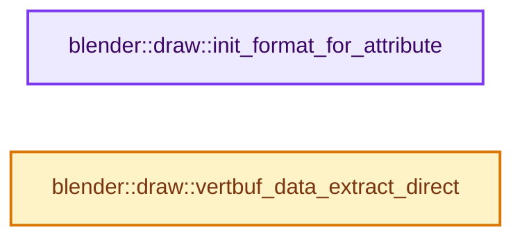

# 实现依赖专题：source/blender/draw/intern/attribute_convert.cc

[实现依赖导航](../../../README.md) · [符号索引](../../../../00-课程指南/02-源码与提交索引/符号依赖与实现索引.md)

本专题从正文实际调用进入，集中保存共享实现。函数有稳定锚点，可从调用处直接跳到对应完整函数；递归与互相调用通过回链组织。

## 本文件的实现关系




## 完整成员与函数实现

<a id="f-60f0d5be1794d46d"></a>

### `blender::draw::init_format_for_attribute`

实现位置：[source/blender/draw/intern/attribute_convert.cc](../../../../../../../../source/blender/draw/intern/attribute_convert.cc) · L19—L33。

接口参数：

- `const bke::AttrType data_type`
- `const StringRef vbo_name`

**教学注释版**

<!-- annotated:fb304224df8a65 -->

```cpp
GPUVertFormat init_format_for_attribute(const bke::AttrType data_type, const StringRef vbo_name)
{
  GPUVertFormat format{};
  bke::attribute_math::to_static_type(data_type, [&]<typename T>() {
    using Converter = AttributeConverter<T>;
    if constexpr (!std::is_void_v<typename Converter::VBOType>) {
      GPU_vertformat_attr_add_legacy(&format,
                                     vbo_name,
                                     Converter::gpu_component_type,
                                     Converter::gpu_component_len,
                                     Converter::gpu_fetch_mode);
    }
  });
  return format;
}
```

<details>
<summary>核对原始源码：source/blender/draw/intern/attribute_convert.cc · L19—L33</summary>

<!-- original:fb304224df8a65:source/blender/draw/intern/attribute_convert.cc:19:33 -->

```cpp
GPUVertFormat init_format_for_attribute(const bke::AttrType data_type, const StringRef vbo_name)
{
  GPUVertFormat format{};
  bke::attribute_math::to_static_type(data_type, [&]<typename T>() {
    using Converter = AttributeConverter<T>;
    if constexpr (!std::is_void_v<typename Converter::VBOType>) {
      GPU_vertformat_attr_add_legacy(&format,
                                     vbo_name,
                                     Converter::gpu_component_type,
                                     Converter::gpu_component_len,
                                     Converter::gpu_fetch_mode);
    }
  });
  return format;
}
```

</details>

**结果出口**

- `return format;`

**继续追踪实现**

- `bke::attribute_math::to_static_type` → [blender::bke::attribute_math::to_static_type · L35](../../../02-BKE几何与数据/BKE_attribute_math.hh.md#f-fdfaf0b86a24f278)；[blender::bke::attribute_math::to_static_type · L52](../../../02-BKE几何与数据/BKE_attribute_math.hh.md#f-5346ade4e816ebd6)。同名重载需按实参类型选择。
- `GPU_vertformat_attr_add_legacy` → [blender::GPU_vertformat_attr_add_legacy · L380](../../gpu/intern/gpu_vertex_format.cc.md#f-6ad9c5472902c65d)。

<a id="f-a98e2bf92cee2387"></a>

### `blender::draw::vertbuf_data_extract_direct`

实现位置：[source/blender/draw/intern/attribute_convert.cc](../../../../../../../../source/blender/draw/intern/attribute_convert.cc) · L35—L55。

接口参数：

- `const GSpan attribute`
- `gpu::VertBuf &vbo`

**教学注释版**

<!-- annotated:909f0d710f3af3 -->

```cpp
void vertbuf_data_extract_direct(const GSpan attribute, gpu::VertBuf &vbo)
{
  bke::attribute_math::to_static_type(attribute.type(), [&]<typename T>() {
    using Converter = AttributeConverter<T>;
    using VBOType = typename Converter::VBOType;
    if constexpr (!std::is_void_v<VBOType>) {
      const Span<T> src = attribute.typed<T>();
      MutableSpan<VBOType> data = vbo.data<VBOType>();
      if constexpr (std::is_same_v<T, VBOType>) {
        array_utils::copy(src, data);
      }
      else {
        // [讲解] src.index_range：查询视图长度或生成对应有效索引区间。
        threading::parallel_for(src.index_range(), 8192, [&](const IndexRange range) {
          for (const int i : range) {
            data[i] = Converter::convert(src[i]);
          }
        });
      }
    }
  });
}
```

<details>
<summary>核对原始源码：source/blender/draw/intern/attribute_convert.cc · L35—L55</summary>

<!-- original:909f0d710f3af3:source/blender/draw/intern/attribute_convert.cc:35:55 -->

```cpp
void vertbuf_data_extract_direct(const GSpan attribute, gpu::VertBuf &vbo)
{
  bke::attribute_math::to_static_type(attribute.type(), [&]<typename T>() {
    using Converter = AttributeConverter<T>;
    using VBOType = typename Converter::VBOType;
    if constexpr (!std::is_void_v<VBOType>) {
      const Span<T> src = attribute.typed<T>();
      MutableSpan<VBOType> data = vbo.data<VBOType>();
      if constexpr (std::is_same_v<T, VBOType>) {
        array_utils::copy(src, data);
      }
      else {
        threading::parallel_for(src.index_range(), 8192, [&](const IndexRange range) {
          for (const int i : range) {
            data[i] = Converter::convert(src[i]);
          }
        });
      }
    }
  });
}
```

</details>

**沿实际写入检查状态**

- `data[i] = Converter::convert(src[i]);`

**继续追踪实现**

- `bke::attribute_math::to_static_type` → [blender::bke::attribute_math::to_static_type · L35](../../../02-BKE几何与数据/BKE_attribute_math.hh.md#f-fdfaf0b86a24f278)；[blender::bke::attribute_math::to_static_type · L52](../../../02-BKE几何与数据/BKE_attribute_math.hh.md#f-5346ade4e816ebd6)。同名重载需按实参类型选择。
- `attribute.type` → [blender::GSpan::type · L55](../../../../03-内存分配与运行时类型/11-GSpan与GArray.md#f-4c44cc0364dcf191)。
- `attribute.typed<T>` → [blender::GSpan::typed · L92](../../../../03-内存分配与运行时类型/11-GSpan与GArray.md#f-aa54cf0d7a8dae2b)。
- `vbo.data<VBOType>` → [blender::gpu::VertBuf::data · L220](../../gpu/GPU_vertex_buffer.hh.md#f-e72412fdddda8bf5)。
- `array_utils::copy` → [blender::array_utils::copy · L54](../../../../01-基础容器与现代CPP/20-容器选择与独立实现.md#f-82e21acdac93f91c)；[blender::array_utils::copy · L72](../../../../01-基础容器与现代CPP/20-容器选择与独立实现.md#f-ee9c17de026a6c9a)；[blender::array_utils::copy · L98](../../../../01-基础容器与现代CPP/20-容器选择与独立实现.md#f-ec9fd099c7280717)；[blender::array_utils::copy · L27](../../../01-BLI基础库/intern/array_utils.cc.md#f-245f7c23437cf35f)；[blender::array_utils::copy · L43](../../../01-BLI基础库/intern/array_utils.cc.md#f-6170524934215b36)。同名重载需按实参类型选择。
- `threading::parallel_for` → [blender::threading::parallel_for · L68](../../../../11-Depsgraph与并行任务系统/07-任务池与TBB接入.md#f-838294754c24426c)。
- `src.index_range` → [blender::Span::index_range · L405](../../../../01-基础容器与现代CPP/05-Span只读连续视图.md#f-caaa9b06e13e53e0)。
- `Converter::convert` → [调用协议](../../../../00-课程指南/01-路线与规范/模板宏与动态分派协议.md)：函数指针、局部可调用对象或未展开的宏；必须结合调用者环境。调用位置L49。
