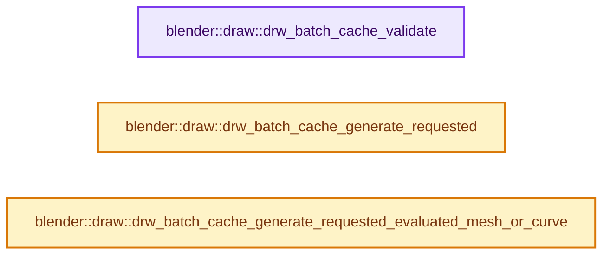
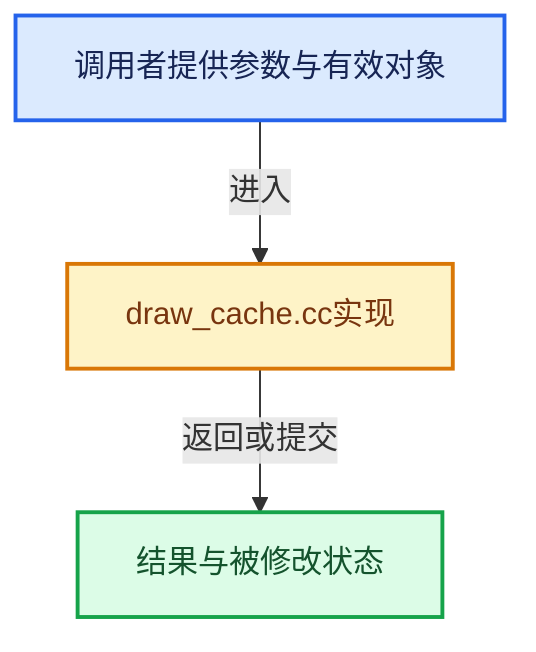

# 实现依赖专题：source/blender/draw/intern/draw_cache.cc

[实现依赖导航](../../../README.md) · [符号索引](../../../../00-课程指南/02-源码与提交索引/符号依赖与实现索引.md)

本专题从正文实际调用进入，集中保存共享实现。函数有稳定锚点，可从调用处直接跳到对应完整函数；递归与互相调用通过回链组织。

## 本文件的实现关系






## 完整成员与函数实现

<a id="f-40e2002417761f5f"></a>

### `blender::draw::drw_batch_cache_validate`

实现位置：[source/blender/draw/intern/draw_cache.cc](../../../../../../../../source/blender/draw/intern/draw_cache.cc) · L488—L517。

接口参数：

- `Object *ob`

**教学注释版**

<!-- annotated:7213c574fa618b -->

```cpp
void drw_batch_cache_validate(Object *ob)
{
  switch (ob->type) {
    case OB_MESH:
      DRW_mesh_batch_cache_validate(DRW_object_get_data_for_drawing<Mesh>(*ob));
      break;
    case OB_CURVES_LEGACY:
    case OB_FONT:
    case OB_SURF:
      DRW_curve_batch_cache_validate(&DRW_object_get_data_for_drawing<Curve>(*ob));
      break;
    case OB_LATTICE:
      DRW_lattice_batch_cache_validate(&DRW_object_get_data_for_drawing<Lattice>(*ob));
      break;
    case OB_CURVES:
      DRW_curves_batch_cache_validate(&DRW_object_get_data_for_drawing<Curves>(*ob));
      break;
    case OB_POINTCLOUD:
      DRW_pointcloud_batch_cache_validate(&DRW_object_get_data_for_drawing<PointCloud>(*ob));
      DRW_gsplat_batch_cache_validate(&DRW_object_get_data_for_drawing<PointCloud>(*ob));
      break;
    case OB_VOLUME:
      DRW_volume_batch_cache_validate(&DRW_object_get_data_for_drawing<Volume>(*ob));
      break;
    case OB_GREASE_PENCIL:
      DRW_grease_pencil_batch_cache_validate(&DRW_object_get_data_for_drawing<GreasePencil>(*ob));
    default:
      break;
  }
}
```

<details>
<summary>核对原始源码：source/blender/draw/intern/draw_cache.cc · L488—L517</summary>

<!-- original:7213c574fa618b:source/blender/draw/intern/draw_cache.cc:488:517 -->

```cpp
void drw_batch_cache_validate(Object *ob)
{
  switch (ob->type) {
    case OB_MESH:
      DRW_mesh_batch_cache_validate(DRW_object_get_data_for_drawing<Mesh>(*ob));
      break;
    case OB_CURVES_LEGACY:
    case OB_FONT:
    case OB_SURF:
      DRW_curve_batch_cache_validate(&DRW_object_get_data_for_drawing<Curve>(*ob));
      break;
    case OB_LATTICE:
      DRW_lattice_batch_cache_validate(&DRW_object_get_data_for_drawing<Lattice>(*ob));
      break;
    case OB_CURVES:
      DRW_curves_batch_cache_validate(&DRW_object_get_data_for_drawing<Curves>(*ob));
      break;
    case OB_POINTCLOUD:
      DRW_pointcloud_batch_cache_validate(&DRW_object_get_data_for_drawing<PointCloud>(*ob));
      DRW_gsplat_batch_cache_validate(&DRW_object_get_data_for_drawing<PointCloud>(*ob));
      break;
    case OB_VOLUME:
      DRW_volume_batch_cache_validate(&DRW_object_get_data_for_drawing<Volume>(*ob));
      break;
    case OB_GREASE_PENCIL:
      DRW_grease_pencil_batch_cache_validate(&DRW_object_get_data_for_drawing<GreasePencil>(*ob));
    default:
      break;
  }
}
```

</details>

**继续追踪实现**

- `DRW_mesh_batch_cache_validate` → [blender::draw::DRW_mesh_batch_cache_validate · L445](draw_cache_impl_mesh.cc.md#f-ad8b5318051b3b97)。
- `DRW_object_get_data_for_drawing<Mesh>` → [blender::DRW_object_get_data_for_drawing · L203](DRW_render.hh.md#f-dad88423243c219e)；[blender::DRW_object_get_data_for_drawing · L218](DRW_render.hh.md#f-223e280efbea59b2)。同名重载需按实参类型选择。
- `DRW_curve_batch_cache_validate` → [blender::draw::DRW_curve_batch_cache_validate · L384](draw_cache_impl_curve.cc.md#f-c060b8aad36a169e)。
- `DRW_object_get_data_for_drawing<Curve>` → [blender::DRW_object_get_data_for_drawing · L203](DRW_render.hh.md#f-dad88423243c219e)；[blender::DRW_object_get_data_for_drawing · L218](DRW_render.hh.md#f-223e280efbea59b2)。同名重载需按实参类型选择。
- `DRW_lattice_batch_cache_validate` → [blender::draw::DRW_lattice_batch_cache_validate · L263](draw_cache_impl_lattice.cc.md#f-71d22645cb658b2d)。
- `DRW_object_get_data_for_drawing<Lattice>` → [blender::DRW_object_get_data_for_drawing · L203](DRW_render.hh.md#f-dad88423243c219e)；[blender::DRW_object_get_data_for_drawing · L218](DRW_render.hh.md#f-223e280efbea59b2)。同名重载需按实参类型选择。
- `DRW_curves_batch_cache_validate` → [blender::draw::DRW_curves_batch_cache_validate · L965](draw_cache_impl_curves.cc.md#f-7547ef50cea9e650)。
- `DRW_object_get_data_for_drawing<Curves>` → [blender::DRW_object_get_data_for_drawing · L203](DRW_render.hh.md#f-dad88423243c219e)；[blender::DRW_object_get_data_for_drawing · L218](DRW_render.hh.md#f-223e280efbea59b2)。同名重载需按实参类型选择。
- `DRW_pointcloud_batch_cache_validate` → [blender::draw::DRW_pointcloud_batch_cache_validate · L177](draw_cache_impl_pointcloud.cc.md#f-febdf7fabe4289ca)。
- `DRW_object_get_data_for_drawing<PointCloud>` → [blender::DRW_object_get_data_for_drawing · L203](DRW_render.hh.md#f-dad88423243c219e)；[blender::DRW_object_get_data_for_drawing · L218](DRW_render.hh.md#f-223e280efbea59b2)。同名重载需按实参类型选择。
- `DRW_gsplat_batch_cache_validate` → [blender::draw::DRW_gsplat_batch_cache_validate · L622](draw_cache_impl_gsplat.cc.md#f-bcbfbff508fd8392)。
- `DRW_volume_batch_cache_validate` → [blender::draw::DRW_volume_batch_cache_validate · L84](draw_cache_impl_volume.cc.md#f-99cbbf4735f8b94a)。
- `DRW_object_get_data_for_drawing<Volume>` → [blender::DRW_object_get_data_for_drawing · L203](DRW_render.hh.md#f-dad88423243c219e)；[blender::DRW_object_get_data_for_drawing · L218](DRW_render.hh.md#f-223e280efbea59b2)。同名重载需按实参类型选择。
- `DRW_grease_pencil_batch_cache_validate` → [blender::draw::DRW_grease_pencil_batch_cache_validate · L1936](draw_cache_impl_grease_pencil.cc.md#f-cfc0fc20015f6e89)。
- `DRW_object_get_data_for_drawing<GreasePencil>` → [blender::DRW_object_get_data_for_drawing · L203](DRW_render.hh.md#f-dad88423243c219e)；[blender::DRW_object_get_data_for_drawing · L218](DRW_render.hh.md#f-223e280efbea59b2)。同名重载需按实参类型选择。

<a id="f-ec34504be619dc4c"></a>

### `blender::draw::drw_batch_cache_generate_requested`

实现位置：[source/blender/draw/intern/draw_cache.cc](../../../../../../../../source/blender/draw/intern/draw_cache.cc) · L519—L558。

接口参数：

- `Object *ob`
- `TaskGraph &task_graph`

**教学注释版**

<!-- annotated:3220a1b9e64301 -->

```cpp
void drw_batch_cache_generate_requested(Object *ob, TaskGraph &task_graph)
{
  const DRWContext *draw_ctx = DRW_context_get();
  const Scene *scene = draw_ctx->scene;
  const enum eContextObjectMode mode = CTX_data_mode_enum_ex(
      draw_ctx->object_edit, draw_ctx->obact, draw_ctx->object_mode);
  const bool is_paint_mode = ELEM(
      mode, CTX_MODE_SCULPT, CTX_MODE_PAINT_TEXTURE, CTX_MODE_PAINT_VERTEX, CTX_MODE_PAINT_WEIGHT);

  const bool use_hide = ((ob->type == OB_MESH) &&
                         ((is_paint_mode && (ob == draw_ctx->obact) &&
                           DRW_object_use_hide_faces(ob)) ||
                          ((mode == CTX_MODE_EDIT_MESH) && (ob->mode == OB_MODE_EDIT))));

  switch (ob->type) {
    case OB_MESH:
      DRW_mesh_batch_cache_create_requested(task_graph,
                                            *ob,
                                            DRW_object_get_data_for_drawing<Mesh>(*ob),
                                            *scene,
                                            is_paint_mode,
                                            use_hide);
      break;
    case OB_CURVES_LEGACY:
    case OB_FONT:
    case OB_SURF:
      DRW_curve_batch_cache_create_requested(ob, scene);
      break;
    case OB_CURVES:
      DRW_curves_batch_cache_create_requested(ob);
      break;
    case OB_POINTCLOUD:
      DRW_pointcloud_batch_cache_create_requested(ob);
      DRW_gsplat_batch_cache_create_requested(ob);
      break;
    /* TODO: all cases. */
    default:
      break;
  }
}
```

<details>
<summary>核对原始源码：source/blender/draw/intern/draw_cache.cc · L519—L558</summary>

<!-- original:3220a1b9e64301:source/blender/draw/intern/draw_cache.cc:519:558 -->

```cpp
void drw_batch_cache_generate_requested(Object *ob, TaskGraph &task_graph)
{
  const DRWContext *draw_ctx = DRW_context_get();
  const Scene *scene = draw_ctx->scene;
  const enum eContextObjectMode mode = CTX_data_mode_enum_ex(
      draw_ctx->object_edit, draw_ctx->obact, draw_ctx->object_mode);
  const bool is_paint_mode = ELEM(
      mode, CTX_MODE_SCULPT, CTX_MODE_PAINT_TEXTURE, CTX_MODE_PAINT_VERTEX, CTX_MODE_PAINT_WEIGHT);

  const bool use_hide = ((ob->type == OB_MESH) &&
                         ((is_paint_mode && (ob == draw_ctx->obact) &&
                           DRW_object_use_hide_faces(ob)) ||
                          ((mode == CTX_MODE_EDIT_MESH) && (ob->mode == OB_MODE_EDIT))));

  switch (ob->type) {
    case OB_MESH:
      DRW_mesh_batch_cache_create_requested(task_graph,
                                            *ob,
                                            DRW_object_get_data_for_drawing<Mesh>(*ob),
                                            *scene,
                                            is_paint_mode,
                                            use_hide);
      break;
    case OB_CURVES_LEGACY:
    case OB_FONT:
    case OB_SURF:
      DRW_curve_batch_cache_create_requested(ob, scene);
      break;
    case OB_CURVES:
      DRW_curves_batch_cache_create_requested(ob);
      break;
    case OB_POINTCLOUD:
      DRW_pointcloud_batch_cache_create_requested(ob);
      DRW_gsplat_batch_cache_create_requested(ob);
      break;
    /* TODO: all cases. */
    default:
      break;
  }
}
```

</details>

**继续追踪实现**

- `DRW_context_get` → [blender::DRW_context_get · L2437](draw_context.cc.md#f-98f4b7cf23aa98d9)。
- `CTX_data_mode_enum_ex` → [blender::CTX_data_mode_enum_ex · L1411](../../../02-BKE几何与数据/intern/context.cc.md#f-8634567d285b0df9)。
- `ELEM` → [ELEM · L88](../../../07-Intern运行时与平台/ghost/intern/GHOST_utildefines.hh.md#m-d28724a15928)；[ELEM · L135](../../../01-BLI基础库/BLI_utildefines.hh.md#m-d6572de7cae0)。宏定义由构建条件选择。
- `DRW_object_use_hide_faces` → [blender::DRW_object_use_hide_faces · L315](draw_context.cc.md#f-704dc6bb0eeff73e)。
- `DRW_mesh_batch_cache_create_requested` → [blender::draw::DRW_mesh_batch_cache_create_requested · L1092](draw_cache_impl_mesh.cc.md#f-9394ee482497f33f)。
- `DRW_object_get_data_for_drawing<Mesh>` → [blender::DRW_object_get_data_for_drawing · L203](DRW_render.hh.md#f-dad88423243c219e)；[blender::DRW_object_get_data_for_drawing · L218](DRW_render.hh.md#f-223e280efbea59b2)。同名重载需按实参类型选择。
- `DRW_curve_batch_cache_create_requested` → [blender::draw::DRW_curve_batch_cache_create_requested · L839](draw_cache_impl_curve.cc.md#f-b6f666965b4a01dd)。
- `DRW_curves_batch_cache_create_requested` → [blender::draw::DRW_curves_batch_cache_create_requested · L1081](draw_cache_impl_curves.cc.md#f-1107ba400e713eb5)。
- `DRW_pointcloud_batch_cache_create_requested` → [blender::draw::DRW_pointcloud_batch_cache_create_requested · L422](draw_cache_impl_pointcloud.cc.md#f-99e1d0424a81ef60)。
- `DRW_gsplat_batch_cache_create_requested` → [blender::draw::DRW_gsplat_batch_cache_create_requested · L597](draw_cache_impl_gsplat.cc.md#f-c42d1952a8e065ad)。

<a id="f-b7b60c8afd0ebfc9"></a>

### `blender::draw::drw_batch_cache_generate_requested_evaluated_mesh_or_curve`

实现位置：[source/blender/draw/intern/draw_cache.cc](../../../../../../../../source/blender/draw/intern/draw_cache.cc) · L560—L596。

接口参数：

- `Object *ob`
- `TaskGraph &task_graph`

**教学注释版**

<!-- annotated:17e98c6660c84e -->

```cpp
void drw_batch_cache_generate_requested_evaluated_mesh_or_curve(Object *ob, TaskGraph &task_graph)
{
  /* NOTE: Logic here is duplicated from #drw_batch_cache_generate_requested. */

  const DRWContext *draw_ctx = DRW_context_get();
  const Scene *scene = draw_ctx->scene;
  const enum eContextObjectMode mode = CTX_data_mode_enum_ex(
      draw_ctx->object_edit, draw_ctx->obact, draw_ctx->object_mode);
  const bool is_paint_mode = ELEM(
      mode, CTX_MODE_SCULPT, CTX_MODE_PAINT_TEXTURE, CTX_MODE_PAINT_VERTEX, CTX_MODE_PAINT_WEIGHT);

  if (ob->type == OB_MESH) {
    const bool use_hide = ((is_paint_mode && (ob == draw_ctx->obact) &&
                            DRW_object_use_hide_faces(ob)) ||
                           ((mode == CTX_MODE_EDIT_MESH) && (ob->mode == OB_MODE_EDIT)));
    if (Mesh *mesh = BKE_object_get_evaluated_mesh_no_subsurf_unchecked(ob)) {
      DRW_mesh_batch_cache_create_requested(
          task_graph, *ob, DRW_mesh_get_for_drawing(*mesh), *scene, is_paint_mode, use_hide);
    }
  }
  else if (Mesh *mesh = BKE_object_get_evaluated_mesh_no_subsurf_unchecked(ob)) {
    /* Legacy curve objects can have evaluated mesh data while the original object is still a curve
     * in edit mode (see #156971). #DRW_mesh_batch_cache_create_requested expects the object to
     * match the mesh data and to be in object mode for non-edit mesh extraction, so use a shallow
     * temporary mesh object for drawing. */
    bke::ObjectRuntime tmp_runtime = *ob->runtime;
    Object tmp_object = dna::shallow_copy(*ob);
    tmp_object.runtime = &tmp_runtime;
    tmp_object.mode = OB_MODE_OBJECT;
    BKE_object_replace_data_on_shallow_copy(&tmp_object, &mesh->id);
    DRW_mesh_batch_cache_create_requested(
        task_graph, tmp_object, DRW_mesh_get_for_drawing(*mesh), *scene, is_paint_mode, false);
  }
  else if (ELEM(ob->type, OB_CURVES_LEGACY, OB_FONT, OB_SURF)) {
    DRW_curve_batch_cache_create_requested(ob, scene);
  }
}
```

<details>
<summary>核对原始源码：source/blender/draw/intern/draw_cache.cc · L560—L596</summary>

<!-- original:17e98c6660c84e:source/blender/draw/intern/draw_cache.cc:560:596 -->

```cpp
void drw_batch_cache_generate_requested_evaluated_mesh_or_curve(Object *ob, TaskGraph &task_graph)
{
  /* NOTE: Logic here is duplicated from #drw_batch_cache_generate_requested. */

  const DRWContext *draw_ctx = DRW_context_get();
  const Scene *scene = draw_ctx->scene;
  const enum eContextObjectMode mode = CTX_data_mode_enum_ex(
      draw_ctx->object_edit, draw_ctx->obact, draw_ctx->object_mode);
  const bool is_paint_mode = ELEM(
      mode, CTX_MODE_SCULPT, CTX_MODE_PAINT_TEXTURE, CTX_MODE_PAINT_VERTEX, CTX_MODE_PAINT_WEIGHT);

  if (ob->type == OB_MESH) {
    const bool use_hide = ((is_paint_mode && (ob == draw_ctx->obact) &&
                            DRW_object_use_hide_faces(ob)) ||
                           ((mode == CTX_MODE_EDIT_MESH) && (ob->mode == OB_MODE_EDIT)));
    if (Mesh *mesh = BKE_object_get_evaluated_mesh_no_subsurf_unchecked(ob)) {
      DRW_mesh_batch_cache_create_requested(
          task_graph, *ob, DRW_mesh_get_for_drawing(*mesh), *scene, is_paint_mode, use_hide);
    }
  }
  else if (Mesh *mesh = BKE_object_get_evaluated_mesh_no_subsurf_unchecked(ob)) {
    /* Legacy curve objects can have evaluated mesh data while the original object is still a curve
     * in edit mode (see #156971). #DRW_mesh_batch_cache_create_requested expects the object to
     * match the mesh data and to be in object mode for non-edit mesh extraction, so use a shallow
     * temporary mesh object for drawing. */
    bke::ObjectRuntime tmp_runtime = *ob->runtime;
    Object tmp_object = dna::shallow_copy(*ob);
    tmp_object.runtime = &tmp_runtime;
    tmp_object.mode = OB_MODE_OBJECT;
    BKE_object_replace_data_on_shallow_copy(&tmp_object, &mesh->id);
    DRW_mesh_batch_cache_create_requested(
        task_graph, tmp_object, DRW_mesh_get_for_drawing(*mesh), *scene, is_paint_mode, false);
  }
  else if (ELEM(ob->type, OB_CURVES_LEGACY, OB_FONT, OB_SURF)) {
    DRW_curve_batch_cache_create_requested(ob, scene);
  }
}
```

</details>

**沿实际写入检查状态**

- `tmp_object.runtime = &tmp_runtime;`
- `tmp_object.mode = OB_MODE_OBJECT;`

**继续追踪实现**

- `DRW_context_get` → [blender::DRW_context_get · L2437](draw_context.cc.md#f-98f4b7cf23aa98d9)。
- `CTX_data_mode_enum_ex` → [blender::CTX_data_mode_enum_ex · L1411](../../../02-BKE几何与数据/intern/context.cc.md#f-8634567d285b0df9)。
- `ELEM` → [ELEM · L88](../../../07-Intern运行时与平台/ghost/intern/GHOST_utildefines.hh.md#m-d28724a15928)；[ELEM · L135](../../../01-BLI基础库/BLI_utildefines.hh.md#m-d6572de7cae0)。宏定义由构建条件选择。
- `DRW_object_use_hide_faces` → [blender::DRW_object_use_hide_faces · L315](draw_context.cc.md#f-704dc6bb0eeff73e)。
- `BKE_object_get_evaluated_mesh_no_subsurf_unchecked` → [blender::BKE_object_get_evaluated_mesh_no_subsurf_unchecked · L4392](../../../02-BKE几何与数据/intern/object.cc.md#f-d6935c107c24d6fc)。
- `DRW_mesh_batch_cache_create_requested` → [blender::draw::DRW_mesh_batch_cache_create_requested · L1092](draw_cache_impl_mesh.cc.md#f-9394ee482497f33f)。
- `DRW_mesh_get_for_drawing` → [blender::DRW_mesh_get_for_drawing · L208](DRW_render.hh.md#f-6a3f1053c13a5cef)。
- `dna::shallow_copy` → [blender::dna::shallow_copy · L146](../../makesdna/DNA_defs.h.md#f-84b6eda95a1c994c)。
- `BKE_object_replace_data_on_shallow_copy` → [blender::BKE_object_replace_data_on_shallow_copy · L5748](../../../02-BKE几何与数据/intern/object.cc.md#f-6b828c6b95e6f2e2)。
- `DRW_curve_batch_cache_create_requested` → [blender::draw::DRW_curve_batch_cache_create_requested · L839](draw_cache_impl_curve.cc.md#f-b6f666965b4a01dd)。
