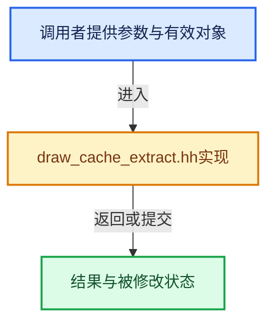

# 实现依赖专题：source/blender/draw/intern/draw_cache_extract.hh

[实现依赖导航](../../../README.md) · [符号索引](../../../../00-课程指南/02-源码与提交索引/符号依赖与实现索引.md)

本专题从正文实际调用进入，集中保存共享实现。函数有稳定锚点，可从调用处直接跳到对应完整函数；递归与互相调用通过回链组织。

## 本文件的实现关系





## 相关类型布局与成员入口

<a id="t-351ea4e35cf6"></a>

### `blender::ToolSettings`

原始声明：[source/blender/draw/intern/draw_cache_extract.hh](../../../../../../../../source/blender/draw/intern/draw_cache_extract.hh) · L35—L35。

以下保留类的数据声明与编译条件，成员函数实现通过后面的精确链接阅读。

<!-- annotated:d7f07db2f56b9a -->

```cpp
struct ToolSettings;
```

<details>
<summary>核对原始源码：source/blender/draw/intern/draw_cache_extract.hh · L35—L35</summary>

<!-- original:d7f07db2f56b9a:source/blender/draw/intern/draw_cache_extract.hh:35:35 -->

```cpp
struct ToolSettings;
```

</details>


<a id="t-10d0af769649"></a>

### `blender::draw::VBOType`

原始声明：[source/blender/draw/intern/draw_cache_extract.hh](../../../../../../../../source/blender/draw/intern/draw_cache_extract.hh) · L75—L116。

以下保留类的数据声明与编译条件，成员函数实现通过后面的精确链接阅读。

<!-- annotated:990cbb2bd60619 -->

```cpp
enum class VBOType : int8_t {
  Position,
  CornerNormal,
  EdgeFactor,
  VertexGroupWeight,
  UVs,
  Tangents,
  SculptData,
  Orco,
  EditData,
  EditUVData,
  EditUVStretchArea,
  EditUVStretchAngle,
  MeshAnalysis,
  FaceDotPosition,
  FaceDotNormal,
  FaceDotUV,
  FaceDotEditUVData,
  SkinRoots,
  IndexVert,
  IndexEdge,
  IndexFace,
  IndexFaceDot,
  Attr0,
  Attr1,
  Attr2,
  Attr3,
  Attr5,
  Attr6,
  Attr7,
  Attr8,
  Attr9,
  Attr10,
  Attr11,
  Attr12,
  Attr13,
  Attr14,
  Attr15,
  AttrViewer,
  VertexNormal,
  PaintOverlayFlag,
};
```

<details>
<summary>核对原始源码：source/blender/draw/intern/draw_cache_extract.hh · L75—L116</summary>

<!-- original:990cbb2bd60619:source/blender/draw/intern/draw_cache_extract.hh:75:116 -->

```cpp
enum class VBOType : int8_t {
  Position,
  CornerNormal,
  EdgeFactor,
  VertexGroupWeight,
  UVs,
  Tangents,
  SculptData,
  Orco,
  EditData,
  EditUVData,
  EditUVStretchArea,
  EditUVStretchAngle,
  MeshAnalysis,
  FaceDotPosition,
  FaceDotNormal,
  FaceDotUV,
  FaceDotEditUVData,
  SkinRoots,
  IndexVert,
  IndexEdge,
  IndexFace,
  IndexFaceDot,
  Attr0,
  Attr1,
  Attr2,
  Attr3,
  Attr5,
  Attr6,
  Attr7,
  Attr8,
  Attr9,
  Attr10,
  Attr11,
  Attr12,
  Attr13,
  Attr14,
  Attr15,
  AttrViewer,
  VertexNormal,
  PaintOverlayFlag,
};
```

</details>


<a id="t-0b6fb9d8bce5"></a>

### `blender::draw::DRWBatchFlag`

原始声明：[source/blender/draw/intern/draw_cache_extract.hh](../../../../../../../../source/blender/draw/intern/draw_cache_extract.hh) · L200—L236。

以下保留类的数据声明与编译条件，成员函数实现通过后面的精确链接阅读。

<!-- annotated:109c42b628b3ab -->

```cpp
enum DRWBatchFlag : uint64_t {
  MBC_SURFACE = (1u << MBC_BATCH_INDEX(surface)),
  MBC_SURFACE_WEIGHTS = (1u << MBC_BATCH_INDEX(surface_weights)),
  MBC_EDIT_TRIANGLES = (1u << MBC_BATCH_INDEX(edit_triangles)),
  MBC_EDIT_VERTICES = (1u << MBC_BATCH_INDEX(edit_vertices)),
  MBC_EDIT_EDGES = (1u << MBC_BATCH_INDEX(edit_edges)),
  MBC_EDIT_VNOR = (1u << MBC_BATCH_INDEX(edit_vnor)),
  MBC_EDIT_LNOR = (1u << MBC_BATCH_INDEX(edit_lnor)),
  MBC_EDIT_FACEDOTS = (1u << MBC_BATCH_INDEX(edit_fdots)),
  MBC_EDIT_MESH_ANALYSIS = (1u << MBC_BATCH_INDEX(edit_mesh_analysis)),
  MBC_SKIN_ROOTS = (1u << MBC_BATCH_INDEX(edit_skin_roots)),
  MBC_UV_FACES = (1u << MBC_BATCH_INDEX(uv_faces)),
  MBC_EDITUV_FACES_STRETCH_AREA = (1u << MBC_BATCH_INDEX(edituv_faces_stretch_area)),
  MBC_EDITUV_FACES_STRETCH_ANGLE = (1u << MBC_BATCH_INDEX(edituv_faces_stretch_angle)),
  MBC_EDITUV_FACES = (1u << MBC_BATCH_INDEX(edituv_faces)),
  MBC_EDITUV_EDGES = (1u << MBC_BATCH_INDEX(edituv_edges)),
  MBC_EDITUV_VERTS = (1u << MBC_BATCH_INDEX(edituv_verts)),
  MBC_EDITUV_FACEDOTS = (1u << MBC_BATCH_INDEX(edituv_fdots)),
  MBC_EDIT_SELECTION_VERTS = (1u << MBC_BATCH_INDEX(edit_selection_verts)),
  MBC_EDIT_SELECTION_EDGES = (1u << MBC_BATCH_INDEX(edit_selection_edges)),
  MBC_EDIT_SELECTION_FACES = (1u << MBC_BATCH_INDEX(edit_selection_faces)),
  MBC_EDIT_SELECTION_FACEDOTS = (1u << MBC_BATCH_INDEX(edit_selection_fdots)),
  MBC_ALL_VERTS = (1u << MBC_BATCH_INDEX(all_verts)),
  MBC_ALL_EDGES = (1u << MBC_BATCH_INDEX(all_edges)),
  MBC_LOOSE_EDGES = (1u << MBC_BATCH_INDEX(loose_edges)),
  MBC_EDGE_DETECTION = (1u << MBC_BATCH_INDEX(edge_detection)),
  MBC_WIRE_EDGES = (1u << MBC_BATCH_INDEX(wire_edges)),
  MBC_PAINT_OVERLAY_WIRE_LOOPS = (1u << MBC_BATCH_INDEX(paint_overlay_wire_loops)),
  MBC_WIRE_LOOPS_ALL_UVS = (1u << MBC_BATCH_INDEX(wire_loops_all_uvs)),
  MBC_WIRE_LOOPS_UVS = (1u << MBC_BATCH_INDEX(wire_loops_uvs)),
  MBC_WIRE_LOOPS_EDITUVS = (1u << MBC_BATCH_INDEX(wire_loops_edituvs)),
  MBC_SCULPT_OVERLAYS = (1u << MBC_BATCH_INDEX(sculpt_overlays)),
  MBC_VIEWER_ATTRIBUTE_OVERLAY = (1u << MBC_BATCH_INDEX(surface_viewer_attribute)),
  MBC_PAINT_OVERLAY_VERTS = (uint64_t(1u) << MBC_BATCH_INDEX(paint_overlay_verts)),
  MBC_PAINT_OVERLAY_SURFACE = (uint64_t(1u) << MBC_BATCH_INDEX(paint_overlay_surface)),
  MBC_SURFACE_PER_MAT = (uint64_t(1u) << MBC_BATCH_LEN),
};
```

<details>
<summary>核对原始源码：source/blender/draw/intern/draw_cache_extract.hh · L200—L236</summary>

<!-- original:109c42b628b3ab:source/blender/draw/intern/draw_cache_extract.hh:200:236 -->

```cpp
enum DRWBatchFlag : uint64_t {
  MBC_SURFACE = (1u << MBC_BATCH_INDEX(surface)),
  MBC_SURFACE_WEIGHTS = (1u << MBC_BATCH_INDEX(surface_weights)),
  MBC_EDIT_TRIANGLES = (1u << MBC_BATCH_INDEX(edit_triangles)),
  MBC_EDIT_VERTICES = (1u << MBC_BATCH_INDEX(edit_vertices)),
  MBC_EDIT_EDGES = (1u << MBC_BATCH_INDEX(edit_edges)),
  MBC_EDIT_VNOR = (1u << MBC_BATCH_INDEX(edit_vnor)),
  MBC_EDIT_LNOR = (1u << MBC_BATCH_INDEX(edit_lnor)),
  MBC_EDIT_FACEDOTS = (1u << MBC_BATCH_INDEX(edit_fdots)),
  MBC_EDIT_MESH_ANALYSIS = (1u << MBC_BATCH_INDEX(edit_mesh_analysis)),
  MBC_SKIN_ROOTS = (1u << MBC_BATCH_INDEX(edit_skin_roots)),
  MBC_UV_FACES = (1u << MBC_BATCH_INDEX(uv_faces)),
  MBC_EDITUV_FACES_STRETCH_AREA = (1u << MBC_BATCH_INDEX(edituv_faces_stretch_area)),
  MBC_EDITUV_FACES_STRETCH_ANGLE = (1u << MBC_BATCH_INDEX(edituv_faces_stretch_angle)),
  MBC_EDITUV_FACES = (1u << MBC_BATCH_INDEX(edituv_faces)),
  MBC_EDITUV_EDGES = (1u << MBC_BATCH_INDEX(edituv_edges)),
  MBC_EDITUV_VERTS = (1u << MBC_BATCH_INDEX(edituv_verts)),
  MBC_EDITUV_FACEDOTS = (1u << MBC_BATCH_INDEX(edituv_fdots)),
  MBC_EDIT_SELECTION_VERTS = (1u << MBC_BATCH_INDEX(edit_selection_verts)),
  MBC_EDIT_SELECTION_EDGES = (1u << MBC_BATCH_INDEX(edit_selection_edges)),
  MBC_EDIT_SELECTION_FACES = (1u << MBC_BATCH_INDEX(edit_selection_faces)),
  MBC_EDIT_SELECTION_FACEDOTS = (1u << MBC_BATCH_INDEX(edit_selection_fdots)),
  MBC_ALL_VERTS = (1u << MBC_BATCH_INDEX(all_verts)),
  MBC_ALL_EDGES = (1u << MBC_BATCH_INDEX(all_edges)),
  MBC_LOOSE_EDGES = (1u << MBC_BATCH_INDEX(loose_edges)),
  MBC_EDGE_DETECTION = (1u << MBC_BATCH_INDEX(edge_detection)),
  MBC_WIRE_EDGES = (1u << MBC_BATCH_INDEX(wire_edges)),
  MBC_PAINT_OVERLAY_WIRE_LOOPS = (1u << MBC_BATCH_INDEX(paint_overlay_wire_loops)),
  MBC_WIRE_LOOPS_ALL_UVS = (1u << MBC_BATCH_INDEX(wire_loops_all_uvs)),
  MBC_WIRE_LOOPS_UVS = (1u << MBC_BATCH_INDEX(wire_loops_uvs)),
  MBC_WIRE_LOOPS_EDITUVS = (1u << MBC_BATCH_INDEX(wire_loops_edituvs)),
  MBC_SCULPT_OVERLAYS = (1u << MBC_BATCH_INDEX(sculpt_overlays)),
  MBC_VIEWER_ATTRIBUTE_OVERLAY = (1u << MBC_BATCH_INDEX(surface_viewer_attribute)),
  MBC_PAINT_OVERLAY_VERTS = (uint64_t(1u) << MBC_BATCH_INDEX(paint_overlay_verts)),
  MBC_PAINT_OVERLAY_SURFACE = (uint64_t(1u) << MBC_BATCH_INDEX(paint_overlay_surface)),
  MBC_SURFACE_PER_MAT = (uint64_t(1u) << MBC_BATCH_LEN),
};
```

</details>


## 完整成员与函数实现
