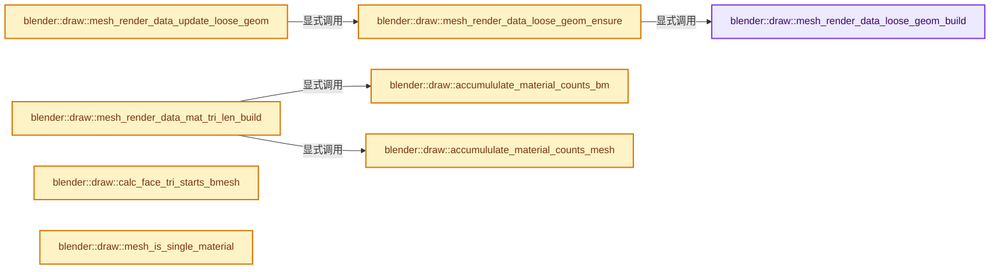
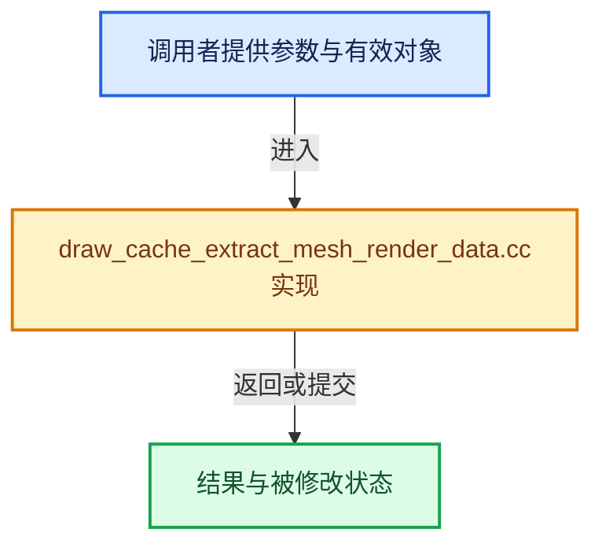

# 实现依赖专题：source/blender/draw/intern/draw_cache_extract_mesh_render_data.cc

[实现依赖导航](../../../README.md) · [符号索引](../../../../00-课程指南/02-源码与提交索引/符号依赖与实现索引.md)

本专题从正文实际调用进入，集中保存共享实现。函数有稳定锚点，可从调用处直接跳到对应完整函数；递归与互相调用通过回链组织。

## 本文件的实现关系






## 完整成员与函数实现

<a id="f-60e10a7e68d05e48"></a>

### `blender::draw::mesh_render_data_loose_geom_build`

实现位置：[source/blender/draw/intern/draw_cache_extract_mesh_render_data.cc](../../../../../../../../source/blender/draw/intern/draw_cache_extract_mesh_render_data.cc) · L38—L57。

接口参数：

- `const MeshRenderData &mr`
- `MeshBufferCache &cache`

**教学注释版**

<!-- annotated:1fc560aaf6c1b2 -->

```cpp
static void mesh_render_data_loose_geom_build(const MeshRenderData &mr, MeshBufferCache &cache)
{
  if (mr.extract_type == MeshExtractType::Mesh) {
    cache.loose_geom.verts = mr.mesh->loose_verts();
    cache.loose_geom.edges = mr.mesh->loose_edges();
  }
  else {
    BMesh &bm = *mr.bm;
    /* Use LinearAllocator instead of IndexMaskMemory to avoid over-allocation. */
    // [讲解] std::make_unique<LinearAllocator<>>：创建独占拥有的对象，拥有关系可移动，get返回的借用指针不自动延长寿命。
    cache.loose_geom.allocator = std::make_unique<LinearAllocator<>>();
    cache.loose_geom.verts = IndexMask::from_predicate(
        IndexRange(bm.totvert), *cache.loose_geom.allocator, [&](const int i) {
          return BM_vert_at_index(&bm, i)->e == nullptr;
        });
    cache.loose_geom.edges = IndexMask::from_predicate(
        IndexRange(bm.totedge), *cache.loose_geom.allocator, [&](const int i) {
          return BM_edge_at_index(&bm, i)->l == nullptr;
        });
  }
}
```

<details>
<summary>核对原始源码：source/blender/draw/intern/draw_cache_extract_mesh_render_data.cc · L38—L57</summary>

<!-- original:1fc560aaf6c1b2:source/blender/draw/intern/draw_cache_extract_mesh_render_data.cc:38:57 -->

```cpp
static void mesh_render_data_loose_geom_build(const MeshRenderData &mr, MeshBufferCache &cache)
{
  if (mr.extract_type == MeshExtractType::Mesh) {
    cache.loose_geom.verts = mr.mesh->loose_verts();
    cache.loose_geom.edges = mr.mesh->loose_edges();
  }
  else {
    BMesh &bm = *mr.bm;
    /* Use LinearAllocator instead of IndexMaskMemory to avoid over-allocation. */
    cache.loose_geom.allocator = std::make_unique<LinearAllocator<>>();
    cache.loose_geom.verts = IndexMask::from_predicate(
        IndexRange(bm.totvert), *cache.loose_geom.allocator, [&](const int i) {
          return BM_vert_at_index(&bm, i)->e == nullptr;
        });
    cache.loose_geom.edges = IndexMask::from_predicate(
        IndexRange(bm.totedge), *cache.loose_geom.allocator, [&](const int i) {
          return BM_edge_at_index(&bm, i)->l == nullptr;
        });
  }
}
```

</details>

**沿实际写入检查状态**

- `cache.loose_geom.verts = mr.mesh->loose_verts();`
- `cache.loose_geom.edges = mr.mesh->loose_edges();`
- `cache.loose_geom.allocator = std::make_unique<LinearAllocator<>>();`
- `cache.loose_geom.verts = IndexMask::from_predicate(`
- `cache.loose_geom.edges = IndexMask::from_predicate(`

**结果出口**

- `return BM_vert_at_index(&bm, i)->e == nullptr;`
- `return BM_edge_at_index(&bm, i)->l == nullptr;`

**继续追踪实现**

- `mr.mesh->loose_verts` → [调用协议](../../../../00-课程指南/01-路线与规范/模板宏与动态分派协议.md)：接收对象类型依赖auto、返回值或模板实例；不按同名猜测目标。调用位置L41。
- `mr.mesh->loose_edges` → [调用协议](../../../../00-课程指南/01-路线与规范/模板宏与动态分派协议.md)：接收对象类型依赖auto、返回值或模板实例；不按同名猜测目标。调用位置L42。
- `std::make_unique<LinearAllocator<>>` → [外部契约](https://eel.is/c++draft/unique.ptr.create)：创建独占拥有的对象，拥有关系可移动，get返回的借用指针不自动延长寿命。
- `IndexMask::from_predicate` → [blender::index_mask::IndexMask::from_predicate · L1073](../../../../04-虚拟数组与索引选择/12-重构历史与基准练习.md#f-3864daa059098df8)。
- `IndexRange` → [blender::IndexRange](../../../01-BLI基础库/BLI_index_range.hh.md#t-caa3466d6776)；[blender::gpu::shader::parser::IndexRange](../../gpu/shader_tool/utils.hh.md#t-82d2bd4ea71c)；[blender::IndexRange](../../makesdna/DNA_node_types.h.md#t-0448cc889d39)。
- `BM_vert_at_index` → [blender::BM_vert_at_index · L110](../../bmesh/intern/bmesh_mesh.hh.md#f-aced0ebcd417a2f4)。
- `BM_edge_at_index` → [blender::BM_edge_at_index · L116](../../bmesh/intern/bmesh_mesh.hh.md#f-81d027fd9e6b4c84)。

<a id="f-c51ee143bab610f3"></a>

### `blender::draw::mesh_render_data_loose_geom_ensure`

实现位置：[source/blender/draw/intern/draw_cache_extract_mesh_render_data.cc](../../../../../../../../source/blender/draw/intern/draw_cache_extract_mesh_render_data.cc) · L59—L67。

接口参数：

- `const MeshRenderData &mr`
- `MeshBufferCache &cache`

**教学注释版**

<!-- annotated:809f039498a971 -->

```cpp
static void mesh_render_data_loose_geom_ensure(const MeshRenderData &mr, MeshBufferCache &cache)
{
  /* Early exit: Are loose geometry already available.
   * Only checking for loose verts as loose edges and verts are calculated at the same time. */
  if (!cache.loose_geom.verts.is_empty()) {
    return;
  }
  mesh_render_data_loose_geom_build(mr, cache);
}
```

<details>
<summary>核对原始源码：source/blender/draw/intern/draw_cache_extract_mesh_render_data.cc · L59—L67</summary>

<!-- original:809f039498a971:source/blender/draw/intern/draw_cache_extract_mesh_render_data.cc:59:67 -->

```cpp
static void mesh_render_data_loose_geom_ensure(const MeshRenderData &mr, MeshBufferCache &cache)
{
  /* Early exit: Are loose geometry already available.
   * Only checking for loose verts as loose edges and verts are calculated at the same time. */
  if (!cache.loose_geom.verts.is_empty()) {
    return;
  }
  mesh_render_data_loose_geom_build(mr, cache);
}
```

</details>

**继续追踪实现**

- `cache.loose_geom.verts.is_empty` → [调用协议](../../../../00-课程指南/01-路线与规范/模板宏与动态分派协议.md)：接收对象类型依赖auto、返回值或模板实例；不按同名猜测目标。调用位置L63。
- `mesh_render_data_loose_geom_build` → [blender::draw::mesh_render_data_loose_geom_build · L38](draw_cache_extract_mesh_render_data.cc.md#f-60e10a7e68d05e48)。

<a id="f-1d7a1b07420f3053"></a>

### `blender::draw::mesh_render_data_update_loose_geom`

实现位置：[source/blender/draw/intern/draw_cache_extract_mesh_render_data.cc](../../../../../../../../source/blender/draw/intern/draw_cache_extract_mesh_render_data.cc) · L69—L78。

接口参数：

- `MeshRenderData &mr`
- `MeshBufferCache &cache`

**教学注释版**

<!-- annotated:b27b34cc3a32e7 -->

```cpp
void mesh_render_data_update_loose_geom(MeshRenderData &mr, MeshBufferCache &cache)
{
  mesh_render_data_loose_geom_ensure(mr, cache);
  mr.loose_edges = cache.loose_geom.edges;
  mr.loose_verts = cache.loose_geom.verts;
  mr.loose_verts_num = cache.loose_geom.verts.size();
  mr.loose_edges_num = cache.loose_geom.edges.size();

  mr.loose_indices_num = mr.loose_verts_num + (mr.loose_edges_num * 2);
}
```

<details>
<summary>核对原始源码：source/blender/draw/intern/draw_cache_extract_mesh_render_data.cc · L69—L78</summary>

<!-- original:b27b34cc3a32e7:source/blender/draw/intern/draw_cache_extract_mesh_render_data.cc:69:78 -->

```cpp
void mesh_render_data_update_loose_geom(MeshRenderData &mr, MeshBufferCache &cache)
{
  mesh_render_data_loose_geom_ensure(mr, cache);
  mr.loose_edges = cache.loose_geom.edges;
  mr.loose_verts = cache.loose_geom.verts;
  mr.loose_verts_num = cache.loose_geom.verts.size();
  mr.loose_edges_num = cache.loose_geom.edges.size();

  mr.loose_indices_num = mr.loose_verts_num + (mr.loose_edges_num * 2);
}
```

</details>

**沿实际写入检查状态**

- `mr.loose_edges = cache.loose_geom.edges;`
- `mr.loose_verts = cache.loose_geom.verts;`
- `mr.loose_verts_num = cache.loose_geom.verts.size();`
- `mr.loose_edges_num = cache.loose_geom.edges.size();`
- `mr.loose_indices_num = mr.loose_verts_num + (mr.loose_edges_num * 2);`

**继续追踪实现**

- `mesh_render_data_loose_geom_ensure` → [blender::draw::mesh_render_data_loose_geom_ensure · L59](draw_cache_extract_mesh_render_data.cc.md#f-c51ee143bab610f3)。
- `cache.loose_geom.verts.size` → [调用协议](../../../../00-课程指南/01-路线与规范/模板宏与动态分派协议.md)：接收对象类型依赖auto、返回值或模板实例；不按同名猜测目标。调用位置L74。
- `cache.loose_geom.edges.size` → [调用协议](../../../../00-课程指南/01-路线与规范/模板宏与动态分派协议.md)：接收对象类型依赖auto、返回值或模板实例；不按同名猜测目标。调用位置L75。

<a id="f-d64b81721497ba04"></a>

### `blender::draw::accumululate_material_counts_bm`

实现位置：[source/blender/draw/intern/draw_cache_extract_mesh_render_data.cc](../../../../../../../../source/blender/draw/intern/draw_cache_extract_mesh_render_data.cc) · L88—L102。

接口参数：

- `const BMesh &bm`
- `threading::EnumerableThreadSpecific<Array<int>> &all_tri_counts`

**教学注释版**

<!-- annotated:6cefd8c5c412ac -->

```cpp
static void accumululate_material_counts_bm(
    const BMesh &bm, threading::EnumerableThreadSpecific<Array<int>> &all_tri_counts)
{
  threading::parallel_for(IndexRange(bm.totface), 1024, [&](const IndexRange range) {
    Array<int> &tri_counts = all_tri_counts.local();
    // [讲解] tri_counts.size：查询固定有效长度及其索引范围。
    const short last_index = tri_counts.size() - 1;
    for (const int i : range) {
      const BMFace &face = *BM_face_at_index(&const_cast<BMesh &>(bm), i);
      if (!BM_elem_flag_test(&face, BM_ELEM_HIDDEN)) {
        const short mat = std::clamp<short>(face.mat_nr, 0, last_index);
        tri_counts[mat] += face.len - 2;
      }
    }
  });
}
```

<details>
<summary>核对原始源码：source/blender/draw/intern/draw_cache_extract_mesh_render_data.cc · L88—L102</summary>

<!-- original:6cefd8c5c412ac:source/blender/draw/intern/draw_cache_extract_mesh_render_data.cc:88:102 -->

```cpp
static void accumululate_material_counts_bm(
    const BMesh &bm, threading::EnumerableThreadSpecific<Array<int>> &all_tri_counts)
{
  threading::parallel_for(IndexRange(bm.totface), 1024, [&](const IndexRange range) {
    Array<int> &tri_counts = all_tri_counts.local();
    const short last_index = tri_counts.size() - 1;
    for (const int i : range) {
      const BMFace &face = *BM_face_at_index(&const_cast<BMesh &>(bm), i);
      if (!BM_elem_flag_test(&face, BM_ELEM_HIDDEN)) {
        const short mat = std::clamp<short>(face.mat_nr, 0, last_index);
        tri_counts[mat] += face.len - 2;
      }
    }
  });
}
```

</details>

**沿实际写入检查状态**

- `tri_counts[mat] += face.len - 2;`

**继续追踪实现**

- `threading::parallel_for` → [blender::threading::parallel_for · L68](../../../../11-Depsgraph与并行任务系统/07-任务池与TBB接入.md#f-838294754c24426c)。
- `IndexRange` → [blender::IndexRange](../../../01-BLI基础库/BLI_index_range.hh.md#t-caa3466d6776)；[blender::gpu::shader::parser::IndexRange](../../gpu/shader_tool/utils.hh.md#t-82d2bd4ea71c)；[blender::IndexRange](../../makesdna/DNA_node_types.h.md#t-0448cc889d39)。
- `all_tri_counts.local` → [blender::threading::EnumerableThreadSpecific::local · L51](../../../01-BLI基础库/BLI_enumerable_thread_specific.hh.md#f-38c6c32570e94c93)；[blender::threading::EnumerableThreadSpecific::local · L87](../../../01-BLI基础库/BLI_enumerable_thread_specific.hh.md#f-3c8975467b7a35ba)。同名重载需按实参类型选择。
- `tri_counts.size` → [blender::Array::size · L267](../../../../01-基础容器与现代CPP/08-Array复制移动与销毁.md#f-c13f1b5a44f423b2)。
- `BM_face_at_index` → [blender::BM_face_at_index · L122](../../bmesh/intern/bmesh_mesh.hh.md#f-366df62c166d5094)。
- `BM_elem_flag_test` → [BM_elem_flag_test · L21](../../bmesh/intern/bmesh_inline.hh.md#m-2431d1179b41)。宏定义由构建条件选择。
- `std::clamp<short>` → [外部契约](https://eel.is/c++draft/)：这个边界按实际表达式及所属类型核对参数、返回值、寿命与失败行为。这里提供接口入口，不声称已解释该第三方版本的内部实现。

<a id="f-3b0718275895bd20"></a>

### `blender::draw::accumululate_material_counts_mesh`

实现位置：[source/blender/draw/intern/draw_cache_extract_mesh_render_data.cc](../../../../../../../../source/blender/draw/intern/draw_cache_extract_mesh_render_data.cc) · L104—L150。

接口参数：

- `const MeshRenderData &mr`
- `threading::EnumerableThreadSpecific<Array<int>> &all_tri_counts`

**教学注释版**

<!-- annotated:5a569d35752ea0 -->

```cpp
static void accumululate_material_counts_mesh(
    const MeshRenderData &mr, threading::EnumerableThreadSpecific<Array<int>> &all_tri_counts)
{
  const OffsetIndices faces = mr.faces;
  const Span<bool> hide_poly = mr.hide_poly;
  const Span material_indices = mr.material_indices;
  // [讲解] material_indices.is_empty：查询视图长度或生成对应有效索引区间。
  if (material_indices.is_empty()) {
    if (!hide_poly.is_empty()) {
      all_tri_counts.local().first() = threading::parallel_reduce(
          faces.index_range(),
          4096,
          0,
          [&](const IndexRange range, int count) {
            for (const int face : range) {
              if (!hide_poly[face]) {
                count += bke::mesh::face_triangles_num(faces[face].size());
              }
            }
            return count;
          },
          std::plus<>());
    }
    else {
      all_tri_counts.local().first() = poly_to_tri_count(mr.faces_num, mr.corners_num);
    }
    return;
  }

  // [讲解] material_indices.index_range：查询视图长度或生成对应有效索引区间。
  threading::parallel_for(material_indices.index_range(), 1024, [&](const IndexRange range) {
    Array<int> &tri_counts = all_tri_counts.local();
    // [讲解] tri_counts.size：查询固定有效长度及其索引范围。
    const int last_index = tri_counts.size() - 1;
    if (!hide_poly.is_empty()) {
      for (const int i : range) {
        if (!hide_poly[i]) {
          const int mat = std::clamp(material_indices[i], 0, last_index);
          tri_counts[mat] += bke::mesh::face_triangles_num(faces[i].size());
        }
      }
    }
    else {
      for (const int i : range) {
        const int mat = std::clamp(material_indices[i], 0, last_index);
        tri_counts[mat] += bke::mesh::face_triangles_num(faces[i].size());
      }
    }
  });
}
```

<details>
<summary>核对原始源码：source/blender/draw/intern/draw_cache_extract_mesh_render_data.cc · L104—L150</summary>

<!-- original:5a569d35752ea0:source/blender/draw/intern/draw_cache_extract_mesh_render_data.cc:104:150 -->

```cpp
static void accumululate_material_counts_mesh(
    const MeshRenderData &mr, threading::EnumerableThreadSpecific<Array<int>> &all_tri_counts)
{
  const OffsetIndices faces = mr.faces;
  const Span<bool> hide_poly = mr.hide_poly;
  const Span material_indices = mr.material_indices;
  if (material_indices.is_empty()) {
    if (!hide_poly.is_empty()) {
      all_tri_counts.local().first() = threading::parallel_reduce(
          faces.index_range(),
          4096,
          0,
          [&](const IndexRange range, int count) {
            for (const int face : range) {
              if (!hide_poly[face]) {
                count += bke::mesh::face_triangles_num(faces[face].size());
              }
            }
            return count;
          },
          std::plus<>());
    }
    else {
      all_tri_counts.local().first() = poly_to_tri_count(mr.faces_num, mr.corners_num);
    }
    return;
  }

  threading::parallel_for(material_indices.index_range(), 1024, [&](const IndexRange range) {
    Array<int> &tri_counts = all_tri_counts.local();
    const int last_index = tri_counts.size() - 1;
    if (!hide_poly.is_empty()) {
      for (const int i : range) {
        if (!hide_poly[i]) {
          const int mat = std::clamp(material_indices[i], 0, last_index);
          tri_counts[mat] += bke::mesh::face_triangles_num(faces[i].size());
        }
      }
    }
    else {
      for (const int i : range) {
        const int mat = std::clamp(material_indices[i], 0, last_index);
        tri_counts[mat] += bke::mesh::face_triangles_num(faces[i].size());
      }
    }
  });
}
```

</details>

**沿实际写入检查状态**

- `count += bke::mesh::face_triangles_num(faces[face].size());`
- `tri_counts[mat] += bke::mesh::face_triangles_num(faces[i].size());`

**结果出口**

- `return count;`

**继续追踪实现**

- `material_indices.is_empty` → [blender::Span::is_empty · L264](../../../../01-基础容器与现代CPP/05-Span只读连续视图.md#f-8cc1d7ba8feb50e6)。
- `hide_poly.is_empty` → [blender::Span::is_empty · L264](../../../../01-基础容器与现代CPP/05-Span只读连续视图.md#f-8cc1d7ba8feb50e6)。
- `all_tri_counts.local().first` → [调用协议](../../../../00-课程指南/01-路线与规范/模板宏与动态分派协议.md)：接收对象类型依赖auto、返回值或模板实例；不按同名猜测目标。调用位置L112。
- `all_tri_counts.local` → [blender::threading::EnumerableThreadSpecific::local · L51](../../../01-BLI基础库/BLI_enumerable_thread_specific.hh.md#f-38c6c32570e94c93)；[blender::threading::EnumerableThreadSpecific::local · L87](../../../01-BLI基础库/BLI_enumerable_thread_specific.hh.md#f-3c8975467b7a35ba)。同名重载需按实参类型选择。
- `threading::parallel_reduce` → [blender::threading::parallel_reduce · L126](../../../../11-Depsgraph与并行任务系统/07-任务池与TBB接入.md#f-9225ddb5efb97fcc)。
- `faces.index_range` → [blender::offset_indices::OffsetIndices::index_range · L77](../../../../05-几何存储与拓扑映射/02-OffsetIndices完整接口.md#f-19b5ca1456de007d)。
- `bke::mesh::face_triangles_num` → [blender::bke::mesh::face_triangles_num · L350](../../../../05-几何存储与拓扑映射/01-Mesh顶点边面角点.md#f-720b4d927730b800)。
- `faces[face].size` → [调用协议](../../../../00-课程指南/01-路线与规范/模板宏与动态分派协议.md)：接收对象类型依赖auto、返回值或模板实例；不按同名猜测目标。调用位置L119。
- `std::plus<>` → [外部契约](https://eel.is/c++draft/)：这个边界按实际表达式及所属类型核对参数、返回值、寿命与失败行为。这里提供接口入口，不声称已解释该第三方版本的内部实现。
- `poly_to_tri_count` → [调用协议](../../../../00-课程指南/01-路线与规范/模板宏与动态分派协议.md)：函数指针、局部可调用对象或未展开的宏；必须结合调用者环境。调用位置L127。
- `threading::parallel_for` → [blender::threading::parallel_for · L68](../../../../11-Depsgraph与并行任务系统/07-任务池与TBB接入.md#f-838294754c24426c)。
- `material_indices.index_range` → [blender::Span::index_range · L405](../../../../01-基础容器与现代CPP/05-Span只读连续视图.md#f-caaa9b06e13e53e0)。
- `tri_counts.size` → [blender::Array::size · L267](../../../../01-基础容器与现代CPP/08-Array复制移动与销毁.md#f-c13f1b5a44f423b2)。
- `std::clamp` → [外部契约](https://eel.is/c++draft/)：这个边界按实际表达式及所属类型核对参数、返回值、寿命与失败行为。这里提供接口入口，不声称已解释该第三方版本的内部实现。
- `faces[i].size` → [调用协议](../../../../00-课程指南/01-路线与规范/模板宏与动态分派协议.md)：接收对象类型依赖auto、返回值或模板实例；不按同名猜测目标。调用位置L139。

<a id="f-39f6427f316e3366"></a>

### `blender::draw::mesh_render_data_mat_tri_len_build`

实现位置：[source/blender/draw/intern/draw_cache_extract_mesh_render_data.cc](../../../../../../../../source/blender/draw/intern/draw_cache_extract_mesh_render_data.cc) · L153—L174。

接口参数：

- `const MeshRenderData &mr`

**教学注释版**

<!-- annotated:61022958296af9 -->

```cpp
static Array<int> mesh_render_data_mat_tri_len_build(const MeshRenderData &mr)
{
  threading::EnumerableThreadSpecific<Array<int>> all_tri_counts(
      [&]() { return Array<int>(mr.materials_num, 0); });

  if (mr.extract_type == MeshExtractType::BMesh) {
    accumululate_material_counts_bm(*mr.bm, all_tri_counts);
  }
  else {
    accumululate_material_counts_mesh(mr, all_tri_counts);
  }

  Array<int> &tris_num_by_material = all_tri_counts.local();
  for (const Array<int> &counts : all_tri_counts) {
    if (&counts != &tris_num_by_material) {
      // [讲解] tris_num_by_material.index_range：查询固定有效长度及其索引范围。
      for (const int i : tris_num_by_material.index_range()) {
        tris_num_by_material[i] += counts[i];
      }
    }
  }
  // [讲解] std::move：把表达式转换成可供移动重载选择的值类别；不保证真的移动，不结束源对象寿命，对const值可能选择复制。
  return std::move(tris_num_by_material);
}
```

<details>
<summary>核对原始源码：source/blender/draw/intern/draw_cache_extract_mesh_render_data.cc · L153—L174</summary>

<!-- original:61022958296af9:source/blender/draw/intern/draw_cache_extract_mesh_render_data.cc:153:174 -->

```cpp
static Array<int> mesh_render_data_mat_tri_len_build(const MeshRenderData &mr)
{
  threading::EnumerableThreadSpecific<Array<int>> all_tri_counts(
      [&]() { return Array<int>(mr.materials_num, 0); });

  if (mr.extract_type == MeshExtractType::BMesh) {
    accumululate_material_counts_bm(*mr.bm, all_tri_counts);
  }
  else {
    accumululate_material_counts_mesh(mr, all_tri_counts);
  }

  Array<int> &tris_num_by_material = all_tri_counts.local();
  for (const Array<int> &counts : all_tri_counts) {
    if (&counts != &tris_num_by_material) {
      for (const int i : tris_num_by_material.index_range()) {
        tris_num_by_material[i] += counts[i];
      }
    }
  }
  return std::move(tris_num_by_material);
}
```

</details>

**沿实际写入检查状态**

- `tris_num_by_material[i] += counts[i];`

**结果出口**

- `return std::move(tris_num_by_material);`

**继续追踪实现**

- `Array<int>` → [blender::Array::Array · L78](../../../../01-基础容器与现代CPP/07-Array构造与存储.md#f-001fd5eb3c658238)；[blender::Array::Array · L84](../../../../01-基础容器与现代CPP/07-Array构造与存储.md#f-674e2f10361a462b)；[blender::Array::Array · L89](../../../../01-基础容器与现代CPP/07-Array构造与存储.md#f-aa1e5908a9b67557)；[blender::Array::Array · L103](../../../../01-基础容器与现代CPP/07-Array构造与存储.md#f-b141be39084346f3)；[blender::Array::Array · L110](../../../../01-基础容器与现代CPP/07-Array构造与存储.md#f-452e276f39e81a2a)；[blender::Array::Array · L123](../../../../01-基础容器与现代CPP/07-Array构造与存储.md#f-646aa58152ec44f6)；[blender::Array::Array · L135](../../../../01-基础容器与现代CPP/07-Array构造与存储.md#f-0a9de4a549125f99)；[blender::Array::Array · L168](../../../../01-基础容器与现代CPP/07-Array构造与存储.md#f-31f001eb92069e9d)；[blender::Array::Array · L176](../../../../01-基础容器与现代CPP/07-Array构造与存储.md#f-cf8148f06fc6747a)；[blender::Array::Array · L178](../../../../01-基础容器与现代CPP/07-Array构造与存储.md#f-2ddca2fb9dd964b3)。同名重载需按实参类型选择。
- `accumululate_material_counts_bm` → [blender::draw::accumululate_material_counts_bm · L88](draw_cache_extract_mesh_render_data.cc.md#f-d64b81721497ba04)。
- `accumululate_material_counts_mesh` → [blender::draw::accumululate_material_counts_mesh · L104](draw_cache_extract_mesh_render_data.cc.md#f-3b0718275895bd20)。
- `all_tri_counts.local` → [blender::threading::EnumerableThreadSpecific::local · L51](../../../01-BLI基础库/BLI_enumerable_thread_specific.hh.md#f-38c6c32570e94c93)；[blender::threading::EnumerableThreadSpecific::local · L87](../../../01-BLI基础库/BLI_enumerable_thread_specific.hh.md#f-3c8975467b7a35ba)。同名重载需按实参类型选择。
- `tris_num_by_material.index_range` → [blender::Array::index_range · L371](../../../../01-基础容器与现代CPP/08-Array复制移动与销毁.md#f-50a09e14742887a0)。
- `std::move` → [外部契约](https://eel.is/c++draft/utility.forward)：把表达式转换成可供移动重载选择的值类别；不保证真的移动，不结束源对象寿命，对const值可能选择复制。

<a id="f-50b2f10133cb8a8f"></a>

### `blender::draw::calc_face_tri_starts_bmesh`

实现位置：[source/blender/draw/intern/draw_cache_extract_mesh_render_data.cc](../../../../../../../../source/blender/draw/intern/draw_cache_extract_mesh_render_data.cc) · L176—L199。

接口参数：

- `const MeshRenderData &mr`
- `MutableSpan<int> material_tri_starts`

**教学注释版**

<!-- annotated:81e133d7ed0c39 -->

```cpp
static Array<int> calc_face_tri_starts_bmesh(const MeshRenderData &mr,
                                             MutableSpan<int> material_tri_starts)
{
  BMesh &bm = *mr.bm;
  Array<int> face_tri_offsets(bm.totface);
#ifndef NDEBUG
  // [讲解] face_tri_offsets.fill：对现有元素赋同一个值。
  face_tri_offsets.fill(-1);
#endif

  const int mat_last = mr.materials_num - 1;
  BMIter iter;
  BMFace *face;
  int i;
  BM_ITER_MESH_INDEX (face, &iter, &bm, BM_FACES_OF_MESH, i) {
    if (BM_elem_flag_test(face, BM_ELEM_HIDDEN)) {
      continue;
    }
    const int mat = std::clamp(int(face->mat_nr), 0, mat_last);
    face_tri_offsets[i] = material_tri_starts[mat];
    material_tri_starts[mat] += face->len - 2;
  }

  return face_tri_offsets;
}
```

<details>
<summary>核对原始源码：source/blender/draw/intern/draw_cache_extract_mesh_render_data.cc · L176—L199</summary>

<!-- original:81e133d7ed0c39:source/blender/draw/intern/draw_cache_extract_mesh_render_data.cc:176:199 -->

```cpp
static Array<int> calc_face_tri_starts_bmesh(const MeshRenderData &mr,
                                             MutableSpan<int> material_tri_starts)
{
  BMesh &bm = *mr.bm;
  Array<int> face_tri_offsets(bm.totface);
#ifndef NDEBUG
  face_tri_offsets.fill(-1);
#endif

  const int mat_last = mr.materials_num - 1;
  BMIter iter;
  BMFace *face;
  int i;
  BM_ITER_MESH_INDEX (face, &iter, &bm, BM_FACES_OF_MESH, i) {
    if (BM_elem_flag_test(face, BM_ELEM_HIDDEN)) {
      continue;
    }
    const int mat = std::clamp(int(face->mat_nr), 0, mat_last);
    face_tri_offsets[i] = material_tri_starts[mat];
    material_tri_starts[mat] += face->len - 2;
  }

  return face_tri_offsets;
}
```

</details>

**沿实际写入检查状态**

- `face_tri_offsets[i] = material_tri_starts[mat];`
- `material_tri_starts[mat] += face->len - 2;`

**结果出口**

- `return face_tri_offsets;`

**继续追踪实现**

- `face_tri_offsets.fill` → [blender::Array::fill · L283](../../../../01-基础容器与现代CPP/08-Array复制移动与销毁.md#f-7c4a16a0c445ca41)。
- `BM_ITER_MESH_INDEX` → [BM_ITER_MESH_INDEX · L76](../../bmesh/intern/bmesh_iterators.hh.md#m-6a0cac4538f9)。宏定义由构建条件选择。
- `BM_elem_flag_test` → [BM_elem_flag_test · L21](../../bmesh/intern/bmesh_inline.hh.md#m-2431d1179b41)。宏定义由构建条件选择。
- `std::clamp` → [外部契约](https://eel.is/c++draft/)：这个边界按实际表达式及所属类型核对参数、返回值、寿命与失败行为。这里提供接口入口，不声称已解释该第三方版本的内部实现。

<a id="f-bafc71f2e2967c0c"></a>

### `blender::draw::mesh_is_single_material`

实现位置：[source/blender/draw/intern/draw_cache_extract_mesh_render_data.cc](../../../../../../../../source/blender/draw/intern/draw_cache_extract_mesh_render_data.cc) · L201—L208。

接口参数：

- `const OffsetIndices<int> material_tri_starts`

**教学注释版**

<!-- annotated:31d77065d3c2ea -->

```cpp
static bool mesh_is_single_material(const OffsetIndices<int> material_tri_starts)
{
  const int used_materials = std::count_if(
      material_tri_starts.index_range().begin(),
      material_tri_starts.index_range().end(),
      [&](const int i) { return material_tri_starts[i].size() > 0; });
  return used_materials == 1;
}
```

<details>
<summary>核对原始源码：source/blender/draw/intern/draw_cache_extract_mesh_render_data.cc · L201—L208</summary>

<!-- original:31d77065d3c2ea:source/blender/draw/intern/draw_cache_extract_mesh_render_data.cc:201:208 -->

```cpp
static bool mesh_is_single_material(const OffsetIndices<int> material_tri_starts)
{
  const int used_materials = std::count_if(
      material_tri_starts.index_range().begin(),
      material_tri_starts.index_range().end(),
      [&](const int i) { return material_tri_starts[i].size() > 0; });
  return used_materials == 1;
}
```

</details>

**结果出口**

- `return used_materials == 1;`

**继续追踪实现**

- `std::count_if` → [外部契约](https://eel.is/c++draft/)：这个边界按实际表达式及所属类型核对参数、返回值、寿命与失败行为。这里提供接口入口，不声称已解释该第三方版本的内部实现。
- `material_tri_starts.index_range().begin` → [调用协议](../../../../00-课程指南/01-路线与规范/模板宏与动态分派协议.md)：接收对象类型依赖auto、返回值或模板实例；不按同名猜测目标。调用位置L204。
- `material_tri_starts.index_range` → [blender::offset_indices::OffsetIndices::index_range · L77](../../../../05-几何存储与拓扑映射/02-OffsetIndices完整接口.md#f-19b5ca1456de007d)。
- `material_tri_starts.index_range().end` → [调用协议](../../../../00-课程指南/01-路线与规范/模板宏与动态分派协议.md)：接收对象类型依赖auto、返回值或模板实例；不按同名猜测目标。调用位置L205。
- `material_tri_starts[i].size` → [调用协议](../../../../00-课程指南/01-路线与规范/模板宏与动态分派协议.md)：接收对象类型依赖auto、返回值或模板实例；不按同名猜测目标。调用位置L206。

<a id="f-2e04f6323d02dd54"></a>

### `blender::draw::calc_face_tri_starts_mesh`

实现位置：[source/blender/draw/intern/draw_cache_extract_mesh_render_data.cc](../../../../../../../../source/blender/draw/intern/draw_cache_extract_mesh_render_data.cc) · L210—L250。

接口参数：

- `const MeshRenderData &mr`
- `MutableSpan<int> material_tri_starts`

**教学注释版**

<!-- annotated:a6dc4351a0cf4c -->

```cpp
static std::optional<Array<int>> calc_face_tri_starts_mesh(const MeshRenderData &mr,
                                                           MutableSpan<int> material_tri_starts)
{
  const bool single_material = mesh_is_single_material(material_tri_starts.as_span());
  if (single_material && mr.hide_poly.is_empty()) {
    return std::nullopt;
  }

  const OffsetIndices faces = mr.faces;
  const Span<bool> hide_poly = mr.hide_poly;

  // [讲解] faces.size：读取连续区间或分组的边界信息。
  Array<int> face_tri_offsets(faces.size());
#ifndef NDEBUG
  // [讲解] face_tri_offsets.fill：对现有元素赋同一个值。
  face_tri_offsets.fill(-1);
#endif

  if (single_material) {
    int offset = 0;
    for (const int face : faces.index_range()) {
      if (hide_poly[face]) {
        continue;
      }
      face_tri_offsets[face] = offset;
      offset += bke::mesh::face_triangles_num(faces[face].size());
    }
    return face_tri_offsets;
  }

  const Span<int> material_indices = mr.material_indices;
  const int mat_last = mr.materials_num - 1;
  for (const int face : faces.index_range()) {
    // [讲解] hide_poly.is_empty：查询视图长度或生成对应有效索引区间。
    if (!hide_poly.is_empty() && hide_poly[face]) {
      continue;
    }
    const int mat = std::clamp(material_indices[face], 0, mat_last);
    face_tri_offsets[face] = material_tri_starts[mat];
    material_tri_starts[mat] += bke::mesh::face_triangles_num(faces[face].size());
  }

  return face_tri_offsets;
}
```

<details>
<summary>核对原始源码：source/blender/draw/intern/draw_cache_extract_mesh_render_data.cc · L210—L250</summary>

<!-- original:a6dc4351a0cf4c:source/blender/draw/intern/draw_cache_extract_mesh_render_data.cc:210:250 -->

```cpp
static std::optional<Array<int>> calc_face_tri_starts_mesh(const MeshRenderData &mr,
                                                           MutableSpan<int> material_tri_starts)
{
  const bool single_material = mesh_is_single_material(material_tri_starts.as_span());
  if (single_material && mr.hide_poly.is_empty()) {
    return std::nullopt;
  }

  const OffsetIndices faces = mr.faces;
  const Span<bool> hide_poly = mr.hide_poly;

  Array<int> face_tri_offsets(faces.size());
#ifndef NDEBUG
  face_tri_offsets.fill(-1);
#endif

  if (single_material) {
    int offset = 0;
    for (const int face : faces.index_range()) {
      if (hide_poly[face]) {
        continue;
      }
      face_tri_offsets[face] = offset;
      offset += bke::mesh::face_triangles_num(faces[face].size());
    }
    return face_tri_offsets;
  }

  const Span<int> material_indices = mr.material_indices;
  const int mat_last = mr.materials_num - 1;
  for (const int face : faces.index_range()) {
    if (!hide_poly.is_empty() && hide_poly[face]) {
      continue;
    }
    const int mat = std::clamp(material_indices[face], 0, mat_last);
    face_tri_offsets[face] = material_tri_starts[mat];
    material_tri_starts[mat] += bke::mesh::face_triangles_num(faces[face].size());
  }

  return face_tri_offsets;
}
```

</details>

**沿实际写入检查状态**

- `face_tri_offsets[face] = offset;`
- `offset += bke::mesh::face_triangles_num(faces[face].size());`
- `face_tri_offsets[face] = material_tri_starts[mat];`
- `material_tri_starts[mat] += bke::mesh::face_triangles_num(faces[face].size());`

**结果出口**

- `return std::nullopt;`
- `return face_tri_offsets;`

**继续追踪实现**

- `mesh_is_single_material` → [blender::draw::mesh_is_single_material · L201](draw_cache_extract_mesh_render_data.cc.md#f-bafc71f2e2967c0c)。
- `material_tri_starts.as_span` → [blender::MutableSpan::as_span · L667](../../../../01-基础容器与现代CPP/06-MutableSpan可写视图.md#f-d0c35de0cfb9761e)。
- `mr.hide_poly.is_empty` → [调用协议](../../../../00-课程指南/01-路线与规范/模板宏与动态分派协议.md)：接收对象类型依赖auto、返回值或模板实例；不按同名猜测目标。调用位置L214。
- `faces.size` → [blender::offset_indices::OffsetIndices::size · L67](../../../../05-几何存储与拓扑映射/02-OffsetIndices完整接口.md#f-e238abc62ed42abd)。
- `face_tri_offsets.fill` → [blender::Array::fill · L283](../../../../01-基础容器与现代CPP/08-Array复制移动与销毁.md#f-7c4a16a0c445ca41)。
- `faces.index_range` → [blender::offset_indices::OffsetIndices::index_range · L77](../../../../05-几何存储与拓扑映射/02-OffsetIndices完整接口.md#f-19b5ca1456de007d)。
- `bke::mesh::face_triangles_num` → [blender::bke::mesh::face_triangles_num · L350](../../../../05-几何存储与拓扑映射/01-Mesh顶点边面角点.md#f-720b4d927730b800)。
- `faces[face].size` → [调用协议](../../../../00-课程指南/01-路线与规范/模板宏与动态分派协议.md)：接收对象类型依赖auto、返回值或模板实例；不按同名猜测目标。调用位置L233。
- `hide_poly.is_empty` → [blender::Span::is_empty · L264](../../../../01-基础容器与现代CPP/05-Span只读连续视图.md#f-8cc1d7ba8feb50e6)。
- `std::clamp` → [外部契约](https://eel.is/c++draft/)：这个边界按实际表达式及所属类型核对参数、返回值、寿命与失败行为。这里提供接口入口，不声称已解释该第三方版本的内部实现。

<a id="f-2d4eb4d75da38153"></a>

### `blender::draw::mesh_render_data_faces_sorted_build`

实现位置：[source/blender/draw/intern/draw_cache_extract_mesh_render_data.cc](../../../../../../../../source/blender/draw/intern/draw_cache_extract_mesh_render_data.cc) · L252—L271。

接口参数：

- `const MeshRenderData &mr`

**教学注释版**

<!-- annotated:7791f00791bb30 -->

```cpp
static SortedFaceData mesh_render_data_faces_sorted_build(const MeshRenderData &mr)
{
  SortedFaceData cache;
  cache.tris_num_by_material = mesh_render_data_mat_tri_len_build(mr);
  const Span<int> tris_num_by_material = cache.tris_num_by_material;

  Array<int, 32> material_tri_starts(mr.materials_num + 1);
  // [讲解] material_tri_starts.as_mutable_span：提供数组的借用访问入口。
  material_tri_starts.as_mutable_span().drop_back(1).copy_from(tris_num_by_material);
  offset_indices::accumulate_counts_to_offsets(material_tri_starts);
  cache.visible_tris_num = material_tri_starts.last();

  /* Sort per material. */
  if (mr.extract_type == MeshExtractType::BMesh) {
    cache.face_tri_offsets = calc_face_tri_starts_bmesh(mr, material_tri_starts);
  }
  else {
    cache.face_tri_offsets = calc_face_tri_starts_mesh(mr, material_tri_starts);
  }
  return cache;
}
```

<details>
<summary>核对原始源码：source/blender/draw/intern/draw_cache_extract_mesh_render_data.cc · L252—L271</summary>

<!-- original:7791f00791bb30:source/blender/draw/intern/draw_cache_extract_mesh_render_data.cc:252:271 -->

```cpp
static SortedFaceData mesh_render_data_faces_sorted_build(const MeshRenderData &mr)
{
  SortedFaceData cache;
  cache.tris_num_by_material = mesh_render_data_mat_tri_len_build(mr);
  const Span<int> tris_num_by_material = cache.tris_num_by_material;

  Array<int, 32> material_tri_starts(mr.materials_num + 1);
  material_tri_starts.as_mutable_span().drop_back(1).copy_from(tris_num_by_material);
  offset_indices::accumulate_counts_to_offsets(material_tri_starts);
  cache.visible_tris_num = material_tri_starts.last();

  /* Sort per material. */
  if (mr.extract_type == MeshExtractType::BMesh) {
    cache.face_tri_offsets = calc_face_tri_starts_bmesh(mr, material_tri_starts);
  }
  else {
    cache.face_tri_offsets = calc_face_tri_starts_mesh(mr, material_tri_starts);
  }
  return cache;
}
```

</details>

**沿实际写入检查状态**

- `cache.tris_num_by_material = mesh_render_data_mat_tri_len_build(mr);`
- `cache.visible_tris_num = material_tri_starts.last();`
- `cache.face_tri_offsets = calc_face_tri_starts_bmesh(mr, material_tri_starts);`
- `cache.face_tri_offsets = calc_face_tri_starts_mesh(mr, material_tri_starts);`

**结果出口**

- `return cache;`

**继续追踪实现**

- `mesh_render_data_mat_tri_len_build` → [blender::draw::mesh_render_data_mat_tri_len_build · L153](draw_cache_extract_mesh_render_data.cc.md#f-39f6427f316e3366)。
- `material_tri_starts.as_mutable_span().drop_back(1).copy_from` → [调用协议](../../../../00-课程指南/01-路线与规范/模板宏与动态分派协议.md)：接收对象类型依赖auto、返回值或模板实例；不按同名猜测目标。调用位置L259。
- `material_tri_starts.as_mutable_span().drop_back` → [调用协议](../../../../00-课程指南/01-路线与规范/模板宏与动态分派协议.md)：接收对象类型依赖auto、返回值或模板实例；不按同名猜测目标。调用位置L259。
- `material_tri_starts.as_mutable_span` → [blender::Array::as_mutable_span · L259](../../../../01-基础容器与现代CPP/08-Array复制移动与销毁.md#f-4e91de9f1337c144)。
- `offset_indices::accumulate_counts_to_offsets` → [blender::offset_indices::accumulate_counts_to_offsets · L24](../../../../05-几何存储与拓扑映射/05-邻接关系与前缀和.md#f-cfa9fbd186afcdd5)。
- `material_tri_starts.last` → [blender::Array::last · L307](../../../../01-基础容器与现代CPP/08-Array复制移动与销毁.md#f-022e4eec5e52edfe)；[blender::Array::last · L313](../../../../01-基础容器与现代CPP/08-Array复制移动与销毁.md#f-5026b1478e15b195)。同名重载需按实参类型选择。
- `calc_face_tri_starts_bmesh` → [blender::draw::calc_face_tri_starts_bmesh · L176](draw_cache_extract_mesh_render_data.cc.md#f-50b2f10133cb8a8f)。
- `calc_face_tri_starts_mesh` → [blender::draw::calc_face_tri_starts_mesh · L210](draw_cache_extract_mesh_render_data.cc.md#f-2e04f6323d02dd54)。

<a id="f-d0c1fc4fd8e71230"></a>

### `blender::draw::mesh_render_data_faces_sorted_ensure`

实现位置：[source/blender/draw/intern/draw_cache_extract_mesh_render_data.cc](../../../../../../../../source/blender/draw/intern/draw_cache_extract_mesh_render_data.cc) · L273—L280。

接口参数：

- `const MeshRenderData &mr`
- `MeshBufferCache &cache`

**教学注释版**

<!-- annotated:e2fb166667f334 -->

```cpp
const SortedFaceData &mesh_render_data_faces_sorted_ensure(const MeshRenderData &mr,
                                                           MeshBufferCache &cache)
{
  if (cache.face_sorted.visible_tris_num == 0) {
    cache.face_sorted = mesh_render_data_faces_sorted_build(mr);
  }
  return cache.face_sorted;
}
```

<details>
<summary>核对原始源码：source/blender/draw/intern/draw_cache_extract_mesh_render_data.cc · L273—L280</summary>

<!-- original:e2fb166667f334:source/blender/draw/intern/draw_cache_extract_mesh_render_data.cc:273:280 -->

```cpp
const SortedFaceData &mesh_render_data_faces_sorted_ensure(const MeshRenderData &mr,
                                                           MeshBufferCache &cache)
{
  if (cache.face_sorted.visible_tris_num == 0) {
    cache.face_sorted = mesh_render_data_faces_sorted_build(mr);
  }
  return cache.face_sorted;
}
```

</details>

**沿实际写入检查状态**

- `cache.face_sorted = mesh_render_data_faces_sorted_build(mr);`

**结果出口**

- `return cache.face_sorted;`

**继续追踪实现**

- `mesh_render_data_faces_sorted_build` → [blender::draw::mesh_render_data_faces_sorted_build · L252](draw_cache_extract_mesh_render_data.cc.md#f-2d4eb4d75da38153)。

<a id="f-cc597e57ed76c336"></a>

### `blender::draw::bmesh_normals_domain`

实现位置：[source/blender/draw/intern/draw_cache_extract_mesh_render_data.cc](../../../../../../../../source/blender/draw/intern/draw_cache_extract_mesh_render_data.cc) · L302—L346。

接口参数：

- `BMesh *bm`

**教学注释版**

<!-- annotated:fd32379450722f -->

```cpp
static bke::MeshNormalDomain bmesh_normals_domain(BMesh *bm)
{
  if (bm->totface == 0) {
    return bke::MeshNormalDomain::Point;
  }

  if (CustomData_has_layer_named(&bm->vdata, CD_PROP_FLOAT3, "custom_normal")) {
    return bke::MeshNormalDomain::Point;
  }
  if (CustomData_has_layer_named(&bm->pdata, CD_PROP_FLOAT3, "custom_normal")) {
    return bke::MeshNormalDomain::Face;
  }
  if (CustomData_has_layer_named(&bm->ldata, CD_PROP_FLOAT3, "custom_normal")) {
    return bke::MeshNormalDomain::Corner;
  }
  if (CustomData_has_layer_named(&bm->ldata, CD_PROP_INT16_2D, "custom_normal")) {
    return bke::MeshNormalDomain::Corner;
  }

  BM_mesh_elem_table_ensure(bm, BM_FACE);
  const VArray<bool> sharp_faces =
      VArray<bool>::from_derived_span<const BMFace *, bm_face_is_sharp>(
          Span(bm->ftable, bm->totface));
  const array_utils::BooleanMix face_mix = array_utils::booleans_mix_calc(sharp_faces);
  if (face_mix == array_utils::BooleanMix::AllTrue) {
    return bke::MeshNormalDomain::Face;
  }

  BM_mesh_elem_table_ensure(bm, BM_EDGE);
  const VArray<bool> sharp_edges =
      VArray<bool>::from_derived_span<const BMEdge *, bm_edge_is_sharp>(
          Span(bm->etable, bm->totedge));
  const array_utils::BooleanMix edge_mix = array_utils::booleans_mix_calc(sharp_edges);
  if (edge_mix == array_utils::BooleanMix::AllTrue) {
    return bke::MeshNormalDomain::Face;
  }

  if (edge_mix == array_utils::BooleanMix::AllFalse &&
      face_mix == array_utils::BooleanMix::AllFalse)
  {
    return bke::MeshNormalDomain::Point;
  }

  return bke::MeshNormalDomain::Corner;
}
```

<details>
<summary>核对原始源码：source/blender/draw/intern/draw_cache_extract_mesh_render_data.cc · L302—L346</summary>

<!-- original:fd32379450722f:source/blender/draw/intern/draw_cache_extract_mesh_render_data.cc:302:346 -->

```cpp
static bke::MeshNormalDomain bmesh_normals_domain(BMesh *bm)
{
  if (bm->totface == 0) {
    return bke::MeshNormalDomain::Point;
  }

  if (CustomData_has_layer_named(&bm->vdata, CD_PROP_FLOAT3, "custom_normal")) {
    return bke::MeshNormalDomain::Point;
  }
  if (CustomData_has_layer_named(&bm->pdata, CD_PROP_FLOAT3, "custom_normal")) {
    return bke::MeshNormalDomain::Face;
  }
  if (CustomData_has_layer_named(&bm->ldata, CD_PROP_FLOAT3, "custom_normal")) {
    return bke::MeshNormalDomain::Corner;
  }
  if (CustomData_has_layer_named(&bm->ldata, CD_PROP_INT16_2D, "custom_normal")) {
    return bke::MeshNormalDomain::Corner;
  }

  BM_mesh_elem_table_ensure(bm, BM_FACE);
  const VArray<bool> sharp_faces =
      VArray<bool>::from_derived_span<const BMFace *, bm_face_is_sharp>(
          Span(bm->ftable, bm->totface));
  const array_utils::BooleanMix face_mix = array_utils::booleans_mix_calc(sharp_faces);
  if (face_mix == array_utils::BooleanMix::AllTrue) {
    return bke::MeshNormalDomain::Face;
  }

  BM_mesh_elem_table_ensure(bm, BM_EDGE);
  const VArray<bool> sharp_edges =
      VArray<bool>::from_derived_span<const BMEdge *, bm_edge_is_sharp>(
          Span(bm->etable, bm->totedge));
  const array_utils::BooleanMix edge_mix = array_utils::booleans_mix_calc(sharp_edges);
  if (edge_mix == array_utils::BooleanMix::AllTrue) {
    return bke::MeshNormalDomain::Face;
  }

  if (edge_mix == array_utils::BooleanMix::AllFalse &&
      face_mix == array_utils::BooleanMix::AllFalse)
  {
    return bke::MeshNormalDomain::Point;
  }

  return bke::MeshNormalDomain::Corner;
}
```

</details>

**结果出口**

- `return bke::MeshNormalDomain::Point;`
- `return bke::MeshNormalDomain::Face;`
- `return bke::MeshNormalDomain::Corner;`

**继续追踪实现**

- `CustomData_has_layer_named` → [blender::CustomData_has_layer_named · L2998](../../../02-BKE几何与数据/intern/customdata.cc.md#f-5faa0eea3d0b58c5)。
- `BM_mesh_elem_table_ensure` → [blender::BM_mesh_elem_table_ensure · L565](../../bmesh/intern/bmesh_mesh.cc.md#f-09c6d14d1229a707)。
- `VArray<bool>::from_derived_span<const BMFace *, bm_face_is_sharp>` → [blender::VArray::VArray · L729](../../../../04-虚拟数组与索引选择/03-单值与Span表示.md#f-d7ae0ad405cffa83)；[blender::VArray::VArray · L731](../../../../04-虚拟数组与索引选择/03-单值与Span表示.md#f-23fc37534533119a)；[blender::VArray::VArray · L733](../../../../04-虚拟数组与索引选择/03-单值与Span表示.md#f-69612c15887be77d)；[blender::VArray::VArray · L735](../../../../04-虚拟数组与索引选择/03-单值与Span表示.md#f-75f0a06e36786df7)；[blender::VArray::VArray · L740](../../../../04-虚拟数组与索引选择/03-单值与Span表示.md#f-2f6f2caa2a2d034f)。同名重载需按实参类型选择。
- `Span` → [blender::Span](../../../01-BLI基础库/BLI_span.hh.md#t-8765a8e0c1d5)；[blender::Span](../../../01-BLI基础库/BLI_index_range.hh.md#t-86091874a1c0)；[blender::Span](../../makesdna/DNA_pointcloud_types.h.md#t-112aa6ed842c)；[blender::Span](../../makesdna/DNA_node_types.h.md#t-49ec6fbb9b69)；[blender::Span](../../makesdna/DNA_mesh_types.h.md#t-184fd48fb638)；[blender::Span](../../makesdna/DNA_anim_types.h.md#t-d841071994c2)；[blender::Span](../../makesrna/RNA_path_fwd.hh.md#t-4dbb08969e41)。
- `array_utils::booleans_mix_calc` → [blender::array_utils::booleans_mix_calc · L387](../../../../05-几何存储与拓扑映射/07-分组访问与反向索引.md#f-aa790c55b250b597)；[blender::array_utils::booleans_mix_calc · L296](../../../01-BLI基础库/intern/array_utils.cc.md#f-3283268137451a3a)。同名重载需按实参类型选择。
- `VArray<bool>::from_derived_span<const BMEdge *, bm_edge_is_sharp>` → [blender::VArray::VArray · L729](../../../../04-虚拟数组与索引选择/03-单值与Span表示.md#f-d7ae0ad405cffa83)；[blender::VArray::VArray · L731](../../../../04-虚拟数组与索引选择/03-单值与Span表示.md#f-23fc37534533119a)；[blender::VArray::VArray · L733](../../../../04-虚拟数组与索引选择/03-单值与Span表示.md#f-69612c15887be77d)；[blender::VArray::VArray · L735](../../../../04-虚拟数组与索引选择/03-单值与Span表示.md#f-75f0a06e36786df7)；[blender::VArray::VArray · L740](../../../../04-虚拟数组与索引选择/03-单值与Span表示.md#f-2f6f2caa2a2d034f)。同名重载需按实参类型选择。

<a id="f-115a375d0e9d91f8"></a>

### `blender::draw::mesh_render_data_update_corner_normals`

实现位置：[source/blender/draw/intern/draw_cache_extract_mesh_render_data.cc](../../../../../../../../source/blender/draw/intern/draw_cache_extract_mesh_render_data.cc) · L348—L375。

接口参数：

- `MeshRenderData &mr`

**教学注释版**

<!-- annotated:97c3a18ba72dde -->

```cpp
void mesh_render_data_update_corner_normals(MeshRenderData &mr)
{
  if (mr.extract_type == MeshExtractType::Mesh) {
    mr.corner_normals = mr.mesh->corner_normals();
  }
  else {
    if (mr.bm_free_normal_offset_vert != -1 || mr.bm_free_normal_offset_face != -1 ||
        mr.bm_free_normal_offset_corner != -1)
    {
      /* If there are free custom normals they should be used directly. */
      mr.bm_loop_normals = {};
      return;
    }
    mr.bm_loop_normals.reinitialize(mr.corners_num);
    const int clnors_offset = CustomData_get_offset_named(
        &mr.bm->ldata, CD_PROP_INT16_2D, "custom_normal");
    BM_loops_calc_normal_vcos(mr.bm,
                              mr.bm_vert_coords,
                              mr.bm_vert_normals,
                              mr.bm_face_normals,
                              true,
                              mr.bm_loop_normals,
                              nullptr,
                              nullptr,
                              clnors_offset,
                              false);
  }
}
```

<details>
<summary>核对原始源码：source/blender/draw/intern/draw_cache_extract_mesh_render_data.cc · L348—L375</summary>

<!-- original:97c3a18ba72dde:source/blender/draw/intern/draw_cache_extract_mesh_render_data.cc:348:375 -->

```cpp
void mesh_render_data_update_corner_normals(MeshRenderData &mr)
{
  if (mr.extract_type == MeshExtractType::Mesh) {
    mr.corner_normals = mr.mesh->corner_normals();
  }
  else {
    if (mr.bm_free_normal_offset_vert != -1 || mr.bm_free_normal_offset_face != -1 ||
        mr.bm_free_normal_offset_corner != -1)
    {
      /* If there are free custom normals they should be used directly. */
      mr.bm_loop_normals = {};
      return;
    }
    mr.bm_loop_normals.reinitialize(mr.corners_num);
    const int clnors_offset = CustomData_get_offset_named(
        &mr.bm->ldata, CD_PROP_INT16_2D, "custom_normal");
    BM_loops_calc_normal_vcos(mr.bm,
                              mr.bm_vert_coords,
                              mr.bm_vert_normals,
                              mr.bm_face_normals,
                              true,
                              mr.bm_loop_normals,
                              nullptr,
                              nullptr,
                              clnors_offset,
                              false);
  }
}
```

</details>

**沿实际写入检查状态**

- `mr.corner_normals = mr.mesh->corner_normals();`
- `mr.bm_loop_normals = {};`

**继续追踪实现**

- `mr.mesh->corner_normals` → [调用协议](../../../../00-课程指南/01-路线与规范/模板宏与动态分派协议.md)：接收对象类型依赖auto、返回值或模板实例；不按同名猜测目标。调用位置L351。
- `mr.bm_loop_normals.reinitialize` → [调用协议](../../../../00-课程指南/01-路线与规范/模板宏与动态分派协议.md)：接收对象类型依赖auto、返回值或模板实例；不按同名猜测目标。调用位置L361。
- `CustomData_get_offset_named` → [blender::CustomData_get_offset_named · L3398](../../../02-BKE几何与数据/intern/customdata.cc.md#f-fe199f3da62e9c30)。
- `BM_loops_calc_normal_vcos` → [blender::BM_loops_calc_normal_vcos · L1685](../../bmesh/intern/bmesh_mesh_normals.cc.md#f-87ff30320fb49215)。

<a id="f-f42e5759e9ccd3dd"></a>

### `blender::draw::mesh_render_data_update_face_normals`

实现位置：[source/blender/draw/intern/draw_cache_extract_mesh_render_data.cc](../../../../../../../../source/blender/draw/intern/draw_cache_extract_mesh_render_data.cc) · L377—L386。

接口参数：

- `MeshRenderData &mr`

**教学注释版**

<!-- annotated:be6daf0bc25be3 -->

```cpp
void mesh_render_data_update_face_normals(MeshRenderData &mr)
{
  if (mr.extract_type == MeshExtractType::Mesh) {
    /* Eager calculation of face normals can reduce waiting on the lazy cache's lock. */
    mr.face_normals = mr.mesh->face_normals();
  }
  else {
    /* Use #BMFace.no. */
  }
}
```

<details>
<summary>核对原始源码：source/blender/draw/intern/draw_cache_extract_mesh_render_data.cc · L377—L386</summary>

<!-- original:be6daf0bc25be3:source/blender/draw/intern/draw_cache_extract_mesh_render_data.cc:377:386 -->

```cpp
void mesh_render_data_update_face_normals(MeshRenderData &mr)
{
  if (mr.extract_type == MeshExtractType::Mesh) {
    /* Eager calculation of face normals can reduce waiting on the lazy cache's lock. */
    mr.face_normals = mr.mesh->face_normals();
  }
  else {
    /* Use #BMFace.no. */
  }
}
```

</details>

**沿实际写入检查状态**

- `mr.face_normals = mr.mesh->face_normals();`

**继续追踪实现**

- `mr.mesh->face_normals` → [调用协议](../../../../00-课程指南/01-路线与规范/模板宏与动态分派协议.md)：接收对象类型依赖auto、返回值或模板实例；不按同名猜测目标。调用位置L381。

<a id="f-9339ecdce2acda0a"></a>

### `blender::draw::retrieve_active_attribute_names`

实现位置：[source/blender/draw/intern/draw_cache_extract_mesh_render_data.cc](../../../../../../../../source/blender/draw/intern/draw_cache_extract_mesh_render_data.cc) · L388—L396。

接口参数：

- `MeshRenderData &mr`
- `const Object &object`
- `const Mesh &mesh`

**教学注释版**

<!-- annotated:38f08025fda67d -->

```cpp
static void retrieve_active_attribute_names(MeshRenderData &mr,
                                            const Object &object,
                                            const Mesh &mesh)
{
  const Mesh &mesh_final = editmesh_final_or_this(object, mesh);
  mr.active_color_name = mesh_final.active_color_attribute ? mesh_final.active_color_attribute :
                                                             mesh_final.default_color_attribute;
  mr.default_color_name = mesh_final.default_color_attribute;
}
```

<details>
<summary>核对原始源码：source/blender/draw/intern/draw_cache_extract_mesh_render_data.cc · L388—L396</summary>

<!-- original:38f08025fda67d:source/blender/draw/intern/draw_cache_extract_mesh_render_data.cc:388:396 -->

```cpp
static void retrieve_active_attribute_names(MeshRenderData &mr,
                                            const Object &object,
                                            const Mesh &mesh)
{
  const Mesh &mesh_final = editmesh_final_or_this(object, mesh);
  mr.active_color_name = mesh_final.active_color_attribute ? mesh_final.active_color_attribute :
                                                             mesh_final.default_color_attribute;
  mr.default_color_name = mesh_final.default_color_attribute;
}
```

</details>

**沿实际写入检查状态**

- `mr.active_color_name = mesh_final.active_color_attribute ? mesh_final.active_color_attribute :`
- `mr.default_color_name = mesh_final.default_color_attribute;`

**继续追踪实现**

- `editmesh_final_or_this` → [blender::draw::editmesh_final_or_this · L127](mesh_extractors/extract_mesh.hh.md#f-944dcc47588a370b)。

<a id="f-b03644122a9f6717"></a>

### `blender::draw::mesh_get_original_mesh`

实现位置：[source/blender/draw/intern/draw_cache_extract_mesh_render_data.cc](../../../../../../../../source/blender/draw/intern/draw_cache_extract_mesh_render_data.cc) · L398—L407。

接口参数：

- `const Object &object`

**教学注释版**

<!-- annotated:d2b564fb76ceaf -->

```cpp
static const Mesh *mesh_get_original_mesh(const Object &object)
{
  BLI_assert(object.type == OB_MESH);
  if (const ID *data_orig = object.runtime->data_orig) {
    if (data_orig->id_type() == ID_ME) {
      return id_cast<const Mesh *>(data_orig);
    }
  }
  return nullptr;
}
```

<details>
<summary>核对原始源码：source/blender/draw/intern/draw_cache_extract_mesh_render_data.cc · L398—L407</summary>

<!-- original:d2b564fb76ceaf:source/blender/draw/intern/draw_cache_extract_mesh_render_data.cc:398:407 -->

```cpp
static const Mesh *mesh_get_original_mesh(const Object &object)
{
  BLI_assert(object.type == OB_MESH);
  if (const ID *data_orig = object.runtime->data_orig) {
    if (data_orig->id_type() == ID_ME) {
      return id_cast<const Mesh *>(data_orig);
    }
  }
  return nullptr;
}
```

</details>

**结果出口**

- `return id_cast<const Mesh *>(data_orig);`
- `return nullptr;`

**继续追踪实现**

- `BLI_assert` → [BLI_assert · L48](../../../01-BLI基础库/BLI_assert.hh.md#m-57a88495704d)；[BLI_assert · L63](../../../01-BLI基础库/BLI_assert.hh.md#m-d07050020cb5)。宏定义由构建条件选择。
- `data_orig->id_type` → [blender::ID::id_type · L544](../../makesdna/DNA_ID.h.md#f-ee8fe63f3948aa47)。
- `id_cast<const Mesh *>` → [blender::id_cast · L1417](../../makesdna/DNA_ID.h.md#f-6c8ac6412850ac5a)。

<a id="f-81ba025bcdba66d9"></a>

### `blender::draw::mesh_render_data_create`

实现位置：[source/blender/draw/intern/draw_cache_extract_mesh_render_data.cc](../../../../../../../../source/blender/draw/intern/draw_cache_extract_mesh_render_data.cc) · L409—L580。

接口参数：

- `Object &object`
- `Mesh &mesh`
- `const bool is_editmode`
- `const bool is_paint_mode`
- `const bool do_final`
- `const bool do_uvedit`
- `const bool use_hide`
- `const ToolSettings *ts`

**教学注释版**

<!-- annotated:1f0e4c0f572923 -->

```cpp
MeshRenderData mesh_render_data_create(Object &object,
                                       Mesh &mesh,
                                       const bool is_editmode,
                                       const bool is_paint_mode,
                                       const bool do_final,
                                       const bool do_uvedit,
                                       const bool use_hide,
                                       const ToolSettings *ts)
{
  MeshRenderData mr{};
  mr.toolsettings = ts;
  mr.materials_num = BKE_object_material_used_with_fallback_eval(object);

  mr.use_hide = use_hide;

  const Mesh *orig_mesh = mesh_get_original_mesh(object);
  if (BMEditMesh *edit_mesh = orig_mesh ? orig_mesh->runtime->edit_mesh.get() : nullptr) {
    const Mesh *eval_cage = DRW_object_get_editmesh_cage_for_drawing(object);

    mr.bm = const_cast<BMesh *>(BKE_editmesh_bmesh_get(orig_mesh));
    mr.edit_bmesh = edit_mesh;
    mr.mesh = (do_final) ? &mesh : eval_cage;
    mr.edit_data = is_editmode ? mr.mesh->runtime->edit_data.get() : nullptr;

    /* If there is no distinct cage, hide unmapped edges that can't be selected. */
    mr.hide_unmapped_edges = !do_final || &mesh == eval_cage;

    mr.bm_free_normal_offset_vert = CustomData_get_offset_named(
        &mr.bm->vdata, CD_PROP_FLOAT3, "custom_normal");
    mr.bm_free_normal_offset_face = CustomData_get_offset_named(
        &mr.bm->pdata, CD_PROP_FLOAT3, "custom_normal");
    mr.bm_free_normal_offset_corner = CustomData_get_offset_named(
        &mr.bm->ldata, CD_PROP_FLOAT3, "custom_normal");

    if (bke::EditMeshData *emd = mr.edit_data) {
      if (!emd->vert_positions.is_empty()) {
        mr.bm_vert_coords = mr.edit_data->vert_positions;
        if (mr.bm_free_normal_offset_vert == -1) {
          mr.bm_vert_normals = BKE_editmesh_cache_ensure_vert_normals(*mr.bm, *emd);
        }
        if (mr.bm_free_normal_offset_face == -1) {
          mr.bm_face_normals = BKE_editmesh_cache_ensure_face_normals(*mr.bm, *emd);
        }
      }
    }

    int bm_ensure_types = BM_VERT | BM_EDGE | BM_LOOP | BM_FACE;

    BM_mesh_elem_index_ensure(mr.bm, bm_ensure_types);
    BM_mesh_elem_table_ensure(mr.bm, bm_ensure_types & ~BM_LOOP);

    mr.efa_act_uv = EDBM_uv_active_face_get(const_cast<Mesh *>(mr.mesh), false, false);
    mr.efa_act = BM_mesh_active_face_get(mr.bm, false, true);
    mr.eed_act = BM_mesh_active_edge_get(mr.bm);
    mr.eve_act = BM_mesh_active_vert_get(mr.bm);

    mr.vert_crease_ofs = CustomData_get_offset_named(&mr.bm->vdata, CD_PROP_FLOAT, "crease_vert");
    mr.edge_crease_ofs = CustomData_get_offset_named(&mr.bm->edata, CD_PROP_FLOAT, "crease_edge");
    mr.bweight_ofs = CustomData_get_offset_named(
        &mr.bm->edata, CD_PROP_FLOAT, "bevel_weight_edge");
#ifdef WITH_FREESTYLE
    mr.freestyle_edge_ofs = CustomData_get_offset_named(
        &mr.bm->edata, CD_PROP_BOOL, "freestyle_edge");
    mr.freestyle_face_ofs = CustomData_get_offset_named(
        &mr.bm->pdata, CD_PROP_BOOL, "freestyle_face");
#endif

    /* Use bmesh directly when the object is unchanged by any modifiers. For non-final UVs, always
     * use original bmesh since the UV editor does not support using the cage mesh with deformed
     * coordinates. */
    if ((mr.mesh->runtime->is_original_bmesh &&
         mr.mesh->runtime->wrapper_type == ME_WRAPPER_TYPE_BMESH) ||
        (do_uvedit && !do_final))
    {
      mr.extract_type = MeshExtractType::BMesh;
    }
    else {
      mr.extract_type = MeshExtractType::Mesh;

      /* Use mapping from final to original mesh when the object is in edit mode. */
      if (is_editmode && do_final) {
        mr.orig_index_vert = static_cast<const int *>(
            CustomData_get_layer(&mr.mesh->vert_data, CD_ORIGINDEX));
        mr.orig_index_edge = static_cast<const int *>(
            CustomData_get_layer(&mr.mesh->edge_data, CD_ORIGINDEX));
        mr.orig_index_face = static_cast<const int *>(
            CustomData_get_layer(&mr.mesh->face_data, CD_ORIGINDEX));
      }
      else {
        mr.orig_index_vert = nullptr;
        mr.orig_index_edge = nullptr;
        mr.orig_index_face = nullptr;
      }
    }
  }
  else {
    mr.mesh = &mesh;
    mr.edit_bmesh = nullptr;
    mr.extract_type = MeshExtractType::Mesh;
    mr.hide_unmapped_edges = false;

    if (is_paint_mode && mr.mesh) {
      mr.orig_index_vert = static_cast<const int *>(
          CustomData_get_layer(&mr.mesh->vert_data, CD_ORIGINDEX));
      mr.orig_index_edge = static_cast<const int *>(
          CustomData_get_layer(&mr.mesh->edge_data, CD_ORIGINDEX));
      mr.orig_index_face = static_cast<const int *>(
          CustomData_get_layer(&mr.mesh->face_data, CD_ORIGINDEX));
    }
    else {
      mr.orig_index_vert = nullptr;
      mr.orig_index_edge = nullptr;
      mr.orig_index_face = nullptr;
    }
  }

  if (mr.extract_type == MeshExtractType::Mesh) {
    mr.verts_num = mr.mesh->verts_num;
    mr.edges_num = mr.mesh->edges_num;
    mr.faces_num = mr.mesh->faces_num;
    mr.corners_num = mr.mesh->corners_num;
    mr.corner_tris_num = poly_to_tri_count(mr.faces_num, mr.corners_num);

    mr.vert_positions = mr.mesh->vert_positions();
    mr.edges = mr.mesh->edges();
    mr.faces = mr.mesh->faces();
    mr.corner_verts = mr.mesh->corner_verts();
    mr.corner_edges = mr.mesh->corner_edges();

    mr.orig_index_vert = static_cast<const int *>(
        CustomData_get_layer(&mr.mesh->vert_data, CD_ORIGINDEX));
    mr.orig_index_edge = static_cast<const int *>(
        CustomData_get_layer(&mr.mesh->edge_data, CD_ORIGINDEX));
    mr.orig_index_face = static_cast<const int *>(
        CustomData_get_layer(&mr.mesh->face_data, CD_ORIGINDEX));

    mr.normals_domain = mr.mesh->normals_domain();

    const bke::AttributeAccessor attributes = mr.mesh->attributes();

    mr.material_indices = *attributes.lookup<int>("material_index", bke::AttrDomain::Face);

    if (is_editmode || is_paint_mode) {
      if (use_hide) {
        mr.hide_vert = *attributes.lookup<bool>(".hide_vert", bke::AttrDomain::Point);
        mr.hide_edge = *attributes.lookup<bool>(".hide_edge", bke::AttrDomain::Edge);
        mr.hide_poly = *attributes.lookup<bool>(".hide_poly", bke::AttrDomain::Face);
      }

      mr.select_vert = *attributes.lookup<bool>(".select_vert", bke::AttrDomain::Point);
      mr.select_edge = *attributes.lookup<bool>(".select_edge", bke::AttrDomain::Edge);
      mr.select_poly = *attributes.lookup<bool>(".select_poly", bke::AttrDomain::Face);
    }

    mr.sharp_faces = *attributes.lookup<bool>("sharp_face", bke::AttrDomain::Face);
  }
  else {
    BMesh *bm = mr.bm;

    mr.verts_num = bm->totvert;
    mr.edges_num = bm->totedge;
    mr.faces_num = bm->totface;
    mr.corners_num = bm->totloop;
    mr.corner_tris_num = poly_to_tri_count(mr.faces_num, mr.corners_num);

    mr.normals_domain = bmesh_normals_domain(bm);
  }

  retrieve_active_attribute_names(mr, object, *mr.mesh);

  return mr;
}
```

<details>
<summary>核对原始源码：source/blender/draw/intern/draw_cache_extract_mesh_render_data.cc · L409—L580</summary>

<!-- original:1f0e4c0f572923:source/blender/draw/intern/draw_cache_extract_mesh_render_data.cc:409:580 -->

```cpp
MeshRenderData mesh_render_data_create(Object &object,
                                       Mesh &mesh,
                                       const bool is_editmode,
                                       const bool is_paint_mode,
                                       const bool do_final,
                                       const bool do_uvedit,
                                       const bool use_hide,
                                       const ToolSettings *ts)
{
  MeshRenderData mr{};
  mr.toolsettings = ts;
  mr.materials_num = BKE_object_material_used_with_fallback_eval(object);

  mr.use_hide = use_hide;

  const Mesh *orig_mesh = mesh_get_original_mesh(object);
  if (BMEditMesh *edit_mesh = orig_mesh ? orig_mesh->runtime->edit_mesh.get() : nullptr) {
    const Mesh *eval_cage = DRW_object_get_editmesh_cage_for_drawing(object);

    mr.bm = const_cast<BMesh *>(BKE_editmesh_bmesh_get(orig_mesh));
    mr.edit_bmesh = edit_mesh;
    mr.mesh = (do_final) ? &mesh : eval_cage;
    mr.edit_data = is_editmode ? mr.mesh->runtime->edit_data.get() : nullptr;

    /* If there is no distinct cage, hide unmapped edges that can't be selected. */
    mr.hide_unmapped_edges = !do_final || &mesh == eval_cage;

    mr.bm_free_normal_offset_vert = CustomData_get_offset_named(
        &mr.bm->vdata, CD_PROP_FLOAT3, "custom_normal");
    mr.bm_free_normal_offset_face = CustomData_get_offset_named(
        &mr.bm->pdata, CD_PROP_FLOAT3, "custom_normal");
    mr.bm_free_normal_offset_corner = CustomData_get_offset_named(
        &mr.bm->ldata, CD_PROP_FLOAT3, "custom_normal");

    if (bke::EditMeshData *emd = mr.edit_data) {
      if (!emd->vert_positions.is_empty()) {
        mr.bm_vert_coords = mr.edit_data->vert_positions;
        if (mr.bm_free_normal_offset_vert == -1) {
          mr.bm_vert_normals = BKE_editmesh_cache_ensure_vert_normals(*mr.bm, *emd);
        }
        if (mr.bm_free_normal_offset_face == -1) {
          mr.bm_face_normals = BKE_editmesh_cache_ensure_face_normals(*mr.bm, *emd);
        }
      }
    }

    int bm_ensure_types = BM_VERT | BM_EDGE | BM_LOOP | BM_FACE;

    BM_mesh_elem_index_ensure(mr.bm, bm_ensure_types);
    BM_mesh_elem_table_ensure(mr.bm, bm_ensure_types & ~BM_LOOP);

    mr.efa_act_uv = EDBM_uv_active_face_get(const_cast<Mesh *>(mr.mesh), false, false);
    mr.efa_act = BM_mesh_active_face_get(mr.bm, false, true);
    mr.eed_act = BM_mesh_active_edge_get(mr.bm);
    mr.eve_act = BM_mesh_active_vert_get(mr.bm);

    mr.vert_crease_ofs = CustomData_get_offset_named(&mr.bm->vdata, CD_PROP_FLOAT, "crease_vert");
    mr.edge_crease_ofs = CustomData_get_offset_named(&mr.bm->edata, CD_PROP_FLOAT, "crease_edge");
    mr.bweight_ofs = CustomData_get_offset_named(
        &mr.bm->edata, CD_PROP_FLOAT, "bevel_weight_edge");
#ifdef WITH_FREESTYLE
    mr.freestyle_edge_ofs = CustomData_get_offset_named(
        &mr.bm->edata, CD_PROP_BOOL, "freestyle_edge");
    mr.freestyle_face_ofs = CustomData_get_offset_named(
        &mr.bm->pdata, CD_PROP_BOOL, "freestyle_face");
#endif

    /* Use bmesh directly when the object is unchanged by any modifiers. For non-final UVs, always
     * use original bmesh since the UV editor does not support using the cage mesh with deformed
     * coordinates. */
    if ((mr.mesh->runtime->is_original_bmesh &&
         mr.mesh->runtime->wrapper_type == ME_WRAPPER_TYPE_BMESH) ||
        (do_uvedit && !do_final))
    {
      mr.extract_type = MeshExtractType::BMesh;
    }
    else {
      mr.extract_type = MeshExtractType::Mesh;

      /* Use mapping from final to original mesh when the object is in edit mode. */
      if (is_editmode && do_final) {
        mr.orig_index_vert = static_cast<const int *>(
            CustomData_get_layer(&mr.mesh->vert_data, CD_ORIGINDEX));
        mr.orig_index_edge = static_cast<const int *>(
            CustomData_get_layer(&mr.mesh->edge_data, CD_ORIGINDEX));
        mr.orig_index_face = static_cast<const int *>(
            CustomData_get_layer(&mr.mesh->face_data, CD_ORIGINDEX));
      }
      else {
        mr.orig_index_vert = nullptr;
        mr.orig_index_edge = nullptr;
        mr.orig_index_face = nullptr;
      }
    }
  }
  else {
    mr.mesh = &mesh;
    mr.edit_bmesh = nullptr;
    mr.extract_type = MeshExtractType::Mesh;
    mr.hide_unmapped_edges = false;

    if (is_paint_mode && mr.mesh) {
      mr.orig_index_vert = static_cast<const int *>(
          CustomData_get_layer(&mr.mesh->vert_data, CD_ORIGINDEX));
      mr.orig_index_edge = static_cast<const int *>(
          CustomData_get_layer(&mr.mesh->edge_data, CD_ORIGINDEX));
      mr.orig_index_face = static_cast<const int *>(
          CustomData_get_layer(&mr.mesh->face_data, CD_ORIGINDEX));
    }
    else {
      mr.orig_index_vert = nullptr;
      mr.orig_index_edge = nullptr;
      mr.orig_index_face = nullptr;
    }
  }

  if (mr.extract_type == MeshExtractType::Mesh) {
    mr.verts_num = mr.mesh->verts_num;
    mr.edges_num = mr.mesh->edges_num;
    mr.faces_num = mr.mesh->faces_num;
    mr.corners_num = mr.mesh->corners_num;
    mr.corner_tris_num = poly_to_tri_count(mr.faces_num, mr.corners_num);

    mr.vert_positions = mr.mesh->vert_positions();
    mr.edges = mr.mesh->edges();
    mr.faces = mr.mesh->faces();
    mr.corner_verts = mr.mesh->corner_verts();
    mr.corner_edges = mr.mesh->corner_edges();

    mr.orig_index_vert = static_cast<const int *>(
        CustomData_get_layer(&mr.mesh->vert_data, CD_ORIGINDEX));
    mr.orig_index_edge = static_cast<const int *>(
        CustomData_get_layer(&mr.mesh->edge_data, CD_ORIGINDEX));
    mr.orig_index_face = static_cast<const int *>(
        CustomData_get_layer(&mr.mesh->face_data, CD_ORIGINDEX));

    mr.normals_domain = mr.mesh->normals_domain();

    const bke::AttributeAccessor attributes = mr.mesh->attributes();

    mr.material_indices = *attributes.lookup<int>("material_index", bke::AttrDomain::Face);

    if (is_editmode || is_paint_mode) {
      if (use_hide) {
        mr.hide_vert = *attributes.lookup<bool>(".hide_vert", bke::AttrDomain::Point);
        mr.hide_edge = *attributes.lookup<bool>(".hide_edge", bke::AttrDomain::Edge);
        mr.hide_poly = *attributes.lookup<bool>(".hide_poly", bke::AttrDomain::Face);
      }

      mr.select_vert = *attributes.lookup<bool>(".select_vert", bke::AttrDomain::Point);
      mr.select_edge = *attributes.lookup<bool>(".select_edge", bke::AttrDomain::Edge);
      mr.select_poly = *attributes.lookup<bool>(".select_poly", bke::AttrDomain::Face);
    }

    mr.sharp_faces = *attributes.lookup<bool>("sharp_face", bke::AttrDomain::Face);
  }
  else {
    BMesh *bm = mr.bm;

    mr.verts_num = bm->totvert;
    mr.edges_num = bm->totedge;
    mr.faces_num = bm->totface;
    mr.corners_num = bm->totloop;
    mr.corner_tris_num = poly_to_tri_count(mr.faces_num, mr.corners_num);

    mr.normals_domain = bmesh_normals_domain(bm);
  }

  retrieve_active_attribute_names(mr, object, *mr.mesh);

  return mr;
}
```

</details>

**沿实际写入检查状态**

- `mr.toolsettings = ts;`
- `mr.materials_num = BKE_object_material_used_with_fallback_eval(object);`
- `mr.use_hide = use_hide;`
- `mr.bm = const_cast<BMesh *>(BKE_editmesh_bmesh_get(orig_mesh));`
- `mr.edit_bmesh = edit_mesh;`
- `mr.mesh = (do_final) ? &mesh : eval_cage;`
- `mr.edit_data = is_editmode ? mr.mesh->runtime->edit_data.get() : nullptr;`
- `mr.hide_unmapped_edges = !do_final || &mesh == eval_cage;`
- `mr.bm_free_normal_offset_vert = CustomData_get_offset_named(`
- `mr.bm_free_normal_offset_face = CustomData_get_offset_named(`
- `mr.bm_free_normal_offset_corner = CustomData_get_offset_named(`
- `mr.bm_vert_coords = mr.edit_data->vert_positions;`
- `mr.bm_vert_normals = BKE_editmesh_cache_ensure_vert_normals(*mr.bm, *emd);`
- `mr.bm_face_normals = BKE_editmesh_cache_ensure_face_normals(*mr.bm, *emd);`
- `mr.efa_act_uv = EDBM_uv_active_face_get(const_cast<Mesh *>(mr.mesh), false, false);`
- `mr.efa_act = BM_mesh_active_face_get(mr.bm, false, true);`
- `mr.eed_act = BM_mesh_active_edge_get(mr.bm);`
- `mr.eve_act = BM_mesh_active_vert_get(mr.bm);`
- `mr.vert_crease_ofs = CustomData_get_offset_named(&mr.bm->vdata, CD_PROP_FLOAT, "crease_vert");`
- `mr.edge_crease_ofs = CustomData_get_offset_named(&mr.bm->edata, CD_PROP_FLOAT, "crease_edge");`
- `mr.bweight_ofs = CustomData_get_offset_named(`
- `mr.freestyle_edge_ofs = CustomData_get_offset_named(`
- `mr.freestyle_face_ofs = CustomData_get_offset_named(`
- `mr.extract_type = MeshExtractType::BMesh;`
- `mr.extract_type = MeshExtractType::Mesh;`
- `mr.orig_index_vert = static_cast<const int *>(`
- `mr.orig_index_edge = static_cast<const int *>(`
- `mr.orig_index_face = static_cast<const int *>(`
- `mr.orig_index_vert = nullptr;`
- `mr.orig_index_edge = nullptr;`
- `mr.orig_index_face = nullptr;`
- `mr.mesh = &mesh;`
- `mr.edit_bmesh = nullptr;`
- `mr.hide_unmapped_edges = false;`
- `mr.verts_num = mr.mesh->verts_num;`
- `mr.edges_num = mr.mesh->edges_num;`
- `mr.faces_num = mr.mesh->faces_num;`
- `mr.corners_num = mr.mesh->corners_num;`
- `mr.corner_tris_num = poly_to_tri_count(mr.faces_num, mr.corners_num);`
- `mr.vert_positions = mr.mesh->vert_positions();`
- `mr.edges = mr.mesh->edges();`
- `mr.faces = mr.mesh->faces();`
- `mr.corner_verts = mr.mesh->corner_verts();`
- `mr.corner_edges = mr.mesh->corner_edges();`
- `mr.normals_domain = mr.mesh->normals_domain();`
- `mr.material_indices = *attributes.lookup<int>("material_index", bke::AttrDomain::Face);`
- `mr.hide_vert = *attributes.lookup<bool>(".hide_vert", bke::AttrDomain::Point);`
- `mr.hide_edge = *attributes.lookup<bool>(".hide_edge", bke::AttrDomain::Edge);`
- `mr.hide_poly = *attributes.lookup<bool>(".hide_poly", bke::AttrDomain::Face);`
- `mr.select_vert = *attributes.lookup<bool>(".select_vert", bke::AttrDomain::Point);`
- `mr.select_edge = *attributes.lookup<bool>(".select_edge", bke::AttrDomain::Edge);`
- `mr.select_poly = *attributes.lookup<bool>(".select_poly", bke::AttrDomain::Face);`
- `mr.sharp_faces = *attributes.lookup<bool>("sharp_face", bke::AttrDomain::Face);`
- `mr.verts_num = bm->totvert;`
- `mr.edges_num = bm->totedge;`
- `mr.faces_num = bm->totface;`
- `mr.corners_num = bm->totloop;`
- `mr.normals_domain = bmesh_normals_domain(bm);`

**结果出口**

- `return mr;`

**继续追踪实现**

- `BKE_object_material_used_with_fallback_eval` → [blender::BKE_object_material_used_with_fallback_eval · L897](../../../02-BKE几何与数据/intern/material.cc.md#f-db4360f7b410441f)。
- `mesh_get_original_mesh` → [blender::draw::mesh_get_original_mesh · L398](draw_cache_extract_mesh_render_data.cc.md#f-b03644122a9f6717)。
- `orig_mesh->runtime->edit_mesh.get` → [调用协议](../../../../00-课程指南/01-路线与规范/模板宏与动态分派协议.md)：接收对象类型依赖auto、返回值或模板实例；不按同名猜测目标。调用位置L425。
- `DRW_object_get_editmesh_cage_for_drawing` → [blender::DRW_object_get_editmesh_cage_for_drawing · L365](draw_context.cc.md#f-538d674f4f5ecc4f)。
- `BKE_editmesh_bmesh_get` → [blender::BKE_editmesh_bmesh_get · L65](../../../02-BKE几何与数据/intern/editmesh.cc.md#f-2afdd2773d3f0d88)；[blender::BKE_editmesh_bmesh_get · L71](../../../02-BKE几何与数据/intern/editmesh.cc.md#f-80631d704a7e9947)。同名重载需按实参类型选择。
- `mr.mesh->runtime->edit_data.get` → [调用协议](../../../../00-课程指南/01-路线与规范/模板宏与动态分派协议.md)：接收对象类型依赖auto、返回值或模板实例；不按同名猜测目标。调用位置L431。
- `CustomData_get_offset_named` → [blender::CustomData_get_offset_named · L3398](../../../02-BKE几何与数据/intern/customdata.cc.md#f-fe199f3da62e9c30)。
- `emd->vert_positions.is_empty` → [调用协议](../../../../00-课程指南/01-路线与规范/模板宏与动态分派协议.md)：接收对象类型依赖auto、返回值或模板实例；不按同名猜测目标。调用位置L444。
- `BKE_editmesh_cache_ensure_vert_normals` → [blender::BKE_editmesh_cache_ensure_vert_normals · L44](../../../02-BKE几何与数据/intern/editmesh_cache.cc.md#f-5c832267611cf64c)。
- `BKE_editmesh_cache_ensure_face_normals` → [blender::BKE_editmesh_cache_ensure_face_normals · L24](../../../02-BKE几何与数据/intern/editmesh_cache.cc.md#f-c3b455cd07eef7b3)。
- `BM_mesh_elem_index_ensure` → [blender::BM_mesh_elem_index_ensure · L453](../../bmesh/intern/bmesh_mesh.cc.md#f-bd47fe96d72a16e4)。
- `BM_mesh_elem_table_ensure` → [blender::BM_mesh_elem_table_ensure · L565](../../bmesh/intern/bmesh_mesh.cc.md#f-09c6d14d1229a707)。
- `EDBM_uv_active_face_get` → [blender::EDBM_uv_active_face_get · L1270](../../editors/mesh/editmesh_utils.cc.md#f-7f35e1893f4d1bc0)。
- `BM_mesh_active_face_get` → [blender::BM_mesh_active_face_get · L966](../../bmesh/intern/bmesh_marking.cc.md#f-37dffeb105562938)。
- `BM_mesh_active_edge_get` → [blender::BM_mesh_active_edge_get · L1006](../../bmesh/intern/bmesh_marking.cc.md#f-1ab713e866b48851)。
- `BM_mesh_active_vert_get` → [blender::BM_mesh_active_vert_get · L1019](../../bmesh/intern/bmesh_marking.cc.md#f-6530db291cd4b04f)。
- `CustomData_get_layer` → [blender::CustomData_get_layer · L3308](../../../02-BKE几何与数据/intern/customdata.cc.md#f-add1273f3ef3e57b)。
- `poly_to_tri_count` → [调用协议](../../../../00-课程指南/01-路线与规范/模板宏与动态分派协议.md)：函数指针、局部可调用对象或未展开的宏；必须结合调用者环境。调用位置L530。
- `mr.mesh->vert_positions` → [调用协议](../../../../00-课程指南/01-路线与规范/模板宏与动态分派协议.md)：接收对象类型依赖auto、返回值或模板实例；不按同名猜测目标。调用位置L532。
- `mr.mesh->edges` → [调用协议](../../../../00-课程指南/01-路线与规范/模板宏与动态分派协议.md)：接收对象类型依赖auto、返回值或模板实例；不按同名猜测目标。调用位置L533。
- `mr.mesh->faces` → [调用协议](../../../../00-课程指南/01-路线与规范/模板宏与动态分派协议.md)：接收对象类型依赖auto、返回值或模板实例；不按同名猜测目标。调用位置L534。
- `mr.mesh->corner_verts` → [调用协议](../../../../00-课程指南/01-路线与规范/模板宏与动态分派协议.md)：接收对象类型依赖auto、返回值或模板实例；不按同名猜测目标。调用位置L535。
- `mr.mesh->corner_edges` → [调用协议](../../../../00-课程指南/01-路线与规范/模板宏与动态分派协议.md)：接收对象类型依赖auto、返回值或模板实例；不按同名猜测目标。调用位置L536。
- `mr.mesh->normals_domain` → [调用协议](../../../../00-课程指南/01-路线与规范/模板宏与动态分派协议.md)：接收对象类型依赖auto、返回值或模板实例；不按同名猜测目标。调用位置L545。
- `mr.mesh->attributes` → [调用协议](../../../../00-课程指南/01-路线与规范/模板宏与动态分派协议.md)：接收对象类型依赖auto、返回值或模板实例；不按同名猜测目标。调用位置L547。
- `attributes.lookup<int>` → [blender::bke::AttributeAccessor::lookup · L401](../../../02-BKE几何与数据/intern/attribute_access.cc.md#f-4673351b7bb3b651)；[blender::bke::AttributeAccessor::lookup · L585](../../../../05-几何存储与拓扑映射/08-AttributeAccessor接口.md#f-432b90c796a80893)；[blender::bke::AttributeAccessor::lookup · L602](../../../../05-几何存储与拓扑映射/08-AttributeAccessor接口.md#f-a60c1a45b85155d9)；[blender::bke::AttributeAccessor::lookup · L611](../../../../05-几何存储与拓扑映射/08-AttributeAccessor接口.md#f-16ca459803fc30a6)；[blender::bke::AttributeAccessor::lookup · L620](../../../../05-几何存储与拓扑映射/08-AttributeAccessor接口.md#f-403fd8a9d1a16c6d)。同名重载需按实参类型选择。
- `attributes.lookup<bool>` → [blender::bke::AttributeAccessor::lookup · L401](../../../02-BKE几何与数据/intern/attribute_access.cc.md#f-4673351b7bb3b651)；[blender::bke::AttributeAccessor::lookup · L585](../../../../05-几何存储与拓扑映射/08-AttributeAccessor接口.md#f-432b90c796a80893)；[blender::bke::AttributeAccessor::lookup · L602](../../../../05-几何存储与拓扑映射/08-AttributeAccessor接口.md#f-a60c1a45b85155d9)；[blender::bke::AttributeAccessor::lookup · L611](../../../../05-几何存储与拓扑映射/08-AttributeAccessor接口.md#f-16ca459803fc30a6)；[blender::bke::AttributeAccessor::lookup · L620](../../../../05-几何存储与拓扑映射/08-AttributeAccessor接口.md#f-403fd8a9d1a16c6d)。同名重载需按实参类型选择。
- `bmesh_normals_domain` → [blender::draw::bmesh_normals_domain · L302](draw_cache_extract_mesh_render_data.cc.md#f-cc597e57ed76c336)。
- `retrieve_active_attribute_names` → [blender::draw::retrieve_active_attribute_names · L388](draw_cache_extract_mesh_render_data.cc.md#f-9339ecdce2acda0a)。
