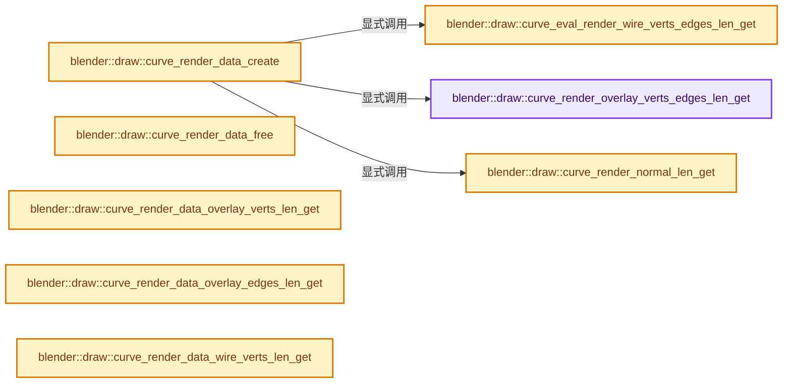
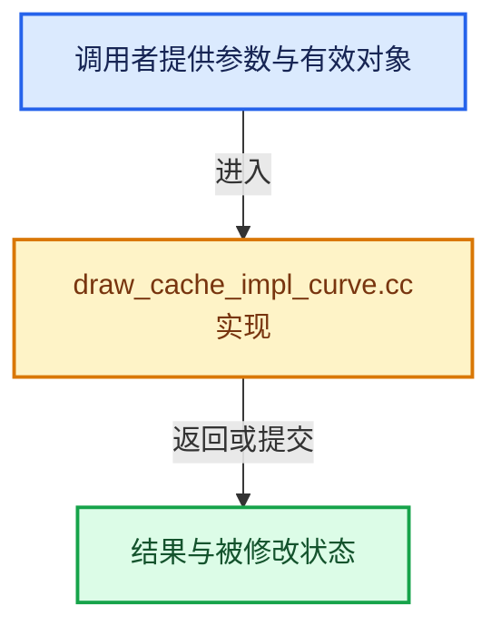

# 实现依赖专题：source/blender/draw/intern/draw_cache_impl_curve.cc

[实现依赖导航](../../../README.md) · [符号索引](../../../../00-课程指南/02-源码与提交索引/符号依赖与实现索引.md)

本专题从正文实际调用进入，集中保存共享实现。函数有稳定锚点，可从调用处直接跳到对应完整函数；递归与互相调用通过回链组织。

## 本文件的实现关系






## 完整成员与函数实现

<a id="f-687595e486f5df48"></a>

### `blender::draw::curve_render_overlay_verts_edges_len_get`

实现位置：[source/blender/draw/intern/draw_cache_impl_curve.cc](../../../../../../../../source/blender/draw/intern/draw_cache_impl_curve.cc) · L71—L97。

接口参数：

- `ListBaseT<Nurb> *lb`
- `int *r_vert_len`
- `int *r_edge_len`

**教学注释版**

<!-- annotated:58c10a4dd15700 -->

```cpp
static void curve_render_overlay_verts_edges_len_get(ListBaseT<Nurb> *lb,
                                                     int *r_vert_len,
                                                     int *r_edge_len)
{
  BLI_assert(r_vert_len || r_edge_len);
  int vert_len = 0;
  int edge_len = 0;
  for (Nurb &nu : *lb) {
    if (nu.bezt) {
      vert_len += nu.pntsu * 3;
      /* 2x handles per point. */
      edge_len += 2 * nu.pntsu;
    }
    else if (nu.bp) {
      vert_len += nu.pntsu * nu.pntsv;
      /* segments between points */
      edge_len += (nu.pntsu - 1) * nu.pntsv;
      edge_len += (nu.pntsv - 1) * nu.pntsu;
    }
  }
  if (r_vert_len) {
    *r_vert_len = vert_len;
  }
  if (r_edge_len) {
    *r_edge_len = edge_len;
  }
}
```

<details>
<summary>核对原始源码：source/blender/draw/intern/draw_cache_impl_curve.cc · L71—L97</summary>

<!-- original:58c10a4dd15700:source/blender/draw/intern/draw_cache_impl_curve.cc:71:97 -->

```cpp
static void curve_render_overlay_verts_edges_len_get(ListBaseT<Nurb> *lb,
                                                     int *r_vert_len,
                                                     int *r_edge_len)
{
  BLI_assert(r_vert_len || r_edge_len);
  int vert_len = 0;
  int edge_len = 0;
  for (Nurb &nu : *lb) {
    if (nu.bezt) {
      vert_len += nu.pntsu * 3;
      /* 2x handles per point. */
      edge_len += 2 * nu.pntsu;
    }
    else if (nu.bp) {
      vert_len += nu.pntsu * nu.pntsv;
      /* segments between points */
      edge_len += (nu.pntsu - 1) * nu.pntsv;
      edge_len += (nu.pntsv - 1) * nu.pntsu;
    }
  }
  if (r_vert_len) {
    *r_vert_len = vert_len;
  }
  if (r_edge_len) {
    *r_edge_len = edge_len;
  }
}
```

</details>

**沿实际写入检查状态**

- `vert_len += nu.pntsu * 3;`
- `edge_len += 2 * nu.pntsu;`
- `vert_len += nu.pntsu * nu.pntsv;`
- `edge_len += (nu.pntsu - 1) * nu.pntsv;`
- `edge_len += (nu.pntsv - 1) * nu.pntsu;`

**继续追踪实现**

- `BLI_assert` → [BLI_assert · L48](../../../01-BLI基础库/BLI_assert.hh.md#m-57a88495704d)；[BLI_assert · L63](../../../01-BLI基础库/BLI_assert.hh.md#m-d07050020cb5)。宏定义由构建条件选择。

<a id="f-b3dbe15f2f940f79"></a>

### `blender::draw::curve_eval_render_wire_verts_edges_len_get`

实现位置：[source/blender/draw/intern/draw_cache_impl_curve.cc](../../../../../../../../source/blender/draw/intern/draw_cache_impl_curve.cc) · L99—L113。

接口参数：

- `const bke::CurvesGeometry &curves`
- `int *r_curve_len`
- `int *r_vert_len`
- `int *r_edge_len`

**教学注释版**

<!-- annotated:d81878a26232d3 -->

```cpp
static void curve_eval_render_wire_verts_edges_len_get(const bke::CurvesGeometry &curves,
                                                       int *r_curve_len,
                                                       int *r_vert_len,
                                                       int *r_edge_len)
{
  const OffsetIndices points_by_curve = curves.evaluated_points_by_curve();
  const VArray<bool> cyclic = curves.cyclic();

  *r_curve_len = curves.curves_num();
  *r_vert_len = points_by_curve.total_size();
  *r_edge_len = 0;
  for (const int i : curves.curves_range()) {
    *r_edge_len += bke::curves::segments_num(points_by_curve[i].size(), cyclic[i]);
  }
}
```

<details>
<summary>核对原始源码：source/blender/draw/intern/draw_cache_impl_curve.cc · L99—L113</summary>

<!-- original:d81878a26232d3:source/blender/draw/intern/draw_cache_impl_curve.cc:99:113 -->

```cpp
static void curve_eval_render_wire_verts_edges_len_get(const bke::CurvesGeometry &curves,
                                                       int *r_curve_len,
                                                       int *r_vert_len,
                                                       int *r_edge_len)
{
  const OffsetIndices points_by_curve = curves.evaluated_points_by_curve();
  const VArray<bool> cyclic = curves.cyclic();

  *r_curve_len = curves.curves_num();
  *r_vert_len = points_by_curve.total_size();
  *r_edge_len = 0;
  for (const int i : curves.curves_range()) {
    *r_edge_len += bke::curves::segments_num(points_by_curve[i].size(), cyclic[i]);
  }
}
```

</details>

**继续追踪实现**

- `curves.evaluated_points_by_curve` → [blender::bke::CurvesGeometry::evaluated_points_by_curve · L706](../../../02-BKE几何与数据/intern/curves_geometry.cc.md#f-50a98b54f67dd20c)。
- `curves.cyclic` → [blender::bke::CurvesGeometry::cyclic · L362](../../../02-BKE几何与数据/intern/curves_geometry.cc.md#f-ec08c2a1d6f3bfea)。
- `curves.curves_num` → [blender::bke::CurvesGeometry::curves_num · L1005](../../../../05-几何存储与拓扑映射/04-CurvesGeometry存储.md#f-eabb3f0e5d3c57be)。
- `points_by_curve.total_size` → [blender::offset_indices::OffsetIndices::total_size · L58](../../../../05-几何存储与拓扑映射/02-OffsetIndices完整接口.md#f-c111ffdac7a19248)。
- `curves.curves_range` → [blender::bke::CurvesGeometry::curves_range · L1023](../../../../05-几何存储与拓扑映射/04-CurvesGeometry存储.md#f-9aedfb1afc5ebcfb)。
- `bke::curves::segments_num` → [blender::bke::curves::segments_num · L574](../../../../05-几何存储与拓扑映射/04-CurvesGeometry存储.md#f-279080e6d7ab269f)。
- `points_by_curve[i].size` → [调用协议](../../../../00-课程指南/01-路线与规范/模板宏与动态分派协议.md)：接收对象类型依赖auto、返回值或模板实例；不按同名猜测目标。调用位置L111。

<a id="f-eb57d02c89060b16"></a>

### `blender::draw::curve_render_normal_len_get`

实现位置：[source/blender/draw/intern/draw_cache_impl_curve.cc](../../../../../../../../source/blender/draw/intern/draw_cache_impl_curve.cc) · L115—L135。

接口参数：

- `const ListBaseT<Nurb> *lb`
- `const CurveCache *ob_curve_cache`

**教学注释版**

<!-- annotated:e2e679447f63bb -->

```cpp
static int curve_render_normal_len_get(const ListBaseT<Nurb> *lb, const CurveCache *ob_curve_cache)
{
  int normal_len = 0;
  const BevList *bl;
  const Nurb *nu;
  for (bl = ob_curve_cache->bev.first(), nu = lb->first(); nu && bl; bl = bl->next, nu = nu->next)
  {
    int nr = bl->nr;
    int skip = nu->resolu / 16;
#if 0
    while (nr-- > 0) { /* accounts for empty bevel lists */
      normal_len += 1;
      nr -= skip;
    }
#else
    /* Same as loop above */
    normal_len += (nr / (skip + 1)) + ((nr % (skip + 1)) != 0);
#endif
  }
  return normal_len;
}
```

<details>
<summary>核对原始源码：source/blender/draw/intern/draw_cache_impl_curve.cc · L115—L135</summary>

<!-- original:e2e679447f63bb:source/blender/draw/intern/draw_cache_impl_curve.cc:115:135 -->

```cpp
static int curve_render_normal_len_get(const ListBaseT<Nurb> *lb, const CurveCache *ob_curve_cache)
{
  int normal_len = 0;
  const BevList *bl;
  const Nurb *nu;
  for (bl = ob_curve_cache->bev.first(), nu = lb->first(); nu && bl; bl = bl->next, nu = nu->next)
  {
    int nr = bl->nr;
    int skip = nu->resolu / 16;
#if 0
    while (nr-- > 0) { /* accounts for empty bevel lists */
      normal_len += 1;
      nr -= skip;
    }
#else
    /* Same as loop above */
    normal_len += (nr / (skip + 1)) + ((nr % (skip + 1)) != 0);
#endif
  }
  return normal_len;
}
```

</details>

**沿实际写入检查状态**

- `normal_len += 1;`
- `nr -= skip;`
- `normal_len += (nr / (skip + 1)) + ((nr % (skip + 1)) != 0);`

**结果出口**

- `return normal_len;`

**继续追踪实现**

- `ob_curve_cache->bev.first` → [调用协议](../../../../00-课程指南/01-路线与规范/模板宏与动态分派协议.md)：接收对象类型依赖auto、返回值或模板实例；不按同名猜测目标。调用位置L120。
- `lb->first` → [blender::ListBaseT::first · L102](../../makesdna/DNA_listBase.h.md#f-3d12ff35da057c9e)；[blender::ListBaseT::first · L106](../../makesdna/DNA_listBase.h.md#f-0df87c3480e059f9)。同名重载需按实参类型选择。

<a id="f-ca21e530b6fd2928"></a>

### `blender::draw::curve_render_data_create`

实现位置：[source/blender/draw/intern/draw_cache_impl_curve.cc](../../../../../../../../source/blender/draw/intern/draw_cache_impl_curve.cc) · L196—L244。

接口参数：

- `Curve *cu`
- `CurveCache *ob_curve_cache`
- `const int types`

**教学注释版**

<!-- annotated:7fa75d99bc29cb -->

```cpp
static CurveRenderData *curve_render_data_create(Curve *cu,
                                                 CurveCache *ob_curve_cache,
                                                 const int types)
{
  CurveRenderData *rdata = MEM_new_zeroed<CurveRenderData>(__func__);
  rdata->types = types;
  ListBaseT<Nurb> *nurbs;

  rdata->actnu = cu->actnu;
  rdata->actvert = cu->actvert;

  rdata->ob_curve_cache = ob_curve_cache;

  rdata->curve_eval = cu->curve_eval;

  if (types & CU_DATATYPE_WIRE) {
    if (rdata->curve_eval != nullptr) {
      curve_eval_render_wire_verts_edges_len_get(rdata->curve_eval->geometry.wrap(),
                                                 &rdata->wire.curve_len,
                                                 &rdata->wire.vert_len,
                                                 &rdata->wire.edge_len);
    }
  }

  if (cu->editnurb) {
    EditNurb *editnurb = cu->editnurb;
    nurbs = &editnurb->nurbs;

    if (types & CU_DATATYPE_OVERLAY) {
      curve_render_overlay_verts_edges_len_get(
          nurbs, &rdata->overlay.vert_len, &rdata->overlay.edge_len);

      rdata->actnu = cu->actnu;
      rdata->actvert = cu->actvert;
    }
    if (types & CU_DATATYPE_NORMAL) {
      rdata->normal.len = curve_render_normal_len_get(nurbs, rdata->ob_curve_cache);
    }
  }
  else {
    nurbs = &cu->nurb;
  }

  rdata->nurbs = nurbs;

  rdata->text.edit_font = cu->editfont;

  return rdata;
}
```

<details>
<summary>核对原始源码：source/blender/draw/intern/draw_cache_impl_curve.cc · L196—L244</summary>

<!-- original:7fa75d99bc29cb:source/blender/draw/intern/draw_cache_impl_curve.cc:196:244 -->

```cpp
static CurveRenderData *curve_render_data_create(Curve *cu,
                                                 CurveCache *ob_curve_cache,
                                                 const int types)
{
  CurveRenderData *rdata = MEM_new_zeroed<CurveRenderData>(__func__);
  rdata->types = types;
  ListBaseT<Nurb> *nurbs;

  rdata->actnu = cu->actnu;
  rdata->actvert = cu->actvert;

  rdata->ob_curve_cache = ob_curve_cache;

  rdata->curve_eval = cu->curve_eval;

  if (types & CU_DATATYPE_WIRE) {
    if (rdata->curve_eval != nullptr) {
      curve_eval_render_wire_verts_edges_len_get(rdata->curve_eval->geometry.wrap(),
                                                 &rdata->wire.curve_len,
                                                 &rdata->wire.vert_len,
                                                 &rdata->wire.edge_len);
    }
  }

  if (cu->editnurb) {
    EditNurb *editnurb = cu->editnurb;
    nurbs = &editnurb->nurbs;

    if (types & CU_DATATYPE_OVERLAY) {
      curve_render_overlay_verts_edges_len_get(
          nurbs, &rdata->overlay.vert_len, &rdata->overlay.edge_len);

      rdata->actnu = cu->actnu;
      rdata->actvert = cu->actvert;
    }
    if (types & CU_DATATYPE_NORMAL) {
      rdata->normal.len = curve_render_normal_len_get(nurbs, rdata->ob_curve_cache);
    }
  }
  else {
    nurbs = &cu->nurb;
  }

  rdata->nurbs = nurbs;

  rdata->text.edit_font = cu->editfont;

  return rdata;
}
```

</details>

**沿实际写入检查状态**

- `rdata->types = types;`
- `rdata->actnu = cu->actnu;`
- `rdata->actvert = cu->actvert;`
- `rdata->ob_curve_cache = ob_curve_cache;`
- `rdata->curve_eval = cu->curve_eval;`
- `nurbs = &editnurb->nurbs;`
- `rdata->normal.len = curve_render_normal_len_get(nurbs, rdata->ob_curve_cache);`
- `nurbs = &cu->nurb;`
- `rdata->nurbs = nurbs;`
- `rdata->text.edit_font = cu->editfont;`

**结果出口**

- `return rdata;`

**继续追踪实现**

- `MEM_new_zeroed<CurveRenderData>` → [MEM_new_zeroed · L550](../../../07-Intern运行时与平台/guardedalloc/MEM_guardedalloc.h.md#f-eeb1e2a7f57dd231)；[MEM_new_zeroed · L114](../../../07-Intern运行时与平台/guardedalloc/intern/mallocn.cc.md#f-e04cf01c64c8b180)。同名重载需按实参类型选择。
- `curve_eval_render_wire_verts_edges_len_get` → [blender::draw::curve_eval_render_wire_verts_edges_len_get · L99](draw_cache_impl_curve.cc.md#f-b3dbe15f2f940f79)。
- `rdata->curve_eval->geometry.wrap` → [调用协议](../../../../00-课程指南/01-路线与规范/模板宏与动态分派协议.md)：接收对象类型依赖auto、返回值或模板实例；不按同名猜测目标。调用位置L213。
- `curve_render_overlay_verts_edges_len_get` → [blender::draw::curve_render_overlay_verts_edges_len_get · L71](draw_cache_impl_curve.cc.md#f-687595e486f5df48)。
- `curve_render_normal_len_get` → [blender::draw::curve_render_normal_len_get · L115](draw_cache_impl_curve.cc.md#f-eb57d02c89060b16)。

<a id="f-22efcbad4a0543a3"></a>

### `blender::draw::curve_render_data_free`

实现位置：[source/blender/draw/intern/draw_cache_impl_curve.cc](../../../../../../../../source/blender/draw/intern/draw_cache_impl_curve.cc) · L246—L254。

接口参数：

- `CurveRenderData *rdata`

**教学注释版**

<!-- annotated:35f7285c928e22 -->

```cpp
static void curve_render_data_free(CurveRenderData *rdata)
{
#if 0
  if (rdata->loose_verts) {
    MEM_delete(rdata->loose_verts);
  }
#endif
  MEM_delete(rdata);
}
```

<details>
<summary>核对原始源码：source/blender/draw/intern/draw_cache_impl_curve.cc · L246—L254</summary>

<!-- original:35f7285c928e22:source/blender/draw/intern/draw_cache_impl_curve.cc:246:254 -->

```cpp
static void curve_render_data_free(CurveRenderData *rdata)
{
#if 0
  if (rdata->loose_verts) {
    MEM_delete(rdata->loose_verts);
  }
#endif
  MEM_delete(rdata);
}
```

</details>

**继续追踪实现**

- `MEM_delete` → [MEM_delete · L400](../../../07-Intern运行时与平台/guardedalloc/MEM_guardedalloc.h.md#f-9049ffdd1682887c)。

<a id="f-3956011fd5164df9"></a>

### `blender::draw::curve_render_data_overlay_verts_len_get`

实现位置：[source/blender/draw/intern/draw_cache_impl_curve.cc](../../../../../../../../source/blender/draw/intern/draw_cache_impl_curve.cc) · L256—L260。

接口参数：

- `const CurveRenderData *rdata`

**教学注释版**

<!-- annotated:583d842f747450 -->

```cpp
static int curve_render_data_overlay_verts_len_get(const CurveRenderData *rdata)
{
  BLI_assert(rdata->types & CU_DATATYPE_OVERLAY);
  return rdata->overlay.vert_len;
}
```

<details>
<summary>核对原始源码：source/blender/draw/intern/draw_cache_impl_curve.cc · L256—L260</summary>

<!-- original:583d842f747450:source/blender/draw/intern/draw_cache_impl_curve.cc:256:260 -->

```cpp
static int curve_render_data_overlay_verts_len_get(const CurveRenderData *rdata)
{
  BLI_assert(rdata->types & CU_DATATYPE_OVERLAY);
  return rdata->overlay.vert_len;
}
```

</details>

**结果出口**

- `return rdata->overlay.vert_len;`

**继续追踪实现**

- `BLI_assert` → [BLI_assert · L48](../../../01-BLI基础库/BLI_assert.hh.md#m-57a88495704d)；[BLI_assert · L63](../../../01-BLI基础库/BLI_assert.hh.md#m-d07050020cb5)。宏定义由构建条件选择。

<a id="f-e71214daf7cfa2d9"></a>

### `blender::draw::curve_render_data_overlay_edges_len_get`

实现位置：[source/blender/draw/intern/draw_cache_impl_curve.cc](../../../../../../../../source/blender/draw/intern/draw_cache_impl_curve.cc) · L262—L266。

接口参数：

- `const CurveRenderData *rdata`

**教学注释版**

<!-- annotated:1263e10834aacd -->

```cpp
static int curve_render_data_overlay_edges_len_get(const CurveRenderData *rdata)
{
  BLI_assert(rdata->types & CU_DATATYPE_OVERLAY);
  return rdata->overlay.edge_len;
}
```

<details>
<summary>核对原始源码：source/blender/draw/intern/draw_cache_impl_curve.cc · L262—L266</summary>

<!-- original:1263e10834aacd:source/blender/draw/intern/draw_cache_impl_curve.cc:262:266 -->

```cpp
static int curve_render_data_overlay_edges_len_get(const CurveRenderData *rdata)
{
  BLI_assert(rdata->types & CU_DATATYPE_OVERLAY);
  return rdata->overlay.edge_len;
}
```

</details>

**结果出口**

- `return rdata->overlay.edge_len;`

**继续追踪实现**

- `BLI_assert` → [BLI_assert · L48](../../../01-BLI基础库/BLI_assert.hh.md#m-57a88495704d)；[BLI_assert · L63](../../../01-BLI基础库/BLI_assert.hh.md#m-d07050020cb5)。宏定义由构建条件选择。

<a id="f-6969ed4051189a8e"></a>

### `blender::draw::curve_render_data_wire_verts_len_get`

实现位置：[source/blender/draw/intern/draw_cache_impl_curve.cc](../../../../../../../../source/blender/draw/intern/draw_cache_impl_curve.cc) · L268—L272。

接口参数：

- `const CurveRenderData *rdata`

**教学注释版**

<!-- annotated:7fec0ef79c6d33 -->

```cpp
static int curve_render_data_wire_verts_len_get(const CurveRenderData *rdata)
{
  BLI_assert(rdata->types & CU_DATATYPE_WIRE);
  return rdata->wire.vert_len;
}
```

<details>
<summary>核对原始源码：source/blender/draw/intern/draw_cache_impl_curve.cc · L268—L272</summary>

<!-- original:7fec0ef79c6d33:source/blender/draw/intern/draw_cache_impl_curve.cc:268:272 -->

```cpp
static int curve_render_data_wire_verts_len_get(const CurveRenderData *rdata)
{
  BLI_assert(rdata->types & CU_DATATYPE_WIRE);
  return rdata->wire.vert_len;
}
```

</details>

**结果出口**

- `return rdata->wire.vert_len;`

**继续追踪实现**

- `BLI_assert` → [BLI_assert · L48](../../../01-BLI基础库/BLI_assert.hh.md#m-57a88495704d)；[BLI_assert · L63](../../../01-BLI基础库/BLI_assert.hh.md#m-d07050020cb5)。宏定义由构建条件选择。

<a id="f-9bc439061a0b42ec"></a>

### `blender::draw::curve_render_data_wire_edges_len_get`

实现位置：[source/blender/draw/intern/draw_cache_impl_curve.cc](../../../../../../../../source/blender/draw/intern/draw_cache_impl_curve.cc) · L274—L278。

接口参数：

- `const CurveRenderData *rdata`

**教学注释版**

<!-- annotated:65c2e838a7ee6b -->

```cpp
static int curve_render_data_wire_edges_len_get(const CurveRenderData *rdata)
{
  BLI_assert(rdata->types & CU_DATATYPE_WIRE);
  return rdata->wire.edge_len;
}
```

<details>
<summary>核对原始源码：source/blender/draw/intern/draw_cache_impl_curve.cc · L274—L278</summary>

<!-- original:65c2e838a7ee6b:source/blender/draw/intern/draw_cache_impl_curve.cc:274:278 -->

```cpp
static int curve_render_data_wire_edges_len_get(const CurveRenderData *rdata)
{
  BLI_assert(rdata->types & CU_DATATYPE_WIRE);
  return rdata->wire.edge_len;
}
```

</details>

**结果出口**

- `return rdata->wire.edge_len;`

**继续追踪实现**

- `BLI_assert` → [BLI_assert · L48](../../../01-BLI基础库/BLI_assert.hh.md#m-57a88495704d)；[BLI_assert · L63](../../../01-BLI基础库/BLI_assert.hh.md#m-d07050020cb5)。宏定义由构建条件选择。

<a id="f-e65087d91cff1932"></a>

### `blender::draw::curve_render_data_wire_curve_len_get`

实现位置：[source/blender/draw/intern/draw_cache_impl_curve.cc](../../../../../../../../source/blender/draw/intern/draw_cache_impl_curve.cc) · L280—L284。

接口参数：

- `const CurveRenderData *rdata`

**教学注释版**

<!-- annotated:86571ef11525b1 -->

```cpp
static int curve_render_data_wire_curve_len_get(const CurveRenderData *rdata)
{
  BLI_assert(rdata->types & CU_DATATYPE_WIRE);
  return rdata->wire.curve_len;
}
```

<details>
<summary>核对原始源码：source/blender/draw/intern/draw_cache_impl_curve.cc · L280—L284</summary>

<!-- original:86571ef11525b1:source/blender/draw/intern/draw_cache_impl_curve.cc:280:284 -->

```cpp
static int curve_render_data_wire_curve_len_get(const CurveRenderData *rdata)
{
  BLI_assert(rdata->types & CU_DATATYPE_WIRE);
  return rdata->wire.curve_len;
}
```

</details>

**结果出口**

- `return rdata->wire.curve_len;`

**继续追踪实现**

- `BLI_assert` → [BLI_assert · L48](../../../01-BLI基础库/BLI_assert.hh.md#m-57a88495704d)；[BLI_assert · L63](../../../01-BLI基础库/BLI_assert.hh.md#m-d07050020cb5)。宏定义由构建条件选择。

<a id="f-7b75dc0a8ed80ad4"></a>

### `blender::draw::curve_render_data_normal_len_get`

实现位置：[source/blender/draw/intern/draw_cache_impl_curve.cc](../../../../../../../../source/blender/draw/intern/draw_cache_impl_curve.cc) · L286—L290。

接口参数：

- `const CurveRenderData *rdata`

**教学注释版**

<!-- annotated:23d06346687db0 -->

```cpp
static int curve_render_data_normal_len_get(const CurveRenderData *rdata)
{
  BLI_assert(rdata->types & CU_DATATYPE_NORMAL);
  return rdata->normal.len;
}
```

<details>
<summary>核对原始源码：source/blender/draw/intern/draw_cache_impl_curve.cc · L286—L290</summary>

<!-- original:23d06346687db0:source/blender/draw/intern/draw_cache_impl_curve.cc:286:290 -->

```cpp
static int curve_render_data_normal_len_get(const CurveRenderData *rdata)
{
  BLI_assert(rdata->types & CU_DATATYPE_NORMAL);
  return rdata->normal.len;
}
```

</details>

**结果出口**

- `return rdata->normal.len;`

**继续追踪实现**

- `BLI_assert` → [BLI_assert · L48](../../../01-BLI基础库/BLI_assert.hh.md#m-57a88495704d)；[BLI_assert · L63](../../../01-BLI基础库/BLI_assert.hh.md#m-d07050020cb5)。宏定义由构建条件选择。

<a id="f-a5d58ec6d3fbfdde"></a>

### `blender::draw::curve_batch_cache_valid`

实现位置：[source/blender/draw/intern/draw_cache_impl_curve.cc](../../../../../../../../source/blender/draw/intern/draw_cache_impl_curve.cc) · L331—L354。

接口参数：

- `Curve *cu`

**教学注释版**

<!-- annotated:26a2be7cdb3ee6 -->

```cpp
static bool curve_batch_cache_valid(Curve *cu)
{
  CurveBatchCache *cache = cu->batch_cache;

  if (cache == nullptr) {
    return false;
  }

  if (cache->is_dirty) {
    return false;
  }

  if (cache->is_editmode != ((cu->editnurb != nullptr) || (cu->editfont != nullptr))) {
    return false;
  }

  if (cache->is_editmode) {
    if (cu->editfont) {
      /* TODO */
    }
  }

  return true;
}
```

<details>
<summary>核对原始源码：source/blender/draw/intern/draw_cache_impl_curve.cc · L331—L354</summary>

<!-- original:26a2be7cdb3ee6:source/blender/draw/intern/draw_cache_impl_curve.cc:331:354 -->

```cpp
static bool curve_batch_cache_valid(Curve *cu)
{
  CurveBatchCache *cache = cu->batch_cache;

  if (cache == nullptr) {
    return false;
  }

  if (cache->is_dirty) {
    return false;
  }

  if (cache->is_editmode != ((cu->editnurb != nullptr) || (cu->editfont != nullptr))) {
    return false;
  }

  if (cache->is_editmode) {
    if (cu->editfont) {
      /* TODO */
    }
  }

  return true;
}
```

</details>

**结果出口**

- `return false;`
- `return true;`

**继续追踪实现**

本实现没有需要继续展开的显式调用；检查返回表达式、对象转换和调用者前置条件。

<a id="f-83245ae0327907ee"></a>

### `blender::draw::curve_batch_cache_init`

实现位置：[source/blender/draw/intern/draw_cache_impl_curve.cc](../../../../../../../../source/blender/draw/intern/draw_cache_impl_curve.cc) · L356—L382。

接口参数：

- `Curve *cu`

**教学注释版**

<!-- annotated:75cf689003eda6 -->

```cpp
static void curve_batch_cache_init(Curve *cu)
{
  CurveBatchCache *cache = cu->batch_cache;

  if (!cache) {
    cache = MEM_new_zeroed<CurveBatchCache>(__func__);
    cu->batch_cache = cache;
  }
  else {
    // [讲解] memset：填充字节，不调用T构造函数，也不保证任意类型的全零表示是合法或期望值。
    memset(cache, 0, sizeof(*cache));
  }

#if 0
  ListBaseT<Nurb> *nurbs;
  if (cu->editnurb) {
    EditNurb *editnurb = cu->editnurb;
    nurbs = &editnurb->nurbs;
  }
  else {
    nurbs = &cu->nurb;
  }
#endif

  cache->is_editmode = (cu->editnurb != nullptr) || (cu->editfont != nullptr);

  cache->is_dirty = false;
}
```

<details>
<summary>核对原始源码：source/blender/draw/intern/draw_cache_impl_curve.cc · L356—L382</summary>

<!-- original:75cf689003eda6:source/blender/draw/intern/draw_cache_impl_curve.cc:356:382 -->

```cpp
static void curve_batch_cache_init(Curve *cu)
{
  CurveBatchCache *cache = cu->batch_cache;

  if (!cache) {
    cache = MEM_new_zeroed<CurveBatchCache>(__func__);
    cu->batch_cache = cache;
  }
  else {
    memset(cache, 0, sizeof(*cache));
  }

#if 0
  ListBaseT<Nurb> *nurbs;
  if (cu->editnurb) {
    EditNurb *editnurb = cu->editnurb;
    nurbs = &editnurb->nurbs;
  }
  else {
    nurbs = &cu->nurb;
  }
#endif

  cache->is_editmode = (cu->editnurb != nullptr) || (cu->editfont != nullptr);

  cache->is_dirty = false;
}
```

</details>

**沿实际写入检查状态**

- `cache = MEM_new_zeroed<CurveBatchCache>(__func__);`
- `cu->batch_cache = cache;`
- `nurbs = &editnurb->nurbs;`
- `nurbs = &cu->nurb;`
- `cache->is_editmode = (cu->editnurb != nullptr) || (cu->editfont != nullptr);`
- `cache->is_dirty = false;`

**继续追踪实现**

- `MEM_new_zeroed<CurveBatchCache>` → [MEM_new_zeroed · L550](../../../07-Intern运行时与平台/guardedalloc/MEM_guardedalloc.h.md#f-eeb1e2a7f57dd231)；[MEM_new_zeroed · L114](../../../07-Intern运行时与平台/guardedalloc/intern/mallocn.cc.md#f-e04cf01c64c8b180)。同名重载需按实参类型选择。
- `memset` → [外部契约](https://eel.is/c++draft/cstring.syn)：填充字节，不调用T构造函数，也不保证任意类型的全零表示是合法或期望值。

<a id="f-c060b8aad36a169e"></a>

### `blender::draw::DRW_curve_batch_cache_validate`

实现位置：[source/blender/draw/intern/draw_cache_impl_curve.cc](../../../../../../../../source/blender/draw/intern/draw_cache_impl_curve.cc) · L384—L390。

接口参数：

- `Curve *cu`

**教学注释版**

<!-- annotated:6732783e6c05bd -->

```cpp
void DRW_curve_batch_cache_validate(Curve *cu)
{
  if (!curve_batch_cache_valid(cu)) {
    curve_batch_cache_clear(cu);
    curve_batch_cache_init(cu);
  }
}
```

<details>
<summary>核对原始源码：source/blender/draw/intern/draw_cache_impl_curve.cc · L384—L390</summary>

<!-- original:6732783e6c05bd:source/blender/draw/intern/draw_cache_impl_curve.cc:384:390 -->

```cpp
void DRW_curve_batch_cache_validate(Curve *cu)
{
  if (!curve_batch_cache_valid(cu)) {
    curve_batch_cache_clear(cu);
    curve_batch_cache_init(cu);
  }
}
```

</details>

**继续追踪实现**

- `curve_batch_cache_valid` → [blender::draw::curve_batch_cache_valid · L331](draw_cache_impl_curve.cc.md#f-a5d58ec6d3fbfdde)。
- `curve_batch_cache_clear` → [blender::draw::curve_batch_cache_clear · L418](draw_cache_impl_curve.cc.md#f-490ee2dfe1680d01)。
- `curve_batch_cache_init` → [blender::draw::curve_batch_cache_init · L356](draw_cache_impl_curve.cc.md#f-83245ae0327907ee)。

<a id="f-5cdc1a87172a9263"></a>

### `blender::draw::curve_batch_cache_get`

实现位置：[source/blender/draw/intern/draw_cache_impl_curve.cc](../../../../../../../../source/blender/draw/intern/draw_cache_impl_curve.cc) · L392—L395。

接口参数：

- `Curve *cu`

**教学注释版**

<!-- annotated:ca2b0015e776cc -->

```cpp
static CurveBatchCache *curve_batch_cache_get(Curve *cu)
{
  return cu->batch_cache;
}
```

<details>
<summary>核对原始源码：source/blender/draw/intern/draw_cache_impl_curve.cc · L392—L395</summary>

<!-- original:ca2b0015e776cc:source/blender/draw/intern/draw_cache_impl_curve.cc:392:395 -->

```cpp
static CurveBatchCache *curve_batch_cache_get(Curve *cu)
{
  return cu->batch_cache;
}
```

</details>

**结果出口**

- `return cu->batch_cache;`

**继续追踪实现**

本实现没有需要继续展开的显式调用；检查返回表达式、对象转换和调用者前置条件。

<a id="f-490ee2dfe1680d01"></a>

### `blender::draw::curve_batch_cache_clear`

实现位置：[source/blender/draw/intern/draw_cache_impl_curve.cc](../../../../../../../../source/blender/draw/intern/draw_cache_impl_curve.cc) · L418—L441。

接口参数：

- `Curve *cu`

**教学注释版**

<!-- annotated:54559361b092bf -->

```cpp
static void curve_batch_cache_clear(Curve *cu)
{
  CurveBatchCache *cache = cu->batch_cache;
  if (!cache) {
    return;
  }

  for (int i = 0; i < sizeof(cache->ordered) / sizeof(void *); i++) {
    gpu::VertBuf **vbo = reinterpret_cast<gpu::VertBuf **>(&cache->ordered);
    GPU_VERTBUF_DISCARD_SAFE(vbo[i]);
  }
  for (int i = 0; i < sizeof(cache->edit) / sizeof(void *); i++) {
    gpu::VertBuf **vbo = reinterpret_cast<gpu::VertBuf **>(&cache->edit);
    GPU_VERTBUF_DISCARD_SAFE(vbo[i]);
  }
  for (int i = 0; i < sizeof(cache->ibo) / sizeof(void *); i++) {
    gpu::IndexBuf **ibo = reinterpret_cast<gpu::IndexBuf **>(&cache->ibo);
    GPU_INDEXBUF_DISCARD_SAFE(ibo[i]);
  }
  for (int i = 0; i < sizeof(cache->batch) / sizeof(void *); i++) {
    gpu::Batch **batch = reinterpret_cast<gpu::Batch **>(&cache->batch);
    GPU_BATCH_DISCARD_SAFE(batch[i]);
  }
}
```

<details>
<summary>核对原始源码：source/blender/draw/intern/draw_cache_impl_curve.cc · L418—L441</summary>

<!-- original:54559361b092bf:source/blender/draw/intern/draw_cache_impl_curve.cc:418:441 -->

```cpp
static void curve_batch_cache_clear(Curve *cu)
{
  CurveBatchCache *cache = cu->batch_cache;
  if (!cache) {
    return;
  }

  for (int i = 0; i < sizeof(cache->ordered) / sizeof(void *); i++) {
    gpu::VertBuf **vbo = reinterpret_cast<gpu::VertBuf **>(&cache->ordered);
    GPU_VERTBUF_DISCARD_SAFE(vbo[i]);
  }
  for (int i = 0; i < sizeof(cache->edit) / sizeof(void *); i++) {
    gpu::VertBuf **vbo = reinterpret_cast<gpu::VertBuf **>(&cache->edit);
    GPU_VERTBUF_DISCARD_SAFE(vbo[i]);
  }
  for (int i = 0; i < sizeof(cache->ibo) / sizeof(void *); i++) {
    gpu::IndexBuf **ibo = reinterpret_cast<gpu::IndexBuf **>(&cache->ibo);
    GPU_INDEXBUF_DISCARD_SAFE(ibo[i]);
  }
  for (int i = 0; i < sizeof(cache->batch) / sizeof(void *); i++) {
    gpu::Batch **batch = reinterpret_cast<gpu::Batch **>(&cache->batch);
    GPU_BATCH_DISCARD_SAFE(batch[i]);
  }
}
```

</details>

**继续追踪实现**

- `GPU_VERTBUF_DISCARD_SAFE` → [GPU_VERTBUF_DISCARD_SAFE · L372](../../gpu/GPU_vertex_buffer.hh.md#m-6427e4c6901c)。宏定义由构建条件选择。
- `GPU_INDEXBUF_DISCARD_SAFE` → [GPU_INDEXBUF_DISCARD_SAFE · L299](../../gpu/GPU_index_buffer.hh.md#m-f3c9c7333ad4)。宏定义由构建条件选择。
- `GPU_BATCH_DISCARD_SAFE` → [GPU_BATCH_DISCARD_SAFE · L199](../../gpu/GPU_batch.hh.md#m-167d477926a1)。宏定义由构建条件选择。

<a id="f-c4d99714fb1bf984"></a>

### `blender::draw::curve_create_curves_pos`

实现位置：[source/blender/draw/intern/draw_cache_impl_curve.cc](../../../../../../../../source/blender/draw/intern/draw_cache_impl_curve.cc) · L454—L477。

接口参数：

- `CurveRenderData *rdata`
- `gpu::VertBuf *vbo_curves_pos`

**教学注释版**

<!-- annotated:810ef82c407c23 -->

```cpp
static void curve_create_curves_pos(CurveRenderData *rdata, gpu::VertBuf *vbo_curves_pos)
{
  if (rdata->curve_eval == nullptr) {
    return;
  }

  static struct {
    uint pos;
  } attr_id;

  static const GPUVertFormat format = [&]() {
    GPUVertFormat format{};
    attr_id.pos = GPU_vertformat_attr_add(&format, "pos", gpu::VertAttrType::SFLOAT_32_32_32);
    return format;
  }();

  const int vert_len = curve_render_data_wire_verts_len_get(rdata);
  GPU_vertbuf_init_with_format(*vbo_curves_pos, format);
  GPU_vertbuf_data_alloc(*vbo_curves_pos, vert_len);

  const bke::CurvesGeometry &curves = rdata->curve_eval->geometry.wrap();
  const Span<float3> positions = curves.evaluated_positions();
  // [讲解] positions.data：返回借用范围的地址。
  GPU_vertbuf_attr_fill(vbo_curves_pos, attr_id.pos, positions.data());
}
```

<details>
<summary>核对原始源码：source/blender/draw/intern/draw_cache_impl_curve.cc · L454—L477</summary>

<!-- original:810ef82c407c23:source/blender/draw/intern/draw_cache_impl_curve.cc:454:477 -->

```cpp
static void curve_create_curves_pos(CurveRenderData *rdata, gpu::VertBuf *vbo_curves_pos)
{
  if (rdata->curve_eval == nullptr) {
    return;
  }

  static struct {
    uint pos;
  } attr_id;

  static const GPUVertFormat format = [&]() {
    GPUVertFormat format{};
    attr_id.pos = GPU_vertformat_attr_add(&format, "pos", gpu::VertAttrType::SFLOAT_32_32_32);
    return format;
  }();

  const int vert_len = curve_render_data_wire_verts_len_get(rdata);
  GPU_vertbuf_init_with_format(*vbo_curves_pos, format);
  GPU_vertbuf_data_alloc(*vbo_curves_pos, vert_len);

  const bke::CurvesGeometry &curves = rdata->curve_eval->geometry.wrap();
  const Span<float3> positions = curves.evaluated_positions();
  GPU_vertbuf_attr_fill(vbo_curves_pos, attr_id.pos, positions.data());
}
```

</details>

**沿实际写入检查状态**

- `attr_id.pos = GPU_vertformat_attr_add(&format, "pos", gpu::VertAttrType::SFLOAT_32_32_32);`

**结果出口**

- `return format;`

**继续追踪实现**

- `[&]() { GPUVertFormat format{}; attr_id.pos = GPU_vertformat_attr_add(&format, "pos", gpu::VertAttrType::SFLOAT_32_32_32); return format; }` → [调用协议](../../../../00-课程指南/01-路线与规范/模板宏与动态分派协议.md)：函数指针、局部可调用对象或未展开的宏；必须结合调用者环境。调用位置L464。
- `GPU_vertformat_attr_add` → [blender::GPU_vertformat_attr_add · L389](../../gpu/intern/gpu_vertex_format.cc.md#f-a36e23f37b97fff4)。
- `curve_render_data_wire_verts_len_get` → [blender::draw::curve_render_data_wire_verts_len_get · L268](draw_cache_impl_curve.cc.md#f-6969ed4051189a8e)。
- `GPU_vertbuf_init_with_format` → [GPU_vertbuf_init_with_format · L277](../../gpu/GPU_vertex_buffer.hh.md#m-7100390733f1)。宏定义由构建条件选择。
- `GPU_vertbuf_data_alloc` → [blender::GPU_vertbuf_data_alloc · L172](../../gpu/intern/gpu_vertex_buffer.cc.md#f-8ee5cf106e0f2b0f)。
- `rdata->curve_eval->geometry.wrap` → [调用协议](../../../../00-课程指南/01-路线与规范/模板宏与动态分派协议.md)：接收对象类型依赖auto、返回值或模板实例；不按同名猜测目标。调用位置L474。
- `curves.evaluated_positions` → [blender::bke::CurvesGeometry::evaluated_positions · L829](../../../02-BKE几何与数据/intern/curves_geometry.cc.md#f-57258eef953d0ea5)。
- `GPU_vertbuf_attr_fill` → [blender::GPU_vertbuf_attr_fill · L201](../../gpu/intern/gpu_vertex_buffer.cc.md#f-d59c0f6c50a21df9)。
- `positions.data` → [blender::Span::data · L219](../../../../01-基础容器与现代CPP/05-Span只读连续视图.md#f-10c5889198935800)。

<a id="f-1ddabd6ddca118bf"></a>

### `blender::draw::curve_create_attribute`

实现位置：[source/blender/draw/intern/draw_cache_impl_curve.cc](../../../../../../../../source/blender/draw/intern/draw_cache_impl_curve.cc) · L479—L500。

接口参数：

- `CurveRenderData *rdata`
- `gpu::VertBuf &vbo_attr`

**教学注释版**

<!-- annotated:b41fa47433c419 -->

```cpp
static void curve_create_attribute(CurveRenderData *rdata, gpu::VertBuf &vbo_attr)
{
  if (rdata->curve_eval == nullptr) {
    return;
  }

  static const GPUVertFormat format = []() {
    GPUVertFormat format{};
    GPU_vertformat_attr_add(&format, "attribute_value", gpu::VertAttrType::SFLOAT_32_32_32_32);
    return format;
  }();

  const int vert_len = curve_render_data_wire_verts_len_get(rdata);
  GPU_vertbuf_init_with_format(vbo_attr, format);
  GPU_vertbuf_data_alloc(vbo_attr, vert_len);

  const bke::CurvesGeometry &curves = rdata->curve_eval->geometry.wrap();
  curves.ensure_can_interpolate_to_evaluated();
  const VArraySpan colors = *curves.attributes().lookup<ColorGeometry4f>(".viewer",
                                                                         bke::AttrDomain::Point);
  curves.interpolate_to_evaluated(colors, vbo_attr.data<ColorGeometry4f>());
}
```

<details>
<summary>核对原始源码：source/blender/draw/intern/draw_cache_impl_curve.cc · L479—L500</summary>

<!-- original:b41fa47433c419:source/blender/draw/intern/draw_cache_impl_curve.cc:479:500 -->

```cpp
static void curve_create_attribute(CurveRenderData *rdata, gpu::VertBuf &vbo_attr)
{
  if (rdata->curve_eval == nullptr) {
    return;
  }

  static const GPUVertFormat format = []() {
    GPUVertFormat format{};
    GPU_vertformat_attr_add(&format, "attribute_value", gpu::VertAttrType::SFLOAT_32_32_32_32);
    return format;
  }();

  const int vert_len = curve_render_data_wire_verts_len_get(rdata);
  GPU_vertbuf_init_with_format(vbo_attr, format);
  GPU_vertbuf_data_alloc(vbo_attr, vert_len);

  const bke::CurvesGeometry &curves = rdata->curve_eval->geometry.wrap();
  curves.ensure_can_interpolate_to_evaluated();
  const VArraySpan colors = *curves.attributes().lookup<ColorGeometry4f>(".viewer",
                                                                         bke::AttrDomain::Point);
  curves.interpolate_to_evaluated(colors, vbo_attr.data<ColorGeometry4f>());
}
```

</details>

**结果出口**

- `return format;`

**继续追踪实现**

- `[]() { GPUVertFormat format{}; GPU_vertformat_attr_add(&format, "attribute_value", gpu::VertAttrType::SFLOAT_32_32_32_32); return format; }` → [调用协议](../../../../00-课程指南/01-路线与规范/模板宏与动态分派协议.md)：函数指针、局部可调用对象或未展开的宏；必须结合调用者环境。调用位置L485。
- `GPU_vertformat_attr_add` → [blender::GPU_vertformat_attr_add · L389](../../gpu/intern/gpu_vertex_format.cc.md#f-a36e23f37b97fff4)。
- `curve_render_data_wire_verts_len_get` → [blender::draw::curve_render_data_wire_verts_len_get · L268](draw_cache_impl_curve.cc.md#f-6969ed4051189a8e)。
- `GPU_vertbuf_init_with_format` → [GPU_vertbuf_init_with_format · L277](../../gpu/GPU_vertex_buffer.hh.md#m-7100390733f1)。宏定义由构建条件选择。
- `GPU_vertbuf_data_alloc` → [blender::GPU_vertbuf_data_alloc · L172](../../gpu/intern/gpu_vertex_buffer.cc.md#f-8ee5cf106e0f2b0f)。
- `rdata->curve_eval->geometry.wrap` → [调用协议](../../../../00-课程指南/01-路线与规范/模板宏与动态分派协议.md)：接收对象类型依赖auto、返回值或模板实例；不按同名猜测目标。调用位置L495。
- `curves.ensure_can_interpolate_to_evaluated` → [blender::bke::CurvesGeometry::ensure_can_interpolate_to_evaluated · L1211](../../../02-BKE几何与数据/intern/curves_geometry.cc.md#f-30313267c1e11391)。
- `curves.attributes().lookup<ColorGeometry4f>` → [调用协议](../../../../00-课程指南/01-路线与规范/模板宏与动态分派协议.md)：接收对象类型依赖auto、返回值或模板实例；不按同名猜测目标。调用位置L497。
- `curves.attributes` → [blender::bke::CurvesGeometry::attributes · L1908](../../../02-BKE几何与数据/intern/curves_geometry.cc.md#f-8e24fbf758862a22)。
- `curves.interpolate_to_evaluated` → [blender::bke::CurvesGeometry::interpolate_to_evaluated · L1136](../../../02-BKE几何与数据/intern/curves_geometry.cc.md#f-29af6547247c8f6a)；[blender::bke::CurvesGeometry::interpolate_to_evaluated · L1156](../../../02-BKE几何与数据/intern/curves_geometry.cc.md#f-9bd697a878eb479d)。同名重载需按实参类型选择。
- `vbo_attr.data<ColorGeometry4f>` → [blender::gpu::VertBuf::data · L220](../../gpu/GPU_vertex_buffer.hh.md#f-e72412fdddda8bf5)。

<a id="f-c131558e470fc722"></a>

### `blender::draw::curve_create_curves_lines`

实现位置：[source/blender/draw/intern/draw_cache_impl_curve.cc](../../../../../../../../source/blender/draw/intern/draw_cache_impl_curve.cc) · L502—L533。

接口参数：

- `CurveRenderData *rdata`
- `gpu::IndexBuf *ibo_curve_lines`

**教学注释版**

<!-- annotated:2147d2fa56796b -->

```cpp
static void curve_create_curves_lines(CurveRenderData *rdata, gpu::IndexBuf *ibo_curve_lines)
{
  if (rdata->curve_eval == nullptr) {
    return;
  }

  const int vert_len = curve_render_data_wire_verts_len_get(rdata);
  const int edge_len = curve_render_data_wire_edges_len_get(rdata);
  const int curve_len = curve_render_data_wire_curve_len_get(rdata);
  /* Count the last vertex or each strip and the primitive restart. */
  const int index_len = edge_len + curve_len * 2;

  GPUIndexBufBuilder elb;
  GPU_indexbuf_init_ex(&elb, GPU_PRIM_LINE_STRIP, index_len, vert_len);

  const bke::CurvesGeometry &curves = rdata->curve_eval->geometry.wrap();
  const OffsetIndices points_by_curve = curves.evaluated_points_by_curve();
  const VArray<bool> cyclic = curves.cyclic();

  for (const int i : curves.curves_range()) {
    const IndexRange points = points_by_curve[i];
    // [讲解] points.size：读取连续区间或分组的边界信息。
    if (cyclic[i] && points.size() > 1) {
      // [讲解] points.last：读取范围两端的有效索引或值。
      GPU_indexbuf_add_generic_vert(&elb, points.last());
    }
    for (const int i_point : points) {
      GPU_indexbuf_add_generic_vert(&elb, i_point);
    }
    GPU_indexbuf_add_primitive_restart(&elb);
  }

  GPU_indexbuf_build_in_place(&elb, ibo_curve_lines);
}
```

<details>
<summary>核对原始源码：source/blender/draw/intern/draw_cache_impl_curve.cc · L502—L533</summary>

<!-- original:2147d2fa56796b:source/blender/draw/intern/draw_cache_impl_curve.cc:502:533 -->

```cpp
static void curve_create_curves_lines(CurveRenderData *rdata, gpu::IndexBuf *ibo_curve_lines)
{
  if (rdata->curve_eval == nullptr) {
    return;
  }

  const int vert_len = curve_render_data_wire_verts_len_get(rdata);
  const int edge_len = curve_render_data_wire_edges_len_get(rdata);
  const int curve_len = curve_render_data_wire_curve_len_get(rdata);
  /* Count the last vertex or each strip and the primitive restart. */
  const int index_len = edge_len + curve_len * 2;

  GPUIndexBufBuilder elb;
  GPU_indexbuf_init_ex(&elb, GPU_PRIM_LINE_STRIP, index_len, vert_len);

  const bke::CurvesGeometry &curves = rdata->curve_eval->geometry.wrap();
  const OffsetIndices points_by_curve = curves.evaluated_points_by_curve();
  const VArray<bool> cyclic = curves.cyclic();

  for (const int i : curves.curves_range()) {
    const IndexRange points = points_by_curve[i];
    if (cyclic[i] && points.size() > 1) {
      GPU_indexbuf_add_generic_vert(&elb, points.last());
    }
    for (const int i_point : points) {
      GPU_indexbuf_add_generic_vert(&elb, i_point);
    }
    GPU_indexbuf_add_primitive_restart(&elb);
  }

  GPU_indexbuf_build_in_place(&elb, ibo_curve_lines);
}
```

</details>

**继续追踪实现**

- `curve_render_data_wire_verts_len_get` → [blender::draw::curve_render_data_wire_verts_len_get · L268](draw_cache_impl_curve.cc.md#f-6969ed4051189a8e)。
- `curve_render_data_wire_edges_len_get` → [blender::draw::curve_render_data_wire_edges_len_get · L274](draw_cache_impl_curve.cc.md#f-9bc439061a0b42ec)。
- `curve_render_data_wire_curve_len_get` → [blender::draw::curve_render_data_wire_curve_len_get · L280](draw_cache_impl_curve.cc.md#f-e65087d91cff1932)。
- `GPU_indexbuf_init_ex` → [blender::GPU_indexbuf_init_ex · L37](../../gpu/intern/gpu_index_buffer.cc.md#f-29e263aa106dc635)。
- `rdata->curve_eval->geometry.wrap` → [调用协议](../../../../00-课程指南/01-路线与规范/模板宏与动态分派协议.md)：接收对象类型依赖auto、返回值或模板实例；不按同名猜测目标。调用位置L517。
- `curves.evaluated_points_by_curve` → [blender::bke::CurvesGeometry::evaluated_points_by_curve · L706](../../../02-BKE几何与数据/intern/curves_geometry.cc.md#f-50a98b54f67dd20c)。
- `curves.cyclic` → [blender::bke::CurvesGeometry::cyclic · L362](../../../02-BKE几何与数据/intern/curves_geometry.cc.md#f-ec08c2a1d6f3bfea)。
- `curves.curves_range` → [blender::bke::CurvesGeometry::curves_range · L1023](../../../../05-几何存储与拓扑映射/04-CurvesGeometry存储.md#f-9aedfb1afc5ebcfb)。
- `points.size` → [blender::IndexRange::size · L156](../../../../01-基础容器与现代CPP/04-IndexRange连续整数区间.md#f-05f66c3ebb2fdfec)。
- `GPU_indexbuf_add_generic_vert` → [blender::GPU_indexbuf_add_generic_vert · L109](../../gpu/intern/gpu_index_buffer.cc.md#f-ec7d2b38e2fd5be1)。
- `points.last` → [blender::IndexRange::last · L214](../../../../01-基础容器与现代CPP/04-IndexRange连续整数区间.md#f-66896c6351a40de1)；[blender::gpu::shader::parser::IndexRange::last · L62](../../gpu/shader_tool/utils.hh.md#f-373501206569c3b3)。同名重载需按实参类型选择。
- `GPU_indexbuf_add_primitive_restart` → [blender::GPU_indexbuf_add_primitive_restart · L119](../../gpu/intern/gpu_index_buffer.cc.md#f-77805e900869d607)。
- `GPU_indexbuf_build_in_place` → [blender::GPU_indexbuf_build_in_place · L441](../../gpu/intern/gpu_index_buffer.cc.md#f-8acccf5b894fac78)。

<a id="f-0a98433359266ef7"></a>

### `blender::draw::curve_create_edit_curves_nor`

实现位置：[source/blender/draw/intern/draw_cache_impl_curve.cc](../../../../../../../../source/blender/draw/intern/draw_cache_impl_curve.cc) · L535—L619。

接口参数：

- `CurveRenderData *rdata`
- `gpu::VertBuf &vbo_curves_nor`
- `const Scene *scene`

**教学注释版**

<!-- annotated:b03236b665cd76 -->

```cpp
static void curve_create_edit_curves_nor(CurveRenderData *rdata,
                                         gpu::VertBuf &vbo_curves_nor,
                                         const Scene *scene)
{
  const bool do_hq_normals = (scene->r.perf_flag & SCE_PERF_HQ_NORMALS) != 0 ||
                             GPU_use_hq_normals_workaround();

  static struct {
    uint pos, nor, tan, rad;
    uint pos_hq, nor_hq, tan_hq, rad_hq;
  } attr_id;

  static const GPUVertFormat format = [&]() {
    GPUVertFormat format{};
    attr_id.pos = GPU_vertformat_attr_add(&format, "pos", gpu::VertAttrType::SFLOAT_32_32_32);
    attr_id.rad = GPU_vertformat_attr_add(&format, "rad", gpu::VertAttrType::SFLOAT_32);
    attr_id.nor = GPU_vertformat_attr_add(&format, "nor", gpu::VertAttrType::SNORM_10_10_10_2);
    attr_id.tan = GPU_vertformat_attr_add(&format, "tangent", gpu::VertAttrType::SNORM_10_10_10_2);
    return format;
  }();

  static const GPUVertFormat format_hq = [&]() {
    GPUVertFormat format{};
    attr_id.pos_hq = GPU_vertformat_attr_add(&format, "pos", gpu::VertAttrType::SFLOAT_32_32_32);
    attr_id.rad_hq = GPU_vertformat_attr_add(&format, "rad", gpu::VertAttrType::SFLOAT_32);
    attr_id.nor_hq = GPU_vertformat_attr_add(&format, "nor", gpu::VertAttrType::SNORM_16_16_16_16);
    attr_id.tan_hq = GPU_vertformat_attr_add(
        &format, "tangent", gpu::VertAttrType::SNORM_16_16_16_16);
    return format;
  }();

  const GPUVertFormat &format_ptr = do_hq_normals ? format_hq : format;

  int verts_len_capacity = curve_render_data_normal_len_get(rdata) * 2;
  int vbo_len_used = 0;

  GPU_vertbuf_init_with_format(vbo_curves_nor, format_ptr);
  GPU_vertbuf_data_alloc(vbo_curves_nor, verts_len_capacity);

  const BevList *bl;
  const Nurb *nu;

  const uint pos_id = do_hq_normals ? attr_id.pos_hq : attr_id.pos;
  const uint nor_id = do_hq_normals ? attr_id.nor_hq : attr_id.nor;
  const uint tan_id = do_hq_normals ? attr_id.tan_hq : attr_id.tan;
  const uint rad_id = do_hq_normals ? attr_id.rad_hq : attr_id.rad;

  for (bl = rdata->ob_curve_cache->bev.first(), nu = rdata->nurbs->first(); nu && bl;
       bl = bl->next, nu = nu->next)
  {
    const BevPoint *bevp = bl->bevpoints;
    int nr = bl->nr;
    int skip = nu->resolu / 16;

    while (nr-- > 0) { /* accounts for empty bevel lists */
      float nor[3] = {1.0f, 0.0f, 0.0f};
      mul_qt_v3(bevp->quat, nor);

      /* Only set attributes for one vertex. */
      GPU_vertbuf_attr_set(&vbo_curves_nor, pos_id, vbo_len_used, bevp->vec);
      GPU_vertbuf_attr_set(&vbo_curves_nor, rad_id, vbo_len_used, &bevp->radius);
      if (do_hq_normals) {
        const short4 pnor = gpu::convert_normal<short4>(nor);
        const short4 ptan = gpu::convert_normal<short4>(bevp->dir);
        GPU_vertbuf_attr_set(&vbo_curves_nor, nor_id, vbo_len_used, &pnor);
        GPU_vertbuf_attr_set(&vbo_curves_nor, tan_id, vbo_len_used, &ptan);
      }
      else {
        const int1010102_norm pnor = gpu::convert_normal<int1010102_norm>(nor);
        const int1010102_norm ptan = gpu::convert_normal<int1010102_norm>(bevp->dir);
        GPU_vertbuf_attr_set(&vbo_curves_nor, nor_id, vbo_len_used, &pnor);
        GPU_vertbuf_attr_set(&vbo_curves_nor, tan_id, vbo_len_used, &ptan);
      }
      vbo_len_used++;

      /* Skip the other vertex (it does not need to be offset). */
      GPU_vertbuf_attr_set(&vbo_curves_nor, attr_id.pos, vbo_len_used, bevp->vec);
      vbo_len_used++;

      bevp += skip + 1;
      nr -= skip;
    }
  }
  BLI_assert(vbo_len_used == verts_len_capacity);
}
```

<details>
<summary>核对原始源码：source/blender/draw/intern/draw_cache_impl_curve.cc · L535—L619</summary>

<!-- original:b03236b665cd76:source/blender/draw/intern/draw_cache_impl_curve.cc:535:619 -->

```cpp
static void curve_create_edit_curves_nor(CurveRenderData *rdata,
                                         gpu::VertBuf &vbo_curves_nor,
                                         const Scene *scene)
{
  const bool do_hq_normals = (scene->r.perf_flag & SCE_PERF_HQ_NORMALS) != 0 ||
                             GPU_use_hq_normals_workaround();

  static struct {
    uint pos, nor, tan, rad;
    uint pos_hq, nor_hq, tan_hq, rad_hq;
  } attr_id;

  static const GPUVertFormat format = [&]() {
    GPUVertFormat format{};
    attr_id.pos = GPU_vertformat_attr_add(&format, "pos", gpu::VertAttrType::SFLOAT_32_32_32);
    attr_id.rad = GPU_vertformat_attr_add(&format, "rad", gpu::VertAttrType::SFLOAT_32);
    attr_id.nor = GPU_vertformat_attr_add(&format, "nor", gpu::VertAttrType::SNORM_10_10_10_2);
    attr_id.tan = GPU_vertformat_attr_add(&format, "tangent", gpu::VertAttrType::SNORM_10_10_10_2);
    return format;
  }();

  static const GPUVertFormat format_hq = [&]() {
    GPUVertFormat format{};
    attr_id.pos_hq = GPU_vertformat_attr_add(&format, "pos", gpu::VertAttrType::SFLOAT_32_32_32);
    attr_id.rad_hq = GPU_vertformat_attr_add(&format, "rad", gpu::VertAttrType::SFLOAT_32);
    attr_id.nor_hq = GPU_vertformat_attr_add(&format, "nor", gpu::VertAttrType::SNORM_16_16_16_16);
    attr_id.tan_hq = GPU_vertformat_attr_add(
        &format, "tangent", gpu::VertAttrType::SNORM_16_16_16_16);
    return format;
  }();

  const GPUVertFormat &format_ptr = do_hq_normals ? format_hq : format;

  int verts_len_capacity = curve_render_data_normal_len_get(rdata) * 2;
  int vbo_len_used = 0;

  GPU_vertbuf_init_with_format(vbo_curves_nor, format_ptr);
  GPU_vertbuf_data_alloc(vbo_curves_nor, verts_len_capacity);

  const BevList *bl;
  const Nurb *nu;

  const uint pos_id = do_hq_normals ? attr_id.pos_hq : attr_id.pos;
  const uint nor_id = do_hq_normals ? attr_id.nor_hq : attr_id.nor;
  const uint tan_id = do_hq_normals ? attr_id.tan_hq : attr_id.tan;
  const uint rad_id = do_hq_normals ? attr_id.rad_hq : attr_id.rad;

  for (bl = rdata->ob_curve_cache->bev.first(), nu = rdata->nurbs->first(); nu && bl;
       bl = bl->next, nu = nu->next)
  {
    const BevPoint *bevp = bl->bevpoints;
    int nr = bl->nr;
    int skip = nu->resolu / 16;

    while (nr-- > 0) { /* accounts for empty bevel lists */
      float nor[3] = {1.0f, 0.0f, 0.0f};
      mul_qt_v3(bevp->quat, nor);

      /* Only set attributes for one vertex. */
      GPU_vertbuf_attr_set(&vbo_curves_nor, pos_id, vbo_len_used, bevp->vec);
      GPU_vertbuf_attr_set(&vbo_curves_nor, rad_id, vbo_len_used, &bevp->radius);
      if (do_hq_normals) {
        const short4 pnor = gpu::convert_normal<short4>(nor);
        const short4 ptan = gpu::convert_normal<short4>(bevp->dir);
        GPU_vertbuf_attr_set(&vbo_curves_nor, nor_id, vbo_len_used, &pnor);
        GPU_vertbuf_attr_set(&vbo_curves_nor, tan_id, vbo_len_used, &ptan);
      }
      else {
        const int1010102_norm pnor = gpu::convert_normal<int1010102_norm>(nor);
        const int1010102_norm ptan = gpu::convert_normal<int1010102_norm>(bevp->dir);
        GPU_vertbuf_attr_set(&vbo_curves_nor, nor_id, vbo_len_used, &pnor);
        GPU_vertbuf_attr_set(&vbo_curves_nor, tan_id, vbo_len_used, &ptan);
      }
      vbo_len_used++;

      /* Skip the other vertex (it does not need to be offset). */
      GPU_vertbuf_attr_set(&vbo_curves_nor, attr_id.pos, vbo_len_used, bevp->vec);
      vbo_len_used++;

      bevp += skip + 1;
      nr -= skip;
    }
  }
  BLI_assert(vbo_len_used == verts_len_capacity);
}
```

</details>

**沿实际写入检查状态**

- `attr_id.pos = GPU_vertformat_attr_add(&format, "pos", gpu::VertAttrType::SFLOAT_32_32_32);`
- `attr_id.rad = GPU_vertformat_attr_add(&format, "rad", gpu::VertAttrType::SFLOAT_32);`
- `attr_id.nor = GPU_vertformat_attr_add(&format, "nor", gpu::VertAttrType::SNORM_10_10_10_2);`
- `attr_id.tan = GPU_vertformat_attr_add(&format, "tangent", gpu::VertAttrType::SNORM_10_10_10_2);`
- `attr_id.pos_hq = GPU_vertformat_attr_add(&format, "pos", gpu::VertAttrType::SFLOAT_32_32_32);`
- `attr_id.rad_hq = GPU_vertformat_attr_add(&format, "rad", gpu::VertAttrType::SFLOAT_32);`
- `attr_id.nor_hq = GPU_vertformat_attr_add(&format, "nor", gpu::VertAttrType::SNORM_16_16_16_16);`
- `attr_id.tan_hq = GPU_vertformat_attr_add(`
- `bl = bl->next, nu = nu->next)`
- `bevp += skip + 1;`
- `nr -= skip;`

**结果出口**

- `return format;`

**继续追踪实现**

- `GPU_use_hq_normals_workaround` → [blender::GPU_use_hq_normals_workaround · L147](../../gpu/intern/gpu_capabilities.cc.md#f-41b0c45a9f3667a7)。
- `[&]() { GPUVertFormat format{}; attr_id.pos = GPU_vertformat_attr_add(&format, "pos", gpu::VertAttrType::SFLOAT_32_32_32); attr_id.rad = GPU_vertformat_attr_add(&format, "rad", gpu …（完整表达式见本函数源码）` → [调用协议](../../../../00-课程指南/01-路线与规范/模板宏与动态分派协议.md)：函数指针、局部可调用对象或未展开的宏；必须结合调用者环境。调用位置L547。
- `GPU_vertformat_attr_add` → [blender::GPU_vertformat_attr_add · L389](../../gpu/intern/gpu_vertex_format.cc.md#f-a36e23f37b97fff4)。
- `[&]() { GPUVertFormat format{}; attr_id.pos_hq = GPU_vertformat_attr_add(&format, "pos", gpu::VertAttrType::SFLOAT_32_32_32); attr_id.rad_hq = GPU_vertformat_attr_add(&format, "rad …（完整表达式见本函数源码）` → [调用协议](../../../../00-课程指南/01-路线与规范/模板宏与动态分派协议.md)：函数指针、局部可调用对象或未展开的宏；必须结合调用者环境。调用位置L556。
- `curve_render_data_normal_len_get` → [blender::draw::curve_render_data_normal_len_get · L286](draw_cache_impl_curve.cc.md#f-7b75dc0a8ed80ad4)。
- `GPU_vertbuf_init_with_format` → [GPU_vertbuf_init_with_format · L277](../../gpu/GPU_vertex_buffer.hh.md#m-7100390733f1)。宏定义由构建条件选择。
- `GPU_vertbuf_data_alloc` → [blender::GPU_vertbuf_data_alloc · L172](../../gpu/intern/gpu_vertex_buffer.cc.md#f-8ee5cf106e0f2b0f)。
- `rdata->ob_curve_cache->bev.first` → [调用协议](../../../../00-课程指南/01-路线与规范/模板宏与动态分派协议.md)：接收对象类型依赖auto、返回值或模板实例；不按同名猜测目标。调用位置L582。
- `rdata->nurbs->first` → [调用协议](../../../../00-课程指南/01-路线与规范/模板宏与动态分派协议.md)：接收对象类型依赖auto、返回值或模板实例；不按同名猜测目标。调用位置L582。
- `mul_qt_v3` → [blender::mul_qt_v3 · L77](../../../01-BLI基础库/intern/math_rotation_c.cc.md#f-de1eaa8cb3a56e7b)。
- `GPU_vertbuf_attr_set` → [blender::GPU_vertbuf_attr_set · L189](../../gpu/intern/gpu_vertex_buffer.cc.md#f-ae856d9873ac8da9)。
- `gpu::convert_normal<short4>` → [blender::gpu::convert_normal · L21](../../gpu/GPU_attribute_convert.hh.md#f-d24eef906ebcd8b5)；[blender::gpu::convert_normal · L26](../../gpu/GPU_attribute_convert.hh.md#f-40f0824f9b7edbbb)。同名重载需按实参类型选择。
- `gpu::convert_normal<int1010102_norm>` → [blender::gpu::convert_normal · L21](../../gpu/GPU_attribute_convert.hh.md#f-d24eef906ebcd8b5)；[blender::gpu::convert_normal · L26](../../gpu/GPU_attribute_convert.hh.md#f-40f0824f9b7edbbb)。同名重载需按实参类型选择。
- `BLI_assert` → [BLI_assert · L48](../../../01-BLI基础库/BLI_assert.hh.md#m-57a88495704d)；[BLI_assert · L63](../../../01-BLI基础库/BLI_assert.hh.md#m-d07050020cb5)。宏定义由构建条件选择。

<a id="f-c44658192551dfcb"></a>

### `blender::draw::beztriple_vflag_get`

实现位置：[source/blender/draw/intern/draw_cache_impl_curve.cc](../../../../../../../../source/blender/draw/intern/draw_cache_impl_curve.cc) · L621—L640。

接口参数：

- `CurveRenderData *rdata`
- `uint8_t flag`
- `uint8_t col_id`
- `int v_idx`
- `int nu_id`
- `bool handle_point`
- `const bool handle_selected`

**教学注释版**

<!-- annotated:2d1228f2fed93d -->

```cpp
static uint8_t beztriple_vflag_get(CurveRenderData *rdata,
                                   uint8_t flag,
                                   uint8_t col_id,
                                   int v_idx,
                                   int nu_id,
                                   bool handle_point,
                                   const bool handle_selected)
{
  uint8_t vflag = 0;
  SET_FLAG_FROM_TEST(vflag, (flag & SELECT), VFLAG_VERT_SELECTED);
  SET_FLAG_FROM_TEST(vflag, (v_idx == rdata->actvert && nu_id == rdata->actnu), VFLAG_VERT_ACTIVE);
  SET_FLAG_FROM_TEST(vflag, (nu_id == rdata->actnu), ACTIVE_NURB);
  SET_FLAG_FROM_TEST(vflag, handle_point, BEZIER_HANDLE);
  SET_FLAG_FROM_TEST(vflag, handle_selected, VFLAG_VERT_SELECTED_BEZT_HANDLE);
  /* Setting flags that overlap with will cause the color id not to work properly. */
  BLI_assert((vflag >> COLOR_SHIFT) == 0);
  /* handle color id */
  vflag |= col_id << COLOR_SHIFT;
  return vflag;
}
```

<details>
<summary>核对原始源码：source/blender/draw/intern/draw_cache_impl_curve.cc · L621—L640</summary>

<!-- original:2d1228f2fed93d:source/blender/draw/intern/draw_cache_impl_curve.cc:621:640 -->

```cpp
static uint8_t beztriple_vflag_get(CurveRenderData *rdata,
                                   uint8_t flag,
                                   uint8_t col_id,
                                   int v_idx,
                                   int nu_id,
                                   bool handle_point,
                                   const bool handle_selected)
{
  uint8_t vflag = 0;
  SET_FLAG_FROM_TEST(vflag, (flag & SELECT), VFLAG_VERT_SELECTED);
  SET_FLAG_FROM_TEST(vflag, (v_idx == rdata->actvert && nu_id == rdata->actnu), VFLAG_VERT_ACTIVE);
  SET_FLAG_FROM_TEST(vflag, (nu_id == rdata->actnu), ACTIVE_NURB);
  SET_FLAG_FROM_TEST(vflag, handle_point, BEZIER_HANDLE);
  SET_FLAG_FROM_TEST(vflag, handle_selected, VFLAG_VERT_SELECTED_BEZT_HANDLE);
  /* Setting flags that overlap with will cause the color id not to work properly. */
  BLI_assert((vflag >> COLOR_SHIFT) == 0);
  /* handle color id */
  vflag |= col_id << COLOR_SHIFT;
  return vflag;
}
```

</details>

**沿实际写入检查状态**

- `vflag |= col_id << COLOR_SHIFT;`

**结果出口**

- `return vflag;`

**继续追踪实现**

- `SET_FLAG_FROM_TEST` → [SET_FLAG_FROM_TEST · L557](../../../01-BLI基础库/BLI_utildefines.hh.md#m-8e0dc83e01a8)。宏定义由构建条件选择。
- `BLI_assert` → [BLI_assert · L48](../../../01-BLI基础库/BLI_assert.hh.md#m-57a88495704d)；[BLI_assert · L63](../../../01-BLI基础库/BLI_assert.hh.md#m-d07050020cb5)。宏定义由构建条件选择。

<a id="f-9381f199e57a4ebb"></a>

### `blender::draw::bpoint_vflag_get`

实现位置：[source/blender/draw/intern/draw_cache_impl_curve.cc](../../../../../../../../source/blender/draw/intern/draw_cache_impl_curve.cc) · L642—L653。

接口参数：

- `CurveRenderData *rdata`
- `uint8_t flag`
- `int v_idx`
- `int nu_id`
- `int u`

**教学注释版**

<!-- annotated:6e58e2730e5458 -->

```cpp
static uint8_t bpoint_vflag_get(CurveRenderData *rdata, uint8_t flag, int v_idx, int nu_id, int u)
{
  uint8_t vflag = 0;
  SET_FLAG_FROM_TEST(vflag, (flag & SELECT), VFLAG_VERT_SELECTED);
  SET_FLAG_FROM_TEST(vflag, (v_idx == rdata->actvert && nu_id == rdata->actnu), VFLAG_VERT_ACTIVE);
  SET_FLAG_FROM_TEST(vflag, (nu_id == rdata->actnu), ACTIVE_NURB);
  SET_FLAG_FROM_TEST(vflag, ((u % 2) == 0), EVEN_U_BIT);
  /* Setting flags that overlap with will cause the color id not to work properly. */
  BLI_assert((vflag >> COLOR_SHIFT) == 0);
  vflag |= COLOR_NURB_ULINE_ID << COLOR_SHIFT;
  return vflag;
}
```

<details>
<summary>核对原始源码：source/blender/draw/intern/draw_cache_impl_curve.cc · L642—L653</summary>

<!-- original:6e58e2730e5458:source/blender/draw/intern/draw_cache_impl_curve.cc:642:653 -->

```cpp
static uint8_t bpoint_vflag_get(CurveRenderData *rdata, uint8_t flag, int v_idx, int nu_id, int u)
{
  uint8_t vflag = 0;
  SET_FLAG_FROM_TEST(vflag, (flag & SELECT), VFLAG_VERT_SELECTED);
  SET_FLAG_FROM_TEST(vflag, (v_idx == rdata->actvert && nu_id == rdata->actnu), VFLAG_VERT_ACTIVE);
  SET_FLAG_FROM_TEST(vflag, (nu_id == rdata->actnu), ACTIVE_NURB);
  SET_FLAG_FROM_TEST(vflag, ((u % 2) == 0), EVEN_U_BIT);
  /* Setting flags that overlap with will cause the color id not to work properly. */
  BLI_assert((vflag >> COLOR_SHIFT) == 0);
  vflag |= COLOR_NURB_ULINE_ID << COLOR_SHIFT;
  return vflag;
}
```

</details>

**沿实际写入检查状态**

- `vflag |= COLOR_NURB_ULINE_ID << COLOR_SHIFT;`

**结果出口**

- `return vflag;`

**继续追踪实现**

- `SET_FLAG_FROM_TEST` → [SET_FLAG_FROM_TEST · L557](../../../01-BLI基础库/BLI_utildefines.hh.md#m-8e0dc83e01a8)。宏定义由构建条件选择。
- `BLI_assert` → [BLI_assert · L48](../../../01-BLI基础库/BLI_assert.hh.md#m-57a88495704d)；[BLI_assert · L63](../../../01-BLI基础库/BLI_assert.hh.md#m-d07050020cb5)。宏定义由构建条件选择。

<a id="f-a76d3c5c622e3879"></a>

### `blender::draw::curve_create_edit_data_and_handles`

实现位置：[source/blender/draw/intern/draw_cache_impl_curve.cc](../../../../../../../../source/blender/draw/intern/draw_cache_impl_curve.cc) · L655—L795。

接口参数：

- `CurveRenderData *rdata`
- `gpu::VertBuf *vbo_pos`
- `gpu::VertBuf *vbo_data`
- `gpu::IndexBuf *ibo_edit_verts_points`
- `gpu::IndexBuf *ibo_edit_lines`

**教学注释版**

<!-- annotated:c1e9346e25eaf3 -->

```cpp
static void curve_create_edit_data_and_handles(CurveRenderData *rdata,
                                               gpu::VertBuf *vbo_pos,
                                               gpu::VertBuf *vbo_data,
                                               gpu::IndexBuf *ibo_edit_verts_points,
                                               gpu::IndexBuf *ibo_edit_lines)
{
  static struct {
    uint pos, data;
  } attr_id;

  static const GPUVertFormat format_pos = [&]() {
    GPUVertFormat format{};
    attr_id.pos = GPU_vertformat_attr_add(&format, "pos", gpu::VertAttrType::SFLOAT_32_32_32);
    return format;
  }();

  static const GPUVertFormat format_data = [&]() {
    GPUVertFormat format{};
    attr_id.data = GPU_vertformat_attr_add(&format, "data", gpu::VertAttrType::UINT_32);
    return format;
  }();

  int verts_len_capacity = curve_render_data_overlay_verts_len_get(rdata);
  int edges_len_capacity = curve_render_data_overlay_edges_len_get(rdata) * 2;
  int vbo_len_used = 0;

#define DRW_TEST_ASSIGN_VBO(v) (v = (DRW_vbo_requested(v) ? (v) : nullptr))
#define DRW_TEST_ASSIGN_IBO(v) (v = (DRW_ibo_requested(v) ? (v) : nullptr))

  if (DRW_TEST_ASSIGN_VBO(vbo_pos)) {
    GPU_vertbuf_init_with_format(*vbo_pos, format_pos);
    GPU_vertbuf_data_alloc(*vbo_pos, verts_len_capacity);
  }
  if (DRW_TEST_ASSIGN_VBO(vbo_data)) {
    GPU_vertbuf_init_with_format(*vbo_data, format_data);
    GPU_vertbuf_data_alloc(*vbo_data, verts_len_capacity);
  }

  GPUIndexBufBuilder elb_verts, *elbp_verts = nullptr;
  GPUIndexBufBuilder elb_lines, *elbp_lines = nullptr;
  if (DRW_TEST_ASSIGN_IBO(ibo_edit_verts_points)) {
    elbp_verts = &elb_verts;
    GPU_indexbuf_init(elbp_verts, GPU_PRIM_POINTS, verts_len_capacity, verts_len_capacity);
  }
  if (DRW_TEST_ASSIGN_IBO(ibo_edit_lines)) {
    elbp_lines = &elb_lines;
    GPU_indexbuf_init(elbp_lines, GPU_PRIM_LINES, edges_len_capacity, verts_len_capacity);
  }

#undef DRW_TEST_ASSIGN_VBO
#undef DRW_TEST_ASSIGN_IBO

  int nu_id = 0;
  for (Nurb *nu = rdata->nurbs->first(); nu; nu = nu->next, nu_id++) {
    const BezTriple *bezt = nu->bezt;
    const BPoint *bp = nu->bp;

    if (bezt) {
      for (int a = 0; a < nu->pntsu; a++, bezt++) {
        if (bezt->hide != 0) {
          continue;
        }
        const bool handle_selected = BEZT_ISSEL_ANY(bezt);

        if (elbp_verts) {
          GPU_indexbuf_add_point_vert(elbp_verts, vbo_len_used + 0);
          GPU_indexbuf_add_point_vert(elbp_verts, vbo_len_used + 1);
          GPU_indexbuf_add_point_vert(elbp_verts, vbo_len_used + 2);
        }
        if (elbp_lines) {
          GPU_indexbuf_add_line_verts(elbp_lines, vbo_len_used + 1, vbo_len_used + 0);
          GPU_indexbuf_add_line_verts(elbp_lines, vbo_len_used + 1, vbo_len_used + 2);
        }
        if (vbo_data) {
          const uint32_t vflag[3] = {
              beztriple_vflag_get(rdata, bezt->f1, bezt->h1, a, nu_id, true, handle_selected),
              beztriple_vflag_get(rdata, bezt->f2, bezt->h1, a, nu_id, false, handle_selected),
              beztriple_vflag_get(rdata, bezt->f3, bezt->h2, a, nu_id, true, handle_selected),
          };
          for (int j = 0; j < 3; j++) {
            GPU_vertbuf_attr_set(vbo_data, attr_id.data, vbo_len_used + j, &vflag[j]);
          }
        }
        if (vbo_pos) {
          for (int j = 0; j < 3; j++) {
            GPU_vertbuf_attr_set(vbo_pos, attr_id.pos, vbo_len_used + j, bezt->vec[j]);
          }
        }
        vbo_len_used += 3;
      }
    }
    else if (bp) {
      int pt_len = nu->pntsu * nu->pntsv;
      for (int a = 0; a < pt_len; a++, bp++, vbo_len_used += 1) {
        if (bp->hide != 0) {
          continue;
        }
        int u = (a % nu->pntsu);
        int v = (a / nu->pntsu);
        /* Use indexed rendering for bezier.
         * Specify all points and use indices to hide/show. */
        if (elbp_verts) {
          GPU_indexbuf_add_point_vert(elbp_verts, vbo_len_used);
        }
        if (elbp_lines) {
          const BPoint *bp_next_u = (u < (nu->pntsu - 1)) ? &nu->bp[a + 1] : nullptr;
          const BPoint *bp_next_v = (v < (nu->pntsv - 1)) ? &nu->bp[a + nu->pntsu] : nullptr;
          if (bp_next_u && (bp_next_u->hide == false)) {
            GPU_indexbuf_add_line_verts(elbp_lines, vbo_len_used, vbo_len_used + 1);
          }
          if (bp_next_v && (bp_next_v->hide == false)) {
            GPU_indexbuf_add_line_verts(elbp_lines, vbo_len_used, vbo_len_used + nu->pntsu);
          }
        }
        if (vbo_data) {
          uint32_t vflag = bpoint_vflag_get(rdata, bp->f1, a, nu_id, u);
          GPU_vertbuf_attr_set(vbo_data, attr_id.data, vbo_len_used, &vflag);
        }
        if (vbo_pos) {
          GPU_vertbuf_attr_set(vbo_pos, attr_id.pos, vbo_len_used, bp->vec);
        }
      }
    }
  }

  /* Resize & Finish */
  if (elbp_verts != nullptr) {
    GPU_indexbuf_build_in_place(elbp_verts, ibo_edit_verts_points);
  }
  if (elbp_lines != nullptr) {
    GPU_indexbuf_build_in_place(elbp_lines, ibo_edit_lines);
  }
  if (vbo_len_used != verts_len_capacity) {
    if (vbo_pos != nullptr) {
      GPU_vertbuf_data_resize(*vbo_pos, vbo_len_used);
    }
    if (vbo_data != nullptr) {
      GPU_vertbuf_data_resize(*vbo_data, vbo_len_used);
    }
  }
}
```

<details>
<summary>核对原始源码：source/blender/draw/intern/draw_cache_impl_curve.cc · L655—L795</summary>

<!-- original:c1e9346e25eaf3:source/blender/draw/intern/draw_cache_impl_curve.cc:655:795 -->

```cpp
static void curve_create_edit_data_and_handles(CurveRenderData *rdata,
                                               gpu::VertBuf *vbo_pos,
                                               gpu::VertBuf *vbo_data,
                                               gpu::IndexBuf *ibo_edit_verts_points,
                                               gpu::IndexBuf *ibo_edit_lines)
{
  static struct {
    uint pos, data;
  } attr_id;

  static const GPUVertFormat format_pos = [&]() {
    GPUVertFormat format{};
    attr_id.pos = GPU_vertformat_attr_add(&format, "pos", gpu::VertAttrType::SFLOAT_32_32_32);
    return format;
  }();

  static const GPUVertFormat format_data = [&]() {
    GPUVertFormat format{};
    attr_id.data = GPU_vertformat_attr_add(&format, "data", gpu::VertAttrType::UINT_32);
    return format;
  }();

  int verts_len_capacity = curve_render_data_overlay_verts_len_get(rdata);
  int edges_len_capacity = curve_render_data_overlay_edges_len_get(rdata) * 2;
  int vbo_len_used = 0;

#define DRW_TEST_ASSIGN_VBO(v) (v = (DRW_vbo_requested(v) ? (v) : nullptr))
#define DRW_TEST_ASSIGN_IBO(v) (v = (DRW_ibo_requested(v) ? (v) : nullptr))

  if (DRW_TEST_ASSIGN_VBO(vbo_pos)) {
    GPU_vertbuf_init_with_format(*vbo_pos, format_pos);
    GPU_vertbuf_data_alloc(*vbo_pos, verts_len_capacity);
  }
  if (DRW_TEST_ASSIGN_VBO(vbo_data)) {
    GPU_vertbuf_init_with_format(*vbo_data, format_data);
    GPU_vertbuf_data_alloc(*vbo_data, verts_len_capacity);
  }

  GPUIndexBufBuilder elb_verts, *elbp_verts = nullptr;
  GPUIndexBufBuilder elb_lines, *elbp_lines = nullptr;
  if (DRW_TEST_ASSIGN_IBO(ibo_edit_verts_points)) {
    elbp_verts = &elb_verts;
    GPU_indexbuf_init(elbp_verts, GPU_PRIM_POINTS, verts_len_capacity, verts_len_capacity);
  }
  if (DRW_TEST_ASSIGN_IBO(ibo_edit_lines)) {
    elbp_lines = &elb_lines;
    GPU_indexbuf_init(elbp_lines, GPU_PRIM_LINES, edges_len_capacity, verts_len_capacity);
  }

#undef DRW_TEST_ASSIGN_VBO
#undef DRW_TEST_ASSIGN_IBO

  int nu_id = 0;
  for (Nurb *nu = rdata->nurbs->first(); nu; nu = nu->next, nu_id++) {
    const BezTriple *bezt = nu->bezt;
    const BPoint *bp = nu->bp;

    if (bezt) {
      for (int a = 0; a < nu->pntsu; a++, bezt++) {
        if (bezt->hide != 0) {
          continue;
        }
        const bool handle_selected = BEZT_ISSEL_ANY(bezt);

        if (elbp_verts) {
          GPU_indexbuf_add_point_vert(elbp_verts, vbo_len_used + 0);
          GPU_indexbuf_add_point_vert(elbp_verts, vbo_len_used + 1);
          GPU_indexbuf_add_point_vert(elbp_verts, vbo_len_used + 2);
        }
        if (elbp_lines) {
          GPU_indexbuf_add_line_verts(elbp_lines, vbo_len_used + 1, vbo_len_used + 0);
          GPU_indexbuf_add_line_verts(elbp_lines, vbo_len_used + 1, vbo_len_used + 2);
        }
        if (vbo_data) {
          const uint32_t vflag[3] = {
              beztriple_vflag_get(rdata, bezt->f1, bezt->h1, a, nu_id, true, handle_selected),
              beztriple_vflag_get(rdata, bezt->f2, bezt->h1, a, nu_id, false, handle_selected),
              beztriple_vflag_get(rdata, bezt->f3, bezt->h2, a, nu_id, true, handle_selected),
          };
          for (int j = 0; j < 3; j++) {
            GPU_vertbuf_attr_set(vbo_data, attr_id.data, vbo_len_used + j, &vflag[j]);
          }
        }
        if (vbo_pos) {
          for (int j = 0; j < 3; j++) {
            GPU_vertbuf_attr_set(vbo_pos, attr_id.pos, vbo_len_used + j, bezt->vec[j]);
          }
        }
        vbo_len_used += 3;
      }
    }
    else if (bp) {
      int pt_len = nu->pntsu * nu->pntsv;
      for (int a = 0; a < pt_len; a++, bp++, vbo_len_used += 1) {
        if (bp->hide != 0) {
          continue;
        }
        int u = (a % nu->pntsu);
        int v = (a / nu->pntsu);
        /* Use indexed rendering for bezier.
         * Specify all points and use indices to hide/show. */
        if (elbp_verts) {
          GPU_indexbuf_add_point_vert(elbp_verts, vbo_len_used);
        }
        if (elbp_lines) {
          const BPoint *bp_next_u = (u < (nu->pntsu - 1)) ? &nu->bp[a + 1] : nullptr;
          const BPoint *bp_next_v = (v < (nu->pntsv - 1)) ? &nu->bp[a + nu->pntsu] : nullptr;
          if (bp_next_u && (bp_next_u->hide == false)) {
            GPU_indexbuf_add_line_verts(elbp_lines, vbo_len_used, vbo_len_used + 1);
          }
          if (bp_next_v && (bp_next_v->hide == false)) {
            GPU_indexbuf_add_line_verts(elbp_lines, vbo_len_used, vbo_len_used + nu->pntsu);
          }
        }
        if (vbo_data) {
          uint32_t vflag = bpoint_vflag_get(rdata, bp->f1, a, nu_id, u);
          GPU_vertbuf_attr_set(vbo_data, attr_id.data, vbo_len_used, &vflag);
        }
        if (vbo_pos) {
          GPU_vertbuf_attr_set(vbo_pos, attr_id.pos, vbo_len_used, bp->vec);
        }
      }
    }
  }

  /* Resize & Finish */
  if (elbp_verts != nullptr) {
    GPU_indexbuf_build_in_place(elbp_verts, ibo_edit_verts_points);
  }
  if (elbp_lines != nullptr) {
    GPU_indexbuf_build_in_place(elbp_lines, ibo_edit_lines);
  }
  if (vbo_len_used != verts_len_capacity) {
    if (vbo_pos != nullptr) {
      GPU_vertbuf_data_resize(*vbo_pos, vbo_len_used);
    }
    if (vbo_data != nullptr) {
      GPU_vertbuf_data_resize(*vbo_data, vbo_len_used);
    }
  }
}
```

</details>

**沿实际写入检查状态**

- `attr_id.pos = GPU_vertformat_attr_add(&format, "pos", gpu::VertAttrType::SFLOAT_32_32_32);`
- `attr_id.data = GPU_vertformat_attr_add(&format, "data", gpu::VertAttrType::UINT_32);`
- `elbp_verts = &elb_verts;`
- `elbp_lines = &elb_lines;`
- `vbo_len_used += 3;`

**结果出口**

- `return format;`

**继续追踪实现**

- `[&]() { GPUVertFormat format{}; attr_id.pos = GPU_vertformat_attr_add(&format, "pos", gpu::VertAttrType::SFLOAT_32_32_32); return format; }` → [调用协议](../../../../00-课程指南/01-路线与规范/模板宏与动态分派协议.md)：函数指针、局部可调用对象或未展开的宏；必须结合调用者环境。调用位置L665。
- `GPU_vertformat_attr_add` → [blender::GPU_vertformat_attr_add · L389](../../gpu/intern/gpu_vertex_format.cc.md#f-a36e23f37b97fff4)。
- `[&]() { GPUVertFormat format{}; attr_id.data = GPU_vertformat_attr_add(&format, "data", gpu::VertAttrType::UINT_32); return format; }` → [调用协议](../../../../00-课程指南/01-路线与规范/模板宏与动态分派协议.md)：函数指针、局部可调用对象或未展开的宏；必须结合调用者环境。调用位置L671。
- `curve_render_data_overlay_verts_len_get` → [blender::draw::curve_render_data_overlay_verts_len_get · L256](draw_cache_impl_curve.cc.md#f-3956011fd5164df9)。
- `curve_render_data_overlay_edges_len_get` → [blender::draw::curve_render_data_overlay_edges_len_get · L262](draw_cache_impl_curve.cc.md#f-e71214daf7cfa2d9)。
- `DRW_TEST_ASSIGN_VBO` → [调用协议](../../../../00-课程指南/01-路线与规范/模板宏与动态分派协议.md)：函数指针、局部可调用对象或未展开的宏；必须结合调用者环境。调用位置L684。
- `GPU_vertbuf_init_with_format` → [GPU_vertbuf_init_with_format · L277](../../gpu/GPU_vertex_buffer.hh.md#m-7100390733f1)。宏定义由构建条件选择。
- `GPU_vertbuf_data_alloc` → [blender::GPU_vertbuf_data_alloc · L172](../../gpu/intern/gpu_vertex_buffer.cc.md#f-8ee5cf106e0f2b0f)。
- `DRW_TEST_ASSIGN_IBO` → [调用协议](../../../../00-课程指南/01-路线与规范/模板宏与动态分派协议.md)：函数指针、局部可调用对象或未展开的宏；必须结合调用者环境。调用位置L695。
- `GPU_indexbuf_init` → [blender::GPU_indexbuf_init · L73](../../gpu/intern/gpu_index_buffer.cc.md#f-adccf0f2321fb073)。
- `rdata->nurbs->first` → [调用协议](../../../../00-课程指南/01-路线与规范/模板宏与动态分派协议.md)：接收对象类型依赖auto、返回值或模板实例；不按同名猜测目标。调用位置L708。
- `BEZT_ISSEL_ANY` → [BEZT_ISSEL_ANY · L352](../../makesdna/DNA_curve_types.h.md#m-28f6639b851f)。宏定义由构建条件选择。
- `GPU_indexbuf_add_point_vert` → [blender::GPU_indexbuf_add_point_vert · L127](../../gpu/intern/gpu_index_buffer.cc.md#f-4dd53012d1ca27f3)。
- `GPU_indexbuf_add_line_verts` → [blender::GPU_indexbuf_add_line_verts · L133](../../gpu/intern/gpu_index_buffer.cc.md#f-193814170fbdd6a8)。
- `beztriple_vflag_get` → [blender::draw::beztriple_vflag_get · L621](draw_cache_impl_curve.cc.md#f-c44658192551dfcb)。
- `GPU_vertbuf_attr_set` → [blender::GPU_vertbuf_attr_set · L189](../../gpu/intern/gpu_vertex_buffer.cc.md#f-ae856d9873ac8da9)。
- `bpoint_vflag_get` → [blender::draw::bpoint_vflag_get · L642](draw_cache_impl_curve.cc.md#f-9381f199e57a4ebb)。
- `GPU_indexbuf_build_in_place` → [blender::GPU_indexbuf_build_in_place · L441](../../gpu/intern/gpu_index_buffer.cc.md#f-8acccf5b894fac78)。
- `GPU_vertbuf_data_resize` → [blender::GPU_vertbuf_data_resize · L177](../../gpu/intern/gpu_vertex_buffer.cc.md#f-d65057a6de0dcd9a)。

<a id="f-b6f666965b4a01dd"></a>

### `blender::draw::DRW_curve_batch_cache_create_requested`

实现位置：[source/blender/draw/intern/draw_cache_impl_curve.cc](../../../../../../../../source/blender/draw/intern/draw_cache_impl_curve.cc) · L839—L923。

接口参数：

- `Object *ob`
- `const Scene *scene`

**教学注释版**

<!-- annotated:f600c4afd51c20 -->

```cpp
void DRW_curve_batch_cache_create_requested(Object *ob, const Scene *scene)
{
  BLI_assert(ELEM(ob->type, OB_CURVES_LEGACY, OB_SURF, OB_FONT));

  Curve *cu = id_cast<Curve *>(ob->data);
  CurveBatchCache *cache = curve_batch_cache_get(cu);

  /* Init batches and request VBOs & IBOs */
  if (DRW_batch_requested(cache->batch.curves, GPU_PRIM_LINE_STRIP)) {
    DRW_ibo_request(cache->batch.curves, &cache->ibo.curves_lines);
    DRW_vbo_request(cache->batch.curves, &cache->ordered.curves_pos);
  }
  if (DRW_batch_requested(cache->batch.curves_viewer_attribute, GPU_PRIM_LINE_STRIP)) {
    DRW_ibo_request(cache->batch.curves_viewer_attribute, &cache->ibo.curves_lines);
    DRW_vbo_request(cache->batch.curves_viewer_attribute, &cache->ordered.curves_pos);
    DRW_vbo_request(cache->batch.curves_viewer_attribute, &cache->ordered.attr_viewer);
  }

  /* Edit mode */
  if (DRW_batch_requested(cache->batch.edit_edges, GPU_PRIM_LINES)) {
    DRW_ibo_request(cache->batch.edit_edges, &cache->ibo.edit_lines);
    DRW_vbo_request(cache->batch.edit_edges, &cache->edit.pos);
    DRW_vbo_request(cache->batch.edit_edges, &cache->edit.data);
  }
  if (DRW_batch_requested(cache->batch.edit_verts, GPU_PRIM_POINTS)) {
    DRW_ibo_request(cache->batch.edit_verts, &cache->ibo.edit_verts);
    DRW_vbo_request(cache->batch.edit_verts, &cache->edit.pos);
    DRW_vbo_request(cache->batch.edit_verts, &cache->edit.data);
  }
  if (DRW_batch_requested(cache->batch.edit_normals, GPU_PRIM_LINES)) {
    DRW_vbo_request(cache->batch.edit_normals, &cache->edit.curves_nor);
  }

#ifdef DRW_DEBUG_MESH_CACHE_REQUEST
  printf("-- %s %s --\n", __func__, ob->id.name + 2);
#endif

  /* Generate MeshRenderData flags */
  int mr_flag = 0;
  DRW_ADD_FLAG_FROM_VBO_REQUEST(mr_flag, cache->ordered.curves_pos, CU_DATATYPE_WIRE);
  DRW_ADD_FLAG_FROM_VBO_REQUEST(
      mr_flag, cache->ordered.attr_viewer, CU_DATATYPE_WIRE | CU_DATATYPE_OVERLAY);
  DRW_ADD_FLAG_FROM_IBO_REQUEST(mr_flag, cache->ibo.curves_lines, CU_DATATYPE_WIRE);

  DRW_ADD_FLAG_FROM_VBO_REQUEST(mr_flag, cache->edit.pos, CU_DATATYPE_OVERLAY);
  DRW_ADD_FLAG_FROM_VBO_REQUEST(mr_flag, cache->edit.data, CU_DATATYPE_OVERLAY);
  DRW_ADD_FLAG_FROM_VBO_REQUEST(mr_flag, cache->edit.curves_nor, CU_DATATYPE_NORMAL);
  DRW_ADD_FLAG_FROM_IBO_REQUEST(mr_flag, cache->ibo.edit_verts, CU_DATATYPE_OVERLAY);
  DRW_ADD_FLAG_FROM_IBO_REQUEST(mr_flag, cache->ibo.edit_lines, CU_DATATYPE_OVERLAY);

#ifdef DRW_DEBUG_MESH_CACHE_REQUEST
  printf("  mr_flag %d\n\n", mr_flag);
#endif

  CurveRenderData *rdata = curve_render_data_create(cu, ob->runtime->curve_cache, mr_flag);

  /* Generate VBOs */
  if (DRW_vbo_requested(cache->ordered.curves_pos)) {
    curve_create_curves_pos(rdata, cache->ordered.curves_pos);
  }
  if (DRW_vbo_requested(cache->ordered.attr_viewer)) {
    curve_create_attribute(rdata, *cache->ordered.attr_viewer);
  }
  if (DRW_ibo_requested(cache->ibo.curves_lines)) {
    curve_create_curves_lines(rdata, cache->ibo.curves_lines);
  }
  if (DRW_vbo_requested(cache->edit.pos) || DRW_vbo_requested(cache->edit.data) ||
      DRW_ibo_requested(cache->ibo.edit_verts) || DRW_ibo_requested(cache->ibo.edit_lines))
  {
    curve_create_edit_data_and_handles(
        rdata, cache->edit.pos, cache->edit.data, cache->ibo.edit_verts, cache->ibo.edit_lines);
  }
  if (DRW_vbo_requested(cache->edit.curves_nor)) {
    curve_create_edit_curves_nor(rdata, *cache->edit.curves_nor, scene);
  }

  curve_render_data_free(rdata);

#ifndef NDEBUG
  /* Make sure all requested batches have been setup. */
  for (int i = 0; i < sizeof(cache->batch) / sizeof(void *); i++) {
    BLI_assert(!DRW_batch_requested(((gpu::Batch **)&cache->batch)[i], (GPUPrimType)0));
  }
#endif
}
```

<details>
<summary>核对原始源码：source/blender/draw/intern/draw_cache_impl_curve.cc · L839—L923</summary>

<!-- original:f600c4afd51c20:source/blender/draw/intern/draw_cache_impl_curve.cc:839:923 -->

```cpp
void DRW_curve_batch_cache_create_requested(Object *ob, const Scene *scene)
{
  BLI_assert(ELEM(ob->type, OB_CURVES_LEGACY, OB_SURF, OB_FONT));

  Curve *cu = id_cast<Curve *>(ob->data);
  CurveBatchCache *cache = curve_batch_cache_get(cu);

  /* Init batches and request VBOs & IBOs */
  if (DRW_batch_requested(cache->batch.curves, GPU_PRIM_LINE_STRIP)) {
    DRW_ibo_request(cache->batch.curves, &cache->ibo.curves_lines);
    DRW_vbo_request(cache->batch.curves, &cache->ordered.curves_pos);
  }
  if (DRW_batch_requested(cache->batch.curves_viewer_attribute, GPU_PRIM_LINE_STRIP)) {
    DRW_ibo_request(cache->batch.curves_viewer_attribute, &cache->ibo.curves_lines);
    DRW_vbo_request(cache->batch.curves_viewer_attribute, &cache->ordered.curves_pos);
    DRW_vbo_request(cache->batch.curves_viewer_attribute, &cache->ordered.attr_viewer);
  }

  /* Edit mode */
  if (DRW_batch_requested(cache->batch.edit_edges, GPU_PRIM_LINES)) {
    DRW_ibo_request(cache->batch.edit_edges, &cache->ibo.edit_lines);
    DRW_vbo_request(cache->batch.edit_edges, &cache->edit.pos);
    DRW_vbo_request(cache->batch.edit_edges, &cache->edit.data);
  }
  if (DRW_batch_requested(cache->batch.edit_verts, GPU_PRIM_POINTS)) {
    DRW_ibo_request(cache->batch.edit_verts, &cache->ibo.edit_verts);
    DRW_vbo_request(cache->batch.edit_verts, &cache->edit.pos);
    DRW_vbo_request(cache->batch.edit_verts, &cache->edit.data);
  }
  if (DRW_batch_requested(cache->batch.edit_normals, GPU_PRIM_LINES)) {
    DRW_vbo_request(cache->batch.edit_normals, &cache->edit.curves_nor);
  }

#ifdef DRW_DEBUG_MESH_CACHE_REQUEST
  printf("-- %s %s --\n", __func__, ob->id.name + 2);
#endif

  /* Generate MeshRenderData flags */
  int mr_flag = 0;
  DRW_ADD_FLAG_FROM_VBO_REQUEST(mr_flag, cache->ordered.curves_pos, CU_DATATYPE_WIRE);
  DRW_ADD_FLAG_FROM_VBO_REQUEST(
      mr_flag, cache->ordered.attr_viewer, CU_DATATYPE_WIRE | CU_DATATYPE_OVERLAY);
  DRW_ADD_FLAG_FROM_IBO_REQUEST(mr_flag, cache->ibo.curves_lines, CU_DATATYPE_WIRE);

  DRW_ADD_FLAG_FROM_VBO_REQUEST(mr_flag, cache->edit.pos, CU_DATATYPE_OVERLAY);
  DRW_ADD_FLAG_FROM_VBO_REQUEST(mr_flag, cache->edit.data, CU_DATATYPE_OVERLAY);
  DRW_ADD_FLAG_FROM_VBO_REQUEST(mr_flag, cache->edit.curves_nor, CU_DATATYPE_NORMAL);
  DRW_ADD_FLAG_FROM_IBO_REQUEST(mr_flag, cache->ibo.edit_verts, CU_DATATYPE_OVERLAY);
  DRW_ADD_FLAG_FROM_IBO_REQUEST(mr_flag, cache->ibo.edit_lines, CU_DATATYPE_OVERLAY);

#ifdef DRW_DEBUG_MESH_CACHE_REQUEST
  printf("  mr_flag %d\n\n", mr_flag);
#endif

  CurveRenderData *rdata = curve_render_data_create(cu, ob->runtime->curve_cache, mr_flag);

  /* Generate VBOs */
  if (DRW_vbo_requested(cache->ordered.curves_pos)) {
    curve_create_curves_pos(rdata, cache->ordered.curves_pos);
  }
  if (DRW_vbo_requested(cache->ordered.attr_viewer)) {
    curve_create_attribute(rdata, *cache->ordered.attr_viewer);
  }
  if (DRW_ibo_requested(cache->ibo.curves_lines)) {
    curve_create_curves_lines(rdata, cache->ibo.curves_lines);
  }
  if (DRW_vbo_requested(cache->edit.pos) || DRW_vbo_requested(cache->edit.data) ||
      DRW_ibo_requested(cache->ibo.edit_verts) || DRW_ibo_requested(cache->ibo.edit_lines))
  {
    curve_create_edit_data_and_handles(
        rdata, cache->edit.pos, cache->edit.data, cache->ibo.edit_verts, cache->ibo.edit_lines);
  }
  if (DRW_vbo_requested(cache->edit.curves_nor)) {
    curve_create_edit_curves_nor(rdata, *cache->edit.curves_nor, scene);
  }

  curve_render_data_free(rdata);

#ifndef NDEBUG
  /* Make sure all requested batches have been setup. */
  for (int i = 0; i < sizeof(cache->batch) / sizeof(void *); i++) {
    BLI_assert(!DRW_batch_requested(((gpu::Batch **)&cache->batch)[i], (GPUPrimType)0));
  }
#endif
}
```

</details>

**继续追踪实现**

- `BLI_assert` → [BLI_assert · L48](../../../01-BLI基础库/BLI_assert.hh.md#m-57a88495704d)；[BLI_assert · L63](../../../01-BLI基础库/BLI_assert.hh.md#m-d07050020cb5)。宏定义由构建条件选择。
- `ELEM` → [ELEM · L88](../../../07-Intern运行时与平台/ghost/intern/GHOST_utildefines.hh.md#m-d28724a15928)；[ELEM · L135](../../../01-BLI基础库/BLI_utildefines.hh.md#m-d6572de7cae0)。宏定义由构建条件选择。
- `id_cast<Curve *>` → [blender::id_cast · L1417](../../makesdna/DNA_ID.h.md#f-6c8ac6412850ac5a)。
- `curve_batch_cache_get` → [blender::draw::curve_batch_cache_get · L392](draw_cache_impl_curve.cc.md#f-5cdc1a87172a9263)。
- `DRW_batch_requested` → [blender::DRW_batch_requested · L40](draw_cache_inline.hh.md#f-eb6d2e4bf92a66e8)。
- `DRW_ibo_request` → [blender::DRW_ibo_request · L54](draw_cache_inline.hh.md#f-6c8bc7c8d95c7b7a)。
- `DRW_vbo_request` → [blender::DRW_vbo_request · L71](draw_cache_inline.hh.md#f-7bc90150070a9339)。
- `printf` → [外部契约](https://eel.is/c++draft/)：这个边界按实际表达式及所属类型核对参数、返回值、寿命与失败行为。这里提供接口入口，不声称已解释该第三方版本的内部实现。
- `DRW_ADD_FLAG_FROM_VBO_REQUEST` → [DRW_ADD_FLAG_FROM_VBO_REQUEST · L20](draw_cache_inline.hh.md#m-223bacae8451)；[DRW_ADD_FLAG_FROM_VBO_REQUEST · L25](draw_cache_inline.hh.md#m-f754b0eed5f6)。宏定义由构建条件选择。
- `DRW_ADD_FLAG_FROM_IBO_REQUEST` → [DRW_ADD_FLAG_FROM_IBO_REQUEST · L22](draw_cache_inline.hh.md#m-2f9f649cd79d)；[DRW_ADD_FLAG_FROM_IBO_REQUEST · L27](draw_cache_inline.hh.md#m-172622ab4335)。宏定义由构建条件选择。
- `curve_render_data_create` → [blender::draw::curve_render_data_create · L196](draw_cache_impl_curve.cc.md#f-ca21e530b6fd2928)。
- `DRW_vbo_requested` → [blender::DRW_vbo_requested · L84](draw_cache_inline.hh.md#f-62874673b723297f)。
- `curve_create_curves_pos` → [blender::draw::curve_create_curves_pos · L454](draw_cache_impl_curve.cc.md#f-c4d99714fb1bf984)。
- `curve_create_attribute` → [blender::draw::curve_create_attribute · L479](draw_cache_impl_curve.cc.md#f-1ddabd6ddca118bf)。
- `DRW_ibo_requested` → [blender::DRW_ibo_requested · L64](draw_cache_inline.hh.md#f-9026f3ea76a033e0)。
- `curve_create_curves_lines` → [blender::draw::curve_create_curves_lines · L502](draw_cache_impl_curve.cc.md#f-c131558e470fc722)。
- `curve_create_edit_data_and_handles` → [blender::draw::curve_create_edit_data_and_handles · L655](draw_cache_impl_curve.cc.md#f-a76d3c5c622e3879)。
- `curve_create_edit_curves_nor` → [blender::draw::curve_create_edit_curves_nor · L535](draw_cache_impl_curve.cc.md#f-0a98433359266ef7)。
- `curve_render_data_free` → [blender::draw::curve_render_data_free · L246](draw_cache_impl_curve.cc.md#f-22efcbad4a0543a3)。
