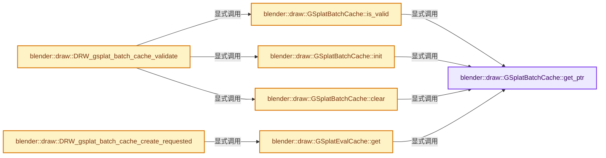
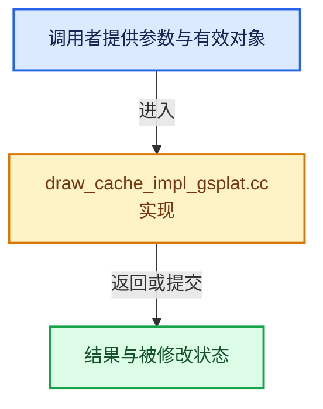

# 实现依赖专题：source/blender/draw/intern/draw_cache_impl_gsplat.cc

[实现依赖导航](../../../README.md) · [符号索引](../../../../00-课程指南/02-源码与提交索引/符号依赖与实现索引.md)

本专题从正文实际调用进入，集中保存共享实现。函数有稳定锚点，可从调用处直接跳到对应完整函数；递归与互相调用通过回链组织。

## 本文件的实现关系






## 完整成员与函数实现

<a id="f-4fa4845182ad3789"></a>

### `blender::draw::GSplatBatchCache::get_ptr`

实现位置：[source/blender/draw/intern/draw_cache_impl_gsplat.cc](../../../../../../../../source/blender/draw/intern/draw_cache_impl_gsplat.cc) · L499—L502。

接口参数：

- `PointCloud &pointcloud`

**教学注释版**

<!-- annotated:9c60574344ca49 -->

```cpp
  static GSplatBatchCache *get_ptr(PointCloud &pointcloud)
  {
    return pointcloud.gsplat_batch_cache;
  }
```

<details>
<summary>核对原始源码：source/blender/draw/intern/draw_cache_impl_gsplat.cc · L499—L502</summary>

<!-- original:9c60574344ca49:source/blender/draw/intern/draw_cache_impl_gsplat.cc:499:502 -->

```cpp
  static GSplatBatchCache *get_ptr(PointCloud &pointcloud)
  {
    return pointcloud.gsplat_batch_cache;
  }
```

</details>

**结果出口**

- `return pointcloud.gsplat_batch_cache;`

**继续追踪实现**

本实现没有需要继续展开的显式调用；检查返回表达式、对象转换和调用者前置条件。

<a id="f-dc30dbbeb2aaaf16"></a>

### `blender::draw::GSplatBatchCache::is_valid`

实现位置：[source/blender/draw/intern/draw_cache_impl_gsplat.cc](../../../../../../../../source/blender/draw/intern/draw_cache_impl_gsplat.cc) · L504—L514。

接口参数：

- `PointCloud &pointcloud`

**教学注释版**

<!-- annotated:a2ce0f79fad147 -->

```cpp
  static bool is_valid(PointCloud &pointcloud)
  {
    GSplatBatchCache *ptr = GSplatBatchCache::get_ptr(pointcloud);
    if (!ptr) {
      return false;
    }
    if (ptr->eval_cache.mat_len != BKE_id_material_used_with_fallback_eval(pointcloud.id)) {
      return false;
    }
    return !ptr->is_dirty;
  }
```

<details>
<summary>核对原始源码：source/blender/draw/intern/draw_cache_impl_gsplat.cc · L504—L514</summary>

<!-- original:a2ce0f79fad147:source/blender/draw/intern/draw_cache_impl_gsplat.cc:504:514 -->

```cpp
  static bool is_valid(PointCloud &pointcloud)
  {
    GSplatBatchCache *ptr = GSplatBatchCache::get_ptr(pointcloud);
    if (!ptr) {
      return false;
    }
    if (ptr->eval_cache.mat_len != BKE_id_material_used_with_fallback_eval(pointcloud.id)) {
      return false;
    }
    return !ptr->is_dirty;
  }
```

</details>

**结果出口**

- `return false;`
- `return !ptr->is_dirty;`

**继续追踪实现**

- `GSplatBatchCache::get_ptr` → [blender::draw::GSplatBatchCache::get_ptr · L499](draw_cache_impl_gsplat.cc.md#f-4fa4845182ad3789)。
- `BKE_id_material_used_with_fallback_eval` → [blender::BKE_id_material_used_with_fallback_eval · L891](../../../02-BKE几何与数据/intern/material.cc.md#f-54149818112236cb)。

<a id="f-ab34f6a79d603c09"></a>

### `blender::draw::GSplatBatchCache::init`

实现位置：[source/blender/draw/intern/draw_cache_impl_gsplat.cc](../../../../../../../../source/blender/draw/intern/draw_cache_impl_gsplat.cc) · L516—L533。

接口参数：

- `PointCloud &pointcloud`

**教学注释版**

<!-- annotated:8dfd65a14292e6 -->

```cpp
  static void init(PointCloud &pointcloud)
  {
    GSplatBatchCache *ptr = GSplatBatchCache::get_ptr(pointcloud);
    if (!ptr) {
      ptr = MEM_new<GSplatBatchCache>(__func__);
      pointcloud.gsplat_batch_cache = ptr;
    }
    else {
      ptr->eval_cache = {};
      ptr->eval_cache.edit_dots = nullptr;
      ptr->eval_cache.edit_dots_indices = nullptr;
    }

    ptr->eval_cache.mat_len = BKE_id_material_used_with_fallback_eval(pointcloud.id);
    ptr->eval_cache.surface_per_mat = MEM_new_array_zeroed<gpu::Batch *>(ptr->eval_cache.mat_len,
                                                                         __func__);
    ptr->is_dirty = false;
  }
```

<details>
<summary>核对原始源码：source/blender/draw/intern/draw_cache_impl_gsplat.cc · L516—L533</summary>

<!-- original:8dfd65a14292e6:source/blender/draw/intern/draw_cache_impl_gsplat.cc:516:533 -->

```cpp
  static void init(PointCloud &pointcloud)
  {
    GSplatBatchCache *ptr = GSplatBatchCache::get_ptr(pointcloud);
    if (!ptr) {
      ptr = MEM_new<GSplatBatchCache>(__func__);
      pointcloud.gsplat_batch_cache = ptr;
    }
    else {
      ptr->eval_cache = {};
      ptr->eval_cache.edit_dots = nullptr;
      ptr->eval_cache.edit_dots_indices = nullptr;
    }

    ptr->eval_cache.mat_len = BKE_id_material_used_with_fallback_eval(pointcloud.id);
    ptr->eval_cache.surface_per_mat = MEM_new_array_zeroed<gpu::Batch *>(ptr->eval_cache.mat_len,
                                                                         __func__);
    ptr->is_dirty = false;
  }
```

</details>

**沿实际写入检查状态**

- `ptr = MEM_new<GSplatBatchCache>(__func__);`
- `pointcloud.gsplat_batch_cache = ptr;`
- `ptr->eval_cache = {};`
- `ptr->eval_cache.edit_dots = nullptr;`
- `ptr->eval_cache.edit_dots_indices = nullptr;`
- `ptr->eval_cache.mat_len = BKE_id_material_used_with_fallback_eval(pointcloud.id);`
- `ptr->eval_cache.surface_per_mat = MEM_new_array_zeroed<gpu::Batch *>(ptr->eval_cache.mat_len,`
- `ptr->is_dirty = false;`

**继续追踪实现**

- `GSplatBatchCache::get_ptr` → [blender::draw::GSplatBatchCache::get_ptr · L499](draw_cache_impl_gsplat.cc.md#f-4fa4845182ad3789)。
- `MEM_new<GSplatBatchCache>` → [MEM_new · L351](../../../07-Intern运行时与平台/guardedalloc/MEM_guardedalloc.h.md#f-115f9b6784f89912)。
- `BKE_id_material_used_with_fallback_eval` → [blender::BKE_id_material_used_with_fallback_eval · L891](../../../02-BKE几何与数据/intern/material.cc.md#f-54149818112236cb)。
- `MEM_new_array_zeroed<gpu::Batch *>` → [MEM_new_array_zeroed · L566](../../../07-Intern运行时与平台/guardedalloc/MEM_guardedalloc.h.md#f-3a0cf63fb5216500)；[MEM_new_array_zeroed · L119](../../../07-Intern运行时与平台/guardedalloc/intern/mallocn.cc.md#f-6825557da566fdbe)。同名重载需按实参类型选择。

<a id="f-242a219ef9c0c299"></a>

### `blender::draw::GSplatBatchCache::clear`

实现位置：[source/blender/draw/intern/draw_cache_impl_gsplat.cc](../../../../../../../../source/blender/draw/intern/draw_cache_impl_gsplat.cc) · L535—L542。

接口参数：

- `PointCloud &pointcloud`

**教学注释版**

<!-- annotated:43961b1e7edbe2 -->

```cpp
  static void clear(PointCloud &pointcloud)
  {
    GSplatBatchCache *ptr = GSplatBatchCache::get_ptr(pointcloud);
    if (!ptr) {
      return;
    }
    ptr->eval_cache.discard_buffers();
  }
```

<details>
<summary>核对原始源码：source/blender/draw/intern/draw_cache_impl_gsplat.cc · L535—L542</summary>

<!-- original:43961b1e7edbe2:source/blender/draw/intern/draw_cache_impl_gsplat.cc:535:542 -->

```cpp
  static void clear(PointCloud &pointcloud)
  {
    GSplatBatchCache *ptr = GSplatBatchCache::get_ptr(pointcloud);
    if (!ptr) {
      return;
    }
    ptr->eval_cache.discard_buffers();
  }
```

</details>

**继续追踪实现**

- `GSplatBatchCache::get_ptr` → [blender::draw::GSplatBatchCache::get_ptr · L499](draw_cache_impl_gsplat.cc.md#f-4fa4845182ad3789)。
- `ptr->eval_cache.discard_buffers` → [调用协议](../../../../00-课程指南/01-路线与规范/模板宏与动态分派协议.md)：接收对象类型依赖auto、返回值或模板实例；不按同名猜测目标。调用位置L541。

<a id="f-3fb704a0b74cb9e4"></a>

### `blender::draw::GSplatEvalCache::get`

实现位置：[source/blender/draw/intern/draw_cache_impl_gsplat.cc](../../../../../../../../source/blender/draw/intern/draw_cache_impl_gsplat.cc) · L545—L548。

接口参数：

- `PointCloud &pointcloud`

**教学注释版**

<!-- annotated:b6680d3259c16d -->

```cpp
GSplatEvalCache &GSplatEvalCache::get(PointCloud &pointcloud)
{
  return GSplatBatchCache::get_ptr(pointcloud)->eval_cache;
}
```

<details>
<summary>核对原始源码：source/blender/draw/intern/draw_cache_impl_gsplat.cc · L545—L548</summary>

<!-- original:b6680d3259c16d:source/blender/draw/intern/draw_cache_impl_gsplat.cc:545:548 -->

```cpp
GSplatEvalCache &GSplatEvalCache::get(PointCloud &pointcloud)
{
  return GSplatBatchCache::get_ptr(pointcloud)->eval_cache;
}
```

</details>

**结果出口**

- `return GSplatBatchCache::get_ptr(pointcloud)->eval_cache;`

**继续追踪实现**

- `GSplatBatchCache::get_ptr` → [blender::draw::GSplatBatchCache::get_ptr · L499](draw_cache_impl_gsplat.cc.md#f-4fa4845182ad3789)。

<a id="f-c42d1952a8e065ad"></a>

### `blender::draw::DRW_gsplat_batch_cache_create_requested`

实现位置：[source/blender/draw/intern/draw_cache_impl_gsplat.cc](../../../../../../../../source/blender/draw/intern/draw_cache_impl_gsplat.cc) · L597—L604。

接口参数：

- `Object *ob`

**教学注释版**

<!-- annotated:aaf31d3c0f9a9b -->

```cpp
void DRW_gsplat_batch_cache_create_requested(Object *ob)
{
  PointCloud &pointcloud = DRW_object_get_data_for_drawing<PointCloud>(*ob);
  if (pointcloud.type != PointCloudType::GSplat) {
    return;
  }
  GSplatEvalCache::get(pointcloud).ensure_requested(pointcloud);
}
```

<details>
<summary>核对原始源码：source/blender/draw/intern/draw_cache_impl_gsplat.cc · L597—L604</summary>

<!-- original:aaf31d3c0f9a9b:source/blender/draw/intern/draw_cache_impl_gsplat.cc:597:604 -->

```cpp
void DRW_gsplat_batch_cache_create_requested(Object *ob)
{
  PointCloud &pointcloud = DRW_object_get_data_for_drawing<PointCloud>(*ob);
  if (pointcloud.type != PointCloudType::GSplat) {
    return;
  }
  GSplatEvalCache::get(pointcloud).ensure_requested(pointcloud);
}
```

</details>

**继续追踪实现**

- `DRW_object_get_data_for_drawing<PointCloud>` → [blender::DRW_object_get_data_for_drawing · L203](DRW_render.hh.md#f-dad88423243c219e)；[blender::DRW_object_get_data_for_drawing · L218](DRW_render.hh.md#f-223e280efbea59b2)。同名重载需按实参类型选择。
- `GSplatEvalCache::get(pointcloud).ensure_requested` → [调用协议](../../../../00-课程指南/01-路线与规范/模板宏与动态分派协议.md)：接收对象类型依赖auto、返回值或模板实例；不按同名猜测目标。调用位置L603。
- `GSplatEvalCache::get` → [blender::draw::GSplatEvalCache::get · L545](draw_cache_impl_gsplat.cc.md#f-3fb704a0b74cb9e4)。

<a id="f-bcbfbff508fd8392"></a>

### `blender::draw::DRW_gsplat_batch_cache_validate`

实现位置：[source/blender/draw/intern/draw_cache_impl_gsplat.cc](../../../../../../../../source/blender/draw/intern/draw_cache_impl_gsplat.cc) · L622—L632。

接口参数：

- `PointCloud *pointcloud`

**教学注释版**

<!-- annotated:b499159fd931fa -->

```cpp
void DRW_gsplat_batch_cache_validate(PointCloud *pointcloud)
{
  if (pointcloud->type != PointCloudType::GSplat) {
    return;
  }

  if (!GSplatBatchCache::is_valid(*pointcloud)) {
    GSplatBatchCache::clear(*pointcloud);
    GSplatBatchCache::init(*pointcloud);
  }
}
```

<details>
<summary>核对原始源码：source/blender/draw/intern/draw_cache_impl_gsplat.cc · L622—L632</summary>

<!-- original:b499159fd931fa:source/blender/draw/intern/draw_cache_impl_gsplat.cc:622:632 -->

```cpp
void DRW_gsplat_batch_cache_validate(PointCloud *pointcloud)
{
  if (pointcloud->type != PointCloudType::GSplat) {
    return;
  }

  if (!GSplatBatchCache::is_valid(*pointcloud)) {
    GSplatBatchCache::clear(*pointcloud);
    GSplatBatchCache::init(*pointcloud);
  }
}
```

</details>

**继续追踪实现**

- `GSplatBatchCache::is_valid` → [blender::draw::GSplatBatchCache::is_valid · L504](draw_cache_impl_gsplat.cc.md#f-dc30dbbeb2aaaf16)。
- `GSplatBatchCache::clear` → [blender::draw::GSplatBatchCache::clear · L535](draw_cache_impl_gsplat.cc.md#f-242a219ef9c0c299)。
- `GSplatBatchCache::init` → [blender::draw::GSplatBatchCache::init · L516](draw_cache_impl_gsplat.cc.md#f-ab34f6a79d603c09)。
