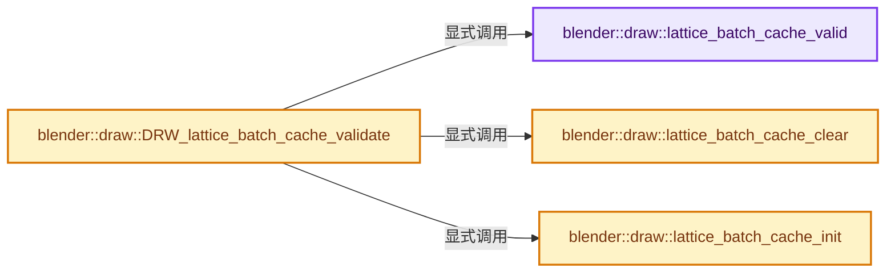
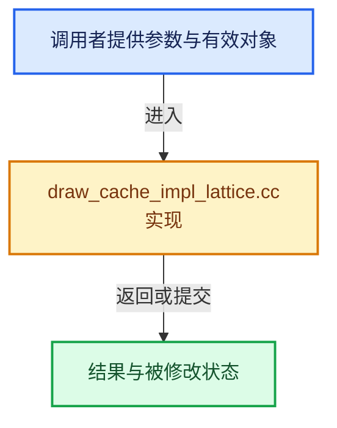

# 实现依赖专题：source/blender/draw/intern/draw_cache_impl_lattice.cc

[实现依赖导航](../../../README.md) · [符号索引](../../../../00-课程指南/02-源码与提交索引/符号依赖与实现索引.md)

本专题从正文实际调用进入，集中保存共享实现。函数有稳定锚点，可从调用处直接跳到对应完整函数；递归与互相调用通过回链组织。

## 本文件的实现关系






## 完整成员与函数实现

<a id="f-816959b35e61232f"></a>

### `blender::draw::lattice_batch_cache_valid`

实现位置：[source/blender/draw/intern/draw_cache_impl_lattice.cc](../../../../../../../../source/blender/draw/intern/draw_cache_impl_lattice.cc) · L216—L240。

接口参数：

- `Lattice *lt`

**教学注释版**

<!-- annotated:b079f879796ef9 -->

```cpp
static bool lattice_batch_cache_valid(Lattice *lt)
{
  LatticeBatchCache *cache = lt->batch_cache;

  if (cache == nullptr) {
    return false;
  }

  if (cache->is_editmode != (lt->editlatt != nullptr)) {
    return false;
  }

  if (cache->is_dirty) {
    return false;
  }

  if ((cache->dims.u_len != lt->pntsu) || (cache->dims.v_len != lt->pntsv) ||
      (cache->dims.w_len != lt->pntsw) ||
      (cache->show_only_outside != ((lt->flag & LT_OUTSIDE) != 0)))
  {
    return false;
  }

  return true;
}
```

<details>
<summary>核对原始源码：source/blender/draw/intern/draw_cache_impl_lattice.cc · L216—L240</summary>

<!-- original:b079f879796ef9:source/blender/draw/intern/draw_cache_impl_lattice.cc:216:240 -->

```cpp
static bool lattice_batch_cache_valid(Lattice *lt)
{
  LatticeBatchCache *cache = lt->batch_cache;

  if (cache == nullptr) {
    return false;
  }

  if (cache->is_editmode != (lt->editlatt != nullptr)) {
    return false;
  }

  if (cache->is_dirty) {
    return false;
  }

  if ((cache->dims.u_len != lt->pntsu) || (cache->dims.v_len != lt->pntsv) ||
      (cache->dims.w_len != lt->pntsw) ||
      (cache->show_only_outside != ((lt->flag & LT_OUTSIDE) != 0)))
  {
    return false;
  }

  return true;
}
```

</details>

**结果出口**

- `return false;`
- `return true;`

**继续追踪实现**

本实现没有需要继续展开的显式调用；检查返回表达式、对象转换和调用者前置条件。

<a id="f-5410fdc3a925244f"></a>

### `blender::draw::lattice_batch_cache_init`

实现位置：[source/blender/draw/intern/draw_cache_impl_lattice.cc](../../../../../../../../source/blender/draw/intern/draw_cache_impl_lattice.cc) · L242—L261。

接口参数：

- `Lattice *lt`

**教学注释版**

<!-- annotated:c2b46162dc740c -->

```cpp
static void lattice_batch_cache_init(Lattice *lt)
{
  LatticeBatchCache *cache = lt->batch_cache;

  if (!cache) {
    lt->batch_cache = cache = MEM_new_zeroed<LatticeBatchCache>(__func__);
  }
  else {
    // [讲解] memset：填充字节，不调用T构造函数，也不保证任意类型的全零表示是合法或期望值。
    memset(cache, 0, sizeof(*cache));
  }

  cache->dims.u_len = lt->pntsu;
  cache->dims.v_len = lt->pntsv;
  cache->dims.w_len = lt->pntsw;
  cache->show_only_outside = (lt->flag & LT_OUTSIDE) != 0;

  cache->is_editmode = lt->editlatt != nullptr;

  cache->is_dirty = false;
}
```

<details>
<summary>核对原始源码：source/blender/draw/intern/draw_cache_impl_lattice.cc · L242—L261</summary>

<!-- original:c2b46162dc740c:source/blender/draw/intern/draw_cache_impl_lattice.cc:242:261 -->

```cpp
static void lattice_batch_cache_init(Lattice *lt)
{
  LatticeBatchCache *cache = lt->batch_cache;

  if (!cache) {
    lt->batch_cache = cache = MEM_new_zeroed<LatticeBatchCache>(__func__);
  }
  else {
    memset(cache, 0, sizeof(*cache));
  }

  cache->dims.u_len = lt->pntsu;
  cache->dims.v_len = lt->pntsv;
  cache->dims.w_len = lt->pntsw;
  cache->show_only_outside = (lt->flag & LT_OUTSIDE) != 0;

  cache->is_editmode = lt->editlatt != nullptr;

  cache->is_dirty = false;
}
```

</details>

**沿实际写入检查状态**

- `lt->batch_cache = cache = MEM_new_zeroed<LatticeBatchCache>(__func__);`
- `cache->dims.u_len = lt->pntsu;`
- `cache->dims.v_len = lt->pntsv;`
- `cache->dims.w_len = lt->pntsw;`
- `cache->show_only_outside = (lt->flag & LT_OUTSIDE) != 0;`
- `cache->is_editmode = lt->editlatt != nullptr;`
- `cache->is_dirty = false;`

**继续追踪实现**

- `MEM_new_zeroed<LatticeBatchCache>` → [MEM_new_zeroed · L550](../../../07-Intern运行时与平台/guardedalloc/MEM_guardedalloc.h.md#f-eeb1e2a7f57dd231)；[MEM_new_zeroed · L114](../../../07-Intern运行时与平台/guardedalloc/intern/mallocn.cc.md#f-e04cf01c64c8b180)。同名重载需按实参类型选择。
- `memset` → [外部契约](https://eel.is/c++draft/cstring.syn)：填充字节，不调用T构造函数，也不保证任意类型的全零表示是合法或期望值。

<a id="f-71d22645cb658b2d"></a>

### `blender::draw::DRW_lattice_batch_cache_validate`

实现位置：[source/blender/draw/intern/draw_cache_impl_lattice.cc](../../../../../../../../source/blender/draw/intern/draw_cache_impl_lattice.cc) · L263—L269。

接口参数：

- `Lattice *lt`

**教学注释版**

<!-- annotated:51d893d52598ec -->

```cpp
void DRW_lattice_batch_cache_validate(Lattice *lt)
{
  if (!lattice_batch_cache_valid(lt)) {
    lattice_batch_cache_clear(lt);
    lattice_batch_cache_init(lt);
  }
}
```

<details>
<summary>核对原始源码：source/blender/draw/intern/draw_cache_impl_lattice.cc · L263—L269</summary>

<!-- original:51d893d52598ec:source/blender/draw/intern/draw_cache_impl_lattice.cc:263:269 -->

```cpp
void DRW_lattice_batch_cache_validate(Lattice *lt)
{
  if (!lattice_batch_cache_valid(lt)) {
    lattice_batch_cache_clear(lt);
    lattice_batch_cache_init(lt);
  }
}
```

</details>

**继续追踪实现**

- `lattice_batch_cache_valid` → [blender::draw::lattice_batch_cache_valid · L216](draw_cache_impl_lattice.cc.md#f-816959b35e61232f)。
- `lattice_batch_cache_clear` → [blender::draw::lattice_batch_cache_clear · L295](draw_cache_impl_lattice.cc.md#f-857e80decada1906)。
- `lattice_batch_cache_init` → [blender::draw::lattice_batch_cache_init · L242](draw_cache_impl_lattice.cc.md#f-5410fdc3a925244f)。

<a id="f-857e80decada1906"></a>

### `blender::draw::lattice_batch_cache_clear`

实现位置：[source/blender/draw/intern/draw_cache_impl_lattice.cc](../../../../../../../../source/blender/draw/intern/draw_cache_impl_lattice.cc) · L295—L308。

接口参数：

- `Lattice *lt`

**教学注释版**

<!-- annotated:b91459f55010aa -->

```cpp
static void lattice_batch_cache_clear(Lattice *lt)
{
  LatticeBatchCache *cache = lt->batch_cache;
  if (!cache) {
    return;
  }

  GPU_BATCH_DISCARD_SAFE(cache->all_verts);
  GPU_BATCH_DISCARD_SAFE(cache->all_edges);
  GPU_BATCH_DISCARD_SAFE(cache->overlay_verts);

  GPU_VERTBUF_DISCARD_SAFE(cache->pos);
  GPU_INDEXBUF_DISCARD_SAFE(cache->edges);
}
```

<details>
<summary>核对原始源码：source/blender/draw/intern/draw_cache_impl_lattice.cc · L295—L308</summary>

<!-- original:b91459f55010aa:source/blender/draw/intern/draw_cache_impl_lattice.cc:295:308 -->

```cpp
static void lattice_batch_cache_clear(Lattice *lt)
{
  LatticeBatchCache *cache = lt->batch_cache;
  if (!cache) {
    return;
  }

  GPU_BATCH_DISCARD_SAFE(cache->all_verts);
  GPU_BATCH_DISCARD_SAFE(cache->all_edges);
  GPU_BATCH_DISCARD_SAFE(cache->overlay_verts);

  GPU_VERTBUF_DISCARD_SAFE(cache->pos);
  GPU_INDEXBUF_DISCARD_SAFE(cache->edges);
}
```

</details>

**继续追踪实现**

- `GPU_BATCH_DISCARD_SAFE` → [GPU_BATCH_DISCARD_SAFE · L199](../../gpu/GPU_batch.hh.md#m-167d477926a1)。宏定义由构建条件选择。
- `GPU_VERTBUF_DISCARD_SAFE` → [GPU_VERTBUF_DISCARD_SAFE · L372](../../gpu/GPU_vertex_buffer.hh.md#m-6427e4c6901c)。宏定义由构建条件选择。
- `GPU_INDEXBUF_DISCARD_SAFE` → [GPU_INDEXBUF_DISCARD_SAFE · L299](../../gpu/GPU_index_buffer.hh.md#m-f3c9c7333ad4)。宏定义由构建条件选择。
