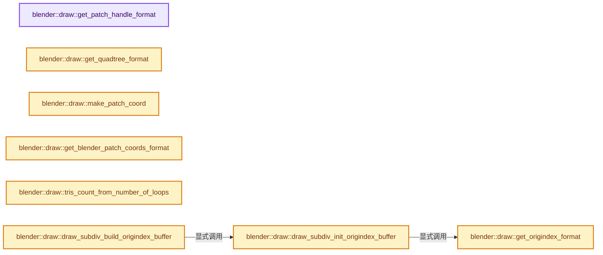
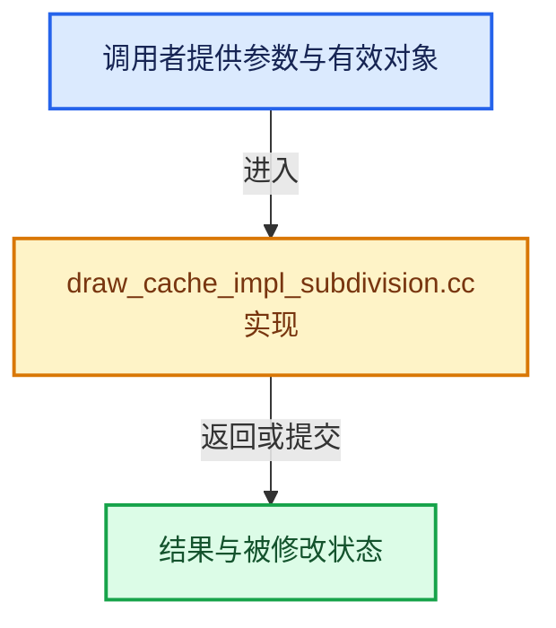

# 实现依赖专题：source/blender/draw/intern/draw_cache_impl_subdivision.cc

[实现依赖导航](../../../README.md) · [符号索引](../../../../00-课程指南/02-源码与提交索引/符号依赖与实现索引.md)

本专题从正文实际调用进入，集中保存共享实现。函数有稳定锚点，可从调用处直接跳到对应完整函数；递归与互相调用通过回链组织。

## 本文件的实现关系






## 完整成员与函数实现

<a id="f-e771a5feb1245d21"></a>

### `blender::draw::get_patch_handle_format`

实现位置：[source/blender/draw/intern/draw_cache_impl_subdivision.cc](../../../../../../../../source/blender/draw/intern/draw_cache_impl_subdivision.cc) · L66—L76。

**教学注释版**

<!-- annotated:6c09b288d57fdd -->

```cpp
static const GPUVertFormat &get_patch_handle_format()
{
  static const GPUVertFormat format = [&]() {
    GPUVertFormat format{};
    GPU_vertformat_attr_add(&format, "vert_index", gpu::VertAttrType::SINT_32);
    GPU_vertformat_attr_add(&format, "array_index", gpu::VertAttrType::SINT_32);
    GPU_vertformat_attr_add(&format, "patch_index", gpu::VertAttrType::SINT_32);
    return format;
  }();
  return format;
}
```

<details>
<summary>核对原始源码：source/blender/draw/intern/draw_cache_impl_subdivision.cc · L66—L76</summary>

<!-- original:6c09b288d57fdd:source/blender/draw/intern/draw_cache_impl_subdivision.cc:66:76 -->

```cpp
static const GPUVertFormat &get_patch_handle_format()
{
  static const GPUVertFormat format = [&]() {
    GPUVertFormat format{};
    GPU_vertformat_attr_add(&format, "vert_index", gpu::VertAttrType::SINT_32);
    GPU_vertformat_attr_add(&format, "array_index", gpu::VertAttrType::SINT_32);
    GPU_vertformat_attr_add(&format, "patch_index", gpu::VertAttrType::SINT_32);
    return format;
  }();
  return format;
}
```

</details>

**结果出口**

- `return format;`

**继续追踪实现**

- `[&]() { GPUVertFormat format{}; GPU_vertformat_attr_add(&format, "vert_index", gpu::VertAttrType::SINT_32); GPU_vertformat_attr_add(&format, "array_index", gpu::VertAttrType::SINT_ …（完整表达式见本函数源码）` → [调用协议](../../../../00-课程指南/01-路线与规范/模板宏与动态分派协议.md)：函数指针、局部可调用对象或未展开的宏；必须结合调用者环境。调用位置L68。
- `GPU_vertformat_attr_add` → [blender::GPU_vertformat_attr_add · L389](../../gpu/intern/gpu_vertex_format.cc.md#f-a36e23f37b97fff4)。

<a id="f-381afc2fcfbfaf1f"></a>

### `blender::draw::get_quadtree_format`

实现位置：[source/blender/draw/intern/draw_cache_impl_subdivision.cc](../../../../../../../../source/blender/draw/intern/draw_cache_impl_subdivision.cc) · L79—L87。

**教学注释版**

<!-- annotated:f629b99c2e48bc -->

```cpp
static const GPUVertFormat &get_quadtree_format()
{
  static const GPUVertFormat format = [&]() {
    GPUVertFormat format{};
    GPU_vertformat_attr_add(&format, "child", gpu::VertAttrType::UINT_32_32_32_32);
    return format;
  }();
  return format;
}
```

<details>
<summary>核对原始源码：source/blender/draw/intern/draw_cache_impl_subdivision.cc · L79—L87</summary>

<!-- original:f629b99c2e48bc:source/blender/draw/intern/draw_cache_impl_subdivision.cc:79:87 -->

```cpp
static const GPUVertFormat &get_quadtree_format()
{
  static const GPUVertFormat format = [&]() {
    GPUVertFormat format{};
    GPU_vertformat_attr_add(&format, "child", gpu::VertAttrType::UINT_32_32_32_32);
    return format;
  }();
  return format;
}
```

</details>

**结果出口**

- `return format;`

**继续追踪实现**

- `[&]() { GPUVertFormat format{}; GPU_vertformat_attr_add(&format, "child", gpu::VertAttrType::UINT_32_32_32_32); return format; }` → [调用协议](../../../../00-课程指南/01-路线与规范/模板宏与动态分派协议.md)：函数指针、局部可调用对象或未展开的宏；必须结合调用者环境。调用位置L81。
- `GPU_vertformat_attr_add` → [blender::GPU_vertformat_attr_add · L389](../../gpu/intern/gpu_vertex_format.cc.md#f-a36e23f37b97fff4)。

<a id="f-54090602186e3e0c"></a>

### `blender::draw::make_patch_coord`

实现位置：[source/blender/draw/intern/draw_cache_impl_subdivision.cc](../../../../../../../../source/blender/draw/intern/draw_cache_impl_subdivision.cc) · L95—L102。

接口参数：

- `int ptex_face_index`
- `float u`
- `float v`

**教学注释版**

<!-- annotated:aa86adf4b10e6b -->

```cpp
MINLINE CompressedPatchCoord make_patch_coord(int ptex_face_index, float u, float v)
{
  CompressedPatchCoord patch_coord = {
      ptex_face_index,
      (uint(u * 65535.0f) << 16) | uint(v * 65535.0f),
  };
  return patch_coord;
}
```

<details>
<summary>核对原始源码：source/blender/draw/intern/draw_cache_impl_subdivision.cc · L95—L102</summary>

<!-- original:aa86adf4b10e6b:source/blender/draw/intern/draw_cache_impl_subdivision.cc:95:102 -->

```cpp
MINLINE CompressedPatchCoord make_patch_coord(int ptex_face_index, float u, float v)
{
  CompressedPatchCoord patch_coord = {
      ptex_face_index,
      (uint(u * 65535.0f) << 16) | uint(v * 65535.0f),
  };
  return patch_coord;
}
```

</details>

**结果出口**

- `return patch_coord;`

**继续追踪实现**

本实现没有需要继续展开的显式调用；检查返回表达式、对象转换和调用者前置条件。

<a id="f-2ad8f08868297565"></a>

### `blender::draw::get_blender_patch_coords_format`

实现位置：[source/blender/draw/intern/draw_cache_impl_subdivision.cc](../../../../../../../../source/blender/draw/intern/draw_cache_impl_subdivision.cc) · L105—L115。

**教学注释版**

<!-- annotated:7b6ac44154f9e6 -->

```cpp
static const GPUVertFormat &get_blender_patch_coords_format()
{
  static const GPUVertFormat format = [&]() {
    GPUVertFormat format{};
    /* WARNING! Adjust #CompressedPatchCoord accordingly. */
    GPU_vertformat_attr_add(&format, "ptex_face_index", gpu::VertAttrType::UINT_32);
    GPU_vertformat_attr_add(&format, "uv", gpu::VertAttrType::UINT_32);
    return format;
  }();
  return format;
}
```

<details>
<summary>核对原始源码：source/blender/draw/intern/draw_cache_impl_subdivision.cc · L105—L115</summary>

<!-- original:7b6ac44154f9e6:source/blender/draw/intern/draw_cache_impl_subdivision.cc:105:115 -->

```cpp
static const GPUVertFormat &get_blender_patch_coords_format()
{
  static const GPUVertFormat format = [&]() {
    GPUVertFormat format{};
    /* WARNING! Adjust #CompressedPatchCoord accordingly. */
    GPU_vertformat_attr_add(&format, "ptex_face_index", gpu::VertAttrType::UINT_32);
    GPU_vertformat_attr_add(&format, "uv", gpu::VertAttrType::UINT_32);
    return format;
  }();
  return format;
}
```

</details>

**结果出口**

- `return format;`

**继续追踪实现**

- `[&]() { GPUVertFormat format{}; /* WARNING! Adjust #CompressedPatchCoord accordingly. */ GPU_vertformat_attr_add(&format, "ptex_face_index", gpu::VertAttrType::UINT_32); GPU_vertfo …（完整表达式见本函数源码）` → [调用协议](../../../../00-课程指南/01-路线与规范/模板宏与动态分派协议.md)：函数指针、局部可调用对象或未展开的宏；必须结合调用者环境。调用位置L107。
- `GPU_vertformat_attr_add` → [blender::GPU_vertformat_attr_add · L389](../../gpu/intern/gpu_vertex_format.cc.md#f-a36e23f37b97fff4)。

<a id="f-feb6c7ebe32f2e69"></a>

### `blender::draw::get_origindex_format`

实现位置：[source/blender/draw/intern/draw_cache_impl_subdivision.cc](../../../../../../../../source/blender/draw/intern/draw_cache_impl_subdivision.cc) · L119—L127。

**教学注释版**

<!-- annotated:70c08bb38358a5 -->

```cpp
static const GPUVertFormat &get_origindex_format()
{
  static const GPUVertFormat format = [&]() {
    GPUVertFormat format{};
    GPU_vertformat_attr_add(&format, "index", gpu::VertAttrType::SINT_32);
    return format;
  }();
  return format;
}
```

<details>
<summary>核对原始源码：source/blender/draw/intern/draw_cache_impl_subdivision.cc · L119—L127</summary>

<!-- original:70c08bb38358a5:source/blender/draw/intern/draw_cache_impl_subdivision.cc:119:127 -->

```cpp
static const GPUVertFormat &get_origindex_format()
{
  static const GPUVertFormat format = [&]() {
    GPUVertFormat format{};
    GPU_vertformat_attr_add(&format, "index", gpu::VertAttrType::SINT_32);
    return format;
  }();
  return format;
}
```

</details>

**结果出口**

- `return format;`

**继续追踪实现**

- `[&]() { GPUVertFormat format{}; GPU_vertformat_attr_add(&format, "index", gpu::VertAttrType::SINT_32); return format; }` → [调用协议](../../../../00-课程指南/01-路线与规范/模板宏与动态分派协议.md)：函数指针、局部可调用对象或未展开的宏；必须结合调用者环境。调用位置L121。
- `GPU_vertformat_attr_add` → [blender::GPU_vertformat_attr_add · L389](../../gpu/intern/gpu_vertex_format.cc.md#f-a36e23f37b97fff4)。

<a id="f-ea04fa812b164ae5"></a>

### `blender::draw::tris_count_from_number_of_loops`

实现位置：[source/blender/draw/intern/draw_cache_impl_subdivision.cc](../../../../../../../../source/blender/draw/intern/draw_cache_impl_subdivision.cc) · L133—L137。

接口参数：

- `const uint number_of_loops`

**教学注释版**

<!-- annotated:840bf258471251 -->

```cpp
static uint tris_count_from_number_of_loops(const uint number_of_loops)
{
  const uint32_t number_of_quads = number_of_loops / 4;
  return number_of_quads * 2;
}
```

<details>
<summary>核对原始源码：source/blender/draw/intern/draw_cache_impl_subdivision.cc · L133—L137</summary>

<!-- original:840bf258471251:source/blender/draw/intern/draw_cache_impl_subdivision.cc:133:137 -->

```cpp
static uint tris_count_from_number_of_loops(const uint number_of_loops)
{
  const uint32_t number_of_quads = number_of_loops / 4;
  return number_of_quads * 2;
}
```

</details>

**结果出口**

- `return number_of_quads * 2;`

**继续追踪实现**

本实现没有需要继续展开的显式调用；检查返回表达式、对象转换和调用者前置条件。

<a id="f-3fb68beaee2d1cd9"></a>

### `blender::draw::draw_subdiv_init_origindex_buffer`

实现位置：[source/blender/draw/intern/draw_cache_impl_subdivision.cc](../../../../../../../../source/blender/draw/intern/draw_cache_impl_subdivision.cc) · L143—L153。

接口参数：

- `int32_t *vert_origindex`
- `uint num_loops`
- `uint loose_len`

**教学注释版**

<!-- annotated:4826c9edc189df -->

```cpp
gpu::VertBufPtr draw_subdiv_init_origindex_buffer(int32_t *vert_origindex,
                                                  uint num_loops,
                                                  uint loose_len)
{
  gpu::VertBufPtr buffer = gpu::VertBufPtr(
      GPU_vertbuf_create_with_format_ex(get_origindex_format(), GPU_USAGE_STATIC));
  GPU_vertbuf_data_alloc(*buffer, num_loops + loose_len);

  buffer->data<int32_t>().take_front(num_loops).copy_from({vert_origindex, num_loops});
  return buffer;
}
```

<details>
<summary>核对原始源码：source/blender/draw/intern/draw_cache_impl_subdivision.cc · L143—L153</summary>

<!-- original:4826c9edc189df:source/blender/draw/intern/draw_cache_impl_subdivision.cc:143:153 -->

```cpp
gpu::VertBufPtr draw_subdiv_init_origindex_buffer(int32_t *vert_origindex,
                                                  uint num_loops,
                                                  uint loose_len)
{
  gpu::VertBufPtr buffer = gpu::VertBufPtr(
      GPU_vertbuf_create_with_format_ex(get_origindex_format(), GPU_USAGE_STATIC));
  GPU_vertbuf_data_alloc(*buffer, num_loops + loose_len);

  buffer->data<int32_t>().take_front(num_loops).copy_from({vert_origindex, num_loops});
  return buffer;
}
```

</details>

**结果出口**

- `return buffer;`

**继续追踪实现**

- `gpu::VertBufPtr` → [调用协议](../../../../00-课程指南/01-路线与规范/模板宏与动态分派协议.md)：函数指针、局部可调用对象或未展开的宏；必须结合调用者环境。调用位置L147。
- `GPU_vertbuf_create_with_format_ex` → [blender::GPU_vertbuf_create_with_format_ex · L117](../../gpu/intern/gpu_vertex_buffer.cc.md#f-3c102ab38514393a)。
- `get_origindex_format` → [blender::draw::get_origindex_format · L119](draw_cache_impl_subdivision.cc.md#f-feb6c7ebe32f2e69)。
- `GPU_vertbuf_data_alloc` → [blender::GPU_vertbuf_data_alloc · L172](../../gpu/intern/gpu_vertex_buffer.cc.md#f-8ee5cf106e0f2b0f)。
- `buffer->data<int32_t>().take_front(num_loops).copy_from` → [调用协议](../../../../00-课程指南/01-路线与规范/模板宏与动态分派协议.md)：接收对象类型依赖auto、返回值或模板实例；不按同名猜测目标。调用位置L151。
- `buffer->data<int32_t>().take_front` → [调用协议](../../../../00-课程指南/01-路线与规范/模板宏与动态分派协议.md)：接收对象类型依赖auto、返回值或模板实例；不按同名猜测目标。调用位置L151。
- `buffer->data<int32_t>` → [blender::draw::data · L124](DRW_gpu_wrapper.hh.md#f-dc115dc22e0c9f33)；[blender::draw::data · L129](DRW_gpu_wrapper.hh.md#f-5f325cb75387045c)。同名重载需按实参类型选择。

<a id="f-c337413dc8956aac"></a>

### `blender::draw::draw_subdiv_build_origindex_buffer`

实现位置：[source/blender/draw/intern/draw_cache_impl_subdivision.cc](../../../../../../../../source/blender/draw/intern/draw_cache_impl_subdivision.cc) · L155—L158。

接口参数：

- `int *vert_origindex`
- `uint num_loops`

**教学注释版**

<!-- annotated:278a559f136200 -->

```cpp
gpu::VertBuf *draw_subdiv_build_origindex_buffer(int *vert_origindex, uint num_loops)
{
  return draw_subdiv_init_origindex_buffer(vert_origindex, num_loops, 0).release();
}
```

<details>
<summary>核对原始源码：source/blender/draw/intern/draw_cache_impl_subdivision.cc · L155—L158</summary>

<!-- original:278a559f136200:source/blender/draw/intern/draw_cache_impl_subdivision.cc:155:158 -->

```cpp
gpu::VertBuf *draw_subdiv_build_origindex_buffer(int *vert_origindex, uint num_loops)
{
  return draw_subdiv_init_origindex_buffer(vert_origindex, num_loops, 0).release();
}
```

</details>

**结果出口**

- `return draw_subdiv_init_origindex_buffer(vert_origindex, num_loops, 0).release();`

**继续追踪实现**

- `draw_subdiv_init_origindex_buffer(vert_origindex, num_loops, 0).release` → [调用协议](../../../../00-课程指南/01-路线与规范/模板宏与动态分派协议.md)：接收对象类型依赖auto、返回值或模板实例；不按同名猜测目标。调用位置L157。
- `draw_subdiv_init_origindex_buffer` → [blender::draw::draw_subdiv_init_origindex_buffer · L143](draw_cache_impl_subdivision.cc.md#f-3fb68beaee2d1cd9)；[blender::draw::draw_subdiv_init_origindex_buffer · L160](draw_cache_impl_subdivision.cc.md#f-f2672bab89b8cd4f)。同名重载需按实参类型选择。

<a id="f-f2672bab89b8cd4f"></a>

### `blender::draw::draw_subdiv_init_origindex_buffer`

实现位置：[source/blender/draw/intern/draw_cache_impl_subdivision.cc](../../../../../../../../source/blender/draw/intern/draw_cache_impl_subdivision.cc) · L160—L168。

接口参数：

- `Span<int32_t> vert_origindex`
- `uint loose_len`

**教学注释版**

<!-- annotated:fd9bdcd3f558b8 -->

```cpp
gpu::VertBufPtr draw_subdiv_init_origindex_buffer(Span<int32_t> vert_origindex, uint loose_len)
{
  gpu::VertBufPtr buffer = gpu::VertBufPtr(
      GPU_vertbuf_create_with_format_ex(get_origindex_format(), GPU_USAGE_STATIC));
  // [讲解] vert_origindex.size：查询视图长度或生成对应有效索引区间。
  GPU_vertbuf_data_alloc(*buffer, vert_origindex.size() + loose_len);

  buffer->data<int32_t>().take_front(vert_origindex.size()).copy_from(vert_origindex);
  return buffer;
}
```

<details>
<summary>核对原始源码：source/blender/draw/intern/draw_cache_impl_subdivision.cc · L160—L168</summary>

<!-- original:fd9bdcd3f558b8:source/blender/draw/intern/draw_cache_impl_subdivision.cc:160:168 -->

```cpp
gpu::VertBufPtr draw_subdiv_init_origindex_buffer(Span<int32_t> vert_origindex, uint loose_len)
{
  gpu::VertBufPtr buffer = gpu::VertBufPtr(
      GPU_vertbuf_create_with_format_ex(get_origindex_format(), GPU_USAGE_STATIC));
  GPU_vertbuf_data_alloc(*buffer, vert_origindex.size() + loose_len);

  buffer->data<int32_t>().take_front(vert_origindex.size()).copy_from(vert_origindex);
  return buffer;
}
```

</details>

**结果出口**

- `return buffer;`

**继续追踪实现**

- `gpu::VertBufPtr` → [调用协议](../../../../00-课程指南/01-路线与规范/模板宏与动态分派协议.md)：函数指针、局部可调用对象或未展开的宏；必须结合调用者环境。调用位置L162。
- `GPU_vertbuf_create_with_format_ex` → [blender::GPU_vertbuf_create_with_format_ex · L117](../../gpu/intern/gpu_vertex_buffer.cc.md#f-3c102ab38514393a)。
- `get_origindex_format` → [blender::draw::get_origindex_format · L119](draw_cache_impl_subdivision.cc.md#f-feb6c7ebe32f2e69)。
- `GPU_vertbuf_data_alloc` → [blender::GPU_vertbuf_data_alloc · L172](../../gpu/intern/gpu_vertex_buffer.cc.md#f-8ee5cf106e0f2b0f)。
- `vert_origindex.size` → [blender::Span::size · L256](../../../../01-基础容器与现代CPP/05-Span只读连续视图.md#f-5f80fa006089c998)。
- `buffer->data<int32_t>().take_front(vert_origindex.size()).copy_from` → [调用协议](../../../../00-课程指南/01-路线与规范/模板宏与动态分派协议.md)：接收对象类型依赖auto、返回值或模板实例；不按同名猜测目标。调用位置L166。
- `buffer->data<int32_t>().take_front` → [调用协议](../../../../00-课程指南/01-路线与规范/模板宏与动态分派协议.md)：接收对象类型依赖auto、返回值或模板实例；不按同名猜测目标。调用位置L166。
- `buffer->data<int32_t>` → [blender::draw::data · L124](DRW_gpu_wrapper.hh.md#f-dc115dc22e0c9f33)；[blender::draw::data · L129](DRW_gpu_wrapper.hh.md#f-5f325cb75387045c)。同名重载需按实参类型选择。

<a id="f-49e3db44146640b1"></a>

### `blender::draw::draw_subdiv_build_origindex_buffer`

实现位置：[source/blender/draw/intern/draw_cache_impl_subdivision.cc](../../../../../../../../source/blender/draw/intern/draw_cache_impl_subdivision.cc) · L170—L173。

接口参数：

- `Span<int> vert_origindex`

**教学注释版**

<!-- annotated:518cc90b091206 -->

```cpp
gpu::VertBuf *draw_subdiv_build_origindex_buffer(Span<int> vert_origindex)
{
  return draw_subdiv_init_origindex_buffer(vert_origindex, 0).release();
}
```

<details>
<summary>核对原始源码：source/blender/draw/intern/draw_cache_impl_subdivision.cc · L170—L173</summary>

<!-- original:518cc90b091206:source/blender/draw/intern/draw_cache_impl_subdivision.cc:170:173 -->

```cpp
gpu::VertBuf *draw_subdiv_build_origindex_buffer(Span<int> vert_origindex)
{
  return draw_subdiv_init_origindex_buffer(vert_origindex, 0).release();
}
```

</details>

**结果出口**

- `return draw_subdiv_init_origindex_buffer(vert_origindex, 0).release();`

**继续追踪实现**

- `draw_subdiv_init_origindex_buffer(vert_origindex, 0).release` → [调用协议](../../../../00-课程指南/01-路线与规范/模板宏与动态分派协议.md)：接收对象类型依赖auto、返回值或模板实例；不按同名猜测目标。调用位置L172。
- `draw_subdiv_init_origindex_buffer` → [blender::draw::draw_subdiv_init_origindex_buffer · L143](draw_cache_impl_subdivision.cc.md#f-3fb68beaee2d1cd9)；[blender::draw::draw_subdiv_init_origindex_buffer · L160](draw_cache_impl_subdivision.cc.md#f-f2672bab89b8cd4f)。同名重载需按实参类型选择。

<a id="f-9fb372973581c447"></a>

### `blender::draw::draw_patch_map_build`

实现位置：[source/blender/draw/intern/draw_cache_impl_subdivision.cc](../../../../../../../../source/blender/draw/intern/draw_cache_impl_subdivision.cc) · L183—L210。

接口参数：

- `DRWPatchMap *gpu_patch_map`
- `bke::subdiv::Subdiv *subdiv`

**教学注释版**

<!-- annotated:bb1c96c3dbcab6 -->

```cpp
static void draw_patch_map_build(DRWPatchMap *gpu_patch_map, bke::subdiv::Subdiv *subdiv)
{
  gpu::VertBuf *patch_map_handles = GPU_vertbuf_calloc();
  GPU_vertbuf_init_with_format_ex(*patch_map_handles, get_patch_handle_format(), GPU_USAGE_STATIC);

  gpu::VertBuf *patch_map_quadtree = GPU_vertbuf_calloc();
  GPU_vertbuf_init_with_format_ex(*patch_map_quadtree, get_quadtree_format(), GPU_USAGE_STATIC);

  int min_patch_face = 0;
  int max_patch_face = 0;
  int max_depth = 0;
  int patches_are_triangular = 0;

  OpenSubdiv_Evaluator *evaluator = subdiv->evaluator;
  evaluator->eval_output->getPatchMap(patch_map_handles,
                                      patch_map_quadtree,
                                      &min_patch_face,
                                      &max_patch_face,
                                      &max_depth,
                                      &patches_are_triangular);

  gpu_patch_map->patch_map_handles = patch_map_handles;
  gpu_patch_map->patch_map_quadtree = patch_map_quadtree;
  gpu_patch_map->min_patch_face = min_patch_face;
  gpu_patch_map->max_patch_face = max_patch_face;
  gpu_patch_map->max_depth = max_depth;
  gpu_patch_map->patches_are_triangular = patches_are_triangular;
}
```

<details>
<summary>核对原始源码：source/blender/draw/intern/draw_cache_impl_subdivision.cc · L183—L210</summary>

<!-- original:bb1c96c3dbcab6:source/blender/draw/intern/draw_cache_impl_subdivision.cc:183:210 -->

```cpp
static void draw_patch_map_build(DRWPatchMap *gpu_patch_map, bke::subdiv::Subdiv *subdiv)
{
  gpu::VertBuf *patch_map_handles = GPU_vertbuf_calloc();
  GPU_vertbuf_init_with_format_ex(*patch_map_handles, get_patch_handle_format(), GPU_USAGE_STATIC);

  gpu::VertBuf *patch_map_quadtree = GPU_vertbuf_calloc();
  GPU_vertbuf_init_with_format_ex(*patch_map_quadtree, get_quadtree_format(), GPU_USAGE_STATIC);

  int min_patch_face = 0;
  int max_patch_face = 0;
  int max_depth = 0;
  int patches_are_triangular = 0;

  OpenSubdiv_Evaluator *evaluator = subdiv->evaluator;
  evaluator->eval_output->getPatchMap(patch_map_handles,
                                      patch_map_quadtree,
                                      &min_patch_face,
                                      &max_patch_face,
                                      &max_depth,
                                      &patches_are_triangular);

  gpu_patch_map->patch_map_handles = patch_map_handles;
  gpu_patch_map->patch_map_quadtree = patch_map_quadtree;
  gpu_patch_map->min_patch_face = min_patch_face;
  gpu_patch_map->max_patch_face = max_patch_face;
  gpu_patch_map->max_depth = max_depth;
  gpu_patch_map->patches_are_triangular = patches_are_triangular;
}
```

</details>

**沿实际写入检查状态**

- `gpu_patch_map->patch_map_handles = patch_map_handles;`
- `gpu_patch_map->patch_map_quadtree = patch_map_quadtree;`
- `gpu_patch_map->min_patch_face = min_patch_face;`
- `gpu_patch_map->max_patch_face = max_patch_face;`
- `gpu_patch_map->max_depth = max_depth;`
- `gpu_patch_map->patches_are_triangular = patches_are_triangular;`

**继续追踪实现**

- `GPU_vertbuf_calloc` → [blender::GPU_vertbuf_calloc · L112](../../gpu/intern/gpu_vertex_buffer.cc.md#f-bddd6e0944c513f4)。
- `GPU_vertbuf_init_with_format_ex` → [blender::GPU_vertbuf_init_with_format_ex · L124](../../gpu/intern/gpu_vertex_buffer.cc.md#f-3e5da22fa9f3e3b7)。
- `get_patch_handle_format` → [blender::draw::get_patch_handle_format · L66](draw_cache_impl_subdivision.cc.md#f-e771a5feb1245d21)。
- `get_quadtree_format` → [blender::draw::get_quadtree_format · L79](draw_cache_impl_subdivision.cc.md#f-381afc2fcfbfaf1f)。
- `evaluator->eval_output->getPatchMap` → [调用协议](../../../../00-课程指南/01-路线与规范/模板宏与动态分派协议.md)：接收对象类型依赖auto、返回值或模板实例；不按同名猜测目标。调用位置L197。

<a id="f-19d284e24b90477f"></a>

### `blender::draw::draw_patch_map_free`

实现位置：[source/blender/draw/intern/draw_cache_impl_subdivision.cc](../../../../../../../../source/blender/draw/intern/draw_cache_impl_subdivision.cc) · L214—L222。

接口参数：

- `DRWPatchMap *gpu_patch_map`

**教学注释版**

<!-- annotated:07f9ddaa46c8dd -->

```cpp
static void draw_patch_map_free(DRWPatchMap *gpu_patch_map)
{
  GPU_VERTBUF_DISCARD_SAFE(gpu_patch_map->patch_map_handles);
  GPU_VERTBUF_DISCARD_SAFE(gpu_patch_map->patch_map_quadtree);
  gpu_patch_map->min_patch_face = 0;
  gpu_patch_map->max_patch_face = 0;
  gpu_patch_map->max_depth = 0;
  gpu_patch_map->patches_are_triangular = false;
}
```

<details>
<summary>核对原始源码：source/blender/draw/intern/draw_cache_impl_subdivision.cc · L214—L222</summary>

<!-- original:07f9ddaa46c8dd:source/blender/draw/intern/draw_cache_impl_subdivision.cc:214:222 -->

```cpp
static void draw_patch_map_free(DRWPatchMap *gpu_patch_map)
{
  GPU_VERTBUF_DISCARD_SAFE(gpu_patch_map->patch_map_handles);
  GPU_VERTBUF_DISCARD_SAFE(gpu_patch_map->patch_map_quadtree);
  gpu_patch_map->min_patch_face = 0;
  gpu_patch_map->max_patch_face = 0;
  gpu_patch_map->max_depth = 0;
  gpu_patch_map->patches_are_triangular = false;
}
```

</details>

**沿实际写入检查状态**

- `gpu_patch_map->min_patch_face = 0;`
- `gpu_patch_map->max_patch_face = 0;`
- `gpu_patch_map->max_depth = 0;`
- `gpu_patch_map->patches_are_triangular = false;`

**继续追踪实现**

- `GPU_VERTBUF_DISCARD_SAFE` → [GPU_VERTBUF_DISCARD_SAFE · L372](../../gpu/GPU_vertex_buffer.hh.md#m-6427e4c6901c)。宏定义由构建条件选择。

<a id="f-6766f121f92e0fd1"></a>

### `blender::draw::draw_subdiv_cache_need_face_data`

实现位置：[source/blender/draw/intern/draw_cache_impl_subdivision.cc](../../../../../../../../source/blender/draw/intern/draw_cache_impl_subdivision.cc) · L230—L233。

接口参数：

- `const DRWSubdivCache &cache`

**教学注释版**

<!-- annotated:339532b9690282 -->

```cpp
static bool draw_subdiv_cache_need_face_data(const DRWSubdivCache &cache)
{
  return cache.subdiv && cache.subdiv->evaluator && cache.num_subdiv_loops != 0;
}
```

<details>
<summary>核对原始源码：source/blender/draw/intern/draw_cache_impl_subdivision.cc · L230—L233</summary>

<!-- original:339532b9690282:source/blender/draw/intern/draw_cache_impl_subdivision.cc:230:233 -->

```cpp
static bool draw_subdiv_cache_need_face_data(const DRWSubdivCache &cache)
{
  return cache.subdiv && cache.subdiv->evaluator && cache.num_subdiv_loops != 0;
}
```

</details>

**结果出口**

- `return cache.subdiv && cache.subdiv->evaluator && cache.num_subdiv_loops != 0;`

**继续追踪实现**

本实现没有需要继续展开的显式调用；检查返回表达式、对象转换和调用者前置条件。

<a id="f-b4cd5ae3c3f1f7bf"></a>

### `blender::draw::draw_subdiv_cache_free_material_data`

实现位置：[source/blender/draw/intern/draw_cache_impl_subdivision.cc](../../../../../../../../source/blender/draw/intern/draw_cache_impl_subdivision.cc) · L235—L240。

接口参数：

- `DRWSubdivCache &cache`

**教学注释版**

<!-- annotated:79f54ffefb5a95 -->

```cpp
static void draw_subdiv_cache_free_material_data(DRWSubdivCache &cache)
{
  GPU_VERTBUF_DISCARD_SAFE(cache.face_mat_offset);
  MEM_SAFE_DELETE(cache.mat_start);
  MEM_SAFE_DELETE(cache.mat_end);
}
```

<details>
<summary>核对原始源码：source/blender/draw/intern/draw_cache_impl_subdivision.cc · L235—L240</summary>

<!-- original:79f54ffefb5a95:source/blender/draw/intern/draw_cache_impl_subdivision.cc:235:240 -->

```cpp
static void draw_subdiv_cache_free_material_data(DRWSubdivCache &cache)
{
  GPU_VERTBUF_DISCARD_SAFE(cache.face_mat_offset);
  MEM_SAFE_DELETE(cache.mat_start);
  MEM_SAFE_DELETE(cache.mat_end);
}
```

</details>

**继续追踪实现**

- `GPU_VERTBUF_DISCARD_SAFE` → [GPU_VERTBUF_DISCARD_SAFE · L372](../../gpu/GPU_vertex_buffer.hh.md#m-6427e4c6901c)。宏定义由构建条件选择。
- `MEM_SAFE_DELETE` → [MEM_SAFE_DELETE · L436](../../../07-Intern运行时与平台/guardedalloc/MEM_guardedalloc.h.md#m-eadb3bc5b902)。宏定义由构建条件选择。

<a id="f-dfbf43e0192bda72"></a>

### `blender::draw::draw_subdiv_free_edit_mode_cache`

实现位置：[source/blender/draw/intern/draw_cache_impl_subdivision.cc](../../../../../../../../source/blender/draw/intern/draw_cache_impl_subdivision.cc) · L242—L248。

接口参数：

- `DRWSubdivCache &cache`

**教学注释版**

<!-- annotated:0674a451115c55 -->

```cpp
static void draw_subdiv_free_edit_mode_cache(DRWSubdivCache &cache)
{
  GPU_VERTBUF_DISCARD_SAFE(cache.verts_orig_index);
  GPU_VERTBUF_DISCARD_SAFE(cache.edges_orig_index);
  GPU_VERTBUF_DISCARD_SAFE(cache.edges_draw_flag);
  GPU_VERTBUF_DISCARD_SAFE(cache.fdots_patch_coords);
}
```

<details>
<summary>核对原始源码：source/blender/draw/intern/draw_cache_impl_subdivision.cc · L242—L248</summary>

<!-- original:0674a451115c55:source/blender/draw/intern/draw_cache_impl_subdivision.cc:242:248 -->

```cpp
static void draw_subdiv_free_edit_mode_cache(DRWSubdivCache &cache)
{
  GPU_VERTBUF_DISCARD_SAFE(cache.verts_orig_index);
  GPU_VERTBUF_DISCARD_SAFE(cache.edges_orig_index);
  GPU_VERTBUF_DISCARD_SAFE(cache.edges_draw_flag);
  GPU_VERTBUF_DISCARD_SAFE(cache.fdots_patch_coords);
}
```

</details>

**继续追踪实现**

- `GPU_VERTBUF_DISCARD_SAFE` → [GPU_VERTBUF_DISCARD_SAFE · L372](../../gpu/GPU_vertex_buffer.hh.md#m-6427e4c6901c)。宏定义由构建条件选择。

<a id="f-641116e408f22799"></a>

### `blender::draw::draw_subdiv_cache_free`

实现位置：[source/blender/draw/intern/draw_cache_impl_subdivision.cc](../../../../../../../../source/blender/draw/intern/draw_cache_impl_subdivision.cc) · L250—L279。

接口参数：

- `DRWSubdivCache &cache`

**教学注释版**

<!-- annotated:36a9c896e13d18 -->

```cpp
void draw_subdiv_cache_free(DRWSubdivCache &cache)
{
  GPU_VERTBUF_DISCARD_SAFE(cache.patch_coords);
  GPU_VERTBUF_DISCARD_SAFE(cache.corner_patch_coords);
  GPU_VERTBUF_DISCARD_SAFE(cache.face_ptex_offset_buffer);
  GPU_VERTBUF_DISCARD_SAFE(cache.subdiv_face_offset_buffer);
  GPU_VERTBUF_DISCARD_SAFE(cache.extra_coarse_face_data);
  MEM_SAFE_DELETE(cache.subdiv_loop_subdiv_vert_index);
  MEM_SAFE_DELETE(cache.subdiv_loop_subdiv_edge_index);
  MEM_SAFE_DELETE(cache.subdiv_loop_face_index);
  cache.subdiv_face_offset = {};
  GPU_VERTBUF_DISCARD_SAFE(cache.subdiv_vert_face_adjacency_offsets);
  GPU_VERTBUF_DISCARD_SAFE(cache.subdiv_vert_face_adjacency);
  cache.resolution = 0;
  cache.num_subdiv_loops = 0;
  cache.num_subdiv_edges = 0;
  cache.num_subdiv_verts = 0;
  cache.num_subdiv_triangles = 0;
  cache.num_coarse_faces = 0;
  cache.num_subdiv_quads = 0;
  cache.may_have_loose_geom = false;
  draw_subdiv_free_edit_mode_cache(cache);
  draw_subdiv_cache_free_material_data(cache);
  draw_patch_map_free(&cache.gpu_patch_map);
  if (cache.ubo) {
    GPU_uniformbuf_free(cache.ubo);
    cache.ubo = nullptr;
  }
  cache.loose_edge_positions = {};
}
```

<details>
<summary>核对原始源码：source/blender/draw/intern/draw_cache_impl_subdivision.cc · L250—L279</summary>

<!-- original:36a9c896e13d18:source/blender/draw/intern/draw_cache_impl_subdivision.cc:250:279 -->

```cpp
void draw_subdiv_cache_free(DRWSubdivCache &cache)
{
  GPU_VERTBUF_DISCARD_SAFE(cache.patch_coords);
  GPU_VERTBUF_DISCARD_SAFE(cache.corner_patch_coords);
  GPU_VERTBUF_DISCARD_SAFE(cache.face_ptex_offset_buffer);
  GPU_VERTBUF_DISCARD_SAFE(cache.subdiv_face_offset_buffer);
  GPU_VERTBUF_DISCARD_SAFE(cache.extra_coarse_face_data);
  MEM_SAFE_DELETE(cache.subdiv_loop_subdiv_vert_index);
  MEM_SAFE_DELETE(cache.subdiv_loop_subdiv_edge_index);
  MEM_SAFE_DELETE(cache.subdiv_loop_face_index);
  cache.subdiv_face_offset = {};
  GPU_VERTBUF_DISCARD_SAFE(cache.subdiv_vert_face_adjacency_offsets);
  GPU_VERTBUF_DISCARD_SAFE(cache.subdiv_vert_face_adjacency);
  cache.resolution = 0;
  cache.num_subdiv_loops = 0;
  cache.num_subdiv_edges = 0;
  cache.num_subdiv_verts = 0;
  cache.num_subdiv_triangles = 0;
  cache.num_coarse_faces = 0;
  cache.num_subdiv_quads = 0;
  cache.may_have_loose_geom = false;
  draw_subdiv_free_edit_mode_cache(cache);
  draw_subdiv_cache_free_material_data(cache);
  draw_patch_map_free(&cache.gpu_patch_map);
  if (cache.ubo) {
    GPU_uniformbuf_free(cache.ubo);
    cache.ubo = nullptr;
  }
  cache.loose_edge_positions = {};
}
```

</details>

**沿实际写入检查状态**

- `cache.subdiv_face_offset = {};`
- `cache.resolution = 0;`
- `cache.num_subdiv_loops = 0;`
- `cache.num_subdiv_edges = 0;`
- `cache.num_subdiv_verts = 0;`
- `cache.num_subdiv_triangles = 0;`
- `cache.num_coarse_faces = 0;`
- `cache.num_subdiv_quads = 0;`
- `cache.may_have_loose_geom = false;`
- `cache.ubo = nullptr;`
- `cache.loose_edge_positions = {};`

**继续追踪实现**

- `GPU_VERTBUF_DISCARD_SAFE` → [GPU_VERTBUF_DISCARD_SAFE · L372](../../gpu/GPU_vertex_buffer.hh.md#m-6427e4c6901c)。宏定义由构建条件选择。
- `MEM_SAFE_DELETE` → [MEM_SAFE_DELETE · L436](../../../07-Intern运行时与平台/guardedalloc/MEM_guardedalloc.h.md#m-eadb3bc5b902)。宏定义由构建条件选择。
- `draw_subdiv_free_edit_mode_cache` → [blender::draw::draw_subdiv_free_edit_mode_cache · L242](draw_cache_impl_subdivision.cc.md#f-dfbf43e0192bda72)。
- `draw_subdiv_cache_free_material_data` → [blender::draw::draw_subdiv_cache_free_material_data · L235](draw_cache_impl_subdivision.cc.md#f-b4cd5ae3c3f1f7bf)。
- `draw_patch_map_free` → [blender::draw::draw_patch_map_free · L214](draw_cache_impl_subdivision.cc.md#f-19d284e24b90477f)。
- `GPU_uniformbuf_free` → [blender::GPU_uniformbuf_free · L339](../../gpu/intern/gpu_uniform_buffer.cc.md#f-db64ab63c2586626)。

<a id="f-c31f1edcec986388"></a>

### `blender::draw::compute_coarse_face_flag_bm`

实现位置：[source/blender/draw/intern/draw_cache_impl_subdivision.cc](../../../../../../../../source/blender/draw/intern/draw_cache_impl_subdivision.cc) · L305—L318。

接口参数：

- `BMFace *f`
- `BMFace *efa_act`

**教学注释版**

<!-- annotated:23da316a46d7f5 -->

```cpp
static uint32_t compute_coarse_face_flag_bm(BMFace *f, BMFace *efa_act)
{
  uint32_t flag = 0;
  if (BM_elem_flag_test(f, BM_ELEM_SELECT)) {
    flag |= SUBDIV_COARSE_FACE_FLAG_SELECT;
  }
  if (BM_elem_flag_test(f, BM_ELEM_HIDDEN)) {
    flag |= SUBDIV_COARSE_FACE_FLAG_HIDDEN;
  }
  if (f == efa_act) {
    flag |= SUBDIV_COARSE_FACE_FLAG_ACTIVE;
  }
  return flag;
}
```

<details>
<summary>核对原始源码：source/blender/draw/intern/draw_cache_impl_subdivision.cc · L305—L318</summary>

<!-- original:23da316a46d7f5:source/blender/draw/intern/draw_cache_impl_subdivision.cc:305:318 -->

```cpp
static uint32_t compute_coarse_face_flag_bm(BMFace *f, BMFace *efa_act)
{
  uint32_t flag = 0;
  if (BM_elem_flag_test(f, BM_ELEM_SELECT)) {
    flag |= SUBDIV_COARSE_FACE_FLAG_SELECT;
  }
  if (BM_elem_flag_test(f, BM_ELEM_HIDDEN)) {
    flag |= SUBDIV_COARSE_FACE_FLAG_HIDDEN;
  }
  if (f == efa_act) {
    flag |= SUBDIV_COARSE_FACE_FLAG_ACTIVE;
  }
  return flag;
}
```

</details>

**沿实际写入检查状态**

- `flag |= SUBDIV_COARSE_FACE_FLAG_SELECT;`
- `flag |= SUBDIV_COARSE_FACE_FLAG_HIDDEN;`
- `flag |= SUBDIV_COARSE_FACE_FLAG_ACTIVE;`

**结果出口**

- `return flag;`

**继续追踪实现**

- `BM_elem_flag_test` → [BM_elem_flag_test · L21](../../bmesh/intern/bmesh_inline.hh.md#m-2431d1179b41)。宏定义由构建条件选择。

<a id="f-515ccbc54126a332"></a>

### `blender::draw::draw_subdiv_cache_extra_coarse_face_data_bm`

实现位置：[source/blender/draw/intern/draw_cache_impl_subdivision.cc](../../../../../../../../source/blender/draw/intern/draw_cache_impl_subdivision.cc) · L320—L336。

接口参数：

- `BMesh *bm`
- `BMFace *efa_act`
- `MutableSpan<uint32_t> flags_data`

**教学注释版**

<!-- annotated:792a52323132d1 -->

```cpp
static void draw_subdiv_cache_extra_coarse_face_data_bm(BMesh *bm,
                                                        BMFace *efa_act,
                                                        MutableSpan<uint32_t> flags_data)
{
  BMFace *f;
  BMIter iter;

  BM_ITER_MESH (f, &iter, bm, BM_FACES_OF_MESH) {
    const int index = BM_elem_index_get(f);
    uint32_t flag = compute_coarse_face_flag_bm(f, efa_act);
    if (BM_elem_flag_test(f, BM_ELEM_SMOOTH)) {
      flag |= SUBDIV_COARSE_FACE_FLAG_SMOOTH;
    }
    const int loopstart = BM_elem_index_get(f->l_first);
    flags_data[index] = uint(loopstart) | (flag << SUBDIV_COARSE_FACE_FLAG_OFFSET);
  }
}
```

<details>
<summary>核对原始源码：source/blender/draw/intern/draw_cache_impl_subdivision.cc · L320—L336</summary>

<!-- original:792a52323132d1:source/blender/draw/intern/draw_cache_impl_subdivision.cc:320:336 -->

```cpp
static void draw_subdiv_cache_extra_coarse_face_data_bm(BMesh *bm,
                                                        BMFace *efa_act,
                                                        MutableSpan<uint32_t> flags_data)
{
  BMFace *f;
  BMIter iter;

  BM_ITER_MESH (f, &iter, bm, BM_FACES_OF_MESH) {
    const int index = BM_elem_index_get(f);
    uint32_t flag = compute_coarse_face_flag_bm(f, efa_act);
    if (BM_elem_flag_test(f, BM_ELEM_SMOOTH)) {
      flag |= SUBDIV_COARSE_FACE_FLAG_SMOOTH;
    }
    const int loopstart = BM_elem_index_get(f->l_first);
    flags_data[index] = uint(loopstart) | (flag << SUBDIV_COARSE_FACE_FLAG_OFFSET);
  }
}
```

</details>

**沿实际写入检查状态**

- `flag |= SUBDIV_COARSE_FACE_FLAG_SMOOTH;`
- `flags_data[index] = uint(loopstart) | (flag << SUBDIV_COARSE_FACE_FLAG_OFFSET);`

**继续追踪实现**

- `BM_ITER_MESH` → [BM_ITER_MESH · L72](../../bmesh/intern/bmesh_iterators.hh.md#m-cfc837c73218)。宏定义由构建条件选择。
- `BM_elem_index_get` → [BM_elem_index_get · L120](../../bmesh/intern/bmesh_inline.hh.md#m-201981cdc62d)。宏定义由构建条件选择。
- `compute_coarse_face_flag_bm` → [blender::draw::compute_coarse_face_flag_bm · L305](draw_cache_impl_subdivision.cc.md#f-c31f1edcec986388)。
- `BM_elem_flag_test` → [BM_elem_flag_test · L21](../../bmesh/intern/bmesh_inline.hh.md#m-2431d1179b41)。宏定义由构建条件选择。

<a id="f-ce4783f77e6c954d"></a>

### `blender::draw::draw_subdiv_cache_extra_coarse_face_data_mesh`

实现位置：[source/blender/draw/intern/draw_cache_impl_subdivision.cc](../../../../../../../../source/blender/draw/intern/draw_cache_impl_subdivision.cc) · L338—L358。

接口参数：

- `const MeshRenderData &mr`
- `const Mesh *mesh`
- `MutableSpan<uint32_t> flags_data`

**教学注释版**

<!-- annotated:042cce5a0123dc -->

```cpp
static void draw_subdiv_cache_extra_coarse_face_data_mesh(const MeshRenderData &mr,
                                                          const Mesh *mesh,
                                                          MutableSpan<uint32_t> flags_data)
{
  const OffsetIndices faces = mesh->faces();
  for (const int i : faces.index_range()) {
    uint32_t flag = 0;
    if (!(mr.normals_domain == bke::MeshNormalDomain::Face ||
          (!mr.sharp_faces.is_empty() && mr.sharp_faces[i])))
    {
      flag |= SUBDIV_COARSE_FACE_FLAG_SMOOTH;
    }
    if (!mr.select_poly.is_empty() && mr.select_poly[i]) {
      flag |= SUBDIV_COARSE_FACE_FLAG_SELECT;
    }
    if (!mr.hide_poly.is_empty() && mr.hide_poly[i]) {
      flag |= SUBDIV_COARSE_FACE_FLAG_HIDDEN;
    }
    flags_data[i] = uint(faces[i].start()) | (flag << SUBDIV_COARSE_FACE_FLAG_OFFSET);
  }
}
```

<details>
<summary>核对原始源码：source/blender/draw/intern/draw_cache_impl_subdivision.cc · L338—L358</summary>

<!-- original:042cce5a0123dc:source/blender/draw/intern/draw_cache_impl_subdivision.cc:338:358 -->

```cpp
static void draw_subdiv_cache_extra_coarse_face_data_mesh(const MeshRenderData &mr,
                                                          const Mesh *mesh,
                                                          MutableSpan<uint32_t> flags_data)
{
  const OffsetIndices faces = mesh->faces();
  for (const int i : faces.index_range()) {
    uint32_t flag = 0;
    if (!(mr.normals_domain == bke::MeshNormalDomain::Face ||
          (!mr.sharp_faces.is_empty() && mr.sharp_faces[i])))
    {
      flag |= SUBDIV_COARSE_FACE_FLAG_SMOOTH;
    }
    if (!mr.select_poly.is_empty() && mr.select_poly[i]) {
      flag |= SUBDIV_COARSE_FACE_FLAG_SELECT;
    }
    if (!mr.hide_poly.is_empty() && mr.hide_poly[i]) {
      flag |= SUBDIV_COARSE_FACE_FLAG_HIDDEN;
    }
    flags_data[i] = uint(faces[i].start()) | (flag << SUBDIV_COARSE_FACE_FLAG_OFFSET);
  }
}
```

</details>

**沿实际写入检查状态**

- `flag |= SUBDIV_COARSE_FACE_FLAG_SMOOTH;`
- `flag |= SUBDIV_COARSE_FACE_FLAG_SELECT;`
- `flag |= SUBDIV_COARSE_FACE_FLAG_HIDDEN;`
- `flags_data[i] = uint(faces[i].start()) | (flag << SUBDIV_COARSE_FACE_FLAG_OFFSET);`

**继续追踪实现**

- `mesh->faces` → [Mesh::faces · L1217](../../../../05-几何存储与拓扑映射/03-MPoly迁移与兼容.md#f-ea444760154e17b2)。
- `faces.index_range` → [blender::offset_indices::OffsetIndices::index_range · L77](../../../../05-几何存储与拓扑映射/02-OffsetIndices完整接口.md#f-19b5ca1456de007d)。
- `mr.sharp_faces.is_empty` → [调用协议](../../../../00-课程指南/01-路线与规范/模板宏与动态分派协议.md)：接收对象类型依赖auto、返回值或模板实例；不按同名猜测目标。调用位置L346。
- `mr.select_poly.is_empty` → [调用协议](../../../../00-课程指南/01-路线与规范/模板宏与动态分派协议.md)：接收对象类型依赖auto、返回值或模板实例；不按同名猜测目标。调用位置L350。
- `mr.hide_poly.is_empty` → [调用协议](../../../../00-课程指南/01-路线与规范/模板宏与动态分派协议.md)：接收对象类型依赖auto、返回值或模板实例；不按同名猜测目标。调用位置L353。
- `faces[i].start` → [调用协议](../../../../00-课程指南/01-路线与规范/模板宏与动态分派协议.md)：接收对象类型依赖auto、返回值或模板实例；不按同名猜测目标。调用位置L356。

<a id="f-ba8d83cedbe72155"></a>

### `blender::draw::draw_subdiv_cache_extra_coarse_face_data_mapped`

实现位置：[source/blender/draw/intern/draw_cache_impl_subdivision.cc](../../../../../../../../source/blender/draw/intern/draw_cache_impl_subdivision.cc) · L360—L383。

接口参数：

- `const Mesh *mesh`
- `BMesh *bm`
- `MeshRenderData &mr`
- `MutableSpan<uint32_t> flags_data`

**教学注释版**

<!-- annotated:db0162afbda3f1 -->

```cpp
static void draw_subdiv_cache_extra_coarse_face_data_mapped(const Mesh *mesh,
                                                            BMesh *bm,
                                                            MeshRenderData &mr,
                                                            MutableSpan<uint32_t> flags_data)
{
  if (bm == nullptr) {
    draw_subdiv_cache_extra_coarse_face_data_mesh(mr, mesh, flags_data);
    return;
  }

  const OffsetIndices faces = mesh->faces();
  for (const int i : faces.index_range()) {
    BMFace *f = bm_original_face_get(mr, i);
    /* Selection and hiding from bmesh. */
    uint32_t flag = (f) ? compute_coarse_face_flag_bm(f, mr.efa_act) : 0;
    /* Smooth from mesh. */
    if (!(mr.normals_domain == bke::MeshNormalDomain::Face ||
          (!mr.sharp_faces.is_empty() && mr.sharp_faces[i])))
    {
      flag |= SUBDIV_COARSE_FACE_FLAG_SMOOTH;
    }
    flags_data[i] = uint(faces[i].start()) | (flag << SUBDIV_COARSE_FACE_FLAG_OFFSET);
  }
}
```

<details>
<summary>核对原始源码：source/blender/draw/intern/draw_cache_impl_subdivision.cc · L360—L383</summary>

<!-- original:db0162afbda3f1:source/blender/draw/intern/draw_cache_impl_subdivision.cc:360:383 -->

```cpp
static void draw_subdiv_cache_extra_coarse_face_data_mapped(const Mesh *mesh,
                                                            BMesh *bm,
                                                            MeshRenderData &mr,
                                                            MutableSpan<uint32_t> flags_data)
{
  if (bm == nullptr) {
    draw_subdiv_cache_extra_coarse_face_data_mesh(mr, mesh, flags_data);
    return;
  }

  const OffsetIndices faces = mesh->faces();
  for (const int i : faces.index_range()) {
    BMFace *f = bm_original_face_get(mr, i);
    /* Selection and hiding from bmesh. */
    uint32_t flag = (f) ? compute_coarse_face_flag_bm(f, mr.efa_act) : 0;
    /* Smooth from mesh. */
    if (!(mr.normals_domain == bke::MeshNormalDomain::Face ||
          (!mr.sharp_faces.is_empty() && mr.sharp_faces[i])))
    {
      flag |= SUBDIV_COARSE_FACE_FLAG_SMOOTH;
    }
    flags_data[i] = uint(faces[i].start()) | (flag << SUBDIV_COARSE_FACE_FLAG_OFFSET);
  }
}
```

</details>

**沿实际写入检查状态**

- `flag |= SUBDIV_COARSE_FACE_FLAG_SMOOTH;`
- `flags_data[i] = uint(faces[i].start()) | (flag << SUBDIV_COARSE_FACE_FLAG_OFFSET);`

**继续追踪实现**

- `draw_subdiv_cache_extra_coarse_face_data_mesh` → [blender::draw::draw_subdiv_cache_extra_coarse_face_data_mesh · L338](draw_cache_impl_subdivision.cc.md#f-ce4783f77e6c954d)。
- `mesh->faces` → [Mesh::faces · L1217](../../../../05-几何存储与拓扑映射/03-MPoly迁移与兼容.md#f-ea444760154e17b2)。
- `faces.index_range` → [blender::offset_indices::OffsetIndices::index_range · L77](../../../../05-几何存储与拓扑映射/02-OffsetIndices完整接口.md#f-19b5ca1456de007d)。
- `bm_original_face_get` → [blender::draw::bm_original_face_get · L138](mesh_extractors/extract_mesh.hh.md#f-50ae48e6025f345a)。
- `compute_coarse_face_flag_bm` → [blender::draw::compute_coarse_face_flag_bm · L305](draw_cache_impl_subdivision.cc.md#f-c31f1edcec986388)。
- `mr.sharp_faces.is_empty` → [调用协议](../../../../00-课程指南/01-路线与规范/模板宏与动态分派协议.md)：接收对象类型依赖auto、返回值或模板实例；不按同名猜测目标。调用位置L377。
- `faces[i].start` → [调用协议](../../../../00-课程指南/01-路线与规范/模板宏与动态分派协议.md)：接收对象类型依赖auto、返回值或模板实例；不按同名猜测目标。调用位置L381。

<a id="f-c5ab35a2589ef2f7"></a>

### `blender::draw::draw_subdiv_cache_update_extra_coarse_face_data`

实现位置：[source/blender/draw/intern/draw_cache_impl_subdivision.cc](../../../../../../../../source/blender/draw/intern/draw_cache_impl_subdivision.cc) · L385—L416。

接口参数：

- `DRWSubdivCache &cache`
- `const Mesh *mesh`
- `MeshRenderData &mr`

**教学注释版**

<!-- annotated:1ac5f1ff35c313 -->

```cpp
static void draw_subdiv_cache_update_extra_coarse_face_data(DRWSubdivCache &cache,
                                                            const Mesh *mesh,
                                                            MeshRenderData &mr)
{
  if (cache.extra_coarse_face_data == nullptr) {
    cache.extra_coarse_face_data = GPU_vertbuf_calloc();
    static const GPUVertFormat format = []() {
      GPUVertFormat format{};
      GPU_vertformat_attr_add(&format, "data", gpu::VertAttrType::UINT_32);
      return format;
    }();
    GPU_vertbuf_init_with_format_ex(*cache.extra_coarse_face_data, format, GPU_USAGE_DYNAMIC);
    GPU_vertbuf_data_alloc(*cache.extra_coarse_face_data,
                           mr.extract_type == MeshExtractType::BMesh ? cache.bm->totface :
                                                                       mesh->faces_num);
  }

  MutableSpan<uint32_t> flags_data = cache.extra_coarse_face_data->data<uint32_t>();

  if (mr.extract_type == MeshExtractType::BMesh) {
    draw_subdiv_cache_extra_coarse_face_data_bm(cache.bm, mr.efa_act, flags_data);
  }
  else if (mr.orig_index_face != nullptr) {
    draw_subdiv_cache_extra_coarse_face_data_mapped(mesh, cache.bm, mr, flags_data);
  }
  else {
    draw_subdiv_cache_extra_coarse_face_data_mesh(mr, mesh, flags_data);
  }

  /* Make sure updated data is re-uploaded. */
  GPU_vertbuf_tag_dirty(cache.extra_coarse_face_data);
}
```

<details>
<summary>核对原始源码：source/blender/draw/intern/draw_cache_impl_subdivision.cc · L385—L416</summary>

<!-- original:1ac5f1ff35c313:source/blender/draw/intern/draw_cache_impl_subdivision.cc:385:416 -->

```cpp
static void draw_subdiv_cache_update_extra_coarse_face_data(DRWSubdivCache &cache,
                                                            const Mesh *mesh,
                                                            MeshRenderData &mr)
{
  if (cache.extra_coarse_face_data == nullptr) {
    cache.extra_coarse_face_data = GPU_vertbuf_calloc();
    static const GPUVertFormat format = []() {
      GPUVertFormat format{};
      GPU_vertformat_attr_add(&format, "data", gpu::VertAttrType::UINT_32);
      return format;
    }();
    GPU_vertbuf_init_with_format_ex(*cache.extra_coarse_face_data, format, GPU_USAGE_DYNAMIC);
    GPU_vertbuf_data_alloc(*cache.extra_coarse_face_data,
                           mr.extract_type == MeshExtractType::BMesh ? cache.bm->totface :
                                                                       mesh->faces_num);
  }

  MutableSpan<uint32_t> flags_data = cache.extra_coarse_face_data->data<uint32_t>();

  if (mr.extract_type == MeshExtractType::BMesh) {
    draw_subdiv_cache_extra_coarse_face_data_bm(cache.bm, mr.efa_act, flags_data);
  }
  else if (mr.orig_index_face != nullptr) {
    draw_subdiv_cache_extra_coarse_face_data_mapped(mesh, cache.bm, mr, flags_data);
  }
  else {
    draw_subdiv_cache_extra_coarse_face_data_mesh(mr, mesh, flags_data);
  }

  /* Make sure updated data is re-uploaded. */
  GPU_vertbuf_tag_dirty(cache.extra_coarse_face_data);
}
```

</details>

**沿实际写入检查状态**

- `cache.extra_coarse_face_data = GPU_vertbuf_calloc();`

**结果出口**

- `return format;`

**继续追踪实现**

- `GPU_vertbuf_calloc` → [blender::GPU_vertbuf_calloc · L112](../../gpu/intern/gpu_vertex_buffer.cc.md#f-bddd6e0944c513f4)。
- `[]() { GPUVertFormat format{}; GPU_vertformat_attr_add(&format, "data", gpu::VertAttrType::UINT_32); return format; }` → [调用协议](../../../../00-课程指南/01-路线与规范/模板宏与动态分派协议.md)：函数指针、局部可调用对象或未展开的宏；必须结合调用者环境。调用位置L391。
- `GPU_vertformat_attr_add` → [blender::GPU_vertformat_attr_add · L389](../../gpu/intern/gpu_vertex_format.cc.md#f-a36e23f37b97fff4)。
- `GPU_vertbuf_init_with_format_ex` → [blender::GPU_vertbuf_init_with_format_ex · L124](../../gpu/intern/gpu_vertex_buffer.cc.md#f-3e5da22fa9f3e3b7)。
- `GPU_vertbuf_data_alloc` → [blender::GPU_vertbuf_data_alloc · L172](../../gpu/intern/gpu_vertex_buffer.cc.md#f-8ee5cf106e0f2b0f)。
- `cache.extra_coarse_face_data->data<uint32_t>` → [调用协议](../../../../00-课程指南/01-路线与规范/模板宏与动态分派协议.md)：接收对象类型依赖auto、返回值或模板实例；不按同名猜测目标。调用位置L402。
- `draw_subdiv_cache_extra_coarse_face_data_bm` → [blender::draw::draw_subdiv_cache_extra_coarse_face_data_bm · L320](draw_cache_impl_subdivision.cc.md#f-515ccbc54126a332)。
- `draw_subdiv_cache_extra_coarse_face_data_mapped` → [blender::draw::draw_subdiv_cache_extra_coarse_face_data_mapped · L360](draw_cache_impl_subdivision.cc.md#f-ba8d83cedbe72155)。
- `draw_subdiv_cache_extra_coarse_face_data_mesh` → [blender::draw::draw_subdiv_cache_extra_coarse_face_data_mesh · L338](draw_cache_impl_subdivision.cc.md#f-ce4783f77e6c954d)。
- `GPU_vertbuf_tag_dirty` → [blender::GPU_vertbuf_tag_dirty · L285](../../gpu/intern/gpu_vertex_buffer.cc.md#f-9fdbfbaeef33be26)。

<a id="f-821a7a9c1a3af79e"></a>

### `blender::draw::mesh_batch_cache_ensure_subdiv_cache`

实现位置：[source/blender/draw/intern/draw_cache_impl_subdivision.cc](../../../../../../../../source/blender/draw/intern/draw_cache_impl_subdivision.cc) · L418—L426。

接口参数：

- `MeshBatchCache &mbc`

**教学注释版**

<!-- annotated:b75148a5078158 -->

```cpp
static DRWSubdivCache &mesh_batch_cache_ensure_subdiv_cache(MeshBatchCache &mbc)
{
  DRWSubdivCache *subdiv_cache = mbc.subdiv_cache;
  if (subdiv_cache == nullptr) {
    subdiv_cache = MEM_new<DRWSubdivCache>(__func__);
  }
  mbc.subdiv_cache = subdiv_cache;
  return *subdiv_cache;
}
```

<details>
<summary>核对原始源码：source/blender/draw/intern/draw_cache_impl_subdivision.cc · L418—L426</summary>

<!-- original:b75148a5078158:source/blender/draw/intern/draw_cache_impl_subdivision.cc:418:426 -->

```cpp
static DRWSubdivCache &mesh_batch_cache_ensure_subdiv_cache(MeshBatchCache &mbc)
{
  DRWSubdivCache *subdiv_cache = mbc.subdiv_cache;
  if (subdiv_cache == nullptr) {
    subdiv_cache = MEM_new<DRWSubdivCache>(__func__);
  }
  mbc.subdiv_cache = subdiv_cache;
  return *subdiv_cache;
}
```

</details>

**沿实际写入检查状态**

- `subdiv_cache = MEM_new<DRWSubdivCache>(__func__);`
- `mbc.subdiv_cache = subdiv_cache;`

**结果出口**

- `return *subdiv_cache;`

**继续追踪实现**

- `MEM_new<DRWSubdivCache>` → [MEM_new · L351](../../../07-Intern运行时与平台/guardedalloc/MEM_guardedalloc.h.md#f-115f9b6784f89912)。

<a id="f-70afc9ef14292532"></a>

### `blender::draw::draw_subdiv_invalidate_evaluator_for_orco`

实现位置：[source/blender/draw/intern/draw_cache_impl_subdivision.cc](../../../../../../../../source/blender/draw/intern/draw_cache_impl_subdivision.cc) · L430—L448。

接口参数：

- `bke::subdiv::Subdiv *subdiv`
- `const Mesh *mesh`

**教学注释版**

<!-- annotated:9ba131fd1b3545 -->

```cpp
static void draw_subdiv_invalidate_evaluator_for_orco(bke::subdiv::Subdiv *subdiv,
                                                      const Mesh *mesh)
{
  if (!(subdiv && subdiv->evaluator)) {
    return;
  }

  const bool has_orco = CustomData_has_layer(&mesh->vert_data, CD_ORCO);
  if (has_orco && !subdiv->evaluator->eval_output->hasVertexData()) {
    /* If we suddenly have/need original coordinates, recreate the evaluator if the extra
     * source was not created yet. The refiner also has to be recreated as refinement for source
     * and vertex data is done only once. */
    delete subdiv->evaluator;
    subdiv->evaluator = nullptr;

    delete subdiv->topology_refiner;
    subdiv->topology_refiner = nullptr;
  }
}
```

<details>
<summary>核对原始源码：source/blender/draw/intern/draw_cache_impl_subdivision.cc · L430—L448</summary>

<!-- original:9ba131fd1b3545:source/blender/draw/intern/draw_cache_impl_subdivision.cc:430:448 -->

```cpp
static void draw_subdiv_invalidate_evaluator_for_orco(bke::subdiv::Subdiv *subdiv,
                                                      const Mesh *mesh)
{
  if (!(subdiv && subdiv->evaluator)) {
    return;
  }

  const bool has_orco = CustomData_has_layer(&mesh->vert_data, CD_ORCO);
  if (has_orco && !subdiv->evaluator->eval_output->hasVertexData()) {
    /* If we suddenly have/need original coordinates, recreate the evaluator if the extra
     * source was not created yet. The refiner also has to be recreated as refinement for source
     * and vertex data is done only once. */
    delete subdiv->evaluator;
    subdiv->evaluator = nullptr;

    delete subdiv->topology_refiner;
    subdiv->topology_refiner = nullptr;
  }
}
```

</details>

**沿实际写入检查状态**

- `subdiv->evaluator = nullptr;`
- `subdiv->topology_refiner = nullptr;`

**继续追踪实现**

- `CustomData_has_layer` → [blender::CustomData_has_layer · L3005](../../../02-BKE几何与数据/intern/customdata.cc.md#f-7333340531d48ea3)。
- `subdiv->evaluator->eval_output->hasVertexData` → [调用协议](../../../../00-课程指南/01-路线与规范/模板宏与动态分派协议.md)：接收对象类型依赖auto、返回值或模板实例；不按同名猜测目标。调用位置L438。

<a id="f-f0db0915ffd81641"></a>

### `blender::draw::draw_subdiv_foreach_callbacks`

实现位置：[source/blender/draw/intern/draw_cache_impl_subdivision.cc](../../../../../../../../source/blender/draw/intern/draw_cache_impl_subdivision.cc) · L682—L690。

接口参数：

- `bke::subdiv::ForeachContext *foreach_context`

**教学注释版**

<!-- annotated:de86f127aa58df -->

```cpp
static void draw_subdiv_foreach_callbacks(bke::subdiv::ForeachContext *foreach_context)
{
  *foreach_context = {};
  foreach_context->topology_info = draw_subdiv_topology_info_cb;
  foreach_context->loop = draw_subdiv_loop_cb;
  foreach_context->edge = draw_subdiv_edge_cb;
  foreach_context->vert_corner = draw_subdiv_vert_corner_cb;
  foreach_context->vert_edge = draw_subdiv_vert_edge_cb;
}
```

<details>
<summary>核对原始源码：source/blender/draw/intern/draw_cache_impl_subdivision.cc · L682—L690</summary>

<!-- original:de86f127aa58df:source/blender/draw/intern/draw_cache_impl_subdivision.cc:682:690 -->

```cpp
static void draw_subdiv_foreach_callbacks(bke::subdiv::ForeachContext *foreach_context)
{
  *foreach_context = {};
  foreach_context->topology_info = draw_subdiv_topology_info_cb;
  foreach_context->loop = draw_subdiv_loop_cb;
  foreach_context->edge = draw_subdiv_edge_cb;
  foreach_context->vert_corner = draw_subdiv_vert_corner_cb;
  foreach_context->vert_edge = draw_subdiv_vert_edge_cb;
}
```

</details>

**沿实际写入检查状态**

- `foreach_context->topology_info = draw_subdiv_topology_info_cb;`
- `foreach_context->loop = draw_subdiv_loop_cb;`
- `foreach_context->edge = draw_subdiv_edge_cb;`
- `foreach_context->vert_corner = draw_subdiv_vert_corner_cb;`
- `foreach_context->vert_edge = draw_subdiv_vert_edge_cb;`

**继续追踪实现**

本实现没有需要继续展开的显式调用；检查返回表达式、对象转换和调用者前置条件。

<a id="f-b620562db7a66413"></a>

### `blender::draw::do_subdiv_traversal`

实现位置：[source/blender/draw/intern/draw_cache_impl_subdivision.cc](../../../../../../../../source/blender/draw/intern/draw_cache_impl_subdivision.cc) · L692—L714。

接口参数：

- `DRWCacheBuildingContext *cache_building_context`
- `bke::subdiv::Subdiv *subdiv`

**教学注释版**

<!-- annotated:b6567b2fbd4c6e -->

```cpp
static void do_subdiv_traversal(DRWCacheBuildingContext *cache_building_context,
                                bke::subdiv::Subdiv *subdiv)
{
  bke::subdiv::ForeachContext foreach_context;
  draw_subdiv_foreach_callbacks(&foreach_context);
  foreach_context.user_data = cache_building_context;

  bke::subdiv::foreach_subdiv_geometry(subdiv,
                                       &foreach_context,
                                       cache_building_context->settings,
                                       cache_building_context->coarse_mesh);

  /* Now that traversal is done, we can set up the right original indices for the
   * subdiv-loop-to-coarse-edge map.
   */
  for (int i = 0; i < cache_building_context->cache->num_subdiv_loops; i++) {
    const int edge_index = cache_building_context->subdiv_loop_subdiv_edge_index[i];
    cache_building_context->subdiv_loop_edge_index[i] =
        cache_building_context->edge_origindex_map[edge_index];
    cache_building_context->subdiv_loop_edge_draw_flag[i] =
        cache_building_context->edge_draw_flag_map[edge_index];
  }
}
```

<details>
<summary>核对原始源码：source/blender/draw/intern/draw_cache_impl_subdivision.cc · L692—L714</summary>

<!-- original:b6567b2fbd4c6e:source/blender/draw/intern/draw_cache_impl_subdivision.cc:692:714 -->

```cpp
static void do_subdiv_traversal(DRWCacheBuildingContext *cache_building_context,
                                bke::subdiv::Subdiv *subdiv)
{
  bke::subdiv::ForeachContext foreach_context;
  draw_subdiv_foreach_callbacks(&foreach_context);
  foreach_context.user_data = cache_building_context;

  bke::subdiv::foreach_subdiv_geometry(subdiv,
                                       &foreach_context,
                                       cache_building_context->settings,
                                       cache_building_context->coarse_mesh);

  /* Now that traversal is done, we can set up the right original indices for the
   * subdiv-loop-to-coarse-edge map.
   */
  for (int i = 0; i < cache_building_context->cache->num_subdiv_loops; i++) {
    const int edge_index = cache_building_context->subdiv_loop_subdiv_edge_index[i];
    cache_building_context->subdiv_loop_edge_index[i] =
        cache_building_context->edge_origindex_map[edge_index];
    cache_building_context->subdiv_loop_edge_draw_flag[i] =
        cache_building_context->edge_draw_flag_map[edge_index];
  }
}
```

</details>

**沿实际写入检查状态**

- `foreach_context.user_data = cache_building_context;`
- `cache_building_context->subdiv_loop_edge_index[i] =`
- `cache_building_context->subdiv_loop_edge_draw_flag[i] =`

**继续追踪实现**

- `draw_subdiv_foreach_callbacks` → [blender::draw::draw_subdiv_foreach_callbacks · L682](draw_cache_impl_subdivision.cc.md#f-f0db0915ffd81641)。
- `bke::subdiv::foreach_subdiv_geometry` → [blender::bke::subdiv::foreach_subdiv_geometry · L1748](../../../02-BKE几何与数据/intern/subdiv_foreach.cc.md#f-d3b417f57c73475c)。

<a id="f-e6aa9b85117d1b72"></a>

### `blender::draw::gpu_vertbuf_create_from_format`

实现位置：[source/blender/draw/intern/draw_cache_impl_subdivision.cc](../../../../../../../../source/blender/draw/intern/draw_cache_impl_subdivision.cc) · L716—L722。

接口参数：

- `const GPUVertFormat &format`
- `uint len`

**教学注释版**

<!-- annotated:dbb31cba57f300 -->

```cpp
static gpu::VertBuf *gpu_vertbuf_create_from_format(const GPUVertFormat &format, uint len)
{
  gpu::VertBuf *verts = GPU_vertbuf_calloc();
  GPU_vertbuf_init_with_format(*verts, format);
  GPU_vertbuf_data_alloc(*verts, len);
  return verts;
}
```

<details>
<summary>核对原始源码：source/blender/draw/intern/draw_cache_impl_subdivision.cc · L716—L722</summary>

<!-- original:dbb31cba57f300:source/blender/draw/intern/draw_cache_impl_subdivision.cc:716:722 -->

```cpp
static gpu::VertBuf *gpu_vertbuf_create_from_format(const GPUVertFormat &format, uint len)
{
  gpu::VertBuf *verts = GPU_vertbuf_calloc();
  GPU_vertbuf_init_with_format(*verts, format);
  GPU_vertbuf_data_alloc(*verts, len);
  return verts;
}
```

</details>

**结果出口**

- `return verts;`

**继续追踪实现**

- `GPU_vertbuf_calloc` → [blender::GPU_vertbuf_calloc · L112](../../gpu/intern/gpu_vertex_buffer.cc.md#f-bddd6e0944c513f4)。
- `GPU_vertbuf_init_with_format` → [GPU_vertbuf_init_with_format · L277](../../gpu/GPU_vertex_buffer.hh.md#m-7100390733f1)。宏定义由构建条件选择。
- `GPU_vertbuf_data_alloc` → [blender::GPU_vertbuf_data_alloc · L172](../../gpu/intern/gpu_vertex_buffer.cc.md#f-8ee5cf106e0f2b0f)。

<a id="f-c42a918ad303a5de"></a>

### `blender::draw::build_vert_face_adjacency_maps`

实现位置：[source/blender/draw/intern/draw_cache_impl_subdivision.cc](../../../../../../../../source/blender/draw/intern/draw_cache_impl_subdivision.cc) · L726—L755。

接口参数：

- `DRWSubdivCache &cache`

**教学注释版**

<!-- annotated:c55c23828cc93f -->

```cpp
static void build_vert_face_adjacency_maps(DRWSubdivCache &cache)
{
  /* +1 so that we do not require a special case for the last vertex, this extra offset will
   * contain the total number of adjacent faces. */
  cache.subdiv_vert_face_adjacency_offsets = gpu_vertbuf_create_from_format(
      get_origindex_format(), cache.num_subdiv_verts + 1);

  MutableSpan<int> vert_offsets = cache.subdiv_vert_face_adjacency_offsets->data<int>();
  // [讲解] vert_offsets.fill：修改已有目标元素，不改变底层容器长度。
  vert_offsets.fill(0);

  offset_indices::build_reverse_offsets(
      {cache.subdiv_loop_subdiv_vert_index, cache.num_subdiv_loops}, vert_offsets);

  cache.subdiv_vert_face_adjacency = gpu_vertbuf_create_from_format(get_origindex_format(),
                                                                    cache.num_subdiv_loops);
  MutableSpan<int> adjacent_faces = cache.subdiv_vert_face_adjacency->data<int>();
  int *tmp_set_faces = MEM_new_array_zeroed<int>(cache.num_subdiv_verts,
                                                 "tmp subdiv vertex offset");

  for (int i = 0; i < cache.num_subdiv_loops / 4; i++) {
    for (int j = 0; j < 4; j++) {
      const int subdiv_vert = cache.subdiv_loop_subdiv_vert_index[i * 4 + j];
      int first_face_offset = vert_offsets[subdiv_vert] + tmp_set_faces[subdiv_vert];
      adjacent_faces[first_face_offset] = i;
      tmp_set_faces[subdiv_vert] += 1;
    }
  }

  MEM_delete(tmp_set_faces);
}
```

<details>
<summary>核对原始源码：source/blender/draw/intern/draw_cache_impl_subdivision.cc · L726—L755</summary>

<!-- original:c55c23828cc93f:source/blender/draw/intern/draw_cache_impl_subdivision.cc:726:755 -->

```cpp
static void build_vert_face_adjacency_maps(DRWSubdivCache &cache)
{
  /* +1 so that we do not require a special case for the last vertex, this extra offset will
   * contain the total number of adjacent faces. */
  cache.subdiv_vert_face_adjacency_offsets = gpu_vertbuf_create_from_format(
      get_origindex_format(), cache.num_subdiv_verts + 1);

  MutableSpan<int> vert_offsets = cache.subdiv_vert_face_adjacency_offsets->data<int>();
  vert_offsets.fill(0);

  offset_indices::build_reverse_offsets(
      {cache.subdiv_loop_subdiv_vert_index, cache.num_subdiv_loops}, vert_offsets);

  cache.subdiv_vert_face_adjacency = gpu_vertbuf_create_from_format(get_origindex_format(),
                                                                    cache.num_subdiv_loops);
  MutableSpan<int> adjacent_faces = cache.subdiv_vert_face_adjacency->data<int>();
  int *tmp_set_faces = MEM_new_array_zeroed<int>(cache.num_subdiv_verts,
                                                 "tmp subdiv vertex offset");

  for (int i = 0; i < cache.num_subdiv_loops / 4; i++) {
    for (int j = 0; j < 4; j++) {
      const int subdiv_vert = cache.subdiv_loop_subdiv_vert_index[i * 4 + j];
      int first_face_offset = vert_offsets[subdiv_vert] + tmp_set_faces[subdiv_vert];
      adjacent_faces[first_face_offset] = i;
      tmp_set_faces[subdiv_vert] += 1;
    }
  }

  MEM_delete(tmp_set_faces);
}
```

</details>

**沿实际写入检查状态**

- `cache.subdiv_vert_face_adjacency_offsets = gpu_vertbuf_create_from_format(`
- `cache.subdiv_vert_face_adjacency = gpu_vertbuf_create_from_format(get_origindex_format(),`
- `adjacent_faces[first_face_offset] = i;`
- `tmp_set_faces[subdiv_vert] += 1;`

**继续追踪实现**

- `gpu_vertbuf_create_from_format` → [blender::draw::gpu_vertbuf_create_from_format · L716](draw_cache_impl_subdivision.cc.md#f-e6aa9b85117d1b72)。
- `get_origindex_format` → [blender::draw::get_origindex_format · L119](draw_cache_impl_subdivision.cc.md#f-feb6c7ebe32f2e69)。
- `cache.subdiv_vert_face_adjacency_offsets->data<int>` → [调用协议](../../../../00-课程指南/01-路线与规范/模板宏与动态分派协议.md)：接收对象类型依赖auto、返回值或模板实例；不按同名猜测目标。调用位置L733。
- `vert_offsets.fill` → [blender::MutableSpan::fill · L523](../../../../01-基础容器与现代CPP/06-MutableSpan可写视图.md#f-8daedd52c727ec26)。
- `offset_indices::build_reverse_offsets` → [blender::offset_indices::build_reverse_offsets · L178](../../../../05-几何存储与拓扑映射/05-邻接关系与前缀和.md#f-f9f2ea11aab00646)。
- `cache.subdiv_vert_face_adjacency->data<int>` → [调用协议](../../../../00-课程指南/01-路线与规范/模板宏与动态分派协议.md)：接收对象类型依赖auto、返回值或模板实例；不按同名猜测目标。调用位置L741。
- `MEM_new_array_zeroed<int>` → [MEM_new_array_zeroed · L566](../../../07-Intern运行时与平台/guardedalloc/MEM_guardedalloc.h.md#f-3a0cf63fb5216500)；[MEM_new_array_zeroed · L119](../../../07-Intern运行时与平台/guardedalloc/intern/mallocn.cc.md#f-6825557da566fdbe)。同名重载需按实参类型选择。
- `MEM_delete` → [MEM_delete · L400](../../../07-Intern运行时与平台/guardedalloc/MEM_guardedalloc.h.md#f-9049ffdd1682887c)。

<a id="f-169921432dd20905"></a>

### `blender::draw::draw_subdiv_build_cache`

实现位置：[source/blender/draw/intern/draw_cache_impl_subdivision.cc](../../../../../../../../source/blender/draw/intern/draw_cache_impl_subdivision.cc) · L757—L866。

接口参数：

- `DRWSubdivCache &cache`
- `bke::subdiv::Subdiv *subdiv`
- `const Mesh *mesh_eval`
- `const SubsurfRuntimeData *runtime_data`

**教学注释版**

<!-- annotated:42010679f59e74 -->

```cpp
static bool draw_subdiv_build_cache(DRWSubdivCache &cache,
                                    bke::subdiv::Subdiv *subdiv,
                                    const Mesh *mesh_eval,
                                    const SubsurfRuntimeData *runtime_data)
{
  bke::subdiv::ToMeshSettings to_mesh_settings;
  to_mesh_settings.resolution = runtime_data->resolution;
  to_mesh_settings.use_optimal_display = false;

  if (cache.resolution != to_mesh_settings.resolution) {
    /* Resolution changed, we need to rebuild, free any existing cached data. */
    draw_subdiv_cache_free(cache);
  }

  /* If the resolution between the cache and the settings match for some reason, check if the patch
   * coordinates were not already generated. Those coordinates are specific to the resolution, so
   * they should be null either after initialization, or after freeing if the resolution (or some
   * other subdivision setting) changed.
   */
  if (cache.patch_coords != nullptr) {
    return true;
  }

  DRWCacheBuildingContext cache_building_context;
  // [讲解] memset：填充字节，不调用T构造函数，也不保证任意类型的全零表示是合法或期望值。
  memset(&cache_building_context, 0, sizeof(DRWCacheBuildingContext));
  cache_building_context.coarse_mesh = mesh_eval;
  cache_building_context.settings = &to_mesh_settings;
  cache_building_context.cache = &cache;

  do_subdiv_traversal(&cache_building_context, subdiv);
  if (cache.num_subdiv_loops == 0 && cache.num_subdiv_verts == 0 && !cache.may_have_loose_geom) {
    /* Either the traversal failed, or we have an empty mesh, either way we cannot go any further.
     * The subdiv_face_offset cannot then be reliably stored in the cache, so free it directly.
     */
    cache.subdiv_face_offset = {};
    return false;
  }

  /* Only build face related data if we have polygons. */
  const OffsetIndices faces = mesh_eval->faces();
  if (cache.num_subdiv_loops != 0) {
    /* Build buffers for the PatchMap. */
    draw_patch_map_build(&cache.gpu_patch_map, subdiv);

    cache.face_ptex_offset = bke::subdiv::face_ptex_offset_get(subdiv);

    /* Build patch coordinates for all the face dots. */
    cache.fdots_patch_coords = gpu_vertbuf_create_from_format(get_blender_patch_coords_format(),
                                                              mesh_eval->faces_num);
    CompressedPatchCoord *blender_fdots_patch_coords =
        cache.fdots_patch_coords->data<CompressedPatchCoord>().data();
    for (int i = 0; i < mesh_eval->faces_num; i++) {
      const int ptex_face_index = cache.face_ptex_offset[i];
      if (faces[i].size() == 4) {
        /* For quads, the center coordinate of the coarse face has `u = v = 0.5`. */
        blender_fdots_patch_coords[i] = make_patch_coord(ptex_face_index, 0.5f, 0.5f);
      }
      else {
        /* For N-gons, since they are split into quads from the center, and since the center is
         * chosen to be the top right corner of each quad, the center coordinate of the coarse face
         * is any one of those top right corners with `u = v = 1.0`. */
        blender_fdots_patch_coords[i] = make_patch_coord(ptex_face_index, 1.0f, 1.0f);
      }
    }

    cache.subdiv_face_offset_buffer = draw_subdiv_build_origindex_buffer(
        // [讲解] faces.size：读取连续区间或分组的边界信息。
        cache.subdiv_face_offset.data(), faces.size());

    cache.face_ptex_offset_buffer = draw_subdiv_build_origindex_buffer(cache.face_ptex_offset);

    build_vert_face_adjacency_maps(cache);
  }

  cache.resolution = to_mesh_settings.resolution;
  cache.num_coarse_faces = faces.size();

  /* To avoid floating point precision issues when evaluating patches at patch boundaries,
   * ensure that all loops sharing a vertex use the same patch coordinate. This could cause
   * the mesh to not be watertight, leading to shadowing artifacts (see #97877). */
  Vector<int> first_loop_index(cache.num_subdiv_verts, -1);

  /* Save coordinates for corners, as attributes may vary for each loop connected to the same
   * vertex. */
  if (cache.num_subdiv_loops > 0) {
    // [讲解] memcpy：复制字节，源与目标不应重叠。类型生命周期、对齐和可复制表示须由调用者证明，不是任意对象的复制构造。
    memcpy(cache.corner_patch_coords->data<CompressedPatchCoord>().data(),
           cache_building_context.patch_coords,
           sizeof(CompressedPatchCoord) * cache.num_subdiv_loops);

    for (int i = 0; i < cache.num_subdiv_loops; i++) {
      const int vert = cache_building_context.subdiv_loop_subdiv_vert_index[i];
      if (first_loop_index[vert] != -1) {
        continue;
      }
      first_loop_index[vert] = i;
    }

    for (int i = 0; i < cache.num_subdiv_loops; i++) {
      const int vert = cache_building_context.subdiv_loop_subdiv_vert_index[i];
      cache_building_context.patch_coords[i] =
          cache_building_context.patch_coords[first_loop_index[vert]];
    }
  }

  /* Cleanup. */
  MEM_SAFE_DELETE(cache_building_context.vert_origindex_map);
  MEM_SAFE_DELETE(cache_building_context.edge_origindex_map);
  MEM_SAFE_DELETE(cache_building_context.edge_draw_flag_map);

  return true;
}
```

<details>
<summary>核对原始源码：source/blender/draw/intern/draw_cache_impl_subdivision.cc · L757—L866</summary>

<!-- original:42010679f59e74:source/blender/draw/intern/draw_cache_impl_subdivision.cc:757:866 -->

```cpp
static bool draw_subdiv_build_cache(DRWSubdivCache &cache,
                                    bke::subdiv::Subdiv *subdiv,
                                    const Mesh *mesh_eval,
                                    const SubsurfRuntimeData *runtime_data)
{
  bke::subdiv::ToMeshSettings to_mesh_settings;
  to_mesh_settings.resolution = runtime_data->resolution;
  to_mesh_settings.use_optimal_display = false;

  if (cache.resolution != to_mesh_settings.resolution) {
    /* Resolution changed, we need to rebuild, free any existing cached data. */
    draw_subdiv_cache_free(cache);
  }

  /* If the resolution between the cache and the settings match for some reason, check if the patch
   * coordinates were not already generated. Those coordinates are specific to the resolution, so
   * they should be null either after initialization, or after freeing if the resolution (or some
   * other subdivision setting) changed.
   */
  if (cache.patch_coords != nullptr) {
    return true;
  }

  DRWCacheBuildingContext cache_building_context;
  memset(&cache_building_context, 0, sizeof(DRWCacheBuildingContext));
  cache_building_context.coarse_mesh = mesh_eval;
  cache_building_context.settings = &to_mesh_settings;
  cache_building_context.cache = &cache;

  do_subdiv_traversal(&cache_building_context, subdiv);
  if (cache.num_subdiv_loops == 0 && cache.num_subdiv_verts == 0 && !cache.may_have_loose_geom) {
    /* Either the traversal failed, or we have an empty mesh, either way we cannot go any further.
     * The subdiv_face_offset cannot then be reliably stored in the cache, so free it directly.
     */
    cache.subdiv_face_offset = {};
    return false;
  }

  /* Only build face related data if we have polygons. */
  const OffsetIndices faces = mesh_eval->faces();
  if (cache.num_subdiv_loops != 0) {
    /* Build buffers for the PatchMap. */
    draw_patch_map_build(&cache.gpu_patch_map, subdiv);

    cache.face_ptex_offset = bke::subdiv::face_ptex_offset_get(subdiv);

    /* Build patch coordinates for all the face dots. */
    cache.fdots_patch_coords = gpu_vertbuf_create_from_format(get_blender_patch_coords_format(),
                                                              mesh_eval->faces_num);
    CompressedPatchCoord *blender_fdots_patch_coords =
        cache.fdots_patch_coords->data<CompressedPatchCoord>().data();
    for (int i = 0; i < mesh_eval->faces_num; i++) {
      const int ptex_face_index = cache.face_ptex_offset[i];
      if (faces[i].size() == 4) {
        /* For quads, the center coordinate of the coarse face has `u = v = 0.5`. */
        blender_fdots_patch_coords[i] = make_patch_coord(ptex_face_index, 0.5f, 0.5f);
      }
      else {
        /* For N-gons, since they are split into quads from the center, and since the center is
         * chosen to be the top right corner of each quad, the center coordinate of the coarse face
         * is any one of those top right corners with `u = v = 1.0`. */
        blender_fdots_patch_coords[i] = make_patch_coord(ptex_face_index, 1.0f, 1.0f);
      }
    }

    cache.subdiv_face_offset_buffer = draw_subdiv_build_origindex_buffer(
        cache.subdiv_face_offset.data(), faces.size());

    cache.face_ptex_offset_buffer = draw_subdiv_build_origindex_buffer(cache.face_ptex_offset);

    build_vert_face_adjacency_maps(cache);
  }

  cache.resolution = to_mesh_settings.resolution;
  cache.num_coarse_faces = faces.size();

  /* To avoid floating point precision issues when evaluating patches at patch boundaries,
   * ensure that all loops sharing a vertex use the same patch coordinate. This could cause
   * the mesh to not be watertight, leading to shadowing artifacts (see #97877). */
  Vector<int> first_loop_index(cache.num_subdiv_verts, -1);

  /* Save coordinates for corners, as attributes may vary for each loop connected to the same
   * vertex. */
  if (cache.num_subdiv_loops > 0) {
    memcpy(cache.corner_patch_coords->data<CompressedPatchCoord>().data(),
           cache_building_context.patch_coords,
           sizeof(CompressedPatchCoord) * cache.num_subdiv_loops);

    for (int i = 0; i < cache.num_subdiv_loops; i++) {
      const int vert = cache_building_context.subdiv_loop_subdiv_vert_index[i];
      if (first_loop_index[vert] != -1) {
        continue;
      }
      first_loop_index[vert] = i;
    }

    for (int i = 0; i < cache.num_subdiv_loops; i++) {
      const int vert = cache_building_context.subdiv_loop_subdiv_vert_index[i];
      cache_building_context.patch_coords[i] =
          cache_building_context.patch_coords[first_loop_index[vert]];
    }
  }

  /* Cleanup. */
  MEM_SAFE_DELETE(cache_building_context.vert_origindex_map);
  MEM_SAFE_DELETE(cache_building_context.edge_origindex_map);
  MEM_SAFE_DELETE(cache_building_context.edge_draw_flag_map);

  return true;
}
```

</details>

**沿实际写入检查状态**

- `to_mesh_settings.resolution = runtime_data->resolution;`
- `to_mesh_settings.use_optimal_display = false;`
- `cache_building_context.coarse_mesh = mesh_eval;`
- `cache_building_context.settings = &to_mesh_settings;`
- `cache_building_context.cache = &cache;`
- `cache.subdiv_face_offset = {};`
- `cache.face_ptex_offset = bke::subdiv::face_ptex_offset_get(subdiv);`
- `cache.fdots_patch_coords = gpu_vertbuf_create_from_format(get_blender_patch_coords_format(),`
- `blender_fdots_patch_coords[i] = make_patch_coord(ptex_face_index, 0.5f, 0.5f);`
- `blender_fdots_patch_coords[i] = make_patch_coord(ptex_face_index, 1.0f, 1.0f);`
- `cache.subdiv_face_offset_buffer = draw_subdiv_build_origindex_buffer(`
- `cache.face_ptex_offset_buffer = draw_subdiv_build_origindex_buffer(cache.face_ptex_offset);`
- `cache.resolution = to_mesh_settings.resolution;`
- `cache.num_coarse_faces = faces.size();`
- `first_loop_index[vert] = i;`
- `cache_building_context.patch_coords[i] =`

**结果出口**

- `return true;`
- `return false;`

**继续追踪实现**

- `draw_subdiv_cache_free` → [blender::draw::draw_subdiv_cache_free · L250](draw_cache_impl_subdivision.cc.md#f-641116e408f22799)。
- `memset` → [外部契约](https://eel.is/c++draft/cstring.syn)：填充字节，不调用T构造函数，也不保证任意类型的全零表示是合法或期望值。
- `do_subdiv_traversal` → [blender::draw::do_subdiv_traversal · L692](draw_cache_impl_subdivision.cc.md#f-b620562db7a66413)。
- `mesh_eval->faces` → [Mesh::faces · L1217](../../../../05-几何存储与拓扑映射/03-MPoly迁移与兼容.md#f-ea444760154e17b2)。
- `draw_patch_map_build` → [blender::draw::draw_patch_map_build · L183](draw_cache_impl_subdivision.cc.md#f-9fb372973581c447)。
- `bke::subdiv::face_ptex_offset_get` → [blender::bke::subdiv::face_ptex_offset_get · L216](../../../02-BKE几何与数据/intern/subdiv.cc.md#f-028aad6f12dcdad1)。
- `gpu_vertbuf_create_from_format` → [blender::draw::gpu_vertbuf_create_from_format · L716](draw_cache_impl_subdivision.cc.md#f-e6aa9b85117d1b72)。
- `get_blender_patch_coords_format` → [blender::draw::get_blender_patch_coords_format · L105](draw_cache_impl_subdivision.cc.md#f-2ad8f08868297565)。
- `cache.fdots_patch_coords->data<CompressedPatchCoord>().data` → [调用协议](../../../../00-课程指南/01-路线与规范/模板宏与动态分派协议.md)：接收对象类型依赖auto、返回值或模板实例；不按同名猜测目标。调用位置L807。
- `cache.fdots_patch_coords->data<CompressedPatchCoord>` → [调用协议](../../../../00-课程指南/01-路线与规范/模板宏与动态分派协议.md)：接收对象类型依赖auto、返回值或模板实例；不按同名猜测目标。调用位置L807。
- `faces[i].size` → [调用协议](../../../../00-课程指南/01-路线与规范/模板宏与动态分派协议.md)：接收对象类型依赖auto、返回值或模板实例；不按同名猜测目标。调用位置L810。
- `make_patch_coord` → [blender::draw::make_patch_coord · L95](draw_cache_impl_subdivision.cc.md#f-54090602186e3e0c)。
- `draw_subdiv_build_origindex_buffer` → [blender::draw::draw_subdiv_build_origindex_buffer · L155](draw_cache_impl_subdivision.cc.md#f-c337413dc8956aac)；[blender::draw::draw_subdiv_build_origindex_buffer · L170](draw_cache_impl_subdivision.cc.md#f-49e3db44146640b1)。同名重载需按实参类型选择。
- `cache.subdiv_face_offset.data` → [调用协议](../../../../00-课程指南/01-路线与规范/模板宏与动态分派协议.md)：接收对象类型依赖auto、返回值或模板实例；不按同名猜测目标。调用位置L823。
- `faces.size` → [blender::offset_indices::OffsetIndices::size · L67](../../../../05-几何存储与拓扑映射/02-OffsetIndices完整接口.md#f-e238abc62ed42abd)。
- `build_vert_face_adjacency_maps` → [blender::draw::build_vert_face_adjacency_maps · L726](draw_cache_impl_subdivision.cc.md#f-c42a918ad303a5de)。
- `memcpy` → [外部契约](https://eel.is/c++draft/cstring.syn)：复制字节，源与目标不应重叠。类型生命周期、对齐和可复制表示须由调用者证明，不是任意对象的复制构造。
- `cache.corner_patch_coords->data<CompressedPatchCoord>().data` → [调用协议](../../../../00-课程指南/01-路线与规范/模板宏与动态分派协议.md)：接收对象类型依赖auto、返回值或模板实例；不按同名猜测目标。调用位置L841。
- `cache.corner_patch_coords->data<CompressedPatchCoord>` → [调用协议](../../../../00-课程指南/01-路线与规范/模板宏与动态分派协议.md)：接收对象类型依赖auto、返回值或模板实例；不按同名猜测目标。调用位置L841。
- `MEM_SAFE_DELETE` → [MEM_SAFE_DELETE · L436](../../../07-Intern运行时与平台/guardedalloc/MEM_guardedalloc.h.md#m-eadb3bc5b902)。宏定义由构建条件选择。

<a id="f-ac18967f00e35cac"></a>

### `blender::draw::draw_subdiv_init_ubo_storage`

实现位置：[source/blender/draw/intern/draw_cache_impl_subdivision.cc](../../../../../../../../source/blender/draw/intern/draw_cache_impl_subdivision.cc) · L878—L904。

接口参数：

- `const DRWSubdivCache &cache`
- `DRWSubdivUboStorage *ubo`
- `const int src_offset`
- `const int dst_offset`
- `const uint total_dispatch_size`
- `const bool has_sculpt_mask`
- `const uint edge_loose_offset`

**教学注释版**

<!-- annotated:f7fb824490fca3 -->

```cpp
static void draw_subdiv_init_ubo_storage(const DRWSubdivCache &cache,
                                         DRWSubdivUboStorage *ubo,
                                         const int src_offset,
                                         const int dst_offset,
                                         const uint total_dispatch_size,
                                         const bool has_sculpt_mask,
                                         const uint edge_loose_offset)
{
  ubo->src_offset = src_offset;
  ubo->dst_offset = dst_offset;
  ubo->min_patch_face = cache.gpu_patch_map.min_patch_face;
  ubo->max_patch_face = cache.gpu_patch_map.max_patch_face;
  ubo->max_depth = cache.gpu_patch_map.max_depth;
  ubo->patches_are_triangular = cache.gpu_patch_map.patches_are_triangular;
  ubo->coarse_face_count = cache.num_coarse_faces;
  ubo->num_subdiv_loops = cache.num_subdiv_loops;
  ubo->edge_loose_offset = edge_loose_offset;
  ubo->has_sculpt_mask = has_sculpt_mask;
  ubo->coarse_face_smooth_mask = SUBDIV_COARSE_FACE_FLAG_SMOOTH_MASK;
  ubo->coarse_face_select_mask = SUBDIV_COARSE_FACE_FLAG_SELECT_MASK;
  ubo->coarse_face_active_mask = SUBDIV_COARSE_FACE_FLAG_ACTIVE_MASK;
  ubo->coarse_face_hidden_mask = SUBDIV_COARSE_FACE_FLAG_HIDDEN_MASK;
  ubo->coarse_face_loopstart_mask = SUBDIV_COARSE_FACE_LOOP_START_MASK;
  ubo->total_dispatch_size = total_dispatch_size;
  ubo->is_edit_mode = cache.is_edit_mode;
  ubo->use_hide = cache.use_hide;
}
```

<details>
<summary>核对原始源码：source/blender/draw/intern/draw_cache_impl_subdivision.cc · L878—L904</summary>

<!-- original:f7fb824490fca3:source/blender/draw/intern/draw_cache_impl_subdivision.cc:878:904 -->

```cpp
static void draw_subdiv_init_ubo_storage(const DRWSubdivCache &cache,
                                         DRWSubdivUboStorage *ubo,
                                         const int src_offset,
                                         const int dst_offset,
                                         const uint total_dispatch_size,
                                         const bool has_sculpt_mask,
                                         const uint edge_loose_offset)
{
  ubo->src_offset = src_offset;
  ubo->dst_offset = dst_offset;
  ubo->min_patch_face = cache.gpu_patch_map.min_patch_face;
  ubo->max_patch_face = cache.gpu_patch_map.max_patch_face;
  ubo->max_depth = cache.gpu_patch_map.max_depth;
  ubo->patches_are_triangular = cache.gpu_patch_map.patches_are_triangular;
  ubo->coarse_face_count = cache.num_coarse_faces;
  ubo->num_subdiv_loops = cache.num_subdiv_loops;
  ubo->edge_loose_offset = edge_loose_offset;
  ubo->has_sculpt_mask = has_sculpt_mask;
  ubo->coarse_face_smooth_mask = SUBDIV_COARSE_FACE_FLAG_SMOOTH_MASK;
  ubo->coarse_face_select_mask = SUBDIV_COARSE_FACE_FLAG_SELECT_MASK;
  ubo->coarse_face_active_mask = SUBDIV_COARSE_FACE_FLAG_ACTIVE_MASK;
  ubo->coarse_face_hidden_mask = SUBDIV_COARSE_FACE_FLAG_HIDDEN_MASK;
  ubo->coarse_face_loopstart_mask = SUBDIV_COARSE_FACE_LOOP_START_MASK;
  ubo->total_dispatch_size = total_dispatch_size;
  ubo->is_edit_mode = cache.is_edit_mode;
  ubo->use_hide = cache.use_hide;
}
```

</details>

**沿实际写入检查状态**

- `ubo->src_offset = src_offset;`
- `ubo->dst_offset = dst_offset;`
- `ubo->min_patch_face = cache.gpu_patch_map.min_patch_face;`
- `ubo->max_patch_face = cache.gpu_patch_map.max_patch_face;`
- `ubo->max_depth = cache.gpu_patch_map.max_depth;`
- `ubo->patches_are_triangular = cache.gpu_patch_map.patches_are_triangular;`
- `ubo->coarse_face_count = cache.num_coarse_faces;`
- `ubo->num_subdiv_loops = cache.num_subdiv_loops;`
- `ubo->edge_loose_offset = edge_loose_offset;`
- `ubo->has_sculpt_mask = has_sculpt_mask;`
- `ubo->coarse_face_smooth_mask = SUBDIV_COARSE_FACE_FLAG_SMOOTH_MASK;`
- `ubo->coarse_face_select_mask = SUBDIV_COARSE_FACE_FLAG_SELECT_MASK;`
- `ubo->coarse_face_active_mask = SUBDIV_COARSE_FACE_FLAG_ACTIVE_MASK;`
- `ubo->coarse_face_hidden_mask = SUBDIV_COARSE_FACE_FLAG_HIDDEN_MASK;`
- `ubo->coarse_face_loopstart_mask = SUBDIV_COARSE_FACE_LOOP_START_MASK;`
- `ubo->total_dispatch_size = total_dispatch_size;`
- `ubo->is_edit_mode = cache.is_edit_mode;`
- `ubo->use_hide = cache.use_hide;`

**继续追踪实现**

本实现没有需要继续展开的显式调用；检查返回表达式、对象转换和调用者前置条件。

<a id="f-c8d88a7b51a26b7a"></a>

### `blender::draw::draw_subdiv_ubo_update_and_bind`

实现位置：[source/blender/draw/intern/draw_cache_impl_subdivision.cc](../../../../../../../../source/blender/draw/intern/draw_cache_impl_subdivision.cc) · L906—L929。

接口参数：

- `const DRWSubdivCache &cache`
- `const int src_offset`
- `const int dst_offset`
- `const uint total_dispatch_size`
- `const bool has_sculpt_mask = false`
- `const uint edge_loose_offset = 0`

**教学注释版**

<!-- annotated:b126a4e722932d -->

```cpp
static void draw_subdiv_ubo_update_and_bind(const DRWSubdivCache &cache,
                                            const int src_offset,
                                            const int dst_offset,
                                            const uint total_dispatch_size,
                                            const bool has_sculpt_mask = false,
                                            const uint edge_loose_offset = 0)
{
  DRWSubdivUboStorage storage;
  draw_subdiv_init_ubo_storage(cache,
                               &storage,
                               src_offset,
                               dst_offset,
                               total_dispatch_size,
                               has_sculpt_mask,
                               edge_loose_offset);

  if (!cache.ubo) {
    const_cast<DRWSubdivCache *>(&cache)->ubo = GPU_uniformbuf_create_ex(
        sizeof(DRWSubdivUboStorage), &storage, "DRWSubdivUboStorage");
  }

  GPU_uniformbuf_update(cache.ubo, &storage);
  GPU_uniformbuf_bind(cache.ubo, SHADER_DATA_BUF_SLOT);
}
```

<details>
<summary>核对原始源码：source/blender/draw/intern/draw_cache_impl_subdivision.cc · L906—L929</summary>

<!-- original:b126a4e722932d:source/blender/draw/intern/draw_cache_impl_subdivision.cc:906:929 -->

```cpp
static void draw_subdiv_ubo_update_and_bind(const DRWSubdivCache &cache,
                                            const int src_offset,
                                            const int dst_offset,
                                            const uint total_dispatch_size,
                                            const bool has_sculpt_mask = false,
                                            const uint edge_loose_offset = 0)
{
  DRWSubdivUboStorage storage;
  draw_subdiv_init_ubo_storage(cache,
                               &storage,
                               src_offset,
                               dst_offset,
                               total_dispatch_size,
                               has_sculpt_mask,
                               edge_loose_offset);

  if (!cache.ubo) {
    const_cast<DRWSubdivCache *>(&cache)->ubo = GPU_uniformbuf_create_ex(
        sizeof(DRWSubdivUboStorage), &storage, "DRWSubdivUboStorage");
  }

  GPU_uniformbuf_update(cache.ubo, &storage);
  GPU_uniformbuf_bind(cache.ubo, SHADER_DATA_BUF_SLOT);
}
```

</details>

**继续追踪实现**

- `draw_subdiv_init_ubo_storage` → [blender::draw::draw_subdiv_init_ubo_storage · L878](draw_cache_impl_subdivision.cc.md#f-ac18967f00e35cac)。
- `GPU_uniformbuf_create_ex` → [blender::GPU_uniformbuf_create_ex · L302](../../gpu/intern/gpu_uniform_buffer.cc.md#f-a0ba5479ae2a63ac)。
- `GPU_uniformbuf_update` → [blender::GPU_uniformbuf_update · L344](../../gpu/intern/gpu_uniform_buffer.cc.md#f-b41c810e912d857a)。
- `GPU_uniformbuf_bind` → [blender::GPU_uniformbuf_bind · L349](../../gpu/intern/gpu_uniform_buffer.cc.md#f-6f7028e200711532)。

<a id="f-d7bfa6ae2ce065b1"></a>

### `blender::draw::get_dispatch_size`

实现位置：[source/blender/draw/intern/draw_cache_impl_subdivision.cc](../../../../../../../../source/blender/draw/intern/draw_cache_impl_subdivision.cc) · L936—L939。

接口参数：

- `uint elements`

**教学注释版**

<!-- annotated:225b0681bc4c38 -->

```cpp
static uint get_dispatch_size(uint elements)
{
  return divide_ceil_u(elements, SUBDIV_LOCAL_WORK_GROUP_SIZE);
}
```

<details>
<summary>核对原始源码：source/blender/draw/intern/draw_cache_impl_subdivision.cc · L936—L939</summary>

<!-- original:225b0681bc4c38:source/blender/draw/intern/draw_cache_impl_subdivision.cc:936:939 -->

```cpp
static uint get_dispatch_size(uint elements)
{
  return divide_ceil_u(elements, SUBDIV_LOCAL_WORK_GROUP_SIZE);
}
```

</details>

**结果出口**

- `return divide_ceil_u(elements, SUBDIV_LOCAL_WORK_GROUP_SIZE);`

**继续追踪实现**

- `divide_ceil_u` → [blender::divide_ceil_u · L235](../../../01-BLI基础库/intern/math_base_inline.cc.md#f-9bfe95d830410fdd)。

<a id="f-81e6c759ae3794f6"></a>

### `blender::draw::drw_subdiv_compute_dispatch`

实现位置：[source/blender/draw/intern/draw_cache_impl_subdivision.cc](../../../../../../../../source/blender/draw/intern/draw_cache_impl_subdivision.cc) · L946—L983。

接口参数：

- `const DRWSubdivCache &cache`
- `gpu::Shader *shader`
- `const int src_offset`
- `const int dst_offset`
- `uint total_dispatch_size`
- `const bool has_sculpt_mask = false`
- `const uint edge_loose_offset = 0`

**教学注释版**

<!-- annotated:e022f107aa5759 -->

```cpp
static void drw_subdiv_compute_dispatch(const DRWSubdivCache &cache,
                                        gpu::Shader *shader,
                                        const int src_offset,
                                        const int dst_offset,
                                        uint total_dispatch_size,
                                        const bool has_sculpt_mask = false,
                                        const uint edge_loose_offset = 0)
{
  const uint max_res_x = uint(GPU_max_work_group_count(0));

  const uint dispatch_size = get_dispatch_size(total_dispatch_size);
  uint dispatch_rx = dispatch_size;
  uint dispatch_ry = 1u;
  if (dispatch_rx > max_res_x) {
    /* Since there are some limitations with regards to the maximum work group size (could be as
     * low as 64k elements per call), we split the number elements into a "2d" number, with the
     * final index being computed as `res_x + res_y * max_work_group_size`. Even with a maximum
     * work group size of 64k, that still leaves us with roughly `64k * 64k = 4` billion elements
     * total, which should be enough. If not, we could also use the 3rd dimension. */
    /* TODO(fclem): We could dispatch fewer groups if we compute the prime factorization and
     * get the smallest rect fitting the requirements. */
    dispatch_rx = dispatch_ry = ceilf(sqrtf(dispatch_size));
    /* Avoid a completely empty dispatch line caused by rounding. */
    if ((dispatch_rx * (dispatch_ry - 1)) >= dispatch_size) {
      dispatch_ry -= 1;
    }
  }

  /* X and Y dimensions may have different limits so the above computation may not be right, but
   * even with the standard 64k minimum on all dimensions we still have a lot of room. Therefore,
   * we presume it all fits. */
  BLI_assert(dispatch_ry < uint(GPU_max_work_group_count(1)));

  draw_subdiv_ubo_update_and_bind(
      cache, src_offset, dst_offset, total_dispatch_size, has_sculpt_mask, edge_loose_offset);

  GPU_compute_dispatch(shader, dispatch_rx, dispatch_ry, 1);
}
```

<details>
<summary>核对原始源码：source/blender/draw/intern/draw_cache_impl_subdivision.cc · L946—L983</summary>

<!-- original:e022f107aa5759:source/blender/draw/intern/draw_cache_impl_subdivision.cc:946:983 -->

```cpp
static void drw_subdiv_compute_dispatch(const DRWSubdivCache &cache,
                                        gpu::Shader *shader,
                                        const int src_offset,
                                        const int dst_offset,
                                        uint total_dispatch_size,
                                        const bool has_sculpt_mask = false,
                                        const uint edge_loose_offset = 0)
{
  const uint max_res_x = uint(GPU_max_work_group_count(0));

  const uint dispatch_size = get_dispatch_size(total_dispatch_size);
  uint dispatch_rx = dispatch_size;
  uint dispatch_ry = 1u;
  if (dispatch_rx > max_res_x) {
    /* Since there are some limitations with regards to the maximum work group size (could be as
     * low as 64k elements per call), we split the number elements into a "2d" number, with the
     * final index being computed as `res_x + res_y * max_work_group_size`. Even with a maximum
     * work group size of 64k, that still leaves us with roughly `64k * 64k = 4` billion elements
     * total, which should be enough. If not, we could also use the 3rd dimension. */
    /* TODO(fclem): We could dispatch fewer groups if we compute the prime factorization and
     * get the smallest rect fitting the requirements. */
    dispatch_rx = dispatch_ry = ceilf(sqrtf(dispatch_size));
    /* Avoid a completely empty dispatch line caused by rounding. */
    if ((dispatch_rx * (dispatch_ry - 1)) >= dispatch_size) {
      dispatch_ry -= 1;
    }
  }

  /* X and Y dimensions may have different limits so the above computation may not be right, but
   * even with the standard 64k minimum on all dimensions we still have a lot of room. Therefore,
   * we presume it all fits. */
  BLI_assert(dispatch_ry < uint(GPU_max_work_group_count(1)));

  draw_subdiv_ubo_update_and_bind(
      cache, src_offset, dst_offset, total_dispatch_size, has_sculpt_mask, edge_loose_offset);

  GPU_compute_dispatch(shader, dispatch_rx, dispatch_ry, 1);
}
```

</details>

**沿实际写入检查状态**

- `dispatch_rx = dispatch_ry = ceilf(sqrtf(dispatch_size));`
- `dispatch_ry -= 1;`

**继续追踪实现**

- `GPU_max_work_group_count` → [blender::GPU_max_work_group_count · L77](../../gpu/intern/gpu_capabilities.cc.md#f-e09045a87e514cab)。
- `get_dispatch_size` → [blender::draw::get_dispatch_size · L936](draw_cache_impl_subdivision.cc.md#f-d7bfa6ae2ce065b1)。
- `ceilf` → [ceilf · L19](../../../07-Intern运行时与平台/cycles/kernel/svm/radial_tiling_shared.h.md#m-30f54371dd32)；[ceilf · L41](../../../07-Intern运行时与平台/cycles/kernel/svm/radial_tiling_shared.h.md#m-227f233ea8b8)；[ceilf · L72](../../../07-Intern运行时与平台/cycles/kernel/svm/radial_tiling_shared.h.md#m-093dc1c96d76)；[ceilf · L23](../../../01-BLI基础库/intern/radial_tiling_shared.hh.md#m-d2cb70ab3380)；[ceilf · L45](../../../01-BLI基础库/intern/radial_tiling_shared.hh.md#m-e7bc3f4e92a8)；[ceilf · L76](../../../01-BLI基础库/intern/radial_tiling_shared.hh.md#m-3815d2ca4ed1)；[ceilf · L19](../../../07-Intern运行时与平台/cycles/kernel/osl/shaders/node_radial_tiling_shared.h.md#m-392d4a61825d)；[ceilf · L41](../../../07-Intern运行时与平台/cycles/kernel/osl/shaders/node_radial_tiling_shared.h.md#m-6bc83db21146)；[ceilf · L72](../../../07-Intern运行时与平台/cycles/kernel/osl/shaders/node_radial_tiling_shared.h.md#m-3cb77b1f59b4)；[ceilf · L173](../../../07-Intern运行时与平台/cycles/kernel/device/oneapi/compat.h.md#m-8b19a4af8ed1)；[ceilf · L271](../../../07-Intern运行时与平台/cycles/kernel/device/metal/compat.h.md#m-95cb074a923c)；[ceilf · L50](../../gpu/GPU_shader_shared_utils.hh.md#m-9a3148f04496)；[ceilf · L71](../../gpu/GPU_shader_shared_utils.hh.md#m-a5269177f54f)。宏定义由构建条件选择。
- `sqrtf` → [外部契约](https://eel.is/c++draft/)：这个边界按实际表达式及所属类型核对参数、返回值、寿命与失败行为。这里提供接口入口，不声称已解释该第三方版本的内部实现。
- `BLI_assert` → [BLI_assert · L48](../../../01-BLI基础库/BLI_assert.hh.md#m-57a88495704d)；[BLI_assert · L63](../../../01-BLI基础库/BLI_assert.hh.md#m-d07050020cb5)。宏定义由构建条件选择。
- `draw_subdiv_ubo_update_and_bind` → [blender::draw::draw_subdiv_ubo_update_and_bind · L906](draw_cache_impl_subdivision.cc.md#f-c8d88a7b51a26b7a)。
- `GPU_compute_dispatch` → [blender::GPU_compute_dispatch · L16](../../gpu/intern/gpu_compute.cc.md#f-333af4920056a41a)。

<a id="f-531a356fd72b2534"></a>

### `blender::draw::draw_subdiv_extract_pos`

实现位置：[source/blender/draw/intern/draw_cache_impl_subdivision.cc](../../../../../../../../source/blender/draw/intern/draw_cache_impl_subdivision.cc) · L985—L1040。

接口参数：

- `const DRWSubdivCache &cache`
- `gpu::VertBuf *pos`
- `gpu::VertBuf *orco`

**教学注释版**

<!-- annotated:54d845156abf4f -->

```cpp
void draw_subdiv_extract_pos(const DRWSubdivCache &cache, gpu::VertBuf *pos, gpu::VertBuf *orco)
{
#ifdef WITH_OPENSUBDIV
  if (!draw_subdiv_cache_need_face_data(cache)) {
    /* Happens on meshes with only loose geometry. */
    return;
  }

  bke::subdiv::Subdiv *subdiv = cache.subdiv;
  OpenSubdiv_Evaluator *evaluator = subdiv->evaluator;

  gpu::VertBuf *src_buffer = evaluator->eval_output->get_source_buf();
  gpu::VertBuf *src_extra_buffer = nullptr;
  if (orco) {
    src_extra_buffer = evaluator->eval_output->get_source_data_buf();
  }

  gpu::StorageBuf *patch_arrays_buffer = evaluator->eval_output->create_patch_arrays_buf();
  gpu::StorageBuf *patch_index_buffer = evaluator->eval_output->get_patch_index_buf();
  gpu::StorageBuf *patch_param_buffer = evaluator->eval_output->get_patch_param_buf();

  gpu::Shader *shader = DRW_shader_subdiv_get(orco ? SubdivShaderType::PATCH_EVALUATION_ORCO :
                                                     SubdivShaderType::PATCH_EVALUATION);
  GPU_shader_bind(shader);

  GPU_vertbuf_bind_as_ssbo(src_buffer, PATCH_EVALUATION_SOURCE_VERTEX_BUFFER_BUF_SLOT);
  GPU_vertbuf_bind_as_ssbo(cache.gpu_patch_map.patch_map_handles,
                           PATCH_EVALUATION_INPUT_PATCH_HANDLES_BUF_SLOT);
  GPU_vertbuf_bind_as_ssbo(cache.gpu_patch_map.patch_map_quadtree,
                           PATCH_EVALUATION_QUAD_NODES_BUF_SLOT);
  GPU_vertbuf_bind_as_ssbo(cache.patch_coords, PATCH_EVALUATION_PATCH_COORDS_BUF_SLOT);
  GPU_storagebuf_bind(patch_arrays_buffer, PATCH_EVALUATION_PATCH_ARRAY_BUFFER_BUF_SLOT);
  GPU_storagebuf_bind(patch_index_buffer, PATCH_EVALUATION_PATCH_INDEX_BUFFER_BUF_SLOT);
  GPU_storagebuf_bind(patch_param_buffer, PATCH_EVALUATION_PATCH_PARAM_BUFFER_BUF_SLOT);
  GPU_vertbuf_bind_as_ssbo(pos, PATCH_EVALUATION_OUTPUT_POS_BUF_SLOT);
  if (orco) {
    GPU_vertbuf_bind_as_ssbo(src_extra_buffer,
                             PATCH_EVALUATION_SOURCE_EXTRA_VERTEX_BUFFER_BUF_SLOT);
    GPU_vertbuf_bind_as_ssbo(orco, PATCH_EVALUATION_OUTPUT_ORCOS_BUF_SLOT);
  }

  drw_subdiv_compute_dispatch(cache, shader, 0, 0, cache.num_subdiv_quads);

  /* This generates a vertex buffer, so we need to put a barrier on the vertex attribute array.
   * We also need it for subsequent compute shaders, so a barrier on the shader storage is also
   * needed. */
  GPU_memory_barrier(GPU_BARRIER_SHADER_STORAGE | GPU_BARRIER_VERTEX_ATTRIB_ARRAY);

  /* Cleanup. */
  GPU_shader_unbind();

  GPU_storagebuf_free(patch_arrays_buffer);
#else
  UNUSED_VARS(cache, pos, orco);
#endif
}
```

<details>
<summary>核对原始源码：source/blender/draw/intern/draw_cache_impl_subdivision.cc · L985—L1040</summary>

<!-- original:54d845156abf4f:source/blender/draw/intern/draw_cache_impl_subdivision.cc:985:1040 -->

```cpp
void draw_subdiv_extract_pos(const DRWSubdivCache &cache, gpu::VertBuf *pos, gpu::VertBuf *orco)
{
#ifdef WITH_OPENSUBDIV
  if (!draw_subdiv_cache_need_face_data(cache)) {
    /* Happens on meshes with only loose geometry. */
    return;
  }

  bke::subdiv::Subdiv *subdiv = cache.subdiv;
  OpenSubdiv_Evaluator *evaluator = subdiv->evaluator;

  gpu::VertBuf *src_buffer = evaluator->eval_output->get_source_buf();
  gpu::VertBuf *src_extra_buffer = nullptr;
  if (orco) {
    src_extra_buffer = evaluator->eval_output->get_source_data_buf();
  }

  gpu::StorageBuf *patch_arrays_buffer = evaluator->eval_output->create_patch_arrays_buf();
  gpu::StorageBuf *patch_index_buffer = evaluator->eval_output->get_patch_index_buf();
  gpu::StorageBuf *patch_param_buffer = evaluator->eval_output->get_patch_param_buf();

  gpu::Shader *shader = DRW_shader_subdiv_get(orco ? SubdivShaderType::PATCH_EVALUATION_ORCO :
                                                     SubdivShaderType::PATCH_EVALUATION);
  GPU_shader_bind(shader);

  GPU_vertbuf_bind_as_ssbo(src_buffer, PATCH_EVALUATION_SOURCE_VERTEX_BUFFER_BUF_SLOT);
  GPU_vertbuf_bind_as_ssbo(cache.gpu_patch_map.patch_map_handles,
                           PATCH_EVALUATION_INPUT_PATCH_HANDLES_BUF_SLOT);
  GPU_vertbuf_bind_as_ssbo(cache.gpu_patch_map.patch_map_quadtree,
                           PATCH_EVALUATION_QUAD_NODES_BUF_SLOT);
  GPU_vertbuf_bind_as_ssbo(cache.patch_coords, PATCH_EVALUATION_PATCH_COORDS_BUF_SLOT);
  GPU_storagebuf_bind(patch_arrays_buffer, PATCH_EVALUATION_PATCH_ARRAY_BUFFER_BUF_SLOT);
  GPU_storagebuf_bind(patch_index_buffer, PATCH_EVALUATION_PATCH_INDEX_BUFFER_BUF_SLOT);
  GPU_storagebuf_bind(patch_param_buffer, PATCH_EVALUATION_PATCH_PARAM_BUFFER_BUF_SLOT);
  GPU_vertbuf_bind_as_ssbo(pos, PATCH_EVALUATION_OUTPUT_POS_BUF_SLOT);
  if (orco) {
    GPU_vertbuf_bind_as_ssbo(src_extra_buffer,
                             PATCH_EVALUATION_SOURCE_EXTRA_VERTEX_BUFFER_BUF_SLOT);
    GPU_vertbuf_bind_as_ssbo(orco, PATCH_EVALUATION_OUTPUT_ORCOS_BUF_SLOT);
  }

  drw_subdiv_compute_dispatch(cache, shader, 0, 0, cache.num_subdiv_quads);

  /* This generates a vertex buffer, so we need to put a barrier on the vertex attribute array.
   * We also need it for subsequent compute shaders, so a barrier on the shader storage is also
   * needed. */
  GPU_memory_barrier(GPU_BARRIER_SHADER_STORAGE | GPU_BARRIER_VERTEX_ATTRIB_ARRAY);

  /* Cleanup. */
  GPU_shader_unbind();

  GPU_storagebuf_free(patch_arrays_buffer);
#else
  UNUSED_VARS(cache, pos, orco);
#endif
}
```

</details>

**沿实际写入检查状态**

- `src_extra_buffer = evaluator->eval_output->get_source_data_buf();`

**继续追踪实现**

- `draw_subdiv_cache_need_face_data` → [blender::draw::draw_subdiv_cache_need_face_data · L230](draw_cache_impl_subdivision.cc.md#f-6766f121f92e0fd1)。
- `evaluator->eval_output->get_source_buf` → [调用协议](../../../../00-课程指南/01-路线与规范/模板宏与动态分派协议.md)：接收对象类型依赖auto、返回值或模板实例；不按同名猜测目标。调用位置L996。
- `evaluator->eval_output->get_source_data_buf` → [调用协议](../../../../00-课程指南/01-路线与规范/模板宏与动态分派协议.md)：接收对象类型依赖auto、返回值或模板实例；不按同名猜测目标。调用位置L999。
- `evaluator->eval_output->create_patch_arrays_buf` → [调用协议](../../../../00-课程指南/01-路线与规范/模板宏与动态分派协议.md)：接收对象类型依赖auto、返回值或模板实例；不按同名猜测目标。调用位置L1002。
- `evaluator->eval_output->get_patch_index_buf` → [调用协议](../../../../00-课程指南/01-路线与规范/模板宏与动态分派协议.md)：接收对象类型依赖auto、返回值或模板实例；不按同名猜测目标。调用位置L1003。
- `evaluator->eval_output->get_patch_param_buf` → [调用协议](../../../../00-课程指南/01-路线与规范/模板宏与动态分派协议.md)：接收对象类型依赖auto、返回值或模板实例；不按同名猜测目标。调用位置L1004。
- `DRW_shader_subdiv_get` → [blender::DRW_shader_subdiv_get · L251](draw_shader.cc.md#f-c3fa7b57751662a7)。
- `GPU_shader_bind` → [blender::GPU_shader_bind · L387](../../gpu/intern/gpu_shader.cc.md#f-a879eef1816db611)。
- `GPU_vertbuf_bind_as_ssbo` → [blender::GPU_vertbuf_bind_as_ssbo · L305](../../gpu/intern/gpu_vertex_buffer.cc.md#f-35fc963b37cbd67c)。
- `GPU_storagebuf_bind` → [blender::GPU_storagebuf_bind · L94](../../gpu/intern/gpu_storage_buffer.cc.md#f-e795e74fcc758ac4)。
- `drw_subdiv_compute_dispatch` → [blender::draw::drw_subdiv_compute_dispatch · L946](draw_cache_impl_subdivision.cc.md#f-81e6c759ae3794f6)。
- `GPU_memory_barrier` → [blender::GPU_memory_barrier · L305](../../gpu/intern/gpu_state.cc.md#f-5a91f15b51991eb7)。
- `GPU_shader_unbind` → [blender::GPU_shader_unbind · L424](../../gpu/intern/gpu_shader.cc.md#f-e0462e112df4c1ef)。
- `GPU_storagebuf_free` → [blender::GPU_storagebuf_free · L79](../../gpu/intern/gpu_storage_buffer.cc.md#f-2c69e3c2aa7fa861)。
- `UNUSED_VARS` → [UNUSED_VARS · L522](../../../01-BLI基础库/BLI_utildefines.hh.md#m-013582537634)；[UNUSED_VARS · L41](../../gpu/GPU_shader_shared_utils.hh.md#m-05d9d7a33da0)；[UNUSED_VARS · L62](../../gpu/GPU_shader_shared_utils.hh.md#m-e12c683a4aca)。宏定义由构建条件选择。

<a id="f-173ff377e09498c0"></a>

### `blender::draw::draw_subdiv_extract_uvs`

实现位置：[source/blender/draw/intern/draw_cache_impl_subdivision.cc](../../../../../../../../source/blender/draw/intern/draw_cache_impl_subdivision.cc) · L1042—L1099。

接口参数：

- `const DRWSubdivCache &cache`
- `gpu::VertBuf *uvs`
- `const int face_varying_channel`
- `const int dst_offset`

**教学注释版**

<!-- annotated:36d48953fd5f2e -->

```cpp
void draw_subdiv_extract_uvs(const DRWSubdivCache &cache,
                             gpu::VertBuf *uvs,
                             const int face_varying_channel,
                             const int dst_offset)
{
#ifdef WITH_OPENSUBDIV
  if (!draw_subdiv_cache_need_face_data(cache)) {
    /* Happens on meshes with only loose geometry. */
    return;
  }

  bke::subdiv::Subdiv *subdiv = cache.subdiv;
  OpenSubdiv_Evaluator *evaluator = subdiv->evaluator;

  gpu::VertBuf *src_buffer = evaluator->eval_output->get_face_varying_source_buf(
      face_varying_channel);
  int src_buffer_offset = evaluator->eval_output->get_face_varying_source_offset(
      face_varying_channel);

  gpu::StorageBuf *patch_arrays_buffer =
      evaluator->eval_output->create_face_varying_patch_array_buf(face_varying_channel);
  gpu::StorageBuf *patch_index_buffer = evaluator->eval_output->get_face_varying_patch_index_buf(
      face_varying_channel);
  gpu::StorageBuf *patch_param_buffer = evaluator->eval_output->get_face_varying_patch_param_buf(
      face_varying_channel);

  gpu::Shader *shader = DRW_shader_subdiv_get(SubdivShaderType::PATCH_EVALUATION_FVAR);
  GPU_shader_bind(shader);

  GPU_vertbuf_bind_as_ssbo(src_buffer, PATCH_EVALUATION_SOURCE_VERTEX_BUFFER_BUF_SLOT);
  GPU_vertbuf_bind_as_ssbo(cache.gpu_patch_map.patch_map_handles,
                           PATCH_EVALUATION_INPUT_PATCH_HANDLES_BUF_SLOT);
  GPU_vertbuf_bind_as_ssbo(cache.gpu_patch_map.patch_map_quadtree,
                           PATCH_EVALUATION_QUAD_NODES_BUF_SLOT);
  GPU_vertbuf_bind_as_ssbo(cache.corner_patch_coords, PATCH_EVALUATION_PATCH_COORDS_BUF_SLOT);
  GPU_storagebuf_bind(patch_arrays_buffer, PATCH_EVALUATION_PATCH_ARRAY_BUFFER_BUF_SLOT);
  GPU_storagebuf_bind(patch_index_buffer, PATCH_EVALUATION_PATCH_INDEX_BUFFER_BUF_SLOT);
  GPU_storagebuf_bind(patch_param_buffer, PATCH_EVALUATION_PATCH_PARAM_BUFFER_BUF_SLOT);
  GPU_vertbuf_bind_as_ssbo(uvs, PATCH_EVALUATION_OUTPUT_FVAR_BUF_SLOT);

  /* The buffer offset has the stride baked in (which is 2 as we have UVs) so remove the stride by
   * dividing by 2 */
  drw_subdiv_compute_dispatch(
      cache, shader, src_buffer_offset / 2, dst_offset, cache.num_subdiv_quads);

  /* This generates a vertex buffer, so we need to put a barrier on the vertex attribute array.
   * Since it may also be used for computing UV stretches, we also need a barrier on the shader
   * storage. */
  GPU_memory_barrier(GPU_BARRIER_VERTEX_ATTRIB_ARRAY | GPU_BARRIER_SHADER_STORAGE);

  /* Cleanup. */
  GPU_shader_unbind();

  GPU_storagebuf_free(patch_arrays_buffer);
#else
  UNUSED_VARS(cache, uvs, face_varying_channel, dst_offset);
#endif
}
```

<details>
<summary>核对原始源码：source/blender/draw/intern/draw_cache_impl_subdivision.cc · L1042—L1099</summary>

<!-- original:36d48953fd5f2e:source/blender/draw/intern/draw_cache_impl_subdivision.cc:1042:1099 -->

```cpp
void draw_subdiv_extract_uvs(const DRWSubdivCache &cache,
                             gpu::VertBuf *uvs,
                             const int face_varying_channel,
                             const int dst_offset)
{
#ifdef WITH_OPENSUBDIV
  if (!draw_subdiv_cache_need_face_data(cache)) {
    /* Happens on meshes with only loose geometry. */
    return;
  }

  bke::subdiv::Subdiv *subdiv = cache.subdiv;
  OpenSubdiv_Evaluator *evaluator = subdiv->evaluator;

  gpu::VertBuf *src_buffer = evaluator->eval_output->get_face_varying_source_buf(
      face_varying_channel);
  int src_buffer_offset = evaluator->eval_output->get_face_varying_source_offset(
      face_varying_channel);

  gpu::StorageBuf *patch_arrays_buffer =
      evaluator->eval_output->create_face_varying_patch_array_buf(face_varying_channel);
  gpu::StorageBuf *patch_index_buffer = evaluator->eval_output->get_face_varying_patch_index_buf(
      face_varying_channel);
  gpu::StorageBuf *patch_param_buffer = evaluator->eval_output->get_face_varying_patch_param_buf(
      face_varying_channel);

  gpu::Shader *shader = DRW_shader_subdiv_get(SubdivShaderType::PATCH_EVALUATION_FVAR);
  GPU_shader_bind(shader);

  GPU_vertbuf_bind_as_ssbo(src_buffer, PATCH_EVALUATION_SOURCE_VERTEX_BUFFER_BUF_SLOT);
  GPU_vertbuf_bind_as_ssbo(cache.gpu_patch_map.patch_map_handles,
                           PATCH_EVALUATION_INPUT_PATCH_HANDLES_BUF_SLOT);
  GPU_vertbuf_bind_as_ssbo(cache.gpu_patch_map.patch_map_quadtree,
                           PATCH_EVALUATION_QUAD_NODES_BUF_SLOT);
  GPU_vertbuf_bind_as_ssbo(cache.corner_patch_coords, PATCH_EVALUATION_PATCH_COORDS_BUF_SLOT);
  GPU_storagebuf_bind(patch_arrays_buffer, PATCH_EVALUATION_PATCH_ARRAY_BUFFER_BUF_SLOT);
  GPU_storagebuf_bind(patch_index_buffer, PATCH_EVALUATION_PATCH_INDEX_BUFFER_BUF_SLOT);
  GPU_storagebuf_bind(patch_param_buffer, PATCH_EVALUATION_PATCH_PARAM_BUFFER_BUF_SLOT);
  GPU_vertbuf_bind_as_ssbo(uvs, PATCH_EVALUATION_OUTPUT_FVAR_BUF_SLOT);

  /* The buffer offset has the stride baked in (which is 2 as we have UVs) so remove the stride by
   * dividing by 2 */
  drw_subdiv_compute_dispatch(
      cache, shader, src_buffer_offset / 2, dst_offset, cache.num_subdiv_quads);

  /* This generates a vertex buffer, so we need to put a barrier on the vertex attribute array.
   * Since it may also be used for computing UV stretches, we also need a barrier on the shader
   * storage. */
  GPU_memory_barrier(GPU_BARRIER_VERTEX_ATTRIB_ARRAY | GPU_BARRIER_SHADER_STORAGE);

  /* Cleanup. */
  GPU_shader_unbind();

  GPU_storagebuf_free(patch_arrays_buffer);
#else
  UNUSED_VARS(cache, uvs, face_varying_channel, dst_offset);
#endif
}
```

</details>

**继续追踪实现**

- `draw_subdiv_cache_need_face_data` → [blender::draw::draw_subdiv_cache_need_face_data · L230](draw_cache_impl_subdivision.cc.md#f-6766f121f92e0fd1)。
- `evaluator->eval_output->get_face_varying_source_buf` → [调用协议](../../../../00-课程指南/01-路线与规范/模板宏与动态分派协议.md)：接收对象类型依赖auto、返回值或模板实例；不按同名猜测目标。调用位置L1056。
- `evaluator->eval_output->get_face_varying_source_offset` → [调用协议](../../../../00-课程指南/01-路线与规范/模板宏与动态分派协议.md)：接收对象类型依赖auto、返回值或模板实例；不按同名猜测目标。调用位置L1058。
- `evaluator->eval_output->create_face_varying_patch_array_buf` → [调用协议](../../../../00-课程指南/01-路线与规范/模板宏与动态分派协议.md)：接收对象类型依赖auto、返回值或模板实例；不按同名猜测目标。调用位置L1062。
- `evaluator->eval_output->get_face_varying_patch_index_buf` → [调用协议](../../../../00-课程指南/01-路线与规范/模板宏与动态分派协议.md)：接收对象类型依赖auto、返回值或模板实例；不按同名猜测目标。调用位置L1063。
- `evaluator->eval_output->get_face_varying_patch_param_buf` → [调用协议](../../../../00-课程指南/01-路线与规范/模板宏与动态分派协议.md)：接收对象类型依赖auto、返回值或模板实例；不按同名猜测目标。调用位置L1065。
- `DRW_shader_subdiv_get` → [blender::DRW_shader_subdiv_get · L251](draw_shader.cc.md#f-c3fa7b57751662a7)。
- `GPU_shader_bind` → [blender::GPU_shader_bind · L387](../../gpu/intern/gpu_shader.cc.md#f-a879eef1816db611)。
- `GPU_vertbuf_bind_as_ssbo` → [blender::GPU_vertbuf_bind_as_ssbo · L305](../../gpu/intern/gpu_vertex_buffer.cc.md#f-35fc963b37cbd67c)。
- `GPU_storagebuf_bind` → [blender::GPU_storagebuf_bind · L94](../../gpu/intern/gpu_storage_buffer.cc.md#f-e795e74fcc758ac4)。
- `drw_subdiv_compute_dispatch` → [blender::draw::drw_subdiv_compute_dispatch · L946](draw_cache_impl_subdivision.cc.md#f-81e6c759ae3794f6)。
- `GPU_memory_barrier` → [blender::GPU_memory_barrier · L305](../../gpu/intern/gpu_state.cc.md#f-5a91f15b51991eb7)。
- `GPU_shader_unbind` → [blender::GPU_shader_unbind · L424](../../gpu/intern/gpu_shader.cc.md#f-e0462e112df4c1ef)。
- `GPU_storagebuf_free` → [blender::GPU_storagebuf_free · L79](../../gpu/intern/gpu_storage_buffer.cc.md#f-2c69e3c2aa7fa861)。
- `UNUSED_VARS` → [UNUSED_VARS · L522](../../../01-BLI基础库/BLI_utildefines.hh.md#m-013582537634)；[UNUSED_VARS · L41](../../gpu/GPU_shader_shared_utils.hh.md#m-05d9d7a33da0)；[UNUSED_VARS · L62](../../gpu/GPU_shader_shared_utils.hh.md#m-e12c683a4aca)。宏定义由构建条件选择。

<a id="f-ceae47d7fb7a30da"></a>

### `blender::draw::draw_subdiv_interp_custom_data`

实现位置：[source/blender/draw/intern/draw_cache_impl_subdivision.cc](../../../../../../../../source/blender/draw/intern/draw_cache_impl_subdivision.cc) · L1101—L1133。

接口参数：

- `const DRWSubdivCache &cache`
- `gpu::VertBuf &src_data`
- `gpu::VertBuf &dst_data`
- `GPUVertCompType comp_type`
- `int dimensions`
- `int dst_offset`

**教学注释版**

<!-- annotated:5d9029197f144e -->

```cpp
void draw_subdiv_interp_custom_data(const DRWSubdivCache &cache,
                                    gpu::VertBuf &src_data,
                                    gpu::VertBuf &dst_data,
                                    GPUVertCompType comp_type,
                                    int dimensions,
                                    int dst_offset)
{
  if (!draw_subdiv_cache_need_face_data(cache)) {
    /* Happens on meshes with only loose geometry. */
    return;
  }

  gpu::Shader *shader = DRW_shader_subdiv_custom_data_get(comp_type, dimensions);
  GPU_shader_bind(shader);

  /* subdiv_face_offset is always at binding point 0 for each shader using it. */
  GPU_vertbuf_bind_as_ssbo(cache.subdiv_face_offset_buffer, SUBDIV_FACE_OFFSET_BUF_SLOT);
  GPU_vertbuf_bind_as_ssbo(&src_data, CUSTOM_DATA_SOURCE_DATA_BUF_SLOT);
  GPU_vertbuf_bind_as_ssbo(cache.face_ptex_offset_buffer, CUSTOM_DATA_FACE_PTEX_OFFSET_BUF_SLOT);
  GPU_vertbuf_bind_as_ssbo(cache.corner_patch_coords, CUSTOM_DATA_PATCH_COORDS_BUF_SLOT);
  GPU_vertbuf_bind_as_ssbo(cache.extra_coarse_face_data,
                           CUSTOM_DATA_EXTRA_COARSE_FACE_DATA_BUF_SLOT);
  GPU_vertbuf_bind_as_ssbo(&dst_data, CUSTOM_DATA_DESTINATION_DATA_BUF_SLOT);

  drw_subdiv_compute_dispatch(cache, shader, 0, dst_offset, cache.num_subdiv_quads);

  /* This generates a vertex buffer, so we need to put a barrier on the vertex attribute array. Put
   * a barrier on the shader storage as we may use the result in another compute shader. */
  GPU_memory_barrier(GPU_BARRIER_SHADER_STORAGE | GPU_BARRIER_VERTEX_ATTRIB_ARRAY);

  /* Cleanup. */
  GPU_shader_unbind();
}
```

<details>
<summary>核对原始源码：source/blender/draw/intern/draw_cache_impl_subdivision.cc · L1101—L1133</summary>

<!-- original:5d9029197f144e:source/blender/draw/intern/draw_cache_impl_subdivision.cc:1101:1133 -->

```cpp
void draw_subdiv_interp_custom_data(const DRWSubdivCache &cache,
                                    gpu::VertBuf &src_data,
                                    gpu::VertBuf &dst_data,
                                    GPUVertCompType comp_type,
                                    int dimensions,
                                    int dst_offset)
{
  if (!draw_subdiv_cache_need_face_data(cache)) {
    /* Happens on meshes with only loose geometry. */
    return;
  }

  gpu::Shader *shader = DRW_shader_subdiv_custom_data_get(comp_type, dimensions);
  GPU_shader_bind(shader);

  /* subdiv_face_offset is always at binding point 0 for each shader using it. */
  GPU_vertbuf_bind_as_ssbo(cache.subdiv_face_offset_buffer, SUBDIV_FACE_OFFSET_BUF_SLOT);
  GPU_vertbuf_bind_as_ssbo(&src_data, CUSTOM_DATA_SOURCE_DATA_BUF_SLOT);
  GPU_vertbuf_bind_as_ssbo(cache.face_ptex_offset_buffer, CUSTOM_DATA_FACE_PTEX_OFFSET_BUF_SLOT);
  GPU_vertbuf_bind_as_ssbo(cache.corner_patch_coords, CUSTOM_DATA_PATCH_COORDS_BUF_SLOT);
  GPU_vertbuf_bind_as_ssbo(cache.extra_coarse_face_data,
                           CUSTOM_DATA_EXTRA_COARSE_FACE_DATA_BUF_SLOT);
  GPU_vertbuf_bind_as_ssbo(&dst_data, CUSTOM_DATA_DESTINATION_DATA_BUF_SLOT);

  drw_subdiv_compute_dispatch(cache, shader, 0, dst_offset, cache.num_subdiv_quads);

  /* This generates a vertex buffer, so we need to put a barrier on the vertex attribute array. Put
   * a barrier on the shader storage as we may use the result in another compute shader. */
  GPU_memory_barrier(GPU_BARRIER_SHADER_STORAGE | GPU_BARRIER_VERTEX_ATTRIB_ARRAY);

  /* Cleanup. */
  GPU_shader_unbind();
}
```

</details>

**继续追踪实现**

- `draw_subdiv_cache_need_face_data` → [blender::draw::draw_subdiv_cache_need_face_data · L230](draw_cache_impl_subdivision.cc.md#f-6766f121f92e0fd1)。
- `DRW_shader_subdiv_custom_data_get` → [blender::DRW_shader_subdiv_custom_data_get · L257](draw_shader.cc.md#f-d9916a5f3d62d263)。
- `GPU_shader_bind` → [blender::GPU_shader_bind · L387](../../gpu/intern/gpu_shader.cc.md#f-a879eef1816db611)。
- `GPU_vertbuf_bind_as_ssbo` → [blender::GPU_vertbuf_bind_as_ssbo · L305](../../gpu/intern/gpu_vertex_buffer.cc.md#f-35fc963b37cbd67c)。
- `drw_subdiv_compute_dispatch` → [blender::draw::drw_subdiv_compute_dispatch · L946](draw_cache_impl_subdivision.cc.md#f-81e6c759ae3794f6)。
- `GPU_memory_barrier` → [blender::GPU_memory_barrier · L305](../../gpu/intern/gpu_state.cc.md#f-5a91f15b51991eb7)。
- `GPU_shader_unbind` → [blender::GPU_shader_unbind · L424](../../gpu/intern/gpu_shader.cc.md#f-e0462e112df4c1ef)。

<a id="f-51561b06a99548b9"></a>

### `blender::draw::draw_subdiv_interp_corner_normals`

实现位置：[source/blender/draw/intern/draw_cache_impl_subdivision.cc](../../../../../../../../source/blender/draw/intern/draw_cache_impl_subdivision.cc) · L1135—L1164。

接口参数：

- `const DRWSubdivCache &cache`
- `gpu::VertBuf &src_data`
- `gpu::VertBuf &dst_data`

**教学注释版**

<!-- annotated:7bbc6466b306a6 -->

```cpp
void draw_subdiv_interp_corner_normals(const DRWSubdivCache &cache,
                                       gpu::VertBuf &src_data,
                                       gpu::VertBuf &dst_data)
{
  if (!draw_subdiv_cache_need_face_data(cache)) {
    /* Happens on meshes with only loose geometry. */
    return;
  }

  gpu::Shader *shader = DRW_shader_subdiv_interp_corner_normals_get();
  GPU_shader_bind(shader);

  /* subdiv_face_offset is always at binding point 0 for each shader using it. */
  GPU_vertbuf_bind_as_ssbo(cache.subdiv_face_offset_buffer, SUBDIV_FACE_OFFSET_BUF_SLOT);
  GPU_vertbuf_bind_as_ssbo(&src_data, CUSTOM_DATA_SOURCE_DATA_BUF_SLOT);
  GPU_vertbuf_bind_as_ssbo(cache.face_ptex_offset_buffer, CUSTOM_DATA_FACE_PTEX_OFFSET_BUF_SLOT);
  GPU_vertbuf_bind_as_ssbo(cache.corner_patch_coords, CUSTOM_DATA_PATCH_COORDS_BUF_SLOT);
  GPU_vertbuf_bind_as_ssbo(cache.extra_coarse_face_data,
                           CUSTOM_DATA_EXTRA_COARSE_FACE_DATA_BUF_SLOT);
  GPU_vertbuf_bind_as_ssbo(&dst_data, CUSTOM_DATA_DESTINATION_DATA_BUF_SLOT);

  drw_subdiv_compute_dispatch(cache, shader, 0, 0, cache.num_subdiv_quads);

  /* This generates a vertex buffer, so we need to put a barrier on the vertex attribute array. Put
   * a barrier on the shader storage as we may use the result in another compute shader. */
  GPU_memory_barrier(GPU_BARRIER_SHADER_STORAGE | GPU_BARRIER_VERTEX_ATTRIB_ARRAY);

  /* Cleanup. */
  GPU_shader_unbind();
}
```

<details>
<summary>核对原始源码：source/blender/draw/intern/draw_cache_impl_subdivision.cc · L1135—L1164</summary>

<!-- original:7bbc6466b306a6:source/blender/draw/intern/draw_cache_impl_subdivision.cc:1135:1164 -->

```cpp
void draw_subdiv_interp_corner_normals(const DRWSubdivCache &cache,
                                       gpu::VertBuf &src_data,
                                       gpu::VertBuf &dst_data)
{
  if (!draw_subdiv_cache_need_face_data(cache)) {
    /* Happens on meshes with only loose geometry. */
    return;
  }

  gpu::Shader *shader = DRW_shader_subdiv_interp_corner_normals_get();
  GPU_shader_bind(shader);

  /* subdiv_face_offset is always at binding point 0 for each shader using it. */
  GPU_vertbuf_bind_as_ssbo(cache.subdiv_face_offset_buffer, SUBDIV_FACE_OFFSET_BUF_SLOT);
  GPU_vertbuf_bind_as_ssbo(&src_data, CUSTOM_DATA_SOURCE_DATA_BUF_SLOT);
  GPU_vertbuf_bind_as_ssbo(cache.face_ptex_offset_buffer, CUSTOM_DATA_FACE_PTEX_OFFSET_BUF_SLOT);
  GPU_vertbuf_bind_as_ssbo(cache.corner_patch_coords, CUSTOM_DATA_PATCH_COORDS_BUF_SLOT);
  GPU_vertbuf_bind_as_ssbo(cache.extra_coarse_face_data,
                           CUSTOM_DATA_EXTRA_COARSE_FACE_DATA_BUF_SLOT);
  GPU_vertbuf_bind_as_ssbo(&dst_data, CUSTOM_DATA_DESTINATION_DATA_BUF_SLOT);

  drw_subdiv_compute_dispatch(cache, shader, 0, 0, cache.num_subdiv_quads);

  /* This generates a vertex buffer, so we need to put a barrier on the vertex attribute array. Put
   * a barrier on the shader storage as we may use the result in another compute shader. */
  GPU_memory_barrier(GPU_BARRIER_SHADER_STORAGE | GPU_BARRIER_VERTEX_ATTRIB_ARRAY);

  /* Cleanup. */
  GPU_shader_unbind();
}
```

</details>

**继续追踪实现**

- `draw_subdiv_cache_need_face_data` → [blender::draw::draw_subdiv_cache_need_face_data · L230](draw_cache_impl_subdivision.cc.md#f-6766f121f92e0fd1)。
- `DRW_shader_subdiv_interp_corner_normals_get` → [blender::DRW_shader_subdiv_interp_corner_normals_get · L268](draw_shader.cc.md#f-96773434198ab4ae)。
- `GPU_shader_bind` → [blender::GPU_shader_bind · L387](../../gpu/intern/gpu_shader.cc.md#f-a879eef1816db611)。
- `GPU_vertbuf_bind_as_ssbo` → [blender::GPU_vertbuf_bind_as_ssbo · L305](../../gpu/intern/gpu_vertex_buffer.cc.md#f-35fc963b37cbd67c)。
- `drw_subdiv_compute_dispatch` → [blender::draw::drw_subdiv_compute_dispatch · L946](draw_cache_impl_subdivision.cc.md#f-81e6c759ae3794f6)。
- `GPU_memory_barrier` → [blender::GPU_memory_barrier · L305](../../gpu/intern/gpu_state.cc.md#f-5a91f15b51991eb7)。
- `GPU_shader_unbind` → [blender::GPU_shader_unbind · L424](../../gpu/intern/gpu_shader.cc.md#f-e0462e112df4c1ef)。

<a id="f-e66d469365c43ab8"></a>

### `blender::draw::draw_subdiv_build_sculpt_data_buffer`

实现位置：[source/blender/draw/intern/draw_cache_impl_subdivision.cc](../../../../../../../../source/blender/draw/intern/draw_cache_impl_subdivision.cc) · L1166—L1188。

接口参数：

- `const DRWSubdivCache &cache`
- `gpu::VertBuf *mask_vbo`
- `gpu::VertBuf *face_set_vbo`
- `gpu::VertBuf *sculpt_data`

**教学注释版**

<!-- annotated:b756ec25d83072 -->

```cpp
void draw_subdiv_build_sculpt_data_buffer(const DRWSubdivCache &cache,
                                          gpu::VertBuf *mask_vbo,
                                          gpu::VertBuf *face_set_vbo,
                                          gpu::VertBuf *sculpt_data)
{
  gpu::Shader *shader = DRW_shader_subdiv_get(SubdivShaderType::BUFFER_SCULPT_DATA);
  GPU_shader_bind(shader);

  /* Mask VBO is always at binding point 0. */
  if (mask_vbo) {
    GPU_vertbuf_bind_as_ssbo(mask_vbo, SCULPT_DATA_SCULPT_MASK_BUF_SLOT);
  }
  GPU_vertbuf_bind_as_ssbo(face_set_vbo, SCULPT_DATA_SCULPT_FACE_SET_COLOR_BUF_SLOT);
  GPU_vertbuf_bind_as_ssbo(sculpt_data, SCULPT_DATA_SCULPT_DATA_BUF_SLOT);

  drw_subdiv_compute_dispatch(cache, shader, 0, 0, cache.num_subdiv_quads, mask_vbo != nullptr);

  /* This generates a vertex buffer, so we need to put a barrier on the vertex attribute array. */
  GPU_memory_barrier(GPU_BARRIER_VERTEX_ATTRIB_ARRAY);

  /* Cleanup. */
  GPU_shader_unbind();
}
```

<details>
<summary>核对原始源码：source/blender/draw/intern/draw_cache_impl_subdivision.cc · L1166—L1188</summary>

<!-- original:b756ec25d83072:source/blender/draw/intern/draw_cache_impl_subdivision.cc:1166:1188 -->

```cpp
void draw_subdiv_build_sculpt_data_buffer(const DRWSubdivCache &cache,
                                          gpu::VertBuf *mask_vbo,
                                          gpu::VertBuf *face_set_vbo,
                                          gpu::VertBuf *sculpt_data)
{
  gpu::Shader *shader = DRW_shader_subdiv_get(SubdivShaderType::BUFFER_SCULPT_DATA);
  GPU_shader_bind(shader);

  /* Mask VBO is always at binding point 0. */
  if (mask_vbo) {
    GPU_vertbuf_bind_as_ssbo(mask_vbo, SCULPT_DATA_SCULPT_MASK_BUF_SLOT);
  }
  GPU_vertbuf_bind_as_ssbo(face_set_vbo, SCULPT_DATA_SCULPT_FACE_SET_COLOR_BUF_SLOT);
  GPU_vertbuf_bind_as_ssbo(sculpt_data, SCULPT_DATA_SCULPT_DATA_BUF_SLOT);

  drw_subdiv_compute_dispatch(cache, shader, 0, 0, cache.num_subdiv_quads, mask_vbo != nullptr);

  /* This generates a vertex buffer, so we need to put a barrier on the vertex attribute array. */
  GPU_memory_barrier(GPU_BARRIER_VERTEX_ATTRIB_ARRAY);

  /* Cleanup. */
  GPU_shader_unbind();
}
```

</details>

**继续追踪实现**

- `DRW_shader_subdiv_get` → [blender::DRW_shader_subdiv_get · L251](draw_shader.cc.md#f-c3fa7b57751662a7)。
- `GPU_shader_bind` → [blender::GPU_shader_bind · L387](../../gpu/intern/gpu_shader.cc.md#f-a879eef1816db611)。
- `GPU_vertbuf_bind_as_ssbo` → [blender::GPU_vertbuf_bind_as_ssbo · L305](../../gpu/intern/gpu_vertex_buffer.cc.md#f-35fc963b37cbd67c)。
- `drw_subdiv_compute_dispatch` → [blender::draw::drw_subdiv_compute_dispatch · L946](draw_cache_impl_subdivision.cc.md#f-81e6c759ae3794f6)。
- `GPU_memory_barrier` → [blender::GPU_memory_barrier · L305](../../gpu/intern/gpu_state.cc.md#f-5a91f15b51991eb7)。
- `GPU_shader_unbind` → [blender::GPU_shader_unbind · L424](../../gpu/intern/gpu_shader.cc.md#f-e0462e112df4c1ef)。

<a id="f-1359a169ef92ecb7"></a>

### `blender::draw::draw_subdiv_accumulate_normals`

实现位置：[source/blender/draw/intern/draw_cache_impl_subdivision.cc](../../../../../../../../source/blender/draw/intern/draw_cache_impl_subdivision.cc) · L1190—L1216。

接口参数：

- `const DRWSubdivCache &cache`
- `gpu::VertBuf *pos`
- `gpu::VertBuf *face_adjacency_offsets`
- `gpu::VertBuf *face_adjacency_lists`
- `gpu::VertBuf *vert_loop_map`
- `gpu::VertBuf *vert_normals`

**教学注释版**

<!-- annotated:5de262e03eb74c -->

```cpp
void draw_subdiv_accumulate_normals(const DRWSubdivCache &cache,
                                    gpu::VertBuf *pos,
                                    gpu::VertBuf *face_adjacency_offsets,
                                    gpu::VertBuf *face_adjacency_lists,
                                    gpu::VertBuf *vert_loop_map,
                                    gpu::VertBuf *vert_normals)
{
  gpu::Shader *shader = DRW_shader_subdiv_get(SubdivShaderType::BUFFER_NORMALS_ACCUMULATE);
  GPU_shader_bind(shader);

  GPU_vertbuf_bind_as_ssbo(pos, NORMALS_ACCUMULATE_POS_BUF_SLOT);
  GPU_vertbuf_bind_as_ssbo(face_adjacency_offsets,
                           NORMALS_ACCUMULATE_FACE_ADJACENCY_OFFSETS_BUF_SLOT);
  GPU_vertbuf_bind_as_ssbo(face_adjacency_lists, NORMALS_ACCUMULATE_FACE_ADJACENCY_LISTS_BUF_SLOT);
  GPU_vertbuf_bind_as_ssbo(vert_loop_map, NORMALS_ACCUMULATE_VERTEX_LOOP_MAP_BUF_SLOT);
  GPU_vertbuf_bind_as_ssbo(vert_normals, NORMALS_ACCUMULATE_NORMALS_BUF_SLOT);

  drw_subdiv_compute_dispatch(cache, shader, 0, 0, cache.num_subdiv_verts);

  /* This generates a vertex buffer, so we need to put a barrier on the vertex attribute array.
   * We also need it for subsequent compute shaders, so a barrier on the shader storage is also
   * needed. */
  GPU_memory_barrier(GPU_BARRIER_SHADER_STORAGE | GPU_BARRIER_VERTEX_ATTRIB_ARRAY);

  /* Cleanup. */
  GPU_shader_unbind();
}
```

<details>
<summary>核对原始源码：source/blender/draw/intern/draw_cache_impl_subdivision.cc · L1190—L1216</summary>

<!-- original:5de262e03eb74c:source/blender/draw/intern/draw_cache_impl_subdivision.cc:1190:1216 -->

```cpp
void draw_subdiv_accumulate_normals(const DRWSubdivCache &cache,
                                    gpu::VertBuf *pos,
                                    gpu::VertBuf *face_adjacency_offsets,
                                    gpu::VertBuf *face_adjacency_lists,
                                    gpu::VertBuf *vert_loop_map,
                                    gpu::VertBuf *vert_normals)
{
  gpu::Shader *shader = DRW_shader_subdiv_get(SubdivShaderType::BUFFER_NORMALS_ACCUMULATE);
  GPU_shader_bind(shader);

  GPU_vertbuf_bind_as_ssbo(pos, NORMALS_ACCUMULATE_POS_BUF_SLOT);
  GPU_vertbuf_bind_as_ssbo(face_adjacency_offsets,
                           NORMALS_ACCUMULATE_FACE_ADJACENCY_OFFSETS_BUF_SLOT);
  GPU_vertbuf_bind_as_ssbo(face_adjacency_lists, NORMALS_ACCUMULATE_FACE_ADJACENCY_LISTS_BUF_SLOT);
  GPU_vertbuf_bind_as_ssbo(vert_loop_map, NORMALS_ACCUMULATE_VERTEX_LOOP_MAP_BUF_SLOT);
  GPU_vertbuf_bind_as_ssbo(vert_normals, NORMALS_ACCUMULATE_NORMALS_BUF_SLOT);

  drw_subdiv_compute_dispatch(cache, shader, 0, 0, cache.num_subdiv_verts);

  /* This generates a vertex buffer, so we need to put a barrier on the vertex attribute array.
   * We also need it for subsequent compute shaders, so a barrier on the shader storage is also
   * needed. */
  GPU_memory_barrier(GPU_BARRIER_SHADER_STORAGE | GPU_BARRIER_VERTEX_ATTRIB_ARRAY);

  /* Cleanup. */
  GPU_shader_unbind();
}
```

</details>

**继续追踪实现**

- `DRW_shader_subdiv_get` → [blender::DRW_shader_subdiv_get · L251](draw_shader.cc.md#f-c3fa7b57751662a7)。
- `GPU_shader_bind` → [blender::GPU_shader_bind · L387](../../gpu/intern/gpu_shader.cc.md#f-a879eef1816db611)。
- `GPU_vertbuf_bind_as_ssbo` → [blender::GPU_vertbuf_bind_as_ssbo · L305](../../gpu/intern/gpu_vertex_buffer.cc.md#f-35fc963b37cbd67c)。
- `drw_subdiv_compute_dispatch` → [blender::draw::drw_subdiv_compute_dispatch · L946](draw_cache_impl_subdivision.cc.md#f-81e6c759ae3794f6)。
- `GPU_memory_barrier` → [blender::GPU_memory_barrier · L305](../../gpu/intern/gpu_state.cc.md#f-5a91f15b51991eb7)。
- `GPU_shader_unbind` → [blender::GPU_shader_unbind · L424](../../gpu/intern/gpu_shader.cc.md#f-e0462e112df4c1ef)。

<a id="f-020e6776ec21c043"></a>

### `blender::draw::draw_subdiv_build_tris_buffer`

实现位置：[source/blender/draw/intern/draw_cache_impl_subdivision.cc](../../../../../../../../source/blender/draw/intern/draw_cache_impl_subdivision.cc) · L1218—L1251。

接口参数：

- `const DRWSubdivCache &cache`
- `gpu::IndexBuf *subdiv_tris`
- `const int material_count`

**教学注释版**

<!-- annotated:2e9f5bfd9ab9e1 -->

```cpp
void draw_subdiv_build_tris_buffer(const DRWSubdivCache &cache,
                                   gpu::IndexBuf *subdiv_tris,
                                   const int material_count)
{
  if (!draw_subdiv_cache_need_face_data(cache)) {
    /* Happens on meshes with only loose geometry. */
    return;
  }

  const bool do_single_material = material_count <= 1;

  gpu::Shader *shader = DRW_shader_subdiv_get(
      do_single_material ? SubdivShaderType::BUFFER_TRIS :
                           SubdivShaderType::BUFFER_TRIS_MULTIPLE_MATERIALS);
  GPU_shader_bind(shader);

  /* subdiv_face_offset is always at binding point 0 for each shader using it. */
  GPU_vertbuf_bind_as_ssbo(cache.subdiv_face_offset_buffer, SUBDIV_FACE_OFFSET_BUF_SLOT);
  GPU_vertbuf_bind_as_ssbo(cache.extra_coarse_face_data, TRIS_EXTRA_COARSE_FACE_DATA_BUF_SLOT);
  if (!do_single_material) {
    GPU_vertbuf_bind_as_ssbo(cache.face_mat_offset, TRIS_FACE_MAT_OFFSET);
  }

  /* Outputs */
  GPU_indexbuf_bind_as_ssbo(subdiv_tris, TRIS_OUTPUT_TRIS_BUF_SLOT);

  drw_subdiv_compute_dispatch(cache, shader, 0, 0, cache.num_subdiv_quads);

  /* This generates an index buffer, so we need to put a barrier on the element array. */
  GPU_memory_barrier(GPU_BARRIER_ELEMENT_ARRAY);

  /* Cleanup. */
  GPU_shader_unbind();
}
```

<details>
<summary>核对原始源码：source/blender/draw/intern/draw_cache_impl_subdivision.cc · L1218—L1251</summary>

<!-- original:2e9f5bfd9ab9e1:source/blender/draw/intern/draw_cache_impl_subdivision.cc:1218:1251 -->

```cpp
void draw_subdiv_build_tris_buffer(const DRWSubdivCache &cache,
                                   gpu::IndexBuf *subdiv_tris,
                                   const int material_count)
{
  if (!draw_subdiv_cache_need_face_data(cache)) {
    /* Happens on meshes with only loose geometry. */
    return;
  }

  const bool do_single_material = material_count <= 1;

  gpu::Shader *shader = DRW_shader_subdiv_get(
      do_single_material ? SubdivShaderType::BUFFER_TRIS :
                           SubdivShaderType::BUFFER_TRIS_MULTIPLE_MATERIALS);
  GPU_shader_bind(shader);

  /* subdiv_face_offset is always at binding point 0 for each shader using it. */
  GPU_vertbuf_bind_as_ssbo(cache.subdiv_face_offset_buffer, SUBDIV_FACE_OFFSET_BUF_SLOT);
  GPU_vertbuf_bind_as_ssbo(cache.extra_coarse_face_data, TRIS_EXTRA_COARSE_FACE_DATA_BUF_SLOT);
  if (!do_single_material) {
    GPU_vertbuf_bind_as_ssbo(cache.face_mat_offset, TRIS_FACE_MAT_OFFSET);
  }

  /* Outputs */
  GPU_indexbuf_bind_as_ssbo(subdiv_tris, TRIS_OUTPUT_TRIS_BUF_SLOT);

  drw_subdiv_compute_dispatch(cache, shader, 0, 0, cache.num_subdiv_quads);

  /* This generates an index buffer, so we need to put a barrier on the element array. */
  GPU_memory_barrier(GPU_BARRIER_ELEMENT_ARRAY);

  /* Cleanup. */
  GPU_shader_unbind();
}
```

</details>

**继续追踪实现**

- `draw_subdiv_cache_need_face_data` → [blender::draw::draw_subdiv_cache_need_face_data · L230](draw_cache_impl_subdivision.cc.md#f-6766f121f92e0fd1)。
- `DRW_shader_subdiv_get` → [blender::DRW_shader_subdiv_get · L251](draw_shader.cc.md#f-c3fa7b57751662a7)。
- `GPU_shader_bind` → [blender::GPU_shader_bind · L387](../../gpu/intern/gpu_shader.cc.md#f-a879eef1816db611)。
- `GPU_vertbuf_bind_as_ssbo` → [blender::GPU_vertbuf_bind_as_ssbo · L305](../../gpu/intern/gpu_vertex_buffer.cc.md#f-35fc963b37cbd67c)。
- `GPU_indexbuf_bind_as_ssbo` → [blender::GPU_indexbuf_bind_as_ssbo · L535](../../gpu/intern/gpu_index_buffer.cc.md#f-b6580b05809b63e3)。
- `drw_subdiv_compute_dispatch` → [blender::draw::drw_subdiv_compute_dispatch · L946](draw_cache_impl_subdivision.cc.md#f-81e6c759ae3794f6)。
- `GPU_memory_barrier` → [blender::GPU_memory_barrier · L305](../../gpu/intern/gpu_state.cc.md#f-5a91f15b51991eb7)。
- `GPU_shader_unbind` → [blender::GPU_shader_unbind · L424](../../gpu/intern/gpu_shader.cc.md#f-e0462e112df4c1ef)。

<a id="f-67c5077dd844193f"></a>

### `blender::draw::draw_subdiv_build_fdots_buffers`

实现位置：[source/blender/draw/intern/draw_cache_impl_subdivision.cc](../../../../../../../../source/blender/draw/intern/draw_cache_impl_subdivision.cc) · L1253—L1310。

接口参数：

- `const DRWSubdivCache &cache`
- `gpu::VertBuf *fdots_pos`
- `gpu::VertBuf *fdots_nor`
- `gpu::IndexBuf *fdots_indices`

**教学注释版**

<!-- annotated:139be1bdd8ce78 -->

```cpp
void draw_subdiv_build_fdots_buffers(const DRWSubdivCache &cache,
                                     gpu::VertBuf *fdots_pos,
                                     gpu::VertBuf *fdots_nor,
                                     gpu::IndexBuf *fdots_indices)
{
#ifdef WITH_OPENSUBDIV
  if (!draw_subdiv_cache_need_face_data(cache)) {
    /* Happens on meshes with only loose geometry. */
    return;
  }

  bke::subdiv::Subdiv *subdiv = cache.subdiv;
  OpenSubdiv_Evaluator *evaluator = subdiv->evaluator;

  gpu::VertBuf *src_buffer = evaluator->eval_output->get_source_buf();
  gpu::StorageBuf *patch_arrays_buffer = evaluator->eval_output->create_patch_arrays_buf();
  gpu::StorageBuf *patch_index_buffer = evaluator->eval_output->get_patch_index_buf();
  gpu::StorageBuf *patch_param_buffer = evaluator->eval_output->get_patch_param_buf();

  gpu::Shader *shader = DRW_shader_subdiv_get(
      fdots_nor ? SubdivShaderType::PATCH_EVALUATION_FACE_DOTS_WITH_NORMALS :
                  SubdivShaderType::PATCH_EVALUATION_FACE_DOTS);
  GPU_shader_bind(shader);

  GPU_vertbuf_bind_as_ssbo(src_buffer, PATCH_EVALUATION_SOURCE_VERTEX_BUFFER_BUF_SLOT);
  GPU_vertbuf_bind_as_ssbo(cache.gpu_patch_map.patch_map_handles,
                           PATCH_EVALUATION_INPUT_PATCH_HANDLES_BUF_SLOT);
  GPU_vertbuf_bind_as_ssbo(cache.gpu_patch_map.patch_map_quadtree,
                           PATCH_EVALUATION_QUAD_NODES_BUF_SLOT);
  GPU_vertbuf_bind_as_ssbo(cache.fdots_patch_coords, PATCH_EVALUATION_PATCH_COORDS_BUF_SLOT);
  GPU_vertbuf_bind_as_ssbo(cache.verts_orig_index,
                           PATCH_EVALUATION_INPUT_VERTEX_ORIG_INDEX_BUF_SLOT);
  GPU_storagebuf_bind(patch_arrays_buffer, PATCH_EVALUATION_PATCH_ARRAY_BUFFER_BUF_SLOT);
  GPU_storagebuf_bind(patch_index_buffer, PATCH_EVALUATION_PATCH_INDEX_BUFFER_BUF_SLOT);
  GPU_storagebuf_bind(patch_param_buffer, PATCH_EVALUATION_PATCH_PARAM_BUFFER_BUF_SLOT);
  GPU_vertbuf_bind_as_ssbo(fdots_pos, PATCH_EVALUATION_OUTPUT_FDOTS_VERTEX_BUFFER_BUF_SLOT);
  /* F-dots normals may not be requested, still reserve the binding point. */
  if (fdots_nor) {
    GPU_vertbuf_bind_as_ssbo(fdots_nor, PATCH_EVALUATION_OUTPUT_NORMALS_BUF_SLOT);
  }
  GPU_indexbuf_bind_as_ssbo(fdots_indices, PATCH_EVALUATION_OUTPUT_INDICES_BUF_SLOT);
  GPU_vertbuf_bind_as_ssbo(cache.extra_coarse_face_data,
                           PATCH_EVALUATION_EXTRA_COARSE_FACE_DATA_BUF_SLOT);

  drw_subdiv_compute_dispatch(cache, shader, 0, 0, cache.num_coarse_faces);

  /* This generates two vertex buffers and an index buffer, so we need to put a barrier on the
   * vertex attributes and element arrays. */
  GPU_memory_barrier(GPU_BARRIER_VERTEX_ATTRIB_ARRAY | GPU_BARRIER_ELEMENT_ARRAY);

  /* Cleanup. */
  GPU_shader_unbind();

  GPU_storagebuf_free(patch_arrays_buffer);
#else
  UNUSED_VARS(cache, fdots_pos, fdots_nor, fdots_indices);
#endif
}
```

<details>
<summary>核对原始源码：source/blender/draw/intern/draw_cache_impl_subdivision.cc · L1253—L1310</summary>

<!-- original:139be1bdd8ce78:source/blender/draw/intern/draw_cache_impl_subdivision.cc:1253:1310 -->

```cpp
void draw_subdiv_build_fdots_buffers(const DRWSubdivCache &cache,
                                     gpu::VertBuf *fdots_pos,
                                     gpu::VertBuf *fdots_nor,
                                     gpu::IndexBuf *fdots_indices)
{
#ifdef WITH_OPENSUBDIV
  if (!draw_subdiv_cache_need_face_data(cache)) {
    /* Happens on meshes with only loose geometry. */
    return;
  }

  bke::subdiv::Subdiv *subdiv = cache.subdiv;
  OpenSubdiv_Evaluator *evaluator = subdiv->evaluator;

  gpu::VertBuf *src_buffer = evaluator->eval_output->get_source_buf();
  gpu::StorageBuf *patch_arrays_buffer = evaluator->eval_output->create_patch_arrays_buf();
  gpu::StorageBuf *patch_index_buffer = evaluator->eval_output->get_patch_index_buf();
  gpu::StorageBuf *patch_param_buffer = evaluator->eval_output->get_patch_param_buf();

  gpu::Shader *shader = DRW_shader_subdiv_get(
      fdots_nor ? SubdivShaderType::PATCH_EVALUATION_FACE_DOTS_WITH_NORMALS :
                  SubdivShaderType::PATCH_EVALUATION_FACE_DOTS);
  GPU_shader_bind(shader);

  GPU_vertbuf_bind_as_ssbo(src_buffer, PATCH_EVALUATION_SOURCE_VERTEX_BUFFER_BUF_SLOT);
  GPU_vertbuf_bind_as_ssbo(cache.gpu_patch_map.patch_map_handles,
                           PATCH_EVALUATION_INPUT_PATCH_HANDLES_BUF_SLOT);
  GPU_vertbuf_bind_as_ssbo(cache.gpu_patch_map.patch_map_quadtree,
                           PATCH_EVALUATION_QUAD_NODES_BUF_SLOT);
  GPU_vertbuf_bind_as_ssbo(cache.fdots_patch_coords, PATCH_EVALUATION_PATCH_COORDS_BUF_SLOT);
  GPU_vertbuf_bind_as_ssbo(cache.verts_orig_index,
                           PATCH_EVALUATION_INPUT_VERTEX_ORIG_INDEX_BUF_SLOT);
  GPU_storagebuf_bind(patch_arrays_buffer, PATCH_EVALUATION_PATCH_ARRAY_BUFFER_BUF_SLOT);
  GPU_storagebuf_bind(patch_index_buffer, PATCH_EVALUATION_PATCH_INDEX_BUFFER_BUF_SLOT);
  GPU_storagebuf_bind(patch_param_buffer, PATCH_EVALUATION_PATCH_PARAM_BUFFER_BUF_SLOT);
  GPU_vertbuf_bind_as_ssbo(fdots_pos, PATCH_EVALUATION_OUTPUT_FDOTS_VERTEX_BUFFER_BUF_SLOT);
  /* F-dots normals may not be requested, still reserve the binding point. */
  if (fdots_nor) {
    GPU_vertbuf_bind_as_ssbo(fdots_nor, PATCH_EVALUATION_OUTPUT_NORMALS_BUF_SLOT);
  }
  GPU_indexbuf_bind_as_ssbo(fdots_indices, PATCH_EVALUATION_OUTPUT_INDICES_BUF_SLOT);
  GPU_vertbuf_bind_as_ssbo(cache.extra_coarse_face_data,
                           PATCH_EVALUATION_EXTRA_COARSE_FACE_DATA_BUF_SLOT);

  drw_subdiv_compute_dispatch(cache, shader, 0, 0, cache.num_coarse_faces);

  /* This generates two vertex buffers and an index buffer, so we need to put a barrier on the
   * vertex attributes and element arrays. */
  GPU_memory_barrier(GPU_BARRIER_VERTEX_ATTRIB_ARRAY | GPU_BARRIER_ELEMENT_ARRAY);

  /* Cleanup. */
  GPU_shader_unbind();

  GPU_storagebuf_free(patch_arrays_buffer);
#else
  UNUSED_VARS(cache, fdots_pos, fdots_nor, fdots_indices);
#endif
}
```

</details>

**继续追踪实现**

- `draw_subdiv_cache_need_face_data` → [blender::draw::draw_subdiv_cache_need_face_data · L230](draw_cache_impl_subdivision.cc.md#f-6766f121f92e0fd1)。
- `evaluator->eval_output->get_source_buf` → [调用协议](../../../../00-课程指南/01-路线与规范/模板宏与动态分派协议.md)：接收对象类型依赖auto、返回值或模板实例；不按同名猜测目标。调用位置L1267。
- `evaluator->eval_output->create_patch_arrays_buf` → [调用协议](../../../../00-课程指南/01-路线与规范/模板宏与动态分派协议.md)：接收对象类型依赖auto、返回值或模板实例；不按同名猜测目标。调用位置L1268。
- `evaluator->eval_output->get_patch_index_buf` → [调用协议](../../../../00-课程指南/01-路线与规范/模板宏与动态分派协议.md)：接收对象类型依赖auto、返回值或模板实例；不按同名猜测目标。调用位置L1269。
- `evaluator->eval_output->get_patch_param_buf` → [调用协议](../../../../00-课程指南/01-路线与规范/模板宏与动态分派协议.md)：接收对象类型依赖auto、返回值或模板实例；不按同名猜测目标。调用位置L1270。
- `DRW_shader_subdiv_get` → [blender::DRW_shader_subdiv_get · L251](draw_shader.cc.md#f-c3fa7b57751662a7)。
- `GPU_shader_bind` → [blender::GPU_shader_bind · L387](../../gpu/intern/gpu_shader.cc.md#f-a879eef1816db611)。
- `GPU_vertbuf_bind_as_ssbo` → [blender::GPU_vertbuf_bind_as_ssbo · L305](../../gpu/intern/gpu_vertex_buffer.cc.md#f-35fc963b37cbd67c)。
- `GPU_storagebuf_bind` → [blender::GPU_storagebuf_bind · L94](../../gpu/intern/gpu_storage_buffer.cc.md#f-e795e74fcc758ac4)。
- `GPU_indexbuf_bind_as_ssbo` → [blender::GPU_indexbuf_bind_as_ssbo · L535](../../gpu/intern/gpu_index_buffer.cc.md#f-b6580b05809b63e3)。
- `drw_subdiv_compute_dispatch` → [blender::draw::drw_subdiv_compute_dispatch · L946](draw_cache_impl_subdivision.cc.md#f-81e6c759ae3794f6)。
- `GPU_memory_barrier` → [blender::GPU_memory_barrier · L305](../../gpu/intern/gpu_state.cc.md#f-5a91f15b51991eb7)。
- `GPU_shader_unbind` → [blender::GPU_shader_unbind · L424](../../gpu/intern/gpu_shader.cc.md#f-e0462e112df4c1ef)。
- `GPU_storagebuf_free` → [blender::GPU_storagebuf_free · L79](../../gpu/intern/gpu_storage_buffer.cc.md#f-2c69e3c2aa7fa861)。
- `UNUSED_VARS` → [UNUSED_VARS · L522](../../../01-BLI基础库/BLI_utildefines.hh.md#m-013582537634)；[UNUSED_VARS · L41](../../gpu/GPU_shader_shared_utils.hh.md#m-05d9d7a33da0)；[UNUSED_VARS · L62](../../gpu/GPU_shader_shared_utils.hh.md#m-e12c683a4aca)。宏定义由构建条件选择。

<a id="f-25e1d91df29dbb48"></a>

### `blender::draw::draw_subdiv_build_lines_buffer`

实现位置：[source/blender/draw/intern/draw_cache_impl_subdivision.cc](../../../../../../../../source/blender/draw/intern/draw_cache_impl_subdivision.cc) · L1312—L1329。

接口参数：

- `const DRWSubdivCache &cache`
- `gpu::IndexBuf *lines_indices`

**教学注释版**

<!-- annotated:701f3fdaed4209 -->

```cpp
void draw_subdiv_build_lines_buffer(const DRWSubdivCache &cache, gpu::IndexBuf *lines_indices)
{
  gpu::Shader *shader = DRW_shader_subdiv_get(SubdivShaderType::BUFFER_LINES);
  GPU_shader_bind(shader);

  GPU_vertbuf_bind_as_ssbo(cache.subdiv_face_offset_buffer, SUBDIV_FACE_OFFSET_BUF_SLOT);
  GPU_vertbuf_bind_as_ssbo(cache.edges_draw_flag, LINES_INPUT_EDGE_DRAW_FLAG_BUF_SLOT);
  GPU_vertbuf_bind_as_ssbo(cache.extra_coarse_face_data, LINES_EXTRA_COARSE_FACE_DATA_BUF_SLOT);
  GPU_indexbuf_bind_as_ssbo(lines_indices, LINES_OUTPUT_LINES_BUF_SLOT);

  drw_subdiv_compute_dispatch(cache, shader, 0, 0, cache.num_subdiv_quads);

  /* This generates an index buffer, so we need to put a barrier on the element array. */
  GPU_memory_barrier(GPU_BARRIER_ELEMENT_ARRAY);

  /* Cleanup. */
  GPU_shader_unbind();
}
```

<details>
<summary>核对原始源码：source/blender/draw/intern/draw_cache_impl_subdivision.cc · L1312—L1329</summary>

<!-- original:701f3fdaed4209:source/blender/draw/intern/draw_cache_impl_subdivision.cc:1312:1329 -->

```cpp
void draw_subdiv_build_lines_buffer(const DRWSubdivCache &cache, gpu::IndexBuf *lines_indices)
{
  gpu::Shader *shader = DRW_shader_subdiv_get(SubdivShaderType::BUFFER_LINES);
  GPU_shader_bind(shader);

  GPU_vertbuf_bind_as_ssbo(cache.subdiv_face_offset_buffer, SUBDIV_FACE_OFFSET_BUF_SLOT);
  GPU_vertbuf_bind_as_ssbo(cache.edges_draw_flag, LINES_INPUT_EDGE_DRAW_FLAG_BUF_SLOT);
  GPU_vertbuf_bind_as_ssbo(cache.extra_coarse_face_data, LINES_EXTRA_COARSE_FACE_DATA_BUF_SLOT);
  GPU_indexbuf_bind_as_ssbo(lines_indices, LINES_OUTPUT_LINES_BUF_SLOT);

  drw_subdiv_compute_dispatch(cache, shader, 0, 0, cache.num_subdiv_quads);

  /* This generates an index buffer, so we need to put a barrier on the element array. */
  GPU_memory_barrier(GPU_BARRIER_ELEMENT_ARRAY);

  /* Cleanup. */
  GPU_shader_unbind();
}
```

</details>

**继续追踪实现**

- `DRW_shader_subdiv_get` → [blender::DRW_shader_subdiv_get · L251](draw_shader.cc.md#f-c3fa7b57751662a7)。
- `GPU_shader_bind` → [blender::GPU_shader_bind · L387](../../gpu/intern/gpu_shader.cc.md#f-a879eef1816db611)。
- `GPU_vertbuf_bind_as_ssbo` → [blender::GPU_vertbuf_bind_as_ssbo · L305](../../gpu/intern/gpu_vertex_buffer.cc.md#f-35fc963b37cbd67c)。
- `GPU_indexbuf_bind_as_ssbo` → [blender::GPU_indexbuf_bind_as_ssbo · L535](../../gpu/intern/gpu_index_buffer.cc.md#f-b6580b05809b63e3)。
- `drw_subdiv_compute_dispatch` → [blender::draw::drw_subdiv_compute_dispatch · L946](draw_cache_impl_subdivision.cc.md#f-81e6c759ae3794f6)。
- `GPU_memory_barrier` → [blender::GPU_memory_barrier · L305](../../gpu/intern/gpu_state.cc.md#f-5a91f15b51991eb7)。
- `GPU_shader_unbind` → [blender::GPU_shader_unbind · L424](../../gpu/intern/gpu_shader.cc.md#f-e0462e112df4c1ef)。

<a id="f-ef5d71ccedfa7c5e"></a>

### `blender::draw::draw_subdiv_build_lines_loose_buffer`

实现位置：[source/blender/draw/intern/draw_cache_impl_subdivision.cc](../../../../../../../../source/blender/draw/intern/draw_cache_impl_subdivision.cc) · L1331—L1350。

接口参数：

- `const DRWSubdivCache &cache`
- `gpu::IndexBuf *lines_indices`
- `gpu::VertBuf *lines_flags`
- `uint edge_loose_offset`
- `uint num_loose_edges`

**教学注释版**

<!-- annotated:5b44dff2d17823 -->

```cpp
void draw_subdiv_build_lines_loose_buffer(const DRWSubdivCache &cache,
                                          gpu::IndexBuf *lines_indices,
                                          gpu::VertBuf *lines_flags,
                                          uint edge_loose_offset,
                                          uint num_loose_edges)
{
  gpu::Shader *shader = DRW_shader_subdiv_get(SubdivShaderType::BUFFER_LINES_LOOSE);
  GPU_shader_bind(shader);

  GPU_indexbuf_bind_as_ssbo(lines_indices, LINES_OUTPUT_LINES_BUF_SLOT);
  GPU_vertbuf_bind_as_ssbo(lines_flags, LINES_LINES_LOOSE_FLAGS);

  drw_subdiv_compute_dispatch(cache, shader, 0, 0, num_loose_edges, false, edge_loose_offset);

  /* This generates an index buffer, so we need to put a barrier on the element array. */
  GPU_memory_barrier(GPU_BARRIER_ELEMENT_ARRAY);

  /* Cleanup. */
  GPU_shader_unbind();
}
```

<details>
<summary>核对原始源码：source/blender/draw/intern/draw_cache_impl_subdivision.cc · L1331—L1350</summary>

<!-- original:5b44dff2d17823:source/blender/draw/intern/draw_cache_impl_subdivision.cc:1331:1350 -->

```cpp
void draw_subdiv_build_lines_loose_buffer(const DRWSubdivCache &cache,
                                          gpu::IndexBuf *lines_indices,
                                          gpu::VertBuf *lines_flags,
                                          uint edge_loose_offset,
                                          uint num_loose_edges)
{
  gpu::Shader *shader = DRW_shader_subdiv_get(SubdivShaderType::BUFFER_LINES_LOOSE);
  GPU_shader_bind(shader);

  GPU_indexbuf_bind_as_ssbo(lines_indices, LINES_OUTPUT_LINES_BUF_SLOT);
  GPU_vertbuf_bind_as_ssbo(lines_flags, LINES_LINES_LOOSE_FLAGS);

  drw_subdiv_compute_dispatch(cache, shader, 0, 0, num_loose_edges, false, edge_loose_offset);

  /* This generates an index buffer, so we need to put a barrier on the element array. */
  GPU_memory_barrier(GPU_BARRIER_ELEMENT_ARRAY);

  /* Cleanup. */
  GPU_shader_unbind();
}
```

</details>

**继续追踪实现**

- `DRW_shader_subdiv_get` → [blender::DRW_shader_subdiv_get · L251](draw_shader.cc.md#f-c3fa7b57751662a7)。
- `GPU_shader_bind` → [blender::GPU_shader_bind · L387](../../gpu/intern/gpu_shader.cc.md#f-a879eef1816db611)。
- `GPU_indexbuf_bind_as_ssbo` → [blender::GPU_indexbuf_bind_as_ssbo · L535](../../gpu/intern/gpu_index_buffer.cc.md#f-b6580b05809b63e3)。
- `GPU_vertbuf_bind_as_ssbo` → [blender::GPU_vertbuf_bind_as_ssbo · L305](../../gpu/intern/gpu_vertex_buffer.cc.md#f-35fc963b37cbd67c)。
- `drw_subdiv_compute_dispatch` → [blender::draw::drw_subdiv_compute_dispatch · L946](draw_cache_impl_subdivision.cc.md#f-81e6c759ae3794f6)。
- `GPU_memory_barrier` → [blender::GPU_memory_barrier · L305](../../gpu/intern/gpu_state.cc.md#f-5a91f15b51991eb7)。
- `GPU_shader_unbind` → [blender::GPU_shader_unbind · L424](../../gpu/intern/gpu_shader.cc.md#f-e0462e112df4c1ef)。

<a id="f-b01acfd006cc89a4"></a>

### `blender::draw::draw_subdiv_build_edge_fac_buffer`

实现位置：[source/blender/draw/intern/draw_cache_impl_subdivision.cc](../../../../../../../../source/blender/draw/intern/draw_cache_impl_subdivision.cc) · L1352—L1373。

接口参数：

- `const DRWSubdivCache &cache`
- `gpu::VertBuf *pos`
- `gpu::VertBuf *edge_draw_flag`
- `gpu::VertBuf *poly_other_map`
- `gpu::VertBuf *edge_fac`

**教学注释版**

<!-- annotated:0ac08c82c400b6 -->

```cpp
void draw_subdiv_build_edge_fac_buffer(const DRWSubdivCache &cache,
                                       gpu::VertBuf *pos,
                                       gpu::VertBuf *edge_draw_flag,
                                       gpu::VertBuf *poly_other_map,
                                       gpu::VertBuf *edge_fac)
{
  gpu::Shader *shader = DRW_shader_subdiv_get(SubdivShaderType::BUFFER_EDGE_FAC);
  GPU_shader_bind(shader);

  GPU_vertbuf_bind_as_ssbo(pos, EDGE_FAC_POS_BUF_SLOT);
  GPU_vertbuf_bind_as_ssbo(edge_draw_flag, EDGE_FAC_EDGE_DRAW_FLAG_BUF_SLOT);
  GPU_vertbuf_bind_as_ssbo(poly_other_map, EDGE_FAC_POLY_OTHER_MAP_BUF_SLOT);
  GPU_vertbuf_bind_as_ssbo(edge_fac, EDGE_FAC_EDGE_FAC_BUF_SLOT);

  drw_subdiv_compute_dispatch(cache, shader, 0, 0, cache.num_subdiv_quads);

  /* This generates a vertex buffer, so we need to put a barrier on the vertex attribute array. */
  GPU_memory_barrier(GPU_BARRIER_VERTEX_ATTRIB_ARRAY);

  /* Cleanup. */
  GPU_shader_unbind();
}
```

<details>
<summary>核对原始源码：source/blender/draw/intern/draw_cache_impl_subdivision.cc · L1352—L1373</summary>

<!-- original:0ac08c82c400b6:source/blender/draw/intern/draw_cache_impl_subdivision.cc:1352:1373 -->

```cpp
void draw_subdiv_build_edge_fac_buffer(const DRWSubdivCache &cache,
                                       gpu::VertBuf *pos,
                                       gpu::VertBuf *edge_draw_flag,
                                       gpu::VertBuf *poly_other_map,
                                       gpu::VertBuf *edge_fac)
{
  gpu::Shader *shader = DRW_shader_subdiv_get(SubdivShaderType::BUFFER_EDGE_FAC);
  GPU_shader_bind(shader);

  GPU_vertbuf_bind_as_ssbo(pos, EDGE_FAC_POS_BUF_SLOT);
  GPU_vertbuf_bind_as_ssbo(edge_draw_flag, EDGE_FAC_EDGE_DRAW_FLAG_BUF_SLOT);
  GPU_vertbuf_bind_as_ssbo(poly_other_map, EDGE_FAC_POLY_OTHER_MAP_BUF_SLOT);
  GPU_vertbuf_bind_as_ssbo(edge_fac, EDGE_FAC_EDGE_FAC_BUF_SLOT);

  drw_subdiv_compute_dispatch(cache, shader, 0, 0, cache.num_subdiv_quads);

  /* This generates a vertex buffer, so we need to put a barrier on the vertex attribute array. */
  GPU_memory_barrier(GPU_BARRIER_VERTEX_ATTRIB_ARRAY);

  /* Cleanup. */
  GPU_shader_unbind();
}
```

</details>

**继续追踪实现**

- `DRW_shader_subdiv_get` → [blender::DRW_shader_subdiv_get · L251](draw_shader.cc.md#f-c3fa7b57751662a7)。
- `GPU_shader_bind` → [blender::GPU_shader_bind · L387](../../gpu/intern/gpu_shader.cc.md#f-a879eef1816db611)。
- `GPU_vertbuf_bind_as_ssbo` → [blender::GPU_vertbuf_bind_as_ssbo · L305](../../gpu/intern/gpu_vertex_buffer.cc.md#f-35fc963b37cbd67c)。
- `drw_subdiv_compute_dispatch` → [blender::draw::drw_subdiv_compute_dispatch · L946](draw_cache_impl_subdivision.cc.md#f-81e6c759ae3794f6)。
- `GPU_memory_barrier` → [blender::GPU_memory_barrier · L305](../../gpu/intern/gpu_state.cc.md#f-5a91f15b51991eb7)。
- `GPU_shader_unbind` → [blender::GPU_shader_unbind · L424](../../gpu/intern/gpu_shader.cc.md#f-e0462e112df4c1ef)。

<a id="f-19842530b2a31fa7"></a>

### `blender::draw::draw_subdiv_build_lnor_buffer`

实现位置：[source/blender/draw/intern/draw_cache_impl_subdivision.cc](../../../../../../../../source/blender/draw/intern/draw_cache_impl_subdivision.cc) · L1375—L1407。

接口参数：

- `const DRWSubdivCache &cache`
- `gpu::VertBuf *pos`
- `gpu::VertBuf *vert_normals`
- `gpu::VertBuf *subdiv_corner_verts`
- `gpu::VertBuf *lnor`

**教学注释版**

<!-- annotated:0dd95231244ac1 -->

```cpp
void draw_subdiv_build_lnor_buffer(const DRWSubdivCache &cache,
                                   gpu::VertBuf *pos,
                                   gpu::VertBuf *vert_normals,
                                   gpu::VertBuf *subdiv_corner_verts,
                                   gpu::VertBuf *lnor)
{
  if (!draw_subdiv_cache_need_face_data(cache)) {
    /* Happens on meshes with only loose geometry. */
    return;
  }

  gpu::Shader *shader = DRW_shader_subdiv_get(SubdivShaderType::BUFFER_LNOR);
  GPU_shader_bind(shader);

  /* Inputs */
  GPU_vertbuf_bind_as_ssbo(cache.subdiv_face_offset_buffer, SUBDIV_FACE_OFFSET_BUF_SLOT);
  GPU_vertbuf_bind_as_ssbo(pos, LOOP_NORMALS_POS_SLOT);
  GPU_vertbuf_bind_as_ssbo(cache.extra_coarse_face_data,
                           LOOP_NORMALS_EXTRA_COARSE_FACE_DATA_BUF_SLOT);
  GPU_vertbuf_bind_as_ssbo(vert_normals, LOOP_NORMALS_VERT_NORMALS_BUF_SLOT);
  GPU_vertbuf_bind_as_ssbo(subdiv_corner_verts, LOOP_NORMALS_VERTEX_LOOP_MAP_BUF_SLOT);

  /* Outputs */
  GPU_vertbuf_bind_as_ssbo(lnor, LOOP_NORMALS_OUTPUT_LNOR_BUF_SLOT);

  drw_subdiv_compute_dispatch(cache, shader, 0, 0, cache.num_subdiv_quads);

  /* This generates a vertex buffer, so we need to put a barrier on the vertex attribute array. */
  GPU_memory_barrier(GPU_BARRIER_VERTEX_ATTRIB_ARRAY);

  /* Cleanup. */
  GPU_shader_unbind();
}
```

<details>
<summary>核对原始源码：source/blender/draw/intern/draw_cache_impl_subdivision.cc · L1375—L1407</summary>

<!-- original:0dd95231244ac1:source/blender/draw/intern/draw_cache_impl_subdivision.cc:1375:1407 -->

```cpp
void draw_subdiv_build_lnor_buffer(const DRWSubdivCache &cache,
                                   gpu::VertBuf *pos,
                                   gpu::VertBuf *vert_normals,
                                   gpu::VertBuf *subdiv_corner_verts,
                                   gpu::VertBuf *lnor)
{
  if (!draw_subdiv_cache_need_face_data(cache)) {
    /* Happens on meshes with only loose geometry. */
    return;
  }

  gpu::Shader *shader = DRW_shader_subdiv_get(SubdivShaderType::BUFFER_LNOR);
  GPU_shader_bind(shader);

  /* Inputs */
  GPU_vertbuf_bind_as_ssbo(cache.subdiv_face_offset_buffer, SUBDIV_FACE_OFFSET_BUF_SLOT);
  GPU_vertbuf_bind_as_ssbo(pos, LOOP_NORMALS_POS_SLOT);
  GPU_vertbuf_bind_as_ssbo(cache.extra_coarse_face_data,
                           LOOP_NORMALS_EXTRA_COARSE_FACE_DATA_BUF_SLOT);
  GPU_vertbuf_bind_as_ssbo(vert_normals, LOOP_NORMALS_VERT_NORMALS_BUF_SLOT);
  GPU_vertbuf_bind_as_ssbo(subdiv_corner_verts, LOOP_NORMALS_VERTEX_LOOP_MAP_BUF_SLOT);

  /* Outputs */
  GPU_vertbuf_bind_as_ssbo(lnor, LOOP_NORMALS_OUTPUT_LNOR_BUF_SLOT);

  drw_subdiv_compute_dispatch(cache, shader, 0, 0, cache.num_subdiv_quads);

  /* This generates a vertex buffer, so we need to put a barrier on the vertex attribute array. */
  GPU_memory_barrier(GPU_BARRIER_VERTEX_ATTRIB_ARRAY);

  /* Cleanup. */
  GPU_shader_unbind();
}
```

</details>

**继续追踪实现**

- `draw_subdiv_cache_need_face_data` → [blender::draw::draw_subdiv_cache_need_face_data · L230](draw_cache_impl_subdivision.cc.md#f-6766f121f92e0fd1)。
- `DRW_shader_subdiv_get` → [blender::DRW_shader_subdiv_get · L251](draw_shader.cc.md#f-c3fa7b57751662a7)。
- `GPU_shader_bind` → [blender::GPU_shader_bind · L387](../../gpu/intern/gpu_shader.cc.md#f-a879eef1816db611)。
- `GPU_vertbuf_bind_as_ssbo` → [blender::GPU_vertbuf_bind_as_ssbo · L305](../../gpu/intern/gpu_vertex_buffer.cc.md#f-35fc963b37cbd67c)。
- `drw_subdiv_compute_dispatch` → [blender::draw::drw_subdiv_compute_dispatch · L946](draw_cache_impl_subdivision.cc.md#f-81e6c759ae3794f6)。
- `GPU_memory_barrier` → [blender::GPU_memory_barrier · L305](../../gpu/intern/gpu_state.cc.md#f-5a91f15b51991eb7)。
- `GPU_shader_unbind` → [blender::GPU_shader_unbind · L424](../../gpu/intern/gpu_shader.cc.md#f-e0462e112df4c1ef)。

<a id="f-d5571a6ae720f218"></a>

### `blender::draw::draw_subdiv_build_paint_overlay_flag_buffer`

实现位置：[source/blender/draw/intern/draw_cache_impl_subdivision.cc](../../../../../../../../source/blender/draw/intern/draw_cache_impl_subdivision.cc) · L1409—L1435。

接口参数：

- `const DRWSubdivCache &cache`
- `gpu::VertBuf &flags`

**教学注释版**

<!-- annotated:f57ec04a0cc158 -->

```cpp
void draw_subdiv_build_paint_overlay_flag_buffer(const DRWSubdivCache &cache, gpu::VertBuf &flags)
{
  if (!draw_subdiv_cache_need_face_data(cache)) {
    /* Happens on meshes with only loose geometry. */
    return;
  }

  gpu::Shader *shader = DRW_shader_subdiv_get(SubdivShaderType::BUFFER_PAINT_OVERLAY_FLAG);
  GPU_shader_bind(shader);

  /* Inputs */
  GPU_vertbuf_bind_as_ssbo(cache.subdiv_face_offset_buffer, SUBDIV_FACE_OFFSET_BUF_SLOT);
  GPU_vertbuf_bind_as_ssbo(cache.extra_coarse_face_data,
                           PAINT_OVERLAY_EXTRA_COARSE_FACE_DATA_BUF_SLOT);
  GPU_vertbuf_bind_as_ssbo(cache.verts_orig_index, PAINT_OVERLAY_EXTRA_INPUT_VERT_ORIG_INDEX_SLOT);

  /* Outputs */
  GPU_vertbuf_bind_as_ssbo(&flags, PAINT_OVERLAY_OUTPUT_FLAG_SLOT);

  drw_subdiv_compute_dispatch(cache, shader, 0, 0, cache.num_subdiv_quads);

  /* This generates a vertex buffer, so we need to put a barrier on the vertex attribute array. */
  GPU_memory_barrier(GPU_BARRIER_VERTEX_ATTRIB_ARRAY);

  /* Cleanup. */
  GPU_shader_unbind();
}
```

<details>
<summary>核对原始源码：source/blender/draw/intern/draw_cache_impl_subdivision.cc · L1409—L1435</summary>

<!-- original:f57ec04a0cc158:source/blender/draw/intern/draw_cache_impl_subdivision.cc:1409:1435 -->

```cpp
void draw_subdiv_build_paint_overlay_flag_buffer(const DRWSubdivCache &cache, gpu::VertBuf &flags)
{
  if (!draw_subdiv_cache_need_face_data(cache)) {
    /* Happens on meshes with only loose geometry. */
    return;
  }

  gpu::Shader *shader = DRW_shader_subdiv_get(SubdivShaderType::BUFFER_PAINT_OVERLAY_FLAG);
  GPU_shader_bind(shader);

  /* Inputs */
  GPU_vertbuf_bind_as_ssbo(cache.subdiv_face_offset_buffer, SUBDIV_FACE_OFFSET_BUF_SLOT);
  GPU_vertbuf_bind_as_ssbo(cache.extra_coarse_face_data,
                           PAINT_OVERLAY_EXTRA_COARSE_FACE_DATA_BUF_SLOT);
  GPU_vertbuf_bind_as_ssbo(cache.verts_orig_index, PAINT_OVERLAY_EXTRA_INPUT_VERT_ORIG_INDEX_SLOT);

  /* Outputs */
  GPU_vertbuf_bind_as_ssbo(&flags, PAINT_OVERLAY_OUTPUT_FLAG_SLOT);

  drw_subdiv_compute_dispatch(cache, shader, 0, 0, cache.num_subdiv_quads);

  /* This generates a vertex buffer, so we need to put a barrier on the vertex attribute array. */
  GPU_memory_barrier(GPU_BARRIER_VERTEX_ATTRIB_ARRAY);

  /* Cleanup. */
  GPU_shader_unbind();
}
```

</details>

**继续追踪实现**

- `draw_subdiv_cache_need_face_data` → [blender::draw::draw_subdiv_cache_need_face_data · L230](draw_cache_impl_subdivision.cc.md#f-6766f121f92e0fd1)。
- `DRW_shader_subdiv_get` → [blender::DRW_shader_subdiv_get · L251](draw_shader.cc.md#f-c3fa7b57751662a7)。
- `GPU_shader_bind` → [blender::GPU_shader_bind · L387](../../gpu/intern/gpu_shader.cc.md#f-a879eef1816db611)。
- `GPU_vertbuf_bind_as_ssbo` → [blender::GPU_vertbuf_bind_as_ssbo · L305](../../gpu/intern/gpu_vertex_buffer.cc.md#f-35fc963b37cbd67c)。
- `drw_subdiv_compute_dispatch` → [blender::draw::drw_subdiv_compute_dispatch · L946](draw_cache_impl_subdivision.cc.md#f-81e6c759ae3794f6)。
- `GPU_memory_barrier` → [blender::GPU_memory_barrier · L305](../../gpu/intern/gpu_state.cc.md#f-5a91f15b51991eb7)。
- `GPU_shader_unbind` → [blender::GPU_shader_unbind · L424](../../gpu/intern/gpu_shader.cc.md#f-e0462e112df4c1ef)。

<a id="f-08a2f541eda625c5"></a>

### `blender::draw::draw_subdiv_build_edituv_stretch_area_buffer`

实现位置：[source/blender/draw/intern/draw_cache_impl_subdivision.cc](../../../../../../../../source/blender/draw/intern/draw_cache_impl_subdivision.cc) · L1437—L1458。

接口参数：

- `const DRWSubdivCache &cache`
- `gpu::VertBuf *coarse_data`
- `gpu::VertBuf *subdiv_data`

**教学注释版**

<!-- annotated:e315c3a1aaa835 -->

```cpp
void draw_subdiv_build_edituv_stretch_area_buffer(const DRWSubdivCache &cache,
                                                  gpu::VertBuf *coarse_data,
                                                  gpu::VertBuf *subdiv_data)
{
  gpu::Shader *shader = DRW_shader_subdiv_get(SubdivShaderType::BUFFER_UV_STRETCH_AREA);
  GPU_shader_bind(shader);

  /* Inputs */
  /* subdiv_face_offset is always at binding point 0 for each shader using it. */
  GPU_vertbuf_bind_as_ssbo(cache.subdiv_face_offset_buffer, SUBDIV_FACE_OFFSET_BUF_SLOT);
  GPU_vertbuf_bind_as_ssbo(coarse_data, STRETCH_AREA_COARSE_STRETCH_AREA_BUF_SLOT);
  /* Outputs */
  GPU_vertbuf_bind_as_ssbo(subdiv_data, STRETCH_AREA_SUBDIV_STRETCH_AREA_BUF_SLOT);

  drw_subdiv_compute_dispatch(cache, shader, 0, 0, cache.num_subdiv_quads);

  /* This generates a vertex buffer, so we need to put a barrier on the vertex attribute array. */
  GPU_memory_barrier(GPU_BARRIER_VERTEX_ATTRIB_ARRAY);

  /* Cleanup. */
  GPU_shader_unbind();
}
```

<details>
<summary>核对原始源码：source/blender/draw/intern/draw_cache_impl_subdivision.cc · L1437—L1458</summary>

<!-- original:e315c3a1aaa835:source/blender/draw/intern/draw_cache_impl_subdivision.cc:1437:1458 -->

```cpp
void draw_subdiv_build_edituv_stretch_area_buffer(const DRWSubdivCache &cache,
                                                  gpu::VertBuf *coarse_data,
                                                  gpu::VertBuf *subdiv_data)
{
  gpu::Shader *shader = DRW_shader_subdiv_get(SubdivShaderType::BUFFER_UV_STRETCH_AREA);
  GPU_shader_bind(shader);

  /* Inputs */
  /* subdiv_face_offset is always at binding point 0 for each shader using it. */
  GPU_vertbuf_bind_as_ssbo(cache.subdiv_face_offset_buffer, SUBDIV_FACE_OFFSET_BUF_SLOT);
  GPU_vertbuf_bind_as_ssbo(coarse_data, STRETCH_AREA_COARSE_STRETCH_AREA_BUF_SLOT);
  /* Outputs */
  GPU_vertbuf_bind_as_ssbo(subdiv_data, STRETCH_AREA_SUBDIV_STRETCH_AREA_BUF_SLOT);

  drw_subdiv_compute_dispatch(cache, shader, 0, 0, cache.num_subdiv_quads);

  /* This generates a vertex buffer, so we need to put a barrier on the vertex attribute array. */
  GPU_memory_barrier(GPU_BARRIER_VERTEX_ATTRIB_ARRAY);

  /* Cleanup. */
  GPU_shader_unbind();
}
```

</details>

**继续追踪实现**

- `DRW_shader_subdiv_get` → [blender::DRW_shader_subdiv_get · L251](draw_shader.cc.md#f-c3fa7b57751662a7)。
- `GPU_shader_bind` → [blender::GPU_shader_bind · L387](../../gpu/intern/gpu_shader.cc.md#f-a879eef1816db611)。
- `GPU_vertbuf_bind_as_ssbo` → [blender::GPU_vertbuf_bind_as_ssbo · L305](../../gpu/intern/gpu_vertex_buffer.cc.md#f-35fc963b37cbd67c)。
- `drw_subdiv_compute_dispatch` → [blender::draw::drw_subdiv_compute_dispatch · L946](draw_cache_impl_subdivision.cc.md#f-81e6c759ae3794f6)。
- `GPU_memory_barrier` → [blender::GPU_memory_barrier · L305](../../gpu/intern/gpu_state.cc.md#f-5a91f15b51991eb7)。
- `GPU_shader_unbind` → [blender::GPU_shader_unbind · L424](../../gpu/intern/gpu_shader.cc.md#f-e0462e112df4c1ef)。

<a id="f-02410ae2446215f5"></a>

### `blender::draw::draw_subdiv_build_edituv_stretch_angle_buffer`

实现位置：[source/blender/draw/intern/draw_cache_impl_subdivision.cc](../../../../../../../../source/blender/draw/intern/draw_cache_impl_subdivision.cc) · L1460—L1482。

接口参数：

- `const DRWSubdivCache &cache`
- `gpu::VertBuf *pos`
- `gpu::VertBuf *uvs`
- `int uvs_offset`
- `gpu::VertBuf *stretch_angles`

**教学注释版**

<!-- annotated:937bb4d6cbbde1 -->

```cpp
void draw_subdiv_build_edituv_stretch_angle_buffer(const DRWSubdivCache &cache,
                                                   gpu::VertBuf *pos,
                                                   gpu::VertBuf *uvs,
                                                   int uvs_offset,
                                                   gpu::VertBuf *stretch_angles)
{
  gpu::Shader *shader = DRW_shader_subdiv_get(SubdivShaderType::BUFFER_UV_STRETCH_ANGLE);
  GPU_shader_bind(shader);

  /* Inputs */
  GPU_vertbuf_bind_as_ssbo(pos, STRETCH_ANGLE_POS_BUF_SLOT);
  GPU_vertbuf_bind_as_ssbo(uvs, STRETCH_ANGLE_UVS_BUF_SLOT);
  /* Outputs */
  GPU_vertbuf_bind_as_ssbo(stretch_angles, STRETCH_ANGLE_UV_STRETCHES_BUF_SLOT);

  drw_subdiv_compute_dispatch(cache, shader, uvs_offset, 0, cache.num_subdiv_quads);

  /* This generates a vertex buffer, so we need to put a barrier on the vertex attribute array. */
  GPU_memory_barrier(GPU_BARRIER_VERTEX_ATTRIB_ARRAY);

  /* Cleanup. */
  GPU_shader_unbind();
}
```

<details>
<summary>核对原始源码：source/blender/draw/intern/draw_cache_impl_subdivision.cc · L1460—L1482</summary>

<!-- original:937bb4d6cbbde1:source/blender/draw/intern/draw_cache_impl_subdivision.cc:1460:1482 -->

```cpp
void draw_subdiv_build_edituv_stretch_angle_buffer(const DRWSubdivCache &cache,
                                                   gpu::VertBuf *pos,
                                                   gpu::VertBuf *uvs,
                                                   int uvs_offset,
                                                   gpu::VertBuf *stretch_angles)
{
  gpu::Shader *shader = DRW_shader_subdiv_get(SubdivShaderType::BUFFER_UV_STRETCH_ANGLE);
  GPU_shader_bind(shader);

  /* Inputs */
  GPU_vertbuf_bind_as_ssbo(pos, STRETCH_ANGLE_POS_BUF_SLOT);
  GPU_vertbuf_bind_as_ssbo(uvs, STRETCH_ANGLE_UVS_BUF_SLOT);
  /* Outputs */
  GPU_vertbuf_bind_as_ssbo(stretch_angles, STRETCH_ANGLE_UV_STRETCHES_BUF_SLOT);

  drw_subdiv_compute_dispatch(cache, shader, uvs_offset, 0, cache.num_subdiv_quads);

  /* This generates a vertex buffer, so we need to put a barrier on the vertex attribute array. */
  GPU_memory_barrier(GPU_BARRIER_VERTEX_ATTRIB_ARRAY);

  /* Cleanup. */
  GPU_shader_unbind();
}
```

</details>

**继续追踪实现**

- `DRW_shader_subdiv_get` → [blender::DRW_shader_subdiv_get · L251](draw_shader.cc.md#f-c3fa7b57751662a7)。
- `GPU_shader_bind` → [blender::GPU_shader_bind · L387](../../gpu/intern/gpu_shader.cc.md#f-a879eef1816db611)。
- `GPU_vertbuf_bind_as_ssbo` → [blender::GPU_vertbuf_bind_as_ssbo · L305](../../gpu/intern/gpu_vertex_buffer.cc.md#f-35fc963b37cbd67c)。
- `drw_subdiv_compute_dispatch` → [blender::draw::drw_subdiv_compute_dispatch · L946](draw_cache_impl_subdivision.cc.md#f-81e6c759ae3794f6)。
- `GPU_memory_barrier` → [blender::GPU_memory_barrier · L305](../../gpu/intern/gpu_state.cc.md#f-5a91f15b51991eb7)。
- `GPU_shader_unbind` → [blender::GPU_shader_unbind · L424](../../gpu/intern/gpu_shader.cc.md#f-e0462e112df4c1ef)。

<a id="f-cb4cb36528a37bb9"></a>

### `blender::draw::draw_subdiv_cache_ensure_mat_offsets`

实现位置：[source/blender/draw/intern/draw_cache_impl_subdivision.cc](../../../../../../../../source/blender/draw/intern/draw_cache_impl_subdivision.cc) · L1519—L1584。

接口参数：

- `DRWSubdivCache &cache`
- `const Mesh *mesh_eval`
- `uint mat_len`

**教学注释版**

<!-- annotated:44bf7f259be542 -->

```cpp
static void draw_subdiv_cache_ensure_mat_offsets(DRWSubdivCache &cache,
                                                 const Mesh *mesh_eval,
                                                 uint mat_len)
{
  draw_subdiv_cache_free_material_data(cache);

  const int number_of_quads = cache.num_subdiv_loops / 4;

  if (mat_len == 1) {
    cache.mat_start = MEM_new_zeroed<int>("subdiv mat_end");
    cache.mat_end = MEM_new_zeroed<int>("subdiv mat_end");
    cache.mat_start[0] = 0;
    cache.mat_end[0] = number_of_quads;
    return;
  }

  const bke::AttributeAccessor attributes = mesh_eval->attributes();
  const VArraySpan<int> material_indices = *attributes.lookup_or_default<int>(
      "material_index", bke::AttrDomain::Face, 0);

  /* Count number of subdivided polygons for each material. */
  int *mat_start = MEM_new_array_zeroed<int>(mat_len, "subdiv mat_start");
  int *subdiv_face_offset = cache.subdiv_face_offset.data();

  /* TODO: parallel_reduce? */
  for (int i = 0; i < mesh_eval->faces_num; i++) {
    const int next_offset = (i == mesh_eval->faces_num - 1) ? number_of_quads :
                                                              subdiv_face_offset[i + 1];
    const int quad_count = next_offset - subdiv_face_offset[i];
    const uint mat_index = uint(material_indices[i]) < mat_len ? uint(material_indices[i]) : 0;
    mat_start[mat_index] += quad_count;
  }

  /* Accumulate offsets. */
  int ofs = mat_start[0];
  mat_start[0] = 0;
  for (uint i = 1; i < mat_len; i++) {
    int tmp = mat_start[i];
    mat_start[i] = ofs;
    ofs += tmp;
  }

  /* Compute per face offsets. */
  int *mat_end = MEM_dupalloc(mat_start);
  int *per_face_mat_offset = MEM_new_array_uninitialized<int>(mesh_eval->faces_num,
                                                              "per_face_mat_offset");

  for (int i = 0; i < mesh_eval->faces_num; i++) {
    const uint mat_index = uint(material_indices[i]) < mat_len ? uint(material_indices[i]) : 0;
    const int single_material_index = subdiv_face_offset[i];
    const int material_offset = mat_end[mat_index];
    const int next_offset = (i == mesh_eval->faces_num - 1) ? number_of_quads :
                                                              subdiv_face_offset[i + 1];
    const int quad_count = next_offset - subdiv_face_offset[i];
    mat_end[mat_index] += quad_count;

    per_face_mat_offset[i] = material_offset - single_material_index;
  }

  cache.face_mat_offset = draw_subdiv_build_origindex_buffer(per_face_mat_offset,
                                                             mesh_eval->faces_num);
  cache.mat_start = mat_start;
  cache.mat_end = mat_end;

  MEM_delete(per_face_mat_offset);
}
```

<details>
<summary>核对原始源码：source/blender/draw/intern/draw_cache_impl_subdivision.cc · L1519—L1584</summary>

<!-- original:44bf7f259be542:source/blender/draw/intern/draw_cache_impl_subdivision.cc:1519:1584 -->

```cpp
static void draw_subdiv_cache_ensure_mat_offsets(DRWSubdivCache &cache,
                                                 const Mesh *mesh_eval,
                                                 uint mat_len)
{
  draw_subdiv_cache_free_material_data(cache);

  const int number_of_quads = cache.num_subdiv_loops / 4;

  if (mat_len == 1) {
    cache.mat_start = MEM_new_zeroed<int>("subdiv mat_end");
    cache.mat_end = MEM_new_zeroed<int>("subdiv mat_end");
    cache.mat_start[0] = 0;
    cache.mat_end[0] = number_of_quads;
    return;
  }

  const bke::AttributeAccessor attributes = mesh_eval->attributes();
  const VArraySpan<int> material_indices = *attributes.lookup_or_default<int>(
      "material_index", bke::AttrDomain::Face, 0);

  /* Count number of subdivided polygons for each material. */
  int *mat_start = MEM_new_array_zeroed<int>(mat_len, "subdiv mat_start");
  int *subdiv_face_offset = cache.subdiv_face_offset.data();

  /* TODO: parallel_reduce? */
  for (int i = 0; i < mesh_eval->faces_num; i++) {
    const int next_offset = (i == mesh_eval->faces_num - 1) ? number_of_quads :
                                                              subdiv_face_offset[i + 1];
    const int quad_count = next_offset - subdiv_face_offset[i];
    const uint mat_index = uint(material_indices[i]) < mat_len ? uint(material_indices[i]) : 0;
    mat_start[mat_index] += quad_count;
  }

  /* Accumulate offsets. */
  int ofs = mat_start[0];
  mat_start[0] = 0;
  for (uint i = 1; i < mat_len; i++) {
    int tmp = mat_start[i];
    mat_start[i] = ofs;
    ofs += tmp;
  }

  /* Compute per face offsets. */
  int *mat_end = MEM_dupalloc(mat_start);
  int *per_face_mat_offset = MEM_new_array_uninitialized<int>(mesh_eval->faces_num,
                                                              "per_face_mat_offset");

  for (int i = 0; i < mesh_eval->faces_num; i++) {
    const uint mat_index = uint(material_indices[i]) < mat_len ? uint(material_indices[i]) : 0;
    const int single_material_index = subdiv_face_offset[i];
    const int material_offset = mat_end[mat_index];
    const int next_offset = (i == mesh_eval->faces_num - 1) ? number_of_quads :
                                                              subdiv_face_offset[i + 1];
    const int quad_count = next_offset - subdiv_face_offset[i];
    mat_end[mat_index] += quad_count;

    per_face_mat_offset[i] = material_offset - single_material_index;
  }

  cache.face_mat_offset = draw_subdiv_build_origindex_buffer(per_face_mat_offset,
                                                             mesh_eval->faces_num);
  cache.mat_start = mat_start;
  cache.mat_end = mat_end;

  MEM_delete(per_face_mat_offset);
}
```

</details>

**沿实际写入检查状态**

- `cache.mat_start = MEM_new_zeroed<int>("subdiv mat_end");`
- `cache.mat_end = MEM_new_zeroed<int>("subdiv mat_end");`
- `cache.mat_start[0] = 0;`
- `cache.mat_end[0] = number_of_quads;`
- `mat_start[mat_index] += quad_count;`
- `mat_start[0] = 0;`
- `mat_start[i] = ofs;`
- `ofs += tmp;`
- `mat_end[mat_index] += quad_count;`
- `per_face_mat_offset[i] = material_offset - single_material_index;`
- `cache.face_mat_offset = draw_subdiv_build_origindex_buffer(per_face_mat_offset,`
- `cache.mat_start = mat_start;`
- `cache.mat_end = mat_end;`

**继续追踪实现**

- `draw_subdiv_cache_free_material_data` → [blender::draw::draw_subdiv_cache_free_material_data · L235](draw_cache_impl_subdivision.cc.md#f-b4cd5ae3c3f1f7bf)。
- `MEM_new_zeroed<int>` → [MEM_new_zeroed · L550](../../../07-Intern运行时与平台/guardedalloc/MEM_guardedalloc.h.md#f-eeb1e2a7f57dd231)；[MEM_new_zeroed · L114](../../../07-Intern运行时与平台/guardedalloc/intern/mallocn.cc.md#f-e04cf01c64c8b180)。同名重载需按实参类型选择。
- `mesh_eval->attributes` → [Mesh::attributes · L1298](../../../../05-几何存储与拓扑映射/03-MPoly迁移与兼容.md#f-607bbfe3e57cfc7f)。
- `attributes.lookup_or_default<int>` → [blender::bke::AttributeAccessor::lookup_or_default · L415](../../../02-BKE几何与数据/intern/attribute_access.cc.md#f-a0cc3e316f1da4bd)；[blender::bke::AttributeAccessor::lookup_or_default · L643](../../../../05-几何存储与拓扑映射/08-AttributeAccessor接口.md#f-e3d2ed81ebe0af61)。同名重载需按实参类型选择。
- `MEM_new_array_zeroed<int>` → [MEM_new_array_zeroed · L566](../../../07-Intern运行时与平台/guardedalloc/MEM_guardedalloc.h.md#f-3a0cf63fb5216500)；[MEM_new_array_zeroed · L119](../../../07-Intern运行时与平台/guardedalloc/intern/mallocn.cc.md#f-6825557da566fdbe)。同名重载需按实参类型选择。
- `cache.subdiv_face_offset.data` → [调用协议](../../../../00-课程指南/01-路线与规范/模板宏与动态分派协议.md)：接收对象类型依赖auto、返回值或模板实例；不按同名猜测目标。调用位置L1541。
- `MEM_dupalloc` → [MEM_dupalloc · L627](../../../07-Intern运行时与平台/guardedalloc/MEM_guardedalloc.h.md#f-78a72b71e3c57010)。
- `MEM_new_array_uninitialized<int>` → [MEM_new_array_uninitialized · L608](../../../07-Intern运行时与平台/guardedalloc/MEM_guardedalloc.h.md#f-b7103eae8eb57b05)；[MEM_new_array_uninitialized · L129](../../../07-Intern运行时与平台/guardedalloc/intern/mallocn.cc.md#f-bf6ef4ddcfb6e5df)。同名重载需按实参类型选择。
- `draw_subdiv_build_origindex_buffer` → [blender::draw::draw_subdiv_build_origindex_buffer · L155](draw_cache_impl_subdivision.cc.md#f-c337413dc8956aac)；[blender::draw::draw_subdiv_build_origindex_buffer · L170](draw_cache_impl_subdivision.cc.md#f-49e3db44146640b1)。同名重载需按实参类型选择。
- `MEM_delete` → [MEM_delete · L400](../../../07-Intern运行时与平台/guardedalloc/MEM_guardedalloc.h.md#f-9049ffdd1682887c)。

<a id="f-f846e3960351b9b1"></a>

### `blender::draw::draw_subdiv_create_requested_buffers`

实现位置：[source/blender/draw/intern/draw_cache_impl_subdivision.cc](../../../../../../../../source/blender/draw/intern/draw_cache_impl_subdivision.cc) · L1596—L1711。

接口参数：

- `Object &ob`
- `Mesh &mesh`
- `MeshBatchCache &batch_cache`
- `MeshBufferCache &mbc`
- `const Span<IBOType> ibo_requests`
- `const Span<VBOType> vbo_requests`
- `const bool is_editmode`
- `const bool is_paint_mode`
- `const bool do_final`
- `const bool do_uvedit`
- `const bool do_cage`
- `const ToolSettings *ts`
- `const bool use_hide`

**教学注释版**

<!-- annotated:7078de94b15c7d -->

```cpp
static bool draw_subdiv_create_requested_buffers(Object &ob,
                                                 Mesh &mesh,
                                                 MeshBatchCache &batch_cache,
                                                 MeshBufferCache &mbc,
                                                 const Span<IBOType> ibo_requests,
                                                 const Span<VBOType> vbo_requests,
                                                 const bool is_editmode,
                                                 const bool is_paint_mode,
                                                 const bool do_final,
                                                 const bool do_uvedit,
                                                 const bool do_cage,
                                                 const ToolSettings *ts,
                                                 const bool use_hide)
{
  SubsurfRuntimeData *runtime_data = mesh.runtime->subsurf_runtime_data;
  BLI_assert(runtime_data && runtime_data->has_gpu_subdiv);

  if (runtime_data->settings.level == 0) {
    return false;
  }

  const Mesh *mesh_eval = &mesh;
  BMesh *bm = nullptr;
  if (mesh.runtime->edit_mesh) {
    mesh_eval = BKE_object_get_editmesh_eval_final(&ob);
    bm = BKE_editmesh_bmesh_get_for_write(&mesh);
  }

#ifdef WITH_OPENSUBDIV
  draw_subdiv_invalidate_evaluator_for_orco(runtime_data->subdiv_gpu, mesh_eval);
#endif

  bke::subdiv::Subdiv *subdiv = BKE_subsurf_modifier_subdiv_descriptor_ensure(
      runtime_data, mesh_eval, true);
  if (!subdiv) {
    return false;
  }

  /* Lock the entire evaluation to avoid concurrent usage of shader objects in evaluator cache. */
  std::scoped_lock lock(g_subdiv_eval_mutex);

  if (g_subdiv_evaluator_cache == nullptr) {
    g_subdiv_evaluator_cache = openSubdiv_createEvaluatorCache(OPENSUBDIV_EVALUATOR_GPU);
  }

  /* Increment evaluator cache reference if an evaluator has been assigned to it. */
  bool evaluator_might_be_assigned = subdiv->evaluator == nullptr;
  auto maybe_increment_cache_ref = [evaluator_might_be_assigned](bke::subdiv::Subdiv *subdiv) {
    if (evaluator_might_be_assigned && subdiv->evaluator != nullptr) {
      /* An evaluator was assigned. */
      g_subdiv_evaluator_users++;
    }
  };

  if (!bke::subdiv::eval_begin_from_mesh(
          subdiv, mesh_eval, bke::subdiv::SUBDIV_EVALUATOR_TYPE_GPU, {}, g_subdiv_evaluator_cache))
  {
    /* This could happen in two situations:
     * - OpenSubdiv is disabled.
     * - Something totally bad happened, and OpenSubdiv rejected our topology.
     * In either way, we can't safely continue. However, we still have to handle potential loose
     * geometry, which is done separately. */
    if (mesh_eval->faces_num) {
      maybe_increment_cache_ref(subdiv);
      return false;
    }
  }

  DRWSubdivCache &draw_cache = mesh_batch_cache_ensure_subdiv_cache(batch_cache);

  draw_cache.optimal_display = runtime_data->use_optimal_display;
  /* If there is no distinct cage, hide unmapped edges that can't be selected. */
  draw_cache.hide_unmapped_edges = is_editmode && !do_cage;
  draw_cache.bm = bm;
  draw_cache.mesh = mesh_eval;
  draw_cache.subdiv = subdiv;

#ifdef WITH_OPENSUBDIV
  if (!draw_subdiv_build_cache(draw_cache, subdiv, mesh_eval, runtime_data)) {
    maybe_increment_cache_ref(subdiv);
    return false;
  }
#endif

  draw_cache.num_subdiv_triangles = tris_count_from_number_of_loops(draw_cache.num_subdiv_loops);

  /* Copy topology information for stats display. */
  runtime_data->stats_totvert = draw_cache.num_subdiv_verts;
  runtime_data->stats_totedge = draw_cache.num_subdiv_edges;
  runtime_data->stats_faces_num = draw_cache.num_subdiv_quads;
  runtime_data->stats_totloop = draw_cache.num_subdiv_loops;

  draw_cache.use_custom_loop_normals = (runtime_data->use_loop_normals) &&
                                       mesh_eval->attributes().contains("custom_normal");

  if (ibo_requests.contains(IBOType::Tris)) {
    draw_subdiv_cache_ensure_mat_offsets(draw_cache, mesh_eval, batch_cache.mat_len);
  }

  MeshRenderData mr = mesh_render_data_create(
      ob, mesh, is_editmode, is_paint_mode, do_final, do_uvedit, use_hide, ts);
  draw_cache.use_hide = use_hide;

  /* Used for setting loop normals flags. Mapped extraction is only used during edit mode.
   * See comments in #extract_lnor_iter_face_mesh.
   */
  draw_cache.is_edit_mode = mr.edit_bmesh != nullptr;

  draw_subdiv_cache_update_extra_coarse_face_data(draw_cache, mesh_eval, mr);

  mesh_buffer_cache_create_requested_subdiv(
      batch_cache, mbc, ibo_requests, vbo_requests, draw_cache, mr);

  maybe_increment_cache_ref(subdiv);
  return true;
}
```

<details>
<summary>核对原始源码：source/blender/draw/intern/draw_cache_impl_subdivision.cc · L1596—L1711</summary>

<!-- original:7078de94b15c7d:source/blender/draw/intern/draw_cache_impl_subdivision.cc:1596:1711 -->

```cpp
static bool draw_subdiv_create_requested_buffers(Object &ob,
                                                 Mesh &mesh,
                                                 MeshBatchCache &batch_cache,
                                                 MeshBufferCache &mbc,
                                                 const Span<IBOType> ibo_requests,
                                                 const Span<VBOType> vbo_requests,
                                                 const bool is_editmode,
                                                 const bool is_paint_mode,
                                                 const bool do_final,
                                                 const bool do_uvedit,
                                                 const bool do_cage,
                                                 const ToolSettings *ts,
                                                 const bool use_hide)
{
  SubsurfRuntimeData *runtime_data = mesh.runtime->subsurf_runtime_data;
  BLI_assert(runtime_data && runtime_data->has_gpu_subdiv);

  if (runtime_data->settings.level == 0) {
    return false;
  }

  const Mesh *mesh_eval = &mesh;
  BMesh *bm = nullptr;
  if (mesh.runtime->edit_mesh) {
    mesh_eval = BKE_object_get_editmesh_eval_final(&ob);
    bm = BKE_editmesh_bmesh_get_for_write(&mesh);
  }

#ifdef WITH_OPENSUBDIV
  draw_subdiv_invalidate_evaluator_for_orco(runtime_data->subdiv_gpu, mesh_eval);
#endif

  bke::subdiv::Subdiv *subdiv = BKE_subsurf_modifier_subdiv_descriptor_ensure(
      runtime_data, mesh_eval, true);
  if (!subdiv) {
    return false;
  }

  /* Lock the entire evaluation to avoid concurrent usage of shader objects in evaluator cache. */
  std::scoped_lock lock(g_subdiv_eval_mutex);

  if (g_subdiv_evaluator_cache == nullptr) {
    g_subdiv_evaluator_cache = openSubdiv_createEvaluatorCache(OPENSUBDIV_EVALUATOR_GPU);
  }

  /* Increment evaluator cache reference if an evaluator has been assigned to it. */
  bool evaluator_might_be_assigned = subdiv->evaluator == nullptr;
  auto maybe_increment_cache_ref = [evaluator_might_be_assigned](bke::subdiv::Subdiv *subdiv) {
    if (evaluator_might_be_assigned && subdiv->evaluator != nullptr) {
      /* An evaluator was assigned. */
      g_subdiv_evaluator_users++;
    }
  };

  if (!bke::subdiv::eval_begin_from_mesh(
          subdiv, mesh_eval, bke::subdiv::SUBDIV_EVALUATOR_TYPE_GPU, {}, g_subdiv_evaluator_cache))
  {
    /* This could happen in two situations:
     * - OpenSubdiv is disabled.
     * - Something totally bad happened, and OpenSubdiv rejected our topology.
     * In either way, we can't safely continue. However, we still have to handle potential loose
     * geometry, which is done separately. */
    if (mesh_eval->faces_num) {
      maybe_increment_cache_ref(subdiv);
      return false;
    }
  }

  DRWSubdivCache &draw_cache = mesh_batch_cache_ensure_subdiv_cache(batch_cache);

  draw_cache.optimal_display = runtime_data->use_optimal_display;
  /* If there is no distinct cage, hide unmapped edges that can't be selected. */
  draw_cache.hide_unmapped_edges = is_editmode && !do_cage;
  draw_cache.bm = bm;
  draw_cache.mesh = mesh_eval;
  draw_cache.subdiv = subdiv;

#ifdef WITH_OPENSUBDIV
  if (!draw_subdiv_build_cache(draw_cache, subdiv, mesh_eval, runtime_data)) {
    maybe_increment_cache_ref(subdiv);
    return false;
  }
#endif

  draw_cache.num_subdiv_triangles = tris_count_from_number_of_loops(draw_cache.num_subdiv_loops);

  /* Copy topology information for stats display. */
  runtime_data->stats_totvert = draw_cache.num_subdiv_verts;
  runtime_data->stats_totedge = draw_cache.num_subdiv_edges;
  runtime_data->stats_faces_num = draw_cache.num_subdiv_quads;
  runtime_data->stats_totloop = draw_cache.num_subdiv_loops;

  draw_cache.use_custom_loop_normals = (runtime_data->use_loop_normals) &&
                                       mesh_eval->attributes().contains("custom_normal");

  if (ibo_requests.contains(IBOType::Tris)) {
    draw_subdiv_cache_ensure_mat_offsets(draw_cache, mesh_eval, batch_cache.mat_len);
  }

  MeshRenderData mr = mesh_render_data_create(
      ob, mesh, is_editmode, is_paint_mode, do_final, do_uvedit, use_hide, ts);
  draw_cache.use_hide = use_hide;

  /* Used for setting loop normals flags. Mapped extraction is only used during edit mode.
   * See comments in #extract_lnor_iter_face_mesh.
   */
  draw_cache.is_edit_mode = mr.edit_bmesh != nullptr;

  draw_subdiv_cache_update_extra_coarse_face_data(draw_cache, mesh_eval, mr);

  mesh_buffer_cache_create_requested_subdiv(
      batch_cache, mbc, ibo_requests, vbo_requests, draw_cache, mr);

  maybe_increment_cache_ref(subdiv);
  return true;
}
```

</details>

**沿实际写入检查状态**

- `mesh_eval = BKE_object_get_editmesh_eval_final(&ob);`
- `bm = BKE_editmesh_bmesh_get_for_write(&mesh);`
- `g_subdiv_evaluator_cache = openSubdiv_createEvaluatorCache(OPENSUBDIV_EVALUATOR_GPU);`
- `draw_cache.optimal_display = runtime_data->use_optimal_display;`
- `draw_cache.hide_unmapped_edges = is_editmode && !do_cage;`
- `draw_cache.bm = bm;`
- `draw_cache.mesh = mesh_eval;`
- `draw_cache.subdiv = subdiv;`
- `draw_cache.num_subdiv_triangles = tris_count_from_number_of_loops(draw_cache.num_subdiv_loops);`
- `runtime_data->stats_totvert = draw_cache.num_subdiv_verts;`
- `runtime_data->stats_totedge = draw_cache.num_subdiv_edges;`
- `runtime_data->stats_faces_num = draw_cache.num_subdiv_quads;`
- `runtime_data->stats_totloop = draw_cache.num_subdiv_loops;`
- `draw_cache.use_custom_loop_normals = (runtime_data->use_loop_normals) &&`
- `draw_cache.use_hide = use_hide;`
- `draw_cache.is_edit_mode = mr.edit_bmesh != nullptr;`

**结果出口**

- `return false;`
- `return true;`

**继续追踪实现**

- `BLI_assert` → [BLI_assert · L48](../../../01-BLI基础库/BLI_assert.hh.md#m-57a88495704d)；[BLI_assert · L63](../../../01-BLI基础库/BLI_assert.hh.md#m-d07050020cb5)。宏定义由构建条件选择。
- `BKE_object_get_editmesh_eval_final` → [blender::BKE_object_get_editmesh_eval_final · L4477](../../../02-BKE几何与数据/intern/object.cc.md#f-1788f7ea6bf8faec)。
- `BKE_editmesh_bmesh_get_for_write` → [blender::BKE_editmesh_bmesh_get_for_write · L79](../../../02-BKE几何与数据/intern/editmesh.cc.md#f-fa556ba8fafc4b41)；[blender::BKE_editmesh_bmesh_get_for_write · L87](../../../02-BKE几何与数据/intern/editmesh.cc.md#f-6137590869c86e48)。同名重载需按实参类型选择。
- `draw_subdiv_invalidate_evaluator_for_orco` → [blender::draw::draw_subdiv_invalidate_evaluator_for_orco · L430](draw_cache_impl_subdivision.cc.md#f-70afc9ef14292532)。
- `BKE_subsurf_modifier_subdiv_descriptor_ensure` → [blender::BKE_subsurf_modifier_subdiv_descriptor_ensure · L131](../../../02-BKE几何与数据/intern/subdiv_modifier.cc.md#f-634f64edee888a48)。
- `openSubdiv_createEvaluatorCache` → [openSubdiv_createEvaluatorCache · L11](../../../07-Intern运行时与平台/opensubdiv/stub/opensubdiv_evaluator_stub.cc.md#f-aad817939d0be3a5)；[openSubdiv_createEvaluatorCache · L22](../../../07-Intern运行时与平台/opensubdiv/internal/evaluator/evaluator_capi.cc.md#f-9a2015f2cb071b37)。同名重载需按实参类型选择。
- `bke::subdiv::eval_begin_from_mesh` → [blender::bke::subdiv::eval_begin_from_mesh · L216](../../../02-BKE几何与数据/intern/subdiv_eval.cc.md#f-88372aa7a8ab8f7e)。
- `maybe_increment_cache_ref` → [调用协议](../../../../00-课程指南/01-路线与规范/模板宏与动态分派协议.md)：局部可调用对象，须结合其初始化与捕获环境。调用位置L1659。
- `mesh_batch_cache_ensure_subdiv_cache` → [blender::draw::mesh_batch_cache_ensure_subdiv_cache · L418](draw_cache_impl_subdivision.cc.md#f-821a7a9c1a3af79e)。
- `draw_subdiv_build_cache` → [blender::draw::draw_subdiv_build_cache · L757](draw_cache_impl_subdivision.cc.md#f-169921432dd20905)。
- `tris_count_from_number_of_loops` → [blender::draw::tris_count_from_number_of_loops · L133](draw_cache_impl_subdivision.cc.md#f-ea04fa812b164ae5)。
- `mesh_eval->attributes().contains` → [调用协议](../../../../00-课程指南/01-路线与规范/模板宏与动态分派协议.md)：接收对象类型依赖auto、返回值或模板实例；不按同名猜测目标。调用位置L1689。
- `mesh_eval->attributes` → [Mesh::attributes · L1298](../../../../05-几何存储与拓扑映射/03-MPoly迁移与兼容.md#f-607bbfe3e57cfc7f)。
- `ibo_requests.contains` → [blender::Span::contains · L281](../../../../01-基础容器与现代CPP/05-Span只读连续视图.md#f-7caee498c984f2c0)。
- `draw_subdiv_cache_ensure_mat_offsets` → [blender::draw::draw_subdiv_cache_ensure_mat_offsets · L1519](draw_cache_impl_subdivision.cc.md#f-cb4cb36528a37bb9)。
- `mesh_render_data_create` → [blender::draw::mesh_render_data_create · L409](draw_cache_extract_mesh_render_data.cc.md#f-81ba025bcdba66d9)。
- `draw_subdiv_cache_update_extra_coarse_face_data` → [blender::draw::draw_subdiv_cache_update_extra_coarse_face_data · L385](draw_cache_impl_subdivision.cc.md#f-c5ab35a2589ef2f7)。
- `mesh_buffer_cache_create_requested_subdiv` → [blender::draw::mesh_buffer_cache_create_requested_subdiv · L352](draw_cache_extract_mesh.cc.md#f-b71b6b056280194b)。

<a id="f-ad8f0b2e45c566fc"></a>

### `blender::draw::DRW_subdivide_loose_geom`

实现位置：[source/blender/draw/intern/draw_cache_impl_subdivision.cc](../../../../../../../../source/blender/draw/intern/draw_cache_impl_subdivision.cc) · L1713—L1754。

接口参数：

- `DRWSubdivCache &subdiv_cache`
- `const MeshBufferCache &cache`

**教学注释版**

<!-- annotated:074929834ad1a2 -->

```cpp
void DRW_subdivide_loose_geom(DRWSubdivCache &subdiv_cache, const MeshBufferCache &cache)
{
  const IndexMask &loose_edges = cache.loose_geom.edges;
  if (loose_edges.is_empty()) {
    return;
  }

  if (!subdiv_cache.loose_edge_positions.is_empty()) {
    /* Already processed. */
    return;
  }

  const Mesh *coarse_mesh = subdiv_cache.mesh;
  const bool is_simple = subdiv_cache.subdiv->settings.is_simple;
  const int resolution = subdiv_cache.resolution;
  const int resolution_1 = resolution - 1;
  const float inv_resolution_1 = 1.0f / float(resolution_1);

  const Span<float3> coarse_positions = coarse_mesh->vert_positions();
  const Span<int2> coarse_edges = coarse_mesh->edges();

  Array<int> vert_to_edge_offsets;
  Array<int> vert_to_edge_indices;
  const GroupedSpan<int> vert_to_edge_map = bke::mesh::build_vert_to_edge_map(
      coarse_edges, coarse_mesh->verts_num, vert_to_edge_offsets, vert_to_edge_indices);

  /* Also store the last vertex to simplify copying the positions to the VBO. */
  subdiv_cache.loose_edge_positions.reinitialize(loose_edges.size() * resolution);
  MutableSpan<float3> edge_positions = subdiv_cache.loose_edge_positions;

  loose_edges.foreach_index([&](const int coarse_edge, const int i) {
    // [讲解] edge_positions.slice：建立原连续范围的子视图。
    MutableSpan positions = edge_positions.slice(i * resolution, resolution);
    // [讲解] positions.index_range：查询视图长度或生成对应有效索引区间。
    for (const int j : positions.index_range()) {
      positions[j] = bke::subdiv::mesh_interpolate_position_on_edge(coarse_positions,
                                                                    coarse_edges,
                                                                    vert_to_edge_map,
                                                                    coarse_edge,
                                                                    is_simple,
                                                                    j * inv_resolution_1);
    }
  });
}
```

<details>
<summary>核对原始源码：source/blender/draw/intern/draw_cache_impl_subdivision.cc · L1713—L1754</summary>

<!-- original:074929834ad1a2:source/blender/draw/intern/draw_cache_impl_subdivision.cc:1713:1754 -->

```cpp
void DRW_subdivide_loose_geom(DRWSubdivCache &subdiv_cache, const MeshBufferCache &cache)
{
  const IndexMask &loose_edges = cache.loose_geom.edges;
  if (loose_edges.is_empty()) {
    return;
  }

  if (!subdiv_cache.loose_edge_positions.is_empty()) {
    /* Already processed. */
    return;
  }

  const Mesh *coarse_mesh = subdiv_cache.mesh;
  const bool is_simple = subdiv_cache.subdiv->settings.is_simple;
  const int resolution = subdiv_cache.resolution;
  const int resolution_1 = resolution - 1;
  const float inv_resolution_1 = 1.0f / float(resolution_1);

  const Span<float3> coarse_positions = coarse_mesh->vert_positions();
  const Span<int2> coarse_edges = coarse_mesh->edges();

  Array<int> vert_to_edge_offsets;
  Array<int> vert_to_edge_indices;
  const GroupedSpan<int> vert_to_edge_map = bke::mesh::build_vert_to_edge_map(
      coarse_edges, coarse_mesh->verts_num, vert_to_edge_offsets, vert_to_edge_indices);

  /* Also store the last vertex to simplify copying the positions to the VBO. */
  subdiv_cache.loose_edge_positions.reinitialize(loose_edges.size() * resolution);
  MutableSpan<float3> edge_positions = subdiv_cache.loose_edge_positions;

  loose_edges.foreach_index([&](const int coarse_edge, const int i) {
    MutableSpan positions = edge_positions.slice(i * resolution, resolution);
    for (const int j : positions.index_range()) {
      positions[j] = bke::subdiv::mesh_interpolate_position_on_edge(coarse_positions,
                                                                    coarse_edges,
                                                                    vert_to_edge_map,
                                                                    coarse_edge,
                                                                    is_simple,
                                                                    j * inv_resolution_1);
    }
  });
}
```

</details>

**沿实际写入检查状态**

- `positions[j] = bke::subdiv::mesh_interpolate_position_on_edge(coarse_positions,`

**继续追踪实现**

- `loose_edges.is_empty` → [blender::index_mask::IndexMask::is_empty · L748](../../../../04-虚拟数组与索引选择/09-分段存储与遍历.md#f-190ac996386064f4)。
- `subdiv_cache.loose_edge_positions.is_empty` → [调用协议](../../../../00-课程指南/01-路线与规范/模板宏与动态分派协议.md)：接收对象类型依赖auto、返回值或模板实例；不按同名猜测目标。调用位置L1720。
- `coarse_mesh->vert_positions` → [Mesh::vert_positions · L1193](../../../../05-几何存储与拓扑映射/03-MPoly迁移与兼容.md#f-ae4177e5c5f2b371)。
- `coarse_mesh->edges` → [Mesh::edges · L1205](../../../../05-几何存储与拓扑映射/03-MPoly迁移与兼容.md#f-7232f6756b674d12)。
- `bke::mesh::build_vert_to_edge_map` → [blender::bke::mesh::build_vert_to_edge_map · L278](../../../../05-几何存储与拓扑映射/06-拓扑映射构建.md#f-066f7f6eb05684e1)。
- `subdiv_cache.loose_edge_positions.reinitialize` → [调用协议](../../../../00-课程指南/01-路线与规范/模板宏与动态分派协议.md)：接收对象类型依赖auto、返回值或模板实例；不按同名猜测目标。调用位置L1740。
- `loose_edges.size` → [blender::index_mask::IndexMask::size · L743](../../../../04-虚拟数组与索引选择/09-分段存储与遍历.md#f-0163b32abc9a0d9c)。
- `loose_edges.foreach_index` → [blender::index_mask::IndexMask::foreach_index · L855](../../../../04-虚拟数组与索引选择/09-分段存储与遍历.md#f-cd6cd317e2e2812c)。
- `edge_positions.slice` → [blender::MutableSpan::slice · L579](../../../../01-基础容器与现代CPP/06-MutableSpan可写视图.md#f-6808b4aefbf58808)；[blender::MutableSpan::slice · L587](../../../../01-基础容器与现代CPP/06-MutableSpan可写视图.md#f-c05b010821861e4f)。同名重载需按实参类型选择。
- `positions.index_range` → [blender::MutableSpan::index_range · L676](../../../../01-基础容器与现代CPP/06-MutableSpan可写视图.md#f-f9a9d59a69ca64b5)。
- `bke::subdiv::mesh_interpolate_position_on_edge` → [blender::bke::subdiv::mesh_interpolate_position_on_edge · L1354](../../../02-BKE几何与数据/intern/subdiv_mesh.cc.md#f-9256a5bdc551c34e)。

<a id="f-1a75fb661aee0993"></a>

### `blender::draw::DRW_create_subdivision`

实现位置：[source/blender/draw/intern/draw_cache_impl_subdivision.cc](../../../../../../../../source/blender/draw/intern/draw_cache_impl_subdivision.cc) · L1766—L1810。

接口参数：

- `Object &ob`
- `Mesh &mesh`
- `MeshBatchCache &batch_cache`
- `MeshBufferCache &mbc`
- `const Span<IBOType> ibo_requests`
- `const Span<VBOType> vbo_requests`
- `const bool is_editmode`
- `const bool is_paint_mode`
- `const bool do_final`
- `const bool do_uvedit`
- `const bool do_cage`
- `const ToolSettings *ts`
- `const bool use_hide`

**教学注释版**

<!-- annotated:5197529f2f2c54 -->

```cpp
void DRW_create_subdivision(Object &ob,
                            Mesh &mesh,
                            MeshBatchCache &batch_cache,
                            MeshBufferCache &mbc,
                            const Span<IBOType> ibo_requests,
                            const Span<VBOType> vbo_requests,
                            const bool is_editmode,
                            const bool is_paint_mode,
                            const bool do_final,
                            const bool do_uvedit,
                            const bool do_cage,
                            const ToolSettings *ts,
                            const bool use_hide)
{

#undef TIME_SUBDIV

#ifdef TIME_SUBDIV
  const double begin_time = BLI_time_now_seconds();
#endif

  if (!draw_subdiv_create_requested_buffers(ob,
                                            mesh,
                                            batch_cache,
                                            mbc,
                                            ibo_requests,
                                            vbo_requests,
                                            is_editmode,
                                            is_paint_mode,
                                            do_final,
                                            do_uvedit,
                                            do_cage,
                                            ts,
                                            use_hide))
  {
    /* Did not run. */
    return;
  }

#ifdef TIME_SUBDIV
  const double end_time = BLI_time_now_seconds();
  fprintf(stderr, "Time to update subdivision: %f\n", end_time - begin_time);
  fprintf(stderr, "Maximum FPS: %f\n", 1.0 / (end_time - begin_time));
#endif
}
```

<details>
<summary>核对原始源码：source/blender/draw/intern/draw_cache_impl_subdivision.cc · L1766—L1810</summary>

<!-- original:5197529f2f2c54:source/blender/draw/intern/draw_cache_impl_subdivision.cc:1766:1810 -->

```cpp
void DRW_create_subdivision(Object &ob,
                            Mesh &mesh,
                            MeshBatchCache &batch_cache,
                            MeshBufferCache &mbc,
                            const Span<IBOType> ibo_requests,
                            const Span<VBOType> vbo_requests,
                            const bool is_editmode,
                            const bool is_paint_mode,
                            const bool do_final,
                            const bool do_uvedit,
                            const bool do_cage,
                            const ToolSettings *ts,
                            const bool use_hide)
{

#undef TIME_SUBDIV

#ifdef TIME_SUBDIV
  const double begin_time = BLI_time_now_seconds();
#endif

  if (!draw_subdiv_create_requested_buffers(ob,
                                            mesh,
                                            batch_cache,
                                            mbc,
                                            ibo_requests,
                                            vbo_requests,
                                            is_editmode,
                                            is_paint_mode,
                                            do_final,
                                            do_uvedit,
                                            do_cage,
                                            ts,
                                            use_hide))
  {
    /* Did not run. */
    return;
  }

#ifdef TIME_SUBDIV
  const double end_time = BLI_time_now_seconds();
  fprintf(stderr, "Time to update subdivision: %f\n", end_time - begin_time);
  fprintf(stderr, "Maximum FPS: %f\n", 1.0 / (end_time - begin_time));
#endif
}
```

</details>

**继续追踪实现**

- `BLI_time_now_seconds` → [blender::BLI_time_now_seconds · L30](../../../01-BLI基础库/intern/time.cc.md#f-78479f031bcc3c53)。
- `draw_subdiv_create_requested_buffers` → [blender::draw::draw_subdiv_create_requested_buffers · L1596](draw_cache_impl_subdivision.cc.md#f-f846e3960351b9b1)。
- `fprintf` → [外部契约](https://eel.is/c++draft/)：这个边界按实际表达式及所属类型核对参数、返回值、寿命与失败行为。这里提供接口入口，不声称已解释该第三方版本的内部实现。

<a id="f-2f751c4b50d34cad"></a>

### `blender::draw::DRW_cache_free_old_subdiv`

实现位置：[source/blender/draw/intern/draw_cache_impl_subdivision.cc](../../../../../../../../source/blender/draw/intern/draw_cache_impl_subdivision.cc) · L1818—L1849。

**教学注释版**

<!-- annotated:8e02c15407df60 -->

```cpp
void DRW_cache_free_old_subdiv()
{
  {
    std::scoped_lock lock(gpu_subdiv_queue_mutex);

    while (gpu_subdiv_free_queue != nullptr) {
      bke::subdiv::Subdiv *subdiv = static_cast<bke::subdiv::Subdiv *>(
          BLI_linklist_pop(&gpu_subdiv_free_queue));

      {
        std::scoped_lock lock(g_subdiv_eval_mutex);
        if (subdiv->evaluator != nullptr) {
          g_subdiv_evaluator_users--;
        }
      }
#ifdef WITH_OPENSUBDIV
      /* Set the type to CPU so that we do actually free the cache. */
      subdiv->evaluator->type = OPENSUBDIV_EVALUATOR_CPU;
#endif
      // [讲解] bke::subdiv::free：归还相匹配的C分配存储，不自动执行C++析构；不可用于Windows的_aligned_malloc结果。
      bke::subdiv::free(subdiv);
    }
  }

  {
    std::scoped_lock lock(g_subdiv_eval_mutex);
    /* Free evaluator cache if there is no more reference to it.. */
    if (g_subdiv_evaluator_users == 0) {
      openSubdiv_deleteEvaluatorCache(g_subdiv_evaluator_cache);
      g_subdiv_evaluator_cache = nullptr;
    }
  }
}
```

<details>
<summary>核对原始源码：source/blender/draw/intern/draw_cache_impl_subdivision.cc · L1818—L1849</summary>

<!-- original:8e02c15407df60:source/blender/draw/intern/draw_cache_impl_subdivision.cc:1818:1849 -->

```cpp
void DRW_cache_free_old_subdiv()
{
  {
    std::scoped_lock lock(gpu_subdiv_queue_mutex);

    while (gpu_subdiv_free_queue != nullptr) {
      bke::subdiv::Subdiv *subdiv = static_cast<bke::subdiv::Subdiv *>(
          BLI_linklist_pop(&gpu_subdiv_free_queue));

      {
        std::scoped_lock lock(g_subdiv_eval_mutex);
        if (subdiv->evaluator != nullptr) {
          g_subdiv_evaluator_users--;
        }
      }
#ifdef WITH_OPENSUBDIV
      /* Set the type to CPU so that we do actually free the cache. */
      subdiv->evaluator->type = OPENSUBDIV_EVALUATOR_CPU;
#endif
      bke::subdiv::free(subdiv);
    }
  }

  {
    std::scoped_lock lock(g_subdiv_eval_mutex);
    /* Free evaluator cache if there is no more reference to it.. */
    if (g_subdiv_evaluator_users == 0) {
      openSubdiv_deleteEvaluatorCache(g_subdiv_evaluator_cache);
      g_subdiv_evaluator_cache = nullptr;
    }
  }
}
```

</details>

**沿实际写入检查状态**

- `subdiv->evaluator->type = OPENSUBDIV_EVALUATOR_CPU;`
- `g_subdiv_evaluator_cache = nullptr;`

**继续追踪实现**

- `BLI_linklist_pop` → [blender::BLI_linklist_pop · L216](../../../01-BLI基础库/intern/BLI_linklist.cc.md#f-90bb23fca0a67f69)。
- `bke::subdiv::free` → [外部契约](https://eel.is/c++draft/c.malloc)：归还相匹配的C分配存储，不自动执行C++析构；不可用于Windows的_aligned_malloc结果。
- `openSubdiv_deleteEvaluatorCache` → [openSubdiv_deleteEvaluatorCache · L16](../../../07-Intern运行时与平台/opensubdiv/stub/opensubdiv_evaluator_stub.cc.md#f-cd43f5993fc0049a)；[openSubdiv_deleteEvaluatorCache · L29](../../../07-Intern运行时与平台/opensubdiv/internal/evaluator/evaluator_capi.cc.md#f-20a13d56cbba52c3)。同名重载需按实参类型选择。
