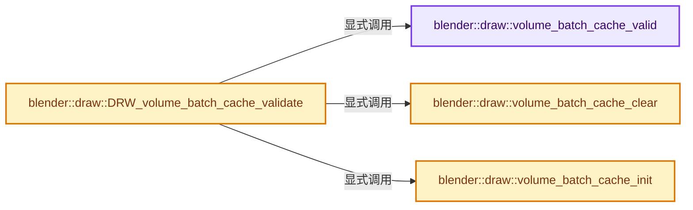
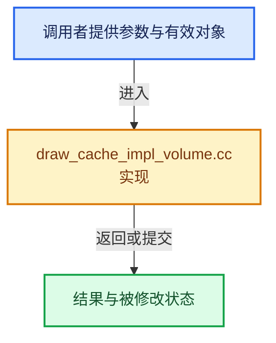

# 实现依赖专题：source/blender/draw/intern/draw_cache_impl_volume.cc

[实现依赖导航](../../../README.md) · [符号索引](../../../../00-课程指南/02-源码与提交索引/符号依赖与实现索引.md)

本专题从正文实际调用进入，集中保存共享实现。函数有稳定锚点，可从调用处直接跳到对应完整函数；递归与互相调用通过回链组织。

## 本文件的实现关系






## 完整成员与函数实现

<a id="f-17ad5af0699f6401"></a>

### `blender::draw::volume_batch_cache_valid`

实现位置：[source/blender/draw/intern/draw_cache_impl_volume.cc](../../../../../../../../source/blender/draw/intern/draw_cache_impl_volume.cc) · L64—L68。

接口参数：

- `Volume *volume`

**教学注释版**

<!-- annotated:54f8de324a6e7b -->

```cpp
static bool volume_batch_cache_valid(Volume *volume)
{
  VolumeBatchCache *cache = volume->batch_cache;
  return (cache && cache->is_dirty == false);
}
```

<details>
<summary>核对原始源码：source/blender/draw/intern/draw_cache_impl_volume.cc · L64—L68</summary>

<!-- original:54f8de324a6e7b:source/blender/draw/intern/draw_cache_impl_volume.cc:64:68 -->

```cpp
static bool volume_batch_cache_valid(Volume *volume)
{
  VolumeBatchCache *cache = volume->batch_cache;
  return (cache && cache->is_dirty == false);
}
```

</details>

**结果出口**

- `return (cache && cache->is_dirty == false);`

**继续追踪实现**

本实现没有需要继续展开的显式调用；检查返回表达式、对象转换和调用者前置条件。

<a id="f-5c08ace1f14d4538"></a>

### `blender::draw::volume_batch_cache_init`

实现位置：[source/blender/draw/intern/draw_cache_impl_volume.cc](../../../../../../../../source/blender/draw/intern/draw_cache_impl_volume.cc) · L70—L82。

接口参数：

- `Volume *volume`

**教学注释版**

<!-- annotated:2cb31bbfb29848 -->

```cpp
static void volume_batch_cache_init(Volume *volume)
{
  VolumeBatchCache *cache = volume->batch_cache;

  if (!cache) {
    volume->batch_cache = cache = MEM_new_zeroed<VolumeBatchCache>(__func__);
  }
  else {
    // [讲解] memset：填充字节，不调用T构造函数，也不保证任意类型的全零表示是合法或期望值。
    memset(cache, 0, sizeof(*cache));
  }

  cache->is_dirty = false;
}
```

<details>
<summary>核对原始源码：source/blender/draw/intern/draw_cache_impl_volume.cc · L70—L82</summary>

<!-- original:2cb31bbfb29848:source/blender/draw/intern/draw_cache_impl_volume.cc:70:82 -->

```cpp
static void volume_batch_cache_init(Volume *volume)
{
  VolumeBatchCache *cache = volume->batch_cache;

  if (!cache) {
    volume->batch_cache = cache = MEM_new_zeroed<VolumeBatchCache>(__func__);
  }
  else {
    memset(cache, 0, sizeof(*cache));
  }

  cache->is_dirty = false;
}
```

</details>

**沿实际写入检查状态**

- `volume->batch_cache = cache = MEM_new_zeroed<VolumeBatchCache>(__func__);`
- `cache->is_dirty = false;`

**继续追踪实现**

- `MEM_new_zeroed<VolumeBatchCache>` → [MEM_new_zeroed · L550](../../../07-Intern运行时与平台/guardedalloc/MEM_guardedalloc.h.md#f-eeb1e2a7f57dd231)；[MEM_new_zeroed · L114](../../../07-Intern运行时与平台/guardedalloc/intern/mallocn.cc.md#f-e04cf01c64c8b180)。同名重载需按实参类型选择。
- `memset` → [外部契约](https://eel.is/c++draft/cstring.syn)：填充字节，不调用T构造函数，也不保证任意类型的全零表示是合法或期望值。

<a id="f-99cbbf4735f8b94a"></a>

### `blender::draw::DRW_volume_batch_cache_validate`

实现位置：[source/blender/draw/intern/draw_cache_impl_volume.cc](../../../../../../../../source/blender/draw/intern/draw_cache_impl_volume.cc) · L84—L90。

接口参数：

- `Volume *volume`

**教学注释版**

<!-- annotated:b9e66d15052979 -->

```cpp
void DRW_volume_batch_cache_validate(Volume *volume)
{
  if (!volume_batch_cache_valid(volume)) {
    volume_batch_cache_clear(volume);
    volume_batch_cache_init(volume);
  }
}
```

<details>
<summary>核对原始源码：source/blender/draw/intern/draw_cache_impl_volume.cc · L84—L90</summary>

<!-- original:b9e66d15052979:source/blender/draw/intern/draw_cache_impl_volume.cc:84:90 -->

```cpp
void DRW_volume_batch_cache_validate(Volume *volume)
{
  if (!volume_batch_cache_valid(volume)) {
    volume_batch_cache_clear(volume);
    volume_batch_cache_init(volume);
  }
}
```

</details>

**继续追踪实现**

- `volume_batch_cache_valid` → [blender::draw::volume_batch_cache_valid · L64](draw_cache_impl_volume.cc.md#f-17ad5af0699f6401)。
- `volume_batch_cache_clear` → [blender::draw::volume_batch_cache_clear · L113](draw_cache_impl_volume.cc.md#f-619c09537c2c6a49)。
- `volume_batch_cache_init` → [blender::draw::volume_batch_cache_init · L70](draw_cache_impl_volume.cc.md#f-5c08ace1f14d4538)。

<a id="f-619c09537c2c6a49"></a>

### `blender::draw::volume_batch_cache_clear`

实现位置：[source/blender/draw/intern/draw_cache_impl_volume.cc](../../../../../../../../source/blender/draw/intern/draw_cache_impl_volume.cc) · L113—L129。

接口参数：

- `Volume *volume`

**教学注释版**

<!-- annotated:8c86ef20716542 -->

```cpp
static void volume_batch_cache_clear(Volume *volume)
{
  VolumeBatchCache *cache = volume->batch_cache;
  if (!cache) {
    return;
  }

  for (DRWVolumeGrid &grid : cache->grids) {
    MEM_SAFE_DELETE(grid.name);
    GPU_TEXTURE_FREE_SAFE(grid.texture);
  }
  cache->grids.free_no_destruct();

  GPU_VERTBUF_DISCARD_SAFE(cache->face_wire.pos_nor_in_order);
  GPU_BATCH_DISCARD_SAFE(cache->face_wire.batch);
  GPU_BATCH_DISCARD_SAFE(cache->selection_surface);
}
```

<details>
<summary>核对原始源码：source/blender/draw/intern/draw_cache_impl_volume.cc · L113—L129</summary>

<!-- original:8c86ef20716542:source/blender/draw/intern/draw_cache_impl_volume.cc:113:129 -->

```cpp
static void volume_batch_cache_clear(Volume *volume)
{
  VolumeBatchCache *cache = volume->batch_cache;
  if (!cache) {
    return;
  }

  for (DRWVolumeGrid &grid : cache->grids) {
    MEM_SAFE_DELETE(grid.name);
    GPU_TEXTURE_FREE_SAFE(grid.texture);
  }
  cache->grids.free_no_destruct();

  GPU_VERTBUF_DISCARD_SAFE(cache->face_wire.pos_nor_in_order);
  GPU_BATCH_DISCARD_SAFE(cache->face_wire.batch);
  GPU_BATCH_DISCARD_SAFE(cache->selection_surface);
}
```

</details>

**继续追踪实现**

- `MEM_SAFE_DELETE` → [MEM_SAFE_DELETE · L436](../../../07-Intern运行时与平台/guardedalloc/MEM_guardedalloc.h.md#m-eadb3bc5b902)。宏定义由构建条件选择。
- `GPU_TEXTURE_FREE_SAFE` → [GPU_TEXTURE_FREE_SAFE · L902](../../gpu/GPU_texture.hh.md#m-fa9785b115fa)。宏定义由构建条件选择。
- `cache->grids.free_no_destruct` → [调用协议](../../../../00-课程指南/01-路线与规范/模板宏与动态分派协议.md)：接收对象类型依赖auto、返回值或模板实例；不按同名猜测目标。调用位置L124。
- `GPU_VERTBUF_DISCARD_SAFE` → [GPU_VERTBUF_DISCARD_SAFE · L372](../../gpu/GPU_vertex_buffer.hh.md#m-6427e4c6901c)。宏定义由构建条件选择。
- `GPU_BATCH_DISCARD_SAFE` → [GPU_BATCH_DISCARD_SAFE · L199](../../gpu/GPU_batch.hh.md#m-167d477926a1)。宏定义由构建条件选择。
