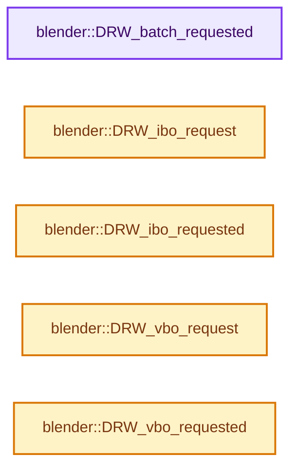
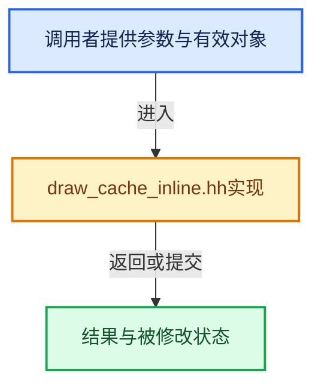

# 实现依赖专题：source/blender/draw/intern/draw_cache_inline.hh

[实现依赖导航](../../../README.md) · [符号索引](../../../../00-课程指南/02-源码与提交索引/符号依赖与实现索引.md)

本专题从正文实际调用进入，集中保存共享实现。函数有稳定锚点，可从调用处直接跳到对应完整函数；递归与互相调用通过回链组织。

## 本文件的实现关系






<a id="m-223bacae8451"></a>

## 宏 `DRW_ADD_FLAG_FROM_VBO_REQUEST`

<!-- annotated:cfa4f5cc279b75 -->

```cpp
#  define DRW_ADD_FLAG_FROM_VBO_REQUEST(flag, vbo, value) \
    (flag |= DRW_vbo_requested(vbo) ? (printf("  VBO requested " #vbo "\n") ? value : value) : 0)
#  define DRW_ADD_FLAG_FROM_IBO_REQUEST(flag, ibo, value) \
```

<details>
<summary>核对原始源码：source/blender/draw/intern/draw_cache_inline.hh · L20—L22</summary>

<!-- original:cfa4f5cc279b75:source/blender/draw/intern/draw_cache_inline.hh:20:22 -->

```cpp
#  define DRW_ADD_FLAG_FROM_VBO_REQUEST(flag, vbo, value) \
    (flag |= DRW_vbo_requested(vbo) ? (printf("  VBO requested " #vbo "\n") ? value : value) : 0)
#  define DRW_ADD_FLAG_FROM_IBO_REQUEST(flag, ibo, value) \
```

</details>

宏在预处理阶段展开，参数替换、重复求值和条件编译应直接从该定义检查。与普通函数不同，宏不会自动提供参数类型检查；构建配置选择哪个定义需结合外围条件。

<a id="m-2f9f649cd79d"></a>

## 宏 `DRW_ADD_FLAG_FROM_IBO_REQUEST`

<!-- annotated:b063c755cb4315 -->

```cpp
#  define DRW_ADD_FLAG_FROM_IBO_REQUEST(flag, ibo, value) \
    (flag |= DRW_ibo_requested(ibo) ? (printf("  IBO requested " #ibo "\n") ? value : value) : 0)
#else
```

<details>
<summary>核对原始源码：source/blender/draw/intern/draw_cache_inline.hh · L22—L24</summary>

<!-- original:b063c755cb4315:source/blender/draw/intern/draw_cache_inline.hh:22:24 -->

```cpp
#  define DRW_ADD_FLAG_FROM_IBO_REQUEST(flag, ibo, value) \
    (flag |= DRW_ibo_requested(ibo) ? (printf("  IBO requested " #ibo "\n") ? value : value) : 0)
#else
```

</details>

宏在预处理阶段展开，参数替换、重复求值和条件编译应直接从该定义检查。与普通函数不同，宏不会自动提供参数类型检查；构建配置选择哪个定义需结合外围条件。

<a id="m-f754b0eed5f6"></a>

## 宏 `DRW_ADD_FLAG_FROM_VBO_REQUEST`

<!-- annotated:3b05dc821a0e61 -->

```cpp
#  define DRW_ADD_FLAG_FROM_VBO_REQUEST(flag, vbo, value) \
    (flag |= DRW_vbo_requested(vbo) ? (value) : 0)
#  define DRW_ADD_FLAG_FROM_IBO_REQUEST(flag, ibo, value) \
```

<details>
<summary>核对原始源码：source/blender/draw/intern/draw_cache_inline.hh · L25—L27</summary>

<!-- original:3b05dc821a0e61:source/blender/draw/intern/draw_cache_inline.hh:25:27 -->

```cpp
#  define DRW_ADD_FLAG_FROM_VBO_REQUEST(flag, vbo, value) \
    (flag |= DRW_vbo_requested(vbo) ? (value) : 0)
#  define DRW_ADD_FLAG_FROM_IBO_REQUEST(flag, ibo, value) \
```

</details>

宏在预处理阶段展开，参数替换、重复求值和条件编译应直接从该定义检查。与普通函数不同，宏不会自动提供参数类型检查；构建配置选择哪个定义需结合外围条件。

<a id="m-172622ab4335"></a>

## 宏 `DRW_ADD_FLAG_FROM_IBO_REQUEST`

<!-- annotated:6866d410a898e8 -->

```cpp
#  define DRW_ADD_FLAG_FROM_IBO_REQUEST(flag, ibo, value) \
    (flag |= DRW_ibo_requested(ibo) ? (value) : 0)
#endif
```

<details>
<summary>核对原始源码：source/blender/draw/intern/draw_cache_inline.hh · L27—L29</summary>

<!-- original:6866d410a898e8:source/blender/draw/intern/draw_cache_inline.hh:27:29 -->

```cpp
#  define DRW_ADD_FLAG_FROM_IBO_REQUEST(flag, ibo, value) \
    (flag |= DRW_ibo_requested(ibo) ? (value) : 0)
#endif
```

</details>

宏在预处理阶段展开，参数替换、重复求值和条件编译应直接从该定义检查。与普通函数不同，宏不会自动提供参数类型检查；构建配置选择哪个定义需结合外围条件。

## 完整成员与函数实现

<a id="f-eb6d2e4bf92a66e8"></a>

### `blender::DRW_batch_requested`

实现位置：[source/blender/draw/intern/draw_cache_inline.hh](../../../../../../../../source/blender/draw/intern/draw_cache_inline.hh) · L40—L52。

接口参数：

- `gpu::Batch *batch`
- `GPUPrimType prim_type`

**教学注释版**

<!-- annotated:c55a9e059adeb4 -->

```cpp
inline bool DRW_batch_requested(gpu::Batch *batch, GPUPrimType prim_type)
{
  /* Batch has been requested if it has been created but not initialized. */
  if (batch != nullptr && batch->verts[0] == nullptr) {
    /* HACK. We init without a valid VBO and let the first vbo binding
     * fill verts[0]. */
    GPU_batch_init_ex(
        batch, prim_type, reinterpret_cast<gpu::VertBuf *>(1), nullptr, GPUBatchFlag(0));
    batch->verts[0] = nullptr;
    return true;
  }
  return false;
}
```

<details>
<summary>核对原始源码：source/blender/draw/intern/draw_cache_inline.hh · L40—L52</summary>

<!-- original:c55a9e059adeb4:source/blender/draw/intern/draw_cache_inline.hh:40:52 -->

```cpp
inline bool DRW_batch_requested(gpu::Batch *batch, GPUPrimType prim_type)
{
  /* Batch has been requested if it has been created but not initialized. */
  if (batch != nullptr && batch->verts[0] == nullptr) {
    /* HACK. We init without a valid VBO and let the first vbo binding
     * fill verts[0]. */
    GPU_batch_init_ex(
        batch, prim_type, reinterpret_cast<gpu::VertBuf *>(1), nullptr, GPUBatchFlag(0));
    batch->verts[0] = nullptr;
    return true;
  }
  return false;
}
```

</details>

**沿实际写入检查状态**

- `batch->verts[0] = nullptr;`

**结果出口**

- `return true;`
- `return false;`

**继续追踪实现**

- `GPU_batch_init_ex` → [blender::GPU_batch_init_ex · L63](../../gpu/intern/gpu_batch.cc.md#f-8b222f39c7363d7d)。
- `GPUBatchFlag` → [blender::GPUBatchFlag](../../gpu/GPU_batch.hh.md#t-69ee9e6aa2b8)。

<a id="f-6c8bc7c8d95c7b7a"></a>

### `blender::DRW_ibo_request`

实现位置：[source/blender/draw/intern/draw_cache_inline.hh](../../../../../../../../source/blender/draw/intern/draw_cache_inline.hh) · L54—L62。

接口参数：

- `gpu::Batch *batch`
- `gpu::IndexBuf **ibo`

**教学注释版**

<!-- annotated:7c4c961ab69797 -->

```cpp
inline void DRW_ibo_request(gpu::Batch *batch, gpu::IndexBuf **ibo)
{
  if (*ibo == nullptr) {
    *ibo = GPU_indexbuf_calloc();
  }
  if (batch != nullptr) {
    GPU_batch_elembuf_set(batch, *ibo, false);
  }
}
```

<details>
<summary>核对原始源码：source/blender/draw/intern/draw_cache_inline.hh · L54—L62</summary>

<!-- original:7c4c961ab69797:source/blender/draw/intern/draw_cache_inline.hh:54:62 -->

```cpp
inline void DRW_ibo_request(gpu::Batch *batch, gpu::IndexBuf **ibo)
{
  if (*ibo == nullptr) {
    *ibo = GPU_indexbuf_calloc();
  }
  if (batch != nullptr) {
    GPU_batch_elembuf_set(batch, *ibo, false);
  }
}
```

</details>

**继续追踪实现**

- `GPU_indexbuf_calloc` → [blender::GPU_indexbuf_calloc · L422](../../gpu/intern/gpu_index_buffer.cc.md#f-e8f02b2e987a3770)。
- `GPU_batch_elembuf_set` → [blender::GPU_batch_elembuf_set · L141](../../gpu/intern/gpu_batch.cc.md#f-7652dfb862df44e0)。

<a id="f-9026f3ea76a033e0"></a>

### `blender::DRW_ibo_requested`

实现位置：[source/blender/draw/intern/draw_cache_inline.hh](../../../../../../../../source/blender/draw/intern/draw_cache_inline.hh) · L64—L69。

接口参数：

- `gpu::IndexBuf *ibo`

**教学注释版**

<!-- annotated:fbb151c38daeda -->

```cpp
inline bool DRW_ibo_requested(gpu::IndexBuf *ibo)
{
  /* TODO: do not rely on data uploaded. This prevents multi-threading.
   * (need access to a GPU context). */
  return (ibo != nullptr && !GPU_indexbuf_is_init(ibo));
}
```

<details>
<summary>核对原始源码：source/blender/draw/intern/draw_cache_inline.hh · L64—L69</summary>

<!-- original:fbb151c38daeda:source/blender/draw/intern/draw_cache_inline.hh:64:69 -->

```cpp
inline bool DRW_ibo_requested(gpu::IndexBuf *ibo)
{
  /* TODO: do not rely on data uploaded. This prevents multi-threading.
   * (need access to a GPU context). */
  return (ibo != nullptr && !GPU_indexbuf_is_init(ibo));
}
```

</details>

**结果出口**

- `return (ibo != nullptr && !GPU_indexbuf_is_init(ibo));`

**继续追踪实现**

- `GPU_indexbuf_is_init` → [blender::GPU_indexbuf_is_init · L520](../../gpu/intern/gpu_index_buffer.cc.md#f-f03a499e8549fedc)。

<a id="f-7bc90150070a9339"></a>

### `blender::DRW_vbo_request`

实现位置：[source/blender/draw/intern/draw_cache_inline.hh](../../../../../../../../source/blender/draw/intern/draw_cache_inline.hh) · L71—L82。

接口参数：

- `gpu::Batch *batch`
- `gpu::VertBuf **vbo`

**教学注释版**

<!-- annotated:d041f8991d13ce -->

```cpp
inline void DRW_vbo_request(gpu::Batch *batch, gpu::VertBuf **vbo)
{
  if (*vbo == nullptr) {
    *vbo = GPU_vertbuf_calloc();
  }
  if (batch != nullptr) {
    BLI_assert_msg(batch->procedural_vertices == -1,
                   "Request of vertex buffer for procedural batch is not valid operation.");
    /* HACK we set VBO's that may not yet be valid. */
    GPU_batch_vertbuf_add(batch, *vbo, false);
  }
}
```

<details>
<summary>核对原始源码：source/blender/draw/intern/draw_cache_inline.hh · L71—L82</summary>

<!-- original:d041f8991d13ce:source/blender/draw/intern/draw_cache_inline.hh:71:82 -->

```cpp
inline void DRW_vbo_request(gpu::Batch *batch, gpu::VertBuf **vbo)
{
  if (*vbo == nullptr) {
    *vbo = GPU_vertbuf_calloc();
  }
  if (batch != nullptr) {
    BLI_assert_msg(batch->procedural_vertices == -1,
                   "Request of vertex buffer for procedural batch is not valid operation.");
    /* HACK we set VBO's that may not yet be valid. */
    GPU_batch_vertbuf_add(batch, *vbo, false);
  }
}
```

</details>

**继续追踪实现**

- `GPU_vertbuf_calloc` → [blender::GPU_vertbuf_calloc · L112](../../gpu/intern/gpu_vertex_buffer.cc.md#f-bddd6e0944c513f4)。
- `BLI_assert_msg` → [BLI_assert_msg · L55](../../../01-BLI基础库/BLI_assert.hh.md#m-695eed20dceb)；[BLI_assert_msg · L64](../../../01-BLI基础库/BLI_assert.hh.md#m-7de5563de4db)。宏定义由构建条件选择。
- `GPU_batch_vertbuf_add` → [blender::GPU_batch_vertbuf_add · L154](../../gpu/intern/gpu_batch.cc.md#f-60321cb8e3743844)。

<a id="f-62874673b723297f"></a>

### `blender::DRW_vbo_requested`

实现位置：[source/blender/draw/intern/draw_cache_inline.hh](../../../../../../../../source/blender/draw/intern/draw_cache_inline.hh) · L84—L87。

接口参数：

- `gpu::VertBuf *vbo`

**教学注释版**

<!-- annotated:e52e443a8015b0 -->

```cpp
inline bool DRW_vbo_requested(gpu::VertBuf *vbo)
{
  return (vbo != nullptr && (GPU_vertbuf_get_status(vbo) & GPU_VERTBUF_INIT) == 0);
}
```

<details>
<summary>核对原始源码：source/blender/draw/intern/draw_cache_inline.hh · L84—L87</summary>

<!-- original:e52e443a8015b0:source/blender/draw/intern/draw_cache_inline.hh:84:87 -->

```cpp
inline bool DRW_vbo_requested(gpu::VertBuf *vbo)
{
  return (vbo != nullptr && (GPU_vertbuf_get_status(vbo) & GPU_VERTBUF_INIT) == 0);
}
```

</details>

**结果出口**

- `return (vbo != nullptr && (GPU_vertbuf_get_status(vbo) & GPU_VERTBUF_INIT) == 0);`

**继续追踪实现**

- `GPU_vertbuf_get_status` → [blender::GPU_vertbuf_get_status · L280](../../gpu/intern/gpu_vertex_buffer.cc.md#f-f829d4bfa0418171)。
