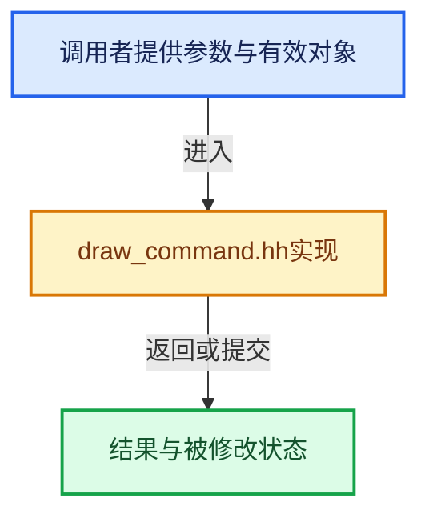

# 实现依赖专题：source/blender/draw/intern/draw_command.hh

[实现依赖导航](../../../README.md) · [符号索引](../../../../00-课程指南/02-源码与提交索引/符号依赖与实现索引.md)

本专题从正文实际调用进入，集中保存共享实现。函数有稳定锚点，可从调用处直接跳到对应完整函数；递归与互相调用通过回链组织。

## 本文件的实现关系





## 相关类型布局与成员入口

<a id="t-55fee021105a"></a>

### `blender::draw::command::Type`

原始声明：[source/blender/draw/intern/draw_command.hh](../../../../../../../../source/blender/draw/intern/draw_command.hh) · L99—L127。

以下保留类的数据声明与编译条件，成员函数实现通过后面的精确链接阅读。

<!-- annotated:18c1f3e3851bb5 -->

```cpp
enum class Type : uint8_t {
  /**
   * None Type commands are either uninitialized or are repurposed as data storage.
   * They are skipped during submission.
   */
  None = 0,

  /** Commands stored as Undetermined in regular command buffer. */
  Barrier,
  Clear,
  ClearMulti,
  Dispatch,
  DispatchIndirect,
  Draw,
  DrawIndirect,
  FramebufferBind,
  PushConstant,
  SpecializeConstant,
  ResourceBind,
  ShaderBind,
  SubPassTransition,
  StateSet,
  StencilSet,
  TextureCopy,

  /** Special commands stored in separate buffers. */
  SubPass,
  DrawMulti,
};
```

<details>
<summary>核对原始源码：source/blender/draw/intern/draw_command.hh · L99—L127</summary>

<!-- original:18c1f3e3851bb5:source/blender/draw/intern/draw_command.hh:99:127 -->

```cpp
enum class Type : uint8_t {
  /**
   * None Type commands are either uninitialized or are repurposed as data storage.
   * They are skipped during submission.
   */
  None = 0,

  /** Commands stored as Undetermined in regular command buffer. */
  Barrier,
  Clear,
  ClearMulti,
  Dispatch,
  DispatchIndirect,
  Draw,
  DrawIndirect,
  FramebufferBind,
  PushConstant,
  SpecializeConstant,
  ResourceBind,
  ShaderBind,
  SubPassTransition,
  StateSet,
  StencilSet,
  TextureCopy,

  /** Special commands stored in separate buffers. */
  SubPass,
  DrawMulti,
};
```

</details>


<a id="t-d5622322174c"></a>

### `blender::draw::command::ResourceBind::Type`

原始声明：[source/blender/draw/intern/draw_command.hh](../../../../../../../../source/blender/draw/intern/draw_command.hh) · L170—L180。

以下保留类的数据声明与编译条件，成员函数实现通过后面的精确链接阅读。

<!-- annotated:7b6207c539108a -->

```cpp
  enum class Type : uint8_t {
    Sampler = 0,
    BufferSampler,
    Image,
    UniformBuf,
    StorageBuf,
    UniformAsStorageBuf,
    VertexAsStorageBuf,
    IndexAsStorageBuf,
    TopLevelAS,
  } type;
```

<details>
<summary>核对原始源码：source/blender/draw/intern/draw_command.hh · L170—L180</summary>

<!-- original:7b6207c539108a:source/blender/draw/intern/draw_command.hh:170:180 -->

```cpp
  enum class Type : uint8_t {
    Sampler = 0,
    BufferSampler,
    Image,
    UniformBuf,
    StorageBuf,
    UniformAsStorageBuf,
    VertexAsStorageBuf,
    IndexAsStorageBuf,
    TopLevelAS,
  } type;
```

</details>


<a id="t-bbbd52482021"></a>

### `blender::draw::command::PushConstant::Type`

原始声明：[source/blender/draw/intern/draw_command.hh](../../../../../../../../source/blender/draw/intern/draw_command.hh) · L246—L251。

以下保留类的数据声明与编译条件，成员函数实现通过后面的精确链接阅读。

<!-- annotated:44cb08691a7356 -->

```cpp
  enum class Type : uint8_t {
    IntValue = 0,
    FloatValue,
    IntReference,
    FloatReference,
  } type;
```

<details>
<summary>核对原始源码：source/blender/draw/intern/draw_command.hh · L246—L251</summary>

<!-- original:44cb08691a7356:source/blender/draw/intern/draw_command.hh:246:251 -->

```cpp
  enum class Type : uint8_t {
    IntValue = 0,
    FloatValue,
    IntReference,
    FloatReference,
  } type;
```

</details>


<a id="t-ea902994ca69"></a>

### `blender::draw::command::SpecializeConstant::Type`

原始声明：[source/blender/draw/intern/draw_command.hh](../../../../../../../../source/blender/draw/intern/draw_command.hh) · L340—L349。

以下保留类的数据声明与编译条件，成员函数实现通过后面的精确链接阅读。

<!-- annotated:04fabe9dd82a2b -->

```cpp
  enum class Type : uint8_t {
    IntValue = 0,
    UintValue,
    FloatValue,
    BoolValue,
    IntReference,
    UintReference,
    FloatReference,
    BoolReference,
  } type;
```

<details>
<summary>核对原始源码：source/blender/draw/intern/draw_command.hh · L340—L349</summary>

<!-- original:04fabe9dd82a2b:source/blender/draw/intern/draw_command.hh:340:349 -->

```cpp
  enum class Type : uint8_t {
    IntValue = 0,
    UintValue,
    FloatValue,
    BoolValue,
    IntReference,
    UintReference,
    FloatReference,
    BoolReference,
  } type;
```

</details>


## 完整成员与函数实现

<a id="f-e1b932670315de19"></a>

### `blender::draw::command::RecordingState::cleanup`

实现位置：[source/blender/draw/intern/draw_command.hh](../../../../../../../../source/blender/draw/intern/draw_command.hh) · L73—L85。

**教学注释版**

<!-- annotated:9f765aede58a0c -->

```cpp
  void cleanup()
  {
    if (front_facing == false) {
      GPU_front_facing(false);
    }

    if (G.debug & G_DEBUG_GPU) {
      GPU_storagebuf_debug_unbind_all();
      GPU_texture_image_unbind_all();
      GPU_texture_unbind_all();
      GPU_uniformbuf_debug_unbind_all();
    }
  }
```

<details>
<summary>核对原始源码：source/blender/draw/intern/draw_command.hh · L73—L85</summary>

<!-- original:9f765aede58a0c:source/blender/draw/intern/draw_command.hh:73:85 -->

```cpp
  void cleanup()
  {
    if (front_facing == false) {
      GPU_front_facing(false);
    }

    if (G.debug & G_DEBUG_GPU) {
      GPU_storagebuf_debug_unbind_all();
      GPU_texture_image_unbind_all();
      GPU_texture_unbind_all();
      GPU_uniformbuf_debug_unbind_all();
    }
  }
```

</details>

**继续追踪实现**

- `GPU_front_facing` → [blender::GPU_front_facing · L60](../../gpu/intern/gpu_state.cc.md#f-470d5afb0c7f9430)。
- `GPU_storagebuf_debug_unbind_all` → [blender::GPU_storagebuf_debug_unbind_all · L104](../../gpu/intern/gpu_storage_buffer.cc.md#f-a89be9cc20c6d67e)。
- `GPU_texture_image_unbind_all` → [blender::GPU_texture_image_unbind_all · L660](../../gpu/intern/gpu_texture.cc.md#f-46511d00aeb97cd2)。
- `GPU_texture_unbind_all` → [blender::GPU_texture_unbind_all · L645](../../gpu/intern/gpu_texture.cc.md#f-a0b95d1cf219374e)。
- `GPU_uniformbuf_debug_unbind_all` → [blender::GPU_uniformbuf_debug_unbind_all · L364](../../gpu/intern/gpu_uniform_buffer.cc.md#f-f085c3d5621ec231)。
