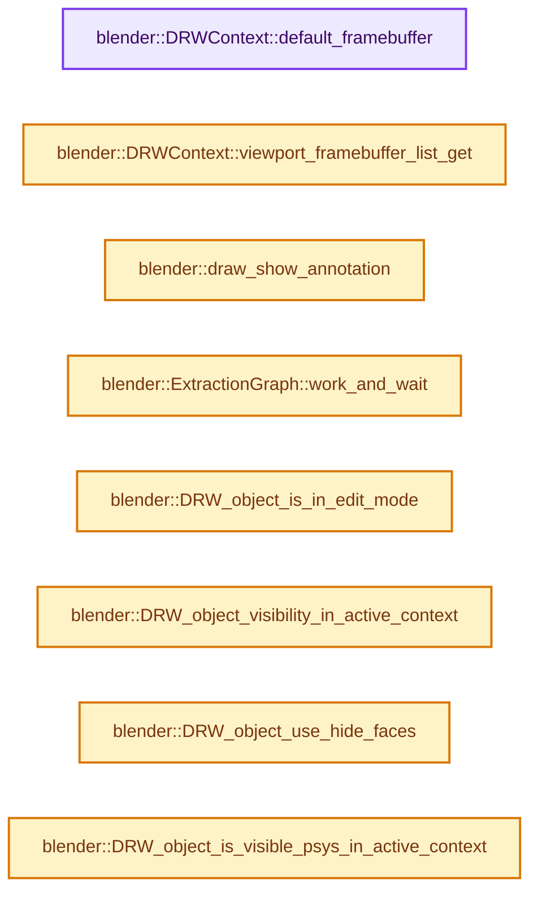
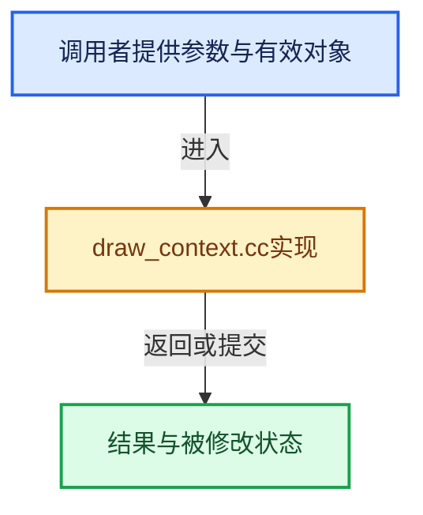

# 实现依赖专题：source/blender/draw/intern/draw_context.cc

[实现依赖导航](../../../README.md) · [符号索引](../../../../00-课程指南/02-源码与提交索引/符号依赖与实现索引.md)

本专题从正文实际调用进入，集中保存共享实现。函数有稳定锚点，可从调用处直接跳到对应完整函数；递归与互相调用通过回链组织。

## 本文件的实现关系






## 相关类型布局与成员入口

<a id="t-fe7d5202f5f6"></a>

### `blender::draw::InstancesFlags`

原始声明：[source/blender/draw/intern/draw_context.cc](../../../../../../../../source/blender/draw/intern/draw_context.cc) · L717—L719。

以下保留类的数据声明与编译条件，成员函数实现通过后面的精确链接阅读。

<!-- annotated:fa89370e770a75 -->

```cpp
enum class InstancesFlags : uint8_t {
  IsNegativeScale = 1 << 0,
};
```

<details>
<summary>核对原始源码：source/blender/draw/intern/draw_context.cc · L717—L719</summary>

<!-- original:fa89370e770a75:source/blender/draw/intern/draw_context.cc:717:719 -->

```cpp
enum class InstancesFlags : uint8_t {
  IsNegativeScale = 1 << 0,
};
```

</details>


## 完整成员与函数实现

<a id="f-44e2a0e966c27d1b"></a>

### `blender::DRWContext::default_framebuffer`

实现位置：[source/blender/draw/intern/draw_context.cc](../../../../../../../../source/blender/draw/intern/draw_context.cc) · L205—L208。

**教学注释版**

<!-- annotated:a30d4689af4c56 -->

```cpp
gpu::FrameBuffer *DRWContext::default_framebuffer()
{
  return view_data_active->dfbl.default_fb;
}
```

<details>
<summary>核对原始源码：source/blender/draw/intern/draw_context.cc · L205—L208</summary>

<!-- original:a30d4689af4c56:source/blender/draw/intern/draw_context.cc:205:208 -->

```cpp
gpu::FrameBuffer *DRWContext::default_framebuffer()
{
  return view_data_active->dfbl.default_fb;
}
```

</details>

**结果出口**

- `return view_data_active->dfbl.default_fb;`

**继续追踪实现**

本实现没有需要继续展开的显式调用；检查返回表达式、对象转换和调用者前置条件。

<a id="f-27179c57ec2d94cf"></a>

### `blender::DRWContext::viewport_framebuffer_list_get`

实现位置：[source/blender/draw/intern/draw_context.cc](../../../../../../../../source/blender/draw/intern/draw_context.cc) · L210—L213。

**教学注释版**

<!-- annotated:e86a1bd1a4a684 -->

```cpp
DefaultFramebufferList *DRWContext::viewport_framebuffer_list_get() const
{
  return const_cast<DefaultFramebufferList *>(&view_data_active->dfbl);
}
```

<details>
<summary>核对原始源码：source/blender/draw/intern/draw_context.cc · L210—L213</summary>

<!-- original:e86a1bd1a4a684:source/blender/draw/intern/draw_context.cc:210:213 -->

```cpp
DefaultFramebufferList *DRWContext::viewport_framebuffer_list_get() const
{
  return const_cast<DefaultFramebufferList *>(&view_data_active->dfbl);
}
```

</details>

**结果出口**

- `return const_cast<DefaultFramebufferList *>(&view_data_active->dfbl);`

**继续追踪实现**

本实现没有需要继续展开的显式调用；检查返回表达式、对象转换和调用者前置条件。

<a id="f-5c6d227c4840975b"></a>

### `blender::draw_show_annotation`

实现位置：[source/blender/draw/intern/draw_context.cc](../../../../../../../../source/blender/draw/intern/draw_context.cc) · L220—L242。

**教学注释版**

<!-- annotated:432864f170ecac -->

```cpp
static bool draw_show_annotation()
{
  DRWContext &draw_ctx = drw_get();
  SpaceLink *space_data = draw_ctx.space_data;
  View3D *v3d = draw_ctx.v3d;

  if (space_data != nullptr) {
    switch (space_data->spacetype) {
      case SPACE_IMAGE: {
        SpaceImage *sima = reinterpret_cast<SpaceImage *>(space_data);
        return (sima->flag & SI_SHOW_GPENCIL) != 0;
      }
      case SPACE_NODE:
        /* Don't draw the annotation for the node editor. Annotations are handled by space_image as
         * the draw manager is only used to draw the background. */
        return false;
      default:
        break;
    }
  }
  return (v3d && ((v3d->flag2 & V3D_SHOW_ANNOTATION) != 0) &&
          ((v3d->flag2 & V3D_HIDE_OVERLAYS) == 0));
}
```

<details>
<summary>核对原始源码：source/blender/draw/intern/draw_context.cc · L220—L242</summary>

<!-- original:432864f170ecac:source/blender/draw/intern/draw_context.cc:220:242 -->

```cpp
static bool draw_show_annotation()
{
  DRWContext &draw_ctx = drw_get();
  SpaceLink *space_data = draw_ctx.space_data;
  View3D *v3d = draw_ctx.v3d;

  if (space_data != nullptr) {
    switch (space_data->spacetype) {
      case SPACE_IMAGE: {
        SpaceImage *sima = reinterpret_cast<SpaceImage *>(space_data);
        return (sima->flag & SI_SHOW_GPENCIL) != 0;
      }
      case SPACE_NODE:
        /* Don't draw the annotation for the node editor. Annotations are handled by space_image as
         * the draw manager is only used to draw the background. */
        return false;
      default:
        break;
    }
  }
  return (v3d && ((v3d->flag2 & V3D_SHOW_ANNOTATION) != 0) &&
          ((v3d->flag2 & V3D_HIDE_OVERLAYS) == 0));
}
```

</details>

**结果出口**

- `return (sima->flag & SI_SHOW_GPENCIL) != 0;`
- `return false;`
- `return (v3d && ((v3d->flag2 & V3D_SHOW_ANNOTATION) != 0) &&`

**继续追踪实现**

- `drw_get` → [blender::drw_get · L81](draw_context_private.hh.md#f-8fd959a68d9e8cf0)。

<a id="f-93c0956559c5c8a9"></a>

### `blender::ExtractionGraph::work_and_wait`

实现位置：[source/blender/draw/intern/draw_context.cc](../../../../../../../../source/blender/draw/intern/draw_context.cc) · L257—L264。

**教学注释版**

<!-- annotated:1edb16ec107ea0 -->

```cpp
  void work_and_wait()
  {
    BLI_assert_msg(graph, "Trying to submit more than once");

    BLI_task_graph_work_and_wait(graph);
    BLI_task_graph_free(graph);
    graph = nullptr;
  }
```

<details>
<summary>核对原始源码：source/blender/draw/intern/draw_context.cc · L257—L264</summary>

<!-- original:1edb16ec107ea0:source/blender/draw/intern/draw_context.cc:257:264 -->

```cpp
  void work_and_wait()
  {
    BLI_assert_msg(graph, "Trying to submit more than once");

    BLI_task_graph_work_and_wait(graph);
    BLI_task_graph_free(graph);
    graph = nullptr;
  }
```

</details>

**沿实际写入检查状态**

- `graph = nullptr;`

**继续追踪实现**

- `BLI_assert_msg` → [BLI_assert_msg · L55](../../../01-BLI基础库/BLI_assert.hh.md#m-695eed20dceb)；[BLI_assert_msg · L64](../../../01-BLI基础库/BLI_assert.hh.md#m-7de5563de4db)。宏定义由构建条件选择。
- `BLI_task_graph_work_and_wait` → [blender::BLI_task_graph_work_and_wait · L108](../../../../11-Depsgraph与并行任务系统/08-任务隔离死锁与实战.md#f-598dba109d651b96)。
- `BLI_task_graph_free` → [blender::BLI_task_graph_free · L103](../../../../11-Depsgraph与并行任务系统/08-任务隔离死锁与实战.md#f-77159d0ad0099d45)。

<a id="f-fd88782141a3f346"></a>

### `blender::DRW_object_is_in_edit_mode`

实现位置：[source/blender/draw/intern/draw_context.cc](../../../../../../../../source/blender/draw/intern/draw_context.cc) · L295—L306。

接口参数：

- `const Object *ob`

**教学注释版**

<!-- annotated:516f3c0a5e98f7 -->

```cpp
bool DRW_object_is_in_edit_mode(const Object *ob)
{
  if (BKE_object_is_in_editmode(ob)) {
    if (ELEM(ob->type, OB_MESH, OB_CURVES)) {
      if ((ob->mode & OB_MODE_EDIT) == 0) {
        return false;
      }
    }
    return true;
  }
  return false;
}
```

<details>
<summary>核对原始源码：source/blender/draw/intern/draw_context.cc · L295—L306</summary>

<!-- original:516f3c0a5e98f7:source/blender/draw/intern/draw_context.cc:295:306 -->

```cpp
bool DRW_object_is_in_edit_mode(const Object *ob)
{
  if (BKE_object_is_in_editmode(ob)) {
    if (ELEM(ob->type, OB_MESH, OB_CURVES)) {
      if ((ob->mode & OB_MODE_EDIT) == 0) {
        return false;
      }
    }
    return true;
  }
  return false;
}
```

</details>

**结果出口**

- `return false;`
- `return true;`

**继续追踪实现**

- `BKE_object_is_in_editmode` → [blender::BKE_object_is_in_editmode · L1898](../../../02-BKE几何与数据/intern/object.cc.md#f-675c61a5cb33f967)。
- `ELEM` → [ELEM · L88](../../../07-Intern运行时与平台/ghost/intern/GHOST_utildefines.hh.md#m-d28724a15928)；[ELEM · L135](../../../01-BLI基础库/BLI_utildefines.hh.md#m-d6572de7cae0)。宏定义由构建条件选择。

<a id="f-ab53c6fc4a9c9deb"></a>

### `blender::DRW_object_visibility_in_active_context`

实现位置：[source/blender/draw/intern/draw_context.cc](../../../../../../../../source/blender/draw/intern/draw_context.cc) · L308—L313。

接口参数：

- `const Object *ob`

**教学注释版**

<!-- annotated:f4980d4b3a5f5c -->

```cpp
int DRW_object_visibility_in_active_context(const Object *ob)
{
  const eEvaluationMode mode = DRW_context_get()->is_scene_render() ? DAG_EVAL_RENDER :
                                                                      DAG_EVAL_VIEWPORT;
  return BKE_object_visibility(ob, mode);
}
```

<details>
<summary>核对原始源码：source/blender/draw/intern/draw_context.cc · L308—L313</summary>

<!-- original:f4980d4b3a5f5c:source/blender/draw/intern/draw_context.cc:308:313 -->

```cpp
int DRW_object_visibility_in_active_context(const Object *ob)
{
  const eEvaluationMode mode = DRW_context_get()->is_scene_render() ? DAG_EVAL_RENDER :
                                                                      DAG_EVAL_VIEWPORT;
  return BKE_object_visibility(ob, mode);
}
```

</details>

**结果出口**

- `return BKE_object_visibility(ob, mode);`

**继续追踪实现**

- `DRW_context_get()->is_scene_render` → [调用协议](../../../../00-课程指南/01-路线与规范/模板宏与动态分派协议.md)：接收对象类型依赖auto、返回值或模板实例；不按同名猜测目标。调用位置L310。
- `DRW_context_get` → [blender::DRW_context_get · L2437](draw_context.cc.md#f-98f4b7cf23aa98d9)。
- `BKE_object_visibility` → [blender::BKE_object_visibility · L2063](../../../02-BKE几何与数据/intern/object.cc.md#f-097dd8f6158083c2)。

<a id="f-704dc6bb0eeff73e"></a>

### `blender::DRW_object_use_hide_faces`

实现位置：[source/blender/draw/intern/draw_context.cc](../../../../../../../../source/blender/draw/intern/draw_context.cc) · L315—L330。

接口参数：

- `const Object *ob`

**教学注释版**

<!-- annotated:f2eac3417a5caa -->

```cpp
bool DRW_object_use_hide_faces(const Object *ob)
{
  if (ob->type == OB_MESH) {
    switch (ob->mode) {
      case OB_MODE_SCULPT:
      case OB_MODE_TEXTURE_PAINT:
      case OB_MODE_VERTEX_PAINT:
      case OB_MODE_WEIGHT_PAINT:
        return true;
      default:
        break;
    }
  }

  return false;
}
```

<details>
<summary>核对原始源码：source/blender/draw/intern/draw_context.cc · L315—L330</summary>

<!-- original:f2eac3417a5caa:source/blender/draw/intern/draw_context.cc:315:330 -->

```cpp
bool DRW_object_use_hide_faces(const Object *ob)
{
  if (ob->type == OB_MESH) {
    switch (ob->mode) {
      case OB_MODE_SCULPT:
      case OB_MODE_TEXTURE_PAINT:
      case OB_MODE_VERTEX_PAINT:
      case OB_MODE_WEIGHT_PAINT:
        return true;
      default:
        break;
    }
  }

  return false;
}
```

</details>

**结果出口**

- `return true;`
- `return false;`

**继续追踪实现**

本实现没有需要继续展开的显式调用；检查返回表达式、对象转换和调用者前置条件。

<a id="f-37865d8e0ba58d25"></a>

### `blender::DRW_object_is_visible_psys_in_active_context`

实现位置：[source/blender/draw/intern/draw_context.cc](../../../../../../../../source/blender/draw/intern/draw_context.cc) · L332—L363。

接口参数：

- `const Object *object`
- `const ParticleSystem *psys`

**教学注释版**

<!-- annotated:1ead7d003479e5 -->

```cpp
bool DRW_object_is_visible_psys_in_active_context(const Object *object, const ParticleSystem *psys)
{
  const bool for_render = DRW_context_get()->is_image_render();
  /* NOTE: psys_check_enabled is using object and particle system for only
   * reading, but is using some other functions which are more generic and
   * which are hard to make const-pointer. */
  if (!psys_check_enabled(
          const_cast<Object *>(object), const_cast<ParticleSystem *>(psys), for_render))
  {
    return false;
  }
  const DRWContext *draw_ctx = DRW_context_get();
  const Scene *scene = draw_ctx->scene;
  if (object == draw_ctx->object_edit) {
    return false;
  }
  const ParticleSettings *part = psys->part;
  const ParticleEditSettings *pset = &scene->toolsettings->particle;
  if (object->mode == OB_MODE_PARTICLE_EDIT) {
    if (psys_in_edit_mode(draw_ctx->depsgraph, psys)) {
      if ((pset->flag & PE_DRAW_PART) == 0) {
        return false;
      }
      if ((part->childtype == 0) &&
          (psys->flag & PSYS_HAIR_DYNAMICS && psys->pointcache->flag & PTCACHE_BAKED) == 0)
      {
        return false;
      }
    }
  }
  return true;
}
```

<details>
<summary>核对原始源码：source/blender/draw/intern/draw_context.cc · L332—L363</summary>

<!-- original:1ead7d003479e5:source/blender/draw/intern/draw_context.cc:332:363 -->

```cpp
bool DRW_object_is_visible_psys_in_active_context(const Object *object, const ParticleSystem *psys)
{
  const bool for_render = DRW_context_get()->is_image_render();
  /* NOTE: psys_check_enabled is using object and particle system for only
   * reading, but is using some other functions which are more generic and
   * which are hard to make const-pointer. */
  if (!psys_check_enabled(
          const_cast<Object *>(object), const_cast<ParticleSystem *>(psys), for_render))
  {
    return false;
  }
  const DRWContext *draw_ctx = DRW_context_get();
  const Scene *scene = draw_ctx->scene;
  if (object == draw_ctx->object_edit) {
    return false;
  }
  const ParticleSettings *part = psys->part;
  const ParticleEditSettings *pset = &scene->toolsettings->particle;
  if (object->mode == OB_MODE_PARTICLE_EDIT) {
    if (psys_in_edit_mode(draw_ctx->depsgraph, psys)) {
      if ((pset->flag & PE_DRAW_PART) == 0) {
        return false;
      }
      if ((part->childtype == 0) &&
          (psys->flag & PSYS_HAIR_DYNAMICS && psys->pointcache->flag & PTCACHE_BAKED) == 0)
      {
        return false;
      }
    }
  }
  return true;
}
```

</details>

**结果出口**

- `return false;`
- `return true;`

**继续追踪实现**

- `DRW_context_get()->is_image_render` → [调用协议](../../../../00-课程指南/01-路线与规范/模板宏与动态分派协议.md)：接收对象类型依赖auto、返回值或模板实例；不按同名猜测目标。调用位置L334。
- `DRW_context_get` → [blender::DRW_context_get · L2437](draw_context.cc.md#f-98f4b7cf23aa98d9)。
- `psys_check_enabled` → [psys_check_enabled · L706](../../../02-BKE几何与数据/intern/particle.cc.md#f-ecccf7e9e00a9741)。
- `psys_in_edit_mode` → [psys_in_edit_mode · L688](../../../02-BKE几何与数据/intern/particle.cc.md#f-12f91aada00d3acc)。

<a id="f-538d674f4f5ecc4f"></a>

### `blender::DRW_object_get_editmesh_cage_for_drawing`

实现位置：[source/blender/draw/intern/draw_context.cc](../../../../../../../../source/blender/draw/intern/draw_context.cc) · L365—L378。

接口参数：

- `const Object &object`

**教学注释版**

<!-- annotated:7b6ddfa8b68674 -->

```cpp
const Mesh *DRW_object_get_editmesh_cage_for_drawing(const Object &object)
{
  /* Same as DRW_object_get_data_for_drawing, but for the cage mesh. */
  BLI_assert(object.type == OB_MESH);
  const Mesh *cage_mesh = BKE_object_get_editmesh_eval_cage(&object);
  if (cage_mesh == nullptr) {
    return nullptr;
  }

  if (BKE_subsurf_modifier_has_gpu_subdiv(cage_mesh)) {
    return cage_mesh;
  }
  return BKE_mesh_wrapper_ensure_subdivision(cage_mesh);
}
```

<details>
<summary>核对原始源码：source/blender/draw/intern/draw_context.cc · L365—L378</summary>

<!-- original:7b6ddfa8b68674:source/blender/draw/intern/draw_context.cc:365:378 -->

```cpp
const Mesh *DRW_object_get_editmesh_cage_for_drawing(const Object &object)
{
  /* Same as DRW_object_get_data_for_drawing, but for the cage mesh. */
  BLI_assert(object.type == OB_MESH);
  const Mesh *cage_mesh = BKE_object_get_editmesh_eval_cage(&object);
  if (cage_mesh == nullptr) {
    return nullptr;
  }

  if (BKE_subsurf_modifier_has_gpu_subdiv(cage_mesh)) {
    return cage_mesh;
  }
  return BKE_mesh_wrapper_ensure_subdivision(cage_mesh);
}
```

</details>

**结果出口**

- `return nullptr;`
- `return cage_mesh;`
- `return BKE_mesh_wrapper_ensure_subdivision(cage_mesh);`

**继续追踪实现**

- `BLI_assert` → [BLI_assert · L48](../../../01-BLI基础库/BLI_assert.hh.md#m-57a88495704d)；[BLI_assert · L63](../../../01-BLI基础库/BLI_assert.hh.md#m-d07050020cb5)。宏定义由构建条件选择。
- `BKE_object_get_editmesh_eval_cage` → [blender::BKE_object_get_editmesh_eval_cage · L4492](../../../02-BKE几何与数据/intern/object.cc.md#f-af3ce5f8f219917c)。
- `BKE_subsurf_modifier_has_gpu_subdiv` → [blender::BKE_subsurf_modifier_has_gpu_subdiv · L86](../../../02-BKE几何与数据/BKE_subdiv_modifier.hh.md#f-15e677020968596a)。
- `BKE_mesh_wrapper_ensure_subdivision` → [blender::BKE_mesh_wrapper_ensure_subdivision · L380](../../../02-BKE几何与数据/intern/mesh_wrapper.cc.md#f-a140cbf2ffa716c8)；[blender::BKE_mesh_wrapper_ensure_subdivision · L403](../../../02-BKE几何与数据/intern/mesh_wrapper.cc.md#f-3f4bc2c278da5751)。同名重载需按实参类型选择。

<a id="f-fad41a33d4f3b432"></a>

### `blender::DRW_viewport_data_create`

实现位置：[source/blender/draw/intern/draw_context.cc](../../../../../../../../source/blender/draw/intern/draw_context.cc) · L386—L396。

**教学注释版**

<!-- annotated:23a7dc3c1dbf14 -->

```cpp
DRWData *DRW_viewport_data_create()
{
  DRWData *drw_data = MEM_new_zeroed<DRWData>("DRWData");

  drw_data->default_view = new draw::View("DrawDefaultView");

  for (int i = 0; i < 2; i++) {
    drw_data->view_data[i] = new DRWViewData();
  }
  return drw_data;
}
```

<details>
<summary>核对原始源码：source/blender/draw/intern/draw_context.cc · L386—L396</summary>

<!-- original:23a7dc3c1dbf14:source/blender/draw/intern/draw_context.cc:386:396 -->

```cpp
DRWData *DRW_viewport_data_create()
{
  DRWData *drw_data = MEM_new_zeroed<DRWData>("DRWData");

  drw_data->default_view = new draw::View("DrawDefaultView");

  for (int i = 0; i < 2; i++) {
    drw_data->view_data[i] = new DRWViewData();
  }
  return drw_data;
}
```

</details>

**沿实际写入检查状态**

- `drw_data->default_view = new draw::View("DrawDefaultView");`
- `drw_data->view_data[i] = new DRWViewData();`

**结果出口**

- `return drw_data;`

**继续追踪实现**

- `MEM_new_zeroed<DRWData>` → [MEM_new_zeroed · L550](../../../07-Intern运行时与平台/guardedalloc/MEM_guardedalloc.h.md#f-eeb1e2a7f57dd231)；[MEM_new_zeroed · L114](../../../07-Intern运行时与平台/guardedalloc/intern/mallocn.cc.md#f-e04cf01c64c8b180)。同名重载需按实参类型选择。

<a id="f-cb85c63f7b574686"></a>

### `blender::DRW_viewport_data_free`

实现位置：[source/blender/draw/intern/draw_context.cc](../../../../../../../../source/blender/draw/intern/draw_context.cc) · L420—L431。

接口参数：

- `DRWData *drw_data`

**教学注释版**

<!-- annotated:e8c3684e19a866 -->

```cpp
void DRW_viewport_data_free(DRWData *drw_data)
{
  for (int i = 0; i < 2; i++) {
    delete drw_data->view_data[i];
  }
  DRW_volume_module_free(drw_data->volume_module);
  DRW_pointcloud_module_free(drw_data->pointcloud_module);
  DRW_gsplat_module_free(drw_data->gsplat_module);
  DRW_curves_module_free(drw_data->curves_module);
  delete drw_data->default_view;
  MEM_delete(drw_data);
}
```

<details>
<summary>核对原始源码：source/blender/draw/intern/draw_context.cc · L420—L431</summary>

<!-- original:e8c3684e19a866:source/blender/draw/intern/draw_context.cc:420:431 -->

```cpp
void DRW_viewport_data_free(DRWData *drw_data)
{
  for (int i = 0; i < 2; i++) {
    delete drw_data->view_data[i];
  }
  DRW_volume_module_free(drw_data->volume_module);
  DRW_pointcloud_module_free(drw_data->pointcloud_module);
  DRW_gsplat_module_free(drw_data->gsplat_module);
  DRW_curves_module_free(drw_data->curves_module);
  delete drw_data->default_view;
  MEM_delete(drw_data);
}
```

</details>

**继续追踪实现**

- `DRW_volume_module_free` → [blender::draw::DRW_volume_module_free · L103](draw_volume.cc.md#f-dd5b295329d8819a)。
- `DRW_pointcloud_module_free` → [blender::draw::DRW_pointcloud_module_free · L64](draw_pointcloud.cc.md#f-0f9e339c8b3e32fd)。
- `DRW_gsplat_module_free` → [blender::draw::DRW_gsplat_module_free · L40](draw_gsplat.cc.md#f-e0cdbeacb1724956)。
- `DRW_curves_module_free` → [blender::draw::DRW_curves_module_free · L87](draw_curves.cc.md#f-cab751298199a2dc)。
- `MEM_delete` → [MEM_delete · L400](../../../07-Intern运行时与平台/guardedalloc/MEM_guardedalloc.h.md#f-9049ffdd1682887c)。

<a id="f-6d90b871bb42034a"></a>

### `blender::drw_viewport_data_ensure`

实现位置：[source/blender/draw/intern/draw_context.cc](../../../../../../../../source/blender/draw/intern/draw_context.cc) · L433—L442。

接口参数：

- `GPUViewport *viewport`

**教学注释版**

<!-- annotated:fe54e20e327b31 -->

```cpp
static DRWData *drw_viewport_data_ensure(GPUViewport *viewport)
{
  DRWData **data_p = GPU_viewport_data_get(viewport);
  DRWData *data = *data_p;

  if (data == nullptr) {
    *data_p = data = DRW_viewport_data_create();
  }
  return data;
}
```

<details>
<summary>核对原始源码：source/blender/draw/intern/draw_context.cc · L433—L442</summary>

<!-- original:fe54e20e327b31:source/blender/draw/intern/draw_context.cc:433:442 -->

```cpp
static DRWData *drw_viewport_data_ensure(GPUViewport *viewport)
{
  DRWData **data_p = GPU_viewport_data_get(viewport);
  DRWData *data = *data_p;

  if (data == nullptr) {
    *data_p = data = DRW_viewport_data_create();
  }
  return data;
}
```

</details>

**结果出口**

- `return data;`

**继续追踪实现**

- `GPU_viewport_data_get` → [blender::GPU_viewport_data_get · L127](../../gpu/intern/gpu_viewport.cc.md#f-84b281be8e8cd5cf)。
- `DRW_viewport_data_create` → [blender::DRW_viewport_data_create · L386](draw_context.cc.md#f-fad41a33d4f3b432)。

<a id="f-60b81b991b9a2d7b"></a>

### `blender::DRWContext::acquire_data`

实现位置：[source/blender/draw/intern/draw_context.cc](../../../../../../../../source/blender/draw/intern/draw_context.cc) · L444—L501。

**教学注释版**

<!-- annotated:fa21d2261a00ed -->

```cpp
void DRWContext::acquire_data()
{
  BLI_assert(GPU_context_active_get() != nullptr);

  gpu::TexturePool::get().reset();

  {
    /* Acquire DRWData. */
    if (!this->viewport && this->data) {
      /* Manager was init first without a viewport, created DRWData, but is being re-init.
       * In this case, keep the old data. */
    }
    else if (this->viewport) {
      /* Use viewport's persistent DRWData. */
      this->data = drw_viewport_data_ensure(this->viewport);
    }
    else {
      /* Create temporary DRWData. Freed in drw_manager_exit(). */
      this->data = DRW_viewport_data_create();
    }
    int view = (this->viewport) ? GPU_viewport_active_view_get(this->viewport) : 0;
    this->view_data_active = this->data->view_data[view];

    this->view_data_active->texture_list_size_validate(int2(this->size));

    if (this->viewport) {
      DRW_view_data_default_lists_from_viewport(this->view_data_active, this->viewport);
    }
  }
  {
    /* Create the default view. */
    if (this->rv3d != nullptr) {
      draw::View::default_set(float4x4(this->rv3d->viewmat), float4x4(this->rv3d->winmat));
    }
    else if (this->region) {
      /* Assume that if rv3d is nullptr, we are drawing for a 2D area. */
      View2D *v2d = &this->region->v2d;
      rctf region_space = {0.0f, 1.0f, 0.0f, 1.0f};

      float4x4 viewmat;
      BLI_rctf_transform_calc_m4_pivot_min(&v2d->cur, &region_space, viewmat.ptr());

      float4x4 winmat = float4x4::identity();
      winmat[0][0] = winmat[1][1] = 2.0f;
      winmat[3][0] = winmat[3][1] = -1.0f;

      draw::View::default_set(viewmat, winmat);
    }
    else {
      /* Assume that this is the render mode or custom mode and
       * that the default view will be set appropriately or not used. */
      BLI_assert(this->is_image_render() || this->mode == DRWContext::CUSTOM);
    }
  }

  /* Init modules ahead of time because the begin_sync happens before DRW_render_object_iter. */
  this->data->modules_init();
}
```

<details>
<summary>核对原始源码：source/blender/draw/intern/draw_context.cc · L444—L501</summary>

<!-- original:fa21d2261a00ed:source/blender/draw/intern/draw_context.cc:444:501 -->

```cpp
void DRWContext::acquire_data()
{
  BLI_assert(GPU_context_active_get() != nullptr);

  gpu::TexturePool::get().reset();

  {
    /* Acquire DRWData. */
    if (!this->viewport && this->data) {
      /* Manager was init first without a viewport, created DRWData, but is being re-init.
       * In this case, keep the old data. */
    }
    else if (this->viewport) {
      /* Use viewport's persistent DRWData. */
      this->data = drw_viewport_data_ensure(this->viewport);
    }
    else {
      /* Create temporary DRWData. Freed in drw_manager_exit(). */
      this->data = DRW_viewport_data_create();
    }
    int view = (this->viewport) ? GPU_viewport_active_view_get(this->viewport) : 0;
    this->view_data_active = this->data->view_data[view];

    this->view_data_active->texture_list_size_validate(int2(this->size));

    if (this->viewport) {
      DRW_view_data_default_lists_from_viewport(this->view_data_active, this->viewport);
    }
  }
  {
    /* Create the default view. */
    if (this->rv3d != nullptr) {
      draw::View::default_set(float4x4(this->rv3d->viewmat), float4x4(this->rv3d->winmat));
    }
    else if (this->region) {
      /* Assume that if rv3d is nullptr, we are drawing for a 2D area. */
      View2D *v2d = &this->region->v2d;
      rctf region_space = {0.0f, 1.0f, 0.0f, 1.0f};

      float4x4 viewmat;
      BLI_rctf_transform_calc_m4_pivot_min(&v2d->cur, &region_space, viewmat.ptr());

      float4x4 winmat = float4x4::identity();
      winmat[0][0] = winmat[1][1] = 2.0f;
      winmat[3][0] = winmat[3][1] = -1.0f;

      draw::View::default_set(viewmat, winmat);
    }
    else {
      /* Assume that this is the render mode or custom mode and
       * that the default view will be set appropriately or not used. */
      BLI_assert(this->is_image_render() || this->mode == DRWContext::CUSTOM);
    }
  }

  /* Init modules ahead of time because the begin_sync happens before DRW_render_object_iter. */
  this->data->modules_init();
}
```

</details>

**沿实际写入检查状态**

- `this->data = drw_viewport_data_ensure(this->viewport);`
- `this->data = DRW_viewport_data_create();`
- `this->view_data_active = this->data->view_data[view];`
- `winmat[0][0] = winmat[1][1] = 2.0f;`
- `winmat[3][0] = winmat[3][1] = -1.0f;`

**继续追踪实现**

- `BLI_assert` → [BLI_assert · L48](../../../01-BLI基础库/BLI_assert.hh.md#m-57a88495704d)；[BLI_assert · L63](../../../01-BLI基础库/BLI_assert.hh.md#m-d07050020cb5)。宏定义由构建条件选择。
- `GPU_context_active_get` → [blender::GPU_context_active_get · L267](../../gpu/intern/gpu_context.cc.md#f-edb6e7879ea67e3d)。
- `gpu::TexturePool::get().reset` → [调用协议](../../../../00-课程指南/01-路线与规范/模板宏与动态分派协议.md)：接收对象类型依赖auto、返回值或模板实例；不按同名猜测目标。调用位置L448。
- `gpu::TexturePool::get` → [blender::gpu::TexturePool::get · L23](../../gpu/intern/gpu_texture_pool.cc.md#f-75a6087748d9f104)。
- `drw_viewport_data_ensure` → [blender::drw_viewport_data_ensure · L433](draw_context.cc.md#f-6d90b871bb42034a)。
- `DRW_viewport_data_create` → [blender::DRW_viewport_data_create · L386](draw_context.cc.md#f-fad41a33d4f3b432)。
- `GPU_viewport_active_view_get` → [blender::GPU_viewport_active_view_get · L585](../../gpu/intern/gpu_viewport.cc.md#f-cb49bb5ce8e2b0e0)。
- `this->view_data_active->texture_list_size_validate` → [调用协议](../../../../00-课程指南/01-路线与规范/模板宏与动态分派协议.md)：接收对象类型依赖auto、返回值或模板实例；不按同名猜测目标。调用位置L467。
- `int2` → [int2 · L643](../../compositor/algorithms/intern/smaa.cc.md#m-8960c8e6139d)。宏定义由构建条件选择。
- `DRW_view_data_default_lists_from_viewport` → [blender::DRW_view_data_default_lists_from_viewport · L39](draw_view_data.cc.md#f-7deeec1fc2c0425a)。
- `draw::View::default_set` → [blender::draw::View::default_set · L322](draw_view.cc.md#f-4028261dbf15aded)。
- `float4x4` → [调用协议](../../../../00-课程指南/01-路线与规范/模板宏与动态分派协议.md)：函数指针、局部可调用对象或未展开的宏；必须结合调用者环境。调用位置L476。
- `BLI_rctf_transform_calc_m4_pivot_min` → [blender::BLI_rctf_transform_calc_m4_pivot_min · L565](../../../01-BLI基础库/intern/rct.cc.md#f-c74bb01ab9b5d2cb)。
- `viewmat.ptr` → [调用协议](../../../../00-课程指南/01-路线与规范/模板宏与动态分派协议.md)：由接收对象具体类型或运行时策略提供实现。调用位置L484。
- `float4x4::identity` → [调用协议](../../../../00-课程指南/01-路线与规范/模板宏与动态分派协议.md)：函数指针、局部可调用对象或未展开的宏；必须结合调用者环境。调用位置L486。
- `this->is_image_render` → [blender::DRWContext::is_image_render · L428](DRW_render.hh.md#f-72047f533582a365)。
- `this->data->modules_init` → [调用协议](../../../../00-课程指南/01-路线与规范/模板宏与动态分派协议.md)：接收对象类型依赖auto、返回值或模板实例；不按同名猜测目标。调用位置L500。

<a id="f-c2776aa3f05d8300"></a>

### `blender::DRWContext::release_data`

实现位置：[source/blender/draw/intern/draw_context.cc](../../../../../../../../source/blender/draw/intern/draw_context.cc) · L503—L519。

**教学注释版**

<!-- annotated:991388b0404ed0 -->

```cpp
void DRWContext::release_data()
{
  BLI_assert(GPU_context_active_get() != nullptr);

  this->data->modules_exit();

  /* Reset drawing state to avoid to side-effects. */
  draw::command::StateSet::set();

  DRW_view_data_reset(this->view_data_active);

  if (this->data != nullptr && this->viewport == nullptr) {
    DRW_viewport_data_free(this->data);
  }
  this->data = nullptr;
  this->viewport = nullptr;
}
```

<details>
<summary>核对原始源码：source/blender/draw/intern/draw_context.cc · L503—L519</summary>

<!-- original:991388b0404ed0:source/blender/draw/intern/draw_context.cc:503:519 -->

```cpp
void DRWContext::release_data()
{
  BLI_assert(GPU_context_active_get() != nullptr);

  this->data->modules_exit();

  /* Reset drawing state to avoid to side-effects. */
  draw::command::StateSet::set();

  DRW_view_data_reset(this->view_data_active);

  if (this->data != nullptr && this->viewport == nullptr) {
    DRW_viewport_data_free(this->data);
  }
  this->data = nullptr;
  this->viewport = nullptr;
}
```

</details>

**沿实际写入检查状态**

- `this->data = nullptr;`
- `this->viewport = nullptr;`

**继续追踪实现**

- `BLI_assert` → [BLI_assert · L48](../../../01-BLI基础库/BLI_assert.hh.md#m-57a88495704d)；[BLI_assert · L63](../../../01-BLI基础库/BLI_assert.hh.md#m-d07050020cb5)。宏定义由构建条件选择。
- `GPU_context_active_get` → [blender::GPU_context_active_get · L267](../../gpu/intern/gpu_context.cc.md#f-edb6e7879ea67e3d)。
- `this->data->modules_exit` → [调用协议](../../../../00-课程指南/01-路线与规范/模板宏与动态分派协议.md)：接收对象类型依赖auto、返回值或模板实例；不按同名猜测目标。调用位置L507。
- `draw::command::StateSet::set` → [blender::draw::command::StateSet::set · L335](draw_command.cc.md#f-3ac2c436b018fdaf)。
- `DRW_view_data_reset` → [blender::DRW_view_data_reset · L111](draw_view_data.cc.md#f-1f3c1f1dd4974e62)。
- `DRW_viewport_data_free` → [blender::DRW_viewport_data_free · L420](draw_context.cc.md#f-cb85c63f7b574686)。

<a id="f-10b72f3a4d0749a2"></a>

### `blender::DRW_viewport_pass_texture_get`

实现位置：[source/blender/draw/intern/draw_context.cc](../../../../../../../../source/blender/draw/intern/draw_context.cc) · L521—L525。

接口参数：

- `const char *pass_name`

**教学注释版**

<!-- annotated:42e16bc070957a -->

```cpp
draw::TextureFromPool &DRW_viewport_pass_texture_get(const char *pass_name)
{
  return *drw_get().view_data_active->viewport_compositor_passes.lookup_or_add_cb(
      // [讲解] std::make_unique<draw::TextureFromPool>：创建独占拥有的对象，拥有关系可移动，get返回的借用指针不自动延长寿命。
      pass_name, [&]() { return std::make_unique<draw::TextureFromPool>(pass_name); });
}
```

<details>
<summary>核对原始源码：source/blender/draw/intern/draw_context.cc · L521—L525</summary>

<!-- original:42e16bc070957a:source/blender/draw/intern/draw_context.cc:521:525 -->

```cpp
draw::TextureFromPool &DRW_viewport_pass_texture_get(const char *pass_name)
{
  return *drw_get().view_data_active->viewport_compositor_passes.lookup_or_add_cb(
      pass_name, [&]() { return std::make_unique<draw::TextureFromPool>(pass_name); });
}
```

</details>

**结果出口**

- `return *drw_get().view_data_active->viewport_compositor_passes.lookup_or_add_cb(`

**继续追踪实现**

- `drw_get().view_data_active->viewport_compositor_passes.lookup_or_add_cb` → [调用协议](../../../../00-课程指南/01-路线与规范/模板宏与动态分派协议.md)：接收对象类型依赖auto、返回值或模板实例；不按同名猜测目标。调用位置L523。
- `drw_get` → [blender::drw_get · L81](draw_context_private.hh.md#f-8fd959a68d9e8cf0)。
- `std::make_unique<draw::TextureFromPool>` → [外部契约](https://eel.is/c++draft/unique.ptr.create)：创建独占拥有的对象，拥有关系可移动，get返回的借用指针不自动延长寿命。

<a id="f-1f9c9090d2d73dc8"></a>

### `blender::DRW_viewport_pass_texture_exists`

实现位置：[source/blender/draw/intern/draw_context.cc](../../../../../../../../source/blender/draw/intern/draw_context.cc) · L527—L530。

接口参数：

- `const char *pass_name`

**教学注释版**

<!-- annotated:ca8590de5e6abb -->

```cpp
bool DRW_viewport_pass_texture_exists(const char *pass_name)
{
  return drw_get().view_data_active->viewport_compositor_passes.contains(pass_name);
}
```

<details>
<summary>核对原始源码：source/blender/draw/intern/draw_context.cc · L527—L530</summary>

<!-- original:ca8590de5e6abb:source/blender/draw/intern/draw_context.cc:527:530 -->

```cpp
bool DRW_viewport_pass_texture_exists(const char *pass_name)
{
  return drw_get().view_data_active->viewport_compositor_passes.contains(pass_name);
}
```

</details>

**结果出口**

- `return drw_get().view_data_active->viewport_compositor_passes.contains(pass_name);`

**继续追踪实现**

- `drw_get().view_data_active->viewport_compositor_passes.contains` → [调用协议](../../../../00-课程指南/01-路线与规范/模板宏与动态分派协议.md)：接收对象类型依赖auto、返回值或模板实例；不按同名猜测目标。调用位置L529。
- `drw_get` → [blender::drw_get · L81](draw_context_private.hh.md#f-8fd959a68d9e8cf0)。

<a id="f-615cbe808b23cb7c"></a>

### `blender::DupliCacheManager::try_add`

实现位置：[source/blender/draw/intern/draw_context.cc](../../../../../../../../source/blender/draw/intern/draw_context.cc) · L583—L609。

接口参数：

- `draw::ObjectRef &ob_ref`

**教学注释版**

<!-- annotated:710e2b8b267057 -->

```cpp
void DupliCacheManager::try_add(draw::ObjectRef &ob_ref)
{
  if (ob_ref.is_dupli() == false) {
    return;
  }
  if (last_key_ == ob_ref.dupli_object_) {
    /* Same data as previous iteration. No need to perform the check again. */
    return;
  }

  last_key_ = ob_ref.dupli_object_;

  if (dupli_set_ == nullptr) {
    dupli_set_ = MEM_new<Set<DupliKey>>("DupliCacheManager::dupli_set_");
  }

  // [讲解] dupli_set_->add：按哈希与相等关系加入键或键值。
  if (dupli_set_->add(last_key_)) {
    /* Key is newly added. It is the first time we sync this object. */
    /* TODO: Meh a bit out of place but this is nice as it is
     * only done once per instance type. */
    /* Note that this can happen for geometry data whose type is different from the original
     * object (e.g. Text evaluated as Mesh, Geometry node instance etc...).
     * In this case, key.ob is not going to have the same data type as ob_ref.object nor the same
     * data at all. */
    draw::drw_batch_cache_validate(ob_ref.object);
  }
}
```

<details>
<summary>核对原始源码：source/blender/draw/intern/draw_context.cc · L583—L609</summary>

<!-- original:710e2b8b267057:source/blender/draw/intern/draw_context.cc:583:609 -->

```cpp
void DupliCacheManager::try_add(draw::ObjectRef &ob_ref)
{
  if (ob_ref.is_dupli() == false) {
    return;
  }
  if (last_key_ == ob_ref.dupli_object_) {
    /* Same data as previous iteration. No need to perform the check again. */
    return;
  }

  last_key_ = ob_ref.dupli_object_;

  if (dupli_set_ == nullptr) {
    dupli_set_ = MEM_new<Set<DupliKey>>("DupliCacheManager::dupli_set_");
  }

  if (dupli_set_->add(last_key_)) {
    /* Key is newly added. It is the first time we sync this object. */
    /* TODO: Meh a bit out of place but this is nice as it is
     * only done once per instance type. */
    /* Note that this can happen for geometry data whose type is different from the original
     * object (e.g. Text evaluated as Mesh, Geometry node instance etc...).
     * In this case, key.ob is not going to have the same data type as ob_ref.object nor the same
     * data at all. */
    draw::drw_batch_cache_validate(ob_ref.object);
  }
}
```

</details>

**沿实际写入检查状态**

- `last_key_ = ob_ref.dupli_object_;`
- `dupli_set_ = MEM_new<Set<DupliKey>>("DupliCacheManager::dupli_set_");`

**继续追踪实现**

- `ob_ref.is_dupli` → [blender::draw::ObjectRef::is_dupli · L254](draw_handle.hh.md#f-b58075af2dcbcc8d)。
- `MEM_new<Set<DupliKey>>` → [MEM_new · L351](../../../07-Intern运行时与平台/guardedalloc/MEM_guardedalloc.h.md#f-115f9b6784f89912)。
- `dupli_set_->add` → [blender::Set::add · L248](../../../../02-哈希表与关联数据结构/08-Set与集合语义.md#f-c7498809c2327fba)；[blender::Set::add · L252](../../../../02-哈希表与关联数据结构/08-Set与集合语义.md#f-e3ac8d1c52c03c2b)。同名重载需按实参类型选择。
- `draw::drw_batch_cache_validate` → [blender::draw::drw_batch_cache_validate · L488](draw_cache.cc.md#f-40e2002417761f5f)。

<a id="f-11fecd3b56beb990"></a>

### `blender::DupliCacheManager::extract_all`

实现位置：[source/blender/draw/intern/draw_context.cc](../../../../../../../../source/blender/draw/intern/draw_context.cc) · L611—L650。

接口参数：

- `ExtractionGraph &extraction`

**教学注释版**

<!-- annotated:59ca3b0a36cc29 -->

```cpp
void DupliCacheManager::extract_all(ExtractionGraph &extraction)
{
  /* Reset for next iter. */
  last_key_ = {};

  if (dupli_set_ == nullptr) {
    return;
  }

  /* Note these can referenced by the temporary object pointer `Object *ob` and needs to have at
   * least the same lifetime. */
  bke::ObjectRuntime tmp_runtime;
  Object tmp_object;

  using Iter = Set<DupliKey>::Iterator;
  Iter begin = dupli_set_->begin();
  Iter end = dupli_set_->end();
  for (Iter iter = begin; iter != end; ++iter) {
    const DupliKey &key = *iter;
    Object *ob = iter->ob;

    if (key.ob_data != ob->data) {
      /* Copy both object data and runtime. */
      tmp_runtime = *ob->runtime;
      tmp_object = dna::shallow_copy(*ob);
      tmp_object.runtime = &tmp_runtime;
      /* Geometry instances shouldn't be rendered with edit mode overlays. */
      tmp_object.mode = OB_MODE_OBJECT;
      /* Do not modify the original bound-box. */
      BKE_object_replace_data_on_shallow_copy(&tmp_object, key.ob_data);

      ob = &tmp_object;
    }

    draw::drw_batch_cache_generate_requested(ob, *extraction.graph);
  }

  /* TODO(fclem): Could eventually keep the set allocated. */
  MEM_SAFE_DELETE(dupli_set_);
}
```

<details>
<summary>核对原始源码：source/blender/draw/intern/draw_context.cc · L611—L650</summary>

<!-- original:59ca3b0a36cc29:source/blender/draw/intern/draw_context.cc:611:650 -->

```cpp
void DupliCacheManager::extract_all(ExtractionGraph &extraction)
{
  /* Reset for next iter. */
  last_key_ = {};

  if (dupli_set_ == nullptr) {
    return;
  }

  /* Note these can referenced by the temporary object pointer `Object *ob` and needs to have at
   * least the same lifetime. */
  bke::ObjectRuntime tmp_runtime;
  Object tmp_object;

  using Iter = Set<DupliKey>::Iterator;
  Iter begin = dupli_set_->begin();
  Iter end = dupli_set_->end();
  for (Iter iter = begin; iter != end; ++iter) {
    const DupliKey &key = *iter;
    Object *ob = iter->ob;

    if (key.ob_data != ob->data) {
      /* Copy both object data and runtime. */
      tmp_runtime = *ob->runtime;
      tmp_object = dna::shallow_copy(*ob);
      tmp_object.runtime = &tmp_runtime;
      /* Geometry instances shouldn't be rendered with edit mode overlays. */
      tmp_object.mode = OB_MODE_OBJECT;
      /* Do not modify the original bound-box. */
      BKE_object_replace_data_on_shallow_copy(&tmp_object, key.ob_data);

      ob = &tmp_object;
    }

    draw::drw_batch_cache_generate_requested(ob, *extraction.graph);
  }

  /* TODO(fclem): Could eventually keep the set allocated. */
  MEM_SAFE_DELETE(dupli_set_);
}
```

</details>

**沿实际写入检查状态**

- `last_key_ = {};`
- `tmp_runtime = *ob->runtime;`
- `tmp_object = dna::shallow_copy(*ob);`
- `tmp_object.runtime = &tmp_runtime;`
- `tmp_object.mode = OB_MODE_OBJECT;`
- `ob = &tmp_object;`

**继续追踪实现**

- `dupli_set_->begin` → [blender::Set::begin · L499](../../../../02-哈希表与关联数据结构/08-Set与集合语义.md#f-2885cc115ca7486f)。
- `dupli_set_->end` → [blender::Set::end · L509](../../../../02-哈希表与关联数据结构/08-Set与集合语义.md#f-553fc42e3d469eaa)。
- `dna::shallow_copy` → [blender::dna::shallow_copy · L146](../../makesdna/DNA_defs.h.md#f-84b6eda95a1c994c)。
- `BKE_object_replace_data_on_shallow_copy` → [blender::BKE_object_replace_data_on_shallow_copy · L5748](../../../02-BKE几何与数据/intern/object.cc.md#f-6b828c6b95e6f2e2)。
- `draw::drw_batch_cache_generate_requested` → [blender::draw::drw_batch_cache_generate_requested · L519](draw_cache.cc.md#f-ec34504be619dc4c)。
- `MEM_SAFE_DELETE` → [MEM_SAFE_DELETE · L436](../../../07-Intern运行时与平台/guardedalloc/MEM_guardedalloc.h.md#m-eadb3bc5b902)。宏定义由构建条件选择。

<a id="f-d65beb00780d8077"></a>

### `blender::draw::supports_handle_ranges`

实现位置：[source/blender/draw/intern/draw_context.cc](../../../../../../../../source/blender/draw/intern/draw_context.cc) · L680—L715。

接口参数：

- `DupliObject *dupli`
- `Object *parent`
- `const DRWContext &draw_ctx`

**教学注释版**

<!-- annotated:99b38550a731f5 -->

```cpp
static bool supports_handle_ranges(DupliObject *dupli, Object *parent, const DRWContext &draw_ctx)
{
  int ob_type = dupli->ob_data ? BKE_object_obdata_to_type(dupli->ob_data) : OB_EMPTY;
  if (!ELEM(ob_type, OB_MESH, OB_CURVES_LEGACY, OB_SURF, OB_FONT, OB_POINTCLOUD)) {
    /* TODO: Add Grease Pencil support. */
    return false;
  }

  Object *ob = dupli->ob;
  if (eDrawType(min(int(ob->dt), int(parent->dt))) == OB_BOUNDBOX) {
    return false;
  }

  if (BKE_sculptsession_use_pbvh_draw(ob, draw_ctx.rv3d)) {
    return false;
  }

  if (ob_type == OB_MESH) {
    for (ParticleSystem &psys : ob->particlesystem) {
      const int draw_as = (psys.part->draw_as == PART_DRAW_REND) ? psys.part->ren_as :
                                                                   psys.part->draw_as;
      if (!ELEM(draw_as, PART_DRAW_NOT, PART_DRAW_OB, PART_DRAW_GR) &&
          DRW_object_is_visible_psys_in_active_context(ob, &psys))
      {
        /* Particles don't support handle ranges.
         * Objects and Group particles are the only exceptions,
         * since they're generated as regular instances by the Depsgraph. */
        return false;
      }
    }
    /* Smoke drawing doesn't support handle ranges. */
    return !BKE_modifiers_findby_type(ob, eModifierType_Fluid);
  }

  return true;
}
```

<details>
<summary>核对原始源码：source/blender/draw/intern/draw_context.cc · L680—L715</summary>

<!-- original:99b38550a731f5:source/blender/draw/intern/draw_context.cc:680:715 -->

```cpp
static bool supports_handle_ranges(DupliObject *dupli, Object *parent, const DRWContext &draw_ctx)
{
  int ob_type = dupli->ob_data ? BKE_object_obdata_to_type(dupli->ob_data) : OB_EMPTY;
  if (!ELEM(ob_type, OB_MESH, OB_CURVES_LEGACY, OB_SURF, OB_FONT, OB_POINTCLOUD)) {
    /* TODO: Add Grease Pencil support. */
    return false;
  }

  Object *ob = dupli->ob;
  if (eDrawType(min(int(ob->dt), int(parent->dt))) == OB_BOUNDBOX) {
    return false;
  }

  if (BKE_sculptsession_use_pbvh_draw(ob, draw_ctx.rv3d)) {
    return false;
  }

  if (ob_type == OB_MESH) {
    for (ParticleSystem &psys : ob->particlesystem) {
      const int draw_as = (psys.part->draw_as == PART_DRAW_REND) ? psys.part->ren_as :
                                                                   psys.part->draw_as;
      if (!ELEM(draw_as, PART_DRAW_NOT, PART_DRAW_OB, PART_DRAW_GR) &&
          DRW_object_is_visible_psys_in_active_context(ob, &psys))
      {
        /* Particles don't support handle ranges.
         * Objects and Group particles are the only exceptions,
         * since they're generated as regular instances by the Depsgraph. */
        return false;
      }
    }
    /* Smoke drawing doesn't support handle ranges. */
    return !BKE_modifiers_findby_type(ob, eModifierType_Fluid);
  }

  return true;
}
```

</details>

**结果出口**

- `return false;`
- `return !BKE_modifiers_findby_type(ob, eModifierType_Fluid);`
- `return true;`

**继续追踪实现**

- `BKE_object_obdata_to_type` → [blender::BKE_object_obdata_to_type · L2230](../../../02-BKE几何与数据/intern/object.cc.md#f-679a8138427bcdef)。
- `ELEM` → [ELEM · L88](../../../07-Intern运行时与平台/ghost/intern/GHOST_utildefines.hh.md#m-d28724a15928)；[ELEM · L135](../../../01-BLI基础库/BLI_utildefines.hh.md#m-d6572de7cae0)。宏定义由构建条件选择。
- `eDrawType` → [blender::eDrawType](../../makesdna/DNA_object_enums.h.md#t-3447fb786588)。
- `min` → [min · L38](../../../01-BLI基础库/intern/sort.cc.md#m-d8ff5d6169c0)。宏定义由构建条件选择。
- `BKE_sculptsession_use_pbvh_draw` → [blender::BKE_sculptsession_use_pbvh_draw · L2751](../../../02-BKE几何与数据/intern/paint.cc.md#f-2a4645777369d8d9)。
- `DRW_object_is_visible_psys_in_active_context` → [blender::DRW_object_is_visible_psys_in_active_context · L332](draw_context.cc.md#f-37865d8e0ba58d25)。
- `BKE_modifiers_findby_type` → [blender::BKE_modifiers_findby_type · L256](../../../02-BKE几何与数据/intern/modifier.cc.md#f-9f6b6b9b4343d30f)。

<a id="f-3c21a4a972d9fce2"></a>

### `blender::draw::is_object_instancer`

实现位置：[source/blender/draw/intern/draw_context.cc](../../../../../../../../source/blender/draw/intern/draw_context.cc) · L813—L816。

接口参数：

- `const Object &ob`

**教学注释版**

<!-- annotated:0f14f8a68aaccb -->

```cpp
bool is_object_instancer(const Object &ob)
{
  return (ob.transflag & OB_DUPLI) || (ob.runtime->geometry_set_eval != nullptr);
}
```

<details>
<summary>核对原始源码：source/blender/draw/intern/draw_context.cc · L813—L816</summary>

<!-- original:0f14f8a68aaccb:source/blender/draw/intern/draw_context.cc:813:816 -->

```cpp
bool is_object_instancer(const Object &ob)
{
  return (ob.transflag & OB_DUPLI) || (ob.runtime->geometry_set_eval != nullptr);
}
```

</details>

**结果出口**

- `return (ob.transflag & OB_DUPLI) || (ob.runtime->geometry_set_eval != nullptr);`

**继续追踪实现**

本实现没有需要继续展开的显式调用；检查返回表达式、对象转换和调用者前置条件。

<a id="f-d3d5a10ecc66015a"></a>

### `blender::draw::draw_filter_from_viewport_object_impl`

实现位置：[source/blender/draw/intern/draw_context.cc](../../../../../../../../source/blender/draw/intern/draw_context.cc) · L836—L898。

接口参数：

- `const DRWContext &draw_ctx`
- `Object &ob`
- `const bool has_duplis`
- `const DRW_ObjectFilterFn object_filter_fn`
- `void *object_filter_user_data`
- `const bool check_select`

**教学注释版**

<!-- annotated:d693b1be17543d -->

```cpp
DrawFilter draw_filter_from_viewport_object_impl(const DRWContext &draw_ctx,
                                                 Object &ob,
                                                 const bool has_duplis,
                                                 const DRW_ObjectFilterFn object_filter_fn,
                                                 void *object_filter_user_data,
                                                 const bool check_select)
{
  const View3D &v3d = *draw_ctx.v3d;

  /* Checks on top-level objects, for an instancer these also apply to its duplis.
   * Duplis reach this predicate only to check draw-ability;
   * these checks were already done on their instancer during the top-level iteration. */
  if ((ob.base_flag & BASE_FROM_DUPLI) == 0) {
    /* For an instancer that may spawn duplis these checks control instance generation,
     * so run them before the visibility / selectable checks. */
    const bool filter_can_exclude_duplis = is_object_instancer(ob) && has_duplis;
    const DrawFilter skip = filter_can_exclude_duplis ? DrawFilter::SkipRecursive :
                                                        DrawFilter::Skip;

    /* Take into account viewport settings for object type visibility on an instancer that may
     * spawn duplis. The exclusion applies to its instances too, see: #159219.
     *
     * Duplis are skipped here on purpose: viewport exclusion is handled by
     * #BKE_object_is_visible_in_viewport below, selection exclusion uses the instancer's
     * type since selecting a dupli selects its instancer (they share a `select_id`). */
    int object_type_exclude = v3d.object_type_exclude_viewport;

    /* Selection also honors viewport exclusion so hidden instances can't occlude or be picked. */
    if (check_select) {
      object_type_exclude |= v3d.object_type_exclude_select;
    }
    if ((object_type_exclude & (1 << ob.type)) != 0) {
      return skip;
    }

    if (object_filter_fn != nullptr) {
      if (object_filter_fn(&ob, object_filter_user_data) == false) {
        return skip;
      }
    }
  }

  /* Checks which only skip the object itself (never its duplis),
   * a dupli may be visible & selectable when its instancer is not. */
  if (!BKE_object_is_visible_in_viewport(&v3d, &ob)) {
    return DrawFilter::Skip;
  }

  if (check_select) {
    /* When selecting pose-bones in pose mode, check for visibility not select-ability
     * as pose-bones have their own selection restriction flag. */
    if ((draw_ctx.object_pose != nullptr) && (ob.mode & OB_MODE_POSE)) {
      if ((ob.base_flag & BASE_ENABLED_AND_VISIBLE_IN_DEFAULT_VIEWPORT) == 0) {
        return DrawFilter::Skip;
      }
    }
    else if ((ob.base_flag & BASE_SELECTABLE) == 0) {
      return DrawFilter::Skip;
    }
  }

  return DrawFilter::Draw;
}
```

<details>
<summary>核对原始源码：source/blender/draw/intern/draw_context.cc · L836—L898</summary>

<!-- original:d693b1be17543d:source/blender/draw/intern/draw_context.cc:836:898 -->

```cpp
DrawFilter draw_filter_from_viewport_object_impl(const DRWContext &draw_ctx,
                                                 Object &ob,
                                                 const bool has_duplis,
                                                 const DRW_ObjectFilterFn object_filter_fn,
                                                 void *object_filter_user_data,
                                                 const bool check_select)
{
  const View3D &v3d = *draw_ctx.v3d;

  /* Checks on top-level objects, for an instancer these also apply to its duplis.
   * Duplis reach this predicate only to check draw-ability;
   * these checks were already done on their instancer during the top-level iteration. */
  if ((ob.base_flag & BASE_FROM_DUPLI) == 0) {
    /* For an instancer that may spawn duplis these checks control instance generation,
     * so run them before the visibility / selectable checks. */
    const bool filter_can_exclude_duplis = is_object_instancer(ob) && has_duplis;
    const DrawFilter skip = filter_can_exclude_duplis ? DrawFilter::SkipRecursive :
                                                        DrawFilter::Skip;

    /* Take into account viewport settings for object type visibility on an instancer that may
     * spawn duplis. The exclusion applies to its instances too, see: #159219.
     *
     * Duplis are skipped here on purpose: viewport exclusion is handled by
     * #BKE_object_is_visible_in_viewport below, selection exclusion uses the instancer's
     * type since selecting a dupli selects its instancer (they share a `select_id`). */
    int object_type_exclude = v3d.object_type_exclude_viewport;

    /* Selection also honors viewport exclusion so hidden instances can't occlude or be picked. */
    if (check_select) {
      object_type_exclude |= v3d.object_type_exclude_select;
    }
    if ((object_type_exclude & (1 << ob.type)) != 0) {
      return skip;
    }

    if (object_filter_fn != nullptr) {
      if (object_filter_fn(&ob, object_filter_user_data) == false) {
        return skip;
      }
    }
  }

  /* Checks which only skip the object itself (never its duplis),
   * a dupli may be visible & selectable when its instancer is not. */
  if (!BKE_object_is_visible_in_viewport(&v3d, &ob)) {
    return DrawFilter::Skip;
  }

  if (check_select) {
    /* When selecting pose-bones in pose mode, check for visibility not select-ability
     * as pose-bones have their own selection restriction flag. */
    if ((draw_ctx.object_pose != nullptr) && (ob.mode & OB_MODE_POSE)) {
      if ((ob.base_flag & BASE_ENABLED_AND_VISIBLE_IN_DEFAULT_VIEWPORT) == 0) {
        return DrawFilter::Skip;
      }
    }
    else if ((ob.base_flag & BASE_SELECTABLE) == 0) {
      return DrawFilter::Skip;
    }
  }

  return DrawFilter::Draw;
}
```

</details>

**沿实际写入检查状态**

- `object_type_exclude |= v3d.object_type_exclude_select;`

**结果出口**

- `return skip;`
- `return DrawFilter::Skip;`
- `return DrawFilter::Draw;`

**继续追踪实现**

- `is_object_instancer` → [blender::draw::is_object_instancer · L813](draw_context.cc.md#f-3c21a4a972d9fce2)。
- `object_filter_fn` → [调用协议](../../../../00-课程指南/01-路线与规范/模板宏与动态分派协议.md)：局部可调用对象，须结合其初始化与捕获环境。调用位置L872。
- `BKE_object_is_visible_in_viewport` → [blender::BKE_object_is_visible_in_viewport · L1702](../../../02-BKE几何与数据/intern/layer.cc.md#f-6be42a129fa5e016)。

<a id="f-4a48eea7bf46bba3"></a>

### `blender::draw::draw_filter_from_viewport_object_for_draw`

实现位置：[source/blender/draw/intern/draw_context.cc](../../../../../../../../source/blender/draw/intern/draw_context.cc) · L901—L906。

接口参数：

- `const DRWContext &draw_ctx`
- `Object &ob`
- `const bool has_duplis`

**教学注释版**

<!-- annotated:218fff5ea9c787 -->

```cpp
DrawFilter draw_filter_from_viewport_object_for_draw(const DRWContext &draw_ctx,
                                                     Object &ob,
                                                     const bool has_duplis)
{
  return draw_filter_from_viewport_object_impl(draw_ctx, ob, has_duplis, nullptr, nullptr, false);
}
```

<details>
<summary>核对原始源码：source/blender/draw/intern/draw_context.cc · L901—L906</summary>

<!-- original:218fff5ea9c787:source/blender/draw/intern/draw_context.cc:901:906 -->

```cpp
DrawFilter draw_filter_from_viewport_object_for_draw(const DRWContext &draw_ctx,
                                                     Object &ob,
                                                     const bool has_duplis)
{
  return draw_filter_from_viewport_object_impl(draw_ctx, ob, has_duplis, nullptr, nullptr, false);
}
```

</details>

**结果出口**

- `return draw_filter_from_viewport_object_impl(draw_ctx, ob, has_duplis, nullptr, nullptr, false);`

**继续追踪实现**

- `draw_filter_from_viewport_object_impl` → [blender::draw::draw_filter_from_viewport_object_impl · L836](draw_context.cc.md#f-d3d5a10ecc66015a)。

<a id="f-9ee8ee687c8a0e69"></a>

### `blender::draw::foreach_obref_in_scene`

实现位置：[source/blender/draw/intern/draw_context.cc](../../../../../../../../source/blender/draw/intern/draw_context.cc) · L948—L1097。

接口参数：

- `DRWContext &draw_ctx`
- `FunctionRef<DrawFilter(Object &, bool has_duplis)> should_draw_object_cb`
- `Object &`
- `bool has_duplis`
- `FunctionRef<void(ObjectRef &)> draw_object_cb`
- `ObjectRef &`

**教学注释版**

<!-- annotated:8e3284bf83bf30 -->

```cpp
static void foreach_obref_in_scene(
    DRWContext &draw_ctx,
    FunctionRef<DrawFilter(Object &, bool has_duplis)> should_draw_object_cb,
    FunctionRef<void(ObjectRef &)> draw_object_cb)
{
  DupliList duplilist;
  Map<InstancesKey, VectorList<DupliObject *>> dupli_map;

  Object tmp_object;
  bke::ObjectRuntime tmp_runtime;

  Depsgraph *depsgraph = draw_ctx.depsgraph;
  eEvaluationMode eval_mode = DEG_get_mode(depsgraph);
  View3D *v3d = draw_ctx.v3d;

  DEGObjectIterSettings deg_iter_settings = {nullptr};
  deg_iter_settings.depsgraph = depsgraph;
  deg_iter_settings.flags = DEG_ITER_OBJECT_FLAG_LINKED_DIRECTLY |
                            DEG_ITER_OBJECT_FLAG_LINKED_VIA_SET;
  if (v3d && v3d->flag2 & V3D_SHOW_VIEWER) {
    deg_iter_settings.viewer_path = &v3d->viewer_path;
  }

  DEG_OBJECT_ITER_BEGIN (&deg_iter_settings, ob) {

    if (!DEG_iterator_object_is_visible(eval_mode, ob)) {
      continue;
    }

    const int visibility = BKE_object_visibility(ob, eval_mode);
    const bool ob_visible = visibility & (OB_VISIBLE_SELF | OB_VISIBLE_PARTICLES);
    const bool instances_visible = (visibility & OB_VISIBLE_INSTANCES) && is_object_instancer(*ob);
    /* Don't create duplis from temporary preview objects, object_duplilist_preview already takes
     * care of everything. (See #146194, #146211) */
    const bool is_preview_dupli = data_.dupli_parent && data_.dupli_object_current;
    const bool process_duplis = instances_visible && !is_preview_dupli;

    /* Fully hidden non-instancers don't need a predicate call: the iterator has nothing
     * to do with them. Skip them before invoking the predicate. */
    if (!ob_visible && !process_duplis) {
      continue;
    }

    /* Decide drawability for the top-level object, then fall through to the dupli path. */
    const DrawFilter parent_filter = should_draw_object_cb(*ob, process_duplis);

    if (parent_filter == DrawFilter::Draw && ob_visible) {
      /* NOTE: object_duplilist_preview is still handled by DEG_OBJECT_ITER,
       * dupli_parent and dupli_object_current won't be null for these. */
      ObjectRef ob_ref(ob, data_.dupli_parent, data_.dupli_object_current);
      draw_object_cb(ob_ref);
    }

    if (!process_duplis) {
      continue;
    }

    if (parent_filter == DrawFilter::SkipRecursive) {
      /* Filter rejected this instancer; skip its duplis entirely. */
      continue;
    }

    /* Generate and walk this instancer's duplis. */
    duplilist.clear();
    object_duplilist(draw_ctx.depsgraph, ob, deg_iter_settings.included_objects, duplilist);

    if (duplilist.is_empty()) {
      continue;
    }

    // [讲解] dupli_map.clear：移除全部活项，并按接口决定是否归还存储。
    dupli_map.clear();
    for (DupliObject &dupli : duplilist) {

      if (!DEG_iterator_dupli_is_visible(&dupli, eval_mode)) {
        continue;
      }

      /* TODO: Optimize.
       * We can't check the dupli.ob since visibility may be different than the dupli itself.
       * But we should be able to check the dupli visibility without creating a temp object. */
#if 0
      if (should_draw_object_cb(*dupli.ob, false) != DrawFilter::Draw) {
        continue;
      }
#endif

      if (!supports_handle_ranges(&dupli, ob, draw_ctx)) {
        /* Sync the dupli as a single object. */
        if (!evil::DEG_iterator_temp_object_from_dupli(
                ob, &dupli, eval_mode, false, &tmp_object, &tmp_runtime) ||
            should_draw_object_cb(tmp_object, false) != DrawFilter::Draw)
        {
          evil::DEG_iterator_temp_object_free_properties(&dupli, &tmp_object);
          continue;
        }

        tmp_object.light_linking = ob->light_linking;
        SET_FLAG_FROM_TEST(tmp_object.transflag, is_negative_m4(dupli.mat), OB_NEG_SCALE);
        tmp_object.runtime->object_to_world = float4x4(dupli.mat);
        tmp_object.runtime->world_to_object = invert(tmp_object.runtime->object_to_world);

        draw::ObjectRef ob_ref(&tmp_object, ob, &dupli);
        draw_object_cb(ob_ref);

        evil::DEG_iterator_temp_object_free_properties(&dupli, &tmp_object);
        continue;
      }

      InstancesFlags flags = InstancesFlags(0);
      {
        SET_FLAG_FROM_TEST(flags, is_negative_m4(dupli.mat), InstancesFlags::IsNegativeScale);
      }
      InstancesKey key(dupli.ob,
                       dupli.ob_data,
                       flags,
                       dupli.preview_base_geometry,
                       dupli.preview_instance_index);

      dupli_map.lookup_or_add_default(key).append(&dupli);
    }

    for (const auto &[key, instances] : dupli_map.items()) {
      DupliObject *first_dupli = instances.first();
      if (!evil::DEG_iterator_temp_object_from_dupli(
              ob, first_dupli, eval_mode, false, &tmp_object, &tmp_runtime) ||
          should_draw_object_cb(tmp_object, false) != DrawFilter::Draw)
      {
        evil::DEG_iterator_temp_object_free_properties(first_dupli, &tmp_object);
        continue;
      }

      tmp_object.light_linking = ob->light_linking;
      SET_FLAG_FROM_TEST(tmp_object.transflag,
                         flag_is_set(key.flags, InstancesFlags::IsNegativeScale),
                         OB_NEG_SCALE);
      /* Should use DrawInstances data instead. */
      tmp_object.runtime->object_to_world = float4x4();
      tmp_object.runtime->world_to_object = float4x4();
#ifndef NDEBUG
      tmp_object.runtime->is_draw_dupli_reference_tmp_object = true;
#endif

      draw::ObjectRef ob_ref(tmp_object, ob, instances);
      draw_object_cb(ob_ref);

      evil::DEG_iterator_temp_object_free_properties(first_dupli, &tmp_object);
    }
  }
  DEG_OBJECT_ITER_END;
}
```

<details>
<summary>核对原始源码：source/blender/draw/intern/draw_context.cc · L948—L1097</summary>

<!-- original:8e3284bf83bf30:source/blender/draw/intern/draw_context.cc:948:1097 -->

```cpp
static void foreach_obref_in_scene(
    DRWContext &draw_ctx,
    FunctionRef<DrawFilter(Object &, bool has_duplis)> should_draw_object_cb,
    FunctionRef<void(ObjectRef &)> draw_object_cb)
{
  DupliList duplilist;
  Map<InstancesKey, VectorList<DupliObject *>> dupli_map;

  Object tmp_object;
  bke::ObjectRuntime tmp_runtime;

  Depsgraph *depsgraph = draw_ctx.depsgraph;
  eEvaluationMode eval_mode = DEG_get_mode(depsgraph);
  View3D *v3d = draw_ctx.v3d;

  DEGObjectIterSettings deg_iter_settings = {nullptr};
  deg_iter_settings.depsgraph = depsgraph;
  deg_iter_settings.flags = DEG_ITER_OBJECT_FLAG_LINKED_DIRECTLY |
                            DEG_ITER_OBJECT_FLAG_LINKED_VIA_SET;
  if (v3d && v3d->flag2 & V3D_SHOW_VIEWER) {
    deg_iter_settings.viewer_path = &v3d->viewer_path;
  }

  DEG_OBJECT_ITER_BEGIN (&deg_iter_settings, ob) {

    if (!DEG_iterator_object_is_visible(eval_mode, ob)) {
      continue;
    }

    const int visibility = BKE_object_visibility(ob, eval_mode);
    const bool ob_visible = visibility & (OB_VISIBLE_SELF | OB_VISIBLE_PARTICLES);
    const bool instances_visible = (visibility & OB_VISIBLE_INSTANCES) && is_object_instancer(*ob);
    /* Don't create duplis from temporary preview objects, object_duplilist_preview already takes
     * care of everything. (See #146194, #146211) */
    const bool is_preview_dupli = data_.dupli_parent && data_.dupli_object_current;
    const bool process_duplis = instances_visible && !is_preview_dupli;

    /* Fully hidden non-instancers don't need a predicate call: the iterator has nothing
     * to do with them. Skip them before invoking the predicate. */
    if (!ob_visible && !process_duplis) {
      continue;
    }

    /* Decide drawability for the top-level object, then fall through to the dupli path. */
    const DrawFilter parent_filter = should_draw_object_cb(*ob, process_duplis);

    if (parent_filter == DrawFilter::Draw && ob_visible) {
      /* NOTE: object_duplilist_preview is still handled by DEG_OBJECT_ITER,
       * dupli_parent and dupli_object_current won't be null for these. */
      ObjectRef ob_ref(ob, data_.dupli_parent, data_.dupli_object_current);
      draw_object_cb(ob_ref);
    }

    if (!process_duplis) {
      continue;
    }

    if (parent_filter == DrawFilter::SkipRecursive) {
      /* Filter rejected this instancer; skip its duplis entirely. */
      continue;
    }

    /* Generate and walk this instancer's duplis. */
    duplilist.clear();
    object_duplilist(draw_ctx.depsgraph, ob, deg_iter_settings.included_objects, duplilist);

    if (duplilist.is_empty()) {
      continue;
    }

    dupli_map.clear();
    for (DupliObject &dupli : duplilist) {

      if (!DEG_iterator_dupli_is_visible(&dupli, eval_mode)) {
        continue;
      }

      /* TODO: Optimize.
       * We can't check the dupli.ob since visibility may be different than the dupli itself.
       * But we should be able to check the dupli visibility without creating a temp object. */
#if 0
      if (should_draw_object_cb(*dupli.ob, false) != DrawFilter::Draw) {
        continue;
      }
#endif

      if (!supports_handle_ranges(&dupli, ob, draw_ctx)) {
        /* Sync the dupli as a single object. */
        if (!evil::DEG_iterator_temp_object_from_dupli(
                ob, &dupli, eval_mode, false, &tmp_object, &tmp_runtime) ||
            should_draw_object_cb(tmp_object, false) != DrawFilter::Draw)
        {
          evil::DEG_iterator_temp_object_free_properties(&dupli, &tmp_object);
          continue;
        }

        tmp_object.light_linking = ob->light_linking;
        SET_FLAG_FROM_TEST(tmp_object.transflag, is_negative_m4(dupli.mat), OB_NEG_SCALE);
        tmp_object.runtime->object_to_world = float4x4(dupli.mat);
        tmp_object.runtime->world_to_object = invert(tmp_object.runtime->object_to_world);

        draw::ObjectRef ob_ref(&tmp_object, ob, &dupli);
        draw_object_cb(ob_ref);

        evil::DEG_iterator_temp_object_free_properties(&dupli, &tmp_object);
        continue;
      }

      InstancesFlags flags = InstancesFlags(0);
      {
        SET_FLAG_FROM_TEST(flags, is_negative_m4(dupli.mat), InstancesFlags::IsNegativeScale);
      }
      InstancesKey key(dupli.ob,
                       dupli.ob_data,
                       flags,
                       dupli.preview_base_geometry,
                       dupli.preview_instance_index);

      dupli_map.lookup_or_add_default(key).append(&dupli);
    }

    for (const auto &[key, instances] : dupli_map.items()) {
      DupliObject *first_dupli = instances.first();
      if (!evil::DEG_iterator_temp_object_from_dupli(
              ob, first_dupli, eval_mode, false, &tmp_object, &tmp_runtime) ||
          should_draw_object_cb(tmp_object, false) != DrawFilter::Draw)
      {
        evil::DEG_iterator_temp_object_free_properties(first_dupli, &tmp_object);
        continue;
      }

      tmp_object.light_linking = ob->light_linking;
      SET_FLAG_FROM_TEST(tmp_object.transflag,
                         flag_is_set(key.flags, InstancesFlags::IsNegativeScale),
                         OB_NEG_SCALE);
      /* Should use DrawInstances data instead. */
      tmp_object.runtime->object_to_world = float4x4();
      tmp_object.runtime->world_to_object = float4x4();
#ifndef NDEBUG
      tmp_object.runtime->is_draw_dupli_reference_tmp_object = true;
#endif

      draw::ObjectRef ob_ref(tmp_object, ob, instances);
      draw_object_cb(ob_ref);

      evil::DEG_iterator_temp_object_free_properties(first_dupli, &tmp_object);
    }
  }
  DEG_OBJECT_ITER_END;
}
```

</details>

**沿实际写入检查状态**

- `deg_iter_settings.depsgraph = depsgraph;`
- `deg_iter_settings.flags = DEG_ITER_OBJECT_FLAG_LINKED_DIRECTLY |`
- `deg_iter_settings.viewer_path = &v3d->viewer_path;`
- `tmp_object.light_linking = ob->light_linking;`
- `tmp_object.runtime->object_to_world = float4x4(dupli.mat);`
- `tmp_object.runtime->world_to_object = invert(tmp_object.runtime->object_to_world);`
- `tmp_object.runtime->object_to_world = float4x4();`
- `tmp_object.runtime->world_to_object = float4x4();`
- `tmp_object.runtime->is_draw_dupli_reference_tmp_object = true;`

**继续追踪实现**

- `DEG_get_mode` → [blender::DEG_get_mode · L99](../../../06-Depsgraph依赖图/intern/depsgraph_query.cc.md#f-fa117f51322cd95c)。
- `DEG_OBJECT_ITER_BEGIN` → [DEG_OBJECT_ITER_BEGIN · L301](../../../06-Depsgraph依赖图/DEG_depsgraph_query.hh.md#m-b026ee27aef3)。宏定义由构建条件选择。
- `DEG_iterator_object_is_visible` → [blender::DEG_iterator_object_is_visible · L466](../../../06-Depsgraph依赖图/intern/depsgraph_query_iter.cc.md#f-af18dc835f5e17d1)。
- `BKE_object_visibility` → [blender::BKE_object_visibility · L2063](../../../02-BKE几何与数据/intern/object.cc.md#f-097dd8f6158083c2)。
- `is_object_instancer` → [blender::draw::is_object_instancer · L813](draw_context.cc.md#f-3c21a4a972d9fce2)。
- `should_draw_object_cb` → [调用协议](../../../../00-课程指南/01-路线与规范/模板宏与动态分派协议.md)：局部可调用对象，须结合其初始化与捕获环境。调用位置L992。
- `draw_object_cb` → [调用协议](../../../../00-课程指南/01-路线与规范/模板宏与动态分派协议.md)：局部可调用对象，须结合其初始化与捕获环境。调用位置L998。
- `duplilist.clear` → [blender::draw::CurvesEvalCache::clear · L154](draw_cache_impl_curves.cc.md#f-c0ee2bcacbd8a97e)。
- `object_duplilist` → [blender::object_duplilist · L1809](../../../02-BKE几何与数据/intern/object_dupli.cc.md#f-c7a1cea399b12daf)。
- `duplilist.is_empty` → [调用协议](../../../../00-课程指南/01-路线与规范/模板宏与动态分派协议.md)：由接收对象具体类型或运行时策略提供实现。调用位置L1014。
- `dupli_map.clear` → [blender::Map::clear · L1038](../../../../02-哈希表与关联数据结构/06-删除墓碑与值销毁.md#f-c58ca43ed9dafe4a)。
- `DEG_iterator_dupli_is_visible` → [blender::DEG_iterator_dupli_is_visible · L474](../../../06-Depsgraph依赖图/intern/depsgraph_query_iter.cc.md#f-34b9bff24fc7aed6)。
- `supports_handle_ranges` → [blender::draw::supports_handle_ranges · L680](draw_context.cc.md#f-d65beb00780d8077)。
- `evil::DEG_iterator_temp_object_from_dupli` → [blender::evil::DEG_iterator_temp_object_from_dupli · L489](../../../06-Depsgraph依赖图/intern/depsgraph_query_iter.cc.md#f-75b9c8e3e348ca1e)。
- `evil::DEG_iterator_temp_object_free_properties` → [blender::evil::DEG_iterator_temp_object_free_properties · L552](../../../06-Depsgraph依赖图/intern/depsgraph_query_iter.cc.md#f-0d3836722a9d42d0)。
- `SET_FLAG_FROM_TEST` → [SET_FLAG_FROM_TEST · L557](../../../01-BLI基础库/BLI_utildefines.hh.md#m-8e0dc83e01a8)。宏定义由构建条件选择。
- `is_negative_m4` → [blender::is_negative_m4 · L2297](../../../01-BLI基础库/intern/math_matrix_c.cc.md#f-96d7f70cc2200141)。
- `float4x4` → [调用协议](../../../../00-课程指南/01-路线与规范/模板宏与动态分派协议.md)：函数指针、局部可调用对象或未展开的宏；必须结合调用者环境。调用位置L1046。
- `invert` → [调用协议](../../../../00-课程指南/01-路线与规范/模板宏与动态分派协议.md)：函数指针、局部可调用对象或未展开的宏；必须结合调用者环境。调用位置L1047。
- `InstancesFlags` → [blender::draw::InstancesFlags](draw_context.cc.md#t-fe7d5202f5f6)。
- `dupli_map.lookup_or_add_default(key).append` → [调用协议](../../../../00-课程指南/01-路线与规范/模板宏与动态分派协议.md)：接收对象类型依赖auto、返回值或模板实例；不按同名猜测目标。调用位置L1066。
- `dupli_map.lookup_or_add_default` → [blender::Map::lookup_or_add_default · L639](../../../../02-哈希表与关联数据结构/05-Map插入与回调.md#f-e8d33f0bfe1f3153)；[blender::Map::lookup_or_add_default · L643](../../../../02-哈希表与关联数据结构/05-Map插入与回调.md#f-d67ab6e12fd0a267)。同名重载需按实参类型选择。
- `dupli_map.items` → [blender::Map::items · L902](../../../../02-哈希表与关联数据结构/06-删除墓碑与值销毁.md#f-9ef4f6f70cba8f81)；[blender::Map::items · L913](../../../../02-哈希表与关联数据结构/06-删除墓碑与值销毁.md#f-0a69f4e73db8973e)；[blender::Map::items · L926](../../../../02-哈希表与关联数据结构/06-删除墓碑与值销毁.md#f-092add737130dcfb)；[blender::Map::items · L927](../../../../02-哈希表与关联数据结构/06-删除墓碑与值销毁.md#f-4bfc999f60cdede4)。同名重载需按实参类型选择。
- `instances.first` → [调用协议](../../../../00-课程指南/01-路线与规范/模板宏与动态分派协议.md)：接收对象类型依赖auto、返回值或模板实例；不按同名猜测目标。调用位置L1070。
- `flag_is_set` → [调用协议](../../../../00-课程指南/01-路线与规范/模板宏与动态分派协议.md)：函数指针、局部可调用对象或未展开的宏；必须结合调用者环境。调用位置L1081。

<a id="f-389b9b0ef7e3c06a"></a>

### `blender::drw_engines_cache_populate`

实现位置：[source/blender/draw/intern/draw_context.cc](../../../../../../../../source/blender/draw/intern/draw_context.cc) · L1151—L1172。

接口参数：

- `draw::ObjectRef &ref`
- `DupliCacheManager &dupli_cache`
- `ExtractionGraph &extraction`

**教学注释版**

<!-- annotated:efcfc3055e59a2 -->

```cpp
static void drw_engines_cache_populate(draw::ObjectRef &ref,
                                       DupliCacheManager &dupli_cache,
                                       ExtractionGraph &extraction)
{
  if (ref.is_dupli() == false) {
    draw::drw_batch_cache_validate(ref.object);
  }
  else {
    dupli_cache.try_add(ref);
  }

  DRWContext &ctx = drw_get();
  ctx.view_data_active->foreach_enabled_engine(
      [&](DrawEngine &instance) { instance.object_sync(ref, *DRW_manager_get()); });

  /* TODO: in the future it would be nice to generate once for all viewports.
   * But we need threaded DRW manager first. */
  if (ref.is_dupli() == false) {
    draw::drw_batch_cache_generate_requested(ref.object, *extraction.graph);
  }
  /* Batch generation for duplis happens after iter_callback. */
}
```

<details>
<summary>核对原始源码：source/blender/draw/intern/draw_context.cc · L1151—L1172</summary>

<!-- original:efcfc3055e59a2:source/blender/draw/intern/draw_context.cc:1151:1172 -->

```cpp
static void drw_engines_cache_populate(draw::ObjectRef &ref,
                                       DupliCacheManager &dupli_cache,
                                       ExtractionGraph &extraction)
{
  if (ref.is_dupli() == false) {
    draw::drw_batch_cache_validate(ref.object);
  }
  else {
    dupli_cache.try_add(ref);
  }

  DRWContext &ctx = drw_get();
  ctx.view_data_active->foreach_enabled_engine(
      [&](DrawEngine &instance) { instance.object_sync(ref, *DRW_manager_get()); });

  /* TODO: in the future it would be nice to generate once for all viewports.
   * But we need threaded DRW manager first. */
  if (ref.is_dupli() == false) {
    draw::drw_batch_cache_generate_requested(ref.object, *extraction.graph);
  }
  /* Batch generation for duplis happens after iter_callback. */
}
```

</details>

**继续追踪实现**

- `ref.is_dupli` → [blender::draw::ObjectRef::is_dupli · L254](draw_handle.hh.md#f-b58075af2dcbcc8d)。
- `draw::drw_batch_cache_validate` → [blender::draw::drw_batch_cache_validate · L488](draw_cache.cc.md#f-40e2002417761f5f)。
- `dupli_cache.try_add` → [blender::DupliCacheManager::try_add · L583](draw_context.cc.md#f-615cbe808b23cb7c)。
- `drw_get` → [blender::drw_get · L81](draw_context_private.hh.md#f-8fd959a68d9e8cf0)。
- `ctx.view_data_active->foreach_enabled_engine` → [调用协议](../../../../00-课程指南/01-路线与规范/模板宏与动态分派协议.md)：接收对象类型依赖auto、返回值或模板实例；不按同名猜测目标。调用位置L1163。
- `instance.object_sync` → [调用协议](../../../../00-课程指南/01-路线与规范/模板宏与动态分派协议.md)：由接收对象具体类型或运行时策略提供实现。调用位置L1164。
- `DRW_manager_get` → [blender::DRW_manager_get · L132](draw_view_data.cc.md#f-5119622e7911956f)。
- `draw::drw_batch_cache_generate_requested` → [blender::draw::drw_batch_cache_generate_requested · L519](draw_cache.cc.md#f-ec34504be619dc4c)。

<a id="f-7b743d470f68e5f4"></a>

### `blender::DRWContext::sync`

实现位置：[source/blender/draw/intern/draw_context.cc](../../../../../../../../source/blender/draw/intern/draw_context.cc) · L1174—L1194。

接口参数：

- `iter_callback_t iter_callback`

**教学注释版**

<!-- annotated:90ff953972c5bd -->

```cpp
void DRWContext::sync(iter_callback_t iter_callback)
{
  /* Enable modules and init for next sync. */
  data->modules_begin_sync();

  DupliCacheManager dupli_handler;
  ExtractionGraph extraction;

  /* Custom callback defines the set of object to sync. */
  iter_callback(dupli_handler, extraction);

  dupli_handler.extract_all(extraction);
  for (Object *object : this->delayed_extraction) {
    draw::drw_batch_cache_generate_requested_evaluated_mesh_or_curve(object, *extraction.graph);
  }
  this->delayed_extraction.clear();

  extraction.work_and_wait();

  DRW_curves_update(*view_data_active->manager);
}
```

<details>
<summary>核对原始源码：source/blender/draw/intern/draw_context.cc · L1174—L1194</summary>

<!-- original:90ff953972c5bd:source/blender/draw/intern/draw_context.cc:1174:1194 -->

```cpp
void DRWContext::sync(iter_callback_t iter_callback)
{
  /* Enable modules and init for next sync. */
  data->modules_begin_sync();

  DupliCacheManager dupli_handler;
  ExtractionGraph extraction;

  /* Custom callback defines the set of object to sync. */
  iter_callback(dupli_handler, extraction);

  dupli_handler.extract_all(extraction);
  for (Object *object : this->delayed_extraction) {
    draw::drw_batch_cache_generate_requested_evaluated_mesh_or_curve(object, *extraction.graph);
  }
  this->delayed_extraction.clear();

  extraction.work_and_wait();

  DRW_curves_update(*view_data_active->manager);
}
```

</details>

**继续追踪实现**

- `data->modules_begin_sync` → [调用协议](../../../../00-课程指南/01-路线与规范/模板宏与动态分派协议.md)：接收对象类型依赖auto、返回值或模板实例；不按同名猜测目标。调用位置L1177。
- `iter_callback` → [调用协议](../../../../00-课程指南/01-路线与规范/模板宏与动态分派协议.md)：局部可调用对象，须结合其初始化与捕获环境。调用位置L1183。
- `dupli_handler.extract_all` → [blender::DupliCacheManager::extract_all · L611](draw_context.cc.md#f-11fecd3b56beb990)。
- `draw::drw_batch_cache_generate_requested_evaluated_mesh_or_curve` → [blender::draw::drw_batch_cache_generate_requested_evaluated_mesh_or_curve · L560](draw_cache.cc.md#f-b7b60c8afd0ebfc9)。
- `this->delayed_extraction.clear` → [调用协议](../../../../00-课程指南/01-路线与规范/模板宏与动态分派协议.md)：接收对象类型依赖auto、返回值或模板实例；不按同名猜测目标。调用位置L1189。
- `extraction.work_and_wait` → [blender::ExtractionGraph::work_and_wait · L257](draw_context.cc.md#f-93c0956559c5c8a9)。
- `DRW_curves_update` → [blender::draw::DRW_curves_update · L322](draw_curves.cc.md#f-b30cee21c13f709b)。

<a id="f-a03b3a32ab7d669a"></a>

### `blender::DRWContext::engines_init_and_sync`

实现位置：[source/blender/draw/intern/draw_context.cc](../../../../../../../../source/blender/draw/intern/draw_context.cc) · L1196—L1213。

接口参数：

- `iter_callback_t iter_callback`

**教学注释版**

<!-- annotated:b0d26a8c97b1c6 -->

```cpp
void DRWContext::engines_init_and_sync(iter_callback_t iter_callback)
{
  double start_time = BLI_time_now_seconds();

  view_data_active->foreach_enabled_engine([&](DrawEngine &instance) { instance.init(); });

  view_data_active->manager->begin_sync(this->obact);

  view_data_active->foreach_enabled_engine([&](DrawEngine &instance) { instance.begin_sync(); });

  sync(iter_callback);

  view_data_active->foreach_enabled_engine([&](DrawEngine &instance) { instance.end_sync(); });

  view_data_active->manager->end_sync();

  last_sync_time_ = float(BLI_time_now_seconds() - start_time);
}
```

<details>
<summary>核对原始源码：source/blender/draw/intern/draw_context.cc · L1196—L1213</summary>

<!-- original:b0d26a8c97b1c6:source/blender/draw/intern/draw_context.cc:1196:1213 -->

```cpp
void DRWContext::engines_init_and_sync(iter_callback_t iter_callback)
{
  double start_time = BLI_time_now_seconds();

  view_data_active->foreach_enabled_engine([&](DrawEngine &instance) { instance.init(); });

  view_data_active->manager->begin_sync(this->obact);

  view_data_active->foreach_enabled_engine([&](DrawEngine &instance) { instance.begin_sync(); });

  sync(iter_callback);

  view_data_active->foreach_enabled_engine([&](DrawEngine &instance) { instance.end_sync(); });

  view_data_active->manager->end_sync();

  last_sync_time_ = float(BLI_time_now_seconds() - start_time);
}
```

</details>

**沿实际写入检查状态**

- `last_sync_time_ = float(BLI_time_now_seconds() - start_time);`

**继续追踪实现**

- `BLI_time_now_seconds` → [blender::BLI_time_now_seconds · L30](../../../01-BLI基础库/intern/time.cc.md#f-78479f031bcc3c53)。
- `view_data_active->foreach_enabled_engine` → [调用协议](../../../../00-课程指南/01-路线与规范/模板宏与动态分派协议.md)：接收对象类型依赖auto、返回值或模板实例；不按同名猜测目标。调用位置L1200。
- `instance.init` → [blender::ViewportColorSampleSession::init · L2800](../../editors/space_view3d/view3d_draw.cc.md#f-0d4ea11cafc75a09)；[blender::init · L234](../../../04-Nodes节点系统/texture/nodes/node_texture_proc.cc.md#f-5ad0d8179c9a6f5f)；[blender::init · L122](../../../04-Nodes节点系统/texture/nodes/node_texture_output.cc.md#f-79e1501970a26a50)；[blender::init · L92](../../../04-Nodes节点系统/texture/nodes/node_texture_image.cc.md#f-d07c2e901b2a67e0)；[blender::init · L33](../../../04-Nodes节点系统/texture/nodes/node_texture_bricks.cc.md#f-c2bf1600c0f2fe2f)；[blender::CryptomatteSession::init · L114](../../../02-BKE几何与数据/intern/cryptomatte.cc.md#f-e6b4d13ecc5bd4fc)；[blender::GLShader::init · L80](../../gpu/opengl/gl_shader.cc.md#f-8fd00738797837a9)；[blender::GLVaoCache::init · L48](../../gpu/opengl/gl_batch.cc.md#f-c3e34d2d3f5ed8dc)。同名重载需按实参类型选择。
- `view_data_active->manager->begin_sync` → [调用协议](../../../../00-课程指南/01-路线与规范/模板宏与动态分派协议.md)：接收对象类型依赖auto、返回值或模板实例；不按同名猜测目标。调用位置L1202。
- `instance.begin_sync` → [调用协议](../../../../00-课程指南/01-路线与规范/模板宏与动态分派协议.md)：由接收对象具体类型或运行时策略提供实现。调用位置L1204。
- `sync` → [blender::DRWContext::sync · L1174](draw_context.cc.md#f-7b743d470f68e5f4)。
- `instance.end_sync` → [调用协议](../../../../00-课程指南/01-路线与规范/模板宏与动态分派协议.md)：由接收对象具体类型或运行时策略提供实现。调用位置L1208。
- `view_data_active->manager->end_sync` → [调用协议](../../../../00-课程指南/01-路线与规范/模板宏与动态分派协议.md)：接收对象类型依赖auto、返回值或模板实例；不按同名猜测目标。调用位置L1210。

<a id="f-69ba85b5cf23eeb1"></a>

### `blender::drw_render_border_mask`

实现位置：[source/blender/draw/intern/draw_context.cc](../../../../../../../../source/blender/draw/intern/draw_context.cc) · L1220—L1334。

接口参数：

- `const DRWContext &ctx`

**教学注释版**

<!-- annotated:14ab704069c233 -->

```cpp
static void drw_render_border_mask(const DRWContext &ctx)
{
  const View3D *v3d = ctx.v3d;
  const RegionView3D *rv3d = ctx.rv3d;

  /* Check if we need to do any render border masking. */
  if (v3d == nullptr || rv3d == nullptr || rv3d->persp != RV3D_CAMOB || v3d->camera == nullptr ||
      rv3d->camroll == 0.0f)
  {
    return;
  }

  bool uses_render_border = false;
  ctx.view_data_active->foreach_enabled_engine(
      [&](DrawEngine &instance) { uses_render_border |= instance.uses_render_border(); });
  if (!uses_render_border) {
    return;
  }

  rctf border, unrolled_border;
  if (!BKE_camera_view_render_border(ctx.scene,
                                     ctx.depsgraph,
                                     v3d,
                                     rv3d,
                                     int(ctx.size.x),
                                     int(ctx.size.y),
                                     &border,
                                     &unrolled_border))
  {
    return;
  }

  float roll_angle = rv3d->camroll;
  if ((rv3d->rflag & RV3D_FLIP_X) != 0) {
    roll_angle = -roll_angle;
  }

  /* Compute corners of the render border. */
  const float2 pivot = ctx.size * 0.5f;
  const float2x2 roll = math::from_rotation<float2x2>(math::AngleRadian(roll_angle));
  const float2 corner[4] = {
      pivot + roll * (float2(unrolled_border.xmin, unrolled_border.ymin) - pivot),
      pivot + roll * (float2(unrolled_border.xmax, unrolled_border.ymin) - pivot),
      pivot + roll * (float2(unrolled_border.xmax, unrolled_border.ymax) - pivot),
      pivot + roll * (float2(unrolled_border.xmin, unrolled_border.ymax) - pivot),
  };

  GPU_debug_group_begin("RenderBorderMask");

  gpu::FrameBuffer *previous_fb = GPU_framebuffer_active_get();

  DefaultFramebufferList *dfbl = ctx.viewport_framebuffer_list_get();
  GPU_framebuffer_viewport_reset(dfbl->default_fb);
  GPU_framebuffer_bind(dfbl->default_fb);

  GPU_matrix_push_projection();
  GPU_matrix_push();
  GPU_matrix_identity_set();
  GPU_matrix_ortho_set(0.0f, ctx.size.x, 0.0f, ctx.size.y, -1.0f, 1.0f);

  /* Replace the RGBA and depth pixels without blending. */
  GPU_blend(GPU_BLEND_NONE);
  GPU_depth_test(GPU_DEPTH_ALWAYS);
  GPU_depth_mask(true);
  GPU_color_mask(true, true, true, true);

  /* Scissor set to the expanded render border bounds. */
  rcti scissor;
  const rcti viewport_rect = {0, int(ctx.size.x), 0, int(ctx.size.y)};
  BLI_rcti_rctf_copy_floor(&scissor, &border);
  BLI_rcti_isect(&scissor, &viewport_rect, &scissor);
  GPU_scissor_test(true);
  GPU_scissor(scissor.xmin, scissor.ymin, BLI_rcti_size_x(&scissor), BLI_rcti_size_y(&scissor));

  GPU_apply_state();

  uint pos = GPU_vertformat_attr_add(immVertexFormat(), "pos", gpu::VertAttrType::SFLOAT_32_32_32);
  immBindBuiltinProgram(GPU_SHADER_3D_UNIFORM_COLOR);
  immUniformColor4f(0.0f, 0.0f, 0.0f, 0.0f);

  /* Draw 4 quads to mask out the area outside the rotated border. */
  const float extend = 2.0f * (ctx.size.x + ctx.size.y);
  /* View space forward is -Z, and we have set the far plane at unit length. */
  const float far_z = -1.0f;

  immBegin(GPU_PRIM_TRIS, 6 * 4);
  for (const int i : IndexRange(4)) {
    const float2 v0 = corner[i];
    const float2 v1 = corner[(i + 1) % 4];
    const float2 tangent = math::normalize(v1 - v0);
    const float2 normal = float2(tangent.y, -tangent.x);
    const float2 quad[4] = {
        v0 - tangent * extend,
        v1 + tangent * extend,
        v1 + tangent * extend + normal * extend,
        v0 - tangent * extend + normal * extend,
    };
    for (const int j : {0, 1, 2, 0, 2, 3}) {
      immVertex3f(pos, quad[j].x, quad[j].y, far_z);
    }
  }
  immEnd();

  immUnbindProgram();

  GPU_scissor_test(false);

  GPU_matrix_pop();
  GPU_matrix_pop_projection();

  draw::command::StateSet::set();
  GPU_framebuffer_bind(previous_fb);

  GPU_debug_group_end();
}
```

<details>
<summary>核对原始源码：source/blender/draw/intern/draw_context.cc · L1220—L1334</summary>

<!-- original:14ab704069c233:source/blender/draw/intern/draw_context.cc:1220:1334 -->

```cpp
static void drw_render_border_mask(const DRWContext &ctx)
{
  const View3D *v3d = ctx.v3d;
  const RegionView3D *rv3d = ctx.rv3d;

  /* Check if we need to do any render border masking. */
  if (v3d == nullptr || rv3d == nullptr || rv3d->persp != RV3D_CAMOB || v3d->camera == nullptr ||
      rv3d->camroll == 0.0f)
  {
    return;
  }

  bool uses_render_border = false;
  ctx.view_data_active->foreach_enabled_engine(
      [&](DrawEngine &instance) { uses_render_border |= instance.uses_render_border(); });
  if (!uses_render_border) {
    return;
  }

  rctf border, unrolled_border;
  if (!BKE_camera_view_render_border(ctx.scene,
                                     ctx.depsgraph,
                                     v3d,
                                     rv3d,
                                     int(ctx.size.x),
                                     int(ctx.size.y),
                                     &border,
                                     &unrolled_border))
  {
    return;
  }

  float roll_angle = rv3d->camroll;
  if ((rv3d->rflag & RV3D_FLIP_X) != 0) {
    roll_angle = -roll_angle;
  }

  /* Compute corners of the render border. */
  const float2 pivot = ctx.size * 0.5f;
  const float2x2 roll = math::from_rotation<float2x2>(math::AngleRadian(roll_angle));
  const float2 corner[4] = {
      pivot + roll * (float2(unrolled_border.xmin, unrolled_border.ymin) - pivot),
      pivot + roll * (float2(unrolled_border.xmax, unrolled_border.ymin) - pivot),
      pivot + roll * (float2(unrolled_border.xmax, unrolled_border.ymax) - pivot),
      pivot + roll * (float2(unrolled_border.xmin, unrolled_border.ymax) - pivot),
  };

  GPU_debug_group_begin("RenderBorderMask");

  gpu::FrameBuffer *previous_fb = GPU_framebuffer_active_get();

  DefaultFramebufferList *dfbl = ctx.viewport_framebuffer_list_get();
  GPU_framebuffer_viewport_reset(dfbl->default_fb);
  GPU_framebuffer_bind(dfbl->default_fb);

  GPU_matrix_push_projection();
  GPU_matrix_push();
  GPU_matrix_identity_set();
  GPU_matrix_ortho_set(0.0f, ctx.size.x, 0.0f, ctx.size.y, -1.0f, 1.0f);

  /* Replace the RGBA and depth pixels without blending. */
  GPU_blend(GPU_BLEND_NONE);
  GPU_depth_test(GPU_DEPTH_ALWAYS);
  GPU_depth_mask(true);
  GPU_color_mask(true, true, true, true);

  /* Scissor set to the expanded render border bounds. */
  rcti scissor;
  const rcti viewport_rect = {0, int(ctx.size.x), 0, int(ctx.size.y)};
  BLI_rcti_rctf_copy_floor(&scissor, &border);
  BLI_rcti_isect(&scissor, &viewport_rect, &scissor);
  GPU_scissor_test(true);
  GPU_scissor(scissor.xmin, scissor.ymin, BLI_rcti_size_x(&scissor), BLI_rcti_size_y(&scissor));

  GPU_apply_state();

  uint pos = GPU_vertformat_attr_add(immVertexFormat(), "pos", gpu::VertAttrType::SFLOAT_32_32_32);
  immBindBuiltinProgram(GPU_SHADER_3D_UNIFORM_COLOR);
  immUniformColor4f(0.0f, 0.0f, 0.0f, 0.0f);

  /* Draw 4 quads to mask out the area outside the rotated border. */
  const float extend = 2.0f * (ctx.size.x + ctx.size.y);
  /* View space forward is -Z, and we have set the far plane at unit length. */
  const float far_z = -1.0f;

  immBegin(GPU_PRIM_TRIS, 6 * 4);
  for (const int i : IndexRange(4)) {
    const float2 v0 = corner[i];
    const float2 v1 = corner[(i + 1) % 4];
    const float2 tangent = math::normalize(v1 - v0);
    const float2 normal = float2(tangent.y, -tangent.x);
    const float2 quad[4] = {
        v0 - tangent * extend,
        v1 + tangent * extend,
        v1 + tangent * extend + normal * extend,
        v0 - tangent * extend + normal * extend,
    };
    for (const int j : {0, 1, 2, 0, 2, 3}) {
      immVertex3f(pos, quad[j].x, quad[j].y, far_z);
    }
  }
  immEnd();

  immUnbindProgram();

  GPU_scissor_test(false);

  GPU_matrix_pop();
  GPU_matrix_pop_projection();

  draw::command::StateSet::set();
  GPU_framebuffer_bind(previous_fb);

  GPU_debug_group_end();
}
```

</details>

**沿实际写入检查状态**

- `roll_angle = -roll_angle;`

**继续追踪实现**

- `ctx.view_data_active->foreach_enabled_engine` → [调用协议](../../../../00-课程指南/01-路线与规范/模板宏与动态分派协议.md)：接收对象类型依赖auto、返回值或模板实例；不按同名猜测目标。调用位置L1233。
- `instance.uses_render_border` → [blender::DrawEngine::uses_render_border · L83](DRW_render.hh.md#f-3be568e067c9b81e)。
- `BKE_camera_view_render_border` → [blender::BKE_camera_view_render_border · L663](../../../02-BKE几何与数据/intern/camera.cc.md#f-6454046bc03b034d)。
- `math::from_rotation<float2x2>` → [调用协议](../../../../00-课程指南/01-路线与规范/模板宏与动态分派协议.md)：函数指针、局部可调用对象或未展开的宏；必须结合调用者环境。调用位置L1259。
- `math::AngleRadian` → [AngleRadian](../../gpu/shaders/common/gpu_shader_math_angle.bsl.hh.md#t-f41e68e4720c)。
- `float2` → [float2::float2 · L45](../../../07-Intern运行时与平台/sky/source/sky_math.h.md#f-04c2783f21f996aa)；[float2::float2 · L47](../../../07-Intern运行时与平台/sky/source/sky_math.h.md#f-dba79c4c10e5ea46)；[float2::float2 · L49](../../../07-Intern运行时与平台/sky/source/sky_math.h.md#f-920ca90efa37bf0b)；[float2::float2 · L51](../../../07-Intern运行时与平台/sky/source/sky_math.h.md#f-4b3fbf848d719a63)；[float2::float2 · L53](../../../07-Intern运行时与平台/sky/source/sky_math.h.md#f-9b2acd8475cc2843)；[float2::float2 · L55](../../../07-Intern运行时与平台/sky/source/sky_math.h.md#f-1e9233a9a231be51)。同名重载需按实参类型选择。
- `GPU_debug_group_begin` → [blender::GPU_debug_group_begin · L23](../../gpu/intern/gpu_debug.cc.md#f-c74a16ba40e0e7a7)。
- `GPU_framebuffer_active_get` → [blender::GPU_framebuffer_active_get · L297](../../gpu/intern/gpu_framebuffer.cc.md#f-ebdb4dc041100a0d)。
- `ctx.viewport_framebuffer_list_get` → [blender::DRWContext::viewport_framebuffer_list_get · L210](draw_context.cc.md#f-27179c57ec2d94cf)。
- `GPU_framebuffer_viewport_reset` → [blender::GPU_framebuffer_viewport_reset · L413](../../gpu/intern/gpu_framebuffer.cc.md#f-7be137bb5c9d8623)。
- `GPU_framebuffer_bind` → [blender::GPU_framebuffer_bind · L245](../../gpu/intern/gpu_framebuffer.cc.md#f-0d0c4adf5c9771fd)。
- `GPU_matrix_push_projection` → [blender::GPU_matrix_push_projection · L134](../../gpu/intern/gpu_matrix.cc.md#f-ef664325369e7595)。
- `GPU_matrix_push` → [blender::GPU_matrix_push · L120](../../gpu/intern/gpu_matrix.cc.md#f-4461e6dee642cd0b)。
- `GPU_matrix_identity_set` → [blender::GPU_matrix_identity_set · L169](../../gpu/intern/gpu_matrix.cc.md#f-2295e3c9adcce99c)。
- `GPU_matrix_ortho_set` → [blender::GPU_matrix_ortho_set · L400](../../gpu/intern/gpu_matrix.cc.md#f-0bb5e2d8c02c2c99)。
- `GPU_blend` → [blender::GPU_blend · L44](../../gpu/intern/gpu_state.cc.md#f-aa74e4560c194f83)。
- `GPU_depth_test` → [blender::GPU_depth_test · L70](../../gpu/intern/gpu_state.cc.md#f-b3b9ee4be7572808)。
- `GPU_depth_mask` → [blender::GPU_depth_mask · L107](../../gpu/intern/gpu_state.cc.md#f-960a0181687885c0)。
- `GPU_color_mask` → [blender::GPU_color_mask · L95](../../gpu/intern/gpu_state.cc.md#f-28518a9db84e1366)。
- `BLI_rcti_rctf_copy_floor` → [blender::BLI_rcti_rctf_copy_floor · L1058](../../../01-BLI基础库/intern/rct.cc.md#f-11aef2d434ebcf51)。
- `BLI_rcti_isect` → [blender::BLI_rcti_isect · L941](../../../01-BLI基础库/intern/rct.cc.md#f-a238c14d2934c44e)。
- `GPU_scissor_test` → [blender::GPU_scissor_test · L173](../../gpu/intern/gpu_state.cc.md#f-01ba9519e95d1f18)。
- `GPU_scissor` → [blender::GPU_scissor · L178](../../gpu/intern/gpu_state.cc.md#f-cfbc3974a70690db)。
- `BLI_rcti_size_x` → [blender::BLI_rcti_size_x · L203](../../../01-BLI基础库/BLI_rect.hh.md#f-7a8fb2c54a829be6)。
- `BLI_rcti_size_y` → [blender::BLI_rcti_size_y · L207](../../../01-BLI基础库/BLI_rect.hh.md#f-ac87d6c708d502ad)。
- `GPU_apply_state` → [blender::GPU_apply_state · L294](../../gpu/intern/gpu_state.cc.md#f-12b0420ed5767bcc)。
- `GPU_vertformat_attr_add` → [blender::GPU_vertformat_attr_add · L389](../../gpu/intern/gpu_vertex_format.cc.md#f-a36e23f37b97fff4)。
- `immVertexFormat` → [blender::immVertexFormat · L41](../../gpu/intern/gpu_immediate.cc.md#f-cc131113ee25fc66)。
- `immBindBuiltinProgram` → [blender::immBindBuiltinProgram · L63](../../gpu/intern/gpu_immediate.cc.md#f-958234d295e1ef45)。
- `immUniformColor4f` → [blender::immUniformColor4f · L654](../../gpu/intern/gpu_immediate.cc.md#f-81a4f3a9b6b79c25)。
- `immBegin` → [blender::immBegin · L202](../../gpu/intern/gpu_immediate.cc.md#f-d20e080325dd293f)。
- `IndexRange` → [blender::IndexRange](../../../01-BLI基础库/BLI_index_range.hh.md#t-caa3466d6776)；[blender::gpu::shader::parser::IndexRange](../../gpu/shader_tool/utils.hh.md#t-82d2bd4ea71c)；[blender::IndexRange](../../makesdna/DNA_node_types.h.md#t-0448cc889d39)。
- `math::normalize` → [blender::math::normalize · L542](../../../01-BLI基础库/BLI_math_vector.hh.md#f-5bea914457e11f7f)；[blender::math::normalize · L258](../../../01-BLI基础库/BLI_math_quaternion.hh.md#f-5bf6b351333e4054)；[blender::math::normalize · L450](../../../01-BLI基础库/BLI_math_quaternion.hh.md#f-b852cee8f0cc9b6a)；[blender::math::normalize · L745](../../../01-BLI基础库/BLI_math_matrix.hh.md#f-2235cb6f5ec7ff18)；[blender::math::normalize · L783](../../../01-BLI基础库/BLI_math_matrix.hh.md#f-0386bc4ee9ac7425)。同名重载需按实参类型选择。
- `immVertex3f` → [blender::immVertex3f · L545](../../gpu/intern/gpu_immediate.cc.md#f-8b4731581b842ad3)。
- `immEnd` → [blender::immEnd · L252](../../gpu/intern/gpu_immediate.cc.md#f-ef4c47367ce69810)。
- `immUnbindProgram` → [blender::immUnbindProgram · L70](../../gpu/intern/gpu_immediate.cc.md#f-1534593ba1cbfc41)。
- `GPU_matrix_pop` → [blender::GPU_matrix_pop · L127](../../gpu/intern/gpu_matrix.cc.md#f-873c4cfc32b18384)。
- `GPU_matrix_pop_projection` → [blender::GPU_matrix_pop_projection · L141](../../gpu/intern/gpu_matrix.cc.md#f-cb1c5ba0af1cf0b5)。
- `draw::command::StateSet::set` → [blender::draw::command::StateSet::set · L335](draw_command.cc.md#f-3ac2c436b018fdaf)。
- `GPU_debug_group_end` → [blender::GPU_debug_group_end · L34](../../gpu/intern/gpu_debug.cc.md#f-6d1ac356d118d5ac)。

<a id="f-b8b4699eec692c6d"></a>

### `blender::DRWContext::engines_draw_scene`

实现位置：[source/blender/draw/intern/draw_context.cc](../../../../../../../../source/blender/draw/intern/draw_context.cc) · L1336—L1376。

**教学注释版**

<!-- annotated:8c87d7768130f3 -->

```cpp
void DRWContext::engines_draw_scene()
{
  double start_time = BLI_time_now_seconds();
  /* Start Drawing */
  draw::command::StateSet::set();

  bool render_border_masked = false;

  view_data_active->foreach_enabled_engine([&](DrawEngine &instance) {
#ifdef __APPLE__
    if (G.debug & G_DEBUG_GPU) {
      /* Put each engine inside their own command buffers. */
      GPU_flush();
    }
#endif

    if (&instance == view_data_active->overlay.instance && this->mode == DRWContext::VIEWPORT) {
      /* Mask the render result before the overlay engine. */
      drw_render_border_mask(*this);
      render_border_masked = true;
    }

    GPU_debug_group_begin(instance.name_get().c_str());
    instance.draw(*DRW_manager_get());
    GPU_debug_group_end();
  });

  if (!render_border_masked && this->mode == DRWContext::VIEWPORT) {
    drw_render_border_mask(*this);
  }

  /* Reset state after drawing */
  draw::command::StateSet::set();

  /* Fix 3D view "lagging" on APPLE and WIN32+NVIDIA. (See #56996, #61474) */
  if (GPU_type_matches_ex(GPU_DEVICE_ANY, GPU_OS_ANY, GPU_DRIVER_ANY, GPU_BACKEND_OPENGL)) {
    GPU_flush();
  }

  last_submission_time_ = float(BLI_time_now_seconds() - start_time);
}
```

<details>
<summary>核对原始源码：source/blender/draw/intern/draw_context.cc · L1336—L1376</summary>

<!-- original:8c87d7768130f3:source/blender/draw/intern/draw_context.cc:1336:1376 -->

```cpp
void DRWContext::engines_draw_scene()
{
  double start_time = BLI_time_now_seconds();
  /* Start Drawing */
  draw::command::StateSet::set();

  bool render_border_masked = false;

  view_data_active->foreach_enabled_engine([&](DrawEngine &instance) {
#ifdef __APPLE__
    if (G.debug & G_DEBUG_GPU) {
      /* Put each engine inside their own command buffers. */
      GPU_flush();
    }
#endif

    if (&instance == view_data_active->overlay.instance && this->mode == DRWContext::VIEWPORT) {
      /* Mask the render result before the overlay engine. */
      drw_render_border_mask(*this);
      render_border_masked = true;
    }

    GPU_debug_group_begin(instance.name_get().c_str());
    instance.draw(*DRW_manager_get());
    GPU_debug_group_end();
  });

  if (!render_border_masked && this->mode == DRWContext::VIEWPORT) {
    drw_render_border_mask(*this);
  }

  /* Reset state after drawing */
  draw::command::StateSet::set();

  /* Fix 3D view "lagging" on APPLE and WIN32+NVIDIA. (See #56996, #61474) */
  if (GPU_type_matches_ex(GPU_DEVICE_ANY, GPU_OS_ANY, GPU_DRIVER_ANY, GPU_BACKEND_OPENGL)) {
    GPU_flush();
  }

  last_submission_time_ = float(BLI_time_now_seconds() - start_time);
}
```

</details>

**沿实际写入检查状态**

- `render_border_masked = true;`
- `last_submission_time_ = float(BLI_time_now_seconds() - start_time);`

**继续追踪实现**

- `BLI_time_now_seconds` → [blender::BLI_time_now_seconds · L30](../../../01-BLI基础库/intern/time.cc.md#f-78479f031bcc3c53)。
- `draw::command::StateSet::set` → [blender::draw::command::StateSet::set · L335](draw_command.cc.md#f-3ac2c436b018fdaf)。
- `view_data_active->foreach_enabled_engine` → [调用协议](../../../../00-课程指南/01-路线与规范/模板宏与动态分派协议.md)：接收对象类型依赖auto、返回值或模板实例；不按同名猜测目标。调用位置L1344。
- `GPU_flush` → [blender::GPU_flush · L284](../../gpu/intern/gpu_state.cc.md#f-c521fe47c3318227)。
- `drw_render_border_mask` → [blender::drw_render_border_mask · L1220](draw_context.cc.md#f-69ba85b5cf23eeb1)。
- `GPU_debug_group_begin` → [blender::GPU_debug_group_begin · L23](../../gpu/intern/gpu_debug.cc.md#f-c74a16ba40e0e7a7)。
- `instance.name_get().c_str` → [调用协议](../../../../00-课程指南/01-路线与规范/模板宏与动态分派协议.md)：接收对象类型依赖auto、返回值或模板实例；不按同名猜测目标。调用位置L1358。
- `instance.name_get` → [调用协议](../../../../00-课程指南/01-路线与规范/模板宏与动态分派协议.md)：由接收对象具体类型或运行时策略提供实现。调用位置L1358。
- `instance.draw` → [blender::PixelBitmapDrawer::draw · L45](../../editors/screen/glutil.cc.md#f-0fff52e0ed35e2a0)；[blender::GLBatch::draw · L251](../../gpu/opengl/gl_batch.cc.md#f-e45fa0092fe6579f)。同名重载需按实参类型选择。
- `DRW_manager_get` → [blender::DRW_manager_get · L132](draw_view_data.cc.md#f-5119622e7911956f)。
- `GPU_debug_group_end` → [blender::GPU_debug_group_end · L34](../../gpu/intern/gpu_debug.cc.md#f-6d1ac356d118d5ac)。
- `GPU_type_matches_ex` → [blender::GPU_type_matches_ex · L174](../../gpu/intern/gpu_platform.cc.md#f-682b17461f99f91a)。

<a id="f-22973607c93e26b3"></a>

### `blender::DRW_draw_region_engine_info`

实现位置：[source/blender/draw/intern/draw_context.cc](../../../../../../../../source/blender/draw/intern/draw_context.cc) · L1378—L1393。

接口参数：

- `int xoffset`
- `int *yoffset`
- `int line_height`

**教学注释版**

<!-- annotated:3b2474473f8138 -->

```cpp
void DRW_draw_region_engine_info(int xoffset, int *yoffset, int line_height)
{
  DRWContext &ctx = drw_get();
  ctx.view_data_active->foreach_enabled_engine([&](DrawEngine &instance) {
    if (instance.info[0] != '\0') {
      const char *buf_step = IFACE_(instance.info);
      do {
        const char *buf = buf_step;
        buf_step = BLI_strchr_or_end(buf, '\n');
        const int buf_len = buf_step - buf;
        *yoffset -= line_height;
        BLF_draw_default(xoffset, *yoffset, 0.0f, buf, buf_len);
      } while (*buf_step ? ((void)buf_step++, true) : false);
    }
  });
}
```

<details>
<summary>核对原始源码：source/blender/draw/intern/draw_context.cc · L1378—L1393</summary>

<!-- original:3b2474473f8138:source/blender/draw/intern/draw_context.cc:1378:1393 -->

```cpp
void DRW_draw_region_engine_info(int xoffset, int *yoffset, int line_height)
{
  DRWContext &ctx = drw_get();
  ctx.view_data_active->foreach_enabled_engine([&](DrawEngine &instance) {
    if (instance.info[0] != '\0') {
      const char *buf_step = IFACE_(instance.info);
      do {
        const char *buf = buf_step;
        buf_step = BLI_strchr_or_end(buf, '\n');
        const int buf_len = buf_step - buf;
        *yoffset -= line_height;
        BLF_draw_default(xoffset, *yoffset, 0.0f, buf, buf_len);
      } while (*buf_step ? ((void)buf_step++, true) : false);
    }
  });
}
```

</details>

**沿实际写入检查状态**

- `buf_step = BLI_strchr_or_end(buf, '\n');`

**继续追踪实现**

- `drw_get` → [blender::drw_get · L81](draw_context_private.hh.md#f-8fd959a68d9e8cf0)。
- `ctx.view_data_active->foreach_enabled_engine` → [调用协议](../../../../00-课程指南/01-路线与规范/模板宏与动态分派协议.md)：接收对象类型依赖auto、返回值或模板实例；不按同名猜测目标。调用位置L1381。
- `IFACE_` → [IFACE_ · L49](../../blentranslation/BLT_translation.hh.md#m-378ed115fdc8)。宏定义由构建条件选择。
- `BLI_strchr_or_end` → [blender::BLI_strchr_or_end · L937](../../../01-BLI基础库/intern/string.cc.md#f-4bb521134836e649)。
- `BLF_draw_default` → [blender::BLF_draw_default · L54](../../blenfont/intern/blf_default.cc.md#f-81cd8e5978455a73)。

<a id="f-65b22a36110bcfd5"></a>

### `blender::DRWContext::enable_engines`

实现位置：[source/blender/draw/intern/draw_context.cc](../../../../../../../../source/blender/draw/intern/draw_context.cc) · L1395—L1481。

接口参数：

- `bool gpencil_engine_needed`
- `RenderEngineType *render_engine_type`

**教学注释版**

<!-- annotated:fa5826902a0ff7 -->

```cpp
void DRWContext::enable_engines(bool gpencil_engine_needed, RenderEngineType *render_engine_type)
{
  DRWViewData &view_data = *this->view_data_active;

  SpaceLink *space_data = this->space_data;
  if (space_data && space_data->spacetype == SPACE_IMAGE) {
    if (DRW_engine_external_acquire_for_image_editor(this)) {
      view_data.external.set_used(true);
    }
    else {
      view_data.image.set_used(true);
    }
    view_data.overlay.set_used(true);
    return;
  }

  if (space_data && space_data->spacetype == SPACE_NODE) {
    /* Only enable when drawing the space image backdrop. */
    SpaceNode *snode = reinterpret_cast<SpaceNode *>(space_data);
    if ((snode->flag & SNODE_BACKDRAW) != 0) {
      view_data.image.set_used(true);
      view_data.overlay.set_used(true);
    }
    return;
  }

  if (ELEM(this->mode, DRWContext::SELECT_OBJECT, DRWContext::SELECT_OBJECT_MATERIAL)) {
    view_data.grease_pencil.set_used(gpencil_engine_needed);
    view_data.object_select.set_used(true);
    return;
  }

  if (ELEM(this->mode, DRWContext::SELECT_EDIT_MESH)) {
    view_data.edit_select.set_used(true);
    return;
  }

  if (ELEM(this->mode, DRWContext::DEPTH, DRWContext::DEPTH_ACTIVE_OBJECT)) {
    view_data.grease_pencil.set_used(gpencil_engine_needed);
    view_data.overlay.set_used(true);
    return;
  }

  /* Regular V3D drawing. */
  {
    const eDrawType drawtype = eDrawType(this->v3d->shading.type);
    const bool use_xray = XRAY_ENABLED(this->v3d);

    /* Base engine. */
    switch (drawtype) {
      case OB_WIRE:
      case OB_SOLID:
        view_data.workbench.set_used(true);
        break;
      case OB_MATERIAL:
      case OB_RENDER:
      default:
        if (render_engine_type == &DRW_engine_viewport_eevee_type) {
          view_data.eevee.set_used(true);
        }
        else if (render_engine_type == &DRW_engine_viewport_workbench_type) {
          view_data.workbench.set_used(true);
        }
        else if ((render_engine_type->flag & RE_INTERNAL) == 0) {
          view_data.external.set_used(true);
        }
        else {
          BLI_assert_unreachable();
        }
        break;
    }

    if ((drawtype >= OB_SOLID) || !use_xray) {
      view_data.grease_pencil.set_used(gpencil_engine_needed);
    }

    view_data.compositor.set_used(is_viewport_compositor_used());

    view_data.overlay.set_used(true);

#ifdef WITH_DRAW_DEBUG
    if (G.debug_value == 31) {
      view_data.edit_select_debug.set_used(true);
    }
#endif
  }
}
```

<details>
<summary>核对原始源码：source/blender/draw/intern/draw_context.cc · L1395—L1481</summary>

<!-- original:fa5826902a0ff7:source/blender/draw/intern/draw_context.cc:1395:1481 -->

```cpp
void DRWContext::enable_engines(bool gpencil_engine_needed, RenderEngineType *render_engine_type)
{
  DRWViewData &view_data = *this->view_data_active;

  SpaceLink *space_data = this->space_data;
  if (space_data && space_data->spacetype == SPACE_IMAGE) {
    if (DRW_engine_external_acquire_for_image_editor(this)) {
      view_data.external.set_used(true);
    }
    else {
      view_data.image.set_used(true);
    }
    view_data.overlay.set_used(true);
    return;
  }

  if (space_data && space_data->spacetype == SPACE_NODE) {
    /* Only enable when drawing the space image backdrop. */
    SpaceNode *snode = reinterpret_cast<SpaceNode *>(space_data);
    if ((snode->flag & SNODE_BACKDRAW) != 0) {
      view_data.image.set_used(true);
      view_data.overlay.set_used(true);
    }
    return;
  }

  if (ELEM(this->mode, DRWContext::SELECT_OBJECT, DRWContext::SELECT_OBJECT_MATERIAL)) {
    view_data.grease_pencil.set_used(gpencil_engine_needed);
    view_data.object_select.set_used(true);
    return;
  }

  if (ELEM(this->mode, DRWContext::SELECT_EDIT_MESH)) {
    view_data.edit_select.set_used(true);
    return;
  }

  if (ELEM(this->mode, DRWContext::DEPTH, DRWContext::DEPTH_ACTIVE_OBJECT)) {
    view_data.grease_pencil.set_used(gpencil_engine_needed);
    view_data.overlay.set_used(true);
    return;
  }

  /* Regular V3D drawing. */
  {
    const eDrawType drawtype = eDrawType(this->v3d->shading.type);
    const bool use_xray = XRAY_ENABLED(this->v3d);

    /* Base engine. */
    switch (drawtype) {
      case OB_WIRE:
      case OB_SOLID:
        view_data.workbench.set_used(true);
        break;
      case OB_MATERIAL:
      case OB_RENDER:
      default:
        if (render_engine_type == &DRW_engine_viewport_eevee_type) {
          view_data.eevee.set_used(true);
        }
        else if (render_engine_type == &DRW_engine_viewport_workbench_type) {
          view_data.workbench.set_used(true);
        }
        else if ((render_engine_type->flag & RE_INTERNAL) == 0) {
          view_data.external.set_used(true);
        }
        else {
          BLI_assert_unreachable();
        }
        break;
    }

    if ((drawtype >= OB_SOLID) || !use_xray) {
      view_data.grease_pencil.set_used(gpencil_engine_needed);
    }

    view_data.compositor.set_used(is_viewport_compositor_used());

    view_data.overlay.set_used(true);

#ifdef WITH_DRAW_DEBUG
    if (G.debug_value == 31) {
      view_data.edit_select_debug.set_used(true);
    }
#endif
  }
}
```

</details>

**继续追踪实现**

- `DRW_engine_external_acquire_for_image_editor` → [blender::DRW_engine_external_acquire_for_image_editor · L488](../engines/external/external_engine.cc.md#f-304b280c856ea629)。
- `view_data.external.set_used` → [调用协议](../../../../00-课程指南/01-路线与规范/模板宏与动态分派协议.md)：接收对象类型依赖auto、返回值或模板实例；不按同名猜测目标。调用位置L1402。
- `view_data.image.set_used` → [调用协议](../../../../00-课程指南/01-路线与规范/模板宏与动态分派协议.md)：接收对象类型依赖auto、返回值或模板实例；不按同名猜测目标。调用位置L1405。
- `view_data.overlay.set_used` → [调用协议](../../../../00-课程指南/01-路线与规范/模板宏与动态分派协议.md)：接收对象类型依赖auto、返回值或模板实例；不按同名猜测目标。调用位置L1407。
- `ELEM` → [ELEM · L88](../../../07-Intern运行时与平台/ghost/intern/GHOST_utildefines.hh.md#m-d28724a15928)；[ELEM · L135](../../../01-BLI基础库/BLI_utildefines.hh.md#m-d6572de7cae0)。宏定义由构建条件选择。
- `view_data.grease_pencil.set_used` → [调用协议](../../../../00-课程指南/01-路线与规范/模板宏与动态分派协议.md)：接收对象类型依赖auto、返回值或模板实例；不按同名猜测目标。调用位置L1422。
- `view_data.object_select.set_used` → [调用协议](../../../../00-课程指南/01-路线与规范/模板宏与动态分派协议.md)：接收对象类型依赖auto、返回值或模板实例；不按同名猜测目标。调用位置L1423。
- `view_data.edit_select.set_used` → [调用协议](../../../../00-课程指南/01-路线与规范/模板宏与动态分派协议.md)：接收对象类型依赖auto、返回值或模板实例；不按同名猜测目标。调用位置L1428。
- `eDrawType` → [blender::eDrawType](../../makesdna/DNA_object_enums.h.md#t-3447fb786588)。
- `XRAY_ENABLED` → [XRAY_ENABLED · L1396](../../editors/include/ED_view3d.hh.md#m-0df9c535ca63)。宏定义由构建条件选择。
- `view_data.workbench.set_used` → [调用协议](../../../../00-课程指南/01-路线与规范/模板宏与动态分派协议.md)：接收对象类型依赖auto、返回值或模板实例；不按同名猜测目标。调用位置L1447。
- `view_data.eevee.set_used` → [调用协议](../../../../00-课程指南/01-路线与规范/模板宏与动态分派协议.md)：接收对象类型依赖auto、返回值或模板实例；不按同名猜测目标。调用位置L1453。
- `BLI_assert_unreachable` → [BLI_assert_unreachable · L77](../../../01-BLI基础库/BLI_assert.hh.md#m-7a2d91a67d8e)。宏定义由构建条件选择。
- `view_data.compositor.set_used` → [调用协议](../../../../00-课程指南/01-路线与规范/模板宏与动态分派协议.md)：接收对象类型依赖auto、返回值或模板实例；不按同名猜测目标。调用位置L1471。
- `is_viewport_compositor_used` → [blender::DRWContext::is_viewport_compositor_used · L2466](draw_context.cc.md#f-b3818f07acd427f9)。
- `view_data.edit_select_debug.set_used` → [调用协议](../../../../00-课程指南/01-路线与规范/模板宏与动态分派协议.md)：接收对象类型依赖auto、返回值或模板实例；不按同名猜测目标。调用位置L1477。

<a id="f-0c1bb57172e2f575"></a>

### `blender::DRWContext::engines_data_validate`

实现位置：[source/blender/draw/intern/draw_context.cc](../../../../../../../../source/blender/draw/intern/draw_context.cc) · L1483—L1486。

**教学注释版**

<!-- annotated:2bc01a9ad83a9c -->

```cpp
void DRWContext::engines_data_validate()
{
  DRW_view_data_free_unused(this->view_data_active);
}
```

<details>
<summary>核对原始源码：source/blender/draw/intern/draw_context.cc · L1483—L1486</summary>

<!-- original:2bc01a9ad83a9c:source/blender/draw/intern/draw_context.cc:1483:1486 -->

```cpp
void DRWContext::engines_data_validate()
{
  DRW_view_data_free_unused(this->view_data_active);
}
```

</details>

**继续追踪实现**

- `DRW_view_data_free_unused` → [blender::DRW_view_data_free_unused · L123](draw_view_data.cc.md#f-550b4bb81b4c6d9b)。

<a id="f-b7e71cb535ab57bf"></a>

### `blender::gpencil_object_is_excluded`

实现位置：[source/blender/draw/intern/draw_context.cc](../../../../../../../../source/blender/draw/intern/draw_context.cc) · L1488—L1494。

接口参数：

- `View3D *v3d`

**教学注释版**

<!-- annotated:373c84d945543d -->

```cpp
static bool gpencil_object_is_excluded(View3D *v3d)
{
  if (v3d) {
    return ((v3d->object_type_exclude_viewport & (1 << OB_GREASE_PENCIL)) != 0);
  }
  return false;
}
```

<details>
<summary>核对原始源码：source/blender/draw/intern/draw_context.cc · L1488—L1494</summary>

<!-- original:373c84d945543d:source/blender/draw/intern/draw_context.cc:1488:1494 -->

```cpp
static bool gpencil_object_is_excluded(View3D *v3d)
{
  if (v3d) {
    return ((v3d->object_type_exclude_viewport & (1 << OB_GREASE_PENCIL)) != 0);
  }
  return false;
}
```

</details>

**结果出口**

- `return ((v3d->object_type_exclude_viewport & (1 << OB_GREASE_PENCIL)) != 0);`
- `return false;`

**继续追踪实现**

本实现没有需要继续展开的显式调用；检查返回表达式、对象转换和调用者前置条件。

<a id="f-67636e3395677c3f"></a>

### `blender::gpencil_any_exists`

实现位置：[source/blender/draw/intern/draw_context.cc](../../../../../../../../source/blender/draw/intern/draw_context.cc) · L1496—L1500。

接口参数：

- `Depsgraph *depsgraph`

**教学注释版**

<!-- annotated:c9eabd88b09610 -->

```cpp
static bool gpencil_any_exists(Depsgraph *depsgraph)
{
  return (DEG_id_type_any_exists(depsgraph, ID_GD_LEGACY) ||
          DEG_id_type_any_exists(depsgraph, ID_GP));
}
```

<details>
<summary>核对原始源码：source/blender/draw/intern/draw_context.cc · L1496—L1500</summary>

<!-- original:c9eabd88b09610:source/blender/draw/intern/draw_context.cc:1496:1500 -->

```cpp
static bool gpencil_any_exists(Depsgraph *depsgraph)
{
  return (DEG_id_type_any_exists(depsgraph, ID_GD_LEGACY) ||
          DEG_id_type_any_exists(depsgraph, ID_GP));
}
```

</details>

**结果出口**

- `return (DEG_id_type_any_exists(depsgraph, ID_GD_LEGACY) ||`

**继续追踪实现**

- `DEG_id_type_any_exists` → [blender::DEG_id_type_any_exists · L158](../../../06-Depsgraph依赖图/intern/depsgraph_query.cc.md#f-a2bd55d39d7ae064)。

<a id="f-3e37fd8382b9e892"></a>

### `blender::drw_callbacks_xr`

实现位置：[source/blender/draw/intern/draw_context.cc](../../../../../../../../source/blender/draw/intern/draw_context.cc) · L1509—L1529。

接口参数：

- `DRWContext &draw_ctx`
- `const int cb_type`

**教学注释版**

<!-- annotated:f6a3d89d62f605 -->

```cpp
static void drw_callbacks_xr(DRWContext &draw_ctx, const int cb_type)
{
  /* XR-specific callbacks (controllers and custom draw functions). */
  const View3D *v3d = draw_ctx.v3d;

  if ((v3d->flag2 & V3D_XR_SHOW_CONTROLLERS) != 0) {
    ARegionType *art = WM_xr_surface_controller_region_type_get();
    if (art) {
      ED_region_surface_draw_cb_draw(draw_ctx.evil_C, art, cb_type);
    }
  }
  if ((v3d->flag2 & V3D_XR_SHOW_CUSTOM_OVERLAYS) != 0) {
    SpaceType *st = BKE_spacetype_from_id(SPACE_VIEW3D);
    if (st) {
      ARegionType *art = BKE_regiontype_from_id(st, RGN_TYPE_XR);
      if (art) {
        ED_region_surface_draw_cb_draw(draw_ctx.evil_C, art, cb_type);
      }
    }
  }
}
```

<details>
<summary>核对原始源码：source/blender/draw/intern/draw_context.cc · L1509—L1529</summary>

<!-- original:f6a3d89d62f605:source/blender/draw/intern/draw_context.cc:1509:1529 -->

```cpp
static void drw_callbacks_xr(DRWContext &draw_ctx, const int cb_type)
{
  /* XR-specific callbacks (controllers and custom draw functions). */
  const View3D *v3d = draw_ctx.v3d;

  if ((v3d->flag2 & V3D_XR_SHOW_CONTROLLERS) != 0) {
    ARegionType *art = WM_xr_surface_controller_region_type_get();
    if (art) {
      ED_region_surface_draw_cb_draw(draw_ctx.evil_C, art, cb_type);
    }
  }
  if ((v3d->flag2 & V3D_XR_SHOW_CUSTOM_OVERLAYS) != 0) {
    SpaceType *st = BKE_spacetype_from_id(SPACE_VIEW3D);
    if (st) {
      ARegionType *art = BKE_regiontype_from_id(st, RGN_TYPE_XR);
      if (art) {
        ED_region_surface_draw_cb_draw(draw_ctx.evil_C, art, cb_type);
      }
    }
  }
}
```

</details>

**继续追踪实现**

- `WM_xr_surface_controller_region_type_get` → [blender::WM_xr_surface_controller_region_type_get · L1916](../../windowmanager/xr/intern/wm_xr_session.cc.md#f-fbd5d2787a730b36)。
- `ED_region_surface_draw_cb_draw` → [blender::ED_region_surface_draw_cb_draw · L266](../../editors/space_api/spacetypes.cc.md#f-7ac06ee2f8684fa0)。
- `BKE_spacetype_from_id` → [blender::BKE_spacetype_from_id · L354](../../../02-BKE几何与数据/intern/screen.cc.md#f-cd8d9b708be9750c)。
- `BKE_regiontype_from_id` → [blender::BKE_regiontype_from_id · L364](../../../02-BKE几何与数据/intern/screen.cc.md#f-d9b0736a33bf8d1b)。

<a id="f-f42163a5f8d3f6a3"></a>

### `blender::drw_callbacks_pre_scene`

实现位置：[source/blender/draw/intern/draw_context.cc](../../../../../../../../source/blender/draw/intern/draw_context.cc) · L1532—L1567。

接口参数：

- `DRWContext &draw_ctx`

**教学注释版**

<!-- annotated:c357fb7e58e84a -->

```cpp
static void drw_callbacks_pre_scene(DRWContext &draw_ctx)
{
  if (draw_ctx.evil_C == nullptr) {
    return;
  }

  const RegionView3D *rv3d = draw_ctx.rv3d;

  GPU_matrix_projection_set(rv3d->winmat);
  GPU_matrix_set(rv3d->viewmat);

  draw::command::StateSet::set();
  DRW_submission_start();

  if (draw_ctx.mode != DRWContext::VIEWPORT_XR) {
    /* Regular View3D region pre-view callbacks. */
    ED_region_draw_cb_draw(draw_ctx.evil_C, draw_ctx.region, REGION_DRAW_PRE_VIEW);

    /* View3D XR session mirror pre-view callbacks. */
#ifdef WITH_XR_OPENXR
    if ((draw_ctx.v3d->flag & V3D_XR_SESSION_MIRROR) != 0) {
      drw_callbacks_xr(draw_ctx, REGION_DRAW_PRE_VIEW);
    }
#endif
  }
#ifdef WITH_XR_OPENXR
  else {
    /* XR surface pre-view callbacks. */
    drw_callbacks_xr(draw_ctx, REGION_DRAW_PRE_VIEW);
  }
#endif

  DRW_submission_end();

  /* State is reset later at the beginning of `draw_ctx.engines_draw_scene()`. */
}
```

<details>
<summary>核对原始源码：source/blender/draw/intern/draw_context.cc · L1532—L1567</summary>

<!-- original:c357fb7e58e84a:source/blender/draw/intern/draw_context.cc:1532:1567 -->

```cpp
static void drw_callbacks_pre_scene(DRWContext &draw_ctx)
{
  if (draw_ctx.evil_C == nullptr) {
    return;
  }

  const RegionView3D *rv3d = draw_ctx.rv3d;

  GPU_matrix_projection_set(rv3d->winmat);
  GPU_matrix_set(rv3d->viewmat);

  draw::command::StateSet::set();
  DRW_submission_start();

  if (draw_ctx.mode != DRWContext::VIEWPORT_XR) {
    /* Regular View3D region pre-view callbacks. */
    ED_region_draw_cb_draw(draw_ctx.evil_C, draw_ctx.region, REGION_DRAW_PRE_VIEW);

    /* View3D XR session mirror pre-view callbacks. */
#ifdef WITH_XR_OPENXR
    if ((draw_ctx.v3d->flag & V3D_XR_SESSION_MIRROR) != 0) {
      drw_callbacks_xr(draw_ctx, REGION_DRAW_PRE_VIEW);
    }
#endif
  }
#ifdef WITH_XR_OPENXR
  else {
    /* XR surface pre-view callbacks. */
    drw_callbacks_xr(draw_ctx, REGION_DRAW_PRE_VIEW);
  }
#endif

  DRW_submission_end();

  /* State is reset later at the beginning of `draw_ctx.engines_draw_scene()`. */
}
```

</details>

**继续追踪实现**

- `GPU_matrix_projection_set` → [blender::GPU_matrix_projection_set · L162](../../gpu/intern/gpu_matrix.cc.md#f-2d7b9ce6e92ca6ad)。
- `GPU_matrix_set` → [blender::GPU_matrix_set · L148](../../gpu/intern/gpu_matrix.cc.md#f-9a0e204d1b913771)。
- `draw::command::StateSet::set` → [blender::draw::command::StateSet::set · L335](draw_command.cc.md#f-3ac2c436b018fdaf)。
- `DRW_submission_start` → [blender::DRW_submission_start · L60](draw_gpu_context.cc.md#f-57273afd566a69bb)。
- `ED_region_draw_cb_draw` → [blender::ED_region_draw_cb_draw · L261](../../editors/space_api/spacetypes.cc.md#f-342de5537b1cfeba)。
- `drw_callbacks_xr` → [blender::drw_callbacks_xr · L1509](draw_context.cc.md#f-3e37fd8382b9e892)。
- `DRW_submission_end` → [blender::DRW_submission_end · L68](draw_gpu_context.cc.md#f-6cc549be55e77d77)。

<a id="f-daa9c1cbaee8bd3b"></a>

### `blender::drw_callbacks_post_scene_view3d`

实现位置：[source/blender/draw/intern/draw_context.cc](../../../../../../../../source/blender/draw/intern/draw_context.cc) · L1569—L1638。

接口参数：

- `DRWContext &draw_ctx`

**教学注释版**

<!-- annotated:92b4a06262c62b -->

```cpp
static void drw_callbacks_post_scene_view3d(DRWContext &draw_ctx)
{
  Depsgraph *depsgraph = draw_ctx.depsgraph;
  ARegion *region = draw_ctx.region;
  RegionView3D *rv3d = draw_ctx.rv3d;
  View3D *v3d = draw_ctx.v3d;

  const bool do_annotations = draw_show_annotation();

  DefaultFramebufferList *dfbl = DRW_context_get()->viewport_framebuffer_list_get();

  GPU_framebuffer_bind(dfbl->overlay_fb);

  GPU_matrix_projection_set(rv3d->winmat);
  GPU_matrix_set(rv3d->viewmat);

  /* annotations - temporary drawing buffer (3d space) */
  /* XXX: Or should we use a proper draw/overlay engine for this case? */
  if (do_annotations) {
    GPU_depth_test(GPU_DEPTH_NONE);
    /* XXX: as `scene->gpd` is not copied for copy-on-eval yet. */
    ED_annotation_draw_view3d(DEG_get_input_scene(depsgraph), depsgraph, v3d, region, true);
    GPU_depth_test(GPU_DEPTH_LESS_EQUAL);
  }

  if (draw_ctx.evil_C) {
    GPU_depth_test(GPU_DEPTH_NONE);
    /* Apply state for callbacks. */
    GPU_apply_state();

    ED_region_draw_cb_draw(draw_ctx.evil_C, draw_ctx.region, REGION_DRAW_POST_VIEW);

    /* View3D XR mirror view. */
#ifdef WITH_XR_OPENXR
    if ((v3d->flag & V3D_XR_SESSION_MIRROR) != 0) {
      drw_callbacks_xr(draw_ctx, REGION_DRAW_POST_VIEW);
    }
#endif

    /* Callback can be nasty and do whatever they want with the state.
     * Don't trust them! */
    draw::command::StateSet::set();

    /* Needed so gizmo isn't occluded. */
    if ((v3d->gizmo_flag & V3D_GIZMO_HIDE) == 0) {
      GPU_depth_test(GPU_DEPTH_NONE);
      DRW_draw_gizmo_3d(draw_ctx.evil_C, region);
    }

    GPU_depth_test(GPU_DEPTH_NONE);
    DRW_draw_region_info(draw_ctx.evil_C, region);

    /* Annotations - temporary drawing buffer (screen-space). */
    /* XXX: Or should we use a proper draw/overlay engine for this case? */
    if (((v3d->flag2 & V3D_HIDE_OVERLAYS) == 0) && (do_annotations)) {
      GPU_depth_test(GPU_DEPTH_NONE);
      /* XXX: as `scene->gpd` is not copied for copy-on-eval yet */
      ED_annotation_draw_view3d(DEG_get_input_scene(depsgraph), depsgraph, v3d, region, false);
    }

    if ((v3d->gizmo_flag & V3D_GIZMO_HIDE) == 0) {
      /* Draw 2D after region info so we can draw on top of the camera passepartout overlay.
       * 'DRW_draw_region_info' sets the projection in pixel-space. */
      GPU_depth_test(GPU_DEPTH_NONE);
      DRW_draw_gizmo_2d(draw_ctx.evil_C, region);
    }

    GPU_depth_test(GPU_DEPTH_LESS_EQUAL);
  }
}
```

<details>
<summary>核对原始源码：source/blender/draw/intern/draw_context.cc · L1569—L1638</summary>

<!-- original:92b4a06262c62b:source/blender/draw/intern/draw_context.cc:1569:1638 -->

```cpp
static void drw_callbacks_post_scene_view3d(DRWContext &draw_ctx)
{
  Depsgraph *depsgraph = draw_ctx.depsgraph;
  ARegion *region = draw_ctx.region;
  RegionView3D *rv3d = draw_ctx.rv3d;
  View3D *v3d = draw_ctx.v3d;

  const bool do_annotations = draw_show_annotation();

  DefaultFramebufferList *dfbl = DRW_context_get()->viewport_framebuffer_list_get();

  GPU_framebuffer_bind(dfbl->overlay_fb);

  GPU_matrix_projection_set(rv3d->winmat);
  GPU_matrix_set(rv3d->viewmat);

  /* annotations - temporary drawing buffer (3d space) */
  /* XXX: Or should we use a proper draw/overlay engine for this case? */
  if (do_annotations) {
    GPU_depth_test(GPU_DEPTH_NONE);
    /* XXX: as `scene->gpd` is not copied for copy-on-eval yet. */
    ED_annotation_draw_view3d(DEG_get_input_scene(depsgraph), depsgraph, v3d, region, true);
    GPU_depth_test(GPU_DEPTH_LESS_EQUAL);
  }

  if (draw_ctx.evil_C) {
    GPU_depth_test(GPU_DEPTH_NONE);
    /* Apply state for callbacks. */
    GPU_apply_state();

    ED_region_draw_cb_draw(draw_ctx.evil_C, draw_ctx.region, REGION_DRAW_POST_VIEW);

    /* View3D XR mirror view. */
#ifdef WITH_XR_OPENXR
    if ((v3d->flag & V3D_XR_SESSION_MIRROR) != 0) {
      drw_callbacks_xr(draw_ctx, REGION_DRAW_POST_VIEW);
    }
#endif

    /* Callback can be nasty and do whatever they want with the state.
     * Don't trust them! */
    draw::command::StateSet::set();

    /* Needed so gizmo isn't occluded. */
    if ((v3d->gizmo_flag & V3D_GIZMO_HIDE) == 0) {
      GPU_depth_test(GPU_DEPTH_NONE);
      DRW_draw_gizmo_3d(draw_ctx.evil_C, region);
    }

    GPU_depth_test(GPU_DEPTH_NONE);
    DRW_draw_region_info(draw_ctx.evil_C, region);

    /* Annotations - temporary drawing buffer (screen-space). */
    /* XXX: Or should we use a proper draw/overlay engine for this case? */
    if (((v3d->flag2 & V3D_HIDE_OVERLAYS) == 0) && (do_annotations)) {
      GPU_depth_test(GPU_DEPTH_NONE);
      /* XXX: as `scene->gpd` is not copied for copy-on-eval yet */
      ED_annotation_draw_view3d(DEG_get_input_scene(depsgraph), depsgraph, v3d, region, false);
    }

    if ((v3d->gizmo_flag & V3D_GIZMO_HIDE) == 0) {
      /* Draw 2D after region info so we can draw on top of the camera passepartout overlay.
       * 'DRW_draw_region_info' sets the projection in pixel-space. */
      GPU_depth_test(GPU_DEPTH_NONE);
      DRW_draw_gizmo_2d(draw_ctx.evil_C, region);
    }

    GPU_depth_test(GPU_DEPTH_LESS_EQUAL);
  }
}
```

</details>

**继续追踪实现**

- `draw_show_annotation` → [blender::draw_show_annotation · L220](draw_context.cc.md#f-5c6d227c4840975b)。
- `DRW_context_get()->viewport_framebuffer_list_get` → [调用协议](../../../../00-课程指南/01-路线与规范/模板宏与动态分派协议.md)：接收对象类型依赖auto、返回值或模板实例；不按同名猜测目标。调用位置L1578。
- `DRW_context_get` → [blender::DRW_context_get · L2437](draw_context.cc.md#f-98f4b7cf23aa98d9)。
- `GPU_framebuffer_bind` → [blender::GPU_framebuffer_bind · L245](../../gpu/intern/gpu_framebuffer.cc.md#f-0d0c4adf5c9771fd)。
- `GPU_matrix_projection_set` → [blender::GPU_matrix_projection_set · L162](../../gpu/intern/gpu_matrix.cc.md#f-2d7b9ce6e92ca6ad)。
- `GPU_matrix_set` → [blender::GPU_matrix_set · L148](../../gpu/intern/gpu_matrix.cc.md#f-9a0e204d1b913771)。
- `GPU_depth_test` → [blender::GPU_depth_test · L70](../../gpu/intern/gpu_state.cc.md#f-b3b9ee4be7572808)。
- `ED_annotation_draw_view3d` → [blender::ED_annotation_draw_view3d · L895](../../editors/gpencil_legacy/annotate_draw.cc.md#f-ef7032ad327cbdee)。
- `DEG_get_input_scene` → [blender::DEG_get_input_scene · L81](../../../06-Depsgraph依赖图/intern/depsgraph_query.cc.md#f-674b6004195dc1ed)。
- `GPU_apply_state` → [blender::GPU_apply_state · L294](../../gpu/intern/gpu_state.cc.md#f-12b0420ed5767bcc)。
- `ED_region_draw_cb_draw` → [blender::ED_region_draw_cb_draw · L261](../../editors/space_api/spacetypes.cc.md#f-342de5537b1cfeba)。
- `drw_callbacks_xr` → [blender::drw_callbacks_xr · L1509](draw_context.cc.md#f-3e37fd8382b9e892)。
- `draw::command::StateSet::set` → [blender::draw::command::StateSet::set · L335](draw_command.cc.md#f-3ac2c436b018fdaf)。
- `DRW_draw_gizmo_3d` → [blender::DRW_draw_gizmo_3d · L46](draw_view_c.cc.md#f-fe3962b30af0fc56)。
- `DRW_draw_region_info` → [blender::DRW_draw_region_info · L37](draw_view_c.cc.md#f-62f02cf481a549c8)。
- `DRW_draw_gizmo_2d` → [blender::DRW_draw_gizmo_2d · L54](draw_view_c.cc.md#f-93c11567cdc3f38c)。

<a id="f-9a6d965c1a687954"></a>

### `blender::drw_callbacks_post_scene_xr_surface`

实现位置：[source/blender/draw/intern/draw_context.cc](../../../../../../../../source/blender/draw/intern/draw_context.cc) · L1641—L1676。

接口参数：

- `DRWContext &draw_ctx`

**教学注释版**

<!-- annotated:4c714082bece29 -->

```cpp
static void drw_callbacks_post_scene_xr_surface(DRWContext &draw_ctx)
{
  Depsgraph *depsgraph = draw_ctx.depsgraph;
  ARegion *region = draw_ctx.region;
  RegionView3D *rv3d = draw_ctx.rv3d;
  View3D *v3d = draw_ctx.v3d;

  if (v3d && ((v3d->flag2 & V3D_SHOW_ANNOTATION) != 0)) {
    GPU_depth_test(GPU_DEPTH_NONE);
    /* XXX: as `scene->gpd` is not copied for copy-on-eval yet */
    ED_annotation_draw_view3d(DEG_get_input_scene(depsgraph), depsgraph, v3d, region, true);
    GPU_depth_test(GPU_DEPTH_LESS_EQUAL);
  }

  DefaultFramebufferList *dfbl = DRW_context_get()->viewport_framebuffer_list_get();

  draw::command::StateSet::set();

  GPU_framebuffer_bind(dfbl->overlay_fb);

  GPU_matrix_projection_set(rv3d->winmat);
  GPU_matrix_set(rv3d->viewmat);

  if (((v3d->flag2 & V3D_XR_SHOW_CONTROLLERS) != 0) ||
      ((v3d->flag2 & V3D_XR_SHOW_CUSTOM_OVERLAYS) != 0))
  {
    GPU_depth_test(GPU_DEPTH_NONE);
    GPU_apply_state();

    drw_callbacks_xr(draw_ctx, REGION_DRAW_POST_VIEW);

    draw::command::StateSet::set();
  }

  GPU_depth_test(GPU_DEPTH_LESS_EQUAL);
}
```

<details>
<summary>核对原始源码：source/blender/draw/intern/draw_context.cc · L1641—L1676</summary>

<!-- original:4c714082bece29:source/blender/draw/intern/draw_context.cc:1641:1676 -->

```cpp
static void drw_callbacks_post_scene_xr_surface(DRWContext &draw_ctx)
{
  Depsgraph *depsgraph = draw_ctx.depsgraph;
  ARegion *region = draw_ctx.region;
  RegionView3D *rv3d = draw_ctx.rv3d;
  View3D *v3d = draw_ctx.v3d;

  if (v3d && ((v3d->flag2 & V3D_SHOW_ANNOTATION) != 0)) {
    GPU_depth_test(GPU_DEPTH_NONE);
    /* XXX: as `scene->gpd` is not copied for copy-on-eval yet */
    ED_annotation_draw_view3d(DEG_get_input_scene(depsgraph), depsgraph, v3d, region, true);
    GPU_depth_test(GPU_DEPTH_LESS_EQUAL);
  }

  DefaultFramebufferList *dfbl = DRW_context_get()->viewport_framebuffer_list_get();

  draw::command::StateSet::set();

  GPU_framebuffer_bind(dfbl->overlay_fb);

  GPU_matrix_projection_set(rv3d->winmat);
  GPU_matrix_set(rv3d->viewmat);

  if (((v3d->flag2 & V3D_XR_SHOW_CONTROLLERS) != 0) ||
      ((v3d->flag2 & V3D_XR_SHOW_CUSTOM_OVERLAYS) != 0))
  {
    GPU_depth_test(GPU_DEPTH_NONE);
    GPU_apply_state();

    drw_callbacks_xr(draw_ctx, REGION_DRAW_POST_VIEW);

    draw::command::StateSet::set();
  }

  GPU_depth_test(GPU_DEPTH_LESS_EQUAL);
}
```

</details>

**继续追踪实现**

- `GPU_depth_test` → [blender::GPU_depth_test · L70](../../gpu/intern/gpu_state.cc.md#f-b3b9ee4be7572808)。
- `ED_annotation_draw_view3d` → [blender::ED_annotation_draw_view3d · L895](../../editors/gpencil_legacy/annotate_draw.cc.md#f-ef7032ad327cbdee)。
- `DEG_get_input_scene` → [blender::DEG_get_input_scene · L81](../../../06-Depsgraph依赖图/intern/depsgraph_query.cc.md#f-674b6004195dc1ed)。
- `DRW_context_get()->viewport_framebuffer_list_get` → [调用协议](../../../../00-课程指南/01-路线与规范/模板宏与动态分派协议.md)：接收对象类型依赖auto、返回值或模板实例；不按同名猜测目标。调用位置L1655。
- `DRW_context_get` → [blender::DRW_context_get · L2437](draw_context.cc.md#f-98f4b7cf23aa98d9)。
- `draw::command::StateSet::set` → [blender::draw::command::StateSet::set · L335](draw_command.cc.md#f-3ac2c436b018fdaf)。
- `GPU_framebuffer_bind` → [blender::GPU_framebuffer_bind · L245](../../gpu/intern/gpu_framebuffer.cc.md#f-0d0c4adf5c9771fd)。
- `GPU_matrix_projection_set` → [blender::GPU_matrix_projection_set · L162](../../gpu/intern/gpu_matrix.cc.md#f-2d7b9ce6e92ca6ad)。
- `GPU_matrix_set` → [blender::GPU_matrix_set · L148](../../gpu/intern/gpu_matrix.cc.md#f-9a0e204d1b913771)。
- `GPU_apply_state` → [blender::GPU_apply_state · L294](../../gpu/intern/gpu_state.cc.md#f-12b0420ed5767bcc)。
- `drw_callbacks_xr` → [blender::drw_callbacks_xr · L1509](draw_context.cc.md#f-3e37fd8382b9e892)。

<a id="f-d7fa51740dad33bf"></a>

### `blender::drw_callbacks_post_scene`

实现位置：[source/blender/draw/intern/draw_context.cc](../../../../../../../../source/blender/draw/intern/draw_context.cc) · L1679—L1699。

接口参数：

- `DRWContext &draw_ctx`

**教学注释版**

<!-- annotated:41ecda3511ca8f -->

```cpp
static void drw_callbacks_post_scene(DRWContext &draw_ctx)
{

  /* State has been reset at the end `draw_ctx.engines_draw_scene()`. */
  DRW_submission_start();

  if (draw_ctx.mode != DRWContext::VIEWPORT_XR) {
    /* Regular View3D post-view callbacks. */
    drw_callbacks_post_scene_view3d(draw_ctx);
  }
#ifdef WITH_XR_OPENXR
  else {
    /* XR surface post-view callbacks. */
    drw_callbacks_post_scene_xr_surface(draw_ctx);
  }
#endif

  DRW_submission_end();

  draw::command::StateSet::set();
}
```

<details>
<summary>核对原始源码：source/blender/draw/intern/draw_context.cc · L1679—L1699</summary>

<!-- original:41ecda3511ca8f:source/blender/draw/intern/draw_context.cc:1679:1699 -->

```cpp
static void drw_callbacks_post_scene(DRWContext &draw_ctx)
{

  /* State has been reset at the end `draw_ctx.engines_draw_scene()`. */
  DRW_submission_start();

  if (draw_ctx.mode != DRWContext::VIEWPORT_XR) {
    /* Regular View3D post-view callbacks. */
    drw_callbacks_post_scene_view3d(draw_ctx);
  }
#ifdef WITH_XR_OPENXR
  else {
    /* XR surface post-view callbacks. */
    drw_callbacks_post_scene_xr_surface(draw_ctx);
  }
#endif

  DRW_submission_end();

  draw::command::StateSet::set();
}
```

</details>

**继续追踪实现**

- `DRW_submission_start` → [blender::DRW_submission_start · L60](draw_gpu_context.cc.md#f-57273afd566a69bb)。
- `drw_callbacks_post_scene_view3d` → [blender::drw_callbacks_post_scene_view3d · L1569](draw_context.cc.md#f-daa9c1cbaee8bd3b)。
- `drw_callbacks_post_scene_xr_surface` → [blender::drw_callbacks_post_scene_xr_surface · L1641](draw_context.cc.md#f-9a6d965c1a687954)。
- `DRW_submission_end` → [blender::DRW_submission_end · L68](draw_gpu_context.cc.md#f-6cc549be55e77d77)。
- `draw::command::StateSet::set` → [blender::draw::command::StateSet::set · L335](draw_command.cc.md#f-3ac2c436b018fdaf)。

<a id="f-35dfa4e9be9ce609"></a>

### `blender::drw_draw_render_loop_3d`

实现位置：[source/blender/draw/intern/draw_context.cc](../../../../../../../../source/blender/draw/intern/draw_context.cc) · L1783—L1829。

接口参数：

- `DRWContext &draw_ctx`
- `RenderEngineType *engine_type`

**教学注释版**

<!-- annotated:9823f42f8240fd -->

```cpp
static void drw_draw_render_loop_3d(DRWContext &draw_ctx, RenderEngineType *engine_type)
{
  using namespace blender::draw;
  Depsgraph *depsgraph = draw_ctx.depsgraph;
  View3D *v3d = draw_ctx.v3d;

  /* Check if scene needs to perform the populate loop */
  const bool internal_engine = (engine_type->flag & RE_INTERNAL) != 0;
  const bool draw_type_render = v3d->shading.type == OB_RENDER;
  const bool overlays_on = (v3d->flag2 & V3D_HIDE_OVERLAYS) == 0;
  const bool gpencil_engine_needed = DRW_render_check_grease_pencil(depsgraph, v3d);
  const bool do_populate_loop = internal_engine || overlays_on || !draw_type_render ||
                                gpencil_engine_needed;

  auto should_draw_object = [&](Object &ob, const bool has_duplis) -> DrawFilter {
    return draw_filter_from_viewport_object_for_draw(draw_ctx, ob, has_duplis);
  };

  draw_ctx.enable_engines(gpencil_engine_needed, engine_type);
  draw_ctx.engines_data_validate();
  draw_ctx.engines_init_and_sync([&](DupliCacheManager &duplis, ExtractionGraph &extraction) {
    /* Only iterate over objects for internal engines or when overlays are enabled */
    if (do_populate_loop) {
      foreach_obref_in_scene(draw_ctx, should_draw_object, [&](ObjectRef &ob_ref) {
        drw_engines_cache_populate(ob_ref, duplis, extraction);
      });
    }
  });

  /* No frame-buffer allowed before drawing. */
  BLI_assert(GPU_framebuffer_active_get() == GPU_framebuffer_back_get());
  GPU_framebuffer_bind(draw_ctx.default_framebuffer());
  GPU_framebuffer_clear_depth_stencil(draw_ctx.default_framebuffer(), 1.0f, 0xFF);

  drw_callbacks_pre_scene(draw_ctx);
  draw_ctx.engines_draw_scene();
  drw_callbacks_post_scene(draw_ctx);

  if (WM_draw_region_get_bound_viewport(draw_ctx.region)) {
    /* Don't unbind the frame-buffer yet in this case and let
     * GPU_viewport_unbind do it, so that we can still do further
     * drawing of action zones on top. */
  }
  else {
    GPU_framebuffer_restore();
  }
}
```

<details>
<summary>核对原始源码：source/blender/draw/intern/draw_context.cc · L1783—L1829</summary>

<!-- original:9823f42f8240fd:source/blender/draw/intern/draw_context.cc:1783:1829 -->

```cpp
static void drw_draw_render_loop_3d(DRWContext &draw_ctx, RenderEngineType *engine_type)
{
  using namespace blender::draw;
  Depsgraph *depsgraph = draw_ctx.depsgraph;
  View3D *v3d = draw_ctx.v3d;

  /* Check if scene needs to perform the populate loop */
  const bool internal_engine = (engine_type->flag & RE_INTERNAL) != 0;
  const bool draw_type_render = v3d->shading.type == OB_RENDER;
  const bool overlays_on = (v3d->flag2 & V3D_HIDE_OVERLAYS) == 0;
  const bool gpencil_engine_needed = DRW_render_check_grease_pencil(depsgraph, v3d);
  const bool do_populate_loop = internal_engine || overlays_on || !draw_type_render ||
                                gpencil_engine_needed;

  auto should_draw_object = [&](Object &ob, const bool has_duplis) -> DrawFilter {
    return draw_filter_from_viewport_object_for_draw(draw_ctx, ob, has_duplis);
  };

  draw_ctx.enable_engines(gpencil_engine_needed, engine_type);
  draw_ctx.engines_data_validate();
  draw_ctx.engines_init_and_sync([&](DupliCacheManager &duplis, ExtractionGraph &extraction) {
    /* Only iterate over objects for internal engines or when overlays are enabled */
    if (do_populate_loop) {
      foreach_obref_in_scene(draw_ctx, should_draw_object, [&](ObjectRef &ob_ref) {
        drw_engines_cache_populate(ob_ref, duplis, extraction);
      });
    }
  });

  /* No frame-buffer allowed before drawing. */
  BLI_assert(GPU_framebuffer_active_get() == GPU_framebuffer_back_get());
  GPU_framebuffer_bind(draw_ctx.default_framebuffer());
  GPU_framebuffer_clear_depth_stencil(draw_ctx.default_framebuffer(), 1.0f, 0xFF);

  drw_callbacks_pre_scene(draw_ctx);
  draw_ctx.engines_draw_scene();
  drw_callbacks_post_scene(draw_ctx);

  if (WM_draw_region_get_bound_viewport(draw_ctx.region)) {
    /* Don't unbind the frame-buffer yet in this case and let
     * GPU_viewport_unbind do it, so that we can still do further
     * drawing of action zones on top. */
  }
  else {
    GPU_framebuffer_restore();
  }
}
```

</details>

**结果出口**

- `return draw_filter_from_viewport_object_for_draw(draw_ctx, ob, has_duplis);`

**继续追踪实现**

- `DRW_render_check_grease_pencil` → [blender::DRW_render_check_grease_pencil · L1996](draw_context.cc.md#f-a2addf7c19e4def7)。
- `draw_filter_from_viewport_object_for_draw` → [blender::draw::draw_filter_from_viewport_object_for_draw · L901](draw_context.cc.md#f-4a48eea7bf46bba3)。
- `draw_ctx.enable_engines` → [blender::DRWContext::enable_engines · L1395](draw_context.cc.md#f-65b22a36110bcfd5)。
- `draw_ctx.engines_data_validate` → [blender::DRWContext::engines_data_validate · L1483](draw_context.cc.md#f-0c1bb57172e2f575)。
- `draw_ctx.engines_init_and_sync` → [blender::DRWContext::engines_init_and_sync · L1196](draw_context.cc.md#f-a03b3a32ab7d669a)。
- `foreach_obref_in_scene` → [blender::draw::foreach_obref_in_scene · L948](draw_context.cc.md#f-9ee8ee687c8a0e69)。
- `drw_engines_cache_populate` → [blender::drw_engines_cache_populate · L1151](draw_context.cc.md#f-389b9b0ef7e3c06a)。
- `BLI_assert` → [BLI_assert · L48](../../../01-BLI基础库/BLI_assert.hh.md#m-57a88495704d)；[BLI_assert · L63](../../../01-BLI基础库/BLI_assert.hh.md#m-d07050020cb5)。宏定义由构建条件选择。
- `GPU_framebuffer_active_get` → [blender::GPU_framebuffer_active_get · L297](../../gpu/intern/gpu_framebuffer.cc.md#f-ebdb4dc041100a0d)。
- `GPU_framebuffer_back_get` → [blender::GPU_framebuffer_back_get · L303](../../gpu/intern/gpu_framebuffer.cc.md#f-d092ae819762f1bd)。
- `GPU_framebuffer_bind` → [blender::GPU_framebuffer_bind · L245](../../gpu/intern/gpu_framebuffer.cc.md#f-0d0c4adf5c9771fd)。
- `draw_ctx.default_framebuffer` → [blender::DRWContext::default_framebuffer · L205](draw_context.cc.md#f-44e2a0e966c27d1b)。
- `GPU_framebuffer_clear_depth_stencil` → [blender::GPU_framebuffer_clear_depth_stencil · L493](../../gpu/intern/gpu_framebuffer.cc.md#f-18e7d39b0677df33)。
- `drw_callbacks_pre_scene` → [blender::drw_callbacks_pre_scene · L1532](draw_context.cc.md#f-f42163a5f8d3f6a3)。
- `draw_ctx.engines_draw_scene` → [blender::DRWContext::engines_draw_scene · L1336](draw_context.cc.md#f-b8b4699eec692c6d)。
- `drw_callbacks_post_scene` → [blender::drw_callbacks_post_scene · L1679](draw_context.cc.md#f-d7fa51740dad33bf)。
- `WM_draw_region_get_bound_viewport` → [blender::WM_draw_region_get_bound_viewport · L964](../../windowmanager/intern/wm_draw.cc.md#f-e2629c4ba858e4d1)。
- `GPU_framebuffer_restore` → [blender::GPU_framebuffer_restore · L292](../../gpu/intern/gpu_framebuffer.cc.md#f-d742b8c64e0b18a0)。

<a id="f-3274689765145fd3"></a>

### `blender::DRW_draw_render_loop_offscreen`

实现位置：[source/blender/draw/intern/draw_context.cc](../../../../../../../../source/blender/draw/intern/draw_context.cc) · L1904—L1971。

接口参数：

- `Depsgraph *depsgraph`
- `RenderEngineType *engine_type`
- `ARegion *region`
- `View3D *v3d`
- `bContext *context`
- `const bool is_image_render`
- `const bool draw_background`
- `const bool do_color_management`
- `GPUOffScreen *ofs`
- `GPUViewport *viewport`

**教学注释版**

<!-- annotated:0c8018465539db -->

```cpp
void DRW_draw_render_loop_offscreen(Depsgraph *depsgraph,
                                    RenderEngineType *engine_type,
                                    ARegion *region,
                                    View3D *v3d,
                                    bContext *context,
                                    const bool is_image_render,
                                    const bool draw_background,
                                    const bool do_color_management,
                                    GPUOffScreen *ofs,
                                    GPUViewport *viewport)
{
  const bool is_xr_surface = ((v3d->flag & V3D_XR_SESSION_SURFACE) != 0);

  /* Create temporary viewport if needed or update the existing viewport. */
  GPUViewport *render_viewport = viewport;
  if (viewport == nullptr) {
    render_viewport = GPU_viewport_create();
  }

  GPU_viewport_bind_from_offscreen(render_viewport, ofs, is_xr_surface);

  /* Just here to avoid an assert but shouldn't be required in practice. */
  GPU_framebuffer_restore();

  /* TODO(fclem): We might want to differentiate between render preview and offscreen render in the
   * future. The later can do progressive rendering. */
  BLI_assert(is_xr_surface == !is_image_render);
  UNUSED_VARS_NDEBUG(is_image_render);
  DRWContext::Mode mode = is_xr_surface ? DRWContext::VIEWPORT_XR : DRWContext::VIEWPORT_RENDER;

  DRWContext draw_ctx(mode, depsgraph, render_viewport, context, region, v3d);
  draw_ctx.acquire_data();
  draw_ctx.options.draw_background = draw_background;

  drw_draw_render_loop_3d(draw_ctx, engine_type);

  draw_ctx.release_data();

  if (draw_background) {
    /* HACK(@fclem): In this case we need to make sure the final alpha is 1.
     * We use the blend mode to ensure that. A better way to fix that would
     * be to do that in the color-management shader. */
    GPU_offscreen_bind(ofs, false);
    GPU_clear_color(0.0f, 0.0f, 0.0f, 1.0f);
    /* Pre-multiply alpha over black background. */
    GPU_blend(GPU_BLEND_ALPHA_PREMULT);
  }

  GPU_matrix_identity_set();
  GPU_matrix_identity_projection_set();
  const bool do_overlays = (v3d->flag2 & V3D_HIDE_OVERLAYS) == 0 ||
                           ELEM(v3d->shading.type, OB_WIRE, OB_SOLID) ||
                           (ELEM(v3d->shading.type, OB_MATERIAL) &&
                            (v3d->shading.flag & V3D_SHADING_SCENE_WORLD) == 0) ||
                           (ELEM(v3d->shading.type, OB_RENDER) &&
                            (v3d->shading.flag & V3D_SHADING_SCENE_WORLD_RENDER) == 0);
  GPU_viewport_unbind_from_offscreen(render_viewport, ofs, do_color_management, do_overlays);

  if (draw_background) {
    /* Reset default. */
    GPU_blend(GPU_BLEND_NONE);
  }

  /* Free temporary viewport. */
  if (viewport == nullptr) {
    GPU_viewport_free(render_viewport);
  }
}
```

<details>
<summary>核对原始源码：source/blender/draw/intern/draw_context.cc · L1904—L1971</summary>

<!-- original:0c8018465539db:source/blender/draw/intern/draw_context.cc:1904:1971 -->

```cpp
void DRW_draw_render_loop_offscreen(Depsgraph *depsgraph,
                                    RenderEngineType *engine_type,
                                    ARegion *region,
                                    View3D *v3d,
                                    bContext *context,
                                    const bool is_image_render,
                                    const bool draw_background,
                                    const bool do_color_management,
                                    GPUOffScreen *ofs,
                                    GPUViewport *viewport)
{
  const bool is_xr_surface = ((v3d->flag & V3D_XR_SESSION_SURFACE) != 0);

  /* Create temporary viewport if needed or update the existing viewport. */
  GPUViewport *render_viewport = viewport;
  if (viewport == nullptr) {
    render_viewport = GPU_viewport_create();
  }

  GPU_viewport_bind_from_offscreen(render_viewport, ofs, is_xr_surface);

  /* Just here to avoid an assert but shouldn't be required in practice. */
  GPU_framebuffer_restore();

  /* TODO(fclem): We might want to differentiate between render preview and offscreen render in the
   * future. The later can do progressive rendering. */
  BLI_assert(is_xr_surface == !is_image_render);
  UNUSED_VARS_NDEBUG(is_image_render);
  DRWContext::Mode mode = is_xr_surface ? DRWContext::VIEWPORT_XR : DRWContext::VIEWPORT_RENDER;

  DRWContext draw_ctx(mode, depsgraph, render_viewport, context, region, v3d);
  draw_ctx.acquire_data();
  draw_ctx.options.draw_background = draw_background;

  drw_draw_render_loop_3d(draw_ctx, engine_type);

  draw_ctx.release_data();

  if (draw_background) {
    /* HACK(@fclem): In this case we need to make sure the final alpha is 1.
     * We use the blend mode to ensure that. A better way to fix that would
     * be to do that in the color-management shader. */
    GPU_offscreen_bind(ofs, false);
    GPU_clear_color(0.0f, 0.0f, 0.0f, 1.0f);
    /* Pre-multiply alpha over black background. */
    GPU_blend(GPU_BLEND_ALPHA_PREMULT);
  }

  GPU_matrix_identity_set();
  GPU_matrix_identity_projection_set();
  const bool do_overlays = (v3d->flag2 & V3D_HIDE_OVERLAYS) == 0 ||
                           ELEM(v3d->shading.type, OB_WIRE, OB_SOLID) ||
                           (ELEM(v3d->shading.type, OB_MATERIAL) &&
                            (v3d->shading.flag & V3D_SHADING_SCENE_WORLD) == 0) ||
                           (ELEM(v3d->shading.type, OB_RENDER) &&
                            (v3d->shading.flag & V3D_SHADING_SCENE_WORLD_RENDER) == 0);
  GPU_viewport_unbind_from_offscreen(render_viewport, ofs, do_color_management, do_overlays);

  if (draw_background) {
    /* Reset default. */
    GPU_blend(GPU_BLEND_NONE);
  }

  /* Free temporary viewport. */
  if (viewport == nullptr) {
    GPU_viewport_free(render_viewport);
  }
}
```

</details>

**沿实际写入检查状态**

- `render_viewport = GPU_viewport_create();`
- `draw_ctx.options.draw_background = draw_background;`

**继续追踪实现**

- `GPU_viewport_create` → [blender::GPU_viewport_create · L111](../../gpu/intern/gpu_viewport.cc.md#f-f1071e96ef089daf)。
- `GPU_viewport_bind_from_offscreen` → [blender::GPU_viewport_bind_from_offscreen · L225](../../gpu/intern/gpu_viewport.cc.md#f-d8289e4f43d94cc3)。
- `GPU_framebuffer_restore` → [blender::GPU_framebuffer_restore · L292](../../gpu/intern/gpu_framebuffer.cc.md#f-d742b8c64e0b18a0)。
- `BLI_assert` → [BLI_assert · L48](../../../01-BLI基础库/BLI_assert.hh.md#m-57a88495704d)；[BLI_assert · L63](../../../01-BLI基础库/BLI_assert.hh.md#m-d07050020cb5)。宏定义由构建条件选择。
- `UNUSED_VARS_NDEBUG` → [UNUSED_VARS_NDEBUG · L526](../../../01-BLI基础库/BLI_utildefines.hh.md#m-fea439f7d366)；[UNUSED_VARS_NDEBUG · L528](../../../01-BLI基础库/BLI_utildefines.hh.md#m-a8f8cfac06c0)。宏定义由构建条件选择。
- `draw_ctx.acquire_data` → [blender::DRWContext::acquire_data · L444](draw_context.cc.md#f-60b81b991b9a2d7b)。
- `drw_draw_render_loop_3d` → [blender::drw_draw_render_loop_3d · L1783](draw_context.cc.md#f-35dfa4e9be9ce609)。
- `draw_ctx.release_data` → [blender::DRWContext::release_data · L503](draw_context.cc.md#f-c2776aa3f05d8300)。
- `GPU_offscreen_bind` → [blender::GPU_offscreen_bind · L812](../../gpu/intern/gpu_framebuffer.cc.md#f-8602ad78866608d1)。
- `GPU_clear_color` → [blender::GPU_clear_color · L528](../../gpu/intern/gpu_framebuffer.cc.md#f-5708ee95362015b1)。
- `GPU_blend` → [blender::GPU_blend · L44](../../gpu/intern/gpu_state.cc.md#f-aa74e4560c194f83)。
- `GPU_matrix_identity_set` → [blender::GPU_matrix_identity_set · L169](../../gpu/intern/gpu_matrix.cc.md#f-2295e3c9adcce99c)。
- `GPU_matrix_identity_projection_set` → [blender::GPU_matrix_identity_projection_set · L155](../../gpu/intern/gpu_matrix.cc.md#f-ce023837fe77cd5c)。
- `ELEM` → [ELEM · L88](../../../07-Intern运行时与平台/ghost/intern/GHOST_utildefines.hh.md#m-d28724a15928)；[ELEM · L135](../../../01-BLI基础库/BLI_utildefines.hh.md#m-d6572de7cae0)。宏定义由构建条件选择。
- `GPU_viewport_unbind_from_offscreen` → [blender::GPU_viewport_unbind_from_offscreen · L546](../../gpu/intern/gpu_viewport.cc.md#f-055468091334b95f)。
- `GPU_viewport_free` → [blender::GPU_viewport_free · L632](../../gpu/intern/gpu_viewport.cc.md#f-9ba1bcfa54b62923)。

<a id="f-d91da98a80c2fb14"></a>

### `blender::depsgraph_contains_visible_grease_pencil_geometry`

实现位置：[source/blender/draw/intern/draw_context.cc](../../../../../../../../source/blender/draw/intern/draw_context.cc) · L1973—L1994。

接口参数：

- `Depsgraph *depsgraph`

**教学注释版**

<!-- annotated:50bbd5149047b5 -->

```cpp
static bool depsgraph_contains_visible_grease_pencil_geometry(Depsgraph *depsgraph)
{
  using namespace blender::bke;
  bool found = false;
  DEG_foreach_ID(depsgraph, [&](const ID *id) {
    const ID *id_eval = DEG_get_evaluated_id(depsgraph, id);
    if (found) {
      return;
    }
    if (id_eval->id_type() == ID_OB) {
      const Object *ob = reinterpret_cast<const Object *>(id_eval);
      const bool is_self_visible = BKE_object_visibility(ob, DAG_EVAL_RENDER) & OB_VISIBLE_SELF;
      const bool contains_grease_pencil_geometry =
          ob->runtime->contained_geometry_types &
          uint16_t(1 << size_t(GeometryComponent::Type::GreasePencil));
      if (is_self_visible && contains_grease_pencil_geometry) {
        found = true;
      }
    }
  });
  return found;
}
```

<details>
<summary>核对原始源码：source/blender/draw/intern/draw_context.cc · L1973—L1994</summary>

<!-- original:50bbd5149047b5:source/blender/draw/intern/draw_context.cc:1973:1994 -->

```cpp
static bool depsgraph_contains_visible_grease_pencil_geometry(Depsgraph *depsgraph)
{
  using namespace blender::bke;
  bool found = false;
  DEG_foreach_ID(depsgraph, [&](const ID *id) {
    const ID *id_eval = DEG_get_evaluated_id(depsgraph, id);
    if (found) {
      return;
    }
    if (id_eval->id_type() == ID_OB) {
      const Object *ob = reinterpret_cast<const Object *>(id_eval);
      const bool is_self_visible = BKE_object_visibility(ob, DAG_EVAL_RENDER) & OB_VISIBLE_SELF;
      const bool contains_grease_pencil_geometry =
          ob->runtime->contained_geometry_types &
          uint16_t(1 << size_t(GeometryComponent::Type::GreasePencil));
      if (is_self_visible && contains_grease_pencil_geometry) {
        found = true;
      }
    }
  });
  return found;
}
```

</details>

**沿实际写入检查状态**

- `found = true;`

**结果出口**

- `return found;`

**继续追踪实现**

- `DEG_foreach_ID` → [blender::DEG_foreach_ID · L433](../../../06-Depsgraph依赖图/intern/depsgraph_query_foreach.cc.md#f-75639c0e775ae5fd)。
- `DEG_get_evaluated_id` → [blender::DEG_get_evaluated_id · L238](../../../06-Depsgraph依赖图/intern/depsgraph_query.cc.md#f-914145e79742c345)；[blender::DEG_get_evaluated_id · L243](../../../06-Depsgraph依赖图/intern/depsgraph_query.cc.md#f-73d3a2c567b88a8b)。同名重载需按实参类型选择。
- `id_eval->id_type` → [blender::ID::id_type · L544](../../makesdna/DNA_ID.h.md#f-ee8fe63f3948aa47)。
- `BKE_object_visibility` → [blender::BKE_object_visibility · L2063](../../../02-BKE几何与数据/intern/object.cc.md#f-097dd8f6158083c2)。

<a id="f-a2addf7c19e4def7"></a>

### `blender::DRW_render_check_grease_pencil`

实现位置：[source/blender/draw/intern/draw_context.cc](../../../../../../../../source/blender/draw/intern/draw_context.cc) · L1996—L2007。

接口参数：

- `Depsgraph *depsgraph`
- `View3D *v3d`

**教学注释版**

<!-- annotated:c6ac3932152cb5 -->

```cpp
bool DRW_render_check_grease_pencil(Depsgraph *depsgraph, View3D *v3d)
{
  if (v3d && gpencil_object_is_excluded(v3d)) {
    return false;
  }

  if (gpencil_any_exists(depsgraph)) {
    return true;
  }

  return depsgraph_contains_visible_grease_pencil_geometry(depsgraph);
}
```

<details>
<summary>核对原始源码：source/blender/draw/intern/draw_context.cc · L1996—L2007</summary>

<!-- original:c6ac3932152cb5:source/blender/draw/intern/draw_context.cc:1996:2007 -->

```cpp
bool DRW_render_check_grease_pencil(Depsgraph *depsgraph, View3D *v3d)
{
  if (v3d && gpencil_object_is_excluded(v3d)) {
    return false;
  }

  if (gpencil_any_exists(depsgraph)) {
    return true;
  }

  return depsgraph_contains_visible_grease_pencil_geometry(depsgraph);
}
```

</details>

**结果出口**

- `return false;`
- `return true;`
- `return depsgraph_contains_visible_grease_pencil_geometry(depsgraph);`

**继续追踪实现**

- `gpencil_object_is_excluded` → [blender::gpencil_object_is_excluded · L1488](draw_context.cc.md#f-b7e71cb535ab57bf)。
- `gpencil_any_exists` → [blender::gpencil_any_exists · L1496](draw_context.cc.md#f-67636e3395677c3f)。
- `depsgraph_contains_visible_grease_pencil_geometry` → [blender::depsgraph_contains_visible_grease_pencil_geometry · L1973](draw_context.cc.md#f-d91da98a80c2fb14)。

<a id="f-66db3edd56647eb2"></a>

### `blender::DRW_render_gpencil`

实现位置：[source/blender/draw/intern/draw_context.cc](../../../../../../../../source/blender/draw/intern/draw_context.cc) · L2009—L2059。

接口参数：

- `RenderEngine *engine`
- `Depsgraph *depsgraph`

**教学注释版**

<!-- annotated:0622613bb9c405 -->

```cpp
void DRW_render_gpencil(RenderEngine *engine, Depsgraph *depsgraph)
{
  using namespace blender::draw;
  /* This function should only be called if there are grease pencil objects,
   * especially important to avoid failing in background renders without GPU context. */
  BLI_assert(DRW_render_check_grease_pencil(depsgraph));

  Scene *scene = DEG_get_evaluated_scene(depsgraph);
  ViewLayer *view_layer = DEG_get_evaluated_view_layer(depsgraph);
  RenderResult *render_result = RE_engine_get_result(engine);
  RenderLayer *render_layer = RE_GetRenderLayer(render_result, view_layer->name);
  if (render_layer == nullptr) {
    return;
  }

  Render *render = engine->re;

  DRW_render_context_enable(render);

  DRWContext draw_ctx(DRWContext::RENDER, depsgraph, {engine->resolution_x, engine->resolution_y});
  draw_ctx.acquire_data();
  draw_ctx.options.draw_background = scene->r.alphamode == R_ADDSKY;

  /* Main rendering. */
  rctf view_rect;
  rcti render_rect;
  RE_GetViewPlane(render, &view_rect, &render_rect);
  if (BLI_rcti_is_empty(&render_rect)) {
    BLI_rcti_init(&render_rect, 0, draw_ctx.size[0], 0, draw_ctx.size[1]);
  }

  for (RenderView *render_view = render_result->views.first(); render_view != nullptr;
       render_view = render_view->next)
  {
    RE_SetActiveRenderView(render, render_view->name);
    gpencil::Engine::render_to_image(engine, render_layer, render_rect);
  }

  command::StateSet::set();

  GPU_depth_test(GPU_DEPTH_NONE);

  gpu::TexturePool::get().reset(true);

  draw_ctx.release_data();

  /* Restore Drawing area. */
  GPU_framebuffer_restore();

  DRW_render_context_disable(render);
}
```

<details>
<summary>核对原始源码：source/blender/draw/intern/draw_context.cc · L2009—L2059</summary>

<!-- original:0622613bb9c405:source/blender/draw/intern/draw_context.cc:2009:2059 -->

```cpp
void DRW_render_gpencil(RenderEngine *engine, Depsgraph *depsgraph)
{
  using namespace blender::draw;
  /* This function should only be called if there are grease pencil objects,
   * especially important to avoid failing in background renders without GPU context. */
  BLI_assert(DRW_render_check_grease_pencil(depsgraph));

  Scene *scene = DEG_get_evaluated_scene(depsgraph);
  ViewLayer *view_layer = DEG_get_evaluated_view_layer(depsgraph);
  RenderResult *render_result = RE_engine_get_result(engine);
  RenderLayer *render_layer = RE_GetRenderLayer(render_result, view_layer->name);
  if (render_layer == nullptr) {
    return;
  }

  Render *render = engine->re;

  DRW_render_context_enable(render);

  DRWContext draw_ctx(DRWContext::RENDER, depsgraph, {engine->resolution_x, engine->resolution_y});
  draw_ctx.acquire_data();
  draw_ctx.options.draw_background = scene->r.alphamode == R_ADDSKY;

  /* Main rendering. */
  rctf view_rect;
  rcti render_rect;
  RE_GetViewPlane(render, &view_rect, &render_rect);
  if (BLI_rcti_is_empty(&render_rect)) {
    BLI_rcti_init(&render_rect, 0, draw_ctx.size[0], 0, draw_ctx.size[1]);
  }

  for (RenderView *render_view = render_result->views.first(); render_view != nullptr;
       render_view = render_view->next)
  {
    RE_SetActiveRenderView(render, render_view->name);
    gpencil::Engine::render_to_image(engine, render_layer, render_rect);
  }

  command::StateSet::set();

  GPU_depth_test(GPU_DEPTH_NONE);

  gpu::TexturePool::get().reset(true);

  draw_ctx.release_data();

  /* Restore Drawing area. */
  GPU_framebuffer_restore();

  DRW_render_context_disable(render);
}
```

</details>

**沿实际写入检查状态**

- `draw_ctx.options.draw_background = scene->r.alphamode == R_ADDSKY;`
- `render_view = render_view->next)`

**继续追踪实现**

- `BLI_assert` → [BLI_assert · L48](../../../01-BLI基础库/BLI_assert.hh.md#m-57a88495704d)；[BLI_assert · L63](../../../01-BLI基础库/BLI_assert.hh.md#m-d07050020cb5)。宏定义由构建条件选择。
- `DRW_render_check_grease_pencil` → [blender::DRW_render_check_grease_pencil · L1996](draw_context.cc.md#f-a2addf7c19e4def7)。
- `DEG_get_evaluated_scene` → [blender::DEG_get_evaluated_scene · L212](../../../06-Depsgraph依赖图/intern/depsgraph_query.cc.md#f-be7729d26a71d3fd)。
- `DEG_get_evaluated_view_layer` → [blender::DEG_get_evaluated_view_layer · L222](../../../06-Depsgraph依赖图/intern/depsgraph_query.cc.md#f-3962e192bc426a3c)。
- `RE_engine_get_result` → [blender::RE_engine_get_result · L475](../../render/intern/engine.cc.md#f-504ce675daf2103d)。
- `RE_GetRenderLayer` → [blender::RE_GetRenderLayer · L249](../../render/intern/pipeline.cc.md#f-96213b04c74f7e5d)。
- `DRW_render_context_enable` → [blender::DRW_render_context_enable · L288](draw_gpu_context.cc.md#f-ebed564046dfa3c8)。
- `draw_ctx.acquire_data` → [blender::DRWContext::acquire_data · L444](draw_context.cc.md#f-60b81b991b9a2d7b)。
- `RE_GetViewPlane` → [blender::RE_GetViewPlane · L102](../../render/intern/initrender.cc.md#f-e4d8c6817735dbb7)。
- `BLI_rcti_is_empty` → [blender::BLI_rcti_is_empty · L29](../../../01-BLI基础库/intern/rct.cc.md#f-c3e23a3e0854d170)。
- `BLI_rcti_init` → [blender::BLI_rcti_init · L428](../../../01-BLI基础库/intern/rct.cc.md#f-c75659264970b4d1)。
- `render_result->views.first` → [调用协议](../../../../00-课程指南/01-路线与规范/模板宏与动态分派协议.md)：接收对象类型依赖auto、返回值或模板实例；不按同名猜测目标。调用位置L2040。
- `RE_SetActiveRenderView` → [blender::RE_SetActiveRenderView · L1870](../../render/intern/pipeline.cc.md#f-e162ab4e05767f48)。
- `gpencil::Engine::render_to_image` → [blender::draw::gpencil::Engine::render_to_image · L397](../engines/gpencil/gpencil_render.cc.md#f-1e0bb3c3f3aefa95)。
- `command::StateSet::set` → [blender::draw::command::StateSet::set · L335](draw_command.cc.md#f-3ac2c436b018fdaf)。
- `GPU_depth_test` → [blender::GPU_depth_test · L70](../../gpu/intern/gpu_state.cc.md#f-b3b9ee4be7572808)。
- `gpu::TexturePool::get().reset` → [调用协议](../../../../00-课程指南/01-路线与规范/模板宏与动态分派协议.md)：接收对象类型依赖auto、返回值或模板实例；不按同名猜测目标。调用位置L2051。
- `gpu::TexturePool::get` → [blender::gpu::TexturePool::get · L23](../../gpu/intern/gpu_texture_pool.cc.md#f-75a6087748d9f104)。
- `draw_ctx.release_data` → [blender::DRWContext::release_data · L503](draw_context.cc.md#f-c2776aa3f05d8300)。
- `GPU_framebuffer_restore` → [blender::GPU_framebuffer_restore · L292](../../gpu/intern/gpu_framebuffer.cc.md#f-d742b8c64e0b18a0)。
- `DRW_render_context_disable` → [blender::DRW_render_context_disable · L316](draw_gpu_context.cc.md#f-2c9e8be208513be2)。

<a id="f-81c66cd7591a7acd"></a>

### `blender::DRW_render_object_iter`

实现位置：[source/blender/draw/intern/draw_context.cc](../../../../../../../../source/blender/draw/intern/draw_context.cc) · L2128—L2164。

接口参数：

- `RenderEngine *engine`
- `Depsgraph *depsgraph`
- `std::function<void(draw::ObjectRef &, RenderEngine *, Depsgraph *)> callback`
- `draw::ObjectRef &`
- `RenderEngine *`
- `Depsgraph *`

**教学注释版**

<!-- annotated:9f9eb8c757b4fb -->

```cpp
void DRW_render_object_iter(
    RenderEngine *engine,
    Depsgraph *depsgraph,
    std::function<void(draw::ObjectRef &, RenderEngine *, Depsgraph *)> callback)
{
  using namespace blender::draw;

  DRWContext &draw_ctx = drw_get();

  /* Without a viewport there are no viewport settings to hide objects, draw everything. */
  auto should_draw_object_all = [](Object & /*ob*/, const bool /*has_duplis*/) -> DrawFilter {
    return DrawFilter::Draw;
  };
  auto should_draw_object_viewport = [&](Object &ob, const bool has_duplis) -> DrawFilter {
    return draw_filter_from_viewport_object_for_draw(draw_ctx, ob, has_duplis);
  };
  FunctionRef<DrawFilter(Object &, bool)> should_draw_object = should_draw_object_viewport;
  if (draw_ctx.v3d == nullptr) {
    should_draw_object = should_draw_object_all;
  }

  draw_ctx.sync([&](DupliCacheManager &duplis, ExtractionGraph &extraction) {
    foreach_obref_in_scene(draw_ctx, should_draw_object, [&](ObjectRef &ob_ref) {
      if (ob_ref.is_dupli() == false) {
        draw::drw_batch_cache_validate(ob_ref.object);
      }
      else {
        duplis.try_add(ob_ref);
      }
      callback(ob_ref, engine, depsgraph);
      if (ob_ref.is_dupli() == false) {
        draw::drw_batch_cache_generate_requested(ob_ref.object, *extraction.graph);
      }
      /* Batch generation for duplis happens after iter_callback. */
    });
  });
}
```

<details>
<summary>核对原始源码：source/blender/draw/intern/draw_context.cc · L2128—L2164</summary>

<!-- original:9f9eb8c757b4fb:source/blender/draw/intern/draw_context.cc:2128:2164 -->

```cpp
void DRW_render_object_iter(
    RenderEngine *engine,
    Depsgraph *depsgraph,
    std::function<void(draw::ObjectRef &, RenderEngine *, Depsgraph *)> callback)
{
  using namespace blender::draw;

  DRWContext &draw_ctx = drw_get();

  /* Without a viewport there are no viewport settings to hide objects, draw everything. */
  auto should_draw_object_all = [](Object & /*ob*/, const bool /*has_duplis*/) -> DrawFilter {
    return DrawFilter::Draw;
  };
  auto should_draw_object_viewport = [&](Object &ob, const bool has_duplis) -> DrawFilter {
    return draw_filter_from_viewport_object_for_draw(draw_ctx, ob, has_duplis);
  };
  FunctionRef<DrawFilter(Object &, bool)> should_draw_object = should_draw_object_viewport;
  if (draw_ctx.v3d == nullptr) {
    should_draw_object = should_draw_object_all;
  }

  draw_ctx.sync([&](DupliCacheManager &duplis, ExtractionGraph &extraction) {
    foreach_obref_in_scene(draw_ctx, should_draw_object, [&](ObjectRef &ob_ref) {
      if (ob_ref.is_dupli() == false) {
        draw::drw_batch_cache_validate(ob_ref.object);
      }
      else {
        duplis.try_add(ob_ref);
      }
      callback(ob_ref, engine, depsgraph);
      if (ob_ref.is_dupli() == false) {
        draw::drw_batch_cache_generate_requested(ob_ref.object, *extraction.graph);
      }
      /* Batch generation for duplis happens after iter_callback. */
    });
  });
}
```

</details>

**沿实际写入检查状态**

- `should_draw_object = should_draw_object_all;`

**结果出口**

- `return DrawFilter::Draw;`
- `return draw_filter_from_viewport_object_for_draw(draw_ctx, ob, has_duplis);`

**继续追踪实现**

- `drw_get` → [blender::drw_get · L81](draw_context_private.hh.md#f-8fd959a68d9e8cf0)。
- `draw_filter_from_viewport_object_for_draw` → [blender::draw::draw_filter_from_viewport_object_for_draw · L901](draw_context.cc.md#f-4a48eea7bf46bba3)。
- `draw_ctx.sync` → [blender::DRWContext::sync · L1174](draw_context.cc.md#f-7b743d470f68e5f4)。
- `foreach_obref_in_scene` → [blender::draw::foreach_obref_in_scene · L948](draw_context.cc.md#f-9ee8ee687c8a0e69)。
- `ob_ref.is_dupli` → [blender::draw::ObjectRef::is_dupli · L254](draw_handle.hh.md#f-b58075af2dcbcc8d)。
- `draw::drw_batch_cache_validate` → [blender::draw::drw_batch_cache_validate · L488](draw_cache.cc.md#f-40e2002417761f5f)。
- `duplis.try_add` → [blender::DupliCacheManager::try_add · L583](draw_context.cc.md#f-615cbe808b23cb7c)。
- `callback` → [调用协议](../../../../00-课程指南/01-路线与规范/模板宏与动态分派协议.md)：局部可调用对象，须结合其初始化与捕获环境。调用位置L2157。
- `draw::drw_batch_cache_generate_requested` → [blender::draw::drw_batch_cache_generate_requested · L519](draw_cache.cc.md#f-ec34504be619dc4c)。

<a id="f-32e4652ad51a9ee3"></a>

### `blender::DRW_render_set_time`

实现位置：[source/blender/draw/intern/draw_context.cc](../../../../../../../../source/blender/draw/intern/draw_context.cc) · L2198—L2204。

接口参数：

- `RenderEngine *engine`
- `Depsgraph *depsgraph`
- `int frame`
- `float subframe`

**教学注释版**

<!-- annotated:f39b150bb334ff -->

```cpp
void DRW_render_set_time(RenderEngine *engine, Depsgraph *depsgraph, int frame, float subframe)
{
  DRWContext &draw_ctx = drw_get();
  RE_engine_frame_set(engine, frame, subframe);
  draw_ctx.scene = DEG_get_evaluated_scene(depsgraph);
  draw_ctx.view_layer = DEG_get_evaluated_view_layer(depsgraph);
}
```

<details>
<summary>核对原始源码：source/blender/draw/intern/draw_context.cc · L2198—L2204</summary>

<!-- original:f39b150bb334ff:source/blender/draw/intern/draw_context.cc:2198:2204 -->

```cpp
void DRW_render_set_time(RenderEngine *engine, Depsgraph *depsgraph, int frame, float subframe)
{
  DRWContext &draw_ctx = drw_get();
  RE_engine_frame_set(engine, frame, subframe);
  draw_ctx.scene = DEG_get_evaluated_scene(depsgraph);
  draw_ctx.view_layer = DEG_get_evaluated_view_layer(depsgraph);
}
```

</details>

**沿实际写入检查状态**

- `draw_ctx.scene = DEG_get_evaluated_scene(depsgraph);`
- `draw_ctx.view_layer = DEG_get_evaluated_view_layer(depsgraph);`

**继续追踪实现**

- `drw_get` → [blender::drw_get · L81](draw_context_private.hh.md#f-8fd959a68d9e8cf0)。
- `RE_engine_frame_set` → [blender::RE_engine_frame_set · L748](../../render/intern/engine.cc.md#f-445315afa7e977f3)。
- `DEG_get_evaluated_scene` → [blender::DEG_get_evaluated_scene · L212](../../../06-Depsgraph依赖图/intern/depsgraph_query.cc.md#f-be7729d26a71d3fd)。
- `DEG_get_evaluated_view_layer` → [blender::DEG_get_evaluated_view_layer · L222](../../../06-Depsgraph依赖图/intern/depsgraph_query.cc.md#f-3962e192bc426a3c)。

<a id="f-98f4b7cf23aa98d9"></a>

### `blender::DRW_context_get`

实现位置：[source/blender/draw/intern/draw_context.cc](../../../../../../../../source/blender/draw/intern/draw_context.cc) · L2437—L2440。

**教学注释版**

<!-- annotated:dc25bea0fff090 -->

```cpp
const DRWContext *DRW_context_get()
{
  return &drw_get();
}
```

<details>
<summary>核对原始源码：source/blender/draw/intern/draw_context.cc · L2437—L2440</summary>

<!-- original:dc25bea0fff090:source/blender/draw/intern/draw_context.cc:2437:2440 -->

```cpp
const DRWContext *DRW_context_get()
{
  return &drw_get();
}
```

</details>

**结果出口**

- `return &drw_get();`

**继续追踪实现**

- `drw_get` → [blender::drw_get · L81](draw_context_private.hh.md#f-8fd959a68d9e8cf0)。

<a id="f-b3818f07acd427f9"></a>

### `blender::DRWContext::is_viewport_compositor_used`

实现位置：[source/blender/draw/intern/draw_context.cc](../../../../../../../../source/blender/draw/intern/draw_context.cc) · L2466—L2474。

**教学注释版**

<!-- annotated:4a03552abec489 -->

```cpp
bool DRWContext::is_viewport_compositor_used() const
{
  if (!this->v3d || !this->rv3d) {
    return false;
  }

  return bke::compositor::is_viewport_compositor_enabled(*this->v3d, *this->rv3d) &&
         bke::compositor::is_enabled(*this->scene, bke::compositor::ExecutionMode::Preview);
}
```

<details>
<summary>核对原始源码：source/blender/draw/intern/draw_context.cc · L2466—L2474</summary>

<!-- original:4a03552abec489:source/blender/draw/intern/draw_context.cc:2466:2474 -->

```cpp
bool DRWContext::is_viewport_compositor_used() const
{
  if (!this->v3d || !this->rv3d) {
    return false;
  }

  return bke::compositor::is_viewport_compositor_enabled(*this->v3d, *this->rv3d) &&
         bke::compositor::is_enabled(*this->scene, bke::compositor::ExecutionMode::Preview);
}
```

</details>

**结果出口**

- `return false;`
- `return bke::compositor::is_viewport_compositor_enabled(*this->v3d, *this->rv3d) &&`

**继续追踪实现**

- `bke::compositor::is_viewport_compositor_enabled` → [blender::bke::compositor::is_viewport_compositor_enabled · L592](../../../02-BKE几何与数据/intern/compositor.cc.md#f-52d045bf1bc3e8b5)。
- `bke::compositor::is_enabled` → [blender::bke::compositor::is_enabled · L185](../../../02-BKE几何与数据/intern/compositor.cc.md#f-819c7d4837fda4bd)。
