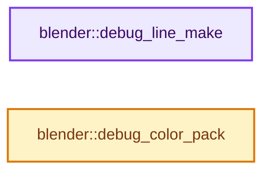
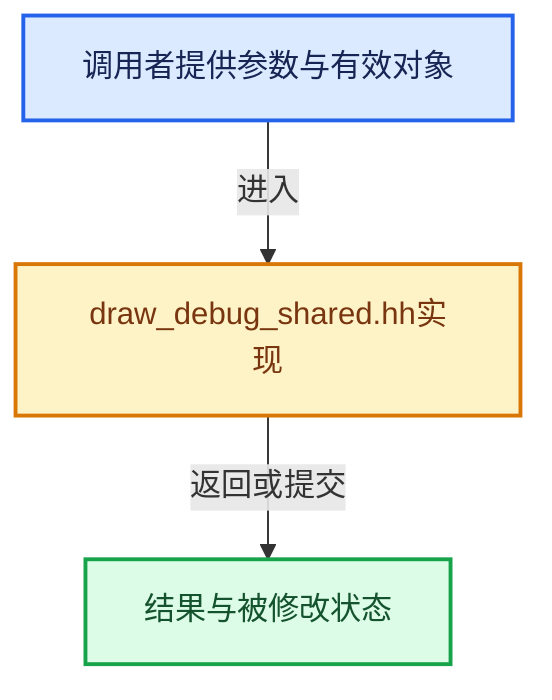

# 实现依赖专题：source/blender/draw/intern/draw_debug_shared.hh

[实现依赖导航](../../../README.md) · [符号索引](../../../../00-课程指南/02-源码与提交索引/符号依赖与实现索引.md)

本专题从正文实际调用进入，集中保存共享实现。函数有稳定锚点，可从调用处直接跳到对应完整函数；递归与互相调用通过回链组织。

## 本文件的实现关系






## 完整成员与函数实现

<a id="f-01eb16f2cc97d904"></a>

### `blender::debug_line_make`

实现位置：[source/blender/draw/intern/draw_debug_shared.hh](../../../../../../../../source/blender/draw/intern/draw_debug_shared.hh) · L42—L61。

接口参数：

- `uint in_pos1_x`
- `uint in_pos1_y`
- `uint in_pos1_z`
- `uint in_pos2_x`
- `uint in_pos2_y`
- `uint in_pos2_z`
- `uint in_vert_color`
- `uint in_lifetime`

**教学注释版**

<!-- annotated:484666f5ef217d -->

```cpp
inline DRWDebugVertPair debug_line_make(uint in_pos1_x,
                                        uint in_pos1_y,
                                        uint in_pos1_z,
                                        uint in_pos2_x,
                                        uint in_pos2_y,
                                        uint in_pos2_z,
                                        uint in_vert_color,
                                        uint in_lifetime)
{
  DRWDebugVertPair debug_vert;
  debug_vert.pos1_x = in_pos1_x;
  debug_vert.pos1_y = in_pos1_y;
  debug_vert.pos1_z = in_pos1_z;
  debug_vert.pos2_x = in_pos2_x;
  debug_vert.pos2_y = in_pos2_y;
  debug_vert.pos2_z = in_pos2_z;
  debug_vert.vert_color = in_vert_color;
  debug_vert.lifetime = in_lifetime;
  return debug_vert;
}
```

<details>
<summary>核对原始源码：source/blender/draw/intern/draw_debug_shared.hh · L42—L61</summary>

<!-- original:484666f5ef217d:source/blender/draw/intern/draw_debug_shared.hh:42:61 -->

```cpp
inline DRWDebugVertPair debug_line_make(uint in_pos1_x,
                                        uint in_pos1_y,
                                        uint in_pos1_z,
                                        uint in_pos2_x,
                                        uint in_pos2_y,
                                        uint in_pos2_z,
                                        uint in_vert_color,
                                        uint in_lifetime)
{
  DRWDebugVertPair debug_vert;
  debug_vert.pos1_x = in_pos1_x;
  debug_vert.pos1_y = in_pos1_y;
  debug_vert.pos1_z = in_pos1_z;
  debug_vert.pos2_x = in_pos2_x;
  debug_vert.pos2_y = in_pos2_y;
  debug_vert.pos2_z = in_pos2_z;
  debug_vert.vert_color = in_vert_color;
  debug_vert.lifetime = in_lifetime;
  return debug_vert;
}
```

</details>

**沿实际写入检查状态**

- `debug_vert.pos1_x = in_pos1_x;`
- `debug_vert.pos1_y = in_pos1_y;`
- `debug_vert.pos1_z = in_pos1_z;`
- `debug_vert.pos2_x = in_pos2_x;`
- `debug_vert.pos2_y = in_pos2_y;`
- `debug_vert.pos2_z = in_pos2_z;`
- `debug_vert.vert_color = in_vert_color;`
- `debug_vert.lifetime = in_lifetime;`

**结果出口**

- `return debug_vert;`

**继续追踪实现**

本实现没有需要继续展开的显式调用；检查返回表达式、对象转换和调用者前置条件。

<a id="f-eb858292d56a8204"></a>

### `blender::debug_color_pack`

实现位置：[source/blender/draw/intern/draw_debug_shared.hh](../../../../../../../../source/blender/draw/intern/draw_debug_shared.hh) · L63—L72。

接口参数：

- `float4 v_color`

**教学注释版**

<!-- annotated:be6d225044e389 -->

```cpp
inline uint debug_color_pack(float4 v_color)
{
  v_color = clamp(v_color, 0.0f, 1.0f);
  uint result = 0;
  result |= uint(v_color.x * 255.0) << 0u;
  result |= uint(v_color.y * 255.0) << 8u;
  result |= uint(v_color.z * 255.0) << 16u;
  result |= uint(v_color.w * 255.0) << 24u;
  return result;
}
```

<details>
<summary>核对原始源码：source/blender/draw/intern/draw_debug_shared.hh · L63—L72</summary>

<!-- original:be6d225044e389:source/blender/draw/intern/draw_debug_shared.hh:63:72 -->

```cpp
inline uint debug_color_pack(float4 v_color)
{
  v_color = clamp(v_color, 0.0f, 1.0f);
  uint result = 0;
  result |= uint(v_color.x * 255.0) << 0u;
  result |= uint(v_color.y * 255.0) << 8u;
  result |= uint(v_color.z * 255.0) << 16u;
  result |= uint(v_color.w * 255.0) << 24u;
  return result;
}
```

</details>

**沿实际写入检查状态**

- `v_color = clamp(v_color, 0.0f, 1.0f);`
- `result |= uint(v_color.x * 255.0) << 0u;`
- `result |= uint(v_color.y * 255.0) << 8u;`
- `result |= uint(v_color.z * 255.0) << 16u;`
- `result |= uint(v_color.w * 255.0) << 24u;`

**结果出口**

- `return result;`

**继续追踪实现**

- `clamp` → [调用协议](../../../../00-课程指南/01-路线与规范/模板宏与动态分派协议.md)：函数指针、局部可调用对象或未展开的宏；必须结合调用者环境。调用位置L65。
