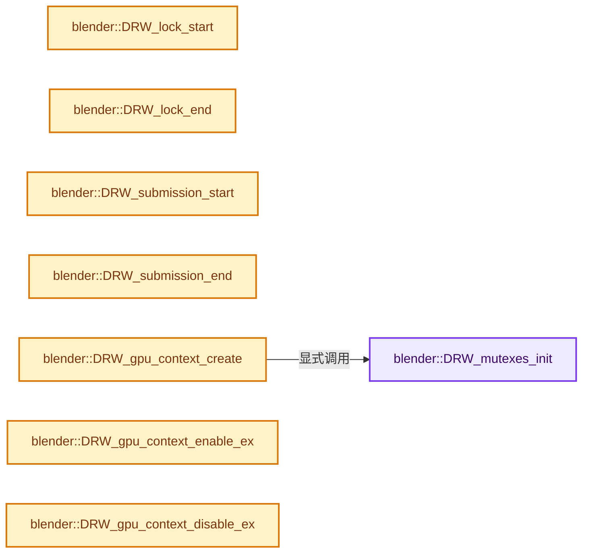

# 实现依赖专题：source/blender/draw/intern/draw_gpu_context.cc

[实现依赖导航](../../../README.md) · [符号索引](../../../../00-课程指南/02-源码与提交索引/符号依赖与实现索引.md)

本专题从正文实际调用进入，集中保存共享实现。函数有稳定锚点，可从调用处直接跳到对应完整函数；递归与互相调用通过回链组织。

## 本文件的实现关系




## 完整成员与函数实现

<a id="f-e63f98b3af267e3a"></a>

### `blender::DRW_mutexes_init`

实现位置：[source/blender/draw/intern/draw_gpu_context.cc](../../../../../../../../source/blender/draw/intern/draw_gpu_context.cc) · L36—L40。

**教学注释版**

<!-- annotated:8c99779a3b0740 -->

```cpp
void DRW_mutexes_init()
{
  draw_mutex = BLI_ticket_mutex_alloc();
  submission_mutex = BLI_ticket_mutex_alloc();
}
```

<details>
<summary>核对原始源码：source/blender/draw/intern/draw_gpu_context.cc · L36—L40</summary>

<!-- original:8c99779a3b0740:source/blender/draw/intern/draw_gpu_context.cc:36:40 -->

```cpp
void DRW_mutexes_init()
{
  draw_mutex = BLI_ticket_mutex_alloc();
  submission_mutex = BLI_ticket_mutex_alloc();
}
```

</details>

**沿实际写入检查状态**

- `draw_mutex = BLI_ticket_mutex_alloc();`
- `submission_mutex = BLI_ticket_mutex_alloc();`

**继续追踪实现**

- `BLI_ticket_mutex_alloc` → [BLI_ticket_mutex_alloc · L513](../../../01-BLI基础库/intern/threads.cc.md#f-a19b42cf96696ce4)。

<a id="f-1c5fc73690c17462"></a>

### `blender::DRW_lock_start`

实现位置：[source/blender/draw/intern/draw_gpu_context.cc](../../../../../../../../source/blender/draw/intern/draw_gpu_context.cc) · L48—L53。

**教学注释版**

<!-- annotated:2d7254cf417373 -->

```cpp
void DRW_lock_start()
{
  bool locked = BLI_ticket_mutex_lock_check_recursive(draw_mutex);
  BLI_assert(locked);
  UNUSED_VARS_NDEBUG(locked);
}
```

<details>
<summary>核对原始源码：source/blender/draw/intern/draw_gpu_context.cc · L48—L53</summary>

<!-- original:2d7254cf417373:source/blender/draw/intern/draw_gpu_context.cc:48:53 -->

```cpp
void DRW_lock_start()
{
  bool locked = BLI_ticket_mutex_lock_check_recursive(draw_mutex);
  BLI_assert(locked);
  UNUSED_VARS_NDEBUG(locked);
}
```

</details>

**继续追踪实现**

- `BLI_ticket_mutex_lock_check_recursive` → [BLI_ticket_mutex_lock_check_recursive · L560](../../../01-BLI基础库/intern/threads.cc.md#f-3d903ff338e26395)。
- `BLI_assert` → [BLI_assert · L48](../../../01-BLI基础库/BLI_assert.hh.md#m-57a88495704d)；[BLI_assert · L63](../../../01-BLI基础库/BLI_assert.hh.md#m-d07050020cb5)。宏定义由构建条件选择。
- `UNUSED_VARS_NDEBUG` → [UNUSED_VARS_NDEBUG · L526](../../../01-BLI基础库/BLI_utildefines.hh.md#m-fea439f7d366)；[UNUSED_VARS_NDEBUG · L528](../../../01-BLI基础库/BLI_utildefines.hh.md#m-a8f8cfac06c0)。宏定义由构建条件选择。

<a id="f-0c7e2428b471cfce"></a>

### `blender::DRW_lock_end`

实现位置：[source/blender/draw/intern/draw_gpu_context.cc](../../../../../../../../source/blender/draw/intern/draw_gpu_context.cc) · L55—L58。

**教学注释版**

<!-- annotated:17dc6798f7b5fc -->

```cpp
void DRW_lock_end()
{
  BLI_ticket_mutex_unlock(draw_mutex);
}
```

<details>
<summary>核对原始源码：source/blender/draw/intern/draw_gpu_context.cc · L55—L58</summary>

<!-- original:17dc6798f7b5fc:source/blender/draw/intern/draw_gpu_context.cc:55:58 -->

```cpp
void DRW_lock_end()
{
  BLI_ticket_mutex_unlock(draw_mutex);
}
```

</details>

**继续追踪实现**

- `BLI_ticket_mutex_unlock` → [BLI_ticket_mutex_unlock · L565](../../../01-BLI基础库/intern/threads.cc.md#f-75799cbeb37c97e5)。

<a id="f-57273afd566a69bb"></a>

### `blender::DRW_submission_start`

实现位置：[source/blender/draw/intern/draw_gpu_context.cc](../../../../../../../../source/blender/draw/intern/draw_gpu_context.cc) · L60—L66。

**教学注释版**

<!-- annotated:1243cd151f4198 -->

```cpp
void DRW_submission_start()
{
  bool locked = BLI_ticket_mutex_lock_check_recursive(submission_mutex);
  BLI_assert(locked);
  UNUSED_VARS_NDEBUG(locked);
  GPU_render_begin();
}
```

<details>
<summary>核对原始源码：source/blender/draw/intern/draw_gpu_context.cc · L60—L66</summary>

<!-- original:1243cd151f4198:source/blender/draw/intern/draw_gpu_context.cc:60:66 -->

```cpp
void DRW_submission_start()
{
  bool locked = BLI_ticket_mutex_lock_check_recursive(submission_mutex);
  BLI_assert(locked);
  UNUSED_VARS_NDEBUG(locked);
  GPU_render_begin();
}
```

</details>

**继续追踪实现**

- `BLI_ticket_mutex_lock_check_recursive` → [BLI_ticket_mutex_lock_check_recursive · L560](../../../01-BLI基础库/intern/threads.cc.md#f-3d903ff338e26395)。
- `BLI_assert` → [BLI_assert · L48](../../../01-BLI基础库/BLI_assert.hh.md#m-57a88495704d)；[BLI_assert · L63](../../../01-BLI基础库/BLI_assert.hh.md#m-d07050020cb5)。宏定义由构建条件选择。
- `UNUSED_VARS_NDEBUG` → [UNUSED_VARS_NDEBUG · L526](../../../01-BLI基础库/BLI_utildefines.hh.md#m-fea439f7d366)；[UNUSED_VARS_NDEBUG · L528](../../../01-BLI基础库/BLI_utildefines.hh.md#m-a8f8cfac06c0)。宏定义由构建条件选择。
- `GPU_render_begin` → [blender::GPU_render_begin · L323](../../gpu/intern/gpu_context.cc.md#f-cce48be45b000520)。

<a id="f-6cc549be55e77d77"></a>

### `blender::DRW_submission_end`

实现位置：[source/blender/draw/intern/draw_gpu_context.cc](../../../../../../../../source/blender/draw/intern/draw_gpu_context.cc) · L68—L72。

**教学注释版**

<!-- annotated:6a3bc741a9cf34 -->

```cpp
void DRW_submission_end()
{
  GPU_render_end();
  BLI_ticket_mutex_unlock(submission_mutex);
}
```

<details>
<summary>核对原始源码：source/blender/draw/intern/draw_gpu_context.cc · L68—L72</summary>

<!-- original:6a3bc741a9cf34:source/blender/draw/intern/draw_gpu_context.cc:68:72 -->

```cpp
void DRW_submission_end()
{
  GPU_render_end();
  BLI_ticket_mutex_unlock(submission_mutex);
}
```

</details>

**继续追踪实现**

- `GPU_render_end` → [blender::GPU_render_end · L334](../../gpu/intern/gpu_context.cc.md#f-925f1716017348b4)。
- `BLI_ticket_mutex_unlock` → [BLI_ticket_mutex_unlock · L565](../../../01-BLI基础库/intern/threads.cc.md#f-75799cbeb37c97e5)。

<a id="f-691f1687a17e9c60"></a>

### `blender::DRW_gpu_context_create`

实现位置：[source/blender/draw/intern/draw_gpu_context.cc](../../../../../../../../source/blender/draw/intern/draw_gpu_context.cc) · L168—L178。

**教学注释版**

<!-- annotated:d0ef92991039f8 -->

```cpp
void DRW_gpu_context_create()
{
  BLI_assert(viewport_context == nullptr); /* Ensure it's called once */

  DRW_mutexes_init();

  viewport_context = MEM_new<ContextShared>(__func__);
  preview_context = MEM_new<ContextShared>(__func__);

  viewport_context->enable();
}
```

<details>
<summary>核对原始源码：source/blender/draw/intern/draw_gpu_context.cc · L168—L178</summary>

<!-- original:d0ef92991039f8:source/blender/draw/intern/draw_gpu_context.cc:168:178 -->

```cpp
void DRW_gpu_context_create()
{
  BLI_assert(viewport_context == nullptr); /* Ensure it's called once */

  DRW_mutexes_init();

  viewport_context = MEM_new<ContextShared>(__func__);
  preview_context = MEM_new<ContextShared>(__func__);

  viewport_context->enable();
}
```

</details>

**沿实际写入检查状态**

- `viewport_context = MEM_new<ContextShared>(__func__);`
- `preview_context = MEM_new<ContextShared>(__func__);`

**继续追踪实现**

- `BLI_assert` → [BLI_assert · L48](../../../01-BLI基础库/BLI_assert.hh.md#m-57a88495704d)；[BLI_assert · L63](../../../01-BLI基础库/BLI_assert.hh.md#m-d07050020cb5)。宏定义由构建条件选择。
- `DRW_mutexes_init` → [blender::DRW_mutexes_init · L36](draw_gpu_context.cc.md#f-e63f98b3af267e3a)。
- `MEM_new<ContextShared>` → [MEM_new · L351](../../../07-Intern运行时与平台/guardedalloc/MEM_guardedalloc.h.md#f-115f9b6784f89912)。
- `viewport_context->enable` → [调用协议](../../../../00-课程指南/01-路线与规范/模板宏与动态分派协议.md)：接收对象类型依赖auto、返回值或模板实例；不按同名猜测目标。调用位置L177。

<a id="f-883cf0914202a0a7"></a>

### `blender::DRW_gpu_context_enable_ex`

实现位置：[source/blender/draw/intern/draw_gpu_context.cc](../../../../../../../../source/blender/draw/intern/draw_gpu_context.cc) · L198—L204。

接口参数：

- `bool`

**教学注释版**

<!-- annotated:fb64136841ec70 -->

```cpp
void DRW_gpu_context_enable_ex(bool /*restore*/)
{
  if (viewport_context == nullptr) {
    return;
  }
  viewport_context->enable();
}
```

<details>
<summary>核对原始源码：source/blender/draw/intern/draw_gpu_context.cc · L198—L204</summary>

<!-- original:fb64136841ec70:source/blender/draw/intern/draw_gpu_context.cc:198:204 -->

```cpp
void DRW_gpu_context_enable_ex(bool /*restore*/)
{
  if (viewport_context == nullptr) {
    return;
  }
  viewport_context->enable();
}
```

</details>

**继续追踪实现**

- `viewport_context->enable` → [调用协议](../../../../00-课程指南/01-路线与规范/模板宏与动态分派协议.md)：接收对象类型依赖auto、返回值或模板实例；不按同名猜测目标。调用位置L203。

<a id="f-f696f3fc7280fe49"></a>

### `blender::DRW_gpu_context_disable_ex`

实现位置：[source/blender/draw/intern/draw_gpu_context.cc](../../../../../../../../source/blender/draw/intern/draw_gpu_context.cc) · L206—L212。

接口参数：

- `bool restore`

**教学注释版**

<!-- annotated:59eb71f192edb9 -->

```cpp
void DRW_gpu_context_disable_ex(bool restore)
{
  if (viewport_context == nullptr) {
    return;
  }
  viewport_context->disable(restore);
}
```

<details>
<summary>核对原始源码：source/blender/draw/intern/draw_gpu_context.cc · L206—L212</summary>

<!-- original:59eb71f192edb9:source/blender/draw/intern/draw_gpu_context.cc:206:212 -->

```cpp
void DRW_gpu_context_disable_ex(bool restore)
{
  if (viewport_context == nullptr) {
    return;
  }
  viewport_context->disable(restore);
}
```

</details>

**继续追踪实现**

- `viewport_context->disable` → [调用协议](../../../../00-课程指南/01-路线与规范/模板宏与动态分派协议.md)：接收对象类型依赖auto、返回值或模板实例；不按同名猜测目标。调用位置L211。

<a id="f-5f6a7100db6baad4"></a>

### `blender::drw_gpu_preview_context_enable`

实现位置：[source/blender/draw/intern/draw_gpu_context.cc](../../../../../../../../source/blender/draw/intern/draw_gpu_context.cc) · L214—L220。

**教学注释版**

<!-- annotated:193eecb1418083 -->

```cpp
static void drw_gpu_preview_context_enable()
{
  if (preview_context == nullptr) {
    return;
  }
  preview_context->enable();
}
```

<details>
<summary>核对原始源码：source/blender/draw/intern/draw_gpu_context.cc · L214—L220</summary>

<!-- original:193eecb1418083:source/blender/draw/intern/draw_gpu_context.cc:214:220 -->

```cpp
static void drw_gpu_preview_context_enable()
{
  if (preview_context == nullptr) {
    return;
  }
  preview_context->enable();
}
```

</details>

**继续追踪实现**

- `preview_context->enable` → [调用协议](../../../../00-课程指南/01-路线与规范/模板宏与动态分派协议.md)：接收对象类型依赖auto、返回值或模板实例；不按同名猜测目标。调用位置L219。

<a id="f-a729d3af515d0fdb"></a>

### `blender::drw_gpu_preview_context_disable`

实现位置：[source/blender/draw/intern/draw_gpu_context.cc](../../../../../../../../source/blender/draw/intern/draw_gpu_context.cc) · L222—L228。

**教学注释版**

<!-- annotated:d2617fb5b76411 -->

```cpp
static void drw_gpu_preview_context_disable()
{
  if (preview_context == nullptr) {
    return;
  }
  preview_context->disable();
}
```

<details>
<summary>核对原始源码：source/blender/draw/intern/draw_gpu_context.cc · L222—L228</summary>

<!-- original:d2617fb5b76411:source/blender/draw/intern/draw_gpu_context.cc:222:228 -->

```cpp
static void drw_gpu_preview_context_disable()
{
  if (preview_context == nullptr) {
    return;
  }
  preview_context->disable();
}
```

</details>

**继续追踪实现**

- `preview_context->disable` → [调用协议](../../../../00-课程指南/01-路线与规范/模板宏与动态分派协议.md)：接收对象类型依赖auto、返回值或模板实例；不按同名猜测目标。调用位置L227。

<a id="f-25fa543faf476757"></a>

### `blender::DRW_gpu_context_enable`

实现位置：[source/blender/draw/intern/draw_gpu_context.cc](../../../../../../../../source/blender/draw/intern/draw_gpu_context.cc) · L230—L238。

**教学注释版**

<!-- annotated:2560a351e68f1c -->

```cpp
void DRW_gpu_context_enable()
{
  /* TODO: should be replace by a more elegant alternative. */

  if (G.background && viewport_context == nullptr) {
    WM_init_gpu_offscreen();
  }
  DRW_gpu_context_enable_ex(true);
}
```

<details>
<summary>核对原始源码：source/blender/draw/intern/draw_gpu_context.cc · L230—L238</summary>

<!-- original:2560a351e68f1c:source/blender/draw/intern/draw_gpu_context.cc:230:238 -->

```cpp
void DRW_gpu_context_enable()
{
  /* TODO: should be replace by a more elegant alternative. */

  if (G.background && viewport_context == nullptr) {
    WM_init_gpu_offscreen();
  }
  DRW_gpu_context_enable_ex(true);
}
```

</details>

**继续追踪实现**

- `WM_init_gpu_offscreen` → [blender::WM_init_gpu_offscreen · L155](../../windowmanager/intern/wm_init_exit.cc.md#f-06324089ff98ece2)。
- `DRW_gpu_context_enable_ex` → [blender::DRW_gpu_context_enable_ex · L198](draw_gpu_context.cc.md#f-883cf0914202a0a7)。

<a id="f-cd7b15acc7b153b9"></a>

### `blender::DRW_gpu_context_is_enabled`

实现位置：[source/blender/draw/intern/draw_gpu_context.cc](../../../../../../../../source/blender/draw/intern/draw_gpu_context.cc) · L249—L252。

**教学注释版**

<!-- annotated:95887dc26092c1 -->

```cpp
bool DRW_gpu_context_is_enabled()
{
  return viewport_context && viewport_context->is_enabled();
}
```

<details>
<summary>核对原始源码：source/blender/draw/intern/draw_gpu_context.cc · L249—L252</summary>

<!-- original:95887dc26092c1:source/blender/draw/intern/draw_gpu_context.cc:249:252 -->

```cpp
bool DRW_gpu_context_is_enabled()
{
  return viewport_context && viewport_context->is_enabled();
}
```

</details>

**结果出口**

- `return viewport_context && viewport_context->is_enabled();`

**继续追踪实现**

- `viewport_context->is_enabled` → [调用协议](../../../../00-课程指南/01-路线与规范/模板宏与动态分派协议.md)：接收对象类型依赖auto、返回值或模板实例；不按同名猜测目标。调用位置L251。

<a id="f-f096405c6087d7b7"></a>

### `blender::DRW_gpu_context_disable`

实现位置：[source/blender/draw/intern/draw_gpu_context.cc](../../../../../../../../source/blender/draw/intern/draw_gpu_context.cc) · L254—L257。

**教学注释版**

<!-- annotated:a33373ac8ab3f6 -->

```cpp
void DRW_gpu_context_disable()
{
  DRW_gpu_context_disable_ex(true);
}
```

<details>
<summary>核对原始源码：source/blender/draw/intern/draw_gpu_context.cc · L254—L257</summary>

<!-- original:a33373ac8ab3f6:source/blender/draw/intern/draw_gpu_context.cc:254:257 -->

```cpp
void DRW_gpu_context_disable()
{
  DRW_gpu_context_disable_ex(true);
}
```

</details>

**继续追踪实现**

- `DRW_gpu_context_disable_ex` → [blender::DRW_gpu_context_disable_ex · L206](draw_gpu_context.cc.md#f-f696f3fc7280fe49)。

<a id="f-eeeebf671d25352f"></a>

### `blender::DRW_system_gpu_render_context_enable`

实现位置：[source/blender/draw/intern/draw_gpu_context.cc](../../../../../../../../source/blender/draw/intern/draw_gpu_context.cc) · L259—L266。

接口参数：

- `GHOST_IContext *re_system_gpu_context`

**教学注释版**

<!-- annotated:17e6dce588df5e -->

```cpp
void DRW_system_gpu_render_context_enable(GHOST_IContext *re_system_gpu_context)
{
  /* If thread is main you should use DRW_gpu_context_enable(). */
  BLI_assert(!BLI_thread_is_main());

  DRW_lock_start();
  WM_system_gpu_context_activate(re_system_gpu_context);
}
```

<details>
<summary>核对原始源码：source/blender/draw/intern/draw_gpu_context.cc · L259—L266</summary>

<!-- original:17e6dce588df5e:source/blender/draw/intern/draw_gpu_context.cc:259:266 -->

```cpp
void DRW_system_gpu_render_context_enable(GHOST_IContext *re_system_gpu_context)
{
  /* If thread is main you should use DRW_gpu_context_enable(). */
  BLI_assert(!BLI_thread_is_main());

  DRW_lock_start();
  WM_system_gpu_context_activate(re_system_gpu_context);
}
```

</details>

**继续追踪实现**

- `BLI_assert` → [BLI_assert · L48](../../../01-BLI基础库/BLI_assert.hh.md#m-57a88495704d)；[BLI_assert · L63](../../../01-BLI基础库/BLI_assert.hh.md#m-d07050020cb5)。宏定义由构建条件选择。
- `BLI_thread_is_main` → [BLI_thread_is_main · L184](../../../01-BLI基础库/intern/threads.cc.md#f-da304af4327defdc)。
- `DRW_lock_start` → [blender::DRW_lock_start · L48](draw_gpu_context.cc.md#f-1c5fc73690c17462)。
- `WM_system_gpu_context_activate` → [blender::WM_system_gpu_context_activate · L3702](../../windowmanager/intern/wm_window.cc.md#f-3e7141099e9a313f)。

<a id="f-22e6bcd61adcfb52"></a>

### `blender::DRW_system_gpu_render_context_disable`

实现位置：[source/blender/draw/intern/draw_gpu_context.cc](../../../../../../../../source/blender/draw/intern/draw_gpu_context.cc) · L268—L272。

接口参数：

- `GHOST_IContext *re_system_gpu_context`

**教学注释版**

<!-- annotated:d5b2fda98df9c0 -->

```cpp
void DRW_system_gpu_render_context_disable(GHOST_IContext *re_system_gpu_context)
{
  WM_system_gpu_context_release(re_system_gpu_context);
  DRW_lock_end();
}
```

<details>
<summary>核对原始源码：source/blender/draw/intern/draw_gpu_context.cc · L268—L272</summary>

<!-- original:d5b2fda98df9c0:source/blender/draw/intern/draw_gpu_context.cc:268:272 -->

```cpp
void DRW_system_gpu_render_context_disable(GHOST_IContext *re_system_gpu_context)
{
  WM_system_gpu_context_release(re_system_gpu_context);
  DRW_lock_end();
}
```

</details>

**继续追踪实现**

- `WM_system_gpu_context_release` → [blender::WM_system_gpu_context_release · L3708](../../windowmanager/intern/wm_window.cc.md#f-7db896ac7a0d2dbf)。
- `DRW_lock_end` → [blender::DRW_lock_end · L55](draw_gpu_context.cc.md#f-0c7e2428b471cfce)。

<a id="f-c072f299e7eb43cc"></a>

### `blender::DRW_blender_gpu_render_context_enable`

实现位置：[source/blender/draw/intern/draw_gpu_context.cc](../../../../../../../../source/blender/draw/intern/draw_gpu_context.cc) · L274—L280。

接口参数：

- `void *re_gpu_context`

**教学注释版**

<!-- annotated:04ec3be992e0fb -->

```cpp
void DRW_blender_gpu_render_context_enable(void *re_gpu_context)
{
  /* If thread is main you should use DRW_gpu_context_enable(). */
  BLI_assert(!BLI_thread_is_main());

  GPU_context_active_set(static_cast<GPUContext *>(re_gpu_context));
}
```

<details>
<summary>核对原始源码：source/blender/draw/intern/draw_gpu_context.cc · L274—L280</summary>

<!-- original:04ec3be992e0fb:source/blender/draw/intern/draw_gpu_context.cc:274:280 -->

```cpp
void DRW_blender_gpu_render_context_enable(void *re_gpu_context)
{
  /* If thread is main you should use DRW_gpu_context_enable(). */
  BLI_assert(!BLI_thread_is_main());

  GPU_context_active_set(static_cast<GPUContext *>(re_gpu_context));
}
```

</details>

**继续追踪实现**

- `BLI_assert` → [BLI_assert · L48](../../../01-BLI基础库/BLI_assert.hh.md#m-57a88495704d)；[BLI_assert · L63](../../../01-BLI基础库/BLI_assert.hh.md#m-d07050020cb5)。宏定义由构建条件选择。
- `BLI_thread_is_main` → [BLI_thread_is_main · L184](../../../01-BLI基础库/intern/threads.cc.md#f-da304af4327defdc)。
- `GPU_context_active_set` → [blender::GPU_context_active_set · L244](../../gpu/intern/gpu_context.cc.md#f-52c17aead712db05)。

<a id="f-917f78878cbf855e"></a>

### `blender::DRW_blender_gpu_render_context_disable`

实现位置：[source/blender/draw/intern/draw_gpu_context.cc](../../../../../../../../source/blender/draw/intern/draw_gpu_context.cc) · L282—L286。

接口参数：

- `void *`

**教学注释版**

<!-- annotated:cd5b0cbdf7bf0c -->

```cpp
void DRW_blender_gpu_render_context_disable(void * /*re_gpu_context*/)
{
  GPU_flush();
  GPU_context_active_set(nullptr);
}
```

<details>
<summary>核对原始源码：source/blender/draw/intern/draw_gpu_context.cc · L282—L286</summary>

<!-- original:cd5b0cbdf7bf0c:source/blender/draw/intern/draw_gpu_context.cc:282:286 -->

```cpp
void DRW_blender_gpu_render_context_disable(void * /*re_gpu_context*/)
{
  GPU_flush();
  GPU_context_active_set(nullptr);
}
```

</details>

**继续追踪实现**

- `GPU_flush` → [blender::GPU_flush · L284](../../gpu/intern/gpu_state.cc.md#f-c521fe47c3318227)。
- `GPU_context_active_set` → [blender::GPU_context_active_set · L244](../../gpu/intern/gpu_context.cc.md#f-52c17aead712db05)。

<a id="f-ebed564046dfa3c8"></a>

### `blender::DRW_render_context_enable`

实现位置：[source/blender/draw/intern/draw_gpu_context.cc](../../../../../../../../source/blender/draw/intern/draw_gpu_context.cc) · L288—L314。

接口参数：

- `Render *render`

**教学注释版**

<!-- annotated:bca7846703a7c2 -->

```cpp
void DRW_render_context_enable(Render *render)
{
  if (G.background && viewport_context == nullptr) {
    WM_init_gpu_offscreen();
  }

  GPU_render_begin();

  if (GPU_use_main_context_workaround()) {
    GPU_context_main_lock();
    DRW_gpu_context_enable();
    return;
  }

  GHOST_IContext *re_viewport_system_gpu_context = RE_system_gpu_context_get(render);

  /* Changing Context */
  if (re_viewport_system_gpu_context != nullptr) {
    DRW_system_gpu_render_context_enable(re_viewport_system_gpu_context);
    /* We need to query gpu context after a gl context has been bound. */
    void *re_viewport_context = RE_blender_gpu_context_ensure(render);
    DRW_blender_gpu_render_context_enable(re_viewport_context);
  }
  else {
    drw_gpu_preview_context_enable();
  }
}
```

<details>
<summary>核对原始源码：source/blender/draw/intern/draw_gpu_context.cc · L288—L314</summary>

<!-- original:bca7846703a7c2:source/blender/draw/intern/draw_gpu_context.cc:288:314 -->

```cpp
void DRW_render_context_enable(Render *render)
{
  if (G.background && viewport_context == nullptr) {
    WM_init_gpu_offscreen();
  }

  GPU_render_begin();

  if (GPU_use_main_context_workaround()) {
    GPU_context_main_lock();
    DRW_gpu_context_enable();
    return;
  }

  GHOST_IContext *re_viewport_system_gpu_context = RE_system_gpu_context_get(render);

  /* Changing Context */
  if (re_viewport_system_gpu_context != nullptr) {
    DRW_system_gpu_render_context_enable(re_viewport_system_gpu_context);
    /* We need to query gpu context after a gl context has been bound. */
    void *re_viewport_context = RE_blender_gpu_context_ensure(render);
    DRW_blender_gpu_render_context_enable(re_viewport_context);
  }
  else {
    drw_gpu_preview_context_enable();
  }
}
```

</details>

**继续追踪实现**

- `WM_init_gpu_offscreen` → [blender::WM_init_gpu_offscreen · L155](../../windowmanager/intern/wm_init_exit.cc.md#f-06324089ff98ece2)。
- `GPU_render_begin` → [blender::GPU_render_begin · L323](../../gpu/intern/gpu_context.cc.md#f-cce48be45b000520)。
- `GPU_use_main_context_workaround` → [blender::GPU_use_main_context_workaround · L142](../../gpu/intern/gpu_capabilities.cc.md#f-8d3c73eb427675cb)。
- `GPU_context_main_lock` → [blender::GPU_context_main_lock · L304](../../gpu/intern/gpu_context.cc.md#f-4f4e439173753112)。
- `DRW_gpu_context_enable` → [blender::DRW_gpu_context_enable · L230](draw_gpu_context.cc.md#f-25fa543faf476757)。
- `RE_system_gpu_context_get` → [blender::RE_system_gpu_context_get · L976](../../render/intern/pipeline.cc.md#f-cd9deef200668263)。
- `DRW_system_gpu_render_context_enable` → [blender::DRW_system_gpu_render_context_enable · L259](draw_gpu_context.cc.md#f-eeeebf671d25352f)。
- `RE_blender_gpu_context_ensure` → [blender::RE_blender_gpu_context_ensure · L982](../../render/intern/pipeline.cc.md#f-1b990556999c6477)。
- `DRW_blender_gpu_render_context_enable` → [blender::DRW_blender_gpu_render_context_enable · L274](draw_gpu_context.cc.md#f-c072f299e7eb43cc)。
- `drw_gpu_preview_context_enable` → [blender::drw_gpu_preview_context_enable · L214](draw_gpu_context.cc.md#f-5f6a7100db6baad4)。

<a id="f-2c9e8be208513be2"></a>

### `blender::DRW_render_context_disable`

实现位置：[source/blender/draw/intern/draw_gpu_context.cc](../../../../../../../../source/blender/draw/intern/draw_gpu_context.cc) · L316—L340。

接口参数：

- `Render *render`

**教学注释版**

<!-- annotated:0143b2222a9d33 -->

```cpp
void DRW_render_context_disable(Render *render)
{
  if (GPU_use_main_context_workaround()) {
    DRW_gpu_context_disable();
    GPU_render_end();
    GPU_context_main_unlock();
    return;
  }

  GHOST_IContext *re_viewport_system_gpu_context = RE_system_gpu_context_get(render);

  if (re_viewport_system_gpu_context != nullptr) {
    void *re_viewport_context = RE_blender_gpu_context_ensure(render);
    /* GPU rendering may occur during context disable. */
    DRW_blender_gpu_render_context_disable(re_viewport_context);
    GPU_render_end();
    DRW_system_gpu_render_context_disable(re_viewport_system_gpu_context);
  }
  else {
    /* Usually the case for a preview job. The `Render` is created inside the render thread which
     * is too late to create a GPU context. */
    drw_gpu_preview_context_disable();
    GPU_render_end();
  }
}
```

<details>
<summary>核对原始源码：source/blender/draw/intern/draw_gpu_context.cc · L316—L340</summary>

<!-- original:0143b2222a9d33:source/blender/draw/intern/draw_gpu_context.cc:316:340 -->

```cpp
void DRW_render_context_disable(Render *render)
{
  if (GPU_use_main_context_workaround()) {
    DRW_gpu_context_disable();
    GPU_render_end();
    GPU_context_main_unlock();
    return;
  }

  GHOST_IContext *re_viewport_system_gpu_context = RE_system_gpu_context_get(render);

  if (re_viewport_system_gpu_context != nullptr) {
    void *re_viewport_context = RE_blender_gpu_context_ensure(render);
    /* GPU rendering may occur during context disable. */
    DRW_blender_gpu_render_context_disable(re_viewport_context);
    GPU_render_end();
    DRW_system_gpu_render_context_disable(re_viewport_system_gpu_context);
  }
  else {
    /* Usually the case for a preview job. The `Render` is created inside the render thread which
     * is too late to create a GPU context. */
    drw_gpu_preview_context_disable();
    GPU_render_end();
  }
}
```

</details>

**继续追踪实现**

- `GPU_use_main_context_workaround` → [blender::GPU_use_main_context_workaround · L142](../../gpu/intern/gpu_capabilities.cc.md#f-8d3c73eb427675cb)。
- `DRW_gpu_context_disable` → [blender::DRW_gpu_context_disable · L254](draw_gpu_context.cc.md#f-f096405c6087d7b7)。
- `GPU_render_end` → [blender::GPU_render_end · L334](../../gpu/intern/gpu_context.cc.md#f-925f1716017348b4)。
- `GPU_context_main_unlock` → [blender::GPU_context_main_unlock · L309](../../gpu/intern/gpu_context.cc.md#f-7cbd61f641482711)。
- `RE_system_gpu_context_get` → [blender::RE_system_gpu_context_get · L976](../../render/intern/pipeline.cc.md#f-cd9deef200668263)。
- `RE_blender_gpu_context_ensure` → [blender::RE_blender_gpu_context_ensure · L982](../../render/intern/pipeline.cc.md#f-1b990556999c6477)。
- `DRW_blender_gpu_render_context_disable` → [blender::DRW_blender_gpu_render_context_disable · L282](draw_gpu_context.cc.md#f-917f78878cbf855e)。
- `DRW_system_gpu_render_context_disable` → [blender::DRW_system_gpu_render_context_disable · L268](draw_gpu_context.cc.md#f-22e6bcd61adcfb52)。
- `drw_gpu_preview_context_disable` → [blender::drw_gpu_preview_context_disable · L222](draw_gpu_context.cc.md#f-a729d3af515d0fdb)。
