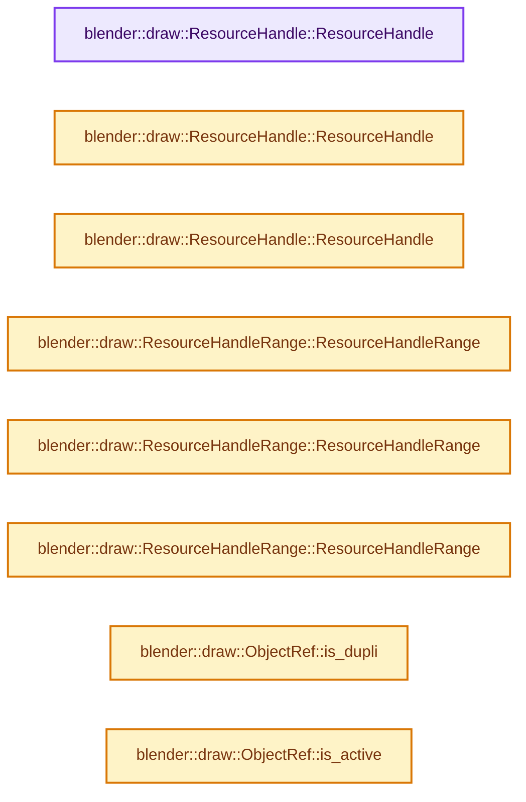
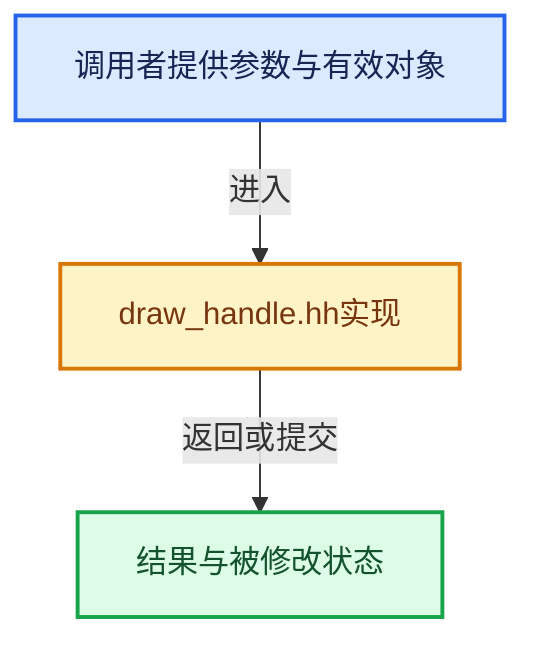

# 实现依赖专题：source/blender/draw/intern/draw_handle.hh

[实现依赖导航](../../../README.md) · [符号索引](../../../../00-课程指南/02-源码与提交索引/符号依赖与实现索引.md)

本专题从正文实际调用进入，集中保存共享实现。函数有稳定锚点，可从调用处直接跳到对应完整函数；递归与互相调用通过回链组织。

## 本文件的实现关系






## 完整成员与函数实现

<a id="f-fefeb18e38acb5b1"></a>

### `blender::draw::ResourceHandle::ResourceHandle`

实现位置：[source/blender/draw/intern/draw_handle.hh](../../../../../../../../source/blender/draw/intern/draw_handle.hh) · L121—L121。

接口参数：

- `uint raw`

**教学注释版**

<!-- annotated:cc1fec212edf12 -->

```cpp
  ResourceHandle(uint raw) : id_(raw) {}
```

<details>
<summary>核对原始源码：source/blender/draw/intern/draw_handle.hh · L121—L121</summary>

<!-- original:cc1fec212edf12:source/blender/draw/intern/draw_handle.hh:121:121 -->

```cpp
  ResourceHandle(uint raw) : id_(raw) {}
```

</details>

**继续追踪实现**

本实现没有需要继续展开的显式调用；检查返回表达式、对象转换和调用者前置条件。

<a id="f-36b02c7ccc4c93ed"></a>

### `blender::draw::ResourceHandle::ResourceHandle`

实现位置：[source/blender/draw/intern/draw_handle.hh](../../../../../../../../source/blender/draw/intern/draw_handle.hh) · L122—L122。

接口参数：

- `uint index`
- `bool inverted_handedness`

**教学注释版**

<!-- annotated:2d07496f572006 -->

```cpp
  ResourceHandle(uint index, bool inverted_handedness) : id_(index, inverted_handedness) {}
```

<details>
<summary>核对原始源码：source/blender/draw/intern/draw_handle.hh · L122—L122</summary>

<!-- original:2d07496f572006:source/blender/draw/intern/draw_handle.hh:122:122 -->

```cpp
  ResourceHandle(uint index, bool inverted_handedness) : id_(index, inverted_handedness) {}
```

</details>

**继续追踪实现**

本实现没有需要继续展开的显式调用；检查返回表达式、对象转换和调用者前置条件。

<a id="f-920cd44f5cc3c6d4"></a>

### `blender::draw::ResourceHandle::ResourceHandle`

实现位置：[source/blender/draw/intern/draw_handle.hh](../../../../../../../../source/blender/draw/intern/draw_handle.hh) · L125—L125。

**教学注释版**

<!-- annotated:7f69aa23ebf46b -->

```cpp
  ResourceHandle() = default;
```

<details>
<summary>核对原始源码：source/blender/draw/intern/draw_handle.hh · L125—L125</summary>

<!-- original:7f69aa23ebf46b:source/blender/draw/intern/draw_handle.hh:125:125 -->

```cpp
  ResourceHandle() = default;
```

</details>

**继续追踪实现**

本实现没有需要继续展开的显式调用；检查返回表达式、对象转换和调用者前置条件。

<a id="f-02feab2cde11028f"></a>

### `blender::draw::ResourceHandleRange::ResourceHandleRange`

实现位置：[source/blender/draw/intern/draw_handle.hh](../../../../../../../../source/blender/draw/intern/draw_handle.hh) · L164—L164。

接口参数：

- `ResourceHandle first_handle`
- `uint len`

**教学注释版**

<!-- annotated:2831e94815d40a -->

```cpp
  ResourceHandleRange(ResourceHandle first_handle, uint len) : id_(first_handle.id_, len) {}
```

<details>
<summary>核对原始源码：source/blender/draw/intern/draw_handle.hh · L164—L164</summary>

<!-- original:2831e94815d40a:source/blender/draw/intern/draw_handle.hh:164:164 -->

```cpp
  ResourceHandleRange(ResourceHandle first_handle, uint len) : id_(first_handle.id_, len) {}
```

</details>

**继续追踪实现**

本实现没有需要继续展开的显式调用；检查返回表达式、对象转换和调用者前置条件。

<a id="f-fb61986e8583d984"></a>

### `blender::draw::ResourceHandleRange::ResourceHandleRange`

实现位置：[source/blender/draw/intern/draw_handle.hh](../../../../../../../../source/blender/draw/intern/draw_handle.hh) · L167—L167。

**教学注释版**

<!-- annotated:7407dfec86b0a4 -->

```cpp
  ResourceHandleRange() = default;
```

<details>
<summary>核对原始源码：source/blender/draw/intern/draw_handle.hh · L167—L167</summary>

<!-- original:7407dfec86b0a4:source/blender/draw/intern/draw_handle.hh:167:167 -->

```cpp
  ResourceHandleRange() = default;
```

</details>

**继续追踪实现**

本实现没有需要继续展开的显式调用；检查返回表达式、对象转换和调用者前置条件。

<a id="f-dde16b71f5282880"></a>

### `blender::draw::ResourceHandleRange::ResourceHandleRange`

实现位置：[source/blender/draw/intern/draw_handle.hh](../../../../../../../../source/blender/draw/intern/draw_handle.hh) · L168—L168。

接口参数：

- `ResourceHandle handle`

**教学注释版**

<!-- annotated:0de5bcbd3129cb -->

```cpp
  ResourceHandleRange(ResourceHandle handle) : id_(handle.id_) {}
```

<details>
<summary>核对原始源码：source/blender/draw/intern/draw_handle.hh · L168—L168</summary>

<!-- original:0de5bcbd3129cb:source/blender/draw/intern/draw_handle.hh:168:168 -->

```cpp
  ResourceHandleRange(ResourceHandle handle) : id_(handle.id_) {}
```

</details>

**继续追踪实现**

本实现没有需要继续展开的显式调用；检查返回表达式、对象转换和调用者前置条件。

<a id="f-b58075af2dcbcc8d"></a>

### `blender::draw::ObjectRef::is_dupli`

实现位置：[source/blender/draw/intern/draw_handle.hh](../../../../../../../../source/blender/draw/intern/draw_handle.hh) · L254—L257。

**教学注释版**

<!-- annotated:5ccc4e0f0e808a -->

```cpp
  bool is_dupli() const
  {
    return dupli_parent_ != nullptr;
  }
```

<details>
<summary>核对原始源码：source/blender/draw/intern/draw_handle.hh · L254—L257</summary>

<!-- original:5ccc4e0f0e808a:source/blender/draw/intern/draw_handle.hh:254:257 -->

```cpp
  bool is_dupli() const
  {
    return dupli_parent_ != nullptr;
  }
```

</details>

**结果出口**

- `return dupli_parent_ != nullptr;`

**继续追踪实现**

本实现没有需要继续展开的显式调用；检查返回表达式、对象转换和调用者前置条件。

<a id="f-bcca4c61d1f23fbf"></a>

### `blender::draw::ObjectRef::is_active`

实现位置：[source/blender/draw/intern/draw_handle.hh](../../../../../../../../source/blender/draw/intern/draw_handle.hh) · L259—L262。

接口参数：

- `const Object *active_object`

**教学注释版**

<!-- annotated:30337134c37347 -->

```cpp
  bool is_active(const Object *active_object) const
  {
    return (dupli_parent_ ? dupli_parent_ : object) == active_object;
  }
```

<details>
<summary>核对原始源码：source/blender/draw/intern/draw_handle.hh · L259—L262</summary>

<!-- original:30337134c37347:source/blender/draw/intern/draw_handle.hh:259:262 -->

```cpp
  bool is_active(const Object *active_object) const
  {
    return (dupli_parent_ ? dupli_parent_ : object) == active_object;
  }
```

</details>

**结果出口**

- `return (dupli_parent_ ? dupli_parent_ : object) == active_object;`

**继续追踪实现**

本实现没有需要继续展开的显式调用；检查返回表达式、对象转换和调用者前置条件。

<a id="f-c1419fe1fc32c41d"></a>

### `blender::draw::ObjectRef::is_range`

实现位置：[source/blender/draw/intern/draw_handle.hh](../../../../../../../../source/blender/draw/intern/draw_handle.hh) · L264—L267。

**教学注释版**

<!-- annotated:7e731f4ff3a972 -->

```cpp
  bool is_range() const
  {
    return duplis_ != nullptr;
  }
```

<details>
<summary>核对原始源码：source/blender/draw/intern/draw_handle.hh · L264—L267</summary>

<!-- original:7e731f4ff3a972:source/blender/draw/intern/draw_handle.hh:264:267 -->

```cpp
  bool is_range() const
  {
    return duplis_ != nullptr;
  }
```

</details>

**结果出口**

- `return duplis_ != nullptr;`

**继续追踪实现**

本实现没有需要继续展开的显式调用；检查返回表达式、对象转换和调用者前置条件。

<a id="f-104d63a2beb25a4b"></a>

### `blender::draw::ObjectRef::random`

实现位置：[source/blender/draw/intern/draw_handle.hh](../../../../../../../../source/blender/draw/intern/draw_handle.hh) · L294—L307。

接口参数：

- `int instance_index`

**教学注释版**

<!-- annotated:9661817c8d756b -->

```cpp
  float random(int instance_index) const
  {
    if (instance_index != 0) {
      BLI_assert(is_range());
      return (*duplis_)[instance_index]->random_id * (1.0f / float(0xFFFFFFFF));
    }

    if (dupli_parent_ == nullptr) {
      /* TODO(fclem): this is rather costly to do at draw time. Maybe we can
       * put it in ob->runtime and make depsgraph ensure it is up to date. */
      return BLI_hash_int_2d(BLI_hash_string(object->id.name + 2), 0) * (1.0f / float(0xFFFFFFFF));
    }
    return dupli_object_->random_id * (1.0f / float(0xFFFFFFFF));
  }
```

<details>
<summary>核对原始源码：source/blender/draw/intern/draw_handle.hh · L294—L307</summary>

<!-- original:9661817c8d756b:source/blender/draw/intern/draw_handle.hh:294:307 -->

```cpp
  float random(int instance_index) const
  {
    if (instance_index != 0) {
      BLI_assert(is_range());
      return (*duplis_)[instance_index]->random_id * (1.0f / float(0xFFFFFFFF));
    }

    if (dupli_parent_ == nullptr) {
      /* TODO(fclem): this is rather costly to do at draw time. Maybe we can
       * put it in ob->runtime and make depsgraph ensure it is up to date. */
      return BLI_hash_int_2d(BLI_hash_string(object->id.name + 2), 0) * (1.0f / float(0xFFFFFFFF));
    }
    return dupli_object_->random_id * (1.0f / float(0xFFFFFFFF));
  }
```

</details>

**结果出口**

- `return (*duplis_)[instance_index]->random_id * (1.0f / float(0xFFFFFFFF));`
- `return BLI_hash_int_2d(BLI_hash_string(object->id.name + 2), 0) * (1.0f / float(0xFFFFFFFF));`
- `return dupli_object_->random_id * (1.0f / float(0xFFFFFFFF));`

**继续追踪实现**

- `BLI_assert` → [BLI_assert · L48](../../../01-BLI基础库/BLI_assert.hh.md#m-57a88495704d)；[BLI_assert · L63](../../../01-BLI基础库/BLI_assert.hh.md#m-d07050020cb5)。宏定义由构建条件选择。
- `is_range` → [blender::draw::ObjectRef::is_range · L264](draw_handle.hh.md#f-c1419fe1fc32c41d)。
- `BLI_hash_int_2d` → [blender::BLI_hash_int_2d · L53](../../../01-BLI基础库/BLI_hash_c.hh.md#f-3257c3494717d4c4)。
- `BLI_hash_string` → [blender::BLI_hash_string · L69](../../../01-BLI基础库/BLI_hash_c.hh.md#f-0f3487d576368d89)。

<a id="f-9526e767d4aa7a14"></a>

### `blender::draw::ObjectRef::light_linking`

实现位置：[source/blender/draw/intern/draw_handle.hh](../../../../../../../../source/blender/draw/intern/draw_handle.hh) · L336—L339。

**教学注释版**

<!-- annotated:3b13395bd63853 -->

```cpp
  LightLinking *light_linking() const
  {
    return dupli_parent_ ? dupli_parent_->light_linking : object->light_linking;
  }
```

<details>
<summary>核对原始源码：source/blender/draw/intern/draw_handle.hh · L336—L339</summary>

<!-- original:3b13395bd63853:source/blender/draw/intern/draw_handle.hh:336:339 -->

```cpp
  LightLinking *light_linking() const
  {
    return dupli_parent_ ? dupli_parent_->light_linking : object->light_linking;
  }
```

</details>

**结果出口**

- `return dupli_parent_ ? dupli_parent_->light_linking : object->light_linking;`

**继续追踪实现**

本实现没有需要继续展开的显式调用；检查返回表达式、对象转换和调用者前置条件。
