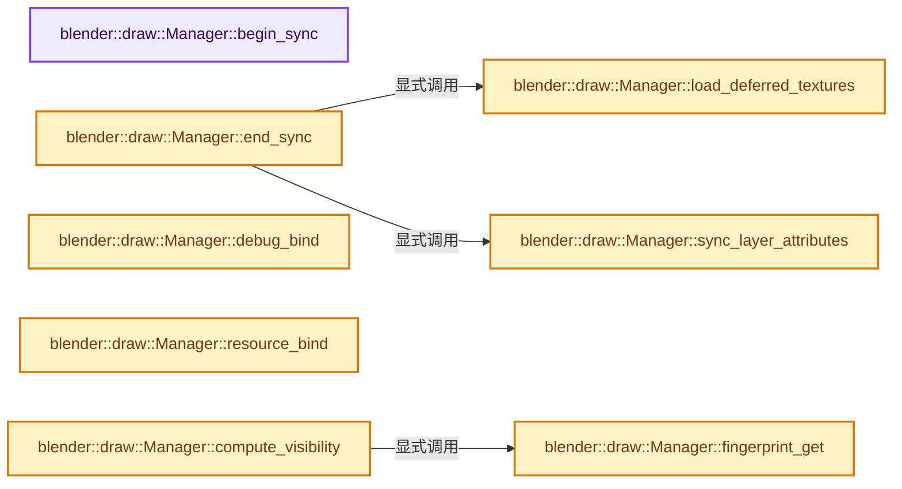

# 实现依赖专题：source/blender/draw/intern/draw_manager.cc

[实现依赖导航](../../../README.md) · [符号索引](../../../../00-课程指南/02-源码与提交索引/符号依赖与实现索引.md)

本专题从正文实际调用进入，集中保存共享实现。函数有稳定锚点，可从调用处直接跳到对应完整函数；递归与互相调用通过回链组织。

## 本文件的实现关系




## 完整成员与函数实现

<a id="f-31b6c3cd3f16088f"></a>

### `blender::draw::Manager::begin_sync`

实现位置：[source/blender/draw/intern/draw_manager.cc](../../../../../../../../source/blender/draw/intern/draw_manager.cc) · L43—L90。

接口参数：

- `Object *object_active`

**教学注释版**

<!-- annotated:c2965c442d043b -->

```cpp
void Manager::begin_sync(Object *object_active)
{
  /* Add 2 to always have a non-null number even in case of overflow. */
  sync_counter_ = (global_sync_counter_ += 2);

  matrix_buf.swap();
  bounds_buf.swap();
  infos_buf.swap();

  matrix_buf.current().trim_to_next_power_of_2(resource_len_);
  bounds_buf.current().trim_to_next_power_of_2(resource_len_);
  infos_buf.current().trim_to_next_power_of_2(resource_len_);
  attributes_buf.trim_to_next_power_of_2(attribute_len_);

  /* TODO: This means the reference is kept until further redraw or manager tear-down. Instead,
   * they should be released after each draw loop. But for now, mimics old DRW behavior. */
  for (gpu::Texture *texture : acquired_textures) {
    /* Decrease refcount and free if 0. */
    GPU_texture_free(texture);
  }

  acquired_textures.clear();
  deferred_textures_.clear();
  layer_attributes.clear();

/* For some reason, if this uninitialized data pattern was enabled (ie release asserts enabled),
 * The viewport just gives up rendering objects on ARM64 devices. Possibly Mesa GLOn12-related. */
#if !defined(NDEBUG) && !defined(_M_ARM64)
  /* Detect uninitialized data. */
  // [讲解] memset：填充字节，不调用T构造函数，也不保证任意类型的全零表示是合法或期望值。
  memset(matrix_buf.current().data(),
         0xF0,
         matrix_buf.current().size() * sizeof(*matrix_buf.current().data()));
  memset(bounds_buf.current().data(),
         0xF0,
         matrix_buf.current().size() * sizeof(*bounds_buf.current().data()));
  memset(infos_buf.current().data(),
         0xF0,
         matrix_buf.current().size() * sizeof(*infos_buf.current().data()));
#endif
  resource_len_ = 0;
  attribute_len_ = 0;
  /* TODO(fclem): Resize buffers if too big, but with an hysteresis threshold. */

  this->object_active = object_active;

  /* Init the 0 resource. */
  resource_handle(float4x4::identity());
}
```

<details>
<summary>核对原始源码：source/blender/draw/intern/draw_manager.cc · L43—L90</summary>

<!-- original:c2965c442d043b:source/blender/draw/intern/draw_manager.cc:43:90 -->

```cpp
void Manager::begin_sync(Object *object_active)
{
  /* Add 2 to always have a non-null number even in case of overflow. */
  sync_counter_ = (global_sync_counter_ += 2);

  matrix_buf.swap();
  bounds_buf.swap();
  infos_buf.swap();

  matrix_buf.current().trim_to_next_power_of_2(resource_len_);
  bounds_buf.current().trim_to_next_power_of_2(resource_len_);
  infos_buf.current().trim_to_next_power_of_2(resource_len_);
  attributes_buf.trim_to_next_power_of_2(attribute_len_);

  /* TODO: This means the reference is kept until further redraw or manager tear-down. Instead,
   * they should be released after each draw loop. But for now, mimics old DRW behavior. */
  for (gpu::Texture *texture : acquired_textures) {
    /* Decrease refcount and free if 0. */
    GPU_texture_free(texture);
  }

  acquired_textures.clear();
  deferred_textures_.clear();
  layer_attributes.clear();

/* For some reason, if this uninitialized data pattern was enabled (ie release asserts enabled),
 * The viewport just gives up rendering objects on ARM64 devices. Possibly Mesa GLOn12-related. */
#if !defined(NDEBUG) && !defined(_M_ARM64)
  /* Detect uninitialized data. */
  memset(matrix_buf.current().data(),
         0xF0,
         matrix_buf.current().size() * sizeof(*matrix_buf.current().data()));
  memset(bounds_buf.current().data(),
         0xF0,
         matrix_buf.current().size() * sizeof(*bounds_buf.current().data()));
  memset(infos_buf.current().data(),
         0xF0,
         matrix_buf.current().size() * sizeof(*infos_buf.current().data()));
#endif
  resource_len_ = 0;
  attribute_len_ = 0;
  /* TODO(fclem): Resize buffers if too big, but with an hysteresis threshold. */

  this->object_active = object_active;

  /* Init the 0 resource. */
  resource_handle(float4x4::identity());
}
```

</details>

**沿实际写入检查状态**

- `sync_counter_ = (global_sync_counter_ += 2);`
- `resource_len_ = 0;`
- `attribute_len_ = 0;`
- `this->object_active = object_active;`

**继续追踪实现**

- `matrix_buf.swap` → [调用协议](../../../../00-课程指南/01-路线与规范/模板宏与动态分派协议.md)：接收对象类型依赖auto、返回值或模板实例；不按同名猜测目标。调用位置L48。
- `bounds_buf.swap` → [调用协议](../../../../00-课程指南/01-路线与规范/模板宏与动态分派协议.md)：接收对象类型依赖auto、返回值或模板实例；不按同名猜测目标。调用位置L49。
- `infos_buf.swap` → [调用协议](../../../../00-课程指南/01-路线与规范/模板宏与动态分派协议.md)：接收对象类型依赖auto、返回值或模板实例；不按同名猜测目标。调用位置L50。
- `matrix_buf.current().trim_to_next_power_of_2` → [调用协议](../../../../00-课程指南/01-路线与规范/模板宏与动态分派协议.md)：接收对象类型依赖auto、返回值或模板实例；不按同名猜测目标。调用位置L52。
- `matrix_buf.current` → [调用协议](../../../../00-课程指南/01-路线与规范/模板宏与动态分派协议.md)：接收对象类型依赖auto、返回值或模板实例；不按同名猜测目标。调用位置L52。
- `bounds_buf.current().trim_to_next_power_of_2` → [调用协议](../../../../00-课程指南/01-路线与规范/模板宏与动态分派协议.md)：接收对象类型依赖auto、返回值或模板实例；不按同名猜测目标。调用位置L53。
- `bounds_buf.current` → [调用协议](../../../../00-课程指南/01-路线与规范/模板宏与动态分派协议.md)：接收对象类型依赖auto、返回值或模板实例；不按同名猜测目标。调用位置L53。
- `infos_buf.current().trim_to_next_power_of_2` → [调用协议](../../../../00-课程指南/01-路线与规范/模板宏与动态分派协议.md)：接收对象类型依赖auto、返回值或模板实例；不按同名猜测目标。调用位置L54。
- `infos_buf.current` → [调用协议](../../../../00-课程指南/01-路线与规范/模板宏与动态分派协议.md)：接收对象类型依赖auto、返回值或模板实例；不按同名猜测目标。调用位置L54。
- `attributes_buf.trim_to_next_power_of_2` → [调用协议](../../../../00-课程指南/01-路线与规范/模板宏与动态分派协议.md)：接收对象类型依赖auto、返回值或模板实例；不按同名猜测目标。调用位置L55。
- `GPU_texture_free` → [blender::GPU_texture_free · L735](../../gpu/intern/gpu_texture.cc.md#f-3f23c7904f8ea87f)。
- `acquired_textures.clear` → [调用协议](../../../../00-课程指南/01-路线与规范/模板宏与动态分派协议.md)：接收对象类型依赖auto、返回值或模板实例；不按同名猜测目标。调用位置L64。
- `deferred_textures_.clear` → [调用协议](../../../../00-课程指南/01-路线与规范/模板宏与动态分派协议.md)：接收对象类型依赖auto、返回值或模板实例；不按同名猜测目标。调用位置L65。
- `layer_attributes.clear` → [调用协议](../../../../00-课程指南/01-路线与规范/模板宏与动态分派协议.md)：接收对象类型依赖auto、返回值或模板实例；不按同名猜测目标。调用位置L66。
- `memset` → [外部契约](https://eel.is/c++draft/cstring.syn)：填充字节，不调用T构造函数，也不保证任意类型的全零表示是合法或期望值。
- `matrix_buf.current().data` → [调用协议](../../../../00-课程指南/01-路线与规范/模板宏与动态分派协议.md)：接收对象类型依赖auto、返回值或模板实例；不按同名猜测目标。调用位置L72。
- `matrix_buf.current().size` → [调用协议](../../../../00-课程指南/01-路线与规范/模板宏与动态分派协议.md)：接收对象类型依赖auto、返回值或模板实例；不按同名猜测目标。调用位置L74。
- `bounds_buf.current().data` → [调用协议](../../../../00-课程指南/01-路线与规范/模板宏与动态分派协议.md)：接收对象类型依赖auto、返回值或模板实例；不按同名猜测目标。调用位置L75。
- `infos_buf.current().data` → [调用协议](../../../../00-课程指南/01-路线与规范/模板宏与动态分派协议.md)：接收对象类型依赖auto、返回值或模板实例；不按同名猜测目标。调用位置L78。
- `resource_handle` → [blender::draw::Manager::resource_handle · L376](draw_manager.hh.md#f-25cb1d2fc5038904)；[blender::draw::Manager::resource_handle · L419](draw_manager.hh.md#f-f4b6ee05df47f9fc)；[blender::draw::Manager::resource_handle · L448](draw_manager.hh.md#f-628b4cb9549be51b)；[blender::draw::Manager::resource_handle · L456](draw_manager.hh.md#f-d13903e016fd9dd4)。同名重载需按实参类型选择。
- `float4x4::identity` → [调用协议](../../../../00-课程指南/01-路线与规范/模板宏与动态分派协议.md)：函数指针、局部可调用对象或未展开的宏；必须结合调用者环境。调用位置L89。

<a id="f-e8b7c421797a8aa2"></a>

### `blender::draw::Manager::sync_layer_attributes`

实现位置：[source/blender/draw/intern/draw_manager.cc](../../../../../../../../source/blender/draw/intern/draw_manager.cc) · L92—L120。

**教学注释版**

<!-- annotated:09da164a22fce3 -->

```cpp
void Manager::sync_layer_attributes()
{
  /* Sort the attribute IDs - the shaders use binary search. */
  Vector<uint32_t> id_list;

  // [讲解] id_list.reserve：确保可容纳至少min_capacity个元素；当前size和已有元素值不因容量请求本身而增加。
  id_list.reserve(layer_attributes.size());

  for (uint32_t id : layer_attributes.keys()) {
    // [讲解] id_list.append：在尾部建立新元素，必要时先扩大存储。
    id_list.append(id);
  }

  std::ranges::sort(id_list);

  /* Look up the attributes. */
  int count = 0, size = layer_attributes_buf.end() - layer_attributes_buf.begin();

  for (uint32_t id : id_list) {
    if (layer_attributes_buf[count].sync(
            drw_get().scene, drw_get().view_layer, layer_attributes.lookup(id)))
    {
      /* Check if the buffer is full. */
      if (++count == size) {
        break;
      }
    }
  }

  layer_attributes_buf[0].buffer_length = count;
}
```

<details>
<summary>核对原始源码：source/blender/draw/intern/draw_manager.cc · L92—L120</summary>

<!-- original:09da164a22fce3:source/blender/draw/intern/draw_manager.cc:92:120 -->

```cpp
void Manager::sync_layer_attributes()
{
  /* Sort the attribute IDs - the shaders use binary search. */
  Vector<uint32_t> id_list;

  id_list.reserve(layer_attributes.size());

  for (uint32_t id : layer_attributes.keys()) {
    id_list.append(id);
  }

  std::ranges::sort(id_list);

  /* Look up the attributes. */
  int count = 0, size = layer_attributes_buf.end() - layer_attributes_buf.begin();

  for (uint32_t id : id_list) {
    if (layer_attributes_buf[count].sync(
            drw_get().scene, drw_get().view_layer, layer_attributes.lookup(id)))
    {
      /* Check if the buffer is full. */
      if (++count == size) {
        break;
      }
    }
  }

  layer_attributes_buf[0].buffer_length = count;
}
```

</details>

**沿实际写入检查状态**

- `layer_attributes_buf[0].buffer_length = count;`

**继续追踪实现**

- `id_list.reserve` → [blender::Vector::reserve · L405](../../../../01-基础容器与现代CPP/10-Vector扩容与增长.md#f-4cf9c0f00e01102e)。
- `layer_attributes.size` → [调用协议](../../../../00-课程指南/01-路线与规范/模板宏与动态分派协议.md)：接收对象类型依赖auto、返回值或模板实例；不按同名猜测目标。调用位置L97。
- `layer_attributes.keys` → [调用协议](../../../../00-课程指南/01-路线与规范/模板宏与动态分派协议.md)：接收对象类型依赖auto、返回值或模板实例；不按同名猜测目标。调用位置L99。
- `id_list.append` → [blender::Vector::append · L498](../../../../01-基础容器与现代CPP/11-Vector插入删除与重排.md#f-5bde268a69e443ec)；[blender::Vector::append · L502](../../../../01-基础容器与现代CPP/11-Vector插入删除与重排.md#f-591e0b15e6308532)。同名重载需按实参类型选择。
- `std::ranges::sort` → [外部契约](https://eel.is/c++draft/)：这个边界按实际表达式及所属类型核对参数、返回值、寿命与失败行为。这里提供接口入口，不声称已解释该第三方版本的内部实现。
- `layer_attributes_buf.end` → [调用协议](../../../../00-课程指南/01-路线与规范/模板宏与动态分派协议.md)：接收对象类型依赖auto、返回值或模板实例；不按同名猜测目标。调用位置L106。
- `layer_attributes_buf.begin` → [调用协议](../../../../00-课程指南/01-路线与规范/模板宏与动态分派协议.md)：接收对象类型依赖auto、返回值或模板实例；不按同名猜测目标。调用位置L106。
- `layer_attributes_buf[count].sync` → [调用协议](../../../../00-课程指南/01-路线与规范/模板宏与动态分派协议.md)：接收对象类型依赖auto、返回值或模板实例；不按同名猜测目标。调用位置L109。
- `drw_get` → [blender::drw_get · L81](draw_context_private.hh.md#f-8fd959a68d9e8cf0)。
- `layer_attributes.lookup` → [调用协议](../../../../00-课程指南/01-路线与规范/模板宏与动态分派协议.md)：接收对象类型依赖auto、返回值或模板实例；不按同名猜测目标。调用位置L110。

<a id="f-550fb36b5d7b99db"></a>

### `blender::draw::Manager::load_deferred_textures`

实现位置：[source/blender/draw/intern/draw_manager.cc](../../../../../../../../source/blender/draw/intern/draw_manager.cc) · L122—L158。

**教学注释版**

<!-- annotated:76a51a4e0d90da -->

```cpp
void Manager::load_deferred_textures()
{
  if (deferred_textures_.is_empty()) {
    return;
  }

  GPU_debug_group_begin("Texture Loading");

  /* Load files from disk in a multithreaded manner. Allow better parallelism. */
  threading::parallel_for(deferred_textures_.index_range(), 1, [&](const IndexRange range) {
    for (const int i : range) {
      DeferredTexture &deferred = *deferred_textures_[i];
      BKE_image_get_tile(deferred.image, 0);
      threading::isolate_task([&]() {
        ImBuf *imbuf = BKE_image_acquire_ibuf(deferred.image, deferred.image_user, nullptr);
        BKE_image_release_ibuf(deferred.image, imbuf, nullptr);
      });
    }
  });

  /* Avoid any leftover bind before GPU texture creation which could cause assert
   * about missing specialization constants. */
  GPU_shader_unbind();

  /* Upload to the GPU (create gpu::Texture). This part still requires a valid GPU context and
   * is not easily parallelized. */
  for (std::unique_ptr<DeferredTexture> &deferred : deferred_textures_) {
    const ImageGPUTextures textures = BKE_image_acquire_gpu_material_texture(
        deferred->image, deferred->image_user, deferred->use_tile_mapping, false);
    deferred->texture = textures.texture;
    deferred->tile_mapping = textures.tile_mapping;
    hold_texture(textures.texture);
    hold_texture(textures.tile_mapping);
  }

  GPU_debug_group_end();
}
```

<details>
<summary>核对原始源码：source/blender/draw/intern/draw_manager.cc · L122—L158</summary>

<!-- original:76a51a4e0d90da:source/blender/draw/intern/draw_manager.cc:122:158 -->

```cpp
void Manager::load_deferred_textures()
{
  if (deferred_textures_.is_empty()) {
    return;
  }

  GPU_debug_group_begin("Texture Loading");

  /* Load files from disk in a multithreaded manner. Allow better parallelism. */
  threading::parallel_for(deferred_textures_.index_range(), 1, [&](const IndexRange range) {
    for (const int i : range) {
      DeferredTexture &deferred = *deferred_textures_[i];
      BKE_image_get_tile(deferred.image, 0);
      threading::isolate_task([&]() {
        ImBuf *imbuf = BKE_image_acquire_ibuf(deferred.image, deferred.image_user, nullptr);
        BKE_image_release_ibuf(deferred.image, imbuf, nullptr);
      });
    }
  });

  /* Avoid any leftover bind before GPU texture creation which could cause assert
   * about missing specialization constants. */
  GPU_shader_unbind();

  /* Upload to the GPU (create gpu::Texture). This part still requires a valid GPU context and
   * is not easily parallelized. */
  for (std::unique_ptr<DeferredTexture> &deferred : deferred_textures_) {
    const ImageGPUTextures textures = BKE_image_acquire_gpu_material_texture(
        deferred->image, deferred->image_user, deferred->use_tile_mapping, false);
    deferred->texture = textures.texture;
    deferred->tile_mapping = textures.tile_mapping;
    hold_texture(textures.texture);
    hold_texture(textures.tile_mapping);
  }

  GPU_debug_group_end();
}
```

</details>

**沿实际写入检查状态**

- `deferred->texture = textures.texture;`
- `deferred->tile_mapping = textures.tile_mapping;`

**继续追踪实现**

- `deferred_textures_.is_empty` → [调用协议](../../../../00-课程指南/01-路线与规范/模板宏与动态分派协议.md)：接收对象类型依赖auto、返回值或模板实例；不按同名猜测目标。调用位置L124。
- `GPU_debug_group_begin` → [blender::GPU_debug_group_begin · L23](../../gpu/intern/gpu_debug.cc.md#f-c74a16ba40e0e7a7)。
- `threading::parallel_for` → [blender::threading::parallel_for · L68](../../../../11-Depsgraph与并行任务系统/07-任务池与TBB接入.md#f-838294754c24426c)。
- `deferred_textures_.index_range` → [调用协议](../../../../00-课程指南/01-路线与规范/模板宏与动态分派协议.md)：接收对象类型依赖auto、返回值或模板实例；不按同名猜测目标。调用位置L131。
- `BKE_image_get_tile` → [blender::BKE_image_get_tile · L979](../../../02-BKE几何与数据/intern/image.cc.md#f-92b08e2de914ba44)。
- `threading::isolate_task` → [blender::threading::isolate_task · L224](../../../../11-Depsgraph与并行任务系统/07-任务池与TBB接入.md#f-c13dd3df595aa4f8)。
- `BKE_image_acquire_ibuf` → [blender::BKE_image_acquire_ibuf · L5032](../../../02-BKE几何与数据/intern/image.cc.md#f-b6fae65bd4cf1a9a)。
- `BKE_image_release_ibuf` → [blender::BKE_image_release_ibuf · L5123](../../../02-BKE几何与数据/intern/image.cc.md#f-c8c0b47bac00ca6f)。
- `GPU_shader_unbind` → [blender::GPU_shader_unbind · L424](../../gpu/intern/gpu_shader.cc.md#f-e0462e112df4c1ef)。
- `BKE_image_acquire_gpu_material_texture` → [blender::BKE_image_acquire_gpu_material_texture · L762](../../../02-BKE几何与数据/intern/image_gpu.cc.md#f-d922341beb3c6886)。
- `hold_texture` → [blender::draw::Manager::hold_texture · L312](draw_manager.hh.md#f-e19110d0a07cdd4f)。
- `GPU_debug_group_end` → [blender::GPU_debug_group_end · L34](../../gpu/intern/gpu_debug.cc.md#f-6d1ac356d118d5ac)。

<a id="f-471784e5b8d9d0b0"></a>

### `blender::draw::Manager::end_sync`

实现位置：[source/blender/draw/intern/draw_manager.cc](../../../../../../../../source/blender/draw/intern/draw_manager.cc) · L160—L194。

**教学注释版**

<!-- annotated:5928f85e9be5f1 -->

```cpp
void Manager::end_sync()
{
  GPU_debug_group_begin("Manager.end_sync");

  load_deferred_textures();

  sync_layer_attributes();

  matrix_buf.current().push_update();
  bounds_buf.current().push_update();
  infos_buf.current().push_update();
  attributes_buf.push_update();
  layer_attributes_buf.push_update();

  /* Useful for debugging the following resource finalize. But will trigger the drawing of the GPU
   * debug draw/print buffers for every frame. Not nice for performance. */
  // debug_bind();

  DRW_submission_start();

  /* Dispatch compute to finalize the resources on GPU. Save a bit of CPU time. */
  uint thread_groups = divide_ceil_u(resource_len_, DRW_FINALIZE_GROUP_SIZE);
  gpu::Shader *shader = DRW_shader_draw_resource_finalize_get();
  GPU_shader_bind(shader);
  GPU_shader_uniform_1i(shader, "resource_len", resource_len_);
  GPU_storagebuf_bind(matrix_buf.current(), GPU_shader_get_ssbo_binding(shader, "matrix_buf"));
  GPU_storagebuf_bind(bounds_buf.current(), GPU_shader_get_ssbo_binding(shader, "bounds_buf"));
  GPU_storagebuf_bind(infos_buf.current(), GPU_shader_get_ssbo_binding(shader, "infos_buf"));
  GPU_compute_dispatch(shader, thread_groups, 1, 1);
  GPU_memory_barrier(GPU_BARRIER_SHADER_STORAGE);

  DRW_submission_end();

  GPU_debug_group_end();
}
```

<details>
<summary>核对原始源码：source/blender/draw/intern/draw_manager.cc · L160—L194</summary>

<!-- original:5928f85e9be5f1:source/blender/draw/intern/draw_manager.cc:160:194 -->

```cpp
void Manager::end_sync()
{
  GPU_debug_group_begin("Manager.end_sync");

  load_deferred_textures();

  sync_layer_attributes();

  matrix_buf.current().push_update();
  bounds_buf.current().push_update();
  infos_buf.current().push_update();
  attributes_buf.push_update();
  layer_attributes_buf.push_update();

  /* Useful for debugging the following resource finalize. But will trigger the drawing of the GPU
   * debug draw/print buffers for every frame. Not nice for performance. */
  // debug_bind();

  DRW_submission_start();

  /* Dispatch compute to finalize the resources on GPU. Save a bit of CPU time. */
  uint thread_groups = divide_ceil_u(resource_len_, DRW_FINALIZE_GROUP_SIZE);
  gpu::Shader *shader = DRW_shader_draw_resource_finalize_get();
  GPU_shader_bind(shader);
  GPU_shader_uniform_1i(shader, "resource_len", resource_len_);
  GPU_storagebuf_bind(matrix_buf.current(), GPU_shader_get_ssbo_binding(shader, "matrix_buf"));
  GPU_storagebuf_bind(bounds_buf.current(), GPU_shader_get_ssbo_binding(shader, "bounds_buf"));
  GPU_storagebuf_bind(infos_buf.current(), GPU_shader_get_ssbo_binding(shader, "infos_buf"));
  GPU_compute_dispatch(shader, thread_groups, 1, 1);
  GPU_memory_barrier(GPU_BARRIER_SHADER_STORAGE);

  DRW_submission_end();

  GPU_debug_group_end();
}
```

</details>

**继续追踪实现**

- `GPU_debug_group_begin` → [blender::GPU_debug_group_begin · L23](../../gpu/intern/gpu_debug.cc.md#f-c74a16ba40e0e7a7)。
- `load_deferred_textures` → [blender::draw::Manager::load_deferred_textures · L122](draw_manager.cc.md#f-550fb36b5d7b99db)。
- `sync_layer_attributes` → [blender::draw::Manager::sync_layer_attributes · L92](draw_manager.cc.md#f-e8b7c421797a8aa2)。
- `matrix_buf.current().push_update` → [调用协议](../../../../00-课程指南/01-路线与规范/模板宏与动态分派协议.md)：接收对象类型依赖auto、返回值或模板实例；不按同名猜测目标。调用位置L168。
- `matrix_buf.current` → [调用协议](../../../../00-课程指南/01-路线与规范/模板宏与动态分派协议.md)：接收对象类型依赖auto、返回值或模板实例；不按同名猜测目标。调用位置L168。
- `bounds_buf.current().push_update` → [调用协议](../../../../00-课程指南/01-路线与规范/模板宏与动态分派协议.md)：接收对象类型依赖auto、返回值或模板实例；不按同名猜测目标。调用位置L169。
- `bounds_buf.current` → [调用协议](../../../../00-课程指南/01-路线与规范/模板宏与动态分派协议.md)：接收对象类型依赖auto、返回值或模板实例；不按同名猜测目标。调用位置L169。
- `infos_buf.current().push_update` → [调用协议](../../../../00-课程指南/01-路线与规范/模板宏与动态分派协议.md)：接收对象类型依赖auto、返回值或模板实例；不按同名猜测目标。调用位置L170。
- `infos_buf.current` → [调用协议](../../../../00-课程指南/01-路线与规范/模板宏与动态分派协议.md)：接收对象类型依赖auto、返回值或模板实例；不按同名猜测目标。调用位置L170。
- `attributes_buf.push_update` → [调用协议](../../../../00-课程指南/01-路线与规范/模板宏与动态分派协议.md)：接收对象类型依赖auto、返回值或模板实例；不按同名猜测目标。调用位置L171。
- `layer_attributes_buf.push_update` → [调用协议](../../../../00-课程指南/01-路线与规范/模板宏与动态分派协议.md)：接收对象类型依赖auto、返回值或模板实例；不按同名猜测目标。调用位置L172。
- `DRW_submission_start` → [blender::DRW_submission_start · L60](draw_gpu_context.cc.md#f-57273afd566a69bb)。
- `divide_ceil_u` → [blender::divide_ceil_u · L235](../../../01-BLI基础库/intern/math_base_inline.cc.md#f-9bfe95d830410fdd)。
- `DRW_shader_draw_resource_finalize_get` → [blender::DRW_shader_draw_resource_finalize_get · L229](draw_shader.cc.md#f-11a13b3024751c86)。
- `GPU_shader_bind` → [blender::GPU_shader_bind · L387](../../gpu/intern/gpu_shader.cc.md#f-a879eef1816db611)。
- `GPU_shader_uniform_1i` → [blender::GPU_shader_uniform_1i · L646](../../gpu/intern/gpu_shader.cc.md#f-d02d234ed60d9de0)。
- `GPU_storagebuf_bind` → [blender::GPU_storagebuf_bind · L94](../../gpu/intern/gpu_storage_buffer.cc.md#f-e795e74fcc758ac4)。
- `GPU_shader_get_ssbo_binding` → [blender::GPU_shader_get_ssbo_binding · L544](../../gpu/intern/gpu_shader.cc.md#f-91a2bf7d4bbda1dc)。
- `GPU_compute_dispatch` → [blender::GPU_compute_dispatch · L16](../../gpu/intern/gpu_compute.cc.md#f-333af4920056a41a)。
- `GPU_memory_barrier` → [blender::GPU_memory_barrier · L305](../../gpu/intern/gpu_state.cc.md#f-5a91f15b51991eb7)。
- `DRW_submission_end` → [blender::DRW_submission_end · L68](draw_gpu_context.cc.md#f-6cc549be55e77d77)。
- `GPU_debug_group_end` → [blender::GPU_debug_group_end · L34](../../gpu/intern/gpu_debug.cc.md#f-6d1ac356d118d5ac)。

<a id="f-047af5ba36c17224"></a>

### `blender::draw::Manager::debug_bind`

实现位置：[source/blender/draw/intern/draw_manager.cc](../../../../../../../../source/blender/draw/intern/draw_manager.cc) · L196—L207。

**教学注释版**

<!-- annotated:5ed184c7f08ff0 -->

```cpp
void Manager::debug_bind()
{
  gpu::StorageBuf *gpu_buf = DebugDraw::get().gpu_draw_buf_get();
  if (gpu_buf == nullptr) {
    return;
  }
  GPU_storagebuf_bind(gpu_buf, DRW_DEBUG_DRAW_SLOT);
#ifndef DISABLE_DEBUG_SHADER_PRINT_BARRIER
  /* Add a barrier to allow multiple shader writing to the same buffer. */
  GPU_memory_barrier(GPU_BARRIER_SHADER_STORAGE);
#endif
}
```

<details>
<summary>核对原始源码：source/blender/draw/intern/draw_manager.cc · L196—L207</summary>

<!-- original:5ed184c7f08ff0:source/blender/draw/intern/draw_manager.cc:196:207 -->

```cpp
void Manager::debug_bind()
{
  gpu::StorageBuf *gpu_buf = DebugDraw::get().gpu_draw_buf_get();
  if (gpu_buf == nullptr) {
    return;
  }
  GPU_storagebuf_bind(gpu_buf, DRW_DEBUG_DRAW_SLOT);
#ifndef DISABLE_DEBUG_SHADER_PRINT_BARRIER
  /* Add a barrier to allow multiple shader writing to the same buffer. */
  GPU_memory_barrier(GPU_BARRIER_SHADER_STORAGE);
#endif
}
```

</details>

**继续追踪实现**

- `DebugDraw::get().gpu_draw_buf_get` → [调用协议](../../../../00-课程指南/01-路线与规范/模板宏与动态分派协议.md)：接收对象类型依赖auto、返回值或模板实例；不按同名猜测目标。调用位置L198。
- `DebugDraw::get` → [blender::draw::DebugDraw::get · L129](draw_debug.hh.md#f-da2078559abe6f41)。
- `GPU_storagebuf_bind` → [blender::GPU_storagebuf_bind · L94](../../gpu/intern/gpu_storage_buffer.cc.md#f-e795e74fcc758ac4)。
- `GPU_memory_barrier` → [blender::GPU_memory_barrier · L305](../../gpu/intern/gpu_state.cc.md#f-5a91f15b51991eb7)。

<a id="f-9411488945daaff5"></a>

### `blender::draw::Manager::resource_bind`

实现位置：[source/blender/draw/intern/draw_manager.cc](../../../../../../../../source/blender/draw/intern/draw_manager.cc) · L209—L215。

**教学注释版**

<!-- annotated:e993e61474e474 -->

```cpp
void Manager::resource_bind()
{
  GPU_storagebuf_bind(matrix_buf.current(), DRW_OBJ_MAT_SLOT);
  GPU_storagebuf_bind(infos_buf.current(), DRW_OBJ_INFOS_SLOT);
  GPU_storagebuf_bind(attributes_buf, DRW_OBJ_ATTR_SLOT);
  GPU_uniformbuf_bind(layer_attributes_buf, DRW_LAYER_ATTR_UBO_SLOT);
}
```

<details>
<summary>核对原始源码：source/blender/draw/intern/draw_manager.cc · L209—L215</summary>

<!-- original:e993e61474e474:source/blender/draw/intern/draw_manager.cc:209:215 -->

```cpp
void Manager::resource_bind()
{
  GPU_storagebuf_bind(matrix_buf.current(), DRW_OBJ_MAT_SLOT);
  GPU_storagebuf_bind(infos_buf.current(), DRW_OBJ_INFOS_SLOT);
  GPU_storagebuf_bind(attributes_buf, DRW_OBJ_ATTR_SLOT);
  GPU_uniformbuf_bind(layer_attributes_buf, DRW_LAYER_ATTR_UBO_SLOT);
}
```

</details>

**继续追踪实现**

- `GPU_storagebuf_bind` → [blender::GPU_storagebuf_bind · L94](../../gpu/intern/gpu_storage_buffer.cc.md#f-e795e74fcc758ac4)。
- `matrix_buf.current` → [调用协议](../../../../00-课程指南/01-路线与规范/模板宏与动态分派协议.md)：接收对象类型依赖auto、返回值或模板实例；不按同名猜测目标。调用位置L211。
- `infos_buf.current` → [调用协议](../../../../00-课程指南/01-路线与规范/模板宏与动态分派协议.md)：接收对象类型依赖auto、返回值或模板实例；不按同名猜测目标。调用位置L212。
- `GPU_uniformbuf_bind` → [blender::GPU_uniformbuf_bind · L349](../../gpu/intern/gpu_uniform_buffer.cc.md#f-6f7028e200711532)。

<a id="f-494ea9eaab2e3534"></a>

### `blender::draw::Manager::fingerprint_get`

实现位置：[source/blender/draw/intern/draw_manager.cc](../../../../../../../../source/blender/draw/intern/draw_manager.cc) · L217—L221。

**教学注释版**

<!-- annotated:59a46fee070c27 -->

```cpp
uint64_t Manager::fingerprint_get()
{
  /* Covers new sync cycle, added resources and different #Manager. */
  return sync_counter_ | (uint64_t(resource_len_) << 32);
}
```

<details>
<summary>核对原始源码：source/blender/draw/intern/draw_manager.cc · L217—L221</summary>

<!-- original:59a46fee070c27:source/blender/draw/intern/draw_manager.cc:217:221 -->

```cpp
uint64_t Manager::fingerprint_get()
{
  /* Covers new sync cycle, added resources and different #Manager. */
  return sync_counter_ | (uint64_t(resource_len_) << 32);
}
```

</details>

**结果出口**

- `return sync_counter_ | (uint64_t(resource_len_) << 32);`

**继续追踪实现**

本实现没有需要继续展开的显式调用；检查返回表达式、对象转换和调用者前置条件。

<a id="f-44b023b6b5d2015e"></a>

### `blender::draw::Manager::compute_visibility`

实现位置：[source/blender/draw/intern/draw_manager.cc](../../../../../../../../source/blender/draw/intern/draw_manager.cc) · L238—L251。

接口参数：

- `View &view`

**教学注释版**

<!-- annotated:cc4eb0c3a6e96a -->

```cpp
void Manager::compute_visibility(View &view)
{
  bool freeze_culling = (USER_DEVELOPER_TOOL_TEST(&U, use_viewport_debug) && drw_get().v3d &&
                         (drw_get().v3d->debug_flag & V3D_DEBUG_FREEZE_CULLING) != 0);

  BLI_assert_msg(view.manager_fingerprint_ != this->fingerprint_get(),
                 "Resources did not changed, no need to update");

  view.manager_fingerprint_ = this->fingerprint_get();

  view.bind();
  view.compute_visibility(
      bounds_buf.current(), infos_buf.current(), resource_len_, freeze_culling);
}
```

<details>
<summary>核对原始源码：source/blender/draw/intern/draw_manager.cc · L238—L251</summary>

<!-- original:cc4eb0c3a6e96a:source/blender/draw/intern/draw_manager.cc:238:251 -->

```cpp
void Manager::compute_visibility(View &view)
{
  bool freeze_culling = (USER_DEVELOPER_TOOL_TEST(&U, use_viewport_debug) && drw_get().v3d &&
                         (drw_get().v3d->debug_flag & V3D_DEBUG_FREEZE_CULLING) != 0);

  BLI_assert_msg(view.manager_fingerprint_ != this->fingerprint_get(),
                 "Resources did not changed, no need to update");

  view.manager_fingerprint_ = this->fingerprint_get();

  view.bind();
  view.compute_visibility(
      bounds_buf.current(), infos_buf.current(), resource_len_, freeze_culling);
}
```

</details>

**沿实际写入检查状态**

- `view.manager_fingerprint_ = this->fingerprint_get();`

**继续追踪实现**

- `USER_DEVELOPER_TOOL_TEST` → [USER_DEVELOPER_TOOL_TEST · L926](../../makesdna/DNA_userdef_types.h.md#m-86dc117d0e84)。宏定义由构建条件选择。
- `drw_get` → [blender::drw_get · L81](draw_context_private.hh.md#f-8fd959a68d9e8cf0)。
- `BLI_assert_msg` → [BLI_assert_msg · L55](../../../01-BLI基础库/BLI_assert.hh.md#m-695eed20dceb)；[BLI_assert_msg · L64](../../../01-BLI基础库/BLI_assert.hh.md#m-7de5563de4db)。宏定义由构建条件选择。
- `this->fingerprint_get` → [blender::draw::Manager::fingerprint_get · L217](draw_manager.cc.md#f-494ea9eaab2e3534)。
- `view.bind` → [blender::draw::View::bind · L226](draw_view.cc.md#f-232f4cf894ce88d1)。
- `view.compute_visibility` → [blender::draw::View::compute_visibility · L257](draw_view.cc.md#f-83043bd24debfa6a)。
- `bounds_buf.current` → [调用协议](../../../../00-课程指南/01-路线与规范/模板宏与动态分派协议.md)：接收对象类型依赖auto、返回值或模板实例；不按同名猜测目标。调用位置L250。
- `infos_buf.current` → [调用协议](../../../../00-课程指南/01-路线与规范/模板宏与动态分派协议.md)：接收对象类型依赖auto、返回值或模板实例；不按同名猜测目标。调用位置L250。

<a id="f-2ce5655466c7b197"></a>

### `blender::draw::Manager::generate_commands`

实现位置：[source/blender/draw/intern/draw_manager.cc](../../../../../../../../source/blender/draw/intern/draw_manager.cc) · L260—L282。

接口参数：

- `PassMain &pass`
- `View &view`

**教学注释版**

<!-- annotated:a906f823aaa166 -->

```cpp
void Manager::generate_commands(PassMain &pass, View &view)
{
  if (pass.is_empty()) {
    return;
  }

  BLI_assert_msg((pass.manager_fingerprint_ != this->fingerprint_get()) ||
                     (pass.view_fingerprint_ != view.fingerprint_get()),
                 "Resources and view did not changed no need to update");
  BLI_assert_msg((view.manager_fingerprint_ == this->fingerprint_get()) &&
                     (view.fingerprint_get() != 0),
                 "Resources or view changed, but compute_visibility was not called");

  pass.manager_fingerprint_ = this->fingerprint_get();
  pass.view_fingerprint_ = view.fingerprint_get();

  pass.draw_commands_buf_.generate_commands(pass.headers_,
                                            pass.commands_,
                                            view.get_visibility_buffer(),
                                            view.visibility_word_per_draw(),
                                            view.view_len_,
                                            pass.use_custom_ids);
}
```

<details>
<summary>核对原始源码：source/blender/draw/intern/draw_manager.cc · L260—L282</summary>

<!-- original:a906f823aaa166:source/blender/draw/intern/draw_manager.cc:260:282 -->

```cpp
void Manager::generate_commands(PassMain &pass, View &view)
{
  if (pass.is_empty()) {
    return;
  }

  BLI_assert_msg((pass.manager_fingerprint_ != this->fingerprint_get()) ||
                     (pass.view_fingerprint_ != view.fingerprint_get()),
                 "Resources and view did not changed no need to update");
  BLI_assert_msg((view.manager_fingerprint_ == this->fingerprint_get()) &&
                     (view.fingerprint_get() != 0),
                 "Resources or view changed, but compute_visibility was not called");

  pass.manager_fingerprint_ = this->fingerprint_get();
  pass.view_fingerprint_ = view.fingerprint_get();

  pass.draw_commands_buf_.generate_commands(pass.headers_,
                                            pass.commands_,
                                            view.get_visibility_buffer(),
                                            view.visibility_word_per_draw(),
                                            view.view_len_,
                                            pass.use_custom_ids);
}
```

</details>

**沿实际写入检查状态**

- `pass.manager_fingerprint_ = this->fingerprint_get();`
- `pass.view_fingerprint_ = view.fingerprint_get();`

**继续追踪实现**

- `pass.is_empty` → [调用协议](../../../../00-课程指南/01-路线与规范/模板宏与动态分派协议.md)：由接收对象具体类型或运行时策略提供实现。调用位置L262。
- `BLI_assert_msg` → [BLI_assert_msg · L55](../../../01-BLI基础库/BLI_assert.hh.md#m-695eed20dceb)；[BLI_assert_msg · L64](../../../01-BLI基础库/BLI_assert.hh.md#m-7de5563de4db)。宏定义由构建条件选择。
- `this->fingerprint_get` → [blender::draw::Manager::fingerprint_get · L217](draw_manager.cc.md#f-494ea9eaab2e3534)。
- `view.fingerprint_get` → [blender::draw::View::fingerprint_get · L261](draw_view.hh.md#f-7084b0f63c9a7162)。
- `pass.draw_commands_buf_.generate_commands` → [调用协议](../../../../00-课程指南/01-路线与规范/模板宏与动态分派协议.md)：接收对象类型依赖auto、返回值或模板实例；不按同名猜测目标。调用位置L276。
- `view.get_visibility_buffer` → [blender::draw::View::get_visibility_buffer · L312](draw_view.cc.md#f-85c9eb1e418b7a3c)。
- `view.visibility_word_per_draw` → [blender::draw::View::visibility_word_per_draw · L178](draw_view.hh.md#f-48a8d3b058f349df)。

<a id="f-603b3752816bf8c1"></a>

### `blender::draw::Manager::generate_commands`

实现位置：[source/blender/draw/intern/draw_manager.cc](../../../../../../../../source/blender/draw/intern/draw_manager.cc) · L284—L292。

接口参数：

- `PassSortable &pass`
- `View &view`

**教学注释版**

<!-- annotated:307170d90938b4 -->

```cpp
void Manager::generate_commands(PassSortable &pass, View &view)
{
  if (pass.is_empty()) {
    return;
  }

  pass.sort();
  generate_commands(static_cast<PassMain &>(pass), view);
}
```

<details>
<summary>核对原始源码：source/blender/draw/intern/draw_manager.cc · L284—L292</summary>

<!-- original:307170d90938b4:source/blender/draw/intern/draw_manager.cc:284:292 -->

```cpp
void Manager::generate_commands(PassSortable &pass, View &view)
{
  if (pass.is_empty()) {
    return;
  }

  pass.sort();
  generate_commands(static_cast<PassMain &>(pass), view);
}
```

</details>

**继续追踪实现**

- `pass.is_empty` → [调用协议](../../../../00-课程指南/01-路线与规范/模板宏与动态分派协议.md)：由接收对象具体类型或运行时策略提供实现。调用位置L286。
- `pass.sort` → [blender::draw::PassSortable::sort · L604](draw_pass.hh.md#f-66fbd18ee8076b64)。
- `generate_commands` → [blender::draw::Manager::generate_commands · L260](draw_manager.cc.md#f-2ce5655466c7b197)；[blender::draw::Manager::generate_commands · L284](draw_manager.cc.md#f-603b3752816bf8c1)；[blender::draw::Manager::generate_commands · L294](draw_manager.cc.md#f-58e2b3dbe52f63d4)。同名重载需按实参类型选择。

<a id="f-58e2b3dbe52f63d4"></a>

### `blender::draw::Manager::generate_commands`

实现位置：[source/blender/draw/intern/draw_manager.cc](../../../../../../../../source/blender/draw/intern/draw_manager.cc) · L294—L305。

接口参数：

- `PassSimple &pass`

**教学注释版**

<!-- annotated:1174a760576c7c -->

```cpp
void Manager::generate_commands(PassSimple &pass)
{
  if (pass.is_empty()) {
    return;
  }

  BLI_assert_msg(pass.manager_fingerprint_ != this->fingerprint_get(),
                 "Resources did not changed since last generate_command, no need to update");
  pass.manager_fingerprint_ = this->fingerprint_get();

  pass.draw_commands_buf_.generate_commands(pass.headers_, pass.commands_, pass.sub_passes_);
}
```

<details>
<summary>核对原始源码：source/blender/draw/intern/draw_manager.cc · L294—L305</summary>

<!-- original:1174a760576c7c:source/blender/draw/intern/draw_manager.cc:294:305 -->

```cpp
void Manager::generate_commands(PassSimple &pass)
{
  if (pass.is_empty()) {
    return;
  }

  BLI_assert_msg(pass.manager_fingerprint_ != this->fingerprint_get(),
                 "Resources did not changed since last generate_command, no need to update");
  pass.manager_fingerprint_ = this->fingerprint_get();

  pass.draw_commands_buf_.generate_commands(pass.headers_, pass.commands_, pass.sub_passes_);
}
```

</details>

**沿实际写入检查状态**

- `pass.manager_fingerprint_ = this->fingerprint_get();`

**继续追踪实现**

- `pass.is_empty` → [调用协议](../../../../00-课程指南/01-路线与规范/模板宏与动态分派协议.md)：由接收对象具体类型或运行时策略提供实现。调用位置L296。
- `BLI_assert_msg` → [BLI_assert_msg · L55](../../../01-BLI基础库/BLI_assert.hh.md#m-695eed20dceb)；[BLI_assert_msg · L64](../../../01-BLI基础库/BLI_assert.hh.md#m-7de5563de4db)。宏定义由构建条件选择。
- `this->fingerprint_get` → [blender::draw::Manager::fingerprint_get · L217](draw_manager.cc.md#f-494ea9eaab2e3534)。
- `pass.draw_commands_buf_.generate_commands` → [调用协议](../../../../00-课程指南/01-路线与规范/模板宏与动态分派协议.md)：接收对象类型依赖auto、返回值或模板实例；不按同名猜测目标。调用位置L304。

<a id="f-7ad41870d5924093"></a>

### `blender::draw::Manager::submit_only`

实现位置：[source/blender/draw/intern/draw_manager.cc](../../../../../../../../source/blender/draw/intern/draw_manager.cc) · L325—L356。

接口参数：

- `PassMain &pass`
- `View &view`

**教学注释版**

<!-- annotated:44786a07f4f2ac -->

```cpp
void Manager::submit_only(PassMain &pass, View &view)
{
  if (pass.is_empty()) {
    return;
  }

  BLI_assert_msg(view.manager_fingerprint_ != 0, "compute_visibility was not called on this view");
  BLI_assert_msg(view.manager_fingerprint_ == this->fingerprint_get(),
                 "Resources changed since last compute_visibility");
  BLI_assert_msg(pass.manager_fingerprint_ != 0, "generate_command was not called on this pass");
  BLI_assert_msg(pass.manager_fingerprint_ == this->fingerprint_get(),
                 "Resources changed since last generate_command");
  /* The function generate_commands needs to be called for each view this pass is going to be
   * submitted with. This is because the commands are stored inside the pass and not per view. */
  BLI_assert_msg(pass.view_fingerprint_ == view.fingerprint_get(),
                 "View have changed since last generate_commands or "
                 "submitting with a different view");

  debug_bind();

  command::RecordingState state;
  state.inverted_view = view.is_inverted();

  view.bind();
  pass.draw_commands_buf_.bind(state);

  resource_bind();

  pass.submit(state);

  state.cleanup();
}
```

<details>
<summary>核对原始源码：source/blender/draw/intern/draw_manager.cc · L325—L356</summary>

<!-- original:44786a07f4f2ac:source/blender/draw/intern/draw_manager.cc:325:356 -->

```cpp
void Manager::submit_only(PassMain &pass, View &view)
{
  if (pass.is_empty()) {
    return;
  }

  BLI_assert_msg(view.manager_fingerprint_ != 0, "compute_visibility was not called on this view");
  BLI_assert_msg(view.manager_fingerprint_ == this->fingerprint_get(),
                 "Resources changed since last compute_visibility");
  BLI_assert_msg(pass.manager_fingerprint_ != 0, "generate_command was not called on this pass");
  BLI_assert_msg(pass.manager_fingerprint_ == this->fingerprint_get(),
                 "Resources changed since last generate_command");
  /* The function generate_commands needs to be called for each view this pass is going to be
   * submitted with. This is because the commands are stored inside the pass and not per view. */
  BLI_assert_msg(pass.view_fingerprint_ == view.fingerprint_get(),
                 "View have changed since last generate_commands or "
                 "submitting with a different view");

  debug_bind();

  command::RecordingState state;
  state.inverted_view = view.is_inverted();

  view.bind();
  pass.draw_commands_buf_.bind(state);

  resource_bind();

  pass.submit(state);

  state.cleanup();
}
```

</details>

**沿实际写入检查状态**

- `state.inverted_view = view.is_inverted();`

**继续追踪实现**

- `pass.is_empty` → [调用协议](../../../../00-课程指南/01-路线与规范/模板宏与动态分派协议.md)：由接收对象具体类型或运行时策略提供实现。调用位置L327。
- `BLI_assert_msg` → [BLI_assert_msg · L55](../../../01-BLI基础库/BLI_assert.hh.md#m-695eed20dceb)；[BLI_assert_msg · L64](../../../01-BLI基础库/BLI_assert.hh.md#m-7de5563de4db)。宏定义由构建条件选择。
- `this->fingerprint_get` → [blender::draw::Manager::fingerprint_get · L217](draw_manager.cc.md#f-494ea9eaab2e3534)。
- `view.fingerprint_get` → [blender::draw::View::fingerprint_get · L261](draw_view.hh.md#f-7084b0f63c9a7162)。
- `debug_bind` → [blender::draw::Manager::debug_bind · L196](draw_manager.cc.md#f-047af5ba36c17224)。
- `view.is_inverted` → [blender::draw::View::is_inverted · L99](draw_view.hh.md#f-d4ecde3808479f9e)。
- `view.bind` → [blender::draw::View::bind · L226](draw_view.cc.md#f-232f4cf894ce88d1)。
- `pass.draw_commands_buf_.bind` → [调用协议](../../../../00-课程指南/01-路线与规范/模板宏与动态分派协议.md)：接收对象类型依赖auto、返回值或模板实例；不按同名猜测目标。调用位置L349。
- `resource_bind` → [blender::draw::Manager::resource_bind · L209](draw_manager.cc.md#f-9411488945daaff5)。
- `pass.submit` → [blender::draw::Manager::submit · L358](draw_manager.cc.md#f-958bd41ad5c7e105)；[blender::draw::Manager::submit · L377](draw_manager.cc.md#f-cee9c3109323befa)；[blender::draw::Manager::submit · L388](draw_manager.cc.md#f-b3167b29791fe895)；[blender::draw::Manager::submit · L412](draw_manager.cc.md#f-9bc48ed8603f6ea9)。同名重载需按实参类型选择。
- `state.cleanup` → [blender::draw::command::RecordingState::cleanup · L73](draw_command.hh.md#f-e1b932670315de19)。

<a id="f-958bd41ad5c7e105"></a>

### `blender::draw::Manager::submit`

实现位置：[source/blender/draw/intern/draw_manager.cc](../../../../../../../../source/blender/draw/intern/draw_manager.cc) · L358—L375。

接口参数：

- `PassMain &pass`
- `View &view`

**教学注释版**

<!-- annotated:cd346820728ee3 -->

```cpp
void Manager::submit(PassMain &pass, View &view)
{
  if (pass.is_empty()) {
    return;
  }

  if (view.manager_fingerprint_ != this->fingerprint_get()) {
    compute_visibility(view);
  }

  if (pass.manager_fingerprint_ != this->fingerprint_get() ||
      pass.view_fingerprint_ != view.fingerprint_get())
  {
    generate_commands(pass, view);
  }

  this->submit_only(pass, view);
}
```

<details>
<summary>核对原始源码：source/blender/draw/intern/draw_manager.cc · L358—L375</summary>

<!-- original:cd346820728ee3:source/blender/draw/intern/draw_manager.cc:358:375 -->

```cpp
void Manager::submit(PassMain &pass, View &view)
{
  if (pass.is_empty()) {
    return;
  }

  if (view.manager_fingerprint_ != this->fingerprint_get()) {
    compute_visibility(view);
  }

  if (pass.manager_fingerprint_ != this->fingerprint_get() ||
      pass.view_fingerprint_ != view.fingerprint_get())
  {
    generate_commands(pass, view);
  }

  this->submit_only(pass, view);
}
```

</details>

**继续追踪实现**

- `pass.is_empty` → [调用协议](../../../../00-课程指南/01-路线与规范/模板宏与动态分派协议.md)：由接收对象具体类型或运行时策略提供实现。调用位置L360。
- `this->fingerprint_get` → [blender::draw::Manager::fingerprint_get · L217](draw_manager.cc.md#f-494ea9eaab2e3534)。
- `compute_visibility` → [blender::draw::Manager::compute_visibility · L238](draw_manager.cc.md#f-44b023b6b5d2015e)。
- `view.fingerprint_get` → [blender::draw::View::fingerprint_get · L261](draw_view.hh.md#f-7084b0f63c9a7162)。
- `generate_commands` → [blender::draw::Manager::generate_commands · L260](draw_manager.cc.md#f-2ce5655466c7b197)；[blender::draw::Manager::generate_commands · L284](draw_manager.cc.md#f-603b3752816bf8c1)；[blender::draw::Manager::generate_commands · L294](draw_manager.cc.md#f-58e2b3dbe52f63d4)。同名重载需按实参类型选择。
- `this->submit_only` → [blender::draw::Manager::submit_only · L325](draw_manager.cc.md#f-7ad41870d5924093)。

<a id="f-cee9c3109323befa"></a>

### `blender::draw::Manager::submit`

实现位置：[source/blender/draw/intern/draw_manager.cc](../../../../../../../../source/blender/draw/intern/draw_manager.cc) · L377—L386。

接口参数：

- `PassSortable &pass`
- `View &view`

**教学注释版**

<!-- annotated:4764f7fa028de0 -->

```cpp
void Manager::submit(PassSortable &pass, View &view)
{
  if (pass.is_empty()) {
    return;
  }

  pass.sort();

  this->submit(static_cast<PassMain &>(pass), view);
}
```

<details>
<summary>核对原始源码：source/blender/draw/intern/draw_manager.cc · L377—L386</summary>

<!-- original:4764f7fa028de0:source/blender/draw/intern/draw_manager.cc:377:386 -->

```cpp
void Manager::submit(PassSortable &pass, View &view)
{
  if (pass.is_empty()) {
    return;
  }

  pass.sort();

  this->submit(static_cast<PassMain &>(pass), view);
}
```

</details>

**继续追踪实现**

- `pass.is_empty` → [调用协议](../../../../00-课程指南/01-路线与规范/模板宏与动态分派协议.md)：由接收对象具体类型或运行时策略提供实现。调用位置L379。
- `pass.sort` → [blender::draw::PassSortable::sort · L604](draw_pass.hh.md#f-66fbd18ee8076b64)。
- `this->submit` → [blender::draw::Manager::submit · L358](draw_manager.cc.md#f-958bd41ad5c7e105)；[blender::draw::Manager::submit · L377](draw_manager.cc.md#f-cee9c3109323befa)；[blender::draw::Manager::submit · L388](draw_manager.cc.md#f-b3167b29791fe895)；[blender::draw::Manager::submit · L412](draw_manager.cc.md#f-9bc48ed8603f6ea9)。同名重载需按实参类型选择。

<a id="f-b3167b29791fe895"></a>

### `blender::draw::Manager::submit`

实现位置：[source/blender/draw/intern/draw_manager.cc](../../../../../../../../source/blender/draw/intern/draw_manager.cc) · L388—L410。

接口参数：

- `PassSimple &pass`
- `bool inverted_view`

**教学注释版**

<!-- annotated:8f25a0e15fe170 -->

```cpp
void Manager::submit(PassSimple &pass, bool inverted_view)
{
  if (pass.is_empty()) {
    return;
  }

  if (!pass.has_generated_commands()) {
    generate_commands(pass);
  }

  debug_bind();

  command::RecordingState state;
  state.inverted_view = inverted_view;

  pass.draw_commands_buf_.bind(state);

  resource_bind();

  pass.submit(state);

  state.cleanup();
}
```

<details>
<summary>核对原始源码：source/blender/draw/intern/draw_manager.cc · L388—L410</summary>

<!-- original:8f25a0e15fe170:source/blender/draw/intern/draw_manager.cc:388:410 -->

```cpp
void Manager::submit(PassSimple &pass, bool inverted_view)
{
  if (pass.is_empty()) {
    return;
  }

  if (!pass.has_generated_commands()) {
    generate_commands(pass);
  }

  debug_bind();

  command::RecordingState state;
  state.inverted_view = inverted_view;

  pass.draw_commands_buf_.bind(state);

  resource_bind();

  pass.submit(state);

  state.cleanup();
}
```

</details>

**沿实际写入检查状态**

- `state.inverted_view = inverted_view;`

**继续追踪实现**

- `pass.is_empty` → [调用协议](../../../../00-课程指南/01-路线与规范/模板宏与动态分派协议.md)：由接收对象具体类型或运行时策略提供实现。调用位置L390。
- `pass.has_generated_commands` → [blender::draw::detail::PassBase::has_generated_commands · L498](draw_pass.hh.md#f-79ba7bc286db0068)。
- `generate_commands` → [blender::draw::Manager::generate_commands · L260](draw_manager.cc.md#f-2ce5655466c7b197)；[blender::draw::Manager::generate_commands · L284](draw_manager.cc.md#f-603b3752816bf8c1)；[blender::draw::Manager::generate_commands · L294](draw_manager.cc.md#f-58e2b3dbe52f63d4)。同名重载需按实参类型选择。
- `debug_bind` → [blender::draw::Manager::debug_bind · L196](draw_manager.cc.md#f-047af5ba36c17224)。
- `pass.draw_commands_buf_.bind` → [调用协议](../../../../00-课程指南/01-路线与规范/模板宏与动态分派协议.md)：接收对象类型依赖auto、返回值或模板实例；不按同名猜测目标。调用位置L403。
- `resource_bind` → [blender::draw::Manager::resource_bind · L209](draw_manager.cc.md#f-9411488945daaff5)。
- `pass.submit` → [blender::draw::Manager::submit · L358](draw_manager.cc.md#f-958bd41ad5c7e105)；[blender::draw::Manager::submit · L377](draw_manager.cc.md#f-cee9c3109323befa)；[blender::draw::Manager::submit · L388](draw_manager.cc.md#f-b3167b29791fe895)；[blender::draw::Manager::submit · L412](draw_manager.cc.md#f-9bc48ed8603f6ea9)。同名重载需按实参类型选择。
- `state.cleanup` → [blender::draw::command::RecordingState::cleanup · L73](draw_command.hh.md#f-e1b932670315de19)。

<a id="f-9bc48ed8603f6ea9"></a>

### `blender::draw::Manager::submit`

实现位置：[source/blender/draw/intern/draw_manager.cc](../../../../../../../../source/blender/draw/intern/draw_manager.cc) · L412—L423。

接口参数：

- `PassSimple &pass`
- `View &view`

**教学注释版**

<!-- annotated:4b1829c694ed7a -->

```cpp
void Manager::submit(PassSimple &pass, View &view)
{
  if (pass.is_empty()) {
    return;
  }

  debug_bind();

  view.bind();

  this->submit(pass, view.is_inverted());
}
```

<details>
<summary>核对原始源码：source/blender/draw/intern/draw_manager.cc · L412—L423</summary>

<!-- original:4b1829c694ed7a:source/blender/draw/intern/draw_manager.cc:412:423 -->

```cpp
void Manager::submit(PassSimple &pass, View &view)
{
  if (pass.is_empty()) {
    return;
  }

  debug_bind();

  view.bind();

  this->submit(pass, view.is_inverted());
}
```

</details>

**继续追踪实现**

- `pass.is_empty` → [调用协议](../../../../00-课程指南/01-路线与规范/模板宏与动态分派协议.md)：由接收对象具体类型或运行时策略提供实现。调用位置L414。
- `debug_bind` → [blender::draw::Manager::debug_bind · L196](draw_manager.cc.md#f-047af5ba36c17224)。
- `view.bind` → [blender::draw::View::bind · L226](draw_view.cc.md#f-232f4cf894ce88d1)。
- `this->submit` → [blender::draw::Manager::submit · L358](draw_manager.cc.md#f-958bd41ad5c7e105)；[blender::draw::Manager::submit · L377](draw_manager.cc.md#f-cee9c3109323befa)；[blender::draw::Manager::submit · L388](draw_manager.cc.md#f-b3167b29791fe895)；[blender::draw::Manager::submit · L412](draw_manager.cc.md#f-9bc48ed8603f6ea9)。同名重载需按实参类型选择。
- `view.is_inverted` → [blender::draw::View::is_inverted · L99](draw_view.hh.md#f-d4ecde3808479f9e)。
