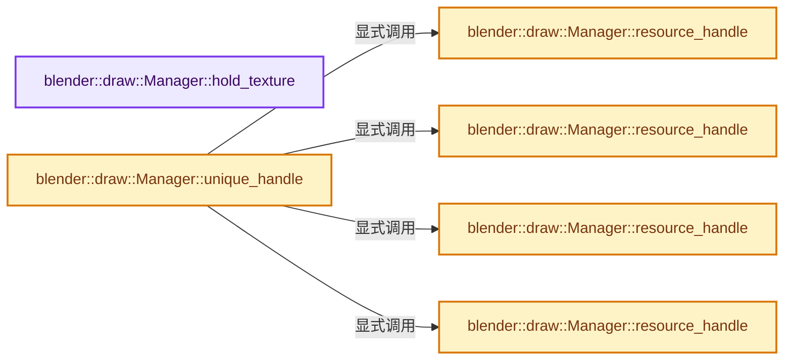

# 实现依赖专题：source/blender/draw/intern/draw_manager.hh

[实现依赖导航](../../../README.md) · [符号索引](../../../../00-课程指南/02-源码与提交索引/符号依赖与实现索引.md)

本专题从正文实际调用进入，集中保存共享实现。函数有稳定锚点，可从调用处直接跳到对应完整函数；递归与互相调用通过回链组织。

## 本文件的实现关系




## 完整成员与函数实现

<a id="f-e19110d0a07cdd4f"></a>

### `blender::draw::Manager::hold_texture`

实现位置：[source/blender/draw/intern/draw_manager.hh](../../../../../../../../source/blender/draw/intern/draw_manager.hh) · L312—L317。

接口参数：

- `gpu::Texture *texture`

**教学注释版**

<!-- annotated:6f2c0069c1dead -->

```cpp
  void hold_texture(gpu::Texture *texture)
  {
    if (texture != nullptr) {
      // [讲解] acquired_textures.append：在尾部建立新元素，必要时先扩大存储。
      acquired_textures.append(texture);
    }
  }
```

<details>
<summary>核对原始源码：source/blender/draw/intern/draw_manager.hh · L312—L317</summary>

<!-- original:6f2c0069c1dead:source/blender/draw/intern/draw_manager.hh:312:317 -->

```cpp
  void hold_texture(gpu::Texture *texture)
  {
    if (texture != nullptr) {
      acquired_textures.append(texture);
    }
  }
```

</details>

**继续追踪实现**

- `acquired_textures.append` → [blender::Vector::append · L498](../../../../01-基础容器与现代CPP/11-Vector插入删除与重排.md#f-5bde268a69e443ec)；[blender::Vector::append · L502](../../../../01-基础容器与现代CPP/11-Vector插入删除与重排.md#f-591e0b15e6308532)。同名重载需按实参类型选择。

<a id="f-1fe544aeb04550f1"></a>

### `blender::draw::Manager::unique_handle`

实现位置：[source/blender/draw/intern/draw_manager.hh](../../../../../../../../source/blender/draw/intern/draw_manager.hh) · L367—L374。

接口参数：

- `const ObjectRef &ref`

**教学注释版**

<!-- annotated:652abb0378dfb6 -->

```cpp
inline ResourceHandleRange Manager::unique_handle(const ObjectRef &ref)
{
  if (!ref.handle_.is_valid()) {
    /* WORKAROUND: Instead of breaking const correctness everywhere, we only break it for this. */
    const_cast<ObjectRef &>(ref).handle_ = resource_handle(ref);
  }
  return ref.handle_;
}
```

<details>
<summary>核对原始源码：source/blender/draw/intern/draw_manager.hh · L367—L374</summary>

<!-- original:652abb0378dfb6:source/blender/draw/intern/draw_manager.hh:367:374 -->

```cpp
inline ResourceHandleRange Manager::unique_handle(const ObjectRef &ref)
{
  if (!ref.handle_.is_valid()) {
    /* WORKAROUND: Instead of breaking const correctness everywhere, we only break it for this. */
    const_cast<ObjectRef &>(ref).handle_ = resource_handle(ref);
  }
  return ref.handle_;
}
```

</details>

**结果出口**

- `return ref.handle_;`

**继续追踪实现**

- `ref.handle_.is_valid` → [调用协议](../../../../00-课程指南/01-路线与规范/模板宏与动态分派协议.md)：接收对象类型依赖auto、返回值或模板实例；不按同名猜测目标。调用位置L369。
- `resource_handle` → [blender::draw::Manager::resource_handle · L376](draw_manager.hh.md#f-25cb1d2fc5038904)；[blender::draw::Manager::resource_handle · L419](draw_manager.hh.md#f-f4b6ee05df47f9fc)；[blender::draw::Manager::resource_handle · L448](draw_manager.hh.md#f-628b4cb9549be51b)；[blender::draw::Manager::resource_handle · L456](draw_manager.hh.md#f-d13903e016fd9dd4)。同名重载需按实参类型选择。

<a id="f-25cb1d2fc5038904"></a>

### `blender::draw::Manager::resource_handle`

实现位置：[source/blender/draw/intern/draw_manager.hh](../../../../../../../../source/blender/draw/intern/draw_manager.hh) · L376—L417。

接口参数：

- `const ObjectRef &ref`
- `float inflate_bounds`

**教学注释版**

<!-- annotated:9f2fcc5abafcd3 -->

```cpp
inline ResourceHandleRange Manager::resource_handle(const ObjectRef &ref, float inflate_bounds)
{
  bool is_active_object = ref.is_active(object_active);
  bool is_active_edit_mode = object_active &&
                             (DRW_object_is_in_edit_mode(object_active) ||
                              ELEM(object_active->mode, OB_MODE_TEXTURE_PAINT, OB_MODE_SCULPT)) &&
                             ref.object->mode == object_active->mode;
  if (ref.duplis_) {
    uint start = resource_len_;

    ObjectBounds proto_bounds;
    proto_bounds.sync(*ref.object, inflate_bounds);

    ObjectInfos proto_info;
    proto_info.sync(ref, is_active_object, is_active_edit_mode);

    for (const DupliObject *dupli : *ref.duplis_) {
      const float4x4 dupli_mat(dupli->mat);
      matrix_buf.current().get_or_resize(resource_len_).sync(dupli_mat);
      bounds_buf.current().get_or_resize(resource_len_) = proto_bounds;

      ObjectInfos &info = infos_buf.current().get_or_resize(resource_len_);
      info = proto_info;
      info.random = dupli->random_id * (1.0f / float(0xFFFFFFFF));
      /* Normal offset is scaled by world transform, so it must be computed per instance. */
      info.shadow_terminator_normal_offset = shadow_terminator_normal_offset_get(*ref.object,
                                                                                 dupli_mat);

      resource_len_++;
    }
    return ResourceHandleRange(ResourceHandle(start, (ref.object->transflag & OB_NEG_SCALE) != 0),
                               resource_len_ - start);
  }
  else {
    matrix_buf.current().get_or_resize(resource_len_).sync(*ref.object);
    bounds_buf.current().get_or_resize(resource_len_).sync(*ref.object, inflate_bounds);
    infos_buf.current()
        .get_or_resize(resource_len_)
        .sync(ref, is_active_object, is_active_edit_mode);
    return ResourceHandle(resource_len_++, (ref.object->transflag & OB_NEG_SCALE) != 0);
  }
}
```

<details>
<summary>核对原始源码：source/blender/draw/intern/draw_manager.hh · L376—L417</summary>

<!-- original:9f2fcc5abafcd3:source/blender/draw/intern/draw_manager.hh:376:417 -->

```cpp
inline ResourceHandleRange Manager::resource_handle(const ObjectRef &ref, float inflate_bounds)
{
  bool is_active_object = ref.is_active(object_active);
  bool is_active_edit_mode = object_active &&
                             (DRW_object_is_in_edit_mode(object_active) ||
                              ELEM(object_active->mode, OB_MODE_TEXTURE_PAINT, OB_MODE_SCULPT)) &&
                             ref.object->mode == object_active->mode;
  if (ref.duplis_) {
    uint start = resource_len_;

    ObjectBounds proto_bounds;
    proto_bounds.sync(*ref.object, inflate_bounds);

    ObjectInfos proto_info;
    proto_info.sync(ref, is_active_object, is_active_edit_mode);

    for (const DupliObject *dupli : *ref.duplis_) {
      const float4x4 dupli_mat(dupli->mat);
      matrix_buf.current().get_or_resize(resource_len_).sync(dupli_mat);
      bounds_buf.current().get_or_resize(resource_len_) = proto_bounds;

      ObjectInfos &info = infos_buf.current().get_or_resize(resource_len_);
      info = proto_info;
      info.random = dupli->random_id * (1.0f / float(0xFFFFFFFF));
      /* Normal offset is scaled by world transform, so it must be computed per instance. */
      info.shadow_terminator_normal_offset = shadow_terminator_normal_offset_get(*ref.object,
                                                                                 dupli_mat);

      resource_len_++;
    }
    return ResourceHandleRange(ResourceHandle(start, (ref.object->transflag & OB_NEG_SCALE) != 0),
                               resource_len_ - start);
  }
  else {
    matrix_buf.current().get_or_resize(resource_len_).sync(*ref.object);
    bounds_buf.current().get_or_resize(resource_len_).sync(*ref.object, inflate_bounds);
    infos_buf.current()
        .get_or_resize(resource_len_)
        .sync(ref, is_active_object, is_active_edit_mode);
    return ResourceHandle(resource_len_++, (ref.object->transflag & OB_NEG_SCALE) != 0);
  }
}
```

</details>

**沿实际写入检查状态**

- `info = proto_info;`
- `info.random = dupli->random_id * (1.0f / float(0xFFFFFFFF));`
- `info.shadow_terminator_normal_offset = shadow_terminator_normal_offset_get(*ref.object,`

**结果出口**

- `return ResourceHandleRange(ResourceHandle(start, (ref.object->transflag & OB_NEG_SCALE) != 0),`
- `return ResourceHandle(resource_len_++, (ref.object->transflag & OB_NEG_SCALE) != 0);`

**继续追踪实现**

- `ref.is_active` → [blender::draw::ObjectRef::is_active · L259](draw_handle.hh.md#f-bcca4c61d1f23fbf)。
- `DRW_object_is_in_edit_mode` → [blender::DRW_object_is_in_edit_mode · L295](draw_context.cc.md#f-fd88782141a3f346)。
- `ELEM` → [ELEM · L88](../../../07-Intern运行时与平台/ghost/intern/GHOST_utildefines.hh.md#m-d28724a15928)；[ELEM · L135](../../../01-BLI基础库/BLI_utildefines.hh.md#m-d6572de7cae0)。宏定义由构建条件选择。
- `proto_bounds.sync` → [blender::ObjectBounds::sync · L205](draw_resource.hh.md#f-92ea96898b110b99)；[blender::ObjectBounds::sync · L218](draw_resource.hh.md#f-5e36e738ecd5ee50)；[blender::ObjectBounds::sync · L251](draw_resource.hh.md#f-e3d52259fad47418)。同名重载需按实参类型选择。
- `proto_info.sync` → [blender::ObjectInfos::sync · L75](draw_resource.hh.md#f-734d5001a3f7cb7c)；[blender::ObjectInfos::sync · L91](draw_resource.hh.md#f-40c3d16ee64e894c)。同名重载需按实参类型选择。
- `matrix_buf.current().get_or_resize(resource_len_).sync` → [调用协议](../../../../00-课程指南/01-路线与规范/模板宏与动态分派协议.md)：接收对象类型依赖auto、返回值或模板实例；不按同名猜测目标。调用位置L394。
- `matrix_buf.current().get_or_resize` → [调用协议](../../../../00-课程指南/01-路线与规范/模板宏与动态分派协议.md)：接收对象类型依赖auto、返回值或模板实例；不按同名猜测目标。调用位置L394。
- `matrix_buf.current` → [current · L1455](DRW_gpu_wrapper.hh.md#f-241f5fd248365b76)；[current · L1471](DRW_gpu_wrapper.hh.md#f-b62e68c32f25a1a2)。同名重载需按实参类型选择。
- `bounds_buf.current().get_or_resize` → [调用协议](../../../../00-课程指南/01-路线与规范/模板宏与动态分派协议.md)：接收对象类型依赖auto、返回值或模板实例；不按同名猜测目标。调用位置L395。
- `bounds_buf.current` → [current · L1455](DRW_gpu_wrapper.hh.md#f-241f5fd248365b76)；[current · L1471](DRW_gpu_wrapper.hh.md#f-b62e68c32f25a1a2)。同名重载需按实参类型选择。
- `infos_buf.current().get_or_resize` → [调用协议](../../../../00-课程指南/01-路线与规范/模板宏与动态分派协议.md)：接收对象类型依赖auto、返回值或模板实例；不按同名猜测目标。调用位置L397。
- `infos_buf.current` → [current · L1455](DRW_gpu_wrapper.hh.md#f-241f5fd248365b76)；[current · L1471](DRW_gpu_wrapper.hh.md#f-b62e68c32f25a1a2)。同名重载需按实参类型选择。
- `shadow_terminator_normal_offset_get` → [blender::shadow_terminator_normal_offset_get · L65](draw_resource.hh.md#f-d7d5e711234ec5bd)。
- `ResourceHandleRange` → [blender::draw::ResourceHandleRange::ResourceHandleRange · L164](draw_handle.hh.md#f-02feab2cde11028f)；[blender::draw::ResourceHandleRange::ResourceHandleRange · L167](draw_handle.hh.md#f-fb61986e8583d984)；[blender::draw::ResourceHandleRange::ResourceHandleRange · L168](draw_handle.hh.md#f-dde16b71f5282880)。同名重载需按实参类型选择。
- `ResourceHandle` → [blender::draw::ResourceHandle::ResourceHandle · L121](draw_handle.hh.md#f-fefeb18e38acb5b1)；[blender::draw::ResourceHandle::ResourceHandle · L122](draw_handle.hh.md#f-36b02c7ccc4c93ed)；[blender::draw::ResourceHandle::ResourceHandle · L125](draw_handle.hh.md#f-920cd44f5cc3c6d4)。同名重载需按实参类型选择。
- `bounds_buf.current().get_or_resize(resource_len_).sync` → [调用协议](../../../../00-课程指南/01-路线与规范/模板宏与动态分派协议.md)：接收对象类型依赖auto、返回值或模板实例；不按同名猜测目标。调用位置L411。
- `infos_buf.current() .get_or_resize(resource_len_) .sync` → [调用协议](../../../../00-课程指南/01-路线与规范/模板宏与动态分派协议.md)：接收对象类型依赖auto、返回值或模板实例；不按同名猜测目标。调用位置L412。
- `infos_buf.current() .get_or_resize` → [调用协议](../../../../00-课程指南/01-路线与规范/模板宏与动态分派协议.md)：接收对象类型依赖auto、返回值或模板实例；不按同名猜测目标。调用位置L412。

<a id="f-f4b6ee05df47f9fc"></a>

### `blender::draw::Manager::resource_handle`

实现位置：[source/blender/draw/intern/draw_manager.hh](../../../../../../../../source/blender/draw/intern/draw_manager.hh) · L419—L446。

接口参数：

- `const ObjectRef &ref`
- `const float4x4 *model_matrix`
- `const float3 *bounds_center`
- `const float3 *bounds_half_extent`

**教学注释版**

<!-- annotated:d15b6e3b182cfa -->

```cpp
inline ResourceHandleRange Manager::resource_handle(const ObjectRef &ref,
                                                    const float4x4 *model_matrix,
                                                    const float3 *bounds_center,
                                                    const float3 *bounds_half_extent)
{
  BLI_assert(!ref.duplis_);
  bool is_active_object = ref.is_active(object_active);
  bool is_active_edit_mode = object_active &&
                             (DRW_object_is_in_edit_mode(object_active) ||
                              ELEM(object_active->mode, OB_MODE_TEXTURE_PAINT, OB_MODE_SCULPT)) &&
                             ref.object->mode == object_active->mode;
  if (model_matrix) {
    matrix_buf.current().get_or_resize(resource_len_).sync(*model_matrix);
  }
  else {
    matrix_buf.current().get_or_resize(resource_len_).sync(*ref.object);
  }
  if (bounds_center && bounds_half_extent) {
    bounds_buf.current().get_or_resize(resource_len_).sync(*bounds_center, *bounds_half_extent);
  }
  else {
    bounds_buf.current().get_or_resize(resource_len_).sync(*ref.object);
  }
  infos_buf.current()
      .get_or_resize(resource_len_)
      .sync(ref, is_active_object, is_active_edit_mode);
  return ResourceHandle(resource_len_++, (ref.object->transflag & OB_NEG_SCALE) != 0);
}
```

<details>
<summary>核对原始源码：source/blender/draw/intern/draw_manager.hh · L419—L446</summary>

<!-- original:d15b6e3b182cfa:source/blender/draw/intern/draw_manager.hh:419:446 -->

```cpp
inline ResourceHandleRange Manager::resource_handle(const ObjectRef &ref,
                                                    const float4x4 *model_matrix,
                                                    const float3 *bounds_center,
                                                    const float3 *bounds_half_extent)
{
  BLI_assert(!ref.duplis_);
  bool is_active_object = ref.is_active(object_active);
  bool is_active_edit_mode = object_active &&
                             (DRW_object_is_in_edit_mode(object_active) ||
                              ELEM(object_active->mode, OB_MODE_TEXTURE_PAINT, OB_MODE_SCULPT)) &&
                             ref.object->mode == object_active->mode;
  if (model_matrix) {
    matrix_buf.current().get_or_resize(resource_len_).sync(*model_matrix);
  }
  else {
    matrix_buf.current().get_or_resize(resource_len_).sync(*ref.object);
  }
  if (bounds_center && bounds_half_extent) {
    bounds_buf.current().get_or_resize(resource_len_).sync(*bounds_center, *bounds_half_extent);
  }
  else {
    bounds_buf.current().get_or_resize(resource_len_).sync(*ref.object);
  }
  infos_buf.current()
      .get_or_resize(resource_len_)
      .sync(ref, is_active_object, is_active_edit_mode);
  return ResourceHandle(resource_len_++, (ref.object->transflag & OB_NEG_SCALE) != 0);
}
```

</details>

**结果出口**

- `return ResourceHandle(resource_len_++, (ref.object->transflag & OB_NEG_SCALE) != 0);`

**继续追踪实现**

- `BLI_assert` → [BLI_assert · L48](../../../01-BLI基础库/BLI_assert.hh.md#m-57a88495704d)；[BLI_assert · L63](../../../01-BLI基础库/BLI_assert.hh.md#m-d07050020cb5)。宏定义由构建条件选择。
- `ref.is_active` → [blender::draw::ObjectRef::is_active · L259](draw_handle.hh.md#f-bcca4c61d1f23fbf)。
- `DRW_object_is_in_edit_mode` → [blender::DRW_object_is_in_edit_mode · L295](draw_context.cc.md#f-fd88782141a3f346)。
- `ELEM` → [ELEM · L88](../../../07-Intern运行时与平台/ghost/intern/GHOST_utildefines.hh.md#m-d28724a15928)；[ELEM · L135](../../../01-BLI基础库/BLI_utildefines.hh.md#m-d6572de7cae0)。宏定义由构建条件选择。
- `matrix_buf.current().get_or_resize(resource_len_).sync` → [调用协议](../../../../00-课程指南/01-路线与规范/模板宏与动态分派协议.md)：接收对象类型依赖auto、返回值或模板实例；不按同名猜测目标。调用位置L431。
- `matrix_buf.current().get_or_resize` → [调用协议](../../../../00-课程指南/01-路线与规范/模板宏与动态分派协议.md)：接收对象类型依赖auto、返回值或模板实例；不按同名猜测目标。调用位置L431。
- `matrix_buf.current` → [current · L1455](DRW_gpu_wrapper.hh.md#f-241f5fd248365b76)；[current · L1471](DRW_gpu_wrapper.hh.md#f-b62e68c32f25a1a2)。同名重载需按实参类型选择。
- `bounds_buf.current().get_or_resize(resource_len_).sync` → [调用协议](../../../../00-课程指南/01-路线与规范/模板宏与动态分派协议.md)：接收对象类型依赖auto、返回值或模板实例；不按同名猜测目标。调用位置L437。
- `bounds_buf.current().get_or_resize` → [调用协议](../../../../00-课程指南/01-路线与规范/模板宏与动态分派协议.md)：接收对象类型依赖auto、返回值或模板实例；不按同名猜测目标。调用位置L437。
- `bounds_buf.current` → [current · L1455](DRW_gpu_wrapper.hh.md#f-241f5fd248365b76)；[current · L1471](DRW_gpu_wrapper.hh.md#f-b62e68c32f25a1a2)。同名重载需按实参类型选择。
- `infos_buf.current() .get_or_resize(resource_len_) .sync` → [调用协议](../../../../00-课程指南/01-路线与规范/模板宏与动态分派协议.md)：接收对象类型依赖auto、返回值或模板实例；不按同名猜测目标。调用位置L442。
- `infos_buf.current() .get_or_resize` → [调用协议](../../../../00-课程指南/01-路线与规范/模板宏与动态分派协议.md)：接收对象类型依赖auto、返回值或模板实例；不按同名猜测目标。调用位置L442。
- `infos_buf.current` → [current · L1455](DRW_gpu_wrapper.hh.md#f-241f5fd248365b76)；[current · L1471](DRW_gpu_wrapper.hh.md#f-b62e68c32f25a1a2)。同名重载需按实参类型选择。
- `ResourceHandle` → [blender::draw::ResourceHandle::ResourceHandle · L121](draw_handle.hh.md#f-fefeb18e38acb5b1)；[blender::draw::ResourceHandle::ResourceHandle · L122](draw_handle.hh.md#f-36b02c7ccc4c93ed)；[blender::draw::ResourceHandle::ResourceHandle · L125](draw_handle.hh.md#f-920cd44f5cc3c6d4)。同名重载需按实参类型选择。

<a id="f-628b4cb9549be51b"></a>

### `blender::draw::Manager::resource_handle`

实现位置：[source/blender/draw/intern/draw_manager.hh](../../../../../../../../source/blender/draw/intern/draw_manager.hh) · L448—L454。

接口参数：

- `const float4x4 &model_matrix`

**教学注释版**

<!-- annotated:c04709f7502dfc -->

```cpp
inline ResourceHandle Manager::resource_handle(const float4x4 &model_matrix)
{
  matrix_buf.current().get_or_resize(resource_len_).sync(model_matrix);
  bounds_buf.current().get_or_resize(resource_len_).sync();
  infos_buf.current().get_or_resize(resource_len_).sync();
  return ResourceHandle(resource_len_++, false);
}
```

<details>
<summary>核对原始源码：source/blender/draw/intern/draw_manager.hh · L448—L454</summary>

<!-- original:c04709f7502dfc:source/blender/draw/intern/draw_manager.hh:448:454 -->

```cpp
inline ResourceHandle Manager::resource_handle(const float4x4 &model_matrix)
{
  matrix_buf.current().get_or_resize(resource_len_).sync(model_matrix);
  bounds_buf.current().get_or_resize(resource_len_).sync();
  infos_buf.current().get_or_resize(resource_len_).sync();
  return ResourceHandle(resource_len_++, false);
}
```

</details>

**结果出口**

- `return ResourceHandle(resource_len_++, false);`

**继续追踪实现**

- `matrix_buf.current().get_or_resize(resource_len_).sync` → [调用协议](../../../../00-课程指南/01-路线与规范/模板宏与动态分派协议.md)：接收对象类型依赖auto、返回值或模板实例；不按同名猜测目标。调用位置L450。
- `matrix_buf.current().get_or_resize` → [调用协议](../../../../00-课程指南/01-路线与规范/模板宏与动态分派协议.md)：接收对象类型依赖auto、返回值或模板实例；不按同名猜测目标。调用位置L450。
- `matrix_buf.current` → [current · L1455](DRW_gpu_wrapper.hh.md#f-241f5fd248365b76)；[current · L1471](DRW_gpu_wrapper.hh.md#f-b62e68c32f25a1a2)。同名重载需按实参类型选择。
- `bounds_buf.current().get_or_resize(resource_len_).sync` → [调用协议](../../../../00-课程指南/01-路线与规范/模板宏与动态分派协议.md)：接收对象类型依赖auto、返回值或模板实例；不按同名猜测目标。调用位置L451。
- `bounds_buf.current().get_or_resize` → [调用协议](../../../../00-课程指南/01-路线与规范/模板宏与动态分派协议.md)：接收对象类型依赖auto、返回值或模板实例；不按同名猜测目标。调用位置L451。
- `bounds_buf.current` → [current · L1455](DRW_gpu_wrapper.hh.md#f-241f5fd248365b76)；[current · L1471](DRW_gpu_wrapper.hh.md#f-b62e68c32f25a1a2)。同名重载需按实参类型选择。
- `infos_buf.current().get_or_resize(resource_len_).sync` → [调用协议](../../../../00-课程指南/01-路线与规范/模板宏与动态分派协议.md)：接收对象类型依赖auto、返回值或模板实例；不按同名猜测目标。调用位置L452。
- `infos_buf.current().get_or_resize` → [调用协议](../../../../00-课程指南/01-路线与规范/模板宏与动态分派协议.md)：接收对象类型依赖auto、返回值或模板实例；不按同名猜测目标。调用位置L452。
- `infos_buf.current` → [current · L1455](DRW_gpu_wrapper.hh.md#f-241f5fd248365b76)；[current · L1471](DRW_gpu_wrapper.hh.md#f-b62e68c32f25a1a2)。同名重载需按实参类型选择。
- `ResourceHandle` → [blender::draw::ResourceHandle::ResourceHandle · L121](draw_handle.hh.md#f-fefeb18e38acb5b1)；[blender::draw::ResourceHandle::ResourceHandle · L122](draw_handle.hh.md#f-36b02c7ccc4c93ed)；[blender::draw::ResourceHandle::ResourceHandle · L125](draw_handle.hh.md#f-920cd44f5cc3c6d4)。同名重载需按实参类型选择。

<a id="f-d13903e016fd9dd4"></a>

### `blender::draw::Manager::resource_handle`

实现位置：[source/blender/draw/intern/draw_manager.hh](../../../../../../../../source/blender/draw/intern/draw_manager.hh) · L456—L464。

接口参数：

- `const float4x4 &model_matrix`
- `const float3 &bounds_center`
- `const float3 &bounds_half_extent`

**教学注释版**

<!-- annotated:171b824c00d806 -->

```cpp
inline ResourceHandle Manager::resource_handle(const float4x4 &model_matrix,
                                               const float3 &bounds_center,
                                               const float3 &bounds_half_extent)
{
  matrix_buf.current().get_or_resize(resource_len_).sync(model_matrix);
  bounds_buf.current().get_or_resize(resource_len_).sync(bounds_center, bounds_half_extent);
  infos_buf.current().get_or_resize(resource_len_).sync();
  return ResourceHandle(resource_len_++, false);
}
```

<details>
<summary>核对原始源码：source/blender/draw/intern/draw_manager.hh · L456—L464</summary>

<!-- original:171b824c00d806:source/blender/draw/intern/draw_manager.hh:456:464 -->

```cpp
inline ResourceHandle Manager::resource_handle(const float4x4 &model_matrix,
                                               const float3 &bounds_center,
                                               const float3 &bounds_half_extent)
{
  matrix_buf.current().get_or_resize(resource_len_).sync(model_matrix);
  bounds_buf.current().get_or_resize(resource_len_).sync(bounds_center, bounds_half_extent);
  infos_buf.current().get_or_resize(resource_len_).sync();
  return ResourceHandle(resource_len_++, false);
}
```

</details>

**结果出口**

- `return ResourceHandle(resource_len_++, false);`

**继续追踪实现**

- `matrix_buf.current().get_or_resize(resource_len_).sync` → [调用协议](../../../../00-课程指南/01-路线与规范/模板宏与动态分派协议.md)：接收对象类型依赖auto、返回值或模板实例；不按同名猜测目标。调用位置L460。
- `matrix_buf.current().get_or_resize` → [调用协议](../../../../00-课程指南/01-路线与规范/模板宏与动态分派协议.md)：接收对象类型依赖auto、返回值或模板实例；不按同名猜测目标。调用位置L460。
- `matrix_buf.current` → [current · L1455](DRW_gpu_wrapper.hh.md#f-241f5fd248365b76)；[current · L1471](DRW_gpu_wrapper.hh.md#f-b62e68c32f25a1a2)。同名重载需按实参类型选择。
- `bounds_buf.current().get_or_resize(resource_len_).sync` → [调用协议](../../../../00-课程指南/01-路线与规范/模板宏与动态分派协议.md)：接收对象类型依赖auto、返回值或模板实例；不按同名猜测目标。调用位置L461。
- `bounds_buf.current().get_or_resize` → [调用协议](../../../../00-课程指南/01-路线与规范/模板宏与动态分派协议.md)：接收对象类型依赖auto、返回值或模板实例；不按同名猜测目标。调用位置L461。
- `bounds_buf.current` → [current · L1455](DRW_gpu_wrapper.hh.md#f-241f5fd248365b76)；[current · L1471](DRW_gpu_wrapper.hh.md#f-b62e68c32f25a1a2)。同名重载需按实参类型选择。
- `infos_buf.current().get_or_resize(resource_len_).sync` → [调用协议](../../../../00-课程指南/01-路线与规范/模板宏与动态分派协议.md)：接收对象类型依赖auto、返回值或模板实例；不按同名猜测目标。调用位置L462。
- `infos_buf.current().get_or_resize` → [调用协议](../../../../00-课程指南/01-路线与规范/模板宏与动态分派协议.md)：接收对象类型依赖auto、返回值或模板实例；不按同名猜测目标。调用位置L462。
- `infos_buf.current` → [current · L1455](DRW_gpu_wrapper.hh.md#f-241f5fd248365b76)；[current · L1471](DRW_gpu_wrapper.hh.md#f-b62e68c32f25a1a2)。同名重载需按实参类型选择。
- `ResourceHandle` → [blender::draw::ResourceHandle::ResourceHandle · L121](draw_handle.hh.md#f-fefeb18e38acb5b1)；[blender::draw::ResourceHandle::ResourceHandle · L122](draw_handle.hh.md#f-36b02c7ccc4c93ed)；[blender::draw::ResourceHandle::ResourceHandle · L125](draw_handle.hh.md#f-920cd44f5cc3c6d4)。同名重载需按实参类型选择。
