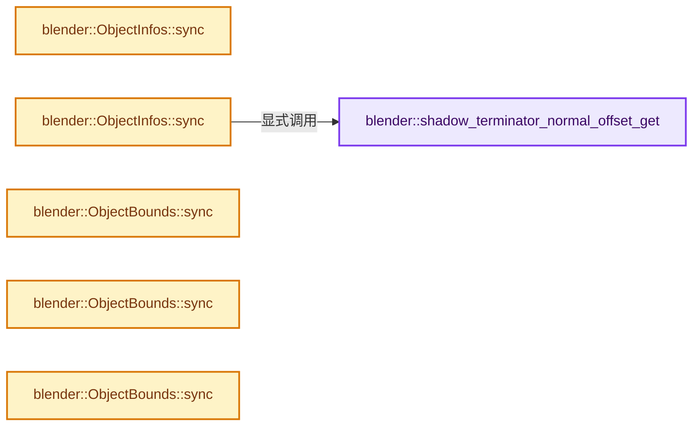
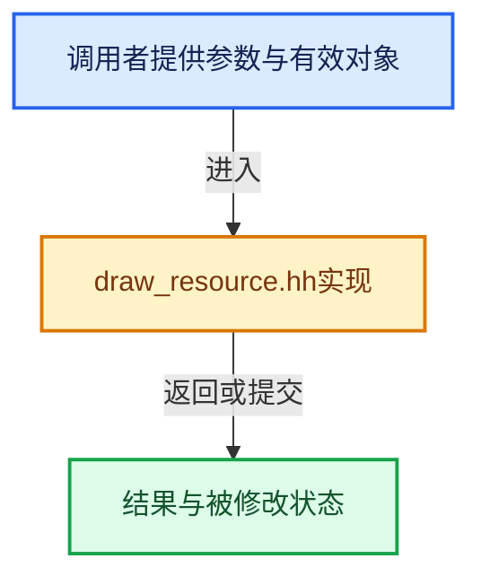

# 实现依赖专题：source/blender/draw/intern/draw_resource.hh

[实现依赖导航](../../../README.md) · [符号索引](../../../../00-课程指南/02-源码与提交索引/符号依赖与实现索引.md)

本专题从正文实际调用进入，集中保存共享实现。函数有稳定锚点，可从调用处直接跳到对应完整函数；递归与互相调用通过回链组织。

## 本文件的实现关系






## 完整成员与函数实现

<a id="f-d7d5e711234ec5bd"></a>

### `blender::shadow_terminator_normal_offset_get`

实现位置：[source/blender/draw/intern/draw_resource.hh](../../../../../../../../source/blender/draw/intern/draw_resource.hh) · L65—L73。

接口参数：

- `const Object &object`
- `const float4x4 &object_to_world`

**教学注释版**

<!-- annotated:b9aeb833e09a04 -->

```cpp
inline float shadow_terminator_normal_offset_get(const Object &object,
                                                 const float4x4 &object_to_world)
{
  if (object.shadow_terminator_normal_offset == 0.0f) {
    return 0.0f;
  }
  using namespace blender::math;
  return object.shadow_terminator_normal_offset * reduce_max(to_scale(object_to_world));
}
```

<details>
<summary>核对原始源码：source/blender/draw/intern/draw_resource.hh · L65—L73</summary>

<!-- original:b9aeb833e09a04:source/blender/draw/intern/draw_resource.hh:65:73 -->

```cpp
inline float shadow_terminator_normal_offset_get(const Object &object,
                                                 const float4x4 &object_to_world)
{
  if (object.shadow_terminator_normal_offset == 0.0f) {
    return 0.0f;
  }
  using namespace blender::math;
  return object.shadow_terminator_normal_offset * reduce_max(to_scale(object_to_world));
}
```

</details>

**结果出口**

- `return 0.0f;`
- `return object.shadow_terminator_normal_offset * reduce_max(to_scale(object_to_world));`

**继续追踪实现**

- `reduce_max` → [调用协议](../../../../00-课程指南/01-路线与规范/模板宏与动态分派协议.md)：函数指针、局部可调用对象或未展开的宏；必须结合调用者环境。调用位置L72。
- `to_scale` → [调用协议](../../../../00-课程指南/01-路线与规范/模板宏与动态分派协议.md)：函数指针、局部可调用对象或未展开的宏；必须结合调用者环境。调用位置L72。

<a id="f-734d5001a3f7cb7c"></a>

### `blender::ObjectInfos::sync`

实现位置：[source/blender/draw/intern/draw_resource.hh](../../../../../../../../source/blender/draw/intern/draw_resource.hh) · L75—L89。

**教学注释版**

<!-- annotated:72b0797434cfdb -->

```cpp
inline void ObjectInfos::sync()
{
  object_attrs_len = 0;
  object_attrs_offset = 0;
  /* Zero-Initialize since this data might still be accessible (See #154105). */
  orco_add = float3(0.0f);
  orco_mul = float3(0.0f);
  ob_color = float4(0.0f);
  index = 0;
  light_and_shadow_set_membership = 0;
  random = 0.0f;
  flag = eObjectInfoFlag::OBJECT_NO_INFO;
  shadow_terminator_normal_offset = 0.0f;
  shadow_terminator_geometry_offset = 0.0f;
}
```

<details>
<summary>核对原始源码：source/blender/draw/intern/draw_resource.hh · L75—L89</summary>

<!-- original:72b0797434cfdb:source/blender/draw/intern/draw_resource.hh:75:89 -->

```cpp
inline void ObjectInfos::sync()
{
  object_attrs_len = 0;
  object_attrs_offset = 0;
  /* Zero-Initialize since this data might still be accessible (See #154105). */
  orco_add = float3(0.0f);
  orco_mul = float3(0.0f);
  ob_color = float4(0.0f);
  index = 0;
  light_and_shadow_set_membership = 0;
  random = 0.0f;
  flag = eObjectInfoFlag::OBJECT_NO_INFO;
  shadow_terminator_normal_offset = 0.0f;
  shadow_terminator_geometry_offset = 0.0f;
}
```

</details>

**沿实际写入检查状态**

- `object_attrs_len = 0;`
- `object_attrs_offset = 0;`
- `orco_add = float3(0.0f);`
- `orco_mul = float3(0.0f);`
- `ob_color = float4(0.0f);`
- `index = 0;`
- `light_and_shadow_set_membership = 0;`
- `random = 0.0f;`
- `flag = eObjectInfoFlag::OBJECT_NO_INFO;`
- `shadow_terminator_normal_offset = 0.0f;`
- `shadow_terminator_geometry_offset = 0.0f;`

**继续追踪实现**

- `float3` → [float3 · L641](../../compositor/algorithms/intern/smaa.cc.md#m-0ea8254cfdb4)。宏定义由构建条件选择。
- `float4` → [float4 · L56](../../../07-Intern运行时与平台/cycles/kernel/svm/radial_tiling_shared.h.md#m-f0908e385c5b)；[float4 · L60](../../../01-BLI基础库/intern/radial_tiling_shared.hh.md#m-7962dcdc288b)；[float4 · L56](../../../07-Intern运行时与平台/cycles/kernel/osl/shaders/node_radial_tiling_shared.h.md#m-adb8e9e87775)；[float4 · L642](../../compositor/algorithms/intern/smaa.cc.md#m-9362daaa821c)。宏定义由构建条件选择。

<a id="f-40c3d16ee64e894c"></a>

### `blender::ObjectInfos::sync`

实现位置：[source/blender/draw/intern/draw_resource.hh](../../../../../../../../source/blender/draw/intern/draw_resource.hh) · L91—L181。

接口参数：

- `const draw::ObjectRef ref`
- `bool is_active_object`
- `bool is_active_edit_mode`

**教学注释版**

<!-- annotated:38fbb26a7ee5d7 -->

```cpp
inline void ObjectInfos::sync(const draw::ObjectRef ref,
                              bool is_active_object,
                              bool is_active_edit_mode)
{
  object_attrs_len = 0;
  object_attrs_offset = 0;
  light_and_shadow_set_membership = 0;

  LightLinking *light_linking = ref.light_linking();
  if (light_linking) {
    light_and_shadow_set_membership |= light_linking->runtime.receiver_light_set;
    light_and_shadow_set_membership |= light_linking->runtime.blocker_shadow_set << 8;
  }

  bool is_holdout = (ref.object->base_flag & BASE_HOLDOUT) ||
                    (ref.object->visibility_flag & OB_HOLDOUT);

  ob_color = ref.object->color;
  index = ref.object->index;
  SET_FLAG_FROM_TEST(flag, is_active_object, eObjectInfoFlag::OBJECT_ACTIVE);
  SET_FLAG_FROM_TEST(
      flag, ref.object->base_flag & BASE_SELECTED, eObjectInfoFlag::OBJECT_SELECTED);
  SET_FLAG_FROM_TEST(
      flag, ref.object->base_flag & BASE_FROM_DUPLI, eObjectInfoFlag::OBJECT_FROM_DUPLI);
  SET_FLAG_FROM_TEST(
      flag, ref.object->base_flag & BASE_FROM_SET, eObjectInfoFlag::OBJECT_FROM_SET);
  SET_FLAG_FROM_TEST(
      flag, ref.object->transflag & OB_NEG_SCALE, eObjectInfoFlag::OBJECT_NEGATIVE_SCALE);
  SET_FLAG_FROM_TEST(flag, is_holdout, eObjectInfoFlag::OBJECT_HOLDOUT);
  SET_FLAG_FROM_TEST(flag, is_active_edit_mode, eObjectInfoFlag::OBJECT_ACTIVE_EDIT_MODE);

  if (ref.object->shadow_terminator_normal_offset > 0.0f) {
    shadow_terminator_geometry_offset = ref.object->shadow_terminator_geometry_offset;
    shadow_terminator_normal_offset = 0.0f;
    if (!ref.is_dupli()) {
      /* Normal offset is scaled by world transform, so it must be computed per instance. */
      shadow_terminator_normal_offset = shadow_terminator_normal_offset_get(
          *ref.object, ref.object->object_to_world());
    }
  }
  else {
    shadow_terminator_geometry_offset = 0.0f;
    shadow_terminator_normal_offset = 0.0f;
  }

  random = ref.random(0);

  if (ref.object->data == nullptr) {
    orco_add = float3(0.0f);
    orco_mul = float3(1.0f);
    return;
  }

  switch (GS(reinterpret_cast<ID *>(ref.object->data)->name)) {
    case ID_VO: {
      std::optional<const Bounds<float3>> bounds = BKE_volume_min_max(
          &DRW_object_get_data_for_drawing<const Volume>(*ref.object));
      if (bounds) {
        orco_add = math::midpoint(bounds->min, bounds->max);
        orco_mul = (bounds->max - bounds->min) * 0.5f;
      }
      else {
        orco_add = float3(0.0f);
        orco_mul = float3(1.0f);
      }
      break;
    }
    case ID_ME: {
      BKE_mesh_texspace_get(
          &DRW_object_get_data_for_drawing<Mesh>(*ref.object), orco_add, orco_mul);
      break;
    }
    case ID_CU_LEGACY: {
      Curve &cu = DRW_object_get_data_for_drawing<Curve>(*ref.object);
      BKE_curve_texspace_ensure(&cu);
      orco_add = cu.texspace_location;
      orco_mul = cu.texspace_size;
      break;
    }
    case ID_MB: {
      MetaBall &mb = DRW_object_get_data_for_drawing<MetaBall>(*ref.object);
      orco_add = mb.texspace_location;
      orco_mul = mb.texspace_size;
      break;
    }
    default:
      orco_add = float3(0.0f);
      orco_mul = float3(1.0f);
      break;
  }
}
```

<details>
<summary>核对原始源码：source/blender/draw/intern/draw_resource.hh · L91—L181</summary>

<!-- original:38fbb26a7ee5d7:source/blender/draw/intern/draw_resource.hh:91:181 -->

```cpp
inline void ObjectInfos::sync(const draw::ObjectRef ref,
                              bool is_active_object,
                              bool is_active_edit_mode)
{
  object_attrs_len = 0;
  object_attrs_offset = 0;
  light_and_shadow_set_membership = 0;

  LightLinking *light_linking = ref.light_linking();
  if (light_linking) {
    light_and_shadow_set_membership |= light_linking->runtime.receiver_light_set;
    light_and_shadow_set_membership |= light_linking->runtime.blocker_shadow_set << 8;
  }

  bool is_holdout = (ref.object->base_flag & BASE_HOLDOUT) ||
                    (ref.object->visibility_flag & OB_HOLDOUT);

  ob_color = ref.object->color;
  index = ref.object->index;
  SET_FLAG_FROM_TEST(flag, is_active_object, eObjectInfoFlag::OBJECT_ACTIVE);
  SET_FLAG_FROM_TEST(
      flag, ref.object->base_flag & BASE_SELECTED, eObjectInfoFlag::OBJECT_SELECTED);
  SET_FLAG_FROM_TEST(
      flag, ref.object->base_flag & BASE_FROM_DUPLI, eObjectInfoFlag::OBJECT_FROM_DUPLI);
  SET_FLAG_FROM_TEST(
      flag, ref.object->base_flag & BASE_FROM_SET, eObjectInfoFlag::OBJECT_FROM_SET);
  SET_FLAG_FROM_TEST(
      flag, ref.object->transflag & OB_NEG_SCALE, eObjectInfoFlag::OBJECT_NEGATIVE_SCALE);
  SET_FLAG_FROM_TEST(flag, is_holdout, eObjectInfoFlag::OBJECT_HOLDOUT);
  SET_FLAG_FROM_TEST(flag, is_active_edit_mode, eObjectInfoFlag::OBJECT_ACTIVE_EDIT_MODE);

  if (ref.object->shadow_terminator_normal_offset > 0.0f) {
    shadow_terminator_geometry_offset = ref.object->shadow_terminator_geometry_offset;
    shadow_terminator_normal_offset = 0.0f;
    if (!ref.is_dupli()) {
      /* Normal offset is scaled by world transform, so it must be computed per instance. */
      shadow_terminator_normal_offset = shadow_terminator_normal_offset_get(
          *ref.object, ref.object->object_to_world());
    }
  }
  else {
    shadow_terminator_geometry_offset = 0.0f;
    shadow_terminator_normal_offset = 0.0f;
  }

  random = ref.random(0);

  if (ref.object->data == nullptr) {
    orco_add = float3(0.0f);
    orco_mul = float3(1.0f);
    return;
  }

  switch (GS(reinterpret_cast<ID *>(ref.object->data)->name)) {
    case ID_VO: {
      std::optional<const Bounds<float3>> bounds = BKE_volume_min_max(
          &DRW_object_get_data_for_drawing<const Volume>(*ref.object));
      if (bounds) {
        orco_add = math::midpoint(bounds->min, bounds->max);
        orco_mul = (bounds->max - bounds->min) * 0.5f;
      }
      else {
        orco_add = float3(0.0f);
        orco_mul = float3(1.0f);
      }
      break;
    }
    case ID_ME: {
      BKE_mesh_texspace_get(
          &DRW_object_get_data_for_drawing<Mesh>(*ref.object), orco_add, orco_mul);
      break;
    }
    case ID_CU_LEGACY: {
      Curve &cu = DRW_object_get_data_for_drawing<Curve>(*ref.object);
      BKE_curve_texspace_ensure(&cu);
      orco_add = cu.texspace_location;
      orco_mul = cu.texspace_size;
      break;
    }
    case ID_MB: {
      MetaBall &mb = DRW_object_get_data_for_drawing<MetaBall>(*ref.object);
      orco_add = mb.texspace_location;
      orco_mul = mb.texspace_size;
      break;
    }
    default:
      orco_add = float3(0.0f);
      orco_mul = float3(1.0f);
      break;
  }
}
```

</details>

**沿实际写入检查状态**

- `object_attrs_len = 0;`
- `object_attrs_offset = 0;`
- `light_and_shadow_set_membership = 0;`
- `light_and_shadow_set_membership |= light_linking->runtime.receiver_light_set;`
- `light_and_shadow_set_membership |= light_linking->runtime.blocker_shadow_set << 8;`
- `ob_color = ref.object->color;`
- `index = ref.object->index;`
- `shadow_terminator_geometry_offset = ref.object->shadow_terminator_geometry_offset;`
- `shadow_terminator_normal_offset = 0.0f;`
- `shadow_terminator_normal_offset = shadow_terminator_normal_offset_get(`
- `shadow_terminator_geometry_offset = 0.0f;`
- `random = ref.random(0);`
- `orco_add = float3(0.0f);`
- `orco_mul = float3(1.0f);`
- `orco_add = math::midpoint(bounds->min, bounds->max);`
- `orco_mul = (bounds->max - bounds->min) * 0.5f;`
- `orco_add = cu.texspace_location;`
- `orco_mul = cu.texspace_size;`
- `orco_add = mb.texspace_location;`
- `orco_mul = mb.texspace_size;`

**继续追踪实现**

- `ref.light_linking` → [blender::draw::ObjectRef::light_linking · L336](draw_handle.hh.md#f-9526e767d4aa7a14)。
- `SET_FLAG_FROM_TEST` → [SET_FLAG_FROM_TEST · L557](../../../01-BLI基础库/BLI_utildefines.hh.md#m-8e0dc83e01a8)。宏定义由构建条件选择。
- `ref.is_dupli` → [blender::draw::ObjectRef::is_dupli · L254](draw_handle.hh.md#f-b58075af2dcbcc8d)。
- `shadow_terminator_normal_offset_get` → [blender::shadow_terminator_normal_offset_get · L65](draw_resource.hh.md#f-d7d5e711234ec5bd)。
- `ref.object->object_to_world` → [调用协议](../../../../00-课程指南/01-路线与规范/模板宏与动态分派协议.md)：接收对象类型依赖auto、返回值或模板实例；不按同名猜测目标。调用位置L128。
- `ref.random` → [blender::draw::ObjectRef::random · L294](draw_handle.hh.md#f-104d63a2beb25a4b)。
- `float3` → [float3 · L641](../../compositor/algorithms/intern/smaa.cc.md#m-0ea8254cfdb4)。宏定义由构建条件选择。
- `GS` → [blender::GS · L410](../../makesdna/DNA_ID.h.md#f-c3ff509f79f21b05)。
- `BKE_volume_min_max` → [blender::BKE_volume_min_max · L627](../../../02-BKE几何与数据/intern/volume.cc.md#f-0fcf2afc72eedde9)。
- `DRW_object_get_data_for_drawing<const Volume>` → [blender::DRW_object_get_data_for_drawing · L203](DRW_render.hh.md#f-dad88423243c219e)；[blender::DRW_object_get_data_for_drawing · L218](DRW_render.hh.md#f-223e280efbea59b2)。同名重载需按实参类型选择。
- `math::midpoint` → [blender::math::midpoint · L647](../../../01-BLI基础库/BLI_math_vector.hh.md#f-383eeed0051cc8bd)；[blender::math::midpoint · L288](../../../01-BLI基础库/BLI_math_base.hh.md#f-1a01baa0be6c0b84)。同名重载需按实参类型选择。
- `BKE_mesh_texspace_get` → [BKE_mesh_texspace_get · L1694](../../../../05-几何存储与拓扑映射/03-MPoly迁移与兼容.md#f-e04048b821aedff8)。
- `DRW_object_get_data_for_drawing<Mesh>` → [blender::DRW_object_get_data_for_drawing · L203](DRW_render.hh.md#f-dad88423243c219e)；[blender::DRW_object_get_data_for_drawing · L218](DRW_render.hh.md#f-223e280efbea59b2)。同名重载需按实参类型选择。
- `DRW_object_get_data_for_drawing<Curve>` → [blender::DRW_object_get_data_for_drawing · L203](DRW_render.hh.md#f-dad88423243c219e)；[blender::DRW_object_get_data_for_drawing · L218](DRW_render.hh.md#f-223e280efbea59b2)。同名重载需按实参类型选择。
- `BKE_curve_texspace_ensure` → [blender::BKE_curve_texspace_ensure · L524](../../../02-BKE几何与数据/intern/curve.cc.md#f-a606a877bbe68855)。
- `DRW_object_get_data_for_drawing<MetaBall>` → [blender::DRW_object_get_data_for_drawing · L203](DRW_render.hh.md#f-dad88423243c219e)；[blender::DRW_object_get_data_for_drawing · L218](DRW_render.hh.md#f-223e280efbea59b2)。同名重载需按实参类型选择。

<a id="f-92ea96898b110b99"></a>

### `blender::ObjectBounds::sync`

实现位置：[source/blender/draw/intern/draw_resource.hh](../../../../../../../../source/blender/draw/intern/draw_resource.hh) · L205—L216。

**教学注释版**

<!-- annotated:ee315488c9b600 -->

```cpp
inline void ObjectBounds::sync()
{
#ifndef NDEBUG
  /* Initialize to NaN for easier debugging of uninitialized data usage. */
  bounding_corners[0] = float4(NAN_FLT);
  bounding_corners[1] = float4(NAN_FLT);
  bounding_corners[2] = float4(NAN_FLT);
  bounding_corners[3] = float4(NAN_FLT);
  bounding_sphere = float4(NAN_FLT);
#endif
  bounding_sphere.w = -1.0f; /* Disable test. */
}
```

<details>
<summary>核对原始源码：source/blender/draw/intern/draw_resource.hh · L205—L216</summary>

<!-- original:ee315488c9b600:source/blender/draw/intern/draw_resource.hh:205:216 -->

```cpp
inline void ObjectBounds::sync()
{
#ifndef NDEBUG
  /* Initialize to NaN for easier debugging of uninitialized data usage. */
  bounding_corners[0] = float4(NAN_FLT);
  bounding_corners[1] = float4(NAN_FLT);
  bounding_corners[2] = float4(NAN_FLT);
  bounding_corners[3] = float4(NAN_FLT);
  bounding_sphere = float4(NAN_FLT);
#endif
  bounding_sphere.w = -1.0f; /* Disable test. */
}
```

</details>

**沿实际写入检查状态**

- `bounding_corners[0] = float4(NAN_FLT);`
- `bounding_corners[1] = float4(NAN_FLT);`
- `bounding_corners[2] = float4(NAN_FLT);`
- `bounding_corners[3] = float4(NAN_FLT);`
- `bounding_sphere = float4(NAN_FLT);`
- `bounding_sphere.w = -1.0f; /* Disable test. */`

**继续追踪实现**

- `float4` → [float4 · L56](../../../07-Intern运行时与平台/cycles/kernel/svm/radial_tiling_shared.h.md#m-f0908e385c5b)；[float4 · L60](../../../01-BLI基础库/intern/radial_tiling_shared.hh.md#m-7962dcdc288b)；[float4 · L56](../../../07-Intern运行时与平台/cycles/kernel/osl/shaders/node_radial_tiling_shared.h.md#m-adb8e9e87775)；[float4 · L642](../../compositor/algorithms/intern/smaa.cc.md#m-9362daaa821c)。宏定义由构建条件选择。

<a id="f-5e36e738ecd5ee50"></a>

### `blender::ObjectBounds::sync`

实现位置：[source/blender/draw/intern/draw_resource.hh](../../../../../../../../source/blender/draw/intern/draw_resource.hh) · L218—L249。

接口参数：

- `const Object &ob`
- `float inflate_bounds`

**教学注释版**

<!-- annotated:8f42fb678043bf -->

```cpp
inline void ObjectBounds::sync(const Object &ob, float inflate_bounds)
{
  const std::optional<Bounds<float3>> bounds = BKE_object_boundbox_get(&ob);
  if (!bounds) {
#ifndef NDEBUG
    /* Initialize to NaN for easier debugging of uninitialized data usage. */
    bounding_corners[0] = float4(NAN_FLT);
    bounding_corners[1] = float4(NAN_FLT);
    bounding_corners[2] = float4(NAN_FLT);
    bounding_corners[3] = float4(NAN_FLT);
    bounding_sphere = float4(NAN_FLT);
#endif
    bounding_sphere.w = -1.0f; /* Disable test. */
    return;
  }
  const std::array<float3, 8> corners = bounds::corners(*bounds);
  *reinterpret_cast<float3 *>(&bounding_corners[0]) = corners[0];
  *reinterpret_cast<float3 *>(&bounding_corners[1]) = corners[4];
  *reinterpret_cast<float3 *>(&bounding_corners[2]) = corners[3];
  *reinterpret_cast<float3 *>(&bounding_corners[3]) = corners[1];
  bounding_sphere.w = 0.0f; /* Enable test. */

  if (inflate_bounds != 0.0f) {
    BLI_assert(inflate_bounds >= 0.0f);
    float p = inflate_bounds;
    float n = -inflate_bounds;
    bounding_corners[0] += float4(n, n, n, 0.0f);
    bounding_corners[1] += float4(p, n, n, 0.0f);
    bounding_corners[2] += float4(n, p, n, 0.0f);
    bounding_corners[3] += float4(n, n, p, 0.0f);
  }
}
```

<details>
<summary>核对原始源码：source/blender/draw/intern/draw_resource.hh · L218—L249</summary>

<!-- original:8f42fb678043bf:source/blender/draw/intern/draw_resource.hh:218:249 -->

```cpp
inline void ObjectBounds::sync(const Object &ob, float inflate_bounds)
{
  const std::optional<Bounds<float3>> bounds = BKE_object_boundbox_get(&ob);
  if (!bounds) {
#ifndef NDEBUG
    /* Initialize to NaN for easier debugging of uninitialized data usage. */
    bounding_corners[0] = float4(NAN_FLT);
    bounding_corners[1] = float4(NAN_FLT);
    bounding_corners[2] = float4(NAN_FLT);
    bounding_corners[3] = float4(NAN_FLT);
    bounding_sphere = float4(NAN_FLT);
#endif
    bounding_sphere.w = -1.0f; /* Disable test. */
    return;
  }
  const std::array<float3, 8> corners = bounds::corners(*bounds);
  *reinterpret_cast<float3 *>(&bounding_corners[0]) = corners[0];
  *reinterpret_cast<float3 *>(&bounding_corners[1]) = corners[4];
  *reinterpret_cast<float3 *>(&bounding_corners[2]) = corners[3];
  *reinterpret_cast<float3 *>(&bounding_corners[3]) = corners[1];
  bounding_sphere.w = 0.0f; /* Enable test. */

  if (inflate_bounds != 0.0f) {
    BLI_assert(inflate_bounds >= 0.0f);
    float p = inflate_bounds;
    float n = -inflate_bounds;
    bounding_corners[0] += float4(n, n, n, 0.0f);
    bounding_corners[1] += float4(p, n, n, 0.0f);
    bounding_corners[2] += float4(n, p, n, 0.0f);
    bounding_corners[3] += float4(n, n, p, 0.0f);
  }
}
```

</details>

**沿实际写入检查状态**

- `bounding_corners[0] = float4(NAN_FLT);`
- `bounding_corners[1] = float4(NAN_FLT);`
- `bounding_corners[2] = float4(NAN_FLT);`
- `bounding_corners[3] = float4(NAN_FLT);`
- `bounding_sphere = float4(NAN_FLT);`
- `bounding_sphere.w = -1.0f; /* Disable test. */`
- `bounding_sphere.w = 0.0f; /* Enable test. */`
- `bounding_corners[0] += float4(n, n, n, 0.0f);`
- `bounding_corners[1] += float4(p, n, n, 0.0f);`
- `bounding_corners[2] += float4(n, p, n, 0.0f);`
- `bounding_corners[3] += float4(n, n, p, 0.0f);`

**继续追踪实现**

- `BKE_object_boundbox_get` → [blender::BKE_object_boundbox_get · L3726](../../../02-BKE几何与数据/intern/object.cc.md#f-481d74b53ca88ae2)。
- `float4` → [float4 · L56](../../../07-Intern运行时与平台/cycles/kernel/svm/radial_tiling_shared.h.md#m-f0908e385c5b)；[float4 · L60](../../../01-BLI基础库/intern/radial_tiling_shared.hh.md#m-7962dcdc288b)；[float4 · L56](../../../07-Intern运行时与平台/cycles/kernel/osl/shaders/node_radial_tiling_shared.h.md#m-adb8e9e87775)；[float4 · L642](../../compositor/algorithms/intern/smaa.cc.md#m-9362daaa821c)。宏定义由构建条件选择。
- `bounds::corners` → [调用协议](../../../../00-课程指南/01-路线与规范/模板宏与动态分派协议.md)：局部可调用对象，须结合其初始化与捕获环境。调用位置L233。
- `BLI_assert` → [BLI_assert · L48](../../../01-BLI基础库/BLI_assert.hh.md#m-57a88495704d)；[BLI_assert · L63](../../../01-BLI基础库/BLI_assert.hh.md#m-d07050020cb5)。宏定义由构建条件选择。

<a id="f-e3d52259fad47418"></a>

### `blender::ObjectBounds::sync`

实现位置：[source/blender/draw/intern/draw_resource.hh](../../../../../../../../source/blender/draw/intern/draw_resource.hh) · L251—L258。

接口参数：

- `const float3 &center`
- `const float3 &size`

**教学注释版**

<!-- annotated:1218d0bbbb456d -->

```cpp
inline void ObjectBounds::sync(const float3 &center, const float3 &size)
{
  *reinterpret_cast<float3 *>(&bounding_corners[0]) = center - size;
  *reinterpret_cast<float3 *>(&bounding_corners[1]) = center + float3(+size.x, -size.y, -size.z);
  *reinterpret_cast<float3 *>(&bounding_corners[2]) = center + float3(-size.x, +size.y, -size.z);
  *reinterpret_cast<float3 *>(&bounding_corners[3]) = center + float3(-size.x, -size.y, +size.z);
  bounding_sphere.w = 0.0; /* Enable test. */
}
```

<details>
<summary>核对原始源码：source/blender/draw/intern/draw_resource.hh · L251—L258</summary>

<!-- original:1218d0bbbb456d:source/blender/draw/intern/draw_resource.hh:251:258 -->

```cpp
inline void ObjectBounds::sync(const float3 &center, const float3 &size)
{
  *reinterpret_cast<float3 *>(&bounding_corners[0]) = center - size;
  *reinterpret_cast<float3 *>(&bounding_corners[1]) = center + float3(+size.x, -size.y, -size.z);
  *reinterpret_cast<float3 *>(&bounding_corners[2]) = center + float3(-size.x, +size.y, -size.z);
  *reinterpret_cast<float3 *>(&bounding_corners[3]) = center + float3(-size.x, -size.y, +size.z);
  bounding_sphere.w = 0.0; /* Enable test. */
}
```

</details>

**沿实际写入检查状态**

- `bounding_sphere.w = 0.0; /* Enable test. */`

**继续追踪实现**

- `float3` → [float3 · L641](../../compositor/algorithms/intern/smaa.cc.md#m-0ea8254cfdb4)。宏定义由构建条件选择。
