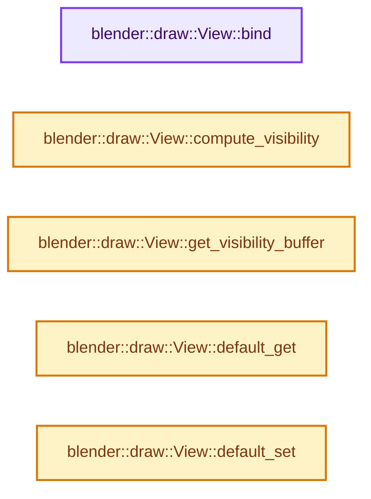
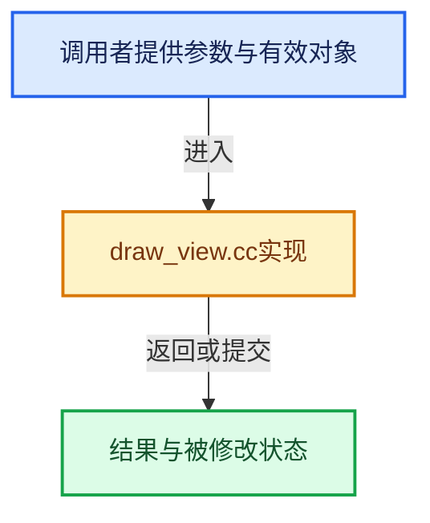

# 实现依赖专题：source/blender/draw/intern/draw_view.cc

[实现依赖导航](../../../README.md) · [符号索引](../../../../00-课程指南/02-源码与提交索引/符号依赖与实现索引.md)

本专题从正文实际调用进入，集中保存共享实现。函数有稳定锚点，可从调用处直接跳到对应完整函数；递归与互相调用通过回链组织。

## 本文件的实现关系






## 完整成员与函数实现

<a id="f-232f4cf894ce88d1"></a>

### `blender::draw::View::bind`

实现位置：[source/blender/draw/intern/draw_view.cc](../../../../../../../../source/blender/draw/intern/draw_view.cc) · L226—L236。

**教学注释版**

<!-- annotated:4247a5f56d1169 -->

```cpp
void View::bind()
{
  if (dirty_ && !procedural_) {
    dirty_ = false;
    data_.push_update();
    culling_.push_update();
  }

  GPU_uniformbuf_bind(data_, DRW_VIEW_UBO_SLOT);
  GPU_uniformbuf_bind(culling_, DRW_VIEW_CULLING_UBO_SLOT);
}
```

<details>
<summary>核对原始源码：source/blender/draw/intern/draw_view.cc · L226—L236</summary>

<!-- original:4247a5f56d1169:source/blender/draw/intern/draw_view.cc:226:236 -->

```cpp
void View::bind()
{
  if (dirty_ && !procedural_) {
    dirty_ = false;
    data_.push_update();
    culling_.push_update();
  }

  GPU_uniformbuf_bind(data_, DRW_VIEW_UBO_SLOT);
  GPU_uniformbuf_bind(culling_, DRW_VIEW_CULLING_UBO_SLOT);
}
```

</details>

**沿实际写入检查状态**

- `dirty_ = false;`

**继续追踪实现**

- `data_.push_update` → [调用协议](../../../../00-课程指南/01-路线与规范/模板宏与动态分派协议.md)：接收对象类型依赖auto、返回值或模板实例；不按同名猜测目标。调用位置L230。
- `culling_.push_update` → [调用协议](../../../../00-课程指南/01-路线与规范/模板宏与动态分派协议.md)：接收对象类型依赖auto、返回值或模板实例；不按同名猜测目标。调用位置L231。
- `GPU_uniformbuf_bind` → [blender::GPU_uniformbuf_bind · L349](../../gpu/intern/gpu_uniform_buffer.cc.md#f-6f7028e200711532)。

<a id="f-83043bd24debfa6a"></a>

### `blender::draw::View::compute_visibility`

实现位置：[source/blender/draw/intern/draw_view.cc](../../../../../../../../source/blender/draw/intern/draw_view.cc) · L257—L310。

接口参数：

- `ObjectBoundsBuf &bounds`
- `ObjectInfosBuf &`
- `uint resource_len`
- `bool debug_freeze`

**教学注释版**

<!-- annotated:beaf0220552a23 -->

```cpp
void View::compute_visibility(ObjectBoundsBuf &bounds,
                              ObjectInfosBuf & /*infos*/,
                              uint resource_len,
                              bool debug_freeze)
{
  if (debug_freeze && frozen_ == false) {
    data_freeze_[0] = static_cast<ViewMatrices>(data_[0]);
    data_freeze_.push_update();
    culling_freeze_[0] = static_cast<ViewCullingData>(culling_[0]);
    culling_freeze_.push_update();
  }
  if (debug_freeze) {
    float4x4 persmat = data_freeze_[0].winmat * data_freeze_[0].viewmat;
    drw_debug_matrix_as_bbox(math::invert(persmat), float4(0, 1, 0, 1));
  }
  frozen_ = debug_freeze;

  GPU_debug_group_begin("View.compute_visibility");

  /* TODO(fclem): Early out if visibility hasn't changed. */

  uint word_per_draw = this->visibility_word_per_draw();
  /* Switch between tightly packed and set of whole word per instance. */
  uint words_len = (view_len_ == 1) ? divide_ceil_u(resource_len, 32) :
                                      resource_len * word_per_draw;
  words_len = ceil_to_multiple_u(max_ii(1, words_len), 4);
  /* TODO(fclem): Resize to nearest pow2 to reduce fragmentation. */
  visibility_buf_.resize(words_len);

  const uint32_t data = 0xFFFFFFFFu;
  GPU_storagebuf_clear(visibility_buf_, data);

  if (do_visibility_) {
    gpu::Shader *shader = DRW_shader_draw_visibility_compute_get();
    GPU_shader_bind(shader);
    GPU_shader_uniform_1i(shader, "resource_len", resource_len);
    GPU_shader_uniform_1i(shader, "view_len", view_len_);
    GPU_shader_uniform_1i(shader, "visibility_word_per_draw", word_per_draw);
    GPU_storagebuf_bind(bounds, GPU_shader_get_ssbo_binding(shader, "bounds_buf"));
    GPU_storagebuf_bind(visibility_buf_, GPU_shader_get_ssbo_binding(shader, "visibility_buf"));
    GPU_uniformbuf_bind(frozen_ ? data_freeze_ : data_, DRW_VIEW_UBO_SLOT);
    GPU_uniformbuf_bind(frozen_ ? culling_freeze_ : culling_, DRW_VIEW_CULLING_UBO_SLOT);
    GPU_compute_dispatch(shader, divide_ceil_u(resource_len, DRW_VISIBILITY_GROUP_SIZE), 1, 1);
    GPU_memory_barrier(GPU_BARRIER_SHADER_STORAGE);
  }

  if (frozen_) {
    /* Bind back the non frozen data. */
    GPU_uniformbuf_bind(data_, DRW_VIEW_UBO_SLOT);
    GPU_uniformbuf_bind(culling_, DRW_VIEW_CULLING_UBO_SLOT);
  }

  GPU_debug_group_end();
}
```

<details>
<summary>核对原始源码：source/blender/draw/intern/draw_view.cc · L257—L310</summary>

<!-- original:beaf0220552a23:source/blender/draw/intern/draw_view.cc:257:310 -->

```cpp
void View::compute_visibility(ObjectBoundsBuf &bounds,
                              ObjectInfosBuf & /*infos*/,
                              uint resource_len,
                              bool debug_freeze)
{
  if (debug_freeze && frozen_ == false) {
    data_freeze_[0] = static_cast<ViewMatrices>(data_[0]);
    data_freeze_.push_update();
    culling_freeze_[0] = static_cast<ViewCullingData>(culling_[0]);
    culling_freeze_.push_update();
  }
  if (debug_freeze) {
    float4x4 persmat = data_freeze_[0].winmat * data_freeze_[0].viewmat;
    drw_debug_matrix_as_bbox(math::invert(persmat), float4(0, 1, 0, 1));
  }
  frozen_ = debug_freeze;

  GPU_debug_group_begin("View.compute_visibility");

  /* TODO(fclem): Early out if visibility hasn't changed. */

  uint word_per_draw = this->visibility_word_per_draw();
  /* Switch between tightly packed and set of whole word per instance. */
  uint words_len = (view_len_ == 1) ? divide_ceil_u(resource_len, 32) :
                                      resource_len * word_per_draw;
  words_len = ceil_to_multiple_u(max_ii(1, words_len), 4);
  /* TODO(fclem): Resize to nearest pow2 to reduce fragmentation. */
  visibility_buf_.resize(words_len);

  const uint32_t data = 0xFFFFFFFFu;
  GPU_storagebuf_clear(visibility_buf_, data);

  if (do_visibility_) {
    gpu::Shader *shader = DRW_shader_draw_visibility_compute_get();
    GPU_shader_bind(shader);
    GPU_shader_uniform_1i(shader, "resource_len", resource_len);
    GPU_shader_uniform_1i(shader, "view_len", view_len_);
    GPU_shader_uniform_1i(shader, "visibility_word_per_draw", word_per_draw);
    GPU_storagebuf_bind(bounds, GPU_shader_get_ssbo_binding(shader, "bounds_buf"));
    GPU_storagebuf_bind(visibility_buf_, GPU_shader_get_ssbo_binding(shader, "visibility_buf"));
    GPU_uniformbuf_bind(frozen_ ? data_freeze_ : data_, DRW_VIEW_UBO_SLOT);
    GPU_uniformbuf_bind(frozen_ ? culling_freeze_ : culling_, DRW_VIEW_CULLING_UBO_SLOT);
    GPU_compute_dispatch(shader, divide_ceil_u(resource_len, DRW_VISIBILITY_GROUP_SIZE), 1, 1);
    GPU_memory_barrier(GPU_BARRIER_SHADER_STORAGE);
  }

  if (frozen_) {
    /* Bind back the non frozen data. */
    GPU_uniformbuf_bind(data_, DRW_VIEW_UBO_SLOT);
    GPU_uniformbuf_bind(culling_, DRW_VIEW_CULLING_UBO_SLOT);
  }

  GPU_debug_group_end();
}
```

</details>

**沿实际写入检查状态**

- `data_freeze_[0] = static_cast<ViewMatrices>(data_[0]);`
- `culling_freeze_[0] = static_cast<ViewCullingData>(culling_[0]);`
- `frozen_ = debug_freeze;`
- `words_len = ceil_to_multiple_u(max_ii(1, words_len), 4);`

**继续追踪实现**

- `data_freeze_.push_update` → [调用协议](../../../../00-课程指南/01-路线与规范/模板宏与动态分派协议.md)：接收对象类型依赖auto、返回值或模板实例；不按同名猜测目标。调用位置L264。
- `culling_freeze_.push_update` → [调用协议](../../../../00-课程指南/01-路线与规范/模板宏与动态分派协议.md)：接收对象类型依赖auto、返回值或模板实例；不按同名猜测目标。调用位置L266。
- `drw_debug_matrix_as_bbox` → [blender::draw::drw_debug_matrix_as_bbox · L185](draw_debug.cc.md#f-2b3f938ee8316e72)。
- `math::invert` → [blender::math::invert · L202](../../../01-BLI基础库/intern/math_matrix.cc.md#f-222be9a4cab433f5)；[blender::math::invert · L234](../../../01-BLI基础库/BLI_math_quaternion.hh.md#f-7ba965075f461895)；[blender::math::invert · L648](../../../01-BLI基础库/BLI_math_matrix.hh.md#f-2b50b5262b2a9121)；[blender::math::invert · L460](../../../01-BLI基础库/BLI_math_basis_types.hh.md#f-76b56b37f151208d)。同名重载需按实参类型选择。
- `float4` → [float4 · L56](../../../07-Intern运行时与平台/cycles/kernel/svm/radial_tiling_shared.h.md#m-f0908e385c5b)；[float4 · L60](../../../01-BLI基础库/intern/radial_tiling_shared.hh.md#m-7962dcdc288b)；[float4 · L56](../../../07-Intern运行时与平台/cycles/kernel/osl/shaders/node_radial_tiling_shared.h.md#m-adb8e9e87775)；[float4 · L642](../../compositor/algorithms/intern/smaa.cc.md#m-9362daaa821c)。宏定义由构建条件选择。
- `GPU_debug_group_begin` → [blender::GPU_debug_group_begin · L23](../../gpu/intern/gpu_debug.cc.md#f-c74a16ba40e0e7a7)。
- `this->visibility_word_per_draw` → [blender::draw::View::visibility_word_per_draw · L178](draw_view.hh.md#f-48a8d3b058f349df)。
- `divide_ceil_u` → [blender::divide_ceil_u · L235](../../../01-BLI基础库/intern/math_base_inline.cc.md#f-9bfe95d830410fdd)。
- `ceil_to_multiple_u` → [blender::ceil_to_multiple_u · L245](../../../01-BLI基础库/intern/math_base_inline.cc.md#f-b6a8b97456313c88)。
- `max_ii` → [blender::max_ii · L368](../../../01-BLI基础库/intern/math_base_inline.cc.md#f-c45aa7b373adb94c)。
- `visibility_buf_.resize` → [调用协议](../../../../00-课程指南/01-路线与规范/模板宏与动态分派协议.md)：接收对象类型依赖auto、返回值或模板实例；不按同名猜测目标。调用位置L284。
- `GPU_storagebuf_clear` → [blender::GPU_storagebuf_clear · L114](../../gpu/intern/gpu_storage_buffer.cc.md#f-697dd35ae1aa8463)。
- `DRW_shader_draw_visibility_compute_get` → [blender::DRW_shader_draw_visibility_compute_get · L219](draw_shader.cc.md#f-d6cb53daf12b2619)。
- `GPU_shader_bind` → [blender::GPU_shader_bind · L387](../../gpu/intern/gpu_shader.cc.md#f-a879eef1816db611)。
- `GPU_shader_uniform_1i` → [blender::GPU_shader_uniform_1i · L646](../../gpu/intern/gpu_shader.cc.md#f-d02d234ed60d9de0)。
- `GPU_storagebuf_bind` → [blender::GPU_storagebuf_bind · L94](../../gpu/intern/gpu_storage_buffer.cc.md#f-e795e74fcc758ac4)。
- `GPU_shader_get_ssbo_binding` → [blender::GPU_shader_get_ssbo_binding · L544](../../gpu/intern/gpu_shader.cc.md#f-91a2bf7d4bbda1dc)。
- `GPU_uniformbuf_bind` → [blender::GPU_uniformbuf_bind · L349](../../gpu/intern/gpu_uniform_buffer.cc.md#f-6f7028e200711532)。
- `GPU_compute_dispatch` → [blender::GPU_compute_dispatch · L16](../../gpu/intern/gpu_compute.cc.md#f-333af4920056a41a)。
- `GPU_memory_barrier` → [blender::GPU_memory_barrier · L305](../../gpu/intern/gpu_state.cc.md#f-5a91f15b51991eb7)。
- `GPU_debug_group_end` → [blender::GPU_debug_group_end · L34](../../gpu/intern/gpu_debug.cc.md#f-6d1ac356d118d5ac)。

<a id="f-85c9eb1e418b7a3c"></a>

### `blender::draw::View::get_visibility_buffer`

实现位置：[source/blender/draw/intern/draw_view.cc](../../../../../../../../source/blender/draw/intern/draw_view.cc) · L312—L315。

**教学注释版**

<!-- annotated:e83d4c5d05e61c -->

```cpp
VisibilityBuf &View::get_visibility_buffer()
{
  return visibility_buf_;
}
```

<details>
<summary>核对原始源码：source/blender/draw/intern/draw_view.cc · L312—L315</summary>

<!-- original:e83d4c5d05e61c:source/blender/draw/intern/draw_view.cc:312:315 -->

```cpp
VisibilityBuf &View::get_visibility_buffer()
{
  return visibility_buf_;
}
```

</details>

**结果出口**

- `return visibility_buf_;`

**继续追踪实现**

本实现没有需要继续展开的显式调用；检查返回表达式、对象转换和调用者前置条件。

<a id="f-1edfe36a27ed8fa6"></a>

### `blender::draw::View::default_get`

实现位置：[source/blender/draw/intern/draw_view.cc](../../../../../../../../source/blender/draw/intern/draw_view.cc) · L317—L320。

**教学注释版**

<!-- annotated:411b5eac6795b5 -->

```cpp
draw::View &View::default_get()
{
  return *drw_get().data->default_view;
}
```

<details>
<summary>核对原始源码：source/blender/draw/intern/draw_view.cc · L317—L320</summary>

<!-- original:411b5eac6795b5:source/blender/draw/intern/draw_view.cc:317:320 -->

```cpp
draw::View &View::default_get()
{
  return *drw_get().data->default_view;
}
```

</details>

**结果出口**

- `return *drw_get().data->default_view;`

**继续追踪实现**

- `drw_get` → [blender::drw_get · L81](draw_context_private.hh.md#f-8fd959a68d9e8cf0)。

<a id="f-4028261dbf15aded"></a>

### `blender::draw::View::default_set`

实现位置：[source/blender/draw/intern/draw_view.cc](../../../../../../../../source/blender/draw/intern/draw_view.cc) · L322—L325。

接口参数：

- `const float4x4 &view_mat`
- `const float4x4 &win_mat`

**教学注释版**

<!-- annotated:ce7557e52e867e -->

```cpp
void View::default_set(const float4x4 &view_mat, const float4x4 &win_mat)
{
  drw_get().data->default_view->sync(view_mat, win_mat);
}
```

<details>
<summary>核对原始源码：source/blender/draw/intern/draw_view.cc · L322—L325</summary>

<!-- original:ce7557e52e867e:source/blender/draw/intern/draw_view.cc:322:325 -->

```cpp
void View::default_set(const float4x4 &view_mat, const float4x4 &win_mat)
{
  drw_get().data->default_view->sync(view_mat, win_mat);
}
```

</details>

**继续追踪实现**

- `drw_get().data->default_view->sync` → [调用协议](../../../../00-课程指南/01-路线与规范/模板宏与动态分派协议.md)：接收对象类型依赖auto、返回值或模板实例；不按同名猜测目标。调用位置L324。
- `drw_get` → [blender::drw_get · L81](draw_context_private.hh.md#f-8fd959a68d9e8cf0)。
