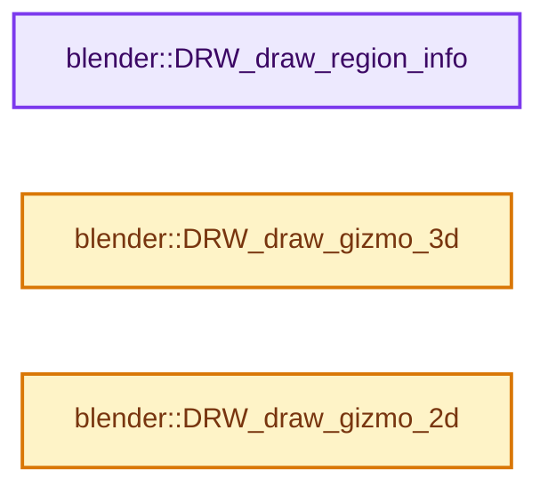
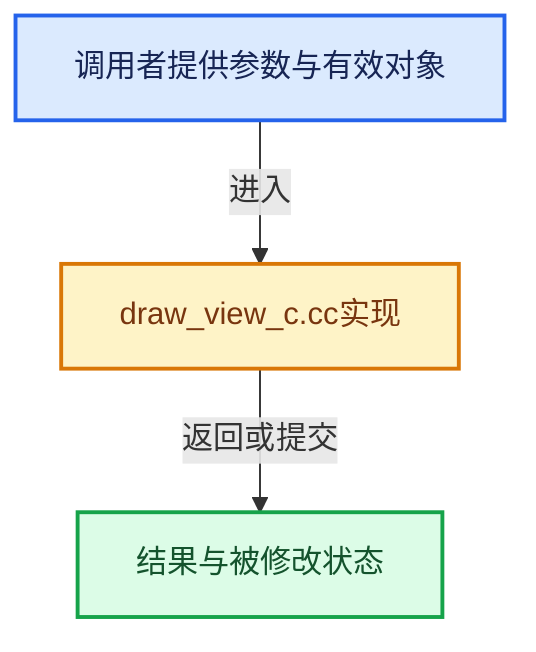

# 实现依赖专题：source/blender/draw/intern/draw_view_c.cc

[实现依赖导航](../../../README.md) · [符号索引](../../../../00-课程指南/02-源码与提交索引/符号依赖与实现索引.md)

本专题从正文实际调用进入，集中保存共享实现。函数有稳定锚点，可从调用处直接跳到对应完整函数；递归与互相调用通过回链组织。

## 本文件的实现关系






## 完整成员与函数实现

<a id="f-62f02cf481a549c8"></a>

### `blender::DRW_draw_region_info`

实现位置：[source/blender/draw/intern/draw_view_c.cc](../../../../../../../../source/blender/draw/intern/draw_view_c.cc) · L37—L42。

接口参数：

- `const bContext *C`
- `ARegion *region`

**教学注释版**

<!-- annotated:21e4f7953ccfaa -->

```cpp
void DRW_draw_region_info(const bContext *C, ARegion *region)
{
  GPU_debug_group_begin("RegionInfo");
  view3d_draw_region_info(C, region);
  GPU_debug_group_end();
}
```

<details>
<summary>核对原始源码：source/blender/draw/intern/draw_view_c.cc · L37—L42</summary>

<!-- original:21e4f7953ccfaa:source/blender/draw/intern/draw_view_c.cc:37:42 -->

```cpp
void DRW_draw_region_info(const bContext *C, ARegion *region)
{
  GPU_debug_group_begin("RegionInfo");
  view3d_draw_region_info(C, region);
  GPU_debug_group_end();
}
```

</details>

**继续追踪实现**

- `GPU_debug_group_begin` → [blender::GPU_debug_group_begin · L23](../../gpu/intern/gpu_debug.cc.md#f-c74a16ba40e0e7a7)。
- `view3d_draw_region_info` → [blender::view3d_draw_region_info · L1469](../../editors/space_view3d/view3d_draw.cc.md#f-8bbeab40e85c6af8)。
- `GPU_debug_group_end` → [blender::GPU_debug_group_end · L34](../../gpu/intern/gpu_debug.cc.md#f-6d1ac356d118d5ac)。

<a id="f-fe3962b30af0fc56"></a>

### `blender::DRW_draw_gizmo_3d`

实现位置：[source/blender/draw/intern/draw_view_c.cc](../../../../../../../../source/blender/draw/intern/draw_view_c.cc) · L46—L52。

接口参数：

- `const bContext *C`
- `ARegion *region`

**教学注释版**

<!-- annotated:8b46c8edf0cfb0 -->

```cpp
void DRW_draw_gizmo_3d(const bContext *C, ARegion *region)
{
  /* draw depth culled gizmos - gizmos need to be updated *after* view matrix was set up */
  /* TODO: depth culling gizmos is not yet supported, just drawing _3D here, should
   * later become _IN_SCENE (and draw _3D separate) */
  WM_gizmomap_draw(region->runtime->gizmo_map, C, WM_GIZMOMAP_DRAWSTEP_3D);
}
```

<details>
<summary>核对原始源码：source/blender/draw/intern/draw_view_c.cc · L46—L52</summary>

<!-- original:8b46c8edf0cfb0:source/blender/draw/intern/draw_view_c.cc:46:52 -->

```cpp
void DRW_draw_gizmo_3d(const bContext *C, ARegion *region)
{
  /* draw depth culled gizmos - gizmos need to be updated *after* view matrix was set up */
  /* TODO: depth culling gizmos is not yet supported, just drawing _3D here, should
   * later become _IN_SCENE (and draw _3D separate) */
  WM_gizmomap_draw(region->runtime->gizmo_map, C, WM_GIZMOMAP_DRAWSTEP_3D);
}
```

</details>

**继续追踪实现**

- `WM_gizmomap_draw` → [blender::WM_gizmomap_draw · L507](../../windowmanager/gizmo/intern/wm_gizmo_map.cc.md#f-25216a0ce94632c3)。

<a id="f-93c11567cdc3f38c"></a>

### `blender::DRW_draw_gizmo_2d`

实现位置：[source/blender/draw/intern/draw_view_c.cc](../../../../../../../../source/blender/draw/intern/draw_view_c.cc) · L54—L58。

接口参数：

- `const bContext *C`
- `ARegion *region`

**教学注释版**

<!-- annotated:30e448d8896f2e -->

```cpp
void DRW_draw_gizmo_2d(const bContext *C, ARegion *region)
{
  WM_gizmomap_draw(region->runtime->gizmo_map, C, WM_GIZMOMAP_DRAWSTEP_2D);
  GPU_depth_mask(true);
}
```

<details>
<summary>核对原始源码：source/blender/draw/intern/draw_view_c.cc · L54—L58</summary>

<!-- original:30e448d8896f2e:source/blender/draw/intern/draw_view_c.cc:54:58 -->

```cpp
void DRW_draw_gizmo_2d(const bContext *C, ARegion *region)
{
  WM_gizmomap_draw(region->runtime->gizmo_map, C, WM_GIZMOMAP_DRAWSTEP_2D);
  GPU_depth_mask(true);
}
```

</details>

**继续追踪实现**

- `WM_gizmomap_draw` → [blender::WM_gizmomap_draw · L507](../../windowmanager/gizmo/intern/wm_gizmo_map.cc.md#f-25216a0ce94632c3)。
- `GPU_depth_mask` → [blender::GPU_depth_mask · L107](../../gpu/intern/gpu_state.cc.md#f-960a0181687885c0)。
