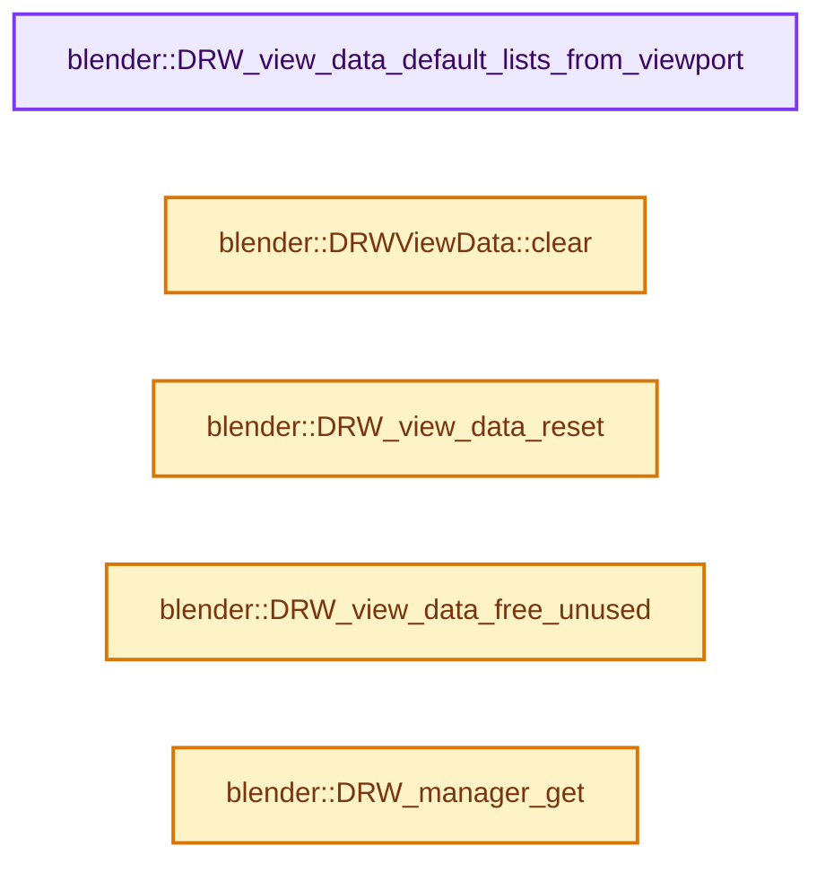

# 实现依赖专题：source/blender/draw/intern/draw_view_data.cc

[实现依赖导航](../../../README.md) · [符号索引](../../../../00-课程指南/02-源码与提交索引/符号依赖与实现索引.md)

本专题从正文实际调用进入，集中保存共享实现。函数有稳定锚点，可从调用处直接跳到对应完整函数；递归与互相调用通过回链组织。

## 本文件的实现关系




## 完整成员与函数实现

<a id="f-7deeec1fc2c0425a"></a>

### `blender::DRW_view_data_default_lists_from_viewport`

实现位置：[source/blender/draw/intern/draw_view_data.cc](../../../../../../../../source/blender/draw/intern/draw_view_data.cc) · L39—L76。

接口参数：

- `DRWViewData *view_data`
- `GPUViewport *viewport`

**教学注释版**

<!-- annotated:3e89bdbf2b43bc -->

```cpp
void DRW_view_data_default_lists_from_viewport(DRWViewData *view_data, GPUViewport *viewport)
{
  int active_view = GPU_viewport_active_view_get(viewport);
  view_data->from_viewport = true;

  DefaultFramebufferList *dfbl = &view_data->dfbl;
  DefaultTextureList *dtxl = &view_data->dtxl;
  /* Depth texture is shared between both stereo views. */
  dtxl->depth = GPU_viewport_depth_texture(viewport);
  dtxl->color = GPU_viewport_color_texture(viewport, active_view);
  dtxl->color_overlay = GPU_viewport_overlay_texture(viewport, active_view);

  GPU_framebuffer_ensure_config(&dfbl->default_fb,
                                {
                                    GPU_ATTACHMENT_TEXTURE(dtxl->depth),
                                    GPU_ATTACHMENT_TEXTURE(dtxl->color),
                                });
  GPU_framebuffer_ensure_config(&dfbl->overlay_fb,
                                {
                                    GPU_ATTACHMENT_TEXTURE(dtxl->depth),
                                    GPU_ATTACHMENT_TEXTURE(dtxl->color_overlay),
                                });
  GPU_framebuffer_ensure_config(&dfbl->depth_only_fb,
                                {
                                    GPU_ATTACHMENT_TEXTURE(dtxl->depth),
                                    GPU_ATTACHMENT_NONE,
                                });
  GPU_framebuffer_ensure_config(&dfbl->color_only_fb,
                                {
                                    GPU_ATTACHMENT_NONE,
                                    GPU_ATTACHMENT_TEXTURE(dtxl->color),
                                });
  GPU_framebuffer_ensure_config(&dfbl->overlay_only_fb,
                                {
                                    GPU_ATTACHMENT_NONE,
                                    GPU_ATTACHMENT_TEXTURE(dtxl->color_overlay),
                                });
}
```

<details>
<summary>核对原始源码：source/blender/draw/intern/draw_view_data.cc · L39—L76</summary>

<!-- original:3e89bdbf2b43bc:source/blender/draw/intern/draw_view_data.cc:39:76 -->

```cpp
void DRW_view_data_default_lists_from_viewport(DRWViewData *view_data, GPUViewport *viewport)
{
  int active_view = GPU_viewport_active_view_get(viewport);
  view_data->from_viewport = true;

  DefaultFramebufferList *dfbl = &view_data->dfbl;
  DefaultTextureList *dtxl = &view_data->dtxl;
  /* Depth texture is shared between both stereo views. */
  dtxl->depth = GPU_viewport_depth_texture(viewport);
  dtxl->color = GPU_viewport_color_texture(viewport, active_view);
  dtxl->color_overlay = GPU_viewport_overlay_texture(viewport, active_view);

  GPU_framebuffer_ensure_config(&dfbl->default_fb,
                                {
                                    GPU_ATTACHMENT_TEXTURE(dtxl->depth),
                                    GPU_ATTACHMENT_TEXTURE(dtxl->color),
                                });
  GPU_framebuffer_ensure_config(&dfbl->overlay_fb,
                                {
                                    GPU_ATTACHMENT_TEXTURE(dtxl->depth),
                                    GPU_ATTACHMENT_TEXTURE(dtxl->color_overlay),
                                });
  GPU_framebuffer_ensure_config(&dfbl->depth_only_fb,
                                {
                                    GPU_ATTACHMENT_TEXTURE(dtxl->depth),
                                    GPU_ATTACHMENT_NONE,
                                });
  GPU_framebuffer_ensure_config(&dfbl->color_only_fb,
                                {
                                    GPU_ATTACHMENT_NONE,
                                    GPU_ATTACHMENT_TEXTURE(dtxl->color),
                                });
  GPU_framebuffer_ensure_config(&dfbl->overlay_only_fb,
                                {
                                    GPU_ATTACHMENT_NONE,
                                    GPU_ATTACHMENT_TEXTURE(dtxl->color_overlay),
                                });
}
```

</details>

**沿实际写入检查状态**

- `view_data->from_viewport = true;`
- `dtxl->depth = GPU_viewport_depth_texture(viewport);`
- `dtxl->color = GPU_viewport_color_texture(viewport, active_view);`
- `dtxl->color_overlay = GPU_viewport_overlay_texture(viewport, active_view);`

**继续追踪实现**

- `GPU_viewport_active_view_get` → [blender::GPU_viewport_active_view_get · L585](../../gpu/intern/gpu_viewport.cc.md#f-cb49bb5ce8e2b0e0)。
- `GPU_viewport_depth_texture` → [blender::GPU_viewport_depth_texture · L605](../../gpu/intern/gpu_viewport.cc.md#f-10a604de746d48f5)。
- `GPU_viewport_color_texture` → [blender::GPU_viewport_color_texture · L595](../../gpu/intern/gpu_viewport.cc.md#f-bf322b0ba509ea3f)。
- `GPU_viewport_overlay_texture` → [blender::GPU_viewport_overlay_texture · L600](../../gpu/intern/gpu_viewport.cc.md#f-6e6d24adf67c6e66)。
- `GPU_framebuffer_ensure_config` → [GPU_framebuffer_ensure_config · L243](../../gpu/GPU_framebuffer.hh.md#m-5b4367b674b8)。宏定义由构建条件选择。
- `GPU_ATTACHMENT_TEXTURE` → [GPU_ATTACHMENT_TEXTURE · L275](../../gpu/GPU_framebuffer.hh.md#m-8822354717b4)。宏定义由构建条件选择。

<a id="f-bb5156f3cc4be47b"></a>

### `blender::DRWViewData::clear`

实现位置：[source/blender/draw/intern/draw_view_data.cc](../../../../../../../../source/blender/draw/intern/draw_view_data.cc) · L78—L101。

接口参数：

- `bool free_instance_data`

**教学注释版**

<!-- annotated:dcb163652fa038 -->

```cpp
void DRWViewData::clear(bool free_instance_data)
{
  GPU_FRAMEBUFFER_FREE_SAFE(this->dfbl.default_fb);
  GPU_FRAMEBUFFER_FREE_SAFE(this->dfbl.overlay_fb);
  GPU_FRAMEBUFFER_FREE_SAFE(this->dfbl.in_front_fb);
  GPU_FRAMEBUFFER_FREE_SAFE(this->dfbl.color_only_fb);
  GPU_FRAMEBUFFER_FREE_SAFE(this->dfbl.depth_only_fb);
  GPU_FRAMEBUFFER_FREE_SAFE(this->dfbl.overlay_only_fb);

  if (!this->from_viewport) {
    GPU_TEXTURE_FREE_SAFE(this->dtxl.color);
    GPU_TEXTURE_FREE_SAFE(this->dtxl.color_overlay);
    GPU_TEXTURE_FREE_SAFE(this->dtxl.depth);
  }
  GPU_TEXTURE_FREE_SAFE(this->dtxl.depth_in_front);

  if (free_instance_data) {
    foreach_engine([&](DrawEngine::Pointer &ptr) {
      if (ptr.instance) {
        ptr.free_instance();
      }
    });
  }
}
```

<details>
<summary>核对原始源码：source/blender/draw/intern/draw_view_data.cc · L78—L101</summary>

<!-- original:dcb163652fa038:source/blender/draw/intern/draw_view_data.cc:78:101 -->

```cpp
void DRWViewData::clear(bool free_instance_data)
{
  GPU_FRAMEBUFFER_FREE_SAFE(this->dfbl.default_fb);
  GPU_FRAMEBUFFER_FREE_SAFE(this->dfbl.overlay_fb);
  GPU_FRAMEBUFFER_FREE_SAFE(this->dfbl.in_front_fb);
  GPU_FRAMEBUFFER_FREE_SAFE(this->dfbl.color_only_fb);
  GPU_FRAMEBUFFER_FREE_SAFE(this->dfbl.depth_only_fb);
  GPU_FRAMEBUFFER_FREE_SAFE(this->dfbl.overlay_only_fb);

  if (!this->from_viewport) {
    GPU_TEXTURE_FREE_SAFE(this->dtxl.color);
    GPU_TEXTURE_FREE_SAFE(this->dtxl.color_overlay);
    GPU_TEXTURE_FREE_SAFE(this->dtxl.depth);
  }
  GPU_TEXTURE_FREE_SAFE(this->dtxl.depth_in_front);

  if (free_instance_data) {
    foreach_engine([&](DrawEngine::Pointer &ptr) {
      if (ptr.instance) {
        ptr.free_instance();
      }
    });
  }
}
```

</details>

**继续追踪实现**

- `GPU_FRAMEBUFFER_FREE_SAFE` → [GPU_FRAMEBUFFER_FREE_SAFE · L90](../../gpu/GPU_framebuffer.hh.md#m-be42e1859b08)。宏定义由构建条件选择。
- `GPU_TEXTURE_FREE_SAFE` → [GPU_TEXTURE_FREE_SAFE · L902](../../gpu/GPU_texture.hh.md#m-fa9785b115fa)。宏定义由构建条件选择。
- `foreach_engine` → [blender::DRWViewData::foreach_engine · L105](draw_view_data.hh.md#f-e1bdf64214610d7c)。
- `ptr.free_instance` → [blender::DrawEngine::Pointer::free_instance · L112](DRW_render.hh.md#f-aa12c1c327fd8469)。

<a id="f-1f3c1f1dd4974e62"></a>

### `blender::DRW_view_data_reset`

实现位置：[source/blender/draw/intern/draw_view_data.cc](../../../../../../../../source/blender/draw/intern/draw_view_data.cc) · L111—L121。

接口参数：

- `DRWViewData *view_data`

**教学注释版**

<!-- annotated:745f7b6c08fdbb -->

```cpp
void DRW_view_data_reset(DRWViewData *view_data)
{
  view_data->foreach_enabled_engine([&](DrawEngine &instance) { instance.used = false; });

  for (std::unique_ptr<draw::TextureFromPool> &texture :
       view_data->viewport_compositor_passes.values())
  {
    texture->release();
  }
  view_data->viewport_compositor_passes.clear();
}
```

<details>
<summary>核对原始源码：source/blender/draw/intern/draw_view_data.cc · L111—L121</summary>

<!-- original:745f7b6c08fdbb:source/blender/draw/intern/draw_view_data.cc:111:121 -->

```cpp
void DRW_view_data_reset(DRWViewData *view_data)
{
  view_data->foreach_enabled_engine([&](DrawEngine &instance) { instance.used = false; });

  for (std::unique_ptr<draw::TextureFromPool> &texture :
       view_data->viewport_compositor_passes.values())
  {
    texture->release();
  }
  view_data->viewport_compositor_passes.clear();
}
```

</details>

**继续追踪实现**

- `view_data->foreach_enabled_engine` → [blender::DRWViewData::foreach_enabled_engine · L130](draw_view_data.hh.md#f-2e7007b2dd23eb0f)。
- `view_data->viewport_compositor_passes.values` → [调用协议](../../../../00-课程指南/01-路线与规范/模板宏与动态分派协议.md)：接收对象类型依赖auto、返回值或模板实例；不按同名猜测目标。调用位置L116。
- `texture->release` → [调用协议](../../../../00-课程指南/01-路线与规范/模板宏与动态分派协议.md)：接收对象类型依赖auto、返回值或模板实例；不按同名猜测目标。调用位置L118。
- `view_data->viewport_compositor_passes.clear` → [调用协议](../../../../00-课程指南/01-路线与规范/模板宏与动态分派协议.md)：接收对象类型依赖auto、返回值或模板实例；不按同名猜测目标。调用位置L120。

<a id="f-550b4bb81b4c6d9b"></a>

### `blender::DRW_view_data_free_unused`

实现位置：[source/blender/draw/intern/draw_view_data.cc](../../../../../../../../source/blender/draw/intern/draw_view_data.cc) · L123—L130。

接口参数：

- `DRWViewData *view_data`

**教学注释版**

<!-- annotated:decf882ece7fa0 -->

```cpp
void DRW_view_data_free_unused(DRWViewData *view_data)
{
  view_data->foreach_engine([&](DrawEngine::Pointer &ptr) {
    if (ptr.instance && ptr.instance->used == false) {
      ptr.free_instance();
    }
  });
}
```

<details>
<summary>核对原始源码：source/blender/draw/intern/draw_view_data.cc · L123—L130</summary>

<!-- original:decf882ece7fa0:source/blender/draw/intern/draw_view_data.cc:123:130 -->

```cpp
void DRW_view_data_free_unused(DRWViewData *view_data)
{
  view_data->foreach_engine([&](DrawEngine::Pointer &ptr) {
    if (ptr.instance && ptr.instance->used == false) {
      ptr.free_instance();
    }
  });
}
```

</details>

**继续追踪实现**

- `view_data->foreach_engine` → [blender::DRWViewData::foreach_engine · L105](draw_view_data.hh.md#f-e1bdf64214610d7c)。
- `ptr.free_instance` → [blender::DrawEngine::Pointer::free_instance · L112](DRW_render.hh.md#f-aa12c1c327fd8469)。

<a id="f-5119622e7911956f"></a>

### `blender::DRW_manager_get`

实现位置：[source/blender/draw/intern/draw_view_data.cc](../../../../../../../../source/blender/draw/intern/draw_view_data.cc) · L132—L136。

**教学注释版**

<!-- annotated:37146d27f309c6 -->

```cpp
draw::Manager *DRW_manager_get()
{
  BLI_assert(drw_get().view_data_active->manager);
  return drw_get().view_data_active->manager;
}
```

<details>
<summary>核对原始源码：source/blender/draw/intern/draw_view_data.cc · L132—L136</summary>

<!-- original:37146d27f309c6:source/blender/draw/intern/draw_view_data.cc:132:136 -->

```cpp
draw::Manager *DRW_manager_get()
{
  BLI_assert(drw_get().view_data_active->manager);
  return drw_get().view_data_active->manager;
}
```

</details>

**结果出口**

- `return drw_get().view_data_active->manager;`

**继续追踪实现**

- `BLI_assert` → [BLI_assert · L48](../../../01-BLI基础库/BLI_assert.hh.md#m-57a88495704d)；[BLI_assert · L63](../../../01-BLI基础库/BLI_assert.hh.md#m-d07050020cb5)。宏定义由构建条件选择。
- `drw_get` → [blender::drw_get · L81](draw_context_private.hh.md#f-8fd959a68d9e8cf0)。
