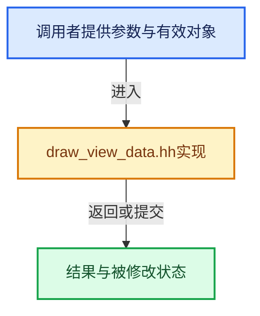

# 实现依赖专题：source/blender/draw/intern/draw_view_data.hh

[实现依赖导航](../../../README.md) · [符号索引](../../../../00-课程指南/02-源码与提交索引/符号依赖与实现索引.md)

本专题从正文实际调用进入，集中保存共享实现。函数有稳定锚点，可从调用处直接跳到对应完整函数；递归与互相调用通过回链组织。

## 本文件的实现关系





## 完整成员与函数实现

<a id="f-e1bdf64214610d7c"></a>

### `blender::DRWViewData::foreach_engine`

实现位置：[source/blender/draw/intern/draw_view_data.hh](../../../../../../../../source/blender/draw/intern/draw_view_data.hh) · L105—L128。

接口参数：

- `CallbackT callback`

**教学注释版**

<!-- annotated:46bff74e04c2cb -->

```cpp
  template<typename CallbackT> void foreach_engine(CallbackT callback)
  {
    /* IMPORTANT: Order here defines the draw order. */

    /* Render engines. Output to the render result frame-buffer. Mutually exclusive. */

    callback(eevee);
    callback(workbench);
    callback(external);
    callback(image);
#ifdef WITH_DRAW_DEBUG
    callback(edit_select_debug);
#endif
    /** Grease pencil. Merge its output to the render result frame-buffer. */
    callback(grease_pencil);
    /** GPU compositor. Processes render result and output to the render result frame-buffer. */
    callback(compositor);
    /** Overlays. Draw on a separate overlay frame-buffer. Can read render result. */
    callback(overlay);

    /** Selection. Are always enabled alone and have no interaction with other engines. */
    callback(object_select);
    callback(edit_select);
  }
```

<details>
<summary>核对原始源码：source/blender/draw/intern/draw_view_data.hh · L105—L128</summary>

<!-- original:46bff74e04c2cb:source/blender/draw/intern/draw_view_data.hh:105:128 -->

```cpp
  template<typename CallbackT> void foreach_engine(CallbackT callback)
  {
    /* IMPORTANT: Order here defines the draw order. */

    /* Render engines. Output to the render result frame-buffer. Mutually exclusive. */

    callback(eevee);
    callback(workbench);
    callback(external);
    callback(image);
#ifdef WITH_DRAW_DEBUG
    callback(edit_select_debug);
#endif
    /** Grease pencil. Merge its output to the render result frame-buffer. */
    callback(grease_pencil);
    /** GPU compositor. Processes render result and output to the render result frame-buffer. */
    callback(compositor);
    /** Overlays. Draw on a separate overlay frame-buffer. Can read render result. */
    callback(overlay);

    /** Selection. Are always enabled alone and have no interaction with other engines. */
    callback(object_select);
    callback(edit_select);
  }
```

</details>

**继续追踪实现**

- `callback` → [调用协议](../../../../00-课程指南/01-路线与规范/模板宏与动态分派协议.md)：局部可调用对象，须结合其初始化与捕获环境。调用位置L111。

<a id="f-2e7007b2dd23eb0f"></a>

### `blender::DRWViewData::foreach_enabled_engine`

实现位置：[source/blender/draw/intern/draw_view_data.hh](../../../../../../../../source/blender/draw/intern/draw_view_data.hh) · L130—L138。

接口参数：

- `CallbackT callback`

**教学注释版**

<!-- annotated:bcbb417c02149a -->

```cpp
  template<typename CallbackT> void foreach_enabled_engine(CallbackT callback)
  {
    foreach_engine([&](DrawEngine::Pointer &ptr) {
      if (ptr.instance == nullptr || ptr.instance->used == false) {
        return;
      }
      callback(*ptr.instance);
    });
  }
```

<details>
<summary>核对原始源码：source/blender/draw/intern/draw_view_data.hh · L130—L138</summary>

<!-- original:bcbb417c02149a:source/blender/draw/intern/draw_view_data.hh:130:138 -->

```cpp
  template<typename CallbackT> void foreach_enabled_engine(CallbackT callback)
  {
    foreach_engine([&](DrawEngine::Pointer &ptr) {
      if (ptr.instance == nullptr || ptr.instance->used == false) {
        return;
      }
      callback(*ptr.instance);
    });
  }
```

</details>

**继续追踪实现**

- `foreach_engine` → [blender::DRWViewData::foreach_engine · L105](draw_view_data.hh.md#f-e1bdf64214610d7c)。
- `callback` → [调用协议](../../../../00-课程指南/01-路线与规范/模板宏与动态分派协议.md)：局部可调用对象，须结合其初始化与捕获环境。调用位置L136。
