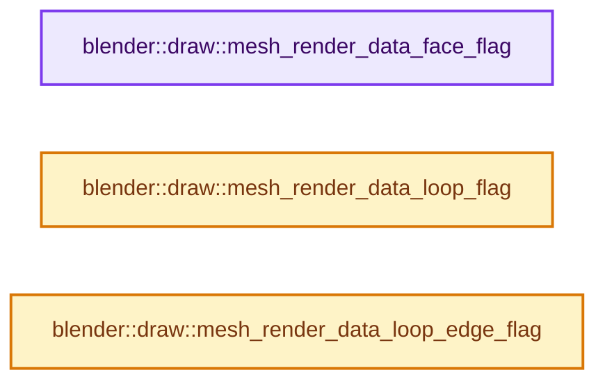
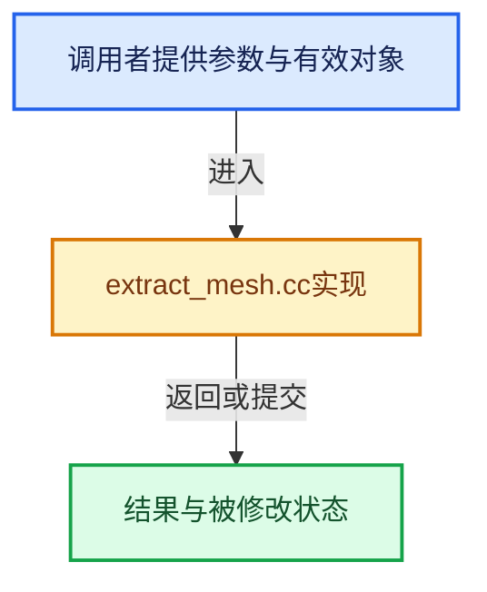

# 实现依赖专题：source/blender/draw/intern/mesh_extractors/extract_mesh.cc

[实现依赖导航](../../../../README.md) · [符号索引](../../../../../00-课程指南/02-源码与提交索引/符号依赖与实现索引.md)

本专题从正文实际调用进入，集中保存共享实现。函数有稳定锚点，可从调用处直接跳到对应完整函数；递归与互相调用通过回链组织。

## 本文件的实现关系






## 完整成员与函数实现

<a id="f-78bb4555cc3bf13e"></a>

### `blender::draw::mesh_render_data_face_flag`

实现位置：[source/blender/draw/intern/mesh_extractors/extract_mesh.cc](../../../../../../../../../source/blender/draw/intern/mesh_extractors/extract_mesh.cc) · L25—L53。

接口参数：

- `const MeshRenderData &mr`
- `const BMFace *efa`
- `const BMUVOffsets &offsets`
- `EditLoopData &eattr`

**教学注释版**

<!-- annotated:c6540048c05353 -->

```cpp
void mesh_render_data_face_flag(const MeshRenderData &mr,
                                const BMFace *efa,
                                const BMUVOffsets &offsets,
                                EditLoopData &eattr)
{
  if (efa == mr.efa_act) {
    eattr.v_flag |= VFLAG_FACE_ACTIVE;
  }
  if (BM_elem_flag_test(efa, BM_ELEM_SELECT)) {
    eattr.v_flag |= VFLAG_FACE_SELECTED;
  }

  if (efa == mr.efa_act_uv) {
    eattr.v_flag |= VFLAG_FACE_UV_ACTIVE;
  }
  if ((offsets.uv != -1) && (!BM_elem_flag_test(efa, BM_ELEM_HIDDEN)) &&
      uvedit_face_select_test_ex(mr.toolsettings, mr.bm, efa))
  {
    eattr.v_flag |= VFLAG_FACE_UV_SELECT;
  }

#ifdef WITH_FREESTYLE
  if (mr.freestyle_face_ofs != -1) {
    if (BM_ELEM_CD_GET_BOOL(efa, mr.freestyle_face_ofs)) {
      eattr.v_flag |= VFLAG_FACE_FREESTYLE;
    }
  }
#endif
}
```

<details>
<summary>核对原始源码：source/blender/draw/intern/mesh_extractors/extract_mesh.cc · L25—L53</summary>

<!-- original:c6540048c05353:source/blender/draw/intern/mesh_extractors/extract_mesh.cc:25:53 -->

```cpp
void mesh_render_data_face_flag(const MeshRenderData &mr,
                                const BMFace *efa,
                                const BMUVOffsets &offsets,
                                EditLoopData &eattr)
{
  if (efa == mr.efa_act) {
    eattr.v_flag |= VFLAG_FACE_ACTIVE;
  }
  if (BM_elem_flag_test(efa, BM_ELEM_SELECT)) {
    eattr.v_flag |= VFLAG_FACE_SELECTED;
  }

  if (efa == mr.efa_act_uv) {
    eattr.v_flag |= VFLAG_FACE_UV_ACTIVE;
  }
  if ((offsets.uv != -1) && (!BM_elem_flag_test(efa, BM_ELEM_HIDDEN)) &&
      uvedit_face_select_test_ex(mr.toolsettings, mr.bm, efa))
  {
    eattr.v_flag |= VFLAG_FACE_UV_SELECT;
  }

#ifdef WITH_FREESTYLE
  if (mr.freestyle_face_ofs != -1) {
    if (BM_ELEM_CD_GET_BOOL(efa, mr.freestyle_face_ofs)) {
      eattr.v_flag |= VFLAG_FACE_FREESTYLE;
    }
  }
#endif
}
```

</details>

**沿实际写入检查状态**

- `eattr.v_flag |= VFLAG_FACE_ACTIVE;`
- `eattr.v_flag |= VFLAG_FACE_SELECTED;`
- `eattr.v_flag |= VFLAG_FACE_UV_ACTIVE;`
- `eattr.v_flag |= VFLAG_FACE_UV_SELECT;`
- `eattr.v_flag |= VFLAG_FACE_FREESTYLE;`

**继续追踪实现**

- `BM_elem_flag_test` → [BM_elem_flag_test · L21](../../../bmesh/intern/bmesh_inline.hh.md#m-2431d1179b41)。宏定义由构建条件选择。
- `uvedit_face_select_test_ex` → [blender::uvedit_face_select_test_ex · L427](../../../editors/uvedit/uvedit_select.cc.md#f-de42c8e97b3369b1)。
- `BM_ELEM_CD_GET_BOOL` → [BM_ELEM_CD_GET_BOOL · L593](../../../bmesh/bmesh_class.hh.md#m-6cba9d53d692)。宏定义由构建条件选择。

<a id="f-a1fd01bc7b0f896a"></a>

### `blender::draw::mesh_render_data_loop_flag`

实现位置：[source/blender/draw/intern/mesh_extractors/extract_mesh.cc](../../../../../../../../../source/blender/draw/intern/mesh_extractors/extract_mesh.cc) · L55—L69。

接口参数：

- `const MeshRenderData &mr`
- `const BMLoop *l`
- `const BMUVOffsets &offsets`
- `EditLoopData &eattr`

**教学注释版**

<!-- annotated:dad071f432fa00 -->

```cpp
void mesh_render_data_loop_flag(const MeshRenderData &mr,
                                const BMLoop *l,
                                const BMUVOffsets &offsets,
                                EditLoopData &eattr)
{
  if (offsets.uv == -1) {
    return;
  }
  if (BM_ELEM_CD_GET_BOOL(l, offsets.pin)) {
    eattr.v_flag |= VFLAG_VERT_UV_PINNED;
  }
  if (uvedit_uv_select_test_ex(mr.toolsettings, mr.bm, l, offsets)) {
    eattr.v_flag |= VFLAG_VERT_UV_SELECT;
  }
}
```

<details>
<summary>核对原始源码：source/blender/draw/intern/mesh_extractors/extract_mesh.cc · L55—L69</summary>

<!-- original:dad071f432fa00:source/blender/draw/intern/mesh_extractors/extract_mesh.cc:55:69 -->

```cpp
void mesh_render_data_loop_flag(const MeshRenderData &mr,
                                const BMLoop *l,
                                const BMUVOffsets &offsets,
                                EditLoopData &eattr)
{
  if (offsets.uv == -1) {
    return;
  }
  if (BM_ELEM_CD_GET_BOOL(l, offsets.pin)) {
    eattr.v_flag |= VFLAG_VERT_UV_PINNED;
  }
  if (uvedit_uv_select_test_ex(mr.toolsettings, mr.bm, l, offsets)) {
    eattr.v_flag |= VFLAG_VERT_UV_SELECT;
  }
}
```

</details>

**沿实际写入检查状态**

- `eattr.v_flag |= VFLAG_VERT_UV_PINNED;`
- `eattr.v_flag |= VFLAG_VERT_UV_SELECT;`

**继续追踪实现**

- `BM_ELEM_CD_GET_BOOL` → [BM_ELEM_CD_GET_BOOL · L593](../../../bmesh/bmesh_class.hh.md#m-6cba9d53d692)。宏定义由构建条件选择。
- `uvedit_uv_select_test_ex` → [blender::uvedit_uv_select_test_ex · L892](../../../editors/uvedit/uvedit_select.cc.md#f-e6b14094fd82e971)。

<a id="f-5c08a17389b379d1"></a>

### `blender::draw::mesh_render_data_loop_edge_flag`

实现位置：[source/blender/draw/intern/mesh_extractors/extract_mesh.cc](../../../../../../../../../source/blender/draw/intern/mesh_extractors/extract_mesh.cc) · L71—L83。

接口参数：

- `const MeshRenderData &mr`
- `const BMLoop *l`
- `const BMUVOffsets &offsets`
- `EditLoopData &eattr`

**教学注释版**

<!-- annotated:37e1c9145eec7d -->

```cpp
void mesh_render_data_loop_edge_flag(const MeshRenderData &mr,
                                     const BMLoop *l,
                                     const BMUVOffsets &offsets,
                                     EditLoopData &eattr)
{
  if (offsets.uv == -1) {
    return;
  }
  if (uvedit_edge_select_test_ex(mr.toolsettings, mr.bm, l, offsets)) {
    eattr.v_flag |= VFLAG_EDGE_UV_SELECT;
    eattr.v_flag |= VFLAG_VERT_UV_SELECT;
  }
}
```

<details>
<summary>核对原始源码：source/blender/draw/intern/mesh_extractors/extract_mesh.cc · L71—L83</summary>

<!-- original:37e1c9145eec7d:source/blender/draw/intern/mesh_extractors/extract_mesh.cc:71:83 -->

```cpp
void mesh_render_data_loop_edge_flag(const MeshRenderData &mr,
                                     const BMLoop *l,
                                     const BMUVOffsets &offsets,
                                     EditLoopData &eattr)
{
  if (offsets.uv == -1) {
    return;
  }
  if (uvedit_edge_select_test_ex(mr.toolsettings, mr.bm, l, offsets)) {
    eattr.v_flag |= VFLAG_EDGE_UV_SELECT;
    eattr.v_flag |= VFLAG_VERT_UV_SELECT;
  }
}
```

</details>

**沿实际写入检查状态**

- `eattr.v_flag |= VFLAG_EDGE_UV_SELECT;`
- `eattr.v_flag |= VFLAG_VERT_UV_SELECT;`

**继续追踪实现**

- `uvedit_edge_select_test_ex` → [blender::uvedit_edge_select_test_ex · L616](../../../editors/uvedit/uvedit_select.cc.md#f-06e34e6cf42e735d)。
