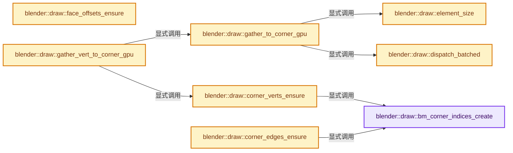
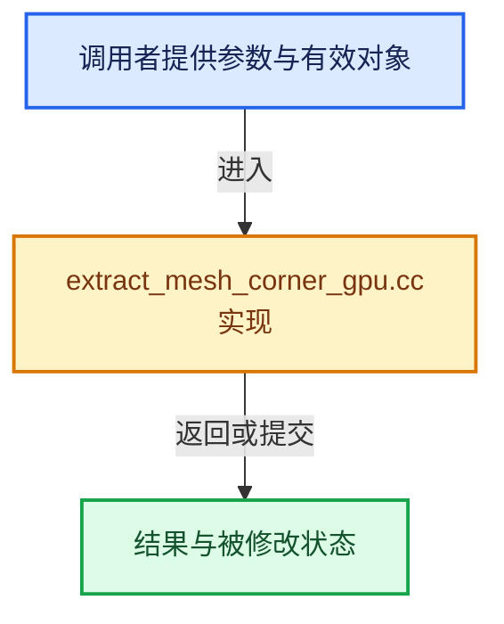

# 实现依赖专题：source/blender/draw/intern/mesh_extractors/extract_mesh_corner_gpu.cc

[实现依赖导航](../../../../README.md) · [符号索引](../../../../../00-课程指南/02-源码与提交索引/符号依赖与实现索引.md)

本专题从正文实际调用进入，集中保存共享实现。函数有稳定锚点，可从调用处直接跳到对应完整函数；递归与互相调用通过回链组织。

## 本文件的实现关系






## 完整成员与函数实现

<a id="f-027c2bdc13b306dc"></a>

### `blender::draw::bm_corner_indices_create`

实现位置：[source/blender/draw/intern/mesh_extractors/extract_mesh_corner_gpu.cc](../../../../../../../../../source/blender/draw/intern/mesh_extractors/extract_mesh_corner_gpu.cc) · L23—L39。

接口参数：

- `const BMesh &bm`
- `const GetIndex get_index`

**教学注释版**

<!-- annotated:0d1f44bad190ff -->

```cpp
template<typename GetIndex>
static gpu::VertBufPtr bm_corner_indices_create(const BMesh &bm, const GetIndex get_index)
{
  gpu::VertBufPtr buf = gpu::VertBuf::from_size<int>(bm.totloop);
  MutableSpan<int> data = buf->data<int>();
  threading::parallel_for(IndexRange(bm.totface), 2048, [&](const IndexRange range) {
    for (const int face_index : range) {
      const BMFace &face = *BM_face_at_index(&const_cast<BMesh &>(bm), face_index);
      const BMLoop *loop = BM_FACE_FIRST_LOOP(&face);
      for ([[maybe_unused]] const int i : IndexRange(face.len)) {
        data[BM_elem_index_get(loop)] = get_index(*loop);
        loop = loop->next;
      }
    }
  });
  return buf;
}
```

<details>
<summary>核对原始源码：source/blender/draw/intern/mesh_extractors/extract_mesh_corner_gpu.cc · L23—L39</summary>

<!-- original:0d1f44bad190ff:source/blender/draw/intern/mesh_extractors/extract_mesh_corner_gpu.cc:23:39 -->

```cpp
template<typename GetIndex>
static gpu::VertBufPtr bm_corner_indices_create(const BMesh &bm, const GetIndex get_index)
{
  gpu::VertBufPtr buf = gpu::VertBuf::from_size<int>(bm.totloop);
  MutableSpan<int> data = buf->data<int>();
  threading::parallel_for(IndexRange(bm.totface), 2048, [&](const IndexRange range) {
    for (const int face_index : range) {
      const BMFace &face = *BM_face_at_index(&const_cast<BMesh &>(bm), face_index);
      const BMLoop *loop = BM_FACE_FIRST_LOOP(&face);
      for ([[maybe_unused]] const int i : IndexRange(face.len)) {
        data[BM_elem_index_get(loop)] = get_index(*loop);
        loop = loop->next;
      }
    }
  });
  return buf;
}
```

</details>

**沿实际写入检查状态**

- `loop = loop->next;`

**结果出口**

- `return buf;`

**继续追踪实现**

- `gpu::VertBuf::from_size<int>` → [blender::gpu::VertBuf::from_size · L134](../../../gpu/GPU_vertex_buffer.hh.md#f-9fe47304cc1cfe70)。
- `buf->data<int>` → [blender::draw::data · L124](../DRW_gpu_wrapper.hh.md#f-dc115dc22e0c9f33)；[blender::draw::data · L129](../DRW_gpu_wrapper.hh.md#f-5f325cb75387045c)。同名重载需按实参类型选择。
- `threading::parallel_for` → [blender::threading::parallel_for · L68](../../../../../11-Depsgraph与并行任务系统/07-任务池与TBB接入.md#f-838294754c24426c)。
- `IndexRange` → [blender::IndexRange](../../../../01-BLI基础库/BLI_index_range.hh.md#t-caa3466d6776)；[blender::gpu::shader::parser::IndexRange](../../../gpu/shader_tool/utils.hh.md#t-82d2bd4ea71c)；[blender::IndexRange](../../../makesdna/DNA_node_types.h.md#t-0448cc889d39)。
- `BM_face_at_index` → [blender::BM_face_at_index · L122](../../../bmesh/intern/bmesh_mesh.hh.md#f-366df62c166d5094)。
- `BM_FACE_FIRST_LOOP` → [BM_FACE_FIRST_LOOP · L697](../../../bmesh/bmesh_class.hh.md#m-c7e10ffb38e6)；[BM_FACE_FIRST_LOOP · L699](../../../bmesh/bmesh_class.hh.md#m-76a054cc4770)。宏定义由构建条件选择。
- `BM_elem_index_get` → [BM_elem_index_get · L120](../../../bmesh/intern/bmesh_inline.hh.md#m-201981cdc62d)。宏定义由构建条件选择。
- `get_index` → [调用协议](../../../../../00-课程指南/01-路线与规范/模板宏与动态分派协议.md)：局部可调用对象，须结合其初始化与捕获环境。调用位置L33。

<a id="f-5b8b1b5936eb64f0"></a>

### `blender::draw::corner_verts_ensure`

实现位置：[source/blender/draw/intern/mesh_extractors/extract_mesh_corner_gpu.cc](../../../../../../../../../source/blender/draw/intern/mesh_extractors/extract_mesh_corner_gpu.cc) · L41—L53。

接口参数：

- `const MeshRenderData &mr`
- `MeshBufferCache &cache`

**教学注释版**

<!-- annotated:f2d98b0b1a835e -->

```cpp
static gpu::VertBuf &corner_verts_ensure(const MeshRenderData &mr, MeshBufferCache &cache)
{
  if (!cache.corner_verts) {
    if (mr.extract_type == MeshExtractType::Mesh) {
      cache.corner_verts = gpu::VertBuf::from_span(mr.corner_verts);
    }
    else {
      cache.corner_verts = bm_corner_indices_create(
          *mr.bm, [](const BMLoop &loop) { return BM_elem_index_get(loop.v); });
    }
  }
  return *cache.corner_verts;
}
```

<details>
<summary>核对原始源码：source/blender/draw/intern/mesh_extractors/extract_mesh_corner_gpu.cc · L41—L53</summary>

<!-- original:f2d98b0b1a835e:source/blender/draw/intern/mesh_extractors/extract_mesh_corner_gpu.cc:41:53 -->

```cpp
static gpu::VertBuf &corner_verts_ensure(const MeshRenderData &mr, MeshBufferCache &cache)
{
  if (!cache.corner_verts) {
    if (mr.extract_type == MeshExtractType::Mesh) {
      cache.corner_verts = gpu::VertBuf::from_span(mr.corner_verts);
    }
    else {
      cache.corner_verts = bm_corner_indices_create(
          *mr.bm, [](const BMLoop &loop) { return BM_elem_index_get(loop.v); });
    }
  }
  return *cache.corner_verts;
}
```

</details>

**沿实际写入检查状态**

- `cache.corner_verts = gpu::VertBuf::from_span(mr.corner_verts);`
- `cache.corner_verts = bm_corner_indices_create(`

**结果出口**

- `return *cache.corner_verts;`

**继续追踪实现**

- `gpu::VertBuf::from_span` → [blender::gpu::VertBuf::from_span · L140](../../../gpu/GPU_vertex_buffer.hh.md#f-27ef61a3a7b97287)。
- `bm_corner_indices_create` → [blender::draw::bm_corner_indices_create · L23](extract_mesh_corner_gpu.cc.md#f-027c2bdc13b306dc)。
- `BM_elem_index_get` → [BM_elem_index_get · L120](../../../bmesh/intern/bmesh_inline.hh.md#m-201981cdc62d)。宏定义由构建条件选择。

<a id="f-85e1828b65967d51"></a>

### `blender::draw::corner_edges_ensure`

实现位置：[source/blender/draw/intern/mesh_extractors/extract_mesh_corner_gpu.cc](../../../../../../../../../source/blender/draw/intern/mesh_extractors/extract_mesh_corner_gpu.cc) · L55—L67。

接口参数：

- `const MeshRenderData &mr`
- `MeshBufferCache &cache`

**教学注释版**

<!-- annotated:751a259d36e08d -->

```cpp
static gpu::VertBuf &corner_edges_ensure(const MeshRenderData &mr, MeshBufferCache &cache)
{
  if (!cache.corner_edges) {
    if (mr.extract_type == MeshExtractType::Mesh) {
      cache.corner_edges = gpu::VertBuf::from_span(mr.corner_edges);
    }
    else {
      cache.corner_edges = bm_corner_indices_create(
          *mr.bm, [](const BMLoop &loop) { return BM_elem_index_get(loop.e); });
    }
  }
  return *cache.corner_edges;
}
```

<details>
<summary>核对原始源码：source/blender/draw/intern/mesh_extractors/extract_mesh_corner_gpu.cc · L55—L67</summary>

<!-- original:751a259d36e08d:source/blender/draw/intern/mesh_extractors/extract_mesh_corner_gpu.cc:55:67 -->

```cpp
static gpu::VertBuf &corner_edges_ensure(const MeshRenderData &mr, MeshBufferCache &cache)
{
  if (!cache.corner_edges) {
    if (mr.extract_type == MeshExtractType::Mesh) {
      cache.corner_edges = gpu::VertBuf::from_span(mr.corner_edges);
    }
    else {
      cache.corner_edges = bm_corner_indices_create(
          *mr.bm, [](const BMLoop &loop) { return BM_elem_index_get(loop.e); });
    }
  }
  return *cache.corner_edges;
}
```

</details>

**沿实际写入检查状态**

- `cache.corner_edges = gpu::VertBuf::from_span(mr.corner_edges);`
- `cache.corner_edges = bm_corner_indices_create(`

**结果出口**

- `return *cache.corner_edges;`

**继续追踪实现**

- `gpu::VertBuf::from_span` → [blender::gpu::VertBuf::from_span · L140](../../../gpu/GPU_vertex_buffer.hh.md#f-27ef61a3a7b97287)。
- `bm_corner_indices_create` → [blender::draw::bm_corner_indices_create · L23](extract_mesh_corner_gpu.cc.md#f-027c2bdc13b306dc)。
- `BM_elem_index_get` → [BM_elem_index_get · L120](../../../bmesh/intern/bmesh_inline.hh.md#m-201981cdc62d)。宏定义由构建条件选择。

<a id="f-327199bc867b79fb"></a>

### `blender::draw::face_offsets_ensure`

实现位置：[source/blender/draw/intern/mesh_extractors/extract_mesh_corner_gpu.cc](../../../../../../../../../source/blender/draw/intern/mesh_extractors/extract_mesh_corner_gpu.cc) · L69—L89。

接口参数：

- `const MeshRenderData &mr`
- `MeshBufferCache &cache`

**教学注释版**

<!-- annotated:80cc2e8a136108 -->

```cpp
static gpu::VertBuf &face_offsets_ensure(const MeshRenderData &mr, MeshBufferCache &cache)
{
  if (cache.face_offsets) {
    return *cache.face_offsets;
  }
  if (mr.extract_type == MeshExtractType::Mesh) {
    cache.face_offsets = gpu::VertBuf::from_span(mr.faces.data().cast<uint>());
    return *cache.face_offsets;
  }
  const BMesh &bm = *mr.bm;
  cache.face_offsets = gpu::VertBuf::from_size<int>(bm.totface + 1);
  MutableSpan<int> data = cache.face_offsets->data<int>();
  threading::parallel_for(IndexRange(bm.totface), 4096, [&](const IndexRange range) {
    for (const int face_index : range) {
      const BMFace &face = *BM_face_at_index(&const_cast<BMesh &>(bm), face_index);
      data[face_index] = BM_elem_index_get(BM_FACE_FIRST_LOOP(&face));
    }
  });
  data[bm.totface] = bm.totloop;
  return *cache.face_offsets;
}
```

<details>
<summary>核对原始源码：source/blender/draw/intern/mesh_extractors/extract_mesh_corner_gpu.cc · L69—L89</summary>

<!-- original:80cc2e8a136108:source/blender/draw/intern/mesh_extractors/extract_mesh_corner_gpu.cc:69:89 -->

```cpp
static gpu::VertBuf &face_offsets_ensure(const MeshRenderData &mr, MeshBufferCache &cache)
{
  if (cache.face_offsets) {
    return *cache.face_offsets;
  }
  if (mr.extract_type == MeshExtractType::Mesh) {
    cache.face_offsets = gpu::VertBuf::from_span(mr.faces.data().cast<uint>());
    return *cache.face_offsets;
  }
  const BMesh &bm = *mr.bm;
  cache.face_offsets = gpu::VertBuf::from_size<int>(bm.totface + 1);
  MutableSpan<int> data = cache.face_offsets->data<int>();
  threading::parallel_for(IndexRange(bm.totface), 4096, [&](const IndexRange range) {
    for (const int face_index : range) {
      const BMFace &face = *BM_face_at_index(&const_cast<BMesh &>(bm), face_index);
      data[face_index] = BM_elem_index_get(BM_FACE_FIRST_LOOP(&face));
    }
  });
  data[bm.totface] = bm.totloop;
  return *cache.face_offsets;
}
```

</details>

**沿实际写入检查状态**

- `cache.face_offsets = gpu::VertBuf::from_span(mr.faces.data().cast<uint>());`
- `cache.face_offsets = gpu::VertBuf::from_size<int>(bm.totface + 1);`
- `data[face_index] = BM_elem_index_get(BM_FACE_FIRST_LOOP(&face));`
- `data[bm.totface] = bm.totloop;`

**结果出口**

- `return *cache.face_offsets;`

**继续追踪实现**

- `gpu::VertBuf::from_span` → [blender::gpu::VertBuf::from_span · L140](../../../gpu/GPU_vertex_buffer.hh.md#f-27ef61a3a7b97287)。
- `mr.faces.data().cast<uint>` → [调用协议](../../../../../00-课程指南/01-路线与规范/模板宏与动态分派协议.md)：接收对象类型依赖auto、返回值或模板实例；不按同名猜测目标。调用位置L75。
- `mr.faces.data` → [调用协议](../../../../../00-课程指南/01-路线与规范/模板宏与动态分派协议.md)：接收对象类型依赖auto、返回值或模板实例；不按同名猜测目标。调用位置L75。
- `gpu::VertBuf::from_size<int>` → [blender::gpu::VertBuf::from_size · L134](../../../gpu/GPU_vertex_buffer.hh.md#f-9fe47304cc1cfe70)。
- `cache.face_offsets->data<int>` → [调用协议](../../../../../00-课程指南/01-路线与规范/模板宏与动态分派协议.md)：接收对象类型依赖auto、返回值或模板实例；不按同名猜测目标。调用位置L80。
- `threading::parallel_for` → [blender::threading::parallel_for · L68](../../../../../11-Depsgraph与并行任务系统/07-任务池与TBB接入.md#f-838294754c24426c)。
- `IndexRange` → [blender::IndexRange](../../../../01-BLI基础库/BLI_index_range.hh.md#t-caa3466d6776)；[blender::gpu::shader::parser::IndexRange](../../../gpu/shader_tool/utils.hh.md#t-82d2bd4ea71c)；[blender::IndexRange](../../../makesdna/DNA_node_types.h.md#t-0448cc889d39)。
- `BM_face_at_index` → [blender::BM_face_at_index · L122](../../../bmesh/intern/bmesh_mesh.hh.md#f-366df62c166d5094)。
- `BM_elem_index_get` → [BM_elem_index_get · L120](../../../bmesh/intern/bmesh_inline.hh.md#m-201981cdc62d)。宏定义由构建条件选择。
- `BM_FACE_FIRST_LOOP` → [BM_FACE_FIRST_LOOP · L697](../../../bmesh/bmesh_class.hh.md#m-c7e10ffb38e6)；[BM_FACE_FIRST_LOOP · L699](../../../bmesh/bmesh_class.hh.md#m-76a054cc4770)。宏定义由构建条件选择。

<a id="f-3fe40e0023fa7d08"></a>

### `blender::draw::dispatch_batched`

实现位置：[source/blender/draw/intern/mesh_extractors/extract_mesh_corner_gpu.cc](../../../../../../../../../source/blender/draw/intern/mesh_extractors/extract_mesh_corner_gpu.cc) · L91—L103。

接口参数：

- `gpu::Shader *shader`
- `const int size`

**教学注释版**

<!-- annotated:6a84321391d48a -->

```cpp
static void dispatch_batched(gpu::Shader *shader, const int size)
{
  const int64_t max_batch_size = int64_t(GPU_max_work_group_count(0)) *
                                 DRW_MESH_TO_CORNER_GROUP_SIZE;
  int start = 0;
  while (start < size) {
    // [讲解] std::min：按比较关系选取较小值；截断范围时还需先满足非负和可表示范围，min本身不会证明边界安全。
    const int batch_size = std::min(int64_t(size - start), max_batch_size);
    GPU_shader_uniform_1i(shader, "start", start);
    GPU_shader_uniform_1i(shader, "count", batch_size);
    GPU_compute_dispatch(shader, divide_ceil_u(batch_size, DRW_MESH_TO_CORNER_GROUP_SIZE), 1, 1);
    start += batch_size;
  }
}
```

<details>
<summary>核对原始源码：source/blender/draw/intern/mesh_extractors/extract_mesh_corner_gpu.cc · L91—L103</summary>

<!-- original:6a84321391d48a:source/blender/draw/intern/mesh_extractors/extract_mesh_corner_gpu.cc:91:103 -->

```cpp
static void dispatch_batched(gpu::Shader *shader, const int size)
{
  const int64_t max_batch_size = int64_t(GPU_max_work_group_count(0)) *
                                 DRW_MESH_TO_CORNER_GROUP_SIZE;
  int start = 0;
  while (start < size) {
    const int batch_size = std::min(int64_t(size - start), max_batch_size);
    GPU_shader_uniform_1i(shader, "start", start);
    GPU_shader_uniform_1i(shader, "count", batch_size);
    GPU_compute_dispatch(shader, divide_ceil_u(batch_size, DRW_MESH_TO_CORNER_GROUP_SIZE), 1, 1);
    start += batch_size;
  }
}
```

</details>

**沿实际写入检查状态**

- `start += batch_size;`

**继续追踪实现**

- `GPU_max_work_group_count` → [blender::GPU_max_work_group_count · L77](../../../gpu/intern/gpu_capabilities.cc.md#f-e09045a87e514cab)。
- `std::min` → [外部契约](https://eel.is/c++draft/alg.min.max)：按比较关系选取较小值；截断范围时还需先满足非负和可表示范围，min本身不会证明边界安全。
- `GPU_shader_uniform_1i` → [blender::GPU_shader_uniform_1i · L646](../../../gpu/intern/gpu_shader.cc.md#f-d02d234ed60d9de0)。
- `GPU_compute_dispatch` → [blender::GPU_compute_dispatch · L16](../../../gpu/intern/gpu_compute.cc.md#f-333af4920056a41a)。
- `divide_ceil_u` → [blender::divide_ceil_u · L235](../../../../01-BLI基础库/intern/math_base_inline.cc.md#f-9bfe95d830410fdd)。

<a id="f-cdb89d531b0a4a9d"></a>

### `blender::draw::element_size`

实现位置：[source/blender/draw/intern/mesh_extractors/extract_mesh_corner_gpu.cc](../../../../../../../../../source/blender/draw/intern/mesh_extractors/extract_mesh_corner_gpu.cc) · L105—L111。

接口参数：

- `const gpu::VertBuf &src`
- `const gpu::VertBuf &dst`

**教学注释版**

<!-- annotated:b6e73e8270c88a -->

```cpp
static int element_size(const gpu::VertBuf &src, const gpu::VertBuf &dst)
{
  const int size = GPU_vertbuf_get_format(&dst)->stride;
  BLI_assert(GPU_vertbuf_get_format(&src)->stride == size);
  UNUSED_VARS_NDEBUG(src);
  return size;
}
```

<details>
<summary>核对原始源码：source/blender/draw/intern/mesh_extractors/extract_mesh_corner_gpu.cc · L105—L111</summary>

<!-- original:b6e73e8270c88a:source/blender/draw/intern/mesh_extractors/extract_mesh_corner_gpu.cc:105:111 -->

```cpp
static int element_size(const gpu::VertBuf &src, const gpu::VertBuf &dst)
{
  const int size = GPU_vertbuf_get_format(&dst)->stride;
  BLI_assert(GPU_vertbuf_get_format(&src)->stride == size);
  UNUSED_VARS_NDEBUG(src);
  return size;
}
```

</details>

**结果出口**

- `return size;`

**继续追踪实现**

- `GPU_vertbuf_get_format` → [blender::GPU_vertbuf_get_format · L265](../../../gpu/intern/gpu_vertex_buffer.cc.md#f-7c66ff8de8245148)。
- `BLI_assert` → [BLI_assert · L48](../../../../01-BLI基础库/BLI_assert.hh.md#m-57a88495704d)；[BLI_assert · L63](../../../../01-BLI基础库/BLI_assert.hh.md#m-d07050020cb5)。宏定义由构建条件选择。
- `UNUSED_VARS_NDEBUG` → [UNUSED_VARS_NDEBUG · L526](../../../../01-BLI基础库/BLI_utildefines.hh.md#m-fea439f7d366)；[UNUSED_VARS_NDEBUG · L528](../../../../01-BLI基础库/BLI_utildefines.hh.md#m-a8f8cfac06c0)。宏定义由构建条件选择。

<a id="f-ce486c479dd2cf14"></a>

### `blender::draw::gather_to_corner_gpu`

实现位置：[source/blender/draw/intern/mesh_extractors/extract_mesh_corner_gpu.cc](../../../../../../../../../source/blender/draw/intern/mesh_extractors/extract_mesh_corner_gpu.cc) · L113—L127。

接口参数：

- `const MeshRenderData &mr`
- `gpu::VertBuf &src`
- `gpu::VertBuf &indices`
- `gpu::VertBuf &dst`

**教学注释版**

<!-- annotated:014af3e428172a -->

```cpp
static void gather_to_corner_gpu(const MeshRenderData &mr,
                                 gpu::VertBuf &src,
                                 gpu::VertBuf &indices,
                                 gpu::VertBuf &dst)
{
  BLI_assert(GPU_vertbuf_get_vertex_len(&dst) >= mr.corners_num);
  gpu::Shader *shader = DRW_shader_mesh_gather_get(element_size(src, dst));
  GPU_shader_bind(shader);
  GPU_vertbuf_bind_as_ssbo(&src, 0);
  GPU_vertbuf_bind_as_ssbo(&indices, 1);
  GPU_vertbuf_bind_as_ssbo(&dst, 2);
  dispatch_batched(shader, mr.corners_num);
  GPU_memory_barrier(GPU_BARRIER_VERTEX_ATTRIB_ARRAY | GPU_BARRIER_SHADER_STORAGE);
  GPU_shader_unbind();
}
```

<details>
<summary>核对原始源码：source/blender/draw/intern/mesh_extractors/extract_mesh_corner_gpu.cc · L113—L127</summary>

<!-- original:014af3e428172a:source/blender/draw/intern/mesh_extractors/extract_mesh_corner_gpu.cc:113:127 -->

```cpp
static void gather_to_corner_gpu(const MeshRenderData &mr,
                                 gpu::VertBuf &src,
                                 gpu::VertBuf &indices,
                                 gpu::VertBuf &dst)
{
  BLI_assert(GPU_vertbuf_get_vertex_len(&dst) >= mr.corners_num);
  gpu::Shader *shader = DRW_shader_mesh_gather_get(element_size(src, dst));
  GPU_shader_bind(shader);
  GPU_vertbuf_bind_as_ssbo(&src, 0);
  GPU_vertbuf_bind_as_ssbo(&indices, 1);
  GPU_vertbuf_bind_as_ssbo(&dst, 2);
  dispatch_batched(shader, mr.corners_num);
  GPU_memory_barrier(GPU_BARRIER_VERTEX_ATTRIB_ARRAY | GPU_BARRIER_SHADER_STORAGE);
  GPU_shader_unbind();
}
```

</details>

**继续追踪实现**

- `BLI_assert` → [BLI_assert · L48](../../../../01-BLI基础库/BLI_assert.hh.md#m-57a88495704d)；[BLI_assert · L63](../../../../01-BLI基础库/BLI_assert.hh.md#m-d07050020cb5)。宏定义由构建条件选择。
- `GPU_vertbuf_get_vertex_len` → [blender::GPU_vertbuf_get_vertex_len · L275](../../../gpu/intern/gpu_vertex_buffer.cc.md#f-54af379c146bc0bb)。
- `DRW_shader_mesh_gather_get` → [blender::DRW_shader_mesh_gather_get · L239](../draw_shader.cc.md#f-73c5e17fb8c8b0ff)。
- `element_size` → [blender::draw::element_size · L105](extract_mesh_corner_gpu.cc.md#f-cdb89d531b0a4a9d)。
- `GPU_shader_bind` → [blender::GPU_shader_bind · L387](../../../gpu/intern/gpu_shader.cc.md#f-a879eef1816db611)。
- `GPU_vertbuf_bind_as_ssbo` → [blender::GPU_vertbuf_bind_as_ssbo · L305](../../../gpu/intern/gpu_vertex_buffer.cc.md#f-35fc963b37cbd67c)。
- `dispatch_batched` → [blender::draw::dispatch_batched · L91](extract_mesh_corner_gpu.cc.md#f-3fe40e0023fa7d08)。
- `GPU_memory_barrier` → [blender::GPU_memory_barrier · L305](../../../gpu/intern/gpu_state.cc.md#f-5a91f15b51991eb7)。
- `GPU_shader_unbind` → [blender::GPU_shader_unbind · L424](../../../gpu/intern/gpu_shader.cc.md#f-e0462e112df4c1ef)。

<a id="f-6a7db1cdc2e15e6c"></a>

### `blender::draw::gather_vert_to_corner_gpu`

实现位置：[source/blender/draw/intern/mesh_extractors/extract_mesh_corner_gpu.cc](../../../../../../../../../source/blender/draw/intern/mesh_extractors/extract_mesh_corner_gpu.cc) · L129—L139。

接口参数：

- `const MeshRenderData &mr`
- `MeshBufferCache &cache`
- `gpu::VertBuf &src`
- `gpu::VertBuf &dst`

**教学注释版**

<!-- annotated:62d953b77f9bb6 -->

```cpp
void gather_vert_to_corner_gpu(const MeshRenderData &mr,
                               MeshBufferCache &cache,
                               gpu::VertBuf &src,
                               gpu::VertBuf &dst)
{
  if (mr.corners_num == 0) {
    return;
  }
  BLI_assert(GPU_vertbuf_get_vertex_len(&src) == mr.verts_num);
  gather_to_corner_gpu(mr, src, corner_verts_ensure(mr, cache), dst);
}
```

<details>
<summary>核对原始源码：source/blender/draw/intern/mesh_extractors/extract_mesh_corner_gpu.cc · L129—L139</summary>

<!-- original:62d953b77f9bb6:source/blender/draw/intern/mesh_extractors/extract_mesh_corner_gpu.cc:129:139 -->

```cpp
void gather_vert_to_corner_gpu(const MeshRenderData &mr,
                               MeshBufferCache &cache,
                               gpu::VertBuf &src,
                               gpu::VertBuf &dst)
{
  if (mr.corners_num == 0) {
    return;
  }
  BLI_assert(GPU_vertbuf_get_vertex_len(&src) == mr.verts_num);
  gather_to_corner_gpu(mr, src, corner_verts_ensure(mr, cache), dst);
}
```

</details>

**继续追踪实现**

- `BLI_assert` → [BLI_assert · L48](../../../../01-BLI基础库/BLI_assert.hh.md#m-57a88495704d)；[BLI_assert · L63](../../../../01-BLI基础库/BLI_assert.hh.md#m-d07050020cb5)。宏定义由构建条件选择。
- `GPU_vertbuf_get_vertex_len` → [blender::GPU_vertbuf_get_vertex_len · L275](../../../gpu/intern/gpu_vertex_buffer.cc.md#f-54af379c146bc0bb)。
- `gather_to_corner_gpu` → [blender::draw::gather_to_corner_gpu · L113](extract_mesh_corner_gpu.cc.md#f-ce486c479dd2cf14)。
- `corner_verts_ensure` → [blender::draw::corner_verts_ensure · L41](extract_mesh_corner_gpu.cc.md#f-5b8b1b5936eb64f0)。

<a id="f-44bab2edeebc8bd1"></a>

### `blender::draw::gather_edge_to_corner_gpu`

实现位置：[source/blender/draw/intern/mesh_extractors/extract_mesh_corner_gpu.cc](../../../../../../../../../source/blender/draw/intern/mesh_extractors/extract_mesh_corner_gpu.cc) · L141—L151。

接口参数：

- `const MeshRenderData &mr`
- `MeshBufferCache &cache`
- `gpu::VertBuf &src`
- `gpu::VertBuf &dst`

**教学注释版**

<!-- annotated:fa839191dc64a6 -->

```cpp
void gather_edge_to_corner_gpu(const MeshRenderData &mr,
                               MeshBufferCache &cache,
                               gpu::VertBuf &src,
                               gpu::VertBuf &dst)
{
  if (mr.corners_num == 0) {
    return;
  }
  BLI_assert(GPU_vertbuf_get_vertex_len(&src) == mr.edges_num);
  gather_to_corner_gpu(mr, src, corner_edges_ensure(mr, cache), dst);
}
```

<details>
<summary>核对原始源码：source/blender/draw/intern/mesh_extractors/extract_mesh_corner_gpu.cc · L141—L151</summary>

<!-- original:fa839191dc64a6:source/blender/draw/intern/mesh_extractors/extract_mesh_corner_gpu.cc:141:151 -->

```cpp
void gather_edge_to_corner_gpu(const MeshRenderData &mr,
                               MeshBufferCache &cache,
                               gpu::VertBuf &src,
                               gpu::VertBuf &dst)
{
  if (mr.corners_num == 0) {
    return;
  }
  BLI_assert(GPU_vertbuf_get_vertex_len(&src) == mr.edges_num);
  gather_to_corner_gpu(mr, src, corner_edges_ensure(mr, cache), dst);
}
```

</details>

**继续追踪实现**

- `BLI_assert` → [BLI_assert · L48](../../../../01-BLI基础库/BLI_assert.hh.md#m-57a88495704d)；[BLI_assert · L63](../../../../01-BLI基础库/BLI_assert.hh.md#m-d07050020cb5)。宏定义由构建条件选择。
- `GPU_vertbuf_get_vertex_len` → [blender::GPU_vertbuf_get_vertex_len · L275](../../../gpu/intern/gpu_vertex_buffer.cc.md#f-54af379c146bc0bb)。
- `gather_to_corner_gpu` → [blender::draw::gather_to_corner_gpu · L113](extract_mesh_corner_gpu.cc.md#f-ce486c479dd2cf14)。
- `corner_edges_ensure` → [blender::draw::corner_edges_ensure · L55](extract_mesh_corner_gpu.cc.md#f-85e1828b65967d51)。

<a id="f-b8163289de9be0fd"></a>

### `blender::draw::scatter_face_to_corner_gpu`

实现位置：[source/blender/draw/intern/mesh_extractors/extract_mesh_corner_gpu.cc](../../../../../../../../../source/blender/draw/intern/mesh_extractors/extract_mesh_corner_gpu.cc) · L153—L171。

接口参数：

- `const MeshRenderData &mr`
- `MeshBufferCache &cache`
- `gpu::VertBuf &src`
- `gpu::VertBuf &dst`

**教学注释版**

<!-- annotated:a678030184325a -->

```cpp
void scatter_face_to_corner_gpu(const MeshRenderData &mr,
                                MeshBufferCache &cache,
                                gpu::VertBuf &src,
                                gpu::VertBuf &dst)
{
  if (mr.corners_num == 0) {
    return;
  }
  BLI_assert(GPU_vertbuf_get_vertex_len(&src) == mr.faces_num);
  BLI_assert(GPU_vertbuf_get_vertex_len(&dst) >= mr.corners_num);
  gpu::Shader *shader = DRW_shader_mesh_scatter_faces_get(element_size(src, dst));
  GPU_shader_bind(shader);
  GPU_vertbuf_bind_as_ssbo(&src, 0);
  GPU_vertbuf_bind_as_ssbo(&face_offsets_ensure(mr, cache), 1);
  GPU_vertbuf_bind_as_ssbo(&dst, 2);
  dispatch_batched(shader, mr.faces_num);
  GPU_memory_barrier(GPU_BARRIER_VERTEX_ATTRIB_ARRAY | GPU_BARRIER_SHADER_STORAGE);
  GPU_shader_unbind();
}
```

<details>
<summary>核对原始源码：source/blender/draw/intern/mesh_extractors/extract_mesh_corner_gpu.cc · L153—L171</summary>

<!-- original:a678030184325a:source/blender/draw/intern/mesh_extractors/extract_mesh_corner_gpu.cc:153:171 -->

```cpp
void scatter_face_to_corner_gpu(const MeshRenderData &mr,
                                MeshBufferCache &cache,
                                gpu::VertBuf &src,
                                gpu::VertBuf &dst)
{
  if (mr.corners_num == 0) {
    return;
  }
  BLI_assert(GPU_vertbuf_get_vertex_len(&src) == mr.faces_num);
  BLI_assert(GPU_vertbuf_get_vertex_len(&dst) >= mr.corners_num);
  gpu::Shader *shader = DRW_shader_mesh_scatter_faces_get(element_size(src, dst));
  GPU_shader_bind(shader);
  GPU_vertbuf_bind_as_ssbo(&src, 0);
  GPU_vertbuf_bind_as_ssbo(&face_offsets_ensure(mr, cache), 1);
  GPU_vertbuf_bind_as_ssbo(&dst, 2);
  dispatch_batched(shader, mr.faces_num);
  GPU_memory_barrier(GPU_BARRIER_VERTEX_ATTRIB_ARRAY | GPU_BARRIER_SHADER_STORAGE);
  GPU_shader_unbind();
}
```

</details>

**继续追踪实现**

- `BLI_assert` → [BLI_assert · L48](../../../../01-BLI基础库/BLI_assert.hh.md#m-57a88495704d)；[BLI_assert · L63](../../../../01-BLI基础库/BLI_assert.hh.md#m-d07050020cb5)。宏定义由构建条件选择。
- `GPU_vertbuf_get_vertex_len` → [blender::GPU_vertbuf_get_vertex_len · L275](../../../gpu/intern/gpu_vertex_buffer.cc.md#f-54af379c146bc0bb)。
- `DRW_shader_mesh_scatter_faces_get` → [blender::DRW_shader_mesh_scatter_faces_get · L245](../draw_shader.cc.md#f-205d73f7d14e8410)。
- `element_size` → [blender::draw::element_size · L105](extract_mesh_corner_gpu.cc.md#f-cdb89d531b0a4a9d)。
- `GPU_shader_bind` → [blender::GPU_shader_bind · L387](../../../gpu/intern/gpu_shader.cc.md#f-a879eef1816db611)。
- `GPU_vertbuf_bind_as_ssbo` → [blender::GPU_vertbuf_bind_as_ssbo · L305](../../../gpu/intern/gpu_vertex_buffer.cc.md#f-35fc963b37cbd67c)。
- `face_offsets_ensure` → [blender::draw::face_offsets_ensure · L69](extract_mesh_corner_gpu.cc.md#f-327199bc867b79fb)。
- `dispatch_batched` → [blender::draw::dispatch_batched · L91](extract_mesh_corner_gpu.cc.md#f-3fe40e0023fa7d08)。
- `GPU_memory_barrier` → [blender::GPU_memory_barrier · L305](../../../gpu/intern/gpu_state.cc.md#f-5a91f15b51991eb7)。
- `GPU_shader_unbind` → [blender::GPU_shader_unbind · L424](../../../gpu/intern/gpu_shader.cc.md#f-e0462e112df4c1ef)。
