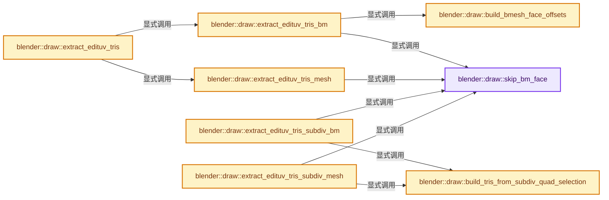
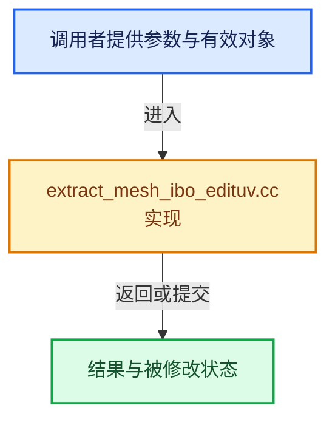

# 实现依赖专题：source/blender/draw/intern/mesh_extractors/extract_mesh_ibo_edituv.cc

[实现依赖导航](../../../../README.md) · [符号索引](../../../../../00-课程指南/02-源码与提交索引/符号依赖与实现索引.md)

本专题从正文实际调用进入，集中保存共享实现。函数有稳定锚点，可从调用处直接跳到对应完整函数；递归与互相调用通过回链组织。

## 本文件的实现关系






## 完整成员与函数实现

<a id="f-6093d02ccd476d55"></a>

### `blender::draw::skip_bm_face`

实现位置：[source/blender/draw/intern/mesh_extractors/extract_mesh_ibo_edituv.cc](../../../../../../../../../source/blender/draw/intern/mesh_extractors/extract_mesh_ibo_edituv.cc) · L25—L36。

接口参数：

- `const BMFace &face`
- `const bool sync_selection`

**教学注释版**

<!-- annotated:3e653653bacc01 -->

```cpp
inline bool skip_bm_face(const BMFace &face, const bool sync_selection)
{
  if (BM_elem_flag_test(&face, BM_ELEM_HIDDEN)) {
    return true;
  }
  if (!sync_selection) {
    if (!BM_elem_flag_test_bool(&face, BM_ELEM_SELECT)) {
      return true;
    }
  }
  return false;
}
```

<details>
<summary>核对原始源码：source/blender/draw/intern/mesh_extractors/extract_mesh_ibo_edituv.cc · L25—L36</summary>

<!-- original:3e653653bacc01:source/blender/draw/intern/mesh_extractors/extract_mesh_ibo_edituv.cc:25:36 -->

```cpp
inline bool skip_bm_face(const BMFace &face, const bool sync_selection)
{
  if (BM_elem_flag_test(&face, BM_ELEM_HIDDEN)) {
    return true;
  }
  if (!sync_selection) {
    if (!BM_elem_flag_test_bool(&face, BM_ELEM_SELECT)) {
      return true;
    }
  }
  return false;
}
```

</details>

**结果出口**

- `return true;`
- `return false;`

**继续追踪实现**

- `BM_elem_flag_test` → [BM_elem_flag_test · L21](../../../bmesh/intern/bmesh_inline.hh.md#m-2431d1179b41)。宏定义由构建条件选择。
- `BM_elem_flag_test_bool` → [BM_elem_flag_test_bool · L22](../../../bmesh/intern/bmesh_inline.hh.md#m-a8ef8d976b74)。宏定义由构建条件选择。

<a id="f-34ecc20fa1d996f2"></a>

### `blender::draw::build_bmesh_face_offsets`

实现位置：[source/blender/draw/intern/mesh_extractors/extract_mesh_ibo_edituv.cc](../../../../../../../../../source/blender/draw/intern/mesh_extractors/extract_mesh_ibo_edituv.cc) · L38—L47。

接口参数：

- `const BMesh &bm`
- `Array<int> &r_offset_data`

**教学注释版**

<!-- annotated:4758c046e2972a -->

```cpp
static OffsetIndices<int> build_bmesh_face_offsets(const BMesh &bm, Array<int> &r_offset_data)
{
  // [讲解] r_offset_data.reinitialize：以新长度重建数组。
  r_offset_data.reinitialize(bm.totface + 1);
  threading::parallel_for(IndexRange(bm.totface), 4096, [&](const IndexRange range) {
    for (const int face : range) {
      r_offset_data[face] = BM_face_at_index(&const_cast<BMesh &>(bm), face)->len;
    }
  });
  return offset_indices::accumulate_counts_to_offsets(r_offset_data);
}
```

<details>
<summary>核对原始源码：source/blender/draw/intern/mesh_extractors/extract_mesh_ibo_edituv.cc · L38—L47</summary>

<!-- original:4758c046e2972a:source/blender/draw/intern/mesh_extractors/extract_mesh_ibo_edituv.cc:38:47 -->

```cpp
static OffsetIndices<int> build_bmesh_face_offsets(const BMesh &bm, Array<int> &r_offset_data)
{
  r_offset_data.reinitialize(bm.totface + 1);
  threading::parallel_for(IndexRange(bm.totface), 4096, [&](const IndexRange range) {
    for (const int face : range) {
      r_offset_data[face] = BM_face_at_index(&const_cast<BMesh &>(bm), face)->len;
    }
  });
  return offset_indices::accumulate_counts_to_offsets(r_offset_data);
}
```

</details>

**沿实际写入检查状态**

- `r_offset_data[face] = BM_face_at_index(&const_cast<BMesh &>(bm), face)->len;`

**结果出口**

- `return offset_indices::accumulate_counts_to_offsets(r_offset_data);`

**继续追踪实现**

- `r_offset_data.reinitialize` → [blender::Array::reinitialize · L430](../../../../../01-基础容器与现代CPP/08-Array复制移动与销毁.md#f-3414f619e246b688)。
- `threading::parallel_for` → [blender::threading::parallel_for · L68](../../../../../11-Depsgraph与并行任务系统/07-任务池与TBB接入.md#f-838294754c24426c)。
- `IndexRange` → [blender::IndexRange](../../../../01-BLI基础库/BLI_index_range.hh.md#t-caa3466d6776)；[blender::gpu::shader::parser::IndexRange](../../../gpu/shader_tool/utils.hh.md#t-82d2bd4ea71c)；[blender::IndexRange](../../../makesdna/DNA_node_types.h.md#t-0448cc889d39)。
- `BM_face_at_index` → [blender::BM_face_at_index · L122](../../../bmesh/intern/bmesh_mesh.hh.md#f-366df62c166d5094)。
- `offset_indices::accumulate_counts_to_offsets` → [blender::offset_indices::accumulate_counts_to_offsets · L24](../../../../../05-几何存储与拓扑映射/05-邻接关系与前缀和.md#f-cfa9fbd186afcdd5)。

<a id="f-c8167dc5e5421a57"></a>

### `blender::draw::extract_edituv_tris_bm`

实现位置：[source/blender/draw/intern/mesh_extractors/extract_mesh_ibo_edituv.cc](../../../../../../../../../source/blender/draw/intern/mesh_extractors/extract_mesh_ibo_edituv.cc) · L49—L100。

接口参数：

- `const MeshRenderData &mr`
- `const bool sync_selection`

**教学注释版**

<!-- annotated:a3b71929a3cff6 -->

```cpp
static gpu::IndexBufPtr extract_edituv_tris_bm(const MeshRenderData &mr, const bool sync_selection)
{
  const Span<std::array<BMLoop *, 3>> looptris = mr.edit_bmesh->looptris;
  const BMesh &bm = *mr.bm;

  IndexMaskMemory memory;
  const IndexMask selection = IndexMask::from_predicate(
      IndexRange(bm.totface), memory, [&](const int face) {
        return !skip_bm_face(*BM_face_at_index(&const_cast<BMesh &>(bm), face), sync_selection);
      });

  if (selection.size() == bm.totface) {
    GPUIndexBufBuilder builder;
    // [讲解] looptris.size：查询视图长度或生成对应有效索引区间。
    GPU_indexbuf_init(&builder, GPU_PRIM_TRIS, looptris.size(), mr.corners_num);
    MutableSpan<uint3> data = GPU_indexbuf_get_data(&builder).cast<uint3>();
    // [讲解] looptris.index_range：查询视图长度或生成对应有效索引区间。
    threading::parallel_for(looptris.index_range(), 4096, [&](const IndexRange range) {
      for (const int i : range) {
        data[i] = uint3(BM_elem_index_get(looptris[i][0]),
                        BM_elem_index_get(looptris[i][1]),
                        BM_elem_index_get(looptris[i][2]));
      }
    });
    return gpu::IndexBufPtr(GPU_indexbuf_build_ex(&builder, 0, mr.corners_num, false));
  }

  Array<int> face_offset_data;
  const OffsetIndices faces = build_bmesh_face_offsets(bm, face_offset_data);

  Array<int> selected_face_offset_data(selection.size() + 1);
  const OffsetIndices selected_faces = offset_indices::gather_selected_offsets(
      faces, selection, selected_face_offset_data);

  const int tris_num = poly_to_tri_count(selected_faces.size(), selected_faces.total_size());

  GPUIndexBufBuilder builder;
  GPU_indexbuf_init(&builder, GPU_PRIM_TRIS, tris_num, mr.corners_num);
  MutableSpan<uint3> data = GPU_indexbuf_get_data(&builder).cast<uint3>();

  selection.foreach_index(
      [&](const int face, const int mask) {
        const IndexRange tris = bke::mesh::face_triangles_range(faces, face);
        const IndexRange ibo_tris = bke::mesh::face_triangles_range(selected_faces, mask);
        for (const int i : tris.index_range()) {
          data[ibo_tris[i]] = uint3(BM_elem_index_get(looptris[tris[i]][0]),
                                    BM_elem_index_get(looptris[tris[i]][1]),
                                    BM_elem_index_get(looptris[tris[i]][2]));
        }
      },
      exec_mode::grain_size(4096));

  return gpu::IndexBufPtr(GPU_indexbuf_build_ex(&builder, 0, mr.corners_num, false));
}
```

<details>
<summary>核对原始源码：source/blender/draw/intern/mesh_extractors/extract_mesh_ibo_edituv.cc · L49—L100</summary>

<!-- original:a3b71929a3cff6:source/blender/draw/intern/mesh_extractors/extract_mesh_ibo_edituv.cc:49:100 -->

```cpp
static gpu::IndexBufPtr extract_edituv_tris_bm(const MeshRenderData &mr, const bool sync_selection)
{
  const Span<std::array<BMLoop *, 3>> looptris = mr.edit_bmesh->looptris;
  const BMesh &bm = *mr.bm;

  IndexMaskMemory memory;
  const IndexMask selection = IndexMask::from_predicate(
      IndexRange(bm.totface), memory, [&](const int face) {
        return !skip_bm_face(*BM_face_at_index(&const_cast<BMesh &>(bm), face), sync_selection);
      });

  if (selection.size() == bm.totface) {
    GPUIndexBufBuilder builder;
    GPU_indexbuf_init(&builder, GPU_PRIM_TRIS, looptris.size(), mr.corners_num);
    MutableSpan<uint3> data = GPU_indexbuf_get_data(&builder).cast<uint3>();
    threading::parallel_for(looptris.index_range(), 4096, [&](const IndexRange range) {
      for (const int i : range) {
        data[i] = uint3(BM_elem_index_get(looptris[i][0]),
                        BM_elem_index_get(looptris[i][1]),
                        BM_elem_index_get(looptris[i][2]));
      }
    });
    return gpu::IndexBufPtr(GPU_indexbuf_build_ex(&builder, 0, mr.corners_num, false));
  }

  Array<int> face_offset_data;
  const OffsetIndices faces = build_bmesh_face_offsets(bm, face_offset_data);

  Array<int> selected_face_offset_data(selection.size() + 1);
  const OffsetIndices selected_faces = offset_indices::gather_selected_offsets(
      faces, selection, selected_face_offset_data);

  const int tris_num = poly_to_tri_count(selected_faces.size(), selected_faces.total_size());

  GPUIndexBufBuilder builder;
  GPU_indexbuf_init(&builder, GPU_PRIM_TRIS, tris_num, mr.corners_num);
  MutableSpan<uint3> data = GPU_indexbuf_get_data(&builder).cast<uint3>();

  selection.foreach_index(
      [&](const int face, const int mask) {
        const IndexRange tris = bke::mesh::face_triangles_range(faces, face);
        const IndexRange ibo_tris = bke::mesh::face_triangles_range(selected_faces, mask);
        for (const int i : tris.index_range()) {
          data[ibo_tris[i]] = uint3(BM_elem_index_get(looptris[tris[i]][0]),
                                    BM_elem_index_get(looptris[tris[i]][1]),
                                    BM_elem_index_get(looptris[tris[i]][2]));
        }
      },
      exec_mode::grain_size(4096));

  return gpu::IndexBufPtr(GPU_indexbuf_build_ex(&builder, 0, mr.corners_num, false));
}
```

</details>

**沿实际写入检查状态**

- `data[i] = uint3(BM_elem_index_get(looptris[i][0]),`
- `data[ibo_tris[i]] = uint3(BM_elem_index_get(looptris[tris[i]][0]),`

**结果出口**

- `return !skip_bm_face(*BM_face_at_index(&const_cast<BMesh &>(bm), face), sync_selection);`
- `return gpu::IndexBufPtr(GPU_indexbuf_build_ex(&builder, 0, mr.corners_num, false));`

**继续追踪实现**

- `IndexMask::from_predicate` → [blender::index_mask::IndexMask::from_predicate · L1073](../../../../../04-虚拟数组与索引选择/12-重构历史与基准练习.md#f-3864daa059098df8)。
- `IndexRange` → [blender::IndexRange](../../../../01-BLI基础库/BLI_index_range.hh.md#t-caa3466d6776)；[blender::gpu::shader::parser::IndexRange](../../../gpu/shader_tool/utils.hh.md#t-82d2bd4ea71c)；[blender::IndexRange](../../../makesdna/DNA_node_types.h.md#t-0448cc889d39)。
- `skip_bm_face` → [blender::draw::skip_bm_face · L25](extract_mesh_ibo_edituv.cc.md#f-6093d02ccd476d55)。
- `BM_face_at_index` → [blender::BM_face_at_index · L122](../../../bmesh/intern/bmesh_mesh.hh.md#f-366df62c166d5094)。
- `selection.size` → [blender::index_mask::IndexMask::size · L743](../../../../../04-虚拟数组与索引选择/09-分段存储与遍历.md#f-0163b32abc9a0d9c)。
- `GPU_indexbuf_init` → [blender::GPU_indexbuf_init · L73](../../../gpu/intern/gpu_index_buffer.cc.md#f-adccf0f2321fb073)。
- `looptris.size` → [blender::Span::size · L256](../../../../../01-基础容器与现代CPP/05-Span只读连续视图.md#f-5f80fa006089c998)。
- `GPU_indexbuf_get_data(&builder).cast<uint3>` → [调用协议](../../../../../00-课程指南/01-路线与规范/模板宏与动态分派协议.md)：接收对象类型依赖auto、返回值或模板实例；不按同名猜测目标。调用位置L63。
- `GPU_indexbuf_get_data` → [blender::GPU_indexbuf_get_data · L96](../../../gpu/intern/gpu_index_buffer.cc.md#f-a5d0d67214a893c0)。
- `threading::parallel_for` → [blender::threading::parallel_for · L68](../../../../../11-Depsgraph与并行任务系统/07-任务池与TBB接入.md#f-838294754c24426c)。
- `looptris.index_range` → [blender::Span::index_range · L405](../../../../../01-基础容器与现代CPP/05-Span只读连续视图.md#f-caaa9b06e13e53e0)。
- `uint3` → [packed_uint3::uint3 · L54](../../../../07-Intern运行时与平台/cycles/util/types_uint3.h.md#f-54e21cc96f356e94)。
- `BM_elem_index_get` → [BM_elem_index_get · L120](../../../bmesh/intern/bmesh_inline.hh.md#m-201981cdc62d)。宏定义由构建条件选择。
- `gpu::IndexBufPtr` → [调用协议](../../../../../00-课程指南/01-路线与规范/模板宏与动态分派协议.md)：函数指针、局部可调用对象或未展开的宏；必须结合调用者环境。调用位置L71。
- `GPU_indexbuf_build_ex` → [blender::GPU_indexbuf_build_ex · L473](../../../gpu/intern/gpu_index_buffer.cc.md#f-99e8b36d94dd0581)。
- `build_bmesh_face_offsets` → [blender::draw::build_bmesh_face_offsets · L38](extract_mesh_ibo_edituv.cc.md#f-34ecc20fa1d996f2)。
- `offset_indices::gather_selected_offsets` → [blender::offset_indices::gather_selected_offsets · L135](../../../../../05-几何存储与拓扑映射/05-邻接关系与前缀和.md#f-db58dc5f33a70276)；[blender::offset_indices::gather_selected_offsets · L152](../../../../../05-几何存储与拓扑映射/05-邻接关系与前缀和.md#f-81774b7fe5ae69aa)；[blender::offset_indices::gather_selected_offsets · L182](../../../../../05-几何存储与拓扑映射/02-OffsetIndices完整接口.md#f-7114c46ef264d80b)；[blender::offset_indices::gather_selected_offsets · L192](../../../../../05-几何存储与拓扑映射/02-OffsetIndices完整接口.md#f-25cd4510af788ad9)。同名重载需按实参类型选择。
- `poly_to_tri_count` → [调用协议](../../../../../00-课程指南/01-路线与规范/模板宏与动态分派协议.md)：函数指针、局部可调用对象或未展开的宏；必须结合调用者环境。调用位置L81。
- `selected_faces.size` → [blender::offset_indices::OffsetIndices::size · L67](../../../../../05-几何存储与拓扑映射/02-OffsetIndices完整接口.md#f-e238abc62ed42abd)。
- `selected_faces.total_size` → [blender::offset_indices::OffsetIndices::total_size · L58](../../../../../05-几何存储与拓扑映射/02-OffsetIndices完整接口.md#f-c111ffdac7a19248)。
- `selection.foreach_index` → [blender::index_mask::IndexMask::foreach_index · L855](../../../../../04-虚拟数组与索引选择/09-分段存储与遍历.md#f-cd6cd317e2e2812c)。
- `bke::mesh::face_triangles_range` → [blender::bke::mesh::face_triangles_range · L359](../../../../../05-几何存储与拓扑映射/01-Mesh顶点边面角点.md#f-029966d2ab83c686)。
- `tris.index_range` → [blender::IndexRange::index_range · L161](../../../../../01-基础容器与现代CPP/04-IndexRange连续整数区间.md#f-fd83072b4b81bce5)。
- `exec_mode::grain_size` → [blender::exec_mode::grain_size · L79](../../../../01-BLI基础库/BLI_execution_mode.hh.md#f-0b4fc2f9fa6e66e7)。

<a id="f-ca80caf3cf51660f"></a>

### `blender::draw::extract_edituv_tris_mesh`

实现位置：[source/blender/draw/intern/mesh_extractors/extract_mesh_ibo_edituv.cc](../../../../../../../../../source/blender/draw/intern/mesh_extractors/extract_mesh_ibo_edituv.cc) · L102—L166。

接口参数：

- `const MeshRenderData &mr`
- `const bool sync_selection`

**教学注释版**

<!-- annotated:36ef128e7d6f29 -->

```cpp
static gpu::IndexBufPtr extract_edituv_tris_mesh(const MeshRenderData &mr,
                                                 const bool sync_selection)
{
  const OffsetIndices faces = mr.faces;
  const Span<int3> corner_tris = mr.mesh->corner_tris();

  IndexMaskMemory memory;
  IndexMask selection;
  if (mr.bm) {
    selection = IndexMask::from_predicate(faces.index_range(), memory, [&](const int face) {
      const BMFace *face_orig = bm_original_face_get(mr, face);
      if (!face_orig) {
        return false;
      }
      if (skip_bm_face(*face_orig, sync_selection)) {
        return false;
      }
      return true;
    });
  }
  else {
    if (mr.hide_poly.is_empty()) {
      selection = faces.index_range();
    }
    else {
      selection = IndexMask::from_bools_inverse(faces.index_range(), mr.hide_poly, memory);
    }

    if (!sync_selection && !mr.select_poly.is_empty()) {
      selection = IndexMask::from_bools(selection, mr.select_poly, memory);
    }
  }

  // [讲解] faces.size：读取连续区间或分组的边界信息。
  if (selection.size() == faces.size()) {
    return gpu::IndexBufPtr(GPU_indexbuf_build_from_memory(GPU_PRIM_TRIS,
                                                           // [讲解] corner_tris.cast<uint32_t>：按类型与布局约束重新解释视图。
                                                           corner_tris.cast<uint32_t>().data(),
                                                           corner_tris.size(),
                                                           0,
                                                           mr.corners_num,
                                                           false));
  }

  Array<int> selected_face_offset_data(selection.size() + 1);
  const OffsetIndices selected_faces = offset_indices::gather_selected_offsets(
      faces, selection, selected_face_offset_data);

  const int tris_num = poly_to_tri_count(selected_faces.size(), selected_faces.total_size());

  GPUIndexBufBuilder builder;
  GPU_indexbuf_init(&builder, GPU_PRIM_TRIS, tris_num, mr.corners_num);
  MutableSpan<uint3> data = GPU_indexbuf_get_data(&builder).cast<uint3>();

  selection.foreach_index(
      [&](const int face, const int mask) {
        const IndexRange tris = bke::mesh::face_triangles_range(faces, face);
        const IndexRange ibo_tris = bke::mesh::face_triangles_range(selected_faces, mask);
        for (const int i : tris.index_range()) {
          data[ibo_tris[i]] = uint3(
              corner_tris[tris[i]][0], corner_tris[tris[i]][1], corner_tris[tris[i]][2]);
        }
      },
      exec_mode::grain_size(4096));

  return gpu::IndexBufPtr(GPU_indexbuf_build_ex(&builder, 0, mr.corners_num, false));
}
```

<details>
<summary>核对原始源码：source/blender/draw/intern/mesh_extractors/extract_mesh_ibo_edituv.cc · L102—L166</summary>

<!-- original:36ef128e7d6f29:source/blender/draw/intern/mesh_extractors/extract_mesh_ibo_edituv.cc:102:166 -->

```cpp
static gpu::IndexBufPtr extract_edituv_tris_mesh(const MeshRenderData &mr,
                                                 const bool sync_selection)
{
  const OffsetIndices faces = mr.faces;
  const Span<int3> corner_tris = mr.mesh->corner_tris();

  IndexMaskMemory memory;
  IndexMask selection;
  if (mr.bm) {
    selection = IndexMask::from_predicate(faces.index_range(), memory, [&](const int face) {
      const BMFace *face_orig = bm_original_face_get(mr, face);
      if (!face_orig) {
        return false;
      }
      if (skip_bm_face(*face_orig, sync_selection)) {
        return false;
      }
      return true;
    });
  }
  else {
    if (mr.hide_poly.is_empty()) {
      selection = faces.index_range();
    }
    else {
      selection = IndexMask::from_bools_inverse(faces.index_range(), mr.hide_poly, memory);
    }

    if (!sync_selection && !mr.select_poly.is_empty()) {
      selection = IndexMask::from_bools(selection, mr.select_poly, memory);
    }
  }

  if (selection.size() == faces.size()) {
    return gpu::IndexBufPtr(GPU_indexbuf_build_from_memory(GPU_PRIM_TRIS,
                                                           corner_tris.cast<uint32_t>().data(),
                                                           corner_tris.size(),
                                                           0,
                                                           mr.corners_num,
                                                           false));
  }

  Array<int> selected_face_offset_data(selection.size() + 1);
  const OffsetIndices selected_faces = offset_indices::gather_selected_offsets(
      faces, selection, selected_face_offset_data);

  const int tris_num = poly_to_tri_count(selected_faces.size(), selected_faces.total_size());

  GPUIndexBufBuilder builder;
  GPU_indexbuf_init(&builder, GPU_PRIM_TRIS, tris_num, mr.corners_num);
  MutableSpan<uint3> data = GPU_indexbuf_get_data(&builder).cast<uint3>();

  selection.foreach_index(
      [&](const int face, const int mask) {
        const IndexRange tris = bke::mesh::face_triangles_range(faces, face);
        const IndexRange ibo_tris = bke::mesh::face_triangles_range(selected_faces, mask);
        for (const int i : tris.index_range()) {
          data[ibo_tris[i]] = uint3(
              corner_tris[tris[i]][0], corner_tris[tris[i]][1], corner_tris[tris[i]][2]);
        }
      },
      exec_mode::grain_size(4096));

  return gpu::IndexBufPtr(GPU_indexbuf_build_ex(&builder, 0, mr.corners_num, false));
}
```

</details>

**沿实际写入检查状态**

- `selection = IndexMask::from_predicate(faces.index_range(), memory, [&](const int face) {`
- `selection = faces.index_range();`
- `selection = IndexMask::from_bools_inverse(faces.index_range(), mr.hide_poly, memory);`
- `selection = IndexMask::from_bools(selection, mr.select_poly, memory);`
- `data[ibo_tris[i]] = uint3(`

**结果出口**

- `return false;`
- `return true;`
- `return gpu::IndexBufPtr(GPU_indexbuf_build_from_memory(GPU_PRIM_TRIS,`
- `return gpu::IndexBufPtr(GPU_indexbuf_build_ex(&builder, 0, mr.corners_num, false));`

**继续追踪实现**

- `mr.mesh->corner_tris` → [调用协议](../../../../../00-课程指南/01-路线与规范/模板宏与动态分派协议.md)：接收对象类型依赖auto、返回值或模板实例；不按同名猜测目标。调用位置L106。
- `IndexMask::from_predicate` → [blender::index_mask::IndexMask::from_predicate · L1073](../../../../../04-虚拟数组与索引选择/12-重构历史与基准练习.md#f-3864daa059098df8)。
- `faces.index_range` → [blender::offset_indices::OffsetIndices::index_range · L77](../../../../../05-几何存储与拓扑映射/02-OffsetIndices完整接口.md#f-19b5ca1456de007d)。
- `bm_original_face_get` → [blender::draw::bm_original_face_get · L138](extract_mesh.hh.md#f-50ae48e6025f345a)。
- `skip_bm_face` → [blender::draw::skip_bm_face · L25](extract_mesh_ibo_edituv.cc.md#f-6093d02ccd476d55)。
- `mr.hide_poly.is_empty` → [调用协议](../../../../../00-课程指南/01-路线与规范/模板宏与动态分派协议.md)：接收对象类型依赖auto、返回值或模板实例；不按同名猜测目标。调用位置L123。
- `IndexMask::from_bools_inverse` → [blender::index_mask::IndexMask::from_bools_inverse · L603](../../../../../04-虚拟数组与索引选择/10-IndexMask构建与并行.md#f-96442cca3bb6cc50)；[blender::index_mask::IndexMask::from_bools_inverse · L608](../../../../../04-虚拟数组与索引选择/10-IndexMask构建与并行.md#f-c40b154f402a386c)；[blender::index_mask::IndexMask::from_bools_inverse · L640](../../../../../04-虚拟数组与索引选择/10-IndexMask构建与并行.md#f-f2da3a64e1eb2558)；[blender::index_mask::IndexMask::from_bools_inverse · L668](../../../../../04-虚拟数组与索引选择/10-IndexMask构建与并行.md#f-1975fcd2e2ded5f3)。同名重载需按实参类型选择。
- `mr.select_poly.is_empty` → [调用协议](../../../../../00-课程指南/01-路线与规范/模板宏与动态分派协议.md)：接收对象类型依赖auto、返回值或模板实例；不按同名猜测目标。调用位置L130。
- `IndexMask::from_bools` → [blender::index_mask::IndexMask::from_bools · L593](../../../../../04-虚拟数组与索引选择/10-IndexMask构建与并行.md#f-1eccbfd39b11c6bc)；[blender::index_mask::IndexMask::from_bools · L598](../../../../../04-虚拟数组与索引选择/10-IndexMask构建与并行.md#f-3962fd5fd5aee616)；[blender::index_mask::IndexMask::from_bools · L613](../../../../../04-虚拟数组与索引选择/10-IndexMask构建与并行.md#f-5f32581e6bbdca9e)；[blender::index_mask::IndexMask::from_bools · L649](../../../../../04-虚拟数组与索引选择/10-IndexMask构建与并行.md#f-89ee3d007144c267)。同名重载需按实参类型选择。
- `selection.size` → [blender::index_mask::IndexMask::size · L743](../../../../../04-虚拟数组与索引选择/09-分段存储与遍历.md#f-0163b32abc9a0d9c)。
- `faces.size` → [blender::offset_indices::OffsetIndices::size · L67](../../../../../05-几何存储与拓扑映射/02-OffsetIndices完整接口.md#f-e238abc62ed42abd)。
- `gpu::IndexBufPtr` → [调用协议](../../../../../00-课程指南/01-路线与规范/模板宏与动态分派协议.md)：函数指针、局部可调用对象或未展开的宏；必须结合调用者环境。调用位置L136。
- `GPU_indexbuf_build_from_memory` → [blender::GPU_indexbuf_build_from_memory · L483](../../../gpu/intern/gpu_index_buffer.cc.md#f-06c937699ed01175)。
- `corner_tris.cast<uint32_t>().data` → [调用协议](../../../../../00-课程指南/01-路线与规范/模板宏与动态分派协议.md)：接收对象类型依赖auto、返回值或模板实例；不按同名猜测目标。调用位置L137。
- `corner_tris.cast<uint32_t>` → [blender::Span::cast · L422](../../../../../01-基础容器与现代CPP/05-Span只读连续视图.md#f-e082d823028af8f6)。
- `corner_tris.size` → [blender::Span::size · L256](../../../../../01-基础容器与现代CPP/05-Span只读连续视图.md#f-5f80fa006089c998)。
- `offset_indices::gather_selected_offsets` → [blender::offset_indices::gather_selected_offsets · L135](../../../../../05-几何存储与拓扑映射/05-邻接关系与前缀和.md#f-db58dc5f33a70276)；[blender::offset_indices::gather_selected_offsets · L152](../../../../../05-几何存储与拓扑映射/05-邻接关系与前缀和.md#f-81774b7fe5ae69aa)；[blender::offset_indices::gather_selected_offsets · L182](../../../../../05-几何存储与拓扑映射/02-OffsetIndices完整接口.md#f-7114c46ef264d80b)；[blender::offset_indices::gather_selected_offsets · L192](../../../../../05-几何存储与拓扑映射/02-OffsetIndices完整接口.md#f-25cd4510af788ad9)。同名重载需按实参类型选择。
- `poly_to_tri_count` → [调用协议](../../../../../00-课程指南/01-路线与规范/模板宏与动态分派协议.md)：函数指针、局部可调用对象或未展开的宏；必须结合调用者环境。调用位置L148。
- `selected_faces.size` → [blender::offset_indices::OffsetIndices::size · L67](../../../../../05-几何存储与拓扑映射/02-OffsetIndices完整接口.md#f-e238abc62ed42abd)。
- `selected_faces.total_size` → [blender::offset_indices::OffsetIndices::total_size · L58](../../../../../05-几何存储与拓扑映射/02-OffsetIndices完整接口.md#f-c111ffdac7a19248)。
- `GPU_indexbuf_init` → [blender::GPU_indexbuf_init · L73](../../../gpu/intern/gpu_index_buffer.cc.md#f-adccf0f2321fb073)。
- `GPU_indexbuf_get_data(&builder).cast<uint3>` → [调用协议](../../../../../00-课程指南/01-路线与规范/模板宏与动态分派协议.md)：接收对象类型依赖auto、返回值或模板实例；不按同名猜测目标。调用位置L152。
- `GPU_indexbuf_get_data` → [blender::GPU_indexbuf_get_data · L96](../../../gpu/intern/gpu_index_buffer.cc.md#f-a5d0d67214a893c0)。
- `selection.foreach_index` → [blender::index_mask::IndexMask::foreach_index · L855](../../../../../04-虚拟数组与索引选择/09-分段存储与遍历.md#f-cd6cd317e2e2812c)。
- `bke::mesh::face_triangles_range` → [blender::bke::mesh::face_triangles_range · L359](../../../../../05-几何存储与拓扑映射/01-Mesh顶点边面角点.md#f-029966d2ab83c686)。
- `tris.index_range` → [blender::IndexRange::index_range · L161](../../../../../01-基础容器与现代CPP/04-IndexRange连续整数区间.md#f-fd83072b4b81bce5)。
- `uint3` → [packed_uint3::uint3 · L54](../../../../07-Intern运行时与平台/cycles/util/types_uint3.h.md#f-54e21cc96f356e94)。
- `exec_mode::grain_size` → [blender::exec_mode::grain_size · L79](../../../../01-BLI基础库/BLI_execution_mode.hh.md#f-0b4fc2f9fa6e66e7)。
- `GPU_indexbuf_build_ex` → [blender::GPU_indexbuf_build_ex · L473](../../../gpu/intern/gpu_index_buffer.cc.md#f-99e8b36d94dd0581)。

<a id="f-175b261698699661"></a>

### `blender::draw::extract_edituv_tris`

实现位置：[source/blender/draw/intern/mesh_extractors/extract_mesh_ibo_edituv.cc](../../../../../../../../../source/blender/draw/intern/mesh_extractors/extract_mesh_ibo_edituv.cc) · L168—L176。

接口参数：

- `const MeshRenderData &mr`
- `const bool edit_uvs`

**教学注释版**

<!-- annotated:830e972128c1ff -->

```cpp
gpu::IndexBufPtr extract_edituv_tris(const MeshRenderData &mr, const bool edit_uvs)
{
  const bool sync_selection = edit_uvs ? (mr.toolsettings->uv_flag & UV_FLAG_SELECT_SYNC) != 0 :
                                         false;
  if (mr.extract_type == MeshExtractType::BMesh) {
    return extract_edituv_tris_bm(mr, sync_selection);
  }
  return extract_edituv_tris_mesh(mr, sync_selection);
}
```

<details>
<summary>核对原始源码：source/blender/draw/intern/mesh_extractors/extract_mesh_ibo_edituv.cc · L168—L176</summary>

<!-- original:830e972128c1ff:source/blender/draw/intern/mesh_extractors/extract_mesh_ibo_edituv.cc:168:176 -->

```cpp
gpu::IndexBufPtr extract_edituv_tris(const MeshRenderData &mr, const bool edit_uvs)
{
  const bool sync_selection = edit_uvs ? (mr.toolsettings->uv_flag & UV_FLAG_SELECT_SYNC) != 0 :
                                         false;
  if (mr.extract_type == MeshExtractType::BMesh) {
    return extract_edituv_tris_bm(mr, sync_selection);
  }
  return extract_edituv_tris_mesh(mr, sync_selection);
}
```

</details>

**结果出口**

- `return extract_edituv_tris_bm(mr, sync_selection);`
- `return extract_edituv_tris_mesh(mr, sync_selection);`

**继续追踪实现**

- `extract_edituv_tris_bm` → [blender::draw::extract_edituv_tris_bm · L49](extract_mesh_ibo_edituv.cc.md#f-c8167dc5e5421a57)。
- `extract_edituv_tris_mesh` → [blender::draw::extract_edituv_tris_mesh · L102](extract_mesh_ibo_edituv.cc.md#f-ca80caf3cf51660f)。

<a id="f-ddfc37d3fc3e4e78"></a>

### `blender::draw::build_tris_from_subdiv_quad_selection`

实现位置：[source/blender/draw/intern/mesh_extractors/extract_mesh_ibo_edituv.cc](../../../../../../../../../source/blender/draw/intern/mesh_extractors/extract_mesh_ibo_edituv.cc) · L178—L197。

接口参数：

- `const DRWSubdivCache &subdiv_cache`
- `const IndexMask &selection`

**教学注释版**

<!-- annotated:0178b559ac5ee5 -->

```cpp
static gpu::IndexBufPtr build_tris_from_subdiv_quad_selection(const DRWSubdivCache &subdiv_cache,
                                                              const IndexMask &selection)
{
  const int tris_num = selection.size() * 2;

  GPUIndexBufBuilder builder;
  GPU_indexbuf_init(&builder, GPU_PRIM_TRIS, tris_num, subdiv_cache.num_subdiv_loops);
  MutableSpan<uint3> data = GPU_indexbuf_get_data(&builder).cast<uint3>();

  selection.foreach_index(
      [&](const int subdiv_quad_index, const int mask) {
        const uint corner_start = subdiv_quad_index * 4;
        data[mask * 2 + 0] = uint3(corner_start, corner_start + 1, corner_start + 2);
        data[mask * 2 + 1] = uint3(corner_start, corner_start + 2, corner_start + 3);
      },
      exec_mode::grain_size(4096));

  return gpu::IndexBufPtr(
      GPU_indexbuf_build_ex(&builder, 0, subdiv_cache.num_subdiv_loops, false));
}
```

<details>
<summary>核对原始源码：source/blender/draw/intern/mesh_extractors/extract_mesh_ibo_edituv.cc · L178—L197</summary>

<!-- original:0178b559ac5ee5:source/blender/draw/intern/mesh_extractors/extract_mesh_ibo_edituv.cc:178:197 -->

```cpp
static gpu::IndexBufPtr build_tris_from_subdiv_quad_selection(const DRWSubdivCache &subdiv_cache,
                                                              const IndexMask &selection)
{
  const int tris_num = selection.size() * 2;

  GPUIndexBufBuilder builder;
  GPU_indexbuf_init(&builder, GPU_PRIM_TRIS, tris_num, subdiv_cache.num_subdiv_loops);
  MutableSpan<uint3> data = GPU_indexbuf_get_data(&builder).cast<uint3>();

  selection.foreach_index(
      [&](const int subdiv_quad_index, const int mask) {
        const uint corner_start = subdiv_quad_index * 4;
        data[mask * 2 + 0] = uint3(corner_start, corner_start + 1, corner_start + 2);
        data[mask * 2 + 1] = uint3(corner_start, corner_start + 2, corner_start + 3);
      },
      exec_mode::grain_size(4096));

  return gpu::IndexBufPtr(
      GPU_indexbuf_build_ex(&builder, 0, subdiv_cache.num_subdiv_loops, false));
}
```

</details>

**结果出口**

- `return gpu::IndexBufPtr(`

**继续追踪实现**

- `selection.size` → [blender::index_mask::IndexMask::size · L743](../../../../../04-虚拟数组与索引选择/09-分段存储与遍历.md#f-0163b32abc9a0d9c)。
- `GPU_indexbuf_init` → [blender::GPU_indexbuf_init · L73](../../../gpu/intern/gpu_index_buffer.cc.md#f-adccf0f2321fb073)。
- `GPU_indexbuf_get_data(&builder).cast<uint3>` → [调用协议](../../../../../00-课程指南/01-路线与规范/模板宏与动态分派协议.md)：接收对象类型依赖auto、返回值或模板实例；不按同名猜测目标。调用位置L185。
- `GPU_indexbuf_get_data` → [blender::GPU_indexbuf_get_data · L96](../../../gpu/intern/gpu_index_buffer.cc.md#f-a5d0d67214a893c0)。
- `selection.foreach_index` → [blender::index_mask::IndexMask::foreach_index · L855](../../../../../04-虚拟数组与索引选择/09-分段存储与遍历.md#f-cd6cd317e2e2812c)。
- `uint3` → [packed_uint3::uint3 · L54](../../../../07-Intern运行时与平台/cycles/util/types_uint3.h.md#f-54e21cc96f356e94)。
- `exec_mode::grain_size` → [blender::exec_mode::grain_size · L79](../../../../01-BLI基础库/BLI_execution_mode.hh.md#f-0b4fc2f9fa6e66e7)。
- `gpu::IndexBufPtr` → [调用协议](../../../../../00-课程指南/01-路线与规范/模板宏与动态分派协议.md)：函数指针、局部可调用对象或未展开的宏；必须结合调用者环境。调用位置L195。
- `GPU_indexbuf_build_ex` → [blender::GPU_indexbuf_build_ex · L473](../../../gpu/intern/gpu_index_buffer.cc.md#f-99e8b36d94dd0581)。

<a id="f-19a78eee217bdf3a"></a>

### `blender::draw::extract_edituv_tris_subdiv_bm`

实现位置：[source/blender/draw/intern/mesh_extractors/extract_mesh_ibo_edituv.cc](../../../../../../../../../source/blender/draw/intern/mesh_extractors/extract_mesh_ibo_edituv.cc) · L199—L217。

接口参数：

- `const MeshRenderData &mr`
- `const DRWSubdivCache &subdiv_cache`
- `const bool sync_selection`

**教学注释版**

<!-- annotated:83cb6d5fbc7393 -->

```cpp
static gpu::IndexBufPtr extract_edituv_tris_subdiv_bm(const MeshRenderData &mr,
                                                      const DRWSubdivCache &subdiv_cache,
                                                      const bool sync_selection)
{
  const BMesh &bm = *mr.bm;
  const Span<int> subdiv_loop_face_index(subdiv_cache.subdiv_loop_face_index,
                                         subdiv_cache.num_subdiv_loops);

  IndexMaskMemory memory;
  const IndexMask selection = IndexMask::from_predicate(
      IndexRange(subdiv_cache.num_subdiv_quads), memory, [&](const int subdiv_quad_index) {
        const uint corner_start = subdiv_quad_index * 4;
        const int coarse_face = subdiv_loop_face_index[corner_start];
        const BMFace &bm_face = *BM_face_at_index(&const_cast<BMesh &>(bm), coarse_face);
        return !skip_bm_face(bm_face, sync_selection);
      });

  return build_tris_from_subdiv_quad_selection(subdiv_cache, selection);
}
```

<details>
<summary>核对原始源码：source/blender/draw/intern/mesh_extractors/extract_mesh_ibo_edituv.cc · L199—L217</summary>

<!-- original:83cb6d5fbc7393:source/blender/draw/intern/mesh_extractors/extract_mesh_ibo_edituv.cc:199:217 -->

```cpp
static gpu::IndexBufPtr extract_edituv_tris_subdiv_bm(const MeshRenderData &mr,
                                                      const DRWSubdivCache &subdiv_cache,
                                                      const bool sync_selection)
{
  const BMesh &bm = *mr.bm;
  const Span<int> subdiv_loop_face_index(subdiv_cache.subdiv_loop_face_index,
                                         subdiv_cache.num_subdiv_loops);

  IndexMaskMemory memory;
  const IndexMask selection = IndexMask::from_predicate(
      IndexRange(subdiv_cache.num_subdiv_quads), memory, [&](const int subdiv_quad_index) {
        const uint corner_start = subdiv_quad_index * 4;
        const int coarse_face = subdiv_loop_face_index[corner_start];
        const BMFace &bm_face = *BM_face_at_index(&const_cast<BMesh &>(bm), coarse_face);
        return !skip_bm_face(bm_face, sync_selection);
      });

  return build_tris_from_subdiv_quad_selection(subdiv_cache, selection);
}
```

</details>

**结果出口**

- `return !skip_bm_face(bm_face, sync_selection);`
- `return build_tris_from_subdiv_quad_selection(subdiv_cache, selection);`

**继续追踪实现**

- `IndexMask::from_predicate` → [blender::index_mask::IndexMask::from_predicate · L1073](../../../../../04-虚拟数组与索引选择/12-重构历史与基准练习.md#f-3864daa059098df8)。
- `IndexRange` → [blender::IndexRange](../../../../01-BLI基础库/BLI_index_range.hh.md#t-caa3466d6776)；[blender::gpu::shader::parser::IndexRange](../../../gpu/shader_tool/utils.hh.md#t-82d2bd4ea71c)；[blender::IndexRange](../../../makesdna/DNA_node_types.h.md#t-0448cc889d39)。
- `BM_face_at_index` → [blender::BM_face_at_index · L122](../../../bmesh/intern/bmesh_mesh.hh.md#f-366df62c166d5094)。
- `skip_bm_face` → [blender::draw::skip_bm_face · L25](extract_mesh_ibo_edituv.cc.md#f-6093d02ccd476d55)。
- `build_tris_from_subdiv_quad_selection` → [blender::draw::build_tris_from_subdiv_quad_selection · L178](extract_mesh_ibo_edituv.cc.md#f-ddfc37d3fc3e4e78)。

<a id="f-af605d2aaaf6b58c"></a>

### `blender::draw::extract_edituv_tris_subdiv_mesh`

实现位置：[source/blender/draw/intern/mesh_extractors/extract_mesh_ibo_edituv.cc](../../../../../../../../../source/blender/draw/intern/mesh_extractors/extract_mesh_ibo_edituv.cc) · L219—L242。

接口参数：

- `const MeshRenderData &mr`
- `const DRWSubdivCache &subdiv_cache`
- `const bool sync_selection`

**教学注释版**

<!-- annotated:c54ac6f4f3f512 -->

```cpp
static gpu::IndexBufPtr extract_edituv_tris_subdiv_mesh(const MeshRenderData &mr,
                                                        const DRWSubdivCache &subdiv_cache,
                                                        const bool sync_selection)
{
  const Span<int> subdiv_loop_face_index(subdiv_cache.subdiv_loop_face_index,
                                         subdiv_cache.num_subdiv_loops);

  IndexMaskMemory memory;
  const IndexMask selection = IndexMask::from_predicate(
      IndexRange(subdiv_cache.num_subdiv_quads), memory, [&](const int subdiv_quad_index) {
        const uint corner_start = subdiv_quad_index * 4;
        const int coarse_face = subdiv_loop_face_index[corner_start];
        const BMFace *face_orig = bm_original_face_get(mr, coarse_face);
        if (!face_orig) {
          return false;
        }
        if (skip_bm_face(*face_orig, sync_selection)) {
          return false;
        }
        return true;
      });

  return build_tris_from_subdiv_quad_selection(subdiv_cache, selection);
}
```

<details>
<summary>核对原始源码：source/blender/draw/intern/mesh_extractors/extract_mesh_ibo_edituv.cc · L219—L242</summary>

<!-- original:c54ac6f4f3f512:source/blender/draw/intern/mesh_extractors/extract_mesh_ibo_edituv.cc:219:242 -->

```cpp
static gpu::IndexBufPtr extract_edituv_tris_subdiv_mesh(const MeshRenderData &mr,
                                                        const DRWSubdivCache &subdiv_cache,
                                                        const bool sync_selection)
{
  const Span<int> subdiv_loop_face_index(subdiv_cache.subdiv_loop_face_index,
                                         subdiv_cache.num_subdiv_loops);

  IndexMaskMemory memory;
  const IndexMask selection = IndexMask::from_predicate(
      IndexRange(subdiv_cache.num_subdiv_quads), memory, [&](const int subdiv_quad_index) {
        const uint corner_start = subdiv_quad_index * 4;
        const int coarse_face = subdiv_loop_face_index[corner_start];
        const BMFace *face_orig = bm_original_face_get(mr, coarse_face);
        if (!face_orig) {
          return false;
        }
        if (skip_bm_face(*face_orig, sync_selection)) {
          return false;
        }
        return true;
      });

  return build_tris_from_subdiv_quad_selection(subdiv_cache, selection);
}
```

</details>

**结果出口**

- `return false;`
- `return true;`
- `return build_tris_from_subdiv_quad_selection(subdiv_cache, selection);`

**继续追踪实现**

- `IndexMask::from_predicate` → [blender::index_mask::IndexMask::from_predicate · L1073](../../../../../04-虚拟数组与索引选择/12-重构历史与基准练习.md#f-3864daa059098df8)。
- `IndexRange` → [blender::IndexRange](../../../../01-BLI基础库/BLI_index_range.hh.md#t-caa3466d6776)；[blender::gpu::shader::parser::IndexRange](../../../gpu/shader_tool/utils.hh.md#t-82d2bd4ea71c)；[blender::IndexRange](../../../makesdna/DNA_node_types.h.md#t-0448cc889d39)。
- `bm_original_face_get` → [blender::draw::bm_original_face_get · L138](extract_mesh.hh.md#f-50ae48e6025f345a)。
- `skip_bm_face` → [blender::draw::skip_bm_face · L25](extract_mesh_ibo_edituv.cc.md#f-6093d02ccd476d55)。
- `build_tris_from_subdiv_quad_selection` → [blender::draw::build_tris_from_subdiv_quad_selection · L178](extract_mesh_ibo_edituv.cc.md#f-ddfc37d3fc3e4e78)。

<a id="f-7748775925ddba3c"></a>

### `blender::draw::extract_edituv_tris_subdiv`

实现位置：[source/blender/draw/intern/mesh_extractors/extract_mesh_ibo_edituv.cc](../../../../../../../../../source/blender/draw/intern/mesh_extractors/extract_mesh_ibo_edituv.cc) · L244—L252。

接口参数：

- `const MeshRenderData &mr`
- `const DRWSubdivCache &subdiv_cache`

**教学注释版**

<!-- annotated:e3683e8167d26e -->

```cpp
gpu::IndexBufPtr extract_edituv_tris_subdiv(const MeshRenderData &mr,
                                            const DRWSubdivCache &subdiv_cache)
{
  const bool sync_selection = (mr.toolsettings->uv_flag & UV_FLAG_SELECT_SYNC) != 0;
  if (mr.extract_type == MeshExtractType::BMesh) {
    return extract_edituv_tris_subdiv_bm(mr, subdiv_cache, sync_selection);
  }
  return extract_edituv_tris_subdiv_mesh(mr, subdiv_cache, sync_selection);
}
```

<details>
<summary>核对原始源码：source/blender/draw/intern/mesh_extractors/extract_mesh_ibo_edituv.cc · L244—L252</summary>

<!-- original:e3683e8167d26e:source/blender/draw/intern/mesh_extractors/extract_mesh_ibo_edituv.cc:244:252 -->

```cpp
gpu::IndexBufPtr extract_edituv_tris_subdiv(const MeshRenderData &mr,
                                            const DRWSubdivCache &subdiv_cache)
{
  const bool sync_selection = (mr.toolsettings->uv_flag & UV_FLAG_SELECT_SYNC) != 0;
  if (mr.extract_type == MeshExtractType::BMesh) {
    return extract_edituv_tris_subdiv_bm(mr, subdiv_cache, sync_selection);
  }
  return extract_edituv_tris_subdiv_mesh(mr, subdiv_cache, sync_selection);
}
```

</details>

**结果出口**

- `return extract_edituv_tris_subdiv_bm(mr, subdiv_cache, sync_selection);`
- `return extract_edituv_tris_subdiv_mesh(mr, subdiv_cache, sync_selection);`

**继续追踪实现**

- `extract_edituv_tris_subdiv_bm` → [blender::draw::extract_edituv_tris_subdiv_bm · L199](extract_mesh_ibo_edituv.cc.md#f-19a78eee217bdf3a)。
- `extract_edituv_tris_subdiv_mesh` → [blender::draw::extract_edituv_tris_subdiv_mesh · L219](extract_mesh_ibo_edituv.cc.md#f-af605d2aaaf6b58c)。

<a id="f-a6af60c36bc4d0f2"></a>

### `blender::draw::extract_edituv_lines_bm`

实现位置：[source/blender/draw/intern/mesh_extractors/extract_mesh_ibo_edituv.cc](../../../../../../../../../source/blender/draw/intern/mesh_extractors/extract_mesh_ibo_edituv.cc) · L260—L291。

接口参数：

- `const MeshRenderData &mr`
- `const bool sync_selection`

**教学注释版**

<!-- annotated:fe5283e9a1f9c2 -->

```cpp
static gpu::IndexBufPtr extract_edituv_lines_bm(const MeshRenderData &mr,
                                                const bool sync_selection)
{
  GPUIndexBufBuilder builder;
  GPU_indexbuf_init(&builder, GPU_PRIM_LINES, mr.corners_num, mr.corners_num);
  MutableSpan<uint2> data = GPU_indexbuf_get_data(&builder).cast<uint2>();
  int line_index = 0;

  const BMFace *face;
  BMIter f_iter;
  BM_ITER_MESH (face, &f_iter, mr.bm, BM_FACES_OF_MESH) {
    if (skip_bm_face(*face, sync_selection)) {
      continue;
    }
    const BMLoop *loop = BM_FACE_FIRST_LOOP(face);
    for ([[maybe_unused]] const int i : IndexRange(face->len)) {
      data[line_index++] = uint2(BM_elem_index_get(loop), BM_elem_index_get(loop->next));
      loop = loop->next;
    }
  }

  /* Only upload the part of the index buffer that is used. Alternatively it might be beneficial to
   * count the number of visible edges first, especially if that allows parallelizing filling the
   * data array. */
  builder.index_len = line_index * 2;
  builder.index_min = 0;
  builder.index_max = mr.corners_num;
  builder.uses_restart_indices = false;
  gpu::IndexBufPtr result = gpu::IndexBufPtr(GPU_indexbuf_calloc());
  GPU_indexbuf_build_in_place(&builder, result.get());
  return result;
}
```

<details>
<summary>核对原始源码：source/blender/draw/intern/mesh_extractors/extract_mesh_ibo_edituv.cc · L260—L291</summary>

<!-- original:fe5283e9a1f9c2:source/blender/draw/intern/mesh_extractors/extract_mesh_ibo_edituv.cc:260:291 -->

```cpp
static gpu::IndexBufPtr extract_edituv_lines_bm(const MeshRenderData &mr,
                                                const bool sync_selection)
{
  GPUIndexBufBuilder builder;
  GPU_indexbuf_init(&builder, GPU_PRIM_LINES, mr.corners_num, mr.corners_num);
  MutableSpan<uint2> data = GPU_indexbuf_get_data(&builder).cast<uint2>();
  int line_index = 0;

  const BMFace *face;
  BMIter f_iter;
  BM_ITER_MESH (face, &f_iter, mr.bm, BM_FACES_OF_MESH) {
    if (skip_bm_face(*face, sync_selection)) {
      continue;
    }
    const BMLoop *loop = BM_FACE_FIRST_LOOP(face);
    for ([[maybe_unused]] const int i : IndexRange(face->len)) {
      data[line_index++] = uint2(BM_elem_index_get(loop), BM_elem_index_get(loop->next));
      loop = loop->next;
    }
  }

  /* Only upload the part of the index buffer that is used. Alternatively it might be beneficial to
   * count the number of visible edges first, especially if that allows parallelizing filling the
   * data array. */
  builder.index_len = line_index * 2;
  builder.index_min = 0;
  builder.index_max = mr.corners_num;
  builder.uses_restart_indices = false;
  gpu::IndexBufPtr result = gpu::IndexBufPtr(GPU_indexbuf_calloc());
  GPU_indexbuf_build_in_place(&builder, result.get());
  return result;
}
```

</details>

**沿实际写入检查状态**

- `loop = loop->next;`
- `builder.index_len = line_index * 2;`
- `builder.index_min = 0;`
- `builder.index_max = mr.corners_num;`
- `builder.uses_restart_indices = false;`

**结果出口**

- `return result;`

**继续追踪实现**

- `GPU_indexbuf_init` → [blender::GPU_indexbuf_init · L73](../../../gpu/intern/gpu_index_buffer.cc.md#f-adccf0f2321fb073)。
- `GPU_indexbuf_get_data(&builder).cast<uint2>` → [调用协议](../../../../../00-课程指南/01-路线与规范/模板宏与动态分派协议.md)：接收对象类型依赖auto、返回值或模板实例；不按同名猜测目标。调用位置L265。
- `GPU_indexbuf_get_data` → [blender::GPU_indexbuf_get_data · L96](../../../gpu/intern/gpu_index_buffer.cc.md#f-a5d0d67214a893c0)。
- `BM_ITER_MESH` → [BM_ITER_MESH · L72](../../../bmesh/intern/bmesh_iterators.hh.md#m-cfc837c73218)。宏定义由构建条件选择。
- `skip_bm_face` → [blender::draw::skip_bm_face · L25](extract_mesh_ibo_edituv.cc.md#f-6093d02ccd476d55)。
- `BM_FACE_FIRST_LOOP` → [BM_FACE_FIRST_LOOP · L697](../../../bmesh/bmesh_class.hh.md#m-c7e10ffb38e6)；[BM_FACE_FIRST_LOOP · L699](../../../bmesh/bmesh_class.hh.md#m-76a054cc4770)。宏定义由构建条件选择。
- `IndexRange` → [blender::IndexRange](../../../../01-BLI基础库/BLI_index_range.hh.md#t-caa3466d6776)；[blender::gpu::shader::parser::IndexRange](../../../gpu/shader_tool/utils.hh.md#t-82d2bd4ea71c)；[blender::IndexRange](../../../makesdna/DNA_node_types.h.md#t-0448cc889d39)。
- `uint2` → [uint2](../../../../07-Intern运行时与平台/cycles/util/types_uint2.h.md#t-acfae85419d8)。
- `BM_elem_index_get` → [BM_elem_index_get · L120](../../../bmesh/intern/bmesh_inline.hh.md#m-201981cdc62d)。宏定义由构建条件选择。
- `gpu::IndexBufPtr` → [调用协议](../../../../../00-课程指南/01-路线与规范/模板宏与动态分派协议.md)：函数指针、局部可调用对象或未展开的宏；必须结合调用者环境。调用位置L288。
- `GPU_indexbuf_calloc` → [blender::GPU_indexbuf_calloc · L422](../../../gpu/intern/gpu_index_buffer.cc.md#f-e8f02b2e987a3770)。
- `GPU_indexbuf_build_in_place` → [blender::GPU_indexbuf_build_in_place · L441](../../../gpu/intern/gpu_index_buffer.cc.md#f-8acccf5b894fac78)。
- `result.get` → [blender::draw::GSplatEvalCache::get · L545](../draw_cache_impl_gsplat.cc.md#f-3fb704a0b74cb9e4)。

<a id="f-ca33dc9c2570f182"></a>

### `blender::draw::extract_edituv_lines_mesh`

实现位置：[source/blender/draw/intern/mesh_extractors/extract_mesh_ibo_edituv.cc](../../../../../../../../../source/blender/draw/intern/mesh_extractors/extract_mesh_ibo_edituv.cc) · L293—L362。

接口参数：

- `const MeshRenderData &mr`
- `const bool sync_selection`

**教学注释版**

<!-- annotated:7a2836ead4e2f8 -->

```cpp
static gpu::IndexBufPtr extract_edituv_lines_mesh(const MeshRenderData &mr,
                                                  const bool sync_selection)
{
  const OffsetIndices faces = mr.faces;
  const Span<int> corner_edges = mr.corner_edges;
  const Span<int> orig_index_edge = mr.orig_index_edge ?
                                        Span<int>(mr.orig_index_edge, mr.edges_num) :
                                        Span<int>();

  GPUIndexBufBuilder builder;
  GPU_indexbuf_init(&builder, GPU_PRIM_LINES, mr.corners_num, mr.corners_num);
  MutableSpan<uint2> data = GPU_indexbuf_get_data(&builder).cast<uint2>();
  int line_index = 0;

  if (mr.bm) {
    for (const int face_index : faces.index_range()) {
      const IndexRange face = faces[face_index];
      const BMFace *face_orig = bm_original_face_get(mr, face_index);
      if (!face_orig) {
        continue;
      }
      if (skip_bm_face(*face_orig, sync_selection)) {
        continue;
      }
      for (const int corner : face) {
        const int edge = corner_edges[corner];
        // [讲解] orig_index_edge.is_empty：查询视图长度或生成对应有效索引区间。
        if (!orig_index_edge.is_empty() && orig_index_edge[edge] == ORIGINDEX_NONE) {
          continue;
        }
        data[line_index++] = edge_from_corners(face, corner);
      }
    }
  }
  else {
    IndexMaskMemory memory;
    IndexMask visible = faces.index_range();
    if (!mr.hide_poly.is_empty()) {
      visible = IndexMask::from_bools_inverse(visible, mr.hide_poly, memory);
    }
    if (!sync_selection) {
      if (mr.select_poly.is_empty()) {
        visible = {};
      }
      else {
        visible = IndexMask::from_bools(visible, mr.select_poly, memory);
      }
    }
    visible.foreach_index([&](const int face_index) {
      const IndexRange face = faces[face_index];
      for (const int corner : face) {
        const int edge = corner_edges[corner];
        if (!orig_index_edge.is_empty() && orig_index_edge[edge] == ORIGINDEX_NONE) {
          continue;
        }
        data[line_index++] = edge_from_corners(face, corner);
      }
    });
  }

  /* Only upload the part of the index buffer that is used. Alternatively it might be beneficial to
   * count the number of visible edges first, especially if that allows parallelizing filling the
   * data array. */
  builder.index_len = line_index * 2;
  builder.index_min = 0;
  builder.index_max = mr.corners_num;
  builder.uses_restart_indices = false;
  gpu::IndexBufPtr result = gpu::IndexBufPtr(GPU_indexbuf_calloc());
  GPU_indexbuf_build_in_place(&builder, result.get());
  return result;
}
```

<details>
<summary>核对原始源码：source/blender/draw/intern/mesh_extractors/extract_mesh_ibo_edituv.cc · L293—L362</summary>

<!-- original:7a2836ead4e2f8:source/blender/draw/intern/mesh_extractors/extract_mesh_ibo_edituv.cc:293:362 -->

```cpp
static gpu::IndexBufPtr extract_edituv_lines_mesh(const MeshRenderData &mr,
                                                  const bool sync_selection)
{
  const OffsetIndices faces = mr.faces;
  const Span<int> corner_edges = mr.corner_edges;
  const Span<int> orig_index_edge = mr.orig_index_edge ?
                                        Span<int>(mr.orig_index_edge, mr.edges_num) :
                                        Span<int>();

  GPUIndexBufBuilder builder;
  GPU_indexbuf_init(&builder, GPU_PRIM_LINES, mr.corners_num, mr.corners_num);
  MutableSpan<uint2> data = GPU_indexbuf_get_data(&builder).cast<uint2>();
  int line_index = 0;

  if (mr.bm) {
    for (const int face_index : faces.index_range()) {
      const IndexRange face = faces[face_index];
      const BMFace *face_orig = bm_original_face_get(mr, face_index);
      if (!face_orig) {
        continue;
      }
      if (skip_bm_face(*face_orig, sync_selection)) {
        continue;
      }
      for (const int corner : face) {
        const int edge = corner_edges[corner];
        if (!orig_index_edge.is_empty() && orig_index_edge[edge] == ORIGINDEX_NONE) {
          continue;
        }
        data[line_index++] = edge_from_corners(face, corner);
      }
    }
  }
  else {
    IndexMaskMemory memory;
    IndexMask visible = faces.index_range();
    if (!mr.hide_poly.is_empty()) {
      visible = IndexMask::from_bools_inverse(visible, mr.hide_poly, memory);
    }
    if (!sync_selection) {
      if (mr.select_poly.is_empty()) {
        visible = {};
      }
      else {
        visible = IndexMask::from_bools(visible, mr.select_poly, memory);
      }
    }
    visible.foreach_index([&](const int face_index) {
      const IndexRange face = faces[face_index];
      for (const int corner : face) {
        const int edge = corner_edges[corner];
        if (!orig_index_edge.is_empty() && orig_index_edge[edge] == ORIGINDEX_NONE) {
          continue;
        }
        data[line_index++] = edge_from_corners(face, corner);
      }
    });
  }

  /* Only upload the part of the index buffer that is used. Alternatively it might be beneficial to
   * count the number of visible edges first, especially if that allows parallelizing filling the
   * data array. */
  builder.index_len = line_index * 2;
  builder.index_min = 0;
  builder.index_max = mr.corners_num;
  builder.uses_restart_indices = false;
  gpu::IndexBufPtr result = gpu::IndexBufPtr(GPU_indexbuf_calloc());
  GPU_indexbuf_build_in_place(&builder, result.get());
  return result;
}
```

</details>

**沿实际写入检查状态**

- `visible = IndexMask::from_bools_inverse(visible, mr.hide_poly, memory);`
- `visible = {};`
- `visible = IndexMask::from_bools(visible, mr.select_poly, memory);`
- `builder.index_len = line_index * 2;`
- `builder.index_min = 0;`
- `builder.index_max = mr.corners_num;`
- `builder.uses_restart_indices = false;`

**结果出口**

- `return result;`

**继续追踪实现**

- `Span<int>` → [blender::Span](../../../../01-BLI基础库/BLI_span.hh.md#t-8765a8e0c1d5)；[blender::Span](../../../../01-BLI基础库/BLI_index_range.hh.md#t-86091874a1c0)；[blender::Span](../../../makesdna/DNA_pointcloud_types.h.md#t-112aa6ed842c)；[blender::Span](../../../makesdna/DNA_node_types.h.md#t-49ec6fbb9b69)；[blender::Span](../../../makesdna/DNA_mesh_types.h.md#t-184fd48fb638)；[blender::Span](../../../makesdna/DNA_anim_types.h.md#t-d841071994c2)；[blender::Span](../../../makesrna/RNA_path_fwd.hh.md#t-4dbb08969e41)。
- `GPU_indexbuf_init` → [blender::GPU_indexbuf_init · L73](../../../gpu/intern/gpu_index_buffer.cc.md#f-adccf0f2321fb073)。
- `GPU_indexbuf_get_data(&builder).cast<uint2>` → [调用协议](../../../../../00-课程指南/01-路线与规范/模板宏与动态分派协议.md)：接收对象类型依赖auto、返回值或模板实例；不按同名猜测目标。调用位置L304。
- `GPU_indexbuf_get_data` → [blender::GPU_indexbuf_get_data · L96](../../../gpu/intern/gpu_index_buffer.cc.md#f-a5d0d67214a893c0)。
- `faces.index_range` → [blender::offset_indices::OffsetIndices::index_range · L77](../../../../../05-几何存储与拓扑映射/02-OffsetIndices完整接口.md#f-19b5ca1456de007d)。
- `bm_original_face_get` → [blender::draw::bm_original_face_get · L138](extract_mesh.hh.md#f-50ae48e6025f345a)。
- `skip_bm_face` → [blender::draw::skip_bm_face · L25](extract_mesh_ibo_edituv.cc.md#f-6093d02ccd476d55)。
- `orig_index_edge.is_empty` → [blender::Span::is_empty · L264](../../../../../01-基础容器与现代CPP/05-Span只读连续视图.md#f-8cc1d7ba8feb50e6)。
- `edge_from_corners` → [blender::draw::edge_from_corners · L240](extract_mesh.hh.md#f-235a5dd9eb64ff86)。
- `mr.hide_poly.is_empty` → [调用协议](../../../../../00-课程指南/01-路线与规范/模板宏与动态分派协议.md)：接收对象类型依赖auto、返回值或模板实例；不按同名猜测目标。调用位置L329。
- `IndexMask::from_bools_inverse` → [blender::index_mask::IndexMask::from_bools_inverse · L603](../../../../../04-虚拟数组与索引选择/10-IndexMask构建与并行.md#f-96442cca3bb6cc50)；[blender::index_mask::IndexMask::from_bools_inverse · L608](../../../../../04-虚拟数组与索引选择/10-IndexMask构建与并行.md#f-c40b154f402a386c)；[blender::index_mask::IndexMask::from_bools_inverse · L640](../../../../../04-虚拟数组与索引选择/10-IndexMask构建与并行.md#f-f2da3a64e1eb2558)；[blender::index_mask::IndexMask::from_bools_inverse · L668](../../../../../04-虚拟数组与索引选择/10-IndexMask构建与并行.md#f-1975fcd2e2ded5f3)。同名重载需按实参类型选择。
- `mr.select_poly.is_empty` → [调用协议](../../../../../00-课程指南/01-路线与规范/模板宏与动态分派协议.md)：接收对象类型依赖auto、返回值或模板实例；不按同名猜测目标。调用位置L333。
- `IndexMask::from_bools` → [blender::index_mask::IndexMask::from_bools · L593](../../../../../04-虚拟数组与索引选择/10-IndexMask构建与并行.md#f-1eccbfd39b11c6bc)；[blender::index_mask::IndexMask::from_bools · L598](../../../../../04-虚拟数组与索引选择/10-IndexMask构建与并行.md#f-3962fd5fd5aee616)；[blender::index_mask::IndexMask::from_bools · L613](../../../../../04-虚拟数组与索引选择/10-IndexMask构建与并行.md#f-5f32581e6bbdca9e)；[blender::index_mask::IndexMask::from_bools · L649](../../../../../04-虚拟数组与索引选择/10-IndexMask构建与并行.md#f-89ee3d007144c267)。同名重载需按实参类型选择。
- `visible.foreach_index` → [blender::index_mask::IndexMask::foreach_index · L855](../../../../../04-虚拟数组与索引选择/09-分段存储与遍历.md#f-cd6cd317e2e2812c)。
- `gpu::IndexBufPtr` → [调用协议](../../../../../00-课程指南/01-路线与规范/模板宏与动态分派协议.md)：函数指针、局部可调用对象或未展开的宏；必须结合调用者环境。调用位置L359。
- `GPU_indexbuf_calloc` → [blender::GPU_indexbuf_calloc · L422](../../../gpu/intern/gpu_index_buffer.cc.md#f-e8f02b2e987a3770)。
- `GPU_indexbuf_build_in_place` → [blender::GPU_indexbuf_build_in_place · L441](../../../gpu/intern/gpu_index_buffer.cc.md#f-8acccf5b894fac78)。
- `result.get` → [blender::draw::GSplatEvalCache::get · L545](../draw_cache_impl_gsplat.cc.md#f-3fb704a0b74cb9e4)。

<a id="f-182a582865ad8ae8"></a>

### `blender::draw::extract_edituv_lines`

实现位置：[source/blender/draw/intern/mesh_extractors/extract_mesh_ibo_edituv.cc](../../../../../../../../../source/blender/draw/intern/mesh_extractors/extract_mesh_ibo_edituv.cc) · L364—L383。

接口参数：

- `const MeshRenderData &mr`
- `const UvExtractionMode mode`

**教学注释版**

<!-- annotated:2bc654416e10df -->

```cpp
gpu::IndexBufPtr extract_edituv_lines(const MeshRenderData &mr, const UvExtractionMode mode)
{
  bool sync_selection = false;
  switch (mode) {
    case UvExtractionMode::All:
      sync_selection = true;
      break;
    case UvExtractionMode::Edit:
      sync_selection = ((mr.toolsettings->uv_flag & UV_FLAG_SELECT_SYNC) != 0);
      break;
    case UvExtractionMode::Selection:
      sync_selection = false;
      break;
  }

  if (mr.extract_type == MeshExtractType::BMesh) {
    return extract_edituv_lines_bm(mr, sync_selection);
  }
  return extract_edituv_lines_mesh(mr, sync_selection);
}
```

<details>
<summary>核对原始源码：source/blender/draw/intern/mesh_extractors/extract_mesh_ibo_edituv.cc · L364—L383</summary>

<!-- original:2bc654416e10df:source/blender/draw/intern/mesh_extractors/extract_mesh_ibo_edituv.cc:364:383 -->

```cpp
gpu::IndexBufPtr extract_edituv_lines(const MeshRenderData &mr, const UvExtractionMode mode)
{
  bool sync_selection = false;
  switch (mode) {
    case UvExtractionMode::All:
      sync_selection = true;
      break;
    case UvExtractionMode::Edit:
      sync_selection = ((mr.toolsettings->uv_flag & UV_FLAG_SELECT_SYNC) != 0);
      break;
    case UvExtractionMode::Selection:
      sync_selection = false;
      break;
  }

  if (mr.extract_type == MeshExtractType::BMesh) {
    return extract_edituv_lines_bm(mr, sync_selection);
  }
  return extract_edituv_lines_mesh(mr, sync_selection);
}
```

</details>

**沿实际写入检查状态**

- `sync_selection = true;`
- `sync_selection = ((mr.toolsettings->uv_flag & UV_FLAG_SELECT_SYNC) != 0);`
- `sync_selection = false;`

**结果出口**

- `return extract_edituv_lines_bm(mr, sync_selection);`
- `return extract_edituv_lines_mesh(mr, sync_selection);`

**继续追踪实现**

- `extract_edituv_lines_bm` → [blender::draw::extract_edituv_lines_bm · L260](extract_mesh_ibo_edituv.cc.md#f-a6af60c36bc4d0f2)。
- `extract_edituv_lines_mesh` → [blender::draw::extract_edituv_lines_mesh · L293](extract_mesh_ibo_edituv.cc.md#f-ca33dc9c2570f182)。

<a id="f-83df0b0e4d9af154"></a>

### `blender::draw::extract_edituv_lines_subdiv_bm`

实现位置：[source/blender/draw/intern/mesh_extractors/extract_mesh_ibo_edituv.cc](../../../../../../../../../source/blender/draw/intern/mesh_extractors/extract_mesh_ibo_edituv.cc) · L385—L418。

接口参数：

- `const MeshRenderData &mr`
- `const DRWSubdivCache &subdiv_cache`
- `const bool sync_selection`

**教学注释版**

<!-- annotated:ba2151503f10a0 -->

```cpp
static gpu::IndexBufPtr extract_edituv_lines_subdiv_bm(const MeshRenderData &mr,
                                                       const DRWSubdivCache &subdiv_cache,
                                                       const bool sync_selection)
{
  const BMesh &bm = *mr.bm;
  const Span<int> subdiv_loop_edge_index = subdiv_cache.edges_orig_index->data<int>();
  const Span<int> subdiv_loop_face_index(subdiv_cache.subdiv_loop_face_index,
                                         subdiv_cache.num_subdiv_loops);

  GPUIndexBufBuilder builder;
  GPU_indexbuf_init(
      &builder, GPU_PRIM_LINES, subdiv_cache.num_subdiv_loops, subdiv_cache.num_subdiv_loops);
  MutableSpan<uint2> data = GPU_indexbuf_get_data(&builder).cast<uint2>();
  int line_index = 0;

  for (const int subdiv_quad : IndexRange(subdiv_cache.num_subdiv_quads)) {
    const int coarse_face = subdiv_loop_face_index[subdiv_quad * 4];
    const BMFace &face_orig = *BM_face_at_index(&const_cast<BMesh &>(bm), coarse_face);
    if (skip_bm_face(face_orig, sync_selection)) {
      continue;
    }
    const IndexRange subdiv_face(subdiv_quad * 4, 4);
    for (const int subdiv_corner : subdiv_face) {
      const int coarse_edge = subdiv_loop_edge_index[subdiv_corner];
      if (coarse_edge == -1) {
        continue;
      }
      data[line_index++] = edge_from_corners(subdiv_face, subdiv_corner);
    }
  }

  return gpu::IndexBufPtr(
      GPU_indexbuf_build_ex(&builder, 0, subdiv_cache.num_subdiv_loops, false));
}
```

<details>
<summary>核对原始源码：source/blender/draw/intern/mesh_extractors/extract_mesh_ibo_edituv.cc · L385—L418</summary>

<!-- original:ba2151503f10a0:source/blender/draw/intern/mesh_extractors/extract_mesh_ibo_edituv.cc:385:418 -->

```cpp
static gpu::IndexBufPtr extract_edituv_lines_subdiv_bm(const MeshRenderData &mr,
                                                       const DRWSubdivCache &subdiv_cache,
                                                       const bool sync_selection)
{
  const BMesh &bm = *mr.bm;
  const Span<int> subdiv_loop_edge_index = subdiv_cache.edges_orig_index->data<int>();
  const Span<int> subdiv_loop_face_index(subdiv_cache.subdiv_loop_face_index,
                                         subdiv_cache.num_subdiv_loops);

  GPUIndexBufBuilder builder;
  GPU_indexbuf_init(
      &builder, GPU_PRIM_LINES, subdiv_cache.num_subdiv_loops, subdiv_cache.num_subdiv_loops);
  MutableSpan<uint2> data = GPU_indexbuf_get_data(&builder).cast<uint2>();
  int line_index = 0;

  for (const int subdiv_quad : IndexRange(subdiv_cache.num_subdiv_quads)) {
    const int coarse_face = subdiv_loop_face_index[subdiv_quad * 4];
    const BMFace &face_orig = *BM_face_at_index(&const_cast<BMesh &>(bm), coarse_face);
    if (skip_bm_face(face_orig, sync_selection)) {
      continue;
    }
    const IndexRange subdiv_face(subdiv_quad * 4, 4);
    for (const int subdiv_corner : subdiv_face) {
      const int coarse_edge = subdiv_loop_edge_index[subdiv_corner];
      if (coarse_edge == -1) {
        continue;
      }
      data[line_index++] = edge_from_corners(subdiv_face, subdiv_corner);
    }
  }

  return gpu::IndexBufPtr(
      GPU_indexbuf_build_ex(&builder, 0, subdiv_cache.num_subdiv_loops, false));
}
```

</details>

**结果出口**

- `return gpu::IndexBufPtr(`

**继续追踪实现**

- `subdiv_cache.edges_orig_index->data<int>` → [调用协议](../../../../../00-课程指南/01-路线与规范/模板宏与动态分派协议.md)：接收对象类型依赖auto、返回值或模板实例；不按同名猜测目标。调用位置L390。
- `GPU_indexbuf_init` → [blender::GPU_indexbuf_init · L73](../../../gpu/intern/gpu_index_buffer.cc.md#f-adccf0f2321fb073)。
- `GPU_indexbuf_get_data(&builder).cast<uint2>` → [调用协议](../../../../../00-课程指南/01-路线与规范/模板宏与动态分派协议.md)：接收对象类型依赖auto、返回值或模板实例；不按同名猜测目标。调用位置L397。
- `GPU_indexbuf_get_data` → [blender::GPU_indexbuf_get_data · L96](../../../gpu/intern/gpu_index_buffer.cc.md#f-a5d0d67214a893c0)。
- `IndexRange` → [blender::IndexRange](../../../../01-BLI基础库/BLI_index_range.hh.md#t-caa3466d6776)；[blender::gpu::shader::parser::IndexRange](../../../gpu/shader_tool/utils.hh.md#t-82d2bd4ea71c)；[blender::IndexRange](../../../makesdna/DNA_node_types.h.md#t-0448cc889d39)。
- `BM_face_at_index` → [blender::BM_face_at_index · L122](../../../bmesh/intern/bmesh_mesh.hh.md#f-366df62c166d5094)。
- `skip_bm_face` → [blender::draw::skip_bm_face · L25](extract_mesh_ibo_edituv.cc.md#f-6093d02ccd476d55)。
- `edge_from_corners` → [blender::draw::edge_from_corners · L240](extract_mesh.hh.md#f-235a5dd9eb64ff86)。
- `gpu::IndexBufPtr` → [调用协议](../../../../../00-课程指南/01-路线与规范/模板宏与动态分派协议.md)：函数指针、局部可调用对象或未展开的宏；必须结合调用者环境。调用位置L416。
- `GPU_indexbuf_build_ex` → [blender::GPU_indexbuf_build_ex · L473](../../../gpu/intern/gpu_index_buffer.cc.md#f-99e8b36d94dd0581)。

<a id="f-491c500904fa6cff"></a>

### `blender::draw::extract_edituv_lines_subdiv_mesh`

实现位置：[source/blender/draw/intern/mesh_extractors/extract_mesh_ibo_edituv.cc](../../../../../../../../../source/blender/draw/intern/mesh_extractors/extract_mesh_ibo_edituv.cc) · L420—L475。

接口参数：

- `const MeshRenderData &mr`
- `const DRWSubdivCache &subdiv_cache`
- `const bool sync_selection`

**教学注释版**

<!-- annotated:59a3d7e634b404 -->

```cpp
static gpu::IndexBufPtr extract_edituv_lines_subdiv_mesh(const MeshRenderData &mr,
                                                         const DRWSubdivCache &subdiv_cache,
                                                         const bool sync_selection)
{
  GPUIndexBufBuilder builder;
  GPU_indexbuf_init(
      &builder, GPU_PRIM_LINES, subdiv_cache.num_subdiv_loops, subdiv_cache.num_subdiv_loops);
  MutableSpan<uint2> data = GPU_indexbuf_get_data(&builder).cast<uint2>();
  int line_index = 0;

  /* NOTE: #subdiv_loop_edge_index already has the #CD_ORIGINDEX layer baked in. */
  const Span<int> subdiv_loop_edge_index = subdiv_cache.edges_orig_index->data<int>();
  const Span<int> subdiv_loop_face_index(subdiv_cache.subdiv_loop_face_index,
                                         subdiv_cache.num_subdiv_loops);
  /* TODO: Replace subdiv quad iteration with coarse face iteration. */
  for (const int subdiv_quad : IndexRange(subdiv_cache.num_subdiv_quads)) {
    const int coarse_face = subdiv_loop_face_index[subdiv_quad * 4];
    if (const BMesh *bm = mr.bm) {
      const int orig_coarse_face = mr.orig_index_face ? mr.orig_index_face[coarse_face] :
                                                        coarse_face;
      const BMFace &face_orig = *BM_face_at_index(const_cast<BMesh *>(bm), orig_coarse_face);
      if (skip_bm_face(face_orig, sync_selection)) {
        continue;
      }
    }
    else {
      if (!mr.hide_poly.is_empty() && mr.hide_poly[coarse_face]) {
        continue;
      }
      if (!sync_selection) {
        if (mr.select_poly.is_empty() || !mr.select_poly[coarse_face]) {
          continue;
        }
      }
    }
    const IndexRange subdiv_face(subdiv_quad * 4, 4);
    for (const int subdiv_corner : subdiv_face) {
      const int coarse_edge = subdiv_loop_edge_index[subdiv_corner];
      if (coarse_edge == -1) {
        continue;
      }
      data[line_index++] = edge_from_corners(subdiv_face, subdiv_corner);
    }
  }

  /* Only upload the part of the index buffer that is used. Alternatively it might be beneficial to
   * count the number of visible edges first, especially if that allows parallelizing filling the
   * data array. */
  builder.index_len = line_index * 2;
  builder.index_min = 0;
  builder.index_max = subdiv_cache.num_subdiv_loops;
  builder.uses_restart_indices = false;
  gpu::IndexBufPtr result = gpu::IndexBufPtr(GPU_indexbuf_calloc());
  GPU_indexbuf_build_in_place(&builder, result.get());
  return result;
}
```

<details>
<summary>核对原始源码：source/blender/draw/intern/mesh_extractors/extract_mesh_ibo_edituv.cc · L420—L475</summary>

<!-- original:59a3d7e634b404:source/blender/draw/intern/mesh_extractors/extract_mesh_ibo_edituv.cc:420:475 -->

```cpp
static gpu::IndexBufPtr extract_edituv_lines_subdiv_mesh(const MeshRenderData &mr,
                                                         const DRWSubdivCache &subdiv_cache,
                                                         const bool sync_selection)
{
  GPUIndexBufBuilder builder;
  GPU_indexbuf_init(
      &builder, GPU_PRIM_LINES, subdiv_cache.num_subdiv_loops, subdiv_cache.num_subdiv_loops);
  MutableSpan<uint2> data = GPU_indexbuf_get_data(&builder).cast<uint2>();
  int line_index = 0;

  /* NOTE: #subdiv_loop_edge_index already has the #CD_ORIGINDEX layer baked in. */
  const Span<int> subdiv_loop_edge_index = subdiv_cache.edges_orig_index->data<int>();
  const Span<int> subdiv_loop_face_index(subdiv_cache.subdiv_loop_face_index,
                                         subdiv_cache.num_subdiv_loops);
  /* TODO: Replace subdiv quad iteration with coarse face iteration. */
  for (const int subdiv_quad : IndexRange(subdiv_cache.num_subdiv_quads)) {
    const int coarse_face = subdiv_loop_face_index[subdiv_quad * 4];
    if (const BMesh *bm = mr.bm) {
      const int orig_coarse_face = mr.orig_index_face ? mr.orig_index_face[coarse_face] :
                                                        coarse_face;
      const BMFace &face_orig = *BM_face_at_index(const_cast<BMesh *>(bm), orig_coarse_face);
      if (skip_bm_face(face_orig, sync_selection)) {
        continue;
      }
    }
    else {
      if (!mr.hide_poly.is_empty() && mr.hide_poly[coarse_face]) {
        continue;
      }
      if (!sync_selection) {
        if (mr.select_poly.is_empty() || !mr.select_poly[coarse_face]) {
          continue;
        }
      }
    }
    const IndexRange subdiv_face(subdiv_quad * 4, 4);
    for (const int subdiv_corner : subdiv_face) {
      const int coarse_edge = subdiv_loop_edge_index[subdiv_corner];
      if (coarse_edge == -1) {
        continue;
      }
      data[line_index++] = edge_from_corners(subdiv_face, subdiv_corner);
    }
  }

  /* Only upload the part of the index buffer that is used. Alternatively it might be beneficial to
   * count the number of visible edges first, especially if that allows parallelizing filling the
   * data array. */
  builder.index_len = line_index * 2;
  builder.index_min = 0;
  builder.index_max = subdiv_cache.num_subdiv_loops;
  builder.uses_restart_indices = false;
  gpu::IndexBufPtr result = gpu::IndexBufPtr(GPU_indexbuf_calloc());
  GPU_indexbuf_build_in_place(&builder, result.get());
  return result;
}
```

</details>

**沿实际写入检查状态**

- `builder.index_len = line_index * 2;`
- `builder.index_min = 0;`
- `builder.index_max = subdiv_cache.num_subdiv_loops;`
- `builder.uses_restart_indices = false;`

**结果出口**

- `return result;`

**继续追踪实现**

- `GPU_indexbuf_init` → [blender::GPU_indexbuf_init · L73](../../../gpu/intern/gpu_index_buffer.cc.md#f-adccf0f2321fb073)。
- `GPU_indexbuf_get_data(&builder).cast<uint2>` → [调用协议](../../../../../00-课程指南/01-路线与规范/模板宏与动态分派协议.md)：接收对象类型依赖auto、返回值或模板实例；不按同名猜测目标。调用位置L427。
- `GPU_indexbuf_get_data` → [blender::GPU_indexbuf_get_data · L96](../../../gpu/intern/gpu_index_buffer.cc.md#f-a5d0d67214a893c0)。
- `subdiv_cache.edges_orig_index->data<int>` → [调用协议](../../../../../00-课程指南/01-路线与规范/模板宏与动态分派协议.md)：接收对象类型依赖auto、返回值或模板实例；不按同名猜测目标。调用位置L431。
- `IndexRange` → [blender::IndexRange](../../../../01-BLI基础库/BLI_index_range.hh.md#t-caa3466d6776)；[blender::gpu::shader::parser::IndexRange](../../../gpu/shader_tool/utils.hh.md#t-82d2bd4ea71c)；[blender::IndexRange](../../../makesdna/DNA_node_types.h.md#t-0448cc889d39)。
- `BM_face_at_index` → [blender::BM_face_at_index · L122](../../../bmesh/intern/bmesh_mesh.hh.md#f-366df62c166d5094)。
- `skip_bm_face` → [blender::draw::skip_bm_face · L25](extract_mesh_ibo_edituv.cc.md#f-6093d02ccd476d55)。
- `mr.hide_poly.is_empty` → [调用协议](../../../../../00-课程指南/01-路线与规范/模板宏与动态分派协议.md)：接收对象类型依赖auto、返回值或模板实例；不按同名猜测目标。调用位置L446。
- `mr.select_poly.is_empty` → [调用协议](../../../../../00-课程指南/01-路线与规范/模板宏与动态分派协议.md)：接收对象类型依赖auto、返回值或模板实例；不按同名猜测目标。调用位置L450。
- `edge_from_corners` → [blender::draw::edge_from_corners · L240](extract_mesh.hh.md#f-235a5dd9eb64ff86)。
- `gpu::IndexBufPtr` → [调用协议](../../../../../00-课程指南/01-路线与规范/模板宏与动态分派协议.md)：函数指针、局部可调用对象或未展开的宏；必须结合调用者环境。调用位置L472。
- `GPU_indexbuf_calloc` → [blender::GPU_indexbuf_calloc · L422](../../../gpu/intern/gpu_index_buffer.cc.md#f-e8f02b2e987a3770)。
- `GPU_indexbuf_build_in_place` → [blender::GPU_indexbuf_build_in_place · L441](../../../gpu/intern/gpu_index_buffer.cc.md#f-8acccf5b894fac78)。
- `result.get` → [blender::draw::GSplatEvalCache::get · L545](../draw_cache_impl_gsplat.cc.md#f-3fb704a0b74cb9e4)。

<a id="f-d005ab7f8c8f950f"></a>

### `blender::draw::extract_edituv_lines_subdiv`

实现位置：[source/blender/draw/intern/mesh_extractors/extract_mesh_ibo_edituv.cc](../../../../../../../../../source/blender/draw/intern/mesh_extractors/extract_mesh_ibo_edituv.cc) · L477—L498。

接口参数：

- `const MeshRenderData &mr`
- `const DRWSubdivCache &subdiv_cache`
- `const UvExtractionMode mode`

**教学注释版**

<!-- annotated:4ea3f25f4854bd -->

```cpp
gpu::IndexBufPtr extract_edituv_lines_subdiv(const MeshRenderData &mr,
                                             const DRWSubdivCache &subdiv_cache,
                                             const UvExtractionMode mode)
{
  bool sync_selection = false;
  switch (mode) {
    case UvExtractionMode::All:
      sync_selection = true;
      break;
    case UvExtractionMode::Edit:
      sync_selection = ((mr.toolsettings->uv_flag & UV_FLAG_SELECT_SYNC) != 0);
      break;
    case UvExtractionMode::Selection:
      sync_selection = false;
      break;
  }

  if (mr.extract_type == MeshExtractType::BMesh) {
    return extract_edituv_lines_subdiv_bm(mr, subdiv_cache, sync_selection);
  }
  return extract_edituv_lines_subdiv_mesh(mr, subdiv_cache, sync_selection);
}
```

<details>
<summary>核对原始源码：source/blender/draw/intern/mesh_extractors/extract_mesh_ibo_edituv.cc · L477—L498</summary>

<!-- original:4ea3f25f4854bd:source/blender/draw/intern/mesh_extractors/extract_mesh_ibo_edituv.cc:477:498 -->

```cpp
gpu::IndexBufPtr extract_edituv_lines_subdiv(const MeshRenderData &mr,
                                             const DRWSubdivCache &subdiv_cache,
                                             const UvExtractionMode mode)
{
  bool sync_selection = false;
  switch (mode) {
    case UvExtractionMode::All:
      sync_selection = true;
      break;
    case UvExtractionMode::Edit:
      sync_selection = ((mr.toolsettings->uv_flag & UV_FLAG_SELECT_SYNC) != 0);
      break;
    case UvExtractionMode::Selection:
      sync_selection = false;
      break;
  }

  if (mr.extract_type == MeshExtractType::BMesh) {
    return extract_edituv_lines_subdiv_bm(mr, subdiv_cache, sync_selection);
  }
  return extract_edituv_lines_subdiv_mesh(mr, subdiv_cache, sync_selection);
}
```

</details>

**沿实际写入检查状态**

- `sync_selection = true;`
- `sync_selection = ((mr.toolsettings->uv_flag & UV_FLAG_SELECT_SYNC) != 0);`
- `sync_selection = false;`

**结果出口**

- `return extract_edituv_lines_subdiv_bm(mr, subdiv_cache, sync_selection);`
- `return extract_edituv_lines_subdiv_mesh(mr, subdiv_cache, sync_selection);`

**继续追踪实现**

- `extract_edituv_lines_subdiv_bm` → [blender::draw::extract_edituv_lines_subdiv_bm · L385](extract_mesh_ibo_edituv.cc.md#f-83df0b0e4d9af154)。
- `extract_edituv_lines_subdiv_mesh` → [blender::draw::extract_edituv_lines_subdiv_mesh · L420](extract_mesh_ibo_edituv.cc.md#f-491c500904fa6cff)。

<a id="f-716f4c339b745cf4"></a>

### `blender::draw::extract_edituv_points_bm`

实现位置：[source/blender/draw/intern/mesh_extractors/extract_mesh_ibo_edituv.cc](../../../../../../../../../source/blender/draw/intern/mesh_extractors/extract_mesh_ibo_edituv.cc) · L506—L523。

接口参数：

- `const MeshRenderData &mr`
- `const bool sync_selection`
- `GPUIndexBufBuilder &builder`

**教学注释版**

<!-- annotated:31d261fec7d17c -->

```cpp
static void extract_edituv_points_bm(const MeshRenderData &mr,
                                     const bool sync_selection,
                                     GPUIndexBufBuilder &builder)
{
  const BMesh &bm = *mr.bm;
  const BMFace *face;
  BMIter f_iter;
  BM_ITER_MESH (face, &f_iter, &const_cast<BMesh &>(bm), BM_FACES_OF_MESH) {
    if (skip_bm_face(*face, sync_selection)) {
      continue;
    }
    const BMLoop *loop = BM_FACE_FIRST_LOOP(face);
    for ([[maybe_unused]] const int i : IndexRange(face->len)) {
      GPU_indexbuf_add_point_vert(&builder, BM_elem_index_get(loop));
      loop = loop->next;
    }
  }
}
```

<details>
<summary>核对原始源码：source/blender/draw/intern/mesh_extractors/extract_mesh_ibo_edituv.cc · L506—L523</summary>

<!-- original:31d261fec7d17c:source/blender/draw/intern/mesh_extractors/extract_mesh_ibo_edituv.cc:506:523 -->

```cpp
static void extract_edituv_points_bm(const MeshRenderData &mr,
                                     const bool sync_selection,
                                     GPUIndexBufBuilder &builder)
{
  const BMesh &bm = *mr.bm;
  const BMFace *face;
  BMIter f_iter;
  BM_ITER_MESH (face, &f_iter, &const_cast<BMesh &>(bm), BM_FACES_OF_MESH) {
    if (skip_bm_face(*face, sync_selection)) {
      continue;
    }
    const BMLoop *loop = BM_FACE_FIRST_LOOP(face);
    for ([[maybe_unused]] const int i : IndexRange(face->len)) {
      GPU_indexbuf_add_point_vert(&builder, BM_elem_index_get(loop));
      loop = loop->next;
    }
  }
}
```

</details>

**沿实际写入检查状态**

- `loop = loop->next;`

**继续追踪实现**

- `BM_ITER_MESH` → [BM_ITER_MESH · L72](../../../bmesh/intern/bmesh_iterators.hh.md#m-cfc837c73218)。宏定义由构建条件选择。
- `skip_bm_face` → [blender::draw::skip_bm_face · L25](extract_mesh_ibo_edituv.cc.md#f-6093d02ccd476d55)。
- `BM_FACE_FIRST_LOOP` → [BM_FACE_FIRST_LOOP · L697](../../../bmesh/bmesh_class.hh.md#m-c7e10ffb38e6)；[BM_FACE_FIRST_LOOP · L699](../../../bmesh/bmesh_class.hh.md#m-76a054cc4770)。宏定义由构建条件选择。
- `IndexRange` → [blender::IndexRange](../../../../01-BLI基础库/BLI_index_range.hh.md#t-caa3466d6776)；[blender::gpu::shader::parser::IndexRange](../../../gpu/shader_tool/utils.hh.md#t-82d2bd4ea71c)；[blender::IndexRange](../../../makesdna/DNA_node_types.h.md#t-0448cc889d39)。
- `GPU_indexbuf_add_point_vert` → [blender::GPU_indexbuf_add_point_vert · L127](../../../gpu/intern/gpu_index_buffer.cc.md#f-4dd53012d1ca27f3)。
- `BM_elem_index_get` → [BM_elem_index_get · L120](../../../bmesh/intern/bmesh_inline.hh.md#m-201981cdc62d)。宏定义由构建条件选择。

<a id="f-54ed026bd2cbc6b9"></a>

### `blender::draw::extract_edituv_points_mesh`

实现位置：[source/blender/draw/intern/mesh_extractors/extract_mesh_ibo_edituv.cc](../../../../../../../../../source/blender/draw/intern/mesh_extractors/extract_mesh_ibo_edituv.cc) · L525—L550。

接口参数：

- `const MeshRenderData &mr`
- `const bool sync_selection`
- `GPUIndexBufBuilder &builder`

**教学注释版**

<!-- annotated:6e0139983c67e0 -->

```cpp
static void extract_edituv_points_mesh(const MeshRenderData &mr,
                                       const bool sync_selection,
                                       GPUIndexBufBuilder &builder)
{
  const OffsetIndices faces = mr.faces;
  const Span<int> corner_verts = mr.corner_verts;
  const Span<int> orig_index_vert = mr.orig_index_vert ?
                                        Span<int>(mr.orig_index_vert, mr.verts_num) :
                                        Span<int>();
  for (const int face_index : faces.index_range()) {
    const BMFace *face_orig = bm_original_face_get(mr, face_index);
    if (!face_orig) {
      continue;
    }
    if (skip_bm_face(*face_orig, sync_selection)) {
      continue;
    }
    for (const int corner : faces[face_index]) {
      const int vert = corner_verts[corner];
      // [讲解] orig_index_vert.is_empty：查询视图长度或生成对应有效索引区间。
      if (!orig_index_vert.is_empty() && orig_index_vert[vert] == ORIGINDEX_NONE) {
        continue;
      }
      GPU_indexbuf_add_point_vert(&builder, corner);
    }
  }
}
```

<details>
<summary>核对原始源码：source/blender/draw/intern/mesh_extractors/extract_mesh_ibo_edituv.cc · L525—L550</summary>

<!-- original:6e0139983c67e0:source/blender/draw/intern/mesh_extractors/extract_mesh_ibo_edituv.cc:525:550 -->

```cpp
static void extract_edituv_points_mesh(const MeshRenderData &mr,
                                       const bool sync_selection,
                                       GPUIndexBufBuilder &builder)
{
  const OffsetIndices faces = mr.faces;
  const Span<int> corner_verts = mr.corner_verts;
  const Span<int> orig_index_vert = mr.orig_index_vert ?
                                        Span<int>(mr.orig_index_vert, mr.verts_num) :
                                        Span<int>();
  for (const int face_index : faces.index_range()) {
    const BMFace *face_orig = bm_original_face_get(mr, face_index);
    if (!face_orig) {
      continue;
    }
    if (skip_bm_face(*face_orig, sync_selection)) {
      continue;
    }
    for (const int corner : faces[face_index]) {
      const int vert = corner_verts[corner];
      if (!orig_index_vert.is_empty() && orig_index_vert[vert] == ORIGINDEX_NONE) {
        continue;
      }
      GPU_indexbuf_add_point_vert(&builder, corner);
    }
  }
}
```

</details>

**继续追踪实现**

- `Span<int>` → [blender::Span](../../../../01-BLI基础库/BLI_span.hh.md#t-8765a8e0c1d5)；[blender::Span](../../../../01-BLI基础库/BLI_index_range.hh.md#t-86091874a1c0)；[blender::Span](../../../makesdna/DNA_pointcloud_types.h.md#t-112aa6ed842c)；[blender::Span](../../../makesdna/DNA_node_types.h.md#t-49ec6fbb9b69)；[blender::Span](../../../makesdna/DNA_mesh_types.h.md#t-184fd48fb638)；[blender::Span](../../../makesdna/DNA_anim_types.h.md#t-d841071994c2)；[blender::Span](../../../makesrna/RNA_path_fwd.hh.md#t-4dbb08969e41)。
- `faces.index_range` → [blender::offset_indices::OffsetIndices::index_range · L77](../../../../../05-几何存储与拓扑映射/02-OffsetIndices完整接口.md#f-19b5ca1456de007d)。
- `bm_original_face_get` → [blender::draw::bm_original_face_get · L138](extract_mesh.hh.md#f-50ae48e6025f345a)。
- `skip_bm_face` → [blender::draw::skip_bm_face · L25](extract_mesh_ibo_edituv.cc.md#f-6093d02ccd476d55)。
- `orig_index_vert.is_empty` → [blender::Span::is_empty · L264](../../../../../01-基础容器与现代CPP/05-Span只读连续视图.md#f-8cc1d7ba8feb50e6)。
- `GPU_indexbuf_add_point_vert` → [blender::GPU_indexbuf_add_point_vert · L127](../../../gpu/intern/gpu_index_buffer.cc.md#f-4dd53012d1ca27f3)。

<a id="f-30334855a1492219"></a>

### `blender::draw::extract_edituv_points`

实现位置：[source/blender/draw/intern/mesh_extractors/extract_mesh_ibo_edituv.cc](../../../../../../../../../source/blender/draw/intern/mesh_extractors/extract_mesh_ibo_edituv.cc) · L552—L565。

接口参数：

- `const MeshRenderData &mr`

**教学注释版**

<!-- annotated:5e7bb4a86173da -->

```cpp
gpu::IndexBufPtr extract_edituv_points(const MeshRenderData &mr)
{
  const bool sync_selection = (mr.toolsettings->uv_flag & UV_FLAG_SELECT_SYNC) != 0;

  GPUIndexBufBuilder builder;
  GPU_indexbuf_init(&builder, GPU_PRIM_POINTS, mr.corners_num, mr.corners_num);
  if (mr.extract_type == MeshExtractType::BMesh) {
    extract_edituv_points_bm(mr, sync_selection, builder);
  }
  else {
    extract_edituv_points_mesh(mr, sync_selection, builder);
  }
  return gpu::IndexBufPtr(GPU_indexbuf_build(&builder));
}
```

<details>
<summary>核对原始源码：source/blender/draw/intern/mesh_extractors/extract_mesh_ibo_edituv.cc · L552—L565</summary>

<!-- original:5e7bb4a86173da:source/blender/draw/intern/mesh_extractors/extract_mesh_ibo_edituv.cc:552:565 -->

```cpp
gpu::IndexBufPtr extract_edituv_points(const MeshRenderData &mr)
{
  const bool sync_selection = (mr.toolsettings->uv_flag & UV_FLAG_SELECT_SYNC) != 0;

  GPUIndexBufBuilder builder;
  GPU_indexbuf_init(&builder, GPU_PRIM_POINTS, mr.corners_num, mr.corners_num);
  if (mr.extract_type == MeshExtractType::BMesh) {
    extract_edituv_points_bm(mr, sync_selection, builder);
  }
  else {
    extract_edituv_points_mesh(mr, sync_selection, builder);
  }
  return gpu::IndexBufPtr(GPU_indexbuf_build(&builder));
}
```

</details>

**结果出口**

- `return gpu::IndexBufPtr(GPU_indexbuf_build(&builder));`

**继续追踪实现**

- `GPU_indexbuf_init` → [blender::GPU_indexbuf_init · L73](../../../gpu/intern/gpu_index_buffer.cc.md#f-adccf0f2321fb073)。
- `extract_edituv_points_bm` → [blender::draw::extract_edituv_points_bm · L506](extract_mesh_ibo_edituv.cc.md#f-716f4c339b745cf4)。
- `extract_edituv_points_mesh` → [blender::draw::extract_edituv_points_mesh · L525](extract_mesh_ibo_edituv.cc.md#f-54ed026bd2cbc6b9)。
- `gpu::IndexBufPtr` → [调用协议](../../../../../00-课程指南/01-路线与规范/模板宏与动态分派协议.md)：函数指针、局部可调用对象或未展开的宏；必须结合调用者环境。调用位置L564。
- `GPU_indexbuf_build` → [blender::GPU_indexbuf_build · L427](../../../gpu/intern/gpu_index_buffer.cc.md#f-f67e34a8860e37a8)。

<a id="f-75f5b8292ac6e21b"></a>

### `blender::draw::extract_edituv_points_subdiv_bm`

实现位置：[source/blender/draw/intern/mesh_extractors/extract_mesh_ibo_edituv.cc](../../../../../../../../../source/blender/draw/intern/mesh_extractors/extract_mesh_ibo_edituv.cc) · L567—L591。

接口参数：

- `const MeshRenderData &mr`
- `const DRWSubdivCache &subdiv_cache`
- `const bool sync_selection`
- `GPUIndexBufBuilder &builder`

**教学注释版**

<!-- annotated:6baa1395db6b8f -->

```cpp
static void extract_edituv_points_subdiv_bm(const MeshRenderData &mr,
                                            const DRWSubdivCache &subdiv_cache,
                                            const bool sync_selection,
                                            GPUIndexBufBuilder &builder)
{
  const BMesh &bm = *mr.bm;
  const Span<int> subdiv_loop_vert_index = subdiv_cache.verts_orig_index->data<int>();
  const Span<int> subdiv_loop_face_index(subdiv_cache.subdiv_loop_face_index,
                                         subdiv_cache.num_subdiv_loops);

  for (const int subdiv_quad : IndexRange(subdiv_cache.num_subdiv_quads)) {
    const int coarse_face = subdiv_loop_face_index[subdiv_quad * 4];
    const BMFace &face_orig = *BM_face_at_index(&const_cast<BMesh &>(bm), coarse_face);
    if (skip_bm_face(face_orig, sync_selection)) {
      continue;
    }
    for (const int subdiv_corner : IndexRange(subdiv_quad * 4, 4)) {
      const int coarse_vert = subdiv_loop_vert_index[subdiv_corner];
      if (coarse_vert == -1) {
        continue;
      }
      GPU_indexbuf_add_point_vert(&builder, subdiv_corner);
    }
  }
}
```

<details>
<summary>核对原始源码：source/blender/draw/intern/mesh_extractors/extract_mesh_ibo_edituv.cc · L567—L591</summary>

<!-- original:6baa1395db6b8f:source/blender/draw/intern/mesh_extractors/extract_mesh_ibo_edituv.cc:567:591 -->

```cpp
static void extract_edituv_points_subdiv_bm(const MeshRenderData &mr,
                                            const DRWSubdivCache &subdiv_cache,
                                            const bool sync_selection,
                                            GPUIndexBufBuilder &builder)
{
  const BMesh &bm = *mr.bm;
  const Span<int> subdiv_loop_vert_index = subdiv_cache.verts_orig_index->data<int>();
  const Span<int> subdiv_loop_face_index(subdiv_cache.subdiv_loop_face_index,
                                         subdiv_cache.num_subdiv_loops);

  for (const int subdiv_quad : IndexRange(subdiv_cache.num_subdiv_quads)) {
    const int coarse_face = subdiv_loop_face_index[subdiv_quad * 4];
    const BMFace &face_orig = *BM_face_at_index(&const_cast<BMesh &>(bm), coarse_face);
    if (skip_bm_face(face_orig, sync_selection)) {
      continue;
    }
    for (const int subdiv_corner : IndexRange(subdiv_quad * 4, 4)) {
      const int coarse_vert = subdiv_loop_vert_index[subdiv_corner];
      if (coarse_vert == -1) {
        continue;
      }
      GPU_indexbuf_add_point_vert(&builder, subdiv_corner);
    }
  }
}
```

</details>

**继续追踪实现**

- `subdiv_cache.verts_orig_index->data<int>` → [调用协议](../../../../../00-课程指南/01-路线与规范/模板宏与动态分派协议.md)：接收对象类型依赖auto、返回值或模板实例；不按同名猜测目标。调用位置L573。
- `IndexRange` → [blender::IndexRange](../../../../01-BLI基础库/BLI_index_range.hh.md#t-caa3466d6776)；[blender::gpu::shader::parser::IndexRange](../../../gpu/shader_tool/utils.hh.md#t-82d2bd4ea71c)；[blender::IndexRange](../../../makesdna/DNA_node_types.h.md#t-0448cc889d39)。
- `BM_face_at_index` → [blender::BM_face_at_index · L122](../../../bmesh/intern/bmesh_mesh.hh.md#f-366df62c166d5094)。
- `skip_bm_face` → [blender::draw::skip_bm_face · L25](extract_mesh_ibo_edituv.cc.md#f-6093d02ccd476d55)。
- `GPU_indexbuf_add_point_vert` → [blender::GPU_indexbuf_add_point_vert · L127](../../../gpu/intern/gpu_index_buffer.cc.md#f-4dd53012d1ca27f3)。

<a id="f-bdfa76b343a58a5c"></a>

### `blender::draw::extract_edituv_points_subdiv_mesh`

实现位置：[source/blender/draw/intern/mesh_extractors/extract_mesh_ibo_edituv.cc](../../../../../../../../../source/blender/draw/intern/mesh_extractors/extract_mesh_ibo_edituv.cc) · L593—L619。

接口参数：

- `const MeshRenderData &mr`
- `const DRWSubdivCache &subdiv_cache`
- `const bool sync_selection`
- `GPUIndexBufBuilder &builder`

**教学注释版**

<!-- annotated:9a2ec4790e33d8 -->

```cpp
static void extract_edituv_points_subdiv_mesh(const MeshRenderData &mr,
                                              const DRWSubdivCache &subdiv_cache,
                                              const bool sync_selection,
                                              GPUIndexBufBuilder &builder)
{
  const Span<int> subdiv_loop_vert_index = subdiv_cache.verts_orig_index->data<int>();
  const Span<int> subdiv_loop_face_index(subdiv_cache.subdiv_loop_face_index,
                                         subdiv_cache.num_subdiv_loops);

  for (const int subdiv_quad : IndexRange(subdiv_cache.num_subdiv_quads)) {
    const int coarse_face = subdiv_loop_face_index[subdiv_quad * 4];
    const BMFace *face_orig = bm_original_face_get(mr, coarse_face);
    if (!face_orig) {
      continue;
    }
    if (skip_bm_face(*face_orig, sync_selection)) {
      continue;
    }
    for (const int subdiv_corner : IndexRange(subdiv_quad * 4, 4)) {
      const int coarse_vert = subdiv_loop_vert_index[subdiv_corner];
      if (coarse_vert == -1) {
        continue;
      }
      GPU_indexbuf_add_point_vert(&builder, subdiv_corner);
    }
  }
}
```

<details>
<summary>核对原始源码：source/blender/draw/intern/mesh_extractors/extract_mesh_ibo_edituv.cc · L593—L619</summary>

<!-- original:9a2ec4790e33d8:source/blender/draw/intern/mesh_extractors/extract_mesh_ibo_edituv.cc:593:619 -->

```cpp
static void extract_edituv_points_subdiv_mesh(const MeshRenderData &mr,
                                              const DRWSubdivCache &subdiv_cache,
                                              const bool sync_selection,
                                              GPUIndexBufBuilder &builder)
{
  const Span<int> subdiv_loop_vert_index = subdiv_cache.verts_orig_index->data<int>();
  const Span<int> subdiv_loop_face_index(subdiv_cache.subdiv_loop_face_index,
                                         subdiv_cache.num_subdiv_loops);

  for (const int subdiv_quad : IndexRange(subdiv_cache.num_subdiv_quads)) {
    const int coarse_face = subdiv_loop_face_index[subdiv_quad * 4];
    const BMFace *face_orig = bm_original_face_get(mr, coarse_face);
    if (!face_orig) {
      continue;
    }
    if (skip_bm_face(*face_orig, sync_selection)) {
      continue;
    }
    for (const int subdiv_corner : IndexRange(subdiv_quad * 4, 4)) {
      const int coarse_vert = subdiv_loop_vert_index[subdiv_corner];
      if (coarse_vert == -1) {
        continue;
      }
      GPU_indexbuf_add_point_vert(&builder, subdiv_corner);
    }
  }
}
```

</details>

**继续追踪实现**

- `subdiv_cache.verts_orig_index->data<int>` → [调用协议](../../../../../00-课程指南/01-路线与规范/模板宏与动态分派协议.md)：接收对象类型依赖auto、返回值或模板实例；不按同名猜测目标。调用位置L598。
- `IndexRange` → [blender::IndexRange](../../../../01-BLI基础库/BLI_index_range.hh.md#t-caa3466d6776)；[blender::gpu::shader::parser::IndexRange](../../../gpu/shader_tool/utils.hh.md#t-82d2bd4ea71c)；[blender::IndexRange](../../../makesdna/DNA_node_types.h.md#t-0448cc889d39)。
- `bm_original_face_get` → [blender::draw::bm_original_face_get · L138](extract_mesh.hh.md#f-50ae48e6025f345a)。
- `skip_bm_face` → [blender::draw::skip_bm_face · L25](extract_mesh_ibo_edituv.cc.md#f-6093d02ccd476d55)。
- `GPU_indexbuf_add_point_vert` → [blender::GPU_indexbuf_add_point_vert · L127](../../../gpu/intern/gpu_index_buffer.cc.md#f-4dd53012d1ca27f3)。

<a id="f-79ea0c0265cba7da"></a>

### `blender::draw::extract_edituv_points_subdiv`

实现位置：[source/blender/draw/intern/mesh_extractors/extract_mesh_ibo_edituv.cc](../../../../../../../../../source/blender/draw/intern/mesh_extractors/extract_mesh_ibo_edituv.cc) · L621—L636。

接口参数：

- `const MeshRenderData &mr`
- `const DRWSubdivCache &subdiv_cache`

**教学注释版**

<!-- annotated:8ade5de1e74da3 -->

```cpp
gpu::IndexBufPtr extract_edituv_points_subdiv(const MeshRenderData &mr,
                                              const DRWSubdivCache &subdiv_cache)
{
  const bool sync_selection = (mr.toolsettings->uv_flag & UV_FLAG_SELECT_SYNC) != 0;

  GPUIndexBufBuilder builder;
  GPU_indexbuf_init(
      &builder, GPU_PRIM_POINTS, subdiv_cache.num_subdiv_loops, subdiv_cache.num_subdiv_loops);
  if (mr.extract_type == MeshExtractType::BMesh) {
    extract_edituv_points_subdiv_bm(mr, subdiv_cache, sync_selection, builder);
  }
  else {
    extract_edituv_points_subdiv_mesh(mr, subdiv_cache, sync_selection, builder);
  }
  return gpu::IndexBufPtr(GPU_indexbuf_build(&builder));
}
```

<details>
<summary>核对原始源码：source/blender/draw/intern/mesh_extractors/extract_mesh_ibo_edituv.cc · L621—L636</summary>

<!-- original:8ade5de1e74da3:source/blender/draw/intern/mesh_extractors/extract_mesh_ibo_edituv.cc:621:636 -->

```cpp
gpu::IndexBufPtr extract_edituv_points_subdiv(const MeshRenderData &mr,
                                              const DRWSubdivCache &subdiv_cache)
{
  const bool sync_selection = (mr.toolsettings->uv_flag & UV_FLAG_SELECT_SYNC) != 0;

  GPUIndexBufBuilder builder;
  GPU_indexbuf_init(
      &builder, GPU_PRIM_POINTS, subdiv_cache.num_subdiv_loops, subdiv_cache.num_subdiv_loops);
  if (mr.extract_type == MeshExtractType::BMesh) {
    extract_edituv_points_subdiv_bm(mr, subdiv_cache, sync_selection, builder);
  }
  else {
    extract_edituv_points_subdiv_mesh(mr, subdiv_cache, sync_selection, builder);
  }
  return gpu::IndexBufPtr(GPU_indexbuf_build(&builder));
}
```

</details>

**结果出口**

- `return gpu::IndexBufPtr(GPU_indexbuf_build(&builder));`

**继续追踪实现**

- `GPU_indexbuf_init` → [blender::GPU_indexbuf_init · L73](../../../gpu/intern/gpu_index_buffer.cc.md#f-adccf0f2321fb073)。
- `extract_edituv_points_subdiv_bm` → [blender::draw::extract_edituv_points_subdiv_bm · L567](extract_mesh_ibo_edituv.cc.md#f-75f5b8292ac6e21b)。
- `extract_edituv_points_subdiv_mesh` → [blender::draw::extract_edituv_points_subdiv_mesh · L593](extract_mesh_ibo_edituv.cc.md#f-bdfa76b343a58a5c)。
- `gpu::IndexBufPtr` → [调用协议](../../../../../00-课程指南/01-路线与规范/模板宏与动态分派协议.md)：函数指针、局部可调用对象或未展开的宏；必须结合调用者环境。调用位置L635。
- `GPU_indexbuf_build` → [blender::GPU_indexbuf_build · L427](../../../gpu/intern/gpu_index_buffer.cc.md#f-f67e34a8860e37a8)。

<a id="f-f6066b02f026146e"></a>

### `blender::draw::extract_edituv_face_dots_bm`

实现位置：[source/blender/draw/intern/mesh_extractors/extract_mesh_ibo_edituv.cc](../../../../../../../../../source/blender/draw/intern/mesh_extractors/extract_mesh_ibo_edituv.cc) · L644—L658。

接口参数：

- `const MeshRenderData &mr`
- `const bool sync_selection`

**教学注释版**

<!-- annotated:dd1fd2896cac59 -->

```cpp
static gpu::IndexBufPtr extract_edituv_face_dots_bm(const MeshRenderData &mr,
                                                    const bool sync_selection)
{
  const BMesh &bm = *mr.bm;
  IndexMaskMemory memory;
  const IndexMask visible = IndexMask::from_predicate(
      IndexMask(bm.totface), memory, [&](const int i) {
        return !skip_bm_face(*BM_face_at_index(&const_cast<BMesh &>(bm), i), sync_selection);
      });

  GPUIndexBufBuilder builder;
  GPU_indexbuf_init(&builder, GPU_PRIM_POINTS, visible.size(), bm.totface);
  visible.to_indices(GPU_indexbuf_get_data(&builder).cast<int>());
  return gpu::IndexBufPtr(GPU_indexbuf_build_ex(&builder, 0, bm.totface, false));
}
```

<details>
<summary>核对原始源码：source/blender/draw/intern/mesh_extractors/extract_mesh_ibo_edituv.cc · L644—L658</summary>

<!-- original:dd1fd2896cac59:source/blender/draw/intern/mesh_extractors/extract_mesh_ibo_edituv.cc:644:658 -->

```cpp
static gpu::IndexBufPtr extract_edituv_face_dots_bm(const MeshRenderData &mr,
                                                    const bool sync_selection)
{
  const BMesh &bm = *mr.bm;
  IndexMaskMemory memory;
  const IndexMask visible = IndexMask::from_predicate(
      IndexMask(bm.totface), memory, [&](const int i) {
        return !skip_bm_face(*BM_face_at_index(&const_cast<BMesh &>(bm), i), sync_selection);
      });

  GPUIndexBufBuilder builder;
  GPU_indexbuf_init(&builder, GPU_PRIM_POINTS, visible.size(), bm.totface);
  visible.to_indices(GPU_indexbuf_get_data(&builder).cast<int>());
  return gpu::IndexBufPtr(GPU_indexbuf_build_ex(&builder, 0, bm.totface, false));
}
```

</details>

**结果出口**

- `return !skip_bm_face(*BM_face_at_index(&const_cast<BMesh &>(bm), i), sync_selection);`
- `return gpu::IndexBufPtr(GPU_indexbuf_build_ex(&builder, 0, bm.totface, false));`

**继续追踪实现**

- `IndexMask::from_predicate` → [blender::index_mask::IndexMask::from_predicate · L1073](../../../../../04-虚拟数组与索引选择/12-重构历史与基准练习.md#f-3864daa059098df8)。
- `IndexMask` → [blender::index_mask::IndexMask::IndexMask · L704](../../../../../04-虚拟数组与索引选择/09-分段存储与遍历.md#f-8c95440e4c5fec78)；[blender::index_mask::IndexMask::IndexMask · L709](../../../../../04-虚拟数组与索引选择/09-分段存储与遍历.md#f-fdd9dc18868bc0cd)；[blender::index_mask::IndexMask::IndexMask · L722](../../../../../04-虚拟数组与索引选择/09-分段存储与遍历.md#f-4b32f3ba3de66d05)。同名重载需按实参类型选择。
- `skip_bm_face` → [blender::draw::skip_bm_face · L25](extract_mesh_ibo_edituv.cc.md#f-6093d02ccd476d55)。
- `BM_face_at_index` → [blender::BM_face_at_index · L122](../../../bmesh/intern/bmesh_mesh.hh.md#f-366df62c166d5094)。
- `GPU_indexbuf_init` → [blender::GPU_indexbuf_init · L73](../../../gpu/intern/gpu_index_buffer.cc.md#f-adccf0f2321fb073)。
- `visible.size` → [blender::index_mask::IndexMask::size · L743](../../../../../04-虚拟数组与索引选择/09-分段存储与遍历.md#f-0163b32abc9a0d9c)。
- `visible.to_indices` → [blender::index_mask::IndexMask::to_indices · L1129](../../../../../04-虚拟数组与索引选择/12-重构历史与基准练习.md#f-9821e0729f14f866)；[blender::index_mask::IndexMask::to_indices · L766](../../../../../04-虚拟数组与索引选择/10-IndexMask构建与并行.md#f-7d2f4148b6937424)。同名重载需按实参类型选择。
- `GPU_indexbuf_get_data(&builder).cast<int>` → [调用协议](../../../../../00-课程指南/01-路线与规范/模板宏与动态分派协议.md)：接收对象类型依赖auto、返回值或模板实例；不按同名猜测目标。调用位置L656。
- `GPU_indexbuf_get_data` → [blender::GPU_indexbuf_get_data · L96](../../../gpu/intern/gpu_index_buffer.cc.md#f-a5d0d67214a893c0)。
- `gpu::IndexBufPtr` → [调用协议](../../../../../00-课程指南/01-路线与规范/模板宏与动态分派协议.md)：函数指针、局部可调用对象或未展开的宏；必须结合调用者环境。调用位置L657。
- `GPU_indexbuf_build_ex` → [blender::GPU_indexbuf_build_ex · L473](../../../gpu/intern/gpu_index_buffer.cc.md#f-99e8b36d94dd0581)。

<a id="f-bbe6d98ceea4529e"></a>

### `blender::draw::extract_edituv_face_dots_mesh`

实现位置：[source/blender/draw/intern/mesh_extractors/extract_mesh_ibo_edituv.cc](../../../../../../../../../source/blender/draw/intern/mesh_extractors/extract_mesh_ibo_edituv.cc) · L660—L690。

接口参数：

- `const MeshRenderData &mr`
- `const bool sync_selection`

**教学注释版**

<!-- annotated:1c10c737b5d991 -->

```cpp
static gpu::IndexBufPtr extract_edituv_face_dots_mesh(const MeshRenderData &mr,
                                                      const bool sync_selection)
{
  const OffsetIndices faces = mr.faces;
  IndexMaskMemory memory;
  IndexMask visible = IndexMask::from_predicate(faces.index_range(), memory, [&](const int i) {
    const BMFace *face_orig = bm_original_face_get(mr, i);
    if (!face_orig) {
      return false;
    }
    if (skip_bm_face(*face_orig, sync_selection)) {
      return false;
    }
    return true;
  });
  if (mr.use_subsurf_fdots) {
    const BitSpan facedot_tags = mr.mesh->runtime->subsurf_face_dot_tags;
    const Span<int> corner_verts = mr.corner_verts;
    visible = IndexMask::from_predicate(visible, memory, [&](const int i) {
      // [讲解] corner_verts.slice：建立原连续范围的子视图。
      const Span<int> face_verts = corner_verts.slice(faces[i]);
      // [讲解] face_verts.begin：返回借用范围的地址。
      return std::any_of(face_verts.begin(), face_verts.end(), [&](const int vert) {
        return facedot_tags[vert];
      });
    });
  }

  GPUIndexBufBuilder builder;
  // [讲解] faces.size：读取连续区间或分组的边界信息。
  GPU_indexbuf_init(&builder, GPU_PRIM_POINTS, visible.size(), faces.size());
  visible.to_indices(GPU_indexbuf_get_data(&builder).cast<int>());
  return gpu::IndexBufPtr(GPU_indexbuf_build_ex(&builder, 0, faces.size(), false));
}
```

<details>
<summary>核对原始源码：source/blender/draw/intern/mesh_extractors/extract_mesh_ibo_edituv.cc · L660—L690</summary>

<!-- original:1c10c737b5d991:source/blender/draw/intern/mesh_extractors/extract_mesh_ibo_edituv.cc:660:690 -->

```cpp
static gpu::IndexBufPtr extract_edituv_face_dots_mesh(const MeshRenderData &mr,
                                                      const bool sync_selection)
{
  const OffsetIndices faces = mr.faces;
  IndexMaskMemory memory;
  IndexMask visible = IndexMask::from_predicate(faces.index_range(), memory, [&](const int i) {
    const BMFace *face_orig = bm_original_face_get(mr, i);
    if (!face_orig) {
      return false;
    }
    if (skip_bm_face(*face_orig, sync_selection)) {
      return false;
    }
    return true;
  });
  if (mr.use_subsurf_fdots) {
    const BitSpan facedot_tags = mr.mesh->runtime->subsurf_face_dot_tags;
    const Span<int> corner_verts = mr.corner_verts;
    visible = IndexMask::from_predicate(visible, memory, [&](const int i) {
      const Span<int> face_verts = corner_verts.slice(faces[i]);
      return std::any_of(face_verts.begin(), face_verts.end(), [&](const int vert) {
        return facedot_tags[vert];
      });
    });
  }

  GPUIndexBufBuilder builder;
  GPU_indexbuf_init(&builder, GPU_PRIM_POINTS, visible.size(), faces.size());
  visible.to_indices(GPU_indexbuf_get_data(&builder).cast<int>());
  return gpu::IndexBufPtr(GPU_indexbuf_build_ex(&builder, 0, faces.size(), false));
}
```

</details>

**沿实际写入检查状态**

- `visible = IndexMask::from_predicate(visible, memory, [&](const int i) {`

**结果出口**

- `return false;`
- `return true;`
- `return std::any_of(face_verts.begin(), face_verts.end(), [&](const int vert) {`
- `return facedot_tags[vert];`
- `return gpu::IndexBufPtr(GPU_indexbuf_build_ex(&builder, 0, faces.size(), false));`

**继续追踪实现**

- `IndexMask::from_predicate` → [blender::index_mask::IndexMask::from_predicate · L1073](../../../../../04-虚拟数组与索引选择/12-重构历史与基准练习.md#f-3864daa059098df8)。
- `faces.index_range` → [blender::offset_indices::OffsetIndices::index_range · L77](../../../../../05-几何存储与拓扑映射/02-OffsetIndices完整接口.md#f-19b5ca1456de007d)。
- `bm_original_face_get` → [blender::draw::bm_original_face_get · L138](extract_mesh.hh.md#f-50ae48e6025f345a)。
- `skip_bm_face` → [blender::draw::skip_bm_face · L25](extract_mesh_ibo_edituv.cc.md#f-6093d02ccd476d55)。
- `corner_verts.slice` → [blender::Span::slice · L141](../../../../../01-基础容器与现代CPP/05-Span只读连续视图.md#f-380a0e8fdcbd53cc)；[blender::Span::slice · L149](../../../../../01-基础容器与现代CPP/05-Span只读连续视图.md#f-9b9c15e78dd54eec)。同名重载需按实参类型选择。
- `std::any_of` → [外部契约](https://eel.is/c++draft/)：这个边界按实际表达式及所属类型核对参数、返回值、寿命与失败行为。这里提供接口入口，不声称已解释该第三方版本的内部实现。
- `face_verts.begin` → [blender::Span::begin · L224](../../../../../01-基础容器与现代CPP/05-Span只读连续视图.md#f-415883b512284f46)。
- `face_verts.end` → [blender::Span::end · L228](../../../../../01-基础容器与现代CPP/05-Span只读连续视图.md#f-a7d8b9e494c291a7)。
- `GPU_indexbuf_init` → [blender::GPU_indexbuf_init · L73](../../../gpu/intern/gpu_index_buffer.cc.md#f-adccf0f2321fb073)。
- `visible.size` → [blender::index_mask::IndexMask::size · L743](../../../../../04-虚拟数组与索引选择/09-分段存储与遍历.md#f-0163b32abc9a0d9c)。
- `faces.size` → [blender::offset_indices::OffsetIndices::size · L67](../../../../../05-几何存储与拓扑映射/02-OffsetIndices完整接口.md#f-e238abc62ed42abd)。
- `visible.to_indices` → [blender::index_mask::IndexMask::to_indices · L1129](../../../../../04-虚拟数组与索引选择/12-重构历史与基准练习.md#f-9821e0729f14f866)；[blender::index_mask::IndexMask::to_indices · L766](../../../../../04-虚拟数组与索引选择/10-IndexMask构建与并行.md#f-7d2f4148b6937424)。同名重载需按实参类型选择。
- `GPU_indexbuf_get_data(&builder).cast<int>` → [调用协议](../../../../../00-课程指南/01-路线与规范/模板宏与动态分派协议.md)：接收对象类型依赖auto、返回值或模板实例；不按同名猜测目标。调用位置L688。
- `GPU_indexbuf_get_data` → [blender::GPU_indexbuf_get_data · L96](../../../gpu/intern/gpu_index_buffer.cc.md#f-a5d0d67214a893c0)。
- `gpu::IndexBufPtr` → [调用协议](../../../../../00-课程指南/01-路线与规范/模板宏与动态分派协议.md)：函数指针、局部可调用对象或未展开的宏；必须结合调用者环境。调用位置L689。
- `GPU_indexbuf_build_ex` → [blender::GPU_indexbuf_build_ex · L473](../../../gpu/intern/gpu_index_buffer.cc.md#f-99e8b36d94dd0581)。

<a id="f-22e44165a678589c"></a>

### `blender::draw::extract_edituv_face_dots`

实现位置：[source/blender/draw/intern/mesh_extractors/extract_mesh_ibo_edituv.cc](../../../../../../../../../source/blender/draw/intern/mesh_extractors/extract_mesh_ibo_edituv.cc) · L692—L699。

接口参数：

- `const MeshRenderData &mr`

**教学注释版**

<!-- annotated:c64b394bb3e6eb -->

```cpp
gpu::IndexBufPtr extract_edituv_face_dots(const MeshRenderData &mr)
{
  const bool sync_selection = (mr.toolsettings->uv_flag & UV_FLAG_SELECT_SYNC) != 0;
  if (mr.extract_type == MeshExtractType::BMesh) {
    return extract_edituv_face_dots_bm(mr, sync_selection);
  }
  return extract_edituv_face_dots_mesh(mr, sync_selection);
}
```

<details>
<summary>核对原始源码：source/blender/draw/intern/mesh_extractors/extract_mesh_ibo_edituv.cc · L692—L699</summary>

<!-- original:c64b394bb3e6eb:source/blender/draw/intern/mesh_extractors/extract_mesh_ibo_edituv.cc:692:699 -->

```cpp
gpu::IndexBufPtr extract_edituv_face_dots(const MeshRenderData &mr)
{
  const bool sync_selection = (mr.toolsettings->uv_flag & UV_FLAG_SELECT_SYNC) != 0;
  if (mr.extract_type == MeshExtractType::BMesh) {
    return extract_edituv_face_dots_bm(mr, sync_selection);
  }
  return extract_edituv_face_dots_mesh(mr, sync_selection);
}
```

</details>

**结果出口**

- `return extract_edituv_face_dots_bm(mr, sync_selection);`
- `return extract_edituv_face_dots_mesh(mr, sync_selection);`

**继续追踪实现**

- `extract_edituv_face_dots_bm` → [blender::draw::extract_edituv_face_dots_bm · L644](extract_mesh_ibo_edituv.cc.md#f-f6066b02f026146e)。
- `extract_edituv_face_dots_mesh` → [blender::draw::extract_edituv_face_dots_mesh · L660](extract_mesh_ibo_edituv.cc.md#f-bbe6d98ceea4529e)。
