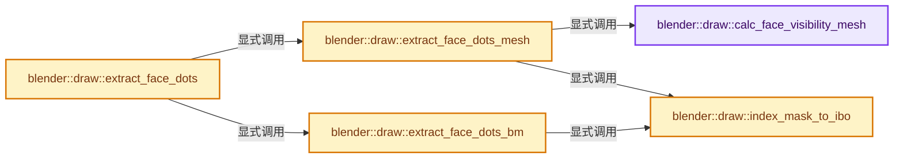
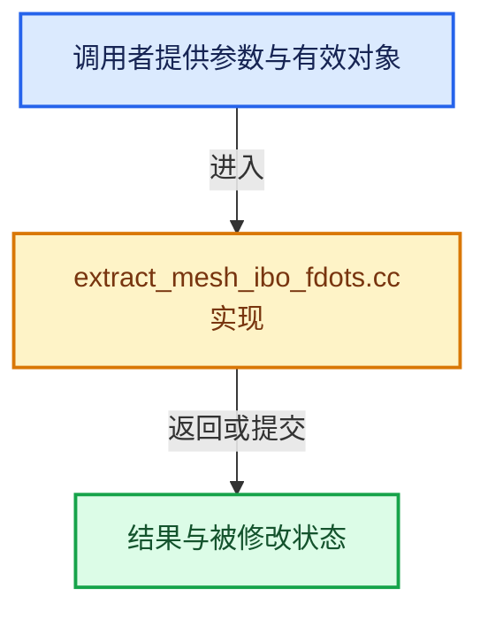

# 实现依赖专题：source/blender/draw/intern/mesh_extractors/extract_mesh_ibo_fdots.cc

[实现依赖导航](../../../../README.md) · [符号索引](../../../../../00-课程指南/02-源码与提交索引/符号依赖与实现索引.md)

本专题从正文实际调用进入，集中保存共享实现。函数有稳定锚点，可从调用处直接跳到对应完整函数；递归与互相调用通过回链组织。

## 本文件的实现关系






## 完整成员与函数实现

<a id="f-86aa0f48f2177f57"></a>

### `blender::draw::calc_face_visibility_mesh`

实现位置：[source/blender/draw/intern/mesh_extractors/extract_mesh_ibo_fdots.cc](../../../../../../../../../source/blender/draw/intern/mesh_extractors/extract_mesh_ibo_fdots.cc) · L15—L33。

接口参数：

- `const MeshRenderData &mr`
- `IndexMaskMemory &memory`

**教学注释版**

<!-- annotated:24b19dda66fd2d -->

```cpp
static IndexMask calc_face_visibility_mesh(const MeshRenderData &mr, IndexMaskMemory &memory)
{
  IndexMask visible(mr.faces_num);
  if (!mr.hide_poly.is_empty()) {
    visible = IndexMask::from_bools_inverse(visible, mr.hide_poly, memory);
  }
  if (mr.use_subsurf_fdots) {
    const OffsetIndices faces = mr.faces;
    const Span<int> corner_verts = mr.corner_verts;
    const BitSpan facedot_tags = mr.mesh->runtime->subsurf_face_dot_tags;
    visible = IndexMask::from_predicate(visible, memory, [&](const int i) {
      // [讲解] corner_verts.slice：建立原连续范围的子视图。
      const Span<int> face_verts = corner_verts.slice(faces[i]);
      // [讲解] face_verts.begin：返回借用范围的地址。
      return std::any_of(face_verts.begin(), face_verts.end(), [&](const int vert) {
        return facedot_tags[vert];
      });
    });
  }
  return visible;
}
```

<details>
<summary>核对原始源码：source/blender/draw/intern/mesh_extractors/extract_mesh_ibo_fdots.cc · L15—L33</summary>

<!-- original:24b19dda66fd2d:source/blender/draw/intern/mesh_extractors/extract_mesh_ibo_fdots.cc:15:33 -->

```cpp
static IndexMask calc_face_visibility_mesh(const MeshRenderData &mr, IndexMaskMemory &memory)
{
  IndexMask visible(mr.faces_num);
  if (!mr.hide_poly.is_empty()) {
    visible = IndexMask::from_bools_inverse(visible, mr.hide_poly, memory);
  }
  if (mr.use_subsurf_fdots) {
    const OffsetIndices faces = mr.faces;
    const Span<int> corner_verts = mr.corner_verts;
    const BitSpan facedot_tags = mr.mesh->runtime->subsurf_face_dot_tags;
    visible = IndexMask::from_predicate(visible, memory, [&](const int i) {
      const Span<int> face_verts = corner_verts.slice(faces[i]);
      return std::any_of(face_verts.begin(), face_verts.end(), [&](const int vert) {
        return facedot_tags[vert];
      });
    });
  }
  return visible;
}
```

</details>

**沿实际写入检查状态**

- `visible = IndexMask::from_bools_inverse(visible, mr.hide_poly, memory);`
- `visible = IndexMask::from_predicate(visible, memory, [&](const int i) {`

**结果出口**

- `return std::any_of(face_verts.begin(), face_verts.end(), [&](const int vert) {`
- `return facedot_tags[vert];`
- `return visible;`

**继续追踪实现**

- `mr.hide_poly.is_empty` → [调用协议](../../../../../00-课程指南/01-路线与规范/模板宏与动态分派协议.md)：接收对象类型依赖auto、返回值或模板实例；不按同名猜测目标。调用位置L18。
- `IndexMask::from_bools_inverse` → [blender::index_mask::IndexMask::from_bools_inverse · L603](../../../../../04-虚拟数组与索引选择/10-IndexMask构建与并行.md#f-96442cca3bb6cc50)；[blender::index_mask::IndexMask::from_bools_inverse · L608](../../../../../04-虚拟数组与索引选择/10-IndexMask构建与并行.md#f-c40b154f402a386c)；[blender::index_mask::IndexMask::from_bools_inverse · L640](../../../../../04-虚拟数组与索引选择/10-IndexMask构建与并行.md#f-f2da3a64e1eb2558)；[blender::index_mask::IndexMask::from_bools_inverse · L668](../../../../../04-虚拟数组与索引选择/10-IndexMask构建与并行.md#f-1975fcd2e2ded5f3)。同名重载需按实参类型选择。
- `IndexMask::from_predicate` → [blender::index_mask::IndexMask::from_predicate · L1073](../../../../../04-虚拟数组与索引选择/12-重构历史与基准练习.md#f-3864daa059098df8)。
- `corner_verts.slice` → [blender::Span::slice · L141](../../../../../01-基础容器与现代CPP/05-Span只读连续视图.md#f-380a0e8fdcbd53cc)；[blender::Span::slice · L149](../../../../../01-基础容器与现代CPP/05-Span只读连续视图.md#f-9b9c15e78dd54eec)。同名重载需按实参类型选择。
- `std::any_of` → [外部契约](https://eel.is/c++draft/)：这个边界按实际表达式及所属类型核对参数、返回值、寿命与失败行为。这里提供接口入口，不声称已解释该第三方版本的内部实现。
- `face_verts.begin` → [blender::Span::begin · L224](../../../../../01-基础容器与现代CPP/05-Span只读连续视图.md#f-415883b512284f46)。
- `face_verts.end` → [blender::Span::end · L228](../../../../../01-基础容器与现代CPP/05-Span只读连续视图.md#f-a7d8b9e494c291a7)。

<a id="f-b4df34bf811bef2f"></a>

### `blender::draw::index_mask_to_ibo`

实现位置：[source/blender/draw/intern/mesh_extractors/extract_mesh_ibo_fdots.cc](../../../../../../../../../source/blender/draw/intern/mesh_extractors/extract_mesh_ibo_fdots.cc) · L35—L43。

接口参数：

- `const IndexMask &mask`

**教学注释版**

<!-- annotated:bc3a78143e82de -->

```cpp
static gpu::IndexBufPtr index_mask_to_ibo(const IndexMask &mask)
{
  const int max_index = mask.min_array_size();
  GPUIndexBufBuilder builder;
  GPU_indexbuf_init(&builder, GPU_PRIM_POINTS, mask.size(), max_index);
  MutableSpan<uint> data = GPU_indexbuf_get_data(&builder);
  // [讲解] data.cast<int>：按类型与布局约束重新解释视图。
  mask.to_indices<int>(data.cast<int>());
  return gpu::IndexBufPtr(GPU_indexbuf_build_ex(&builder, 0, max_index, false));
}
```

<details>
<summary>核对原始源码：source/blender/draw/intern/mesh_extractors/extract_mesh_ibo_fdots.cc · L35—L43</summary>

<!-- original:bc3a78143e82de:source/blender/draw/intern/mesh_extractors/extract_mesh_ibo_fdots.cc:35:43 -->

```cpp
static gpu::IndexBufPtr index_mask_to_ibo(const IndexMask &mask)
{
  const int max_index = mask.min_array_size();
  GPUIndexBufBuilder builder;
  GPU_indexbuf_init(&builder, GPU_PRIM_POINTS, mask.size(), max_index);
  MutableSpan<uint> data = GPU_indexbuf_get_data(&builder);
  mask.to_indices<int>(data.cast<int>());
  return gpu::IndexBufPtr(GPU_indexbuf_build_ex(&builder, 0, max_index, false));
}
```

</details>

**结果出口**

- `return gpu::IndexBufPtr(GPU_indexbuf_build_ex(&builder, 0, max_index, false));`

**继续追踪实现**

- `mask.min_array_size` → [blender::index_mask::IndexMask::min_array_size · L782](../../../../../04-虚拟数组与索引选择/09-分段存储与遍历.md#f-f3a460d74b4fc7d6)。
- `GPU_indexbuf_init` → [blender::GPU_indexbuf_init · L73](../../../gpu/intern/gpu_index_buffer.cc.md#f-adccf0f2321fb073)。
- `mask.size` → [blender::index_mask::IndexMask::size · L743](../../../../../04-虚拟数组与索引选择/09-分段存储与遍历.md#f-0163b32abc9a0d9c)。
- `GPU_indexbuf_get_data` → [blender::GPU_indexbuf_get_data · L96](../../../gpu/intern/gpu_index_buffer.cc.md#f-a5d0d67214a893c0)。
- `mask.to_indices<int>` → [blender::index_mask::IndexMask::to_indices · L1129](../../../../../04-虚拟数组与索引选择/12-重构历史与基准练习.md#f-9821e0729f14f866)；[blender::index_mask::IndexMask::to_indices · L766](../../../../../04-虚拟数组与索引选择/10-IndexMask构建与并行.md#f-7d2f4148b6937424)。同名重载需按实参类型选择。
- `data.cast<int>` → [blender::MutableSpan::cast · L755](../../../../../01-基础容器与现代CPP/06-MutableSpan可写视图.md#f-360354e608371779)。
- `gpu::IndexBufPtr` → [调用协议](../../../../../00-课程指南/01-路线与规范/模板宏与动态分派协议.md)：函数指针、局部可调用对象或未展开的宏；必须结合调用者环境。调用位置L42。
- `GPU_indexbuf_build_ex` → [blender::GPU_indexbuf_build_ex · L473](../../../gpu/intern/gpu_index_buffer.cc.md#f-99e8b36d94dd0581)。

<a id="f-913a342cd4ea1fbf"></a>

### `blender::draw::extract_face_dots_mesh`

实现位置：[source/blender/draw/intern/mesh_extractors/extract_mesh_ibo_fdots.cc](../../../../../../../../../source/blender/draw/intern/mesh_extractors/extract_mesh_ibo_fdots.cc) · L45—L50。

接口参数：

- `const MeshRenderData &mr`

**教学注释版**

<!-- annotated:0a5d1eb3bdcead -->

```cpp
static gpu::IndexBufPtr extract_face_dots_mesh(const MeshRenderData &mr)
{
  IndexMaskMemory memory;
  const IndexMask visible_faces = calc_face_visibility_mesh(mr, memory);
  return index_mask_to_ibo(visible_faces);
}
```

<details>
<summary>核对原始源码：source/blender/draw/intern/mesh_extractors/extract_mesh_ibo_fdots.cc · L45—L50</summary>

<!-- original:0a5d1eb3bdcead:source/blender/draw/intern/mesh_extractors/extract_mesh_ibo_fdots.cc:45:50 -->

```cpp
static gpu::IndexBufPtr extract_face_dots_mesh(const MeshRenderData &mr)
{
  IndexMaskMemory memory;
  const IndexMask visible_faces = calc_face_visibility_mesh(mr, memory);
  return index_mask_to_ibo(visible_faces);
}
```

</details>

**结果出口**

- `return index_mask_to_ibo(visible_faces);`

**继续追踪实现**

- `calc_face_visibility_mesh` → [blender::draw::calc_face_visibility_mesh · L15](extract_mesh_ibo_fdots.cc.md#f-86aa0f48f2177f57)。
- `index_mask_to_ibo` → [blender::draw::index_mask_to_ibo · L35](extract_mesh_ibo_fdots.cc.md#f-b4df34bf811bef2f)。

<a id="f-059c9e1cb996b40e"></a>

### `blender::draw::extract_face_dots_bm`

实现位置：[source/blender/draw/intern/mesh_extractors/extract_mesh_ibo_fdots.cc](../../../../../../../../../source/blender/draw/intern/mesh_extractors/extract_mesh_ibo_fdots.cc) · L52—L61。

接口参数：

- `const MeshRenderData &mr`

**教学注释版**

<!-- annotated:218e449cf06e4a -->

```cpp
static gpu::IndexBufPtr extract_face_dots_bm(const MeshRenderData &mr)
{
  BMesh &bm = *mr.bm;
  IndexMaskMemory memory;
  const IndexMask visible_faces = IndexMask::from_predicate(
      IndexRange(bm.totface), memory, [&](const int i) {
        return !BM_elem_flag_test_bool(BM_face_at_index(&bm, i), BM_ELEM_HIDDEN);
      });
  return index_mask_to_ibo(visible_faces);
}
```

<details>
<summary>核对原始源码：source/blender/draw/intern/mesh_extractors/extract_mesh_ibo_fdots.cc · L52—L61</summary>

<!-- original:218e449cf06e4a:source/blender/draw/intern/mesh_extractors/extract_mesh_ibo_fdots.cc:52:61 -->

```cpp
static gpu::IndexBufPtr extract_face_dots_bm(const MeshRenderData &mr)
{
  BMesh &bm = *mr.bm;
  IndexMaskMemory memory;
  const IndexMask visible_faces = IndexMask::from_predicate(
      IndexRange(bm.totface), memory, [&](const int i) {
        return !BM_elem_flag_test_bool(BM_face_at_index(&bm, i), BM_ELEM_HIDDEN);
      });
  return index_mask_to_ibo(visible_faces);
}
```

</details>

**结果出口**

- `return !BM_elem_flag_test_bool(BM_face_at_index(&bm, i), BM_ELEM_HIDDEN);`
- `return index_mask_to_ibo(visible_faces);`

**继续追踪实现**

- `IndexMask::from_predicate` → [blender::index_mask::IndexMask::from_predicate · L1073](../../../../../04-虚拟数组与索引选择/12-重构历史与基准练习.md#f-3864daa059098df8)。
- `IndexRange` → [blender::IndexRange](../../../../01-BLI基础库/BLI_index_range.hh.md#t-caa3466d6776)；[blender::gpu::shader::parser::IndexRange](../../../gpu/shader_tool/utils.hh.md#t-82d2bd4ea71c)；[blender::IndexRange](../../../makesdna/DNA_node_types.h.md#t-0448cc889d39)。
- `BM_elem_flag_test_bool` → [BM_elem_flag_test_bool · L22](../../../bmesh/intern/bmesh_inline.hh.md#m-a8ef8d976b74)。宏定义由构建条件选择。
- `BM_face_at_index` → [blender::BM_face_at_index · L122](../../../bmesh/intern/bmesh_mesh.hh.md#f-366df62c166d5094)。
- `index_mask_to_ibo` → [blender::draw::index_mask_to_ibo · L35](extract_mesh_ibo_fdots.cc.md#f-b4df34bf811bef2f)。

<a id="f-28c1c09a95f5f3ed"></a>

### `blender::draw::extract_face_dots`

实现位置：[source/blender/draw/intern/mesh_extractors/extract_mesh_ibo_fdots.cc](../../../../../../../../../source/blender/draw/intern/mesh_extractors/extract_mesh_ibo_fdots.cc) · L63—L69。

接口参数：

- `const MeshRenderData &mr`

**教学注释版**

<!-- annotated:13d5f4c1540a98 -->

```cpp
gpu::IndexBufPtr extract_face_dots(const MeshRenderData &mr)
{
  if (mr.extract_type == MeshExtractType::Mesh) {
    return extract_face_dots_mesh(mr);
  }
  return extract_face_dots_bm(mr);
}
```

<details>
<summary>核对原始源码：source/blender/draw/intern/mesh_extractors/extract_mesh_ibo_fdots.cc · L63—L69</summary>

<!-- original:13d5f4c1540a98:source/blender/draw/intern/mesh_extractors/extract_mesh_ibo_fdots.cc:63:69 -->

```cpp
gpu::IndexBufPtr extract_face_dots(const MeshRenderData &mr)
{
  if (mr.extract_type == MeshExtractType::Mesh) {
    return extract_face_dots_mesh(mr);
  }
  return extract_face_dots_bm(mr);
}
```

</details>

**结果出口**

- `return extract_face_dots_mesh(mr);`
- `return extract_face_dots_bm(mr);`

**继续追踪实现**

- `extract_face_dots_mesh` → [blender::draw::extract_face_dots_mesh · L45](extract_mesh_ibo_fdots.cc.md#f-913a342cd4ea1fbf)。
- `extract_face_dots_bm` → [blender::draw::extract_face_dots_bm · L52](extract_mesh_ibo_fdots.cc.md#f-059c9e1cb996b40e)。
