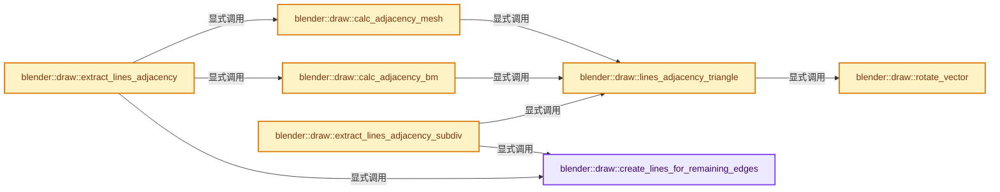
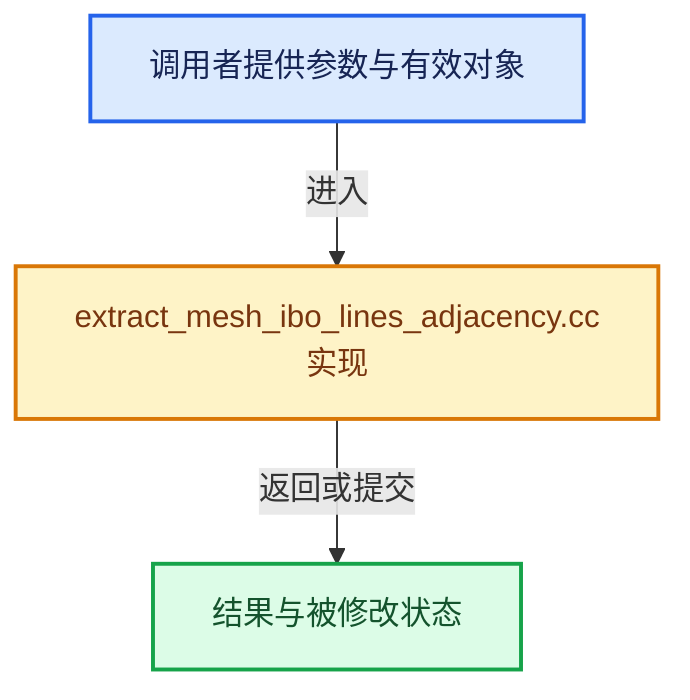

# 实现依赖专题：source/blender/draw/intern/mesh_extractors/extract_mesh_ibo_lines_adjacency.cc

[实现依赖导航](../../../../README.md) · [符号索引](../../../../../00-课程指南/02-源码与提交索引/符号依赖与实现索引.md)

本专题从正文实际调用进入，集中保存共享实现。函数有稳定锚点，可从调用处直接跳到对应完整函数；递归与互相调用通过回链组织。

## 本文件的实现关系






<a id="m-9c7f2eb2f233"></a>

## 宏 `EDGE_IS_UNSET_OR_HANDLED`

<!-- annotated:4e9d7fec5add68 -->

```cpp
#define EDGE_IS_UNSET_OR_HANDLED(i) ((i) >= EDGE_IS_HANDLED)

```

<details>
<summary>核对原始源码：source/blender/draw/intern/mesh_extractors/extract_mesh_ibo_lines_adjacency.cc · L37—L38</summary>

<!-- original:4e9d7fec5add68:source/blender/draw/intern/mesh_extractors/extract_mesh_ibo_lines_adjacency.cc:37:38 -->

```cpp
#define EDGE_IS_UNSET_OR_HANDLED(i) ((i) >= EDGE_IS_HANDLED)

```

</details>

宏在预处理阶段展开，参数替换、重复求值和条件编译应直接从该定义检查。与普通函数不同，宏不会自动提供参数类型检查；构建配置选择哪个定义需结合外围条件。

## 完整成员与函数实现

<a id="f-cc6374a6d90f31b6"></a>

### `blender::draw::create_lines_for_remaining_edges`

实现位置：[source/blender/draw/intern/mesh_extractors/extract_mesh_ibo_lines_adjacency.cc](../../../../../../../../../source/blender/draw/intern/mesh_extractors/extract_mesh_ibo_lines_adjacency.cc) · L39—L62。

接口参数：

- `MutableSpan<int> vert_to_corner`
- `Map<OrderedEdge, int> &edge_hash`
- `GPUIndexBufBuilder &elb`
- `bool &is_manifold`

**教学注释版**

<!-- annotated:d0f64305b3feef -->

```cpp
static void create_lines_for_remaining_edges(MutableSpan<int> vert_to_corner,
                                             Map<OrderedEdge, int> &edge_hash,
                                             GPUIndexBufBuilder &elb,
                                             bool &is_manifold)
{
  for (const auto item : edge_hash.items()) {
    int v_data = item.value;
    if (EDGE_IS_UNSET_OR_HANDLED(v_data)) {
      continue;
    }

    int v2 = item.key.v_low;
    int v3 = item.key.v_high;

    int l1 = uint(abs(v_data)) - 1;
    if (v_data < 0) { /* `inv_opposite`. */
      std::swap(v2, v3);
    }
    int l2 = vert_to_corner[v2];
    int l3 = vert_to_corner[v3];
    GPU_indexbuf_add_line_adj_verts(&elb, l1, l2, l3, l1);
    is_manifold = false;
  }
}
```

<details>
<summary>核对原始源码：source/blender/draw/intern/mesh_extractors/extract_mesh_ibo_lines_adjacency.cc · L39—L62</summary>

<!-- original:d0f64305b3feef:source/blender/draw/intern/mesh_extractors/extract_mesh_ibo_lines_adjacency.cc:39:62 -->

```cpp
static void create_lines_for_remaining_edges(MutableSpan<int> vert_to_corner,
                                             Map<OrderedEdge, int> &edge_hash,
                                             GPUIndexBufBuilder &elb,
                                             bool &is_manifold)
{
  for (const auto item : edge_hash.items()) {
    int v_data = item.value;
    if (EDGE_IS_UNSET_OR_HANDLED(v_data)) {
      continue;
    }

    int v2 = item.key.v_low;
    int v3 = item.key.v_high;

    int l1 = uint(abs(v_data)) - 1;
    if (v_data < 0) { /* `inv_opposite`. */
      std::swap(v2, v3);
    }
    int l2 = vert_to_corner[v2];
    int l3 = vert_to_corner[v3];
    GPU_indexbuf_add_line_adj_verts(&elb, l1, l2, l3, l1);
    is_manifold = false;
  }
}
```

</details>

**沿实际写入检查状态**

- `is_manifold = false;`

**继续追踪实现**

- `edge_hash.items` → [blender::Map::items · L902](../../../../../02-哈希表与关联数据结构/06-删除墓碑与值销毁.md#f-9ef4f6f70cba8f81)；[blender::Map::items · L913](../../../../../02-哈希表与关联数据结构/06-删除墓碑与值销毁.md#f-0a69f4e73db8973e)；[blender::Map::items · L926](../../../../../02-哈希表与关联数据结构/06-删除墓碑与值销毁.md#f-092add737130dcfb)；[blender::Map::items · L927](../../../../../02-哈希表与关联数据结构/06-删除墓碑与值销毁.md#f-4bfc999f60cdede4)。同名重载需按实参类型选择。
- `EDGE_IS_UNSET_OR_HANDLED` → [EDGE_IS_UNSET_OR_HANDLED · L37](extract_mesh_ibo_lines_adjacency.cc.md#m-9c7f2eb2f233)。宏定义由构建条件选择。
- `abs` → [abs · L104](../../../gpu/shaders/compat/gpu_shader_cxx_builtin.hh.md#m-14b5712612c4)。宏定义由构建条件选择。
- `std::swap` → [外部契约](https://eel.is/c++draft/)：这个边界按实际表达式及所属类型核对参数、返回值、寿命与失败行为。这里提供接口入口，不声称已解释该第三方版本的内部实现。
- `GPU_indexbuf_add_line_adj_verts` → [blender::GPU_indexbuf_add_line_adj_verts · L150](../../../gpu/intern/gpu_index_buffer.cc.md#f-cee5a2431f11c84e)。

<a id="f-d3aad2eb05bc752f"></a>

### `blender::draw::rotate_vector`

实现位置：[source/blender/draw/intern/mesh_extractors/extract_mesh_ibo_lines_adjacency.cc](../../../../../../../../../source/blender/draw/intern/mesh_extractors/extract_mesh_ibo_lines_adjacency.cc) · L64—L70。

接口参数：

- `uint3 &value`

**教学注释版**

<!-- annotated:f2d37df802fc8a -->

```cpp
inline void rotate_vector(uint3 &value)
{
  const uint tmp = value[0];
  value[0] = value[2];
  value[2] = value[1];
  value[1] = tmp;
}
```

<details>
<summary>核对原始源码：source/blender/draw/intern/mesh_extractors/extract_mesh_ibo_lines_adjacency.cc · L64—L70</summary>

<!-- original:f2d37df802fc8a:source/blender/draw/intern/mesh_extractors/extract_mesh_ibo_lines_adjacency.cc:64:70 -->

```cpp
inline void rotate_vector(uint3 &value)
{
  const uint tmp = value[0];
  value[0] = value[2];
  value[2] = value[1];
  value[1] = tmp;
}
```

</details>

**沿实际写入检查状态**

- `value[0] = value[2];`
- `value[2] = value[1];`
- `value[1] = tmp;`

**继续追踪实现**

本实现没有需要继续展开的显式调用；检查返回表达式、对象转换和调用者前置条件。

<a id="f-dd933bb7edb7d708"></a>

### `blender::draw::lines_adjacency_triangle`

实现位置：[source/blender/draw/intern/mesh_extractors/extract_mesh_ibo_lines_adjacency.cc](../../../../../../../../../source/blender/draw/intern/mesh_extractors/extract_mesh_ibo_lines_adjacency.cc) · L73—L134。

接口参数：

- `uint3 vert_tri`
- `uint3 corner_tri`
- `MutableSpan<int> vert_to_corner`
- `Map<OrderedEdge, int> &edge_hash`
- `GPUIndexBufBuilder &elb`
- `bool &is_manifold`

**教学注释版**

<!-- annotated:fa1998ca677ffb -->

```cpp
inline void lines_adjacency_triangle(uint3 vert_tri,
                                     uint3 corner_tri,
                                     MutableSpan<int> vert_to_corner,
                                     Map<OrderedEdge, int> &edge_hash,
                                     GPUIndexBufBuilder &elb,
                                     bool &is_manifold)
{
  /* Iterate around the triangle's edges. */
  for (int e = 0; e < 3; e++) {
    rotate_vector(vert_tri);
    rotate_vector(corner_tri);

    bool inv_indices = (vert_tri[1] > vert_tri[2]);
    edge_hash.add_or_modify(
        {vert_tri[1], vert_tri[2]},
        [&](int *value) {
          int new_value = int(corner_tri[0]) + 1; /* 0 cannot be signed so add one. */
          *value = inv_indices ? -new_value : new_value;
          /* Store loop indices for remaining non-manifold edges. */
          vert_to_corner[vert_tri[1]] = corner_tri[1];
          vert_to_corner[vert_tri[2]] = corner_tri[2];
        },
        [&](int *value) {
          int v_data = *value;
          if (v_data == EDGE_IS_UNSET) {
            int new_value = int(corner_tri[0]) + 1; /* 0 cannot be signed so add one. */
            *value = inv_indices ? -new_value : new_value;
            /* Store loop indices for remaining non-manifold edges. */
            vert_to_corner[vert_tri[1]] = corner_tri[1];
            vert_to_corner[vert_tri[2]] = corner_tri[2];
          }
          else if (v_data == EDGE_IS_HANDLED) [[unlikely]] {
            /* Ignore additional faces once this has been handled
             * as this may exceed the pre-sized index buffer: see #150841 & !151084 for details. */

            /* When there are 3+ users of an edge the mesh is not manifold (by definition). */
            is_manifold = false;
          }
          else {
            /* HACK Tag as not used.
             * Prevent overhead of removing from the hash as well as potentially adding
             * the value back in the case more than 2 triangles use this edge. */
            *value = EDGE_IS_HANDLED;
            bool inv_opposite = (v_data < 0);
            const int corner_opposite = abs(v_data) - 1;
            /* TODO: Make this part thread-safe. */
            if (inv_opposite == inv_indices) {
              /* Don't share edge if triangles have non matching winding. */
              GPU_indexbuf_add_line_adj_verts(
                  &elb, corner_tri[0], corner_tri[1], corner_tri[2], corner_tri[0]);
              GPU_indexbuf_add_line_adj_verts(
                  &elb, corner_opposite, corner_tri[1], corner_tri[2], corner_opposite);
              is_manifold = false;
            }
            else {
              GPU_indexbuf_add_line_adj_verts(
                  &elb, corner_tri[0], corner_tri[1], corner_tri[2], corner_opposite);
            }
          }
        });
  }
}
```

<details>
<summary>核对原始源码：source/blender/draw/intern/mesh_extractors/extract_mesh_ibo_lines_adjacency.cc · L73—L134</summary>

<!-- original:fa1998ca677ffb:source/blender/draw/intern/mesh_extractors/extract_mesh_ibo_lines_adjacency.cc:73:134 -->

```cpp
inline void lines_adjacency_triangle(uint3 vert_tri,
                                     uint3 corner_tri,
                                     MutableSpan<int> vert_to_corner,
                                     Map<OrderedEdge, int> &edge_hash,
                                     GPUIndexBufBuilder &elb,
                                     bool &is_manifold)
{
  /* Iterate around the triangle's edges. */
  for (int e = 0; e < 3; e++) {
    rotate_vector(vert_tri);
    rotate_vector(corner_tri);

    bool inv_indices = (vert_tri[1] > vert_tri[2]);
    edge_hash.add_or_modify(
        {vert_tri[1], vert_tri[2]},
        [&](int *value) {
          int new_value = int(corner_tri[0]) + 1; /* 0 cannot be signed so add one. */
          *value = inv_indices ? -new_value : new_value;
          /* Store loop indices for remaining non-manifold edges. */
          vert_to_corner[vert_tri[1]] = corner_tri[1];
          vert_to_corner[vert_tri[2]] = corner_tri[2];
        },
        [&](int *value) {
          int v_data = *value;
          if (v_data == EDGE_IS_UNSET) {
            int new_value = int(corner_tri[0]) + 1; /* 0 cannot be signed so add one. */
            *value = inv_indices ? -new_value : new_value;
            /* Store loop indices for remaining non-manifold edges. */
            vert_to_corner[vert_tri[1]] = corner_tri[1];
            vert_to_corner[vert_tri[2]] = corner_tri[2];
          }
          else if (v_data == EDGE_IS_HANDLED) [[unlikely]] {
            /* Ignore additional faces once this has been handled
             * as this may exceed the pre-sized index buffer: see #150841 & !151084 for details. */

            /* When there are 3+ users of an edge the mesh is not manifold (by definition). */
            is_manifold = false;
          }
          else {
            /* HACK Tag as not used.
             * Prevent overhead of removing from the hash as well as potentially adding
             * the value back in the case more than 2 triangles use this edge. */
            *value = EDGE_IS_HANDLED;
            bool inv_opposite = (v_data < 0);
            const int corner_opposite = abs(v_data) - 1;
            /* TODO: Make this part thread-safe. */
            if (inv_opposite == inv_indices) {
              /* Don't share edge if triangles have non matching winding. */
              GPU_indexbuf_add_line_adj_verts(
                  &elb, corner_tri[0], corner_tri[1], corner_tri[2], corner_tri[0]);
              GPU_indexbuf_add_line_adj_verts(
                  &elb, corner_opposite, corner_tri[1], corner_tri[2], corner_opposite);
              is_manifold = false;
            }
            else {
              GPU_indexbuf_add_line_adj_verts(
                  &elb, corner_tri[0], corner_tri[1], corner_tri[2], corner_opposite);
            }
          }
        });
  }
}
```

</details>

**沿实际写入检查状态**

- `vert_to_corner[vert_tri[1]] = corner_tri[1];`
- `vert_to_corner[vert_tri[2]] = corner_tri[2];`
- `is_manifold = false;`

**继续追踪实现**

- `rotate_vector` → [blender::draw::rotate_vector · L64](extract_mesh_ibo_lines_adjacency.cc.md#f-d3aad2eb05bc752f)。
- `edge_hash.add_or_modify` → [blender::Map::add_or_modify · L480](../../../../../02-哈希表与关联数据结构/04-Map查找与键访问.md#f-eb982d087ea50687)；[blender::Map::add_or_modify · L487](../../../../../02-哈希表与关联数据结构/04-Map查找与键访问.md#f-1811a186397c90d9)。同名重载需按实参类型选择。
- `abs` → [abs · L104](../../../gpu/shaders/compat/gpu_shader_cxx_builtin.hh.md#m-14b5712612c4)。宏定义由构建条件选择。
- `GPU_indexbuf_add_line_adj_verts` → [blender::GPU_indexbuf_add_line_adj_verts · L150](../../../gpu/intern/gpu_index_buffer.cc.md#f-cee5a2431f11c84e)。

<a id="f-d6c25055f42b0a97"></a>

### `blender::draw::calc_adjacency_bm`

实现位置：[source/blender/draw/intern/mesh_extractors/extract_mesh_ibo_lines_adjacency.cc](../../../../../../../../../source/blender/draw/intern/mesh_extractors/extract_mesh_ibo_lines_adjacency.cc) · L136—L158。

接口参数：

- `const MeshRenderData &mr`
- `MutableSpan<int> vert_to_corner`
- `Map<OrderedEdge, int> &edge_hash`
- `GPUIndexBufBuilder &elb`
- `bool &is_manifold`

**教学注释版**

<!-- annotated:d093803ae20db4 -->

```cpp
static void calc_adjacency_bm(const MeshRenderData &mr,
                              MutableSpan<int> vert_to_corner,
                              Map<OrderedEdge, int> &edge_hash,
                              GPUIndexBufBuilder &elb,
                              bool &is_manifold)
{
  const Span<std::array<BMLoop *, 3>> looptris = mr.edit_bmesh->looptris;
  // [讲解] looptris.index_range：查询视图长度或生成对应有效索引区间。
  for (const int i : looptris.index_range()) {
    const std::array<BMLoop *, 3> &tri = looptris[i];
    if (BM_elem_flag_test(tri[0]->f, BM_ELEM_HIDDEN)) {
      continue;
    }
    lines_adjacency_triangle(
        uint3(BM_elem_index_get(tri[0]->v),
              BM_elem_index_get(tri[1]->v),
              BM_elem_index_get(tri[2]->v)),
        uint3(BM_elem_index_get(tri[0]), BM_elem_index_get(tri[1]), BM_elem_index_get(tri[2])),
        vert_to_corner,
        edge_hash,
        elb,
        is_manifold);
  }
}
```

<details>
<summary>核对原始源码：source/blender/draw/intern/mesh_extractors/extract_mesh_ibo_lines_adjacency.cc · L136—L158</summary>

<!-- original:d093803ae20db4:source/blender/draw/intern/mesh_extractors/extract_mesh_ibo_lines_adjacency.cc:136:158 -->

```cpp
static void calc_adjacency_bm(const MeshRenderData &mr,
                              MutableSpan<int> vert_to_corner,
                              Map<OrderedEdge, int> &edge_hash,
                              GPUIndexBufBuilder &elb,
                              bool &is_manifold)
{
  const Span<std::array<BMLoop *, 3>> looptris = mr.edit_bmesh->looptris;
  for (const int i : looptris.index_range()) {
    const std::array<BMLoop *, 3> &tri = looptris[i];
    if (BM_elem_flag_test(tri[0]->f, BM_ELEM_HIDDEN)) {
      continue;
    }
    lines_adjacency_triangle(
        uint3(BM_elem_index_get(tri[0]->v),
              BM_elem_index_get(tri[1]->v),
              BM_elem_index_get(tri[2]->v)),
        uint3(BM_elem_index_get(tri[0]), BM_elem_index_get(tri[1]), BM_elem_index_get(tri[2])),
        vert_to_corner,
        edge_hash,
        elb,
        is_manifold);
  }
}
```

</details>

**继续追踪实现**

- `looptris.index_range` → [blender::Span::index_range · L405](../../../../../01-基础容器与现代CPP/05-Span只读连续视图.md#f-caaa9b06e13e53e0)。
- `BM_elem_flag_test` → [BM_elem_flag_test · L21](../../../bmesh/intern/bmesh_inline.hh.md#m-2431d1179b41)。宏定义由构建条件选择。
- `lines_adjacency_triangle` → [blender::draw::lines_adjacency_triangle · L73](extract_mesh_ibo_lines_adjacency.cc.md#f-dd933bb7edb7d708)。
- `uint3` → [packed_uint3::uint3 · L54](../../../../07-Intern运行时与平台/cycles/util/types_uint3.h.md#f-54e21cc96f356e94)。
- `BM_elem_index_get` → [BM_elem_index_get · L120](../../../bmesh/intern/bmesh_inline.hh.md#m-201981cdc62d)。宏定义由构建条件选择。

<a id="f-867349058e99bd5a"></a>

### `blender::draw::calc_adjacency_mesh`

实现位置：[source/blender/draw/intern/mesh_extractors/extract_mesh_ibo_lines_adjacency.cc](../../../../../../../../../source/blender/draw/intern/mesh_extractors/extract_mesh_ibo_lines_adjacency.cc) · L160—L185。

接口参数：

- `const MeshRenderData &mr`
- `MutableSpan<int> vert_to_corner`
- `Map<OrderedEdge, int> &edge_hash`
- `GPUIndexBufBuilder &elb`
- `bool &is_manifold`

**教学注释版**

<!-- annotated:16742274e6925f -->

```cpp
static void calc_adjacency_mesh(const MeshRenderData &mr,
                                MutableSpan<int> vert_to_corner,
                                Map<OrderedEdge, int> &edge_hash,
                                GPUIndexBufBuilder &elb,
                                bool &is_manifold)
{
  const OffsetIndices faces = mr.faces;
  const Span<int> corner_verts = mr.corner_verts;
  const Span<bool> hide_poly = mr.hide_poly;
  const Span<int3> corner_tris = mr.mesh->corner_tris();
  for (const int face : faces.index_range()) {
    // [讲解] hide_poly.is_empty：查询视图长度或生成对应有效索引区间。
    if (!hide_poly.is_empty() && hide_poly[face]) {
      continue;
    }
    const IndexRange tris = bke::mesh::face_triangles_range(faces, face);
    // [讲解] corner_tris.slice：建立原连续范围的子视图。
    for (const int3 &tri : corner_tris.slice(tris)) {
      lines_adjacency_triangle(
          uint3(corner_verts[tri[0]], corner_verts[tri[1]], corner_verts[tri[2]]),
          uint3(tri),
          vert_to_corner,
          edge_hash,
          elb,
          is_manifold);
    }
  }
}
```

<details>
<summary>核对原始源码：source/blender/draw/intern/mesh_extractors/extract_mesh_ibo_lines_adjacency.cc · L160—L185</summary>

<!-- original:16742274e6925f:source/blender/draw/intern/mesh_extractors/extract_mesh_ibo_lines_adjacency.cc:160:185 -->

```cpp
static void calc_adjacency_mesh(const MeshRenderData &mr,
                                MutableSpan<int> vert_to_corner,
                                Map<OrderedEdge, int> &edge_hash,
                                GPUIndexBufBuilder &elb,
                                bool &is_manifold)
{
  const OffsetIndices faces = mr.faces;
  const Span<int> corner_verts = mr.corner_verts;
  const Span<bool> hide_poly = mr.hide_poly;
  const Span<int3> corner_tris = mr.mesh->corner_tris();
  for (const int face : faces.index_range()) {
    if (!hide_poly.is_empty() && hide_poly[face]) {
      continue;
    }
    const IndexRange tris = bke::mesh::face_triangles_range(faces, face);
    for (const int3 &tri : corner_tris.slice(tris)) {
      lines_adjacency_triangle(
          uint3(corner_verts[tri[0]], corner_verts[tri[1]], corner_verts[tri[2]]),
          uint3(tri),
          vert_to_corner,
          edge_hash,
          elb,
          is_manifold);
    }
  }
}
```

</details>

**继续追踪实现**

- `mr.mesh->corner_tris` → [调用协议](../../../../../00-课程指南/01-路线与规范/模板宏与动态分派协议.md)：接收对象类型依赖auto、返回值或模板实例；不按同名猜测目标。调用位置L169。
- `faces.index_range` → [blender::offset_indices::OffsetIndices::index_range · L77](../../../../../05-几何存储与拓扑映射/02-OffsetIndices完整接口.md#f-19b5ca1456de007d)。
- `hide_poly.is_empty` → [blender::Span::is_empty · L264](../../../../../01-基础容器与现代CPP/05-Span只读连续视图.md#f-8cc1d7ba8feb50e6)。
- `bke::mesh::face_triangles_range` → [blender::bke::mesh::face_triangles_range · L359](../../../../../05-几何存储与拓扑映射/01-Mesh顶点边面角点.md#f-029966d2ab83c686)。
- `corner_tris.slice` → [blender::Span::slice · L141](../../../../../01-基础容器与现代CPP/05-Span只读连续视图.md#f-380a0e8fdcbd53cc)；[blender::Span::slice · L149](../../../../../01-基础容器与现代CPP/05-Span只读连续视图.md#f-9b9c15e78dd54eec)。同名重载需按实参类型选择。
- `lines_adjacency_triangle` → [blender::draw::lines_adjacency_triangle · L73](extract_mesh_ibo_lines_adjacency.cc.md#f-dd933bb7edb7d708)。
- `uint3` → [packed_uint3::uint3 · L54](../../../../07-Intern运行时与平台/cycles/util/types_uint3.h.md#f-54e21cc96f356e94)。

<a id="f-4be16ee52edd348f"></a>

### `blender::draw::extract_lines_adjacency`

实现位置：[source/blender/draw/intern/mesh_extractors/extract_mesh_ibo_lines_adjacency.cc](../../../../../../../../../source/blender/draw/intern/mesh_extractors/extract_mesh_ibo_lines_adjacency.cc) · L187—L213。

接口参数：

- `const MeshRenderData &mr`
- `bool &r_is_manifold`

**教学注释版**

<!-- annotated:a1c879410852a2 -->

```cpp
gpu::IndexBufPtr extract_lines_adjacency(const MeshRenderData &mr, bool &r_is_manifold)
{
  /* Similar to poly_to_tri_count().
   * There is always (loop + triangle - 1) edges inside a face.
   * Accumulate for all faces and you get : */
  const int tess_edge_len = mr.corners_num + mr.corner_tris_num - mr.faces_num;
  Map<OrderedEdge, int> edge_hash;
  // [讲解] edge_hash.reserve：重新组织槽位或准备容量。
  edge_hash.reserve(tess_edge_len);
  Array<int> vert_to_corner(mr.verts_num, 0);
  bool is_manifold = true;

  GPUIndexBufBuilder builder;
  GPU_indexbuf_init(&builder, GPU_PRIM_LINES_ADJ, tess_edge_len, mr.corners_num);

  if (mr.extract_type == MeshExtractType::Mesh) {
    calc_adjacency_mesh(mr, vert_to_corner, edge_hash, builder, is_manifold);
  }
  else {
    calc_adjacency_bm(mr, vert_to_corner, edge_hash, builder, is_manifold);
  }

  create_lines_for_remaining_edges(vert_to_corner, edge_hash, builder, is_manifold);

  r_is_manifold = is_manifold;

  return gpu::IndexBufPtr(GPU_indexbuf_build(&builder));
}
```

<details>
<summary>核对原始源码：source/blender/draw/intern/mesh_extractors/extract_mesh_ibo_lines_adjacency.cc · L187—L213</summary>

<!-- original:a1c879410852a2:source/blender/draw/intern/mesh_extractors/extract_mesh_ibo_lines_adjacency.cc:187:213 -->

```cpp
gpu::IndexBufPtr extract_lines_adjacency(const MeshRenderData &mr, bool &r_is_manifold)
{
  /* Similar to poly_to_tri_count().
   * There is always (loop + triangle - 1) edges inside a face.
   * Accumulate for all faces and you get : */
  const int tess_edge_len = mr.corners_num + mr.corner_tris_num - mr.faces_num;
  Map<OrderedEdge, int> edge_hash;
  edge_hash.reserve(tess_edge_len);
  Array<int> vert_to_corner(mr.verts_num, 0);
  bool is_manifold = true;

  GPUIndexBufBuilder builder;
  GPU_indexbuf_init(&builder, GPU_PRIM_LINES_ADJ, tess_edge_len, mr.corners_num);

  if (mr.extract_type == MeshExtractType::Mesh) {
    calc_adjacency_mesh(mr, vert_to_corner, edge_hash, builder, is_manifold);
  }
  else {
    calc_adjacency_bm(mr, vert_to_corner, edge_hash, builder, is_manifold);
  }

  create_lines_for_remaining_edges(vert_to_corner, edge_hash, builder, is_manifold);

  r_is_manifold = is_manifold;

  return gpu::IndexBufPtr(GPU_indexbuf_build(&builder));
}
```

</details>

**沿实际写入检查状态**

- `r_is_manifold = is_manifold;`

**结果出口**

- `return gpu::IndexBufPtr(GPU_indexbuf_build(&builder));`

**继续追踪实现**

- `edge_hash.reserve` → [blender::Map::reserve · L1028](../../../../../02-哈希表与关联数据结构/06-删除墓碑与值销毁.md#f-03761191d90c03e9)。
- `GPU_indexbuf_init` → [blender::GPU_indexbuf_init · L73](../../../gpu/intern/gpu_index_buffer.cc.md#f-adccf0f2321fb073)。
- `calc_adjacency_mesh` → [blender::draw::calc_adjacency_mesh · L160](extract_mesh_ibo_lines_adjacency.cc.md#f-867349058e99bd5a)。
- `calc_adjacency_bm` → [blender::draw::calc_adjacency_bm · L136](extract_mesh_ibo_lines_adjacency.cc.md#f-d6c25055f42b0a97)。
- `create_lines_for_remaining_edges` → [blender::draw::create_lines_for_remaining_edges · L39](extract_mesh_ibo_lines_adjacency.cc.md#f-cc6374a6d90f31b6)。
- `gpu::IndexBufPtr` → [调用协议](../../../../../00-课程指南/01-路线与规范/模板宏与动态分派协议.md)：函数指针、局部可调用对象或未展开的宏；必须结合调用者环境。调用位置L212。
- `GPU_indexbuf_build` → [blender::GPU_indexbuf_build · L427](../../../gpu/intern/gpu_index_buffer.cc.md#f-f67e34a8860e37a8)。

<a id="f-980afb65312f5067"></a>

### `blender::draw::extract_lines_adjacency_subdiv`

实现位置：[source/blender/draw/intern/mesh_extractors/extract_mesh_ibo_lines_adjacency.cc](../../../../../../../../../source/blender/draw/intern/mesh_extractors/extract_mesh_ibo_lines_adjacency.cc) · L215—L263。

接口参数：

- `const DRWSubdivCache &subdiv_cache`
- `bool &r_is_manifold`

**教学注释版**

<!-- annotated:feb8dace538a75 -->

```cpp
gpu::IndexBufPtr extract_lines_adjacency_subdiv(const DRWSubdivCache &subdiv_cache,
                                                bool &r_is_manifold)
{
  /* For each face there is (loop + triangle - 1) edges. Since we only have quads, and a quad
   * is split into 2 triangles, we have (loop + 2 - 1) = (loop + 1) edges for each quad, or in
   * total: (number_of_loops + number_of_quads). */
  const uint tess_edge_len = subdiv_cache.num_subdiv_loops + subdiv_cache.num_subdiv_quads;

  Array<int> vert_to_corner(subdiv_cache.num_subdiv_verts, 0);
  Map<OrderedEdge, int> edge_hash;
  // [讲解] edge_hash.reserve：重新组织槽位或准备容量。
  edge_hash.reserve(tess_edge_len);

  bool is_manifold = true;

  GPUIndexBufBuilder builder;
  GPU_indexbuf_init(&builder, GPU_PRIM_LINES_ADJ, tess_edge_len, subdiv_cache.num_subdiv_loops);

  for (const int subdiv_quad_index : IndexRange(subdiv_cache.num_subdiv_quads)) {
    const uint loop_index = subdiv_quad_index * 4;
    const uint corner_0 = loop_index + 0;
    const uint corner_1 = loop_index + 1;
    const uint corner_2 = loop_index + 2;
    const uint corner_3 = loop_index + 3;

    const uint vert_0 = subdiv_cache.subdiv_loop_subdiv_vert_index[corner_0];
    const uint vert_1 = subdiv_cache.subdiv_loop_subdiv_vert_index[corner_1];
    const uint vert_2 = subdiv_cache.subdiv_loop_subdiv_vert_index[corner_2];
    const uint vert_3 = subdiv_cache.subdiv_loop_subdiv_vert_index[corner_3];

    lines_adjacency_triangle({vert_0, vert_1, vert_2},
                             {corner_0, corner_1, corner_2},
                             vert_to_corner,
                             edge_hash,
                             builder,
                             is_manifold);
    lines_adjacency_triangle({vert_0, vert_2, vert_3},
                             {corner_0, corner_2, corner_3},
                             vert_to_corner,
                             edge_hash,
                             builder,
                             is_manifold);
  }

  create_lines_for_remaining_edges(vert_to_corner, edge_hash, builder, is_manifold);

  r_is_manifold = is_manifold;

  return gpu::IndexBufPtr(GPU_indexbuf_build(&builder));
}
```

<details>
<summary>核对原始源码：source/blender/draw/intern/mesh_extractors/extract_mesh_ibo_lines_adjacency.cc · L215—L263</summary>

<!-- original:feb8dace538a75:source/blender/draw/intern/mesh_extractors/extract_mesh_ibo_lines_adjacency.cc:215:263 -->

```cpp
gpu::IndexBufPtr extract_lines_adjacency_subdiv(const DRWSubdivCache &subdiv_cache,
                                                bool &r_is_manifold)
{
  /* For each face there is (loop + triangle - 1) edges. Since we only have quads, and a quad
   * is split into 2 triangles, we have (loop + 2 - 1) = (loop + 1) edges for each quad, or in
   * total: (number_of_loops + number_of_quads). */
  const uint tess_edge_len = subdiv_cache.num_subdiv_loops + subdiv_cache.num_subdiv_quads;

  Array<int> vert_to_corner(subdiv_cache.num_subdiv_verts, 0);
  Map<OrderedEdge, int> edge_hash;
  edge_hash.reserve(tess_edge_len);

  bool is_manifold = true;

  GPUIndexBufBuilder builder;
  GPU_indexbuf_init(&builder, GPU_PRIM_LINES_ADJ, tess_edge_len, subdiv_cache.num_subdiv_loops);

  for (const int subdiv_quad_index : IndexRange(subdiv_cache.num_subdiv_quads)) {
    const uint loop_index = subdiv_quad_index * 4;
    const uint corner_0 = loop_index + 0;
    const uint corner_1 = loop_index + 1;
    const uint corner_2 = loop_index + 2;
    const uint corner_3 = loop_index + 3;

    const uint vert_0 = subdiv_cache.subdiv_loop_subdiv_vert_index[corner_0];
    const uint vert_1 = subdiv_cache.subdiv_loop_subdiv_vert_index[corner_1];
    const uint vert_2 = subdiv_cache.subdiv_loop_subdiv_vert_index[corner_2];
    const uint vert_3 = subdiv_cache.subdiv_loop_subdiv_vert_index[corner_3];

    lines_adjacency_triangle({vert_0, vert_1, vert_2},
                             {corner_0, corner_1, corner_2},
                             vert_to_corner,
                             edge_hash,
                             builder,
                             is_manifold);
    lines_adjacency_triangle({vert_0, vert_2, vert_3},
                             {corner_0, corner_2, corner_3},
                             vert_to_corner,
                             edge_hash,
                             builder,
                             is_manifold);
  }

  create_lines_for_remaining_edges(vert_to_corner, edge_hash, builder, is_manifold);

  r_is_manifold = is_manifold;

  return gpu::IndexBufPtr(GPU_indexbuf_build(&builder));
}
```

</details>

**沿实际写入检查状态**

- `r_is_manifold = is_manifold;`

**结果出口**

- `return gpu::IndexBufPtr(GPU_indexbuf_build(&builder));`

**继续追踪实现**

- `edge_hash.reserve` → [blender::Map::reserve · L1028](../../../../../02-哈希表与关联数据结构/06-删除墓碑与值销毁.md#f-03761191d90c03e9)。
- `GPU_indexbuf_init` → [blender::GPU_indexbuf_init · L73](../../../gpu/intern/gpu_index_buffer.cc.md#f-adccf0f2321fb073)。
- `IndexRange` → [blender::IndexRange](../../../../01-BLI基础库/BLI_index_range.hh.md#t-caa3466d6776)；[blender::gpu::shader::parser::IndexRange](../../../gpu/shader_tool/utils.hh.md#t-82d2bd4ea71c)；[blender::IndexRange](../../../makesdna/DNA_node_types.h.md#t-0448cc889d39)。
- `lines_adjacency_triangle` → [blender::draw::lines_adjacency_triangle · L73](extract_mesh_ibo_lines_adjacency.cc.md#f-dd933bb7edb7d708)。
- `create_lines_for_remaining_edges` → [blender::draw::create_lines_for_remaining_edges · L39](extract_mesh_ibo_lines_adjacency.cc.md#f-cc6374a6d90f31b6)。
- `gpu::IndexBufPtr` → [调用协议](../../../../../00-课程指南/01-路线与规范/模板宏与动态分派协议.md)：函数指针、局部可调用对象或未展开的宏；必须结合调用者环境。调用位置L262。
- `GPU_indexbuf_build` → [blender::GPU_indexbuf_build · L427](../../../gpu/intern/gpu_index_buffer.cc.md#f-f67e34a8860e37a8)。
