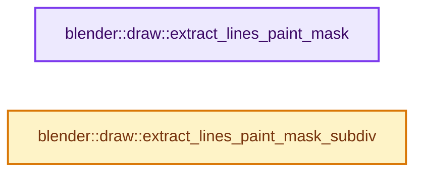
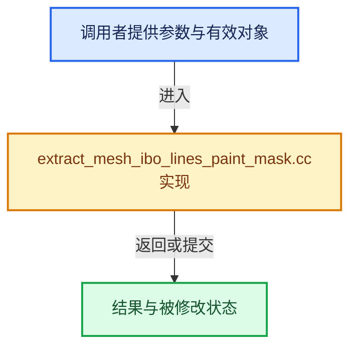

# 实现依赖专题：source/blender/draw/intern/mesh_extractors/extract_mesh_ibo_lines_paint_mask.cc

[实现依赖导航](../../../../README.md) · [符号索引](../../../../../00-课程指南/02-源码与提交索引/符号依赖与实现索引.md)

本专题从正文实际调用进入，集中保存共享实现。函数有稳定锚点，可从调用处直接跳到对应完整函数；递归与互相调用通过回链组织。

## 本文件的实现关系






## 完整成员与函数实现

<a id="f-e3a70089d3ed9c76"></a>

### `blender::draw::extract_lines_paint_mask`

实现位置：[source/blender/draw/intern/mesh_extractors/extract_mesh_ibo_lines_paint_mask.cc](../../../../../../../../../source/blender/draw/intern/mesh_extractors/extract_mesh_ibo_lines_paint_mask.cc) · L21—L72。

接口参数：

- `const MeshRenderData &mr`

**教学注释版**

<!-- annotated:60b56fd87fdd00 -->

```cpp
gpu::IndexBufPtr extract_lines_paint_mask(const MeshRenderData &mr)
{
  const OffsetIndices faces = mr.faces;
  const Span<int> corner_edges = mr.corner_edges;
  const Span<bool> hide_edge = mr.hide_edge;
  const Span<bool> select_poly = mr.select_poly;
  const Span<int> orig_index_edge = mr.orig_index_edge ?
                                        Span<int>(mr.orig_index_edge, mr.edges_num) :
                                        Span<int>();

  GPUIndexBufBuilder builder;
  const int max_index = mr.corners_num;
  GPU_indexbuf_init(&builder, GPU_PRIM_LINES, mr.edges_num, max_index);
  MutableSpan<uint2> data = GPU_indexbuf_get_data(&builder).cast<uint2>();

  BLI_bitmap *select_map = BLI_BITMAP_NEW(mr.edges_num, __func__);
  threading::parallel_for(faces.index_range(), 1024, [&](const IndexRange range) {
    for (const int face_index : range) {
      const IndexRange face = faces[face_index];
      for (const int corner : face) {
        const int edge = corner_edges[corner];
        // [讲解] hide_edge.is_empty：查询视图长度或生成对应有效索引区间。
        if ((!hide_edge.is_empty() && hide_edge[edge]) ||
            (!orig_index_edge.is_empty() && (orig_index_edge[edge] == ORIGINDEX_NONE)))
        {
          data[edge] = uint2(gpu::RESTART_INDEX);
          continue;
        }

        const int corner_next = bke::mesh::face_corner_next(face, corner);
        if (!select_poly.is_empty() && select_poly[face_index]) {
          if (BLI_BITMAP_TEST_AND_SET_ATOMIC(select_map, edge)) {
            /* Hide edge as it has more than 2 selected loop. */
            data[edge] = uint2(gpu::RESTART_INDEX);
          }
          else {
            /* First selected loop. Set edge visible, overwriting any unselected loop. */
            data[edge] = uint2(corner, corner_next);
          }
        }
        else {
          /* Set these unselected loop only if this edge has no other selected loop. */
          if (!BLI_BITMAP_TEST(select_map, edge)) {
            data[edge] = uint2(corner, corner_next);
          }
        }
      }
    }
  });

  MEM_delete(select_map);
  return gpu::IndexBufPtr(GPU_indexbuf_build_ex(&builder, 0, max_index, true));
}
```

<details>
<summary>核对原始源码：source/blender/draw/intern/mesh_extractors/extract_mesh_ibo_lines_paint_mask.cc · L21—L72</summary>

<!-- original:60b56fd87fdd00:source/blender/draw/intern/mesh_extractors/extract_mesh_ibo_lines_paint_mask.cc:21:72 -->

```cpp
gpu::IndexBufPtr extract_lines_paint_mask(const MeshRenderData &mr)
{
  const OffsetIndices faces = mr.faces;
  const Span<int> corner_edges = mr.corner_edges;
  const Span<bool> hide_edge = mr.hide_edge;
  const Span<bool> select_poly = mr.select_poly;
  const Span<int> orig_index_edge = mr.orig_index_edge ?
                                        Span<int>(mr.orig_index_edge, mr.edges_num) :
                                        Span<int>();

  GPUIndexBufBuilder builder;
  const int max_index = mr.corners_num;
  GPU_indexbuf_init(&builder, GPU_PRIM_LINES, mr.edges_num, max_index);
  MutableSpan<uint2> data = GPU_indexbuf_get_data(&builder).cast<uint2>();

  BLI_bitmap *select_map = BLI_BITMAP_NEW(mr.edges_num, __func__);
  threading::parallel_for(faces.index_range(), 1024, [&](const IndexRange range) {
    for (const int face_index : range) {
      const IndexRange face = faces[face_index];
      for (const int corner : face) {
        const int edge = corner_edges[corner];
        if ((!hide_edge.is_empty() && hide_edge[edge]) ||
            (!orig_index_edge.is_empty() && (orig_index_edge[edge] == ORIGINDEX_NONE)))
        {
          data[edge] = uint2(gpu::RESTART_INDEX);
          continue;
        }

        const int corner_next = bke::mesh::face_corner_next(face, corner);
        if (!select_poly.is_empty() && select_poly[face_index]) {
          if (BLI_BITMAP_TEST_AND_SET_ATOMIC(select_map, edge)) {
            /* Hide edge as it has more than 2 selected loop. */
            data[edge] = uint2(gpu::RESTART_INDEX);
          }
          else {
            /* First selected loop. Set edge visible, overwriting any unselected loop. */
            data[edge] = uint2(corner, corner_next);
          }
        }
        else {
          /* Set these unselected loop only if this edge has no other selected loop. */
          if (!BLI_BITMAP_TEST(select_map, edge)) {
            data[edge] = uint2(corner, corner_next);
          }
        }
      }
    }
  });

  MEM_delete(select_map);
  return gpu::IndexBufPtr(GPU_indexbuf_build_ex(&builder, 0, max_index, true));
}
```

</details>

**沿实际写入检查状态**

- `data[edge] = uint2(gpu::RESTART_INDEX);`
- `data[edge] = uint2(corner, corner_next);`

**结果出口**

- `return gpu::IndexBufPtr(GPU_indexbuf_build_ex(&builder, 0, max_index, true));`

**继续追踪实现**

- `Span<int>` → [blender::Span](../../../../01-BLI基础库/BLI_span.hh.md#t-8765a8e0c1d5)；[blender::Span](../../../../01-BLI基础库/BLI_index_range.hh.md#t-86091874a1c0)；[blender::Span](../../../makesdna/DNA_pointcloud_types.h.md#t-112aa6ed842c)；[blender::Span](../../../makesdna/DNA_node_types.h.md#t-49ec6fbb9b69)；[blender::Span](../../../makesdna/DNA_mesh_types.h.md#t-184fd48fb638)；[blender::Span](../../../makesdna/DNA_anim_types.h.md#t-d841071994c2)；[blender::Span](../../../makesrna/RNA_path_fwd.hh.md#t-4dbb08969e41)。
- `GPU_indexbuf_init` → [blender::GPU_indexbuf_init · L73](../../../gpu/intern/gpu_index_buffer.cc.md#f-adccf0f2321fb073)。
- `GPU_indexbuf_get_data(&builder).cast<uint2>` → [调用协议](../../../../../00-课程指南/01-路线与规范/模板宏与动态分派协议.md)：接收对象类型依赖auto、返回值或模板实例；不按同名猜测目标。调用位置L34。
- `GPU_indexbuf_get_data` → [blender::GPU_indexbuf_get_data · L96](../../../gpu/intern/gpu_index_buffer.cc.md#f-a5d0d67214a893c0)。
- `BLI_BITMAP_NEW` → [BLI_BITMAP_NEW · L39](../../../../01-BLI基础库/BLI_bitmap.hh.md#m-77dce9cd8859)。宏定义由构建条件选择。
- `threading::parallel_for` → [blender::threading::parallel_for · L68](../../../../../11-Depsgraph与并行任务系统/07-任务池与TBB接入.md#f-838294754c24426c)。
- `faces.index_range` → [blender::offset_indices::OffsetIndices::index_range · L77](../../../../../05-几何存储与拓扑映射/02-OffsetIndices完整接口.md#f-19b5ca1456de007d)。
- `hide_edge.is_empty` → [blender::Span::is_empty · L264](../../../../../01-基础容器与现代CPP/05-Span只读连续视图.md#f-8cc1d7ba8feb50e6)。
- `orig_index_edge.is_empty` → [blender::Span::is_empty · L264](../../../../../01-基础容器与现代CPP/05-Span只读连续视图.md#f-8cc1d7ba8feb50e6)。
- `uint2` → [uint2](../../../../07-Intern运行时与平台/cycles/util/types_uint2.h.md#t-acfae85419d8)。
- `bke::mesh::face_corner_next` → [blender::bke::mesh::face_corner_next · L315](../../../../../05-几何存储与拓扑映射/01-Mesh顶点边面角点.md#f-bf639df87b51fe48)。
- `select_poly.is_empty` → [blender::Span::is_empty · L264](../../../../../01-基础容器与现代CPP/05-Span只读连续视图.md#f-8cc1d7ba8feb50e6)。
- `BLI_BITMAP_TEST_AND_SET_ATOMIC` → [BLI_BITMAP_TEST_AND_SET_ATOMIC · L67](../../../../01-BLI基础库/BLI_bitmap.hh.md#m-c7ffdd0cf0e7)。宏定义由构建条件选择。
- `BLI_BITMAP_TEST` → [BLI_BITMAP_TEST · L63](../../../../01-BLI基础库/BLI_bitmap.hh.md#m-631c4702a77d)。宏定义由构建条件选择。
- `MEM_delete` → [MEM_delete · L400](../../../../07-Intern运行时与平台/guardedalloc/MEM_guardedalloc.h.md#f-9049ffdd1682887c)。
- `gpu::IndexBufPtr` → [调用协议](../../../../../00-课程指南/01-路线与规范/模板宏与动态分派协议.md)：函数指针、局部可调用对象或未展开的宏；必须结合调用者环境。调用位置L71。
- `GPU_indexbuf_build_ex` → [blender::GPU_indexbuf_build_ex · L473](../../../gpu/intern/gpu_index_buffer.cc.md#f-99e8b36d94dd0581)。

<a id="f-8094bc5bbf122e2f"></a>

### `blender::draw::extract_lines_paint_mask_subdiv`

实现位置：[source/blender/draw/intern/mesh_extractors/extract_mesh_ibo_lines_paint_mask.cc](../../../../../../../../../source/blender/draw/intern/mesh_extractors/extract_mesh_ibo_lines_paint_mask.cc) · L74—L137。

接口参数：

- `const MeshRenderData &mr`
- `const DRWSubdivCache &subdiv_cache`

**教学注释版**

<!-- annotated:3aa5e812550a13 -->

```cpp
gpu::IndexBufPtr extract_lines_paint_mask_subdiv(const MeshRenderData &mr,
                                                 const DRWSubdivCache &subdiv_cache)
{
  const Span<bool> hide_edge = mr.hide_edge;
  const Span<bool> select_poly = mr.select_poly;
  const Span<int> orig_index_edge = mr.orig_index_edge ?
                                        Span<int>(mr.orig_index_edge, mr.edges_num) :
                                        Span<int>();
  const Span<int> subdiv_loop_face_index(subdiv_cache.subdiv_loop_face_index,
                                         subdiv_cache.num_subdiv_loops);
  const Span<int> subdiv_loop_subdiv_edge_index(subdiv_cache.subdiv_loop_subdiv_edge_index,
                                                subdiv_cache.num_subdiv_loops);
  const Span<int> subdiv_loop_edge_index = subdiv_cache.edges_orig_index->data<int>();

  GPUIndexBufBuilder builder;
  const int max_index = subdiv_cache.num_subdiv_loops;
  GPU_indexbuf_init(&builder, GPU_PRIM_LINES, subdiv_cache.num_subdiv_edges, max_index);
  MutableSpan<uint2> data = GPU_indexbuf_get_data(&builder).cast<uint2>();

  BLI_bitmap *select_map = BLI_BITMAP_NEW(mr.edges_num, __func__);
  const int quads_num = subdiv_cache.num_subdiv_quads;
  threading::parallel_for(IndexRange(quads_num), 4096, [&](const IndexRange range) {
    for (const int subdiv_quad_index : range) {
      const int coarse_quad_index = subdiv_loop_face_index[subdiv_quad_index * 4];
      const IndexRange subdiv_face(subdiv_quad_index * 4, 4);
      for (const int corner : subdiv_face) {
        const uint coarse_edge_index = uint(subdiv_loop_edge_index[corner]);
        const uint subdiv_edge_index = uint(subdiv_loop_subdiv_edge_index[corner]);
        if (coarse_edge_index == -1u) {
          data[subdiv_edge_index] = uint2(gpu::RESTART_INDEX);
          continue;
        }
        // [讲解] hide_edge.is_empty：查询视图长度或生成对应有效索引区间。
        if ((!hide_edge.is_empty() && hide_edge[coarse_edge_index]) ||
            (!orig_index_edge.is_empty() &&
             (orig_index_edge[coarse_edge_index] == ORIGINDEX_NONE)))
        {
          data[subdiv_edge_index] = uint2(gpu::RESTART_INDEX);
          continue;
        }

        const int corner_next = bke::mesh::face_corner_next(subdiv_face, corner);
        if (!select_poly.is_empty() && select_poly[coarse_quad_index]) {
          if (BLI_BITMAP_TEST_AND_SET_ATOMIC(select_map, coarse_edge_index)) {
            /* Hide edge as it has more than 2 selected loop. */
            data[subdiv_edge_index] = uint2(gpu::RESTART_INDEX);
          }
          else {
            /* First selected loop. Set edge visible, overwriting any unselected loop. */
            data[subdiv_edge_index] = uint2(corner, corner_next);
          }
        }
        else {
          /* Set these unselected loop only if this edge has no other selected loop. */
          if (!BLI_BITMAP_TEST(select_map, coarse_edge_index)) {
            data[subdiv_edge_index] = uint2(corner, corner_next);
          }
        }
      }
    }
  });

  MEM_delete(select_map);
  return gpu::IndexBufPtr(GPU_indexbuf_build_ex(&builder, 0, max_index, true));
}
```

<details>
<summary>核对原始源码：source/blender/draw/intern/mesh_extractors/extract_mesh_ibo_lines_paint_mask.cc · L74—L137</summary>

<!-- original:3aa5e812550a13:source/blender/draw/intern/mesh_extractors/extract_mesh_ibo_lines_paint_mask.cc:74:137 -->

```cpp
gpu::IndexBufPtr extract_lines_paint_mask_subdiv(const MeshRenderData &mr,
                                                 const DRWSubdivCache &subdiv_cache)
{
  const Span<bool> hide_edge = mr.hide_edge;
  const Span<bool> select_poly = mr.select_poly;
  const Span<int> orig_index_edge = mr.orig_index_edge ?
                                        Span<int>(mr.orig_index_edge, mr.edges_num) :
                                        Span<int>();
  const Span<int> subdiv_loop_face_index(subdiv_cache.subdiv_loop_face_index,
                                         subdiv_cache.num_subdiv_loops);
  const Span<int> subdiv_loop_subdiv_edge_index(subdiv_cache.subdiv_loop_subdiv_edge_index,
                                                subdiv_cache.num_subdiv_loops);
  const Span<int> subdiv_loop_edge_index = subdiv_cache.edges_orig_index->data<int>();

  GPUIndexBufBuilder builder;
  const int max_index = subdiv_cache.num_subdiv_loops;
  GPU_indexbuf_init(&builder, GPU_PRIM_LINES, subdiv_cache.num_subdiv_edges, max_index);
  MutableSpan<uint2> data = GPU_indexbuf_get_data(&builder).cast<uint2>();

  BLI_bitmap *select_map = BLI_BITMAP_NEW(mr.edges_num, __func__);
  const int quads_num = subdiv_cache.num_subdiv_quads;
  threading::parallel_for(IndexRange(quads_num), 4096, [&](const IndexRange range) {
    for (const int subdiv_quad_index : range) {
      const int coarse_quad_index = subdiv_loop_face_index[subdiv_quad_index * 4];
      const IndexRange subdiv_face(subdiv_quad_index * 4, 4);
      for (const int corner : subdiv_face) {
        const uint coarse_edge_index = uint(subdiv_loop_edge_index[corner]);
        const uint subdiv_edge_index = uint(subdiv_loop_subdiv_edge_index[corner]);
        if (coarse_edge_index == -1u) {
          data[subdiv_edge_index] = uint2(gpu::RESTART_INDEX);
          continue;
        }
        if ((!hide_edge.is_empty() && hide_edge[coarse_edge_index]) ||
            (!orig_index_edge.is_empty() &&
             (orig_index_edge[coarse_edge_index] == ORIGINDEX_NONE)))
        {
          data[subdiv_edge_index] = uint2(gpu::RESTART_INDEX);
          continue;
        }

        const int corner_next = bke::mesh::face_corner_next(subdiv_face, corner);
        if (!select_poly.is_empty() && select_poly[coarse_quad_index]) {
          if (BLI_BITMAP_TEST_AND_SET_ATOMIC(select_map, coarse_edge_index)) {
            /* Hide edge as it has more than 2 selected loop. */
            data[subdiv_edge_index] = uint2(gpu::RESTART_INDEX);
          }
          else {
            /* First selected loop. Set edge visible, overwriting any unselected loop. */
            data[subdiv_edge_index] = uint2(corner, corner_next);
          }
        }
        else {
          /* Set these unselected loop only if this edge has no other selected loop. */
          if (!BLI_BITMAP_TEST(select_map, coarse_edge_index)) {
            data[subdiv_edge_index] = uint2(corner, corner_next);
          }
        }
      }
    }
  });

  MEM_delete(select_map);
  return gpu::IndexBufPtr(GPU_indexbuf_build_ex(&builder, 0, max_index, true));
}
```

</details>

**沿实际写入检查状态**

- `data[subdiv_edge_index] = uint2(gpu::RESTART_INDEX);`
- `data[subdiv_edge_index] = uint2(corner, corner_next);`

**结果出口**

- `return gpu::IndexBufPtr(GPU_indexbuf_build_ex(&builder, 0, max_index, true));`

**继续追踪实现**

- `Span<int>` → [blender::Span](../../../../01-BLI基础库/BLI_span.hh.md#t-8765a8e0c1d5)；[blender::Span](../../../../01-BLI基础库/BLI_index_range.hh.md#t-86091874a1c0)；[blender::Span](../../../makesdna/DNA_pointcloud_types.h.md#t-112aa6ed842c)；[blender::Span](../../../makesdna/DNA_node_types.h.md#t-49ec6fbb9b69)；[blender::Span](../../../makesdna/DNA_mesh_types.h.md#t-184fd48fb638)；[blender::Span](../../../makesdna/DNA_anim_types.h.md#t-d841071994c2)；[blender::Span](../../../makesrna/RNA_path_fwd.hh.md#t-4dbb08969e41)。
- `subdiv_cache.edges_orig_index->data<int>` → [调用协议](../../../../../00-课程指南/01-路线与规范/模板宏与动态分派协议.md)：接收对象类型依赖auto、返回值或模板实例；不按同名猜测目标。调用位置L86。
- `GPU_indexbuf_init` → [blender::GPU_indexbuf_init · L73](../../../gpu/intern/gpu_index_buffer.cc.md#f-adccf0f2321fb073)。
- `GPU_indexbuf_get_data(&builder).cast<uint2>` → [调用协议](../../../../../00-课程指南/01-路线与规范/模板宏与动态分派协议.md)：接收对象类型依赖auto、返回值或模板实例；不按同名猜测目标。调用位置L91。
- `GPU_indexbuf_get_data` → [blender::GPU_indexbuf_get_data · L96](../../../gpu/intern/gpu_index_buffer.cc.md#f-a5d0d67214a893c0)。
- `BLI_BITMAP_NEW` → [BLI_BITMAP_NEW · L39](../../../../01-BLI基础库/BLI_bitmap.hh.md#m-77dce9cd8859)。宏定义由构建条件选择。
- `threading::parallel_for` → [blender::threading::parallel_for · L68](../../../../../11-Depsgraph与并行任务系统/07-任务池与TBB接入.md#f-838294754c24426c)。
- `IndexRange` → [blender::IndexRange](../../../../01-BLI基础库/BLI_index_range.hh.md#t-caa3466d6776)；[blender::gpu::shader::parser::IndexRange](../../../gpu/shader_tool/utils.hh.md#t-82d2bd4ea71c)；[blender::IndexRange](../../../makesdna/DNA_node_types.h.md#t-0448cc889d39)。
- `uint2` → [uint2](../../../../07-Intern运行时与平台/cycles/util/types_uint2.h.md#t-acfae85419d8)。
- `hide_edge.is_empty` → [blender::Span::is_empty · L264](../../../../../01-基础容器与现代CPP/05-Span只读连续视图.md#f-8cc1d7ba8feb50e6)。
- `orig_index_edge.is_empty` → [blender::Span::is_empty · L264](../../../../../01-基础容器与现代CPP/05-Span只读连续视图.md#f-8cc1d7ba8feb50e6)。
- `bke::mesh::face_corner_next` → [blender::bke::mesh::face_corner_next · L315](../../../../../05-几何存储与拓扑映射/01-Mesh顶点边面角点.md#f-bf639df87b51fe48)。
- `select_poly.is_empty` → [blender::Span::is_empty · L264](../../../../../01-基础容器与现代CPP/05-Span只读连续视图.md#f-8cc1d7ba8feb50e6)。
- `BLI_BITMAP_TEST_AND_SET_ATOMIC` → [BLI_BITMAP_TEST_AND_SET_ATOMIC · L67](../../../../01-BLI基础库/BLI_bitmap.hh.md#m-c7ffdd0cf0e7)。宏定义由构建条件选择。
- `BLI_BITMAP_TEST` → [BLI_BITMAP_TEST · L63](../../../../01-BLI基础库/BLI_bitmap.hh.md#m-631c4702a77d)。宏定义由构建条件选择。
- `MEM_delete` → [MEM_delete · L400](../../../../07-Intern运行时与平台/guardedalloc/MEM_guardedalloc.h.md#f-9049ffdd1682887c)。
- `gpu::IndexBufPtr` → [调用协议](../../../../../00-课程指南/01-路线与规范/模板宏与动态分派协议.md)：函数指针、局部可调用对象或未展开的宏；必须结合调用者环境。调用位置L136。
- `GPU_indexbuf_build_ex` → [blender::GPU_indexbuf_build_ex · L473](../../../gpu/intern/gpu_index_buffer.cc.md#f-99e8b36d94dd0581)。
